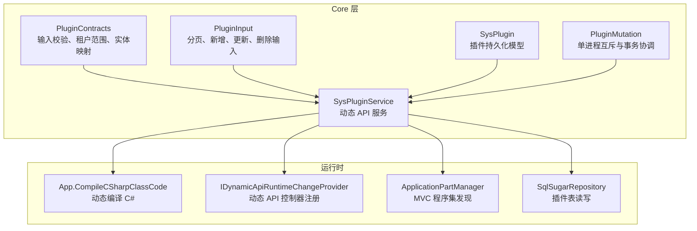
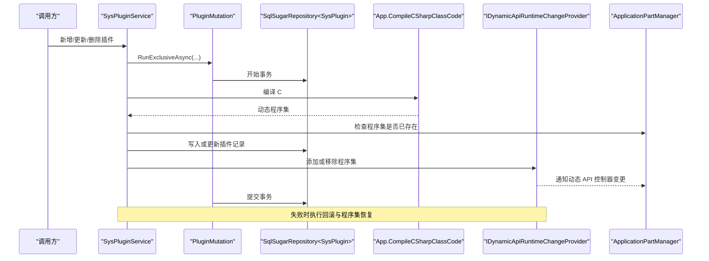
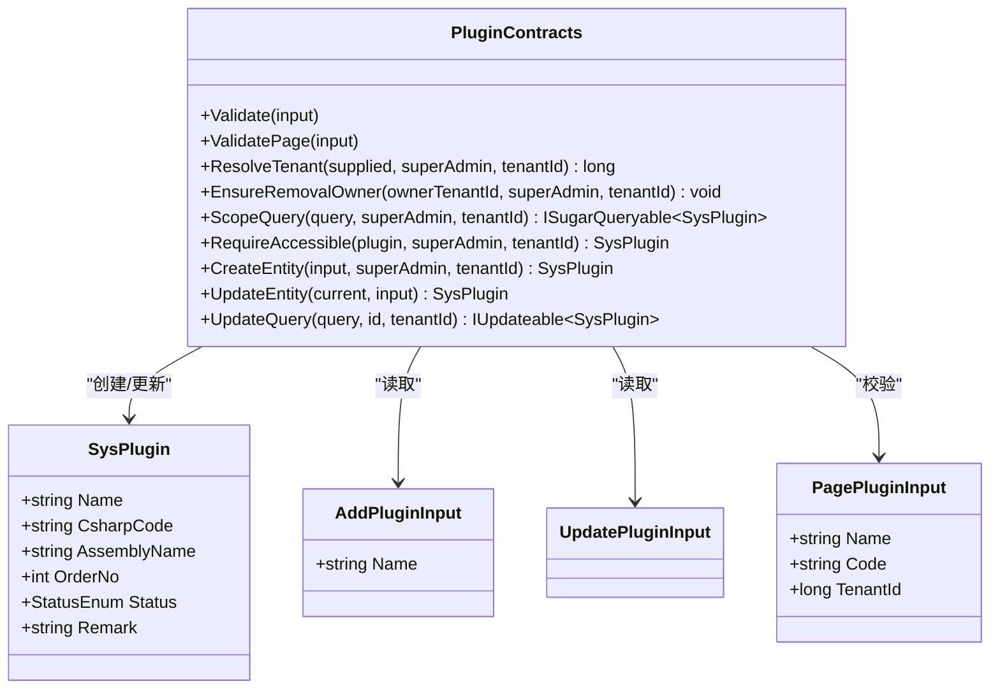
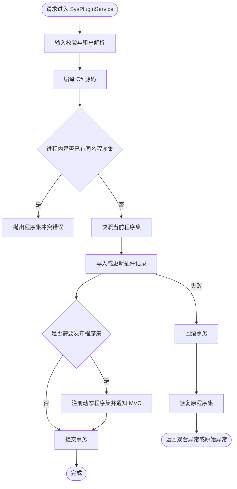
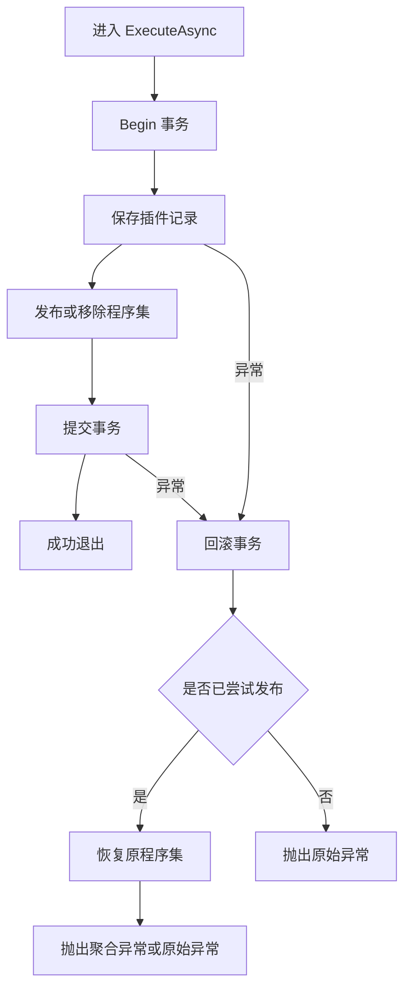
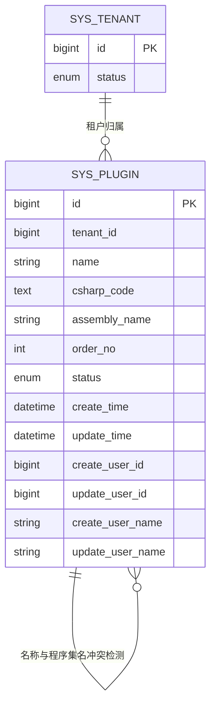
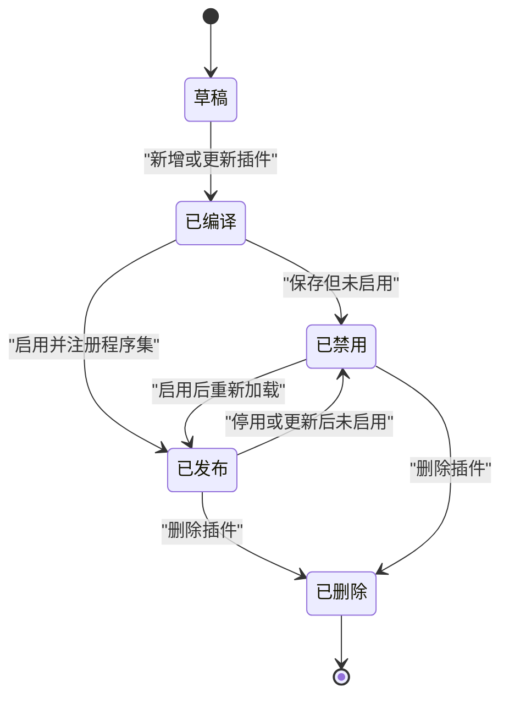
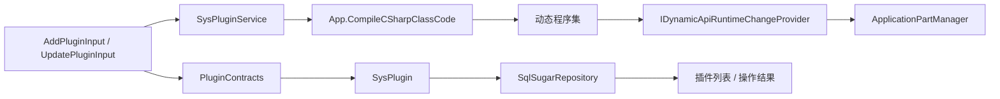
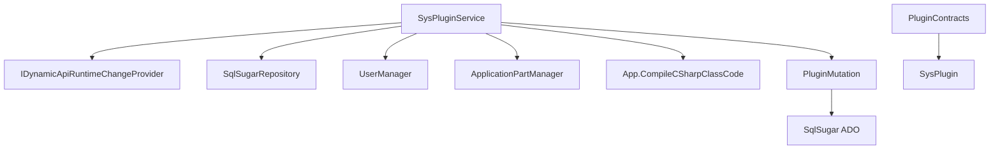

# 插件架构设计

<cite>
**本文引用的文件**   
- [PluginContracts.cs](file://Admin.NET/Admin.NET.Core/Service/Plugin/PluginContracts.cs)
- [SysPluginService.cs](file://Admin.NET/Admin.NET.Core/Service/Plugin/SysPluginService.cs)
- [PluginMutation.cs](file://Admin.NET/Admin.NET.Core/Service/Plugin/PluginMutation.cs)
- [SysPlugin.cs](file://Admin.NET/Admin.NET.Core/Entity/SysPlugin.cs)
- [PluginInput.cs](file://Admin.NET/Admin.NET.Core/Service/Plugin/Dto/PluginInput.cs)
- [PluginRuntimeTests.cs](file://Admin.NET/Admin.NET.Test/Plugin/PluginRuntimeTests.cs)
- [PluginContractTests.cs](file://Admin.NET/Admin.NET.Test/Plugin/PluginContractTests.cs)
- [PluginMutationTests.cs](file://Admin.NET/Admin.NET.Test/Plugin/PluginMutationTests.cs)
</cite>

## 目录
1. [引言](#引言)
2. [项目结构](#项目结构)
3. [核心组件](#核心组件)
4. [架构总览](#架构总览)
5. [详细组件分析](#详细组件分析)
6. [依赖关系分析](#依赖关系分析)
7. [性能与扩展性](#性能与扩展性)
8. [故障排查指南](#故障排查指南)
9. [结论](#结论)

## 引言
本文面向 Admin.NET 的动态插件系统，重点说明以下能力：
- 运行时程序集加载与动态 C# 代码编译。
- 通过动态 API 控制器注册机制暴露插件接口。
- 插件契约、输入校验、租户隔离与安全边界。
- 插件增删改查、编译、发布、热重载与回滚策略。
- 单进程并发协调、事务一致性、程序集恢复。
- 实体模型、数据库约束与名称冲突检测。
- 从代码提交到接口可用的完整生命周期图和数据流图。

本设计将“业务数据”（插件元信息）与“运行时代码”（动态程序集）解耦，并通过 IDynamicApiRuntimeChangeProvider 向 MVC 动态 API 框架注入新控制器；同时以 PluginMutation 保证同一进程中所有变更的串行化与原子性。

## 项目结构
插件相关源码集中在 Core 层的 Service 与 Entity 目录，测试位于 Test/Plugin。前端 API 客户端由自动生成工具生成，不改变后端实现语义。

**图表来源**
- [PluginContracts.cs:10-97](file://Admin.NET/Admin.NET.Core/Service/Plugin/PluginContracts.cs#L10-L97)
- [SysPluginService.cs:16-264](file://Admin.NET/Admin.NET.Core/Service/Plugin/SysPluginService.cs#L16-L264)
- [PluginMutation.cs:10-55](file://Admin.NET/Admin.NET.Core/Service/Plugin/PluginMutation.cs#L10-L55)
- [SysPlugin.cs:14-56](file://Admin.NET/Admin.NET.Core/Entity/SysPlugin.cs#L14-L56)
- [PluginInput.cs:10-42](file://Admin.NET/Admin.NET.Core/Service/Plugin/Dto/PluginInput.cs#L10-L42)

**章节来源**
- [PluginContracts.cs:10-97](file://Admin.NET/Admin.NET.Core/Service/Plugin/PluginContracts.cs#L10-L97)
- [SysPluginService.cs:16-264](file://Admin.NET/Admin.NET.Core/Service/Plugin/SysPluginService.cs#L16-L264)
- [PluginMutation.cs:10-55](file://Admin.NET/Admin.NET.Core/Service/Plugin/PluginMutation.cs#L10-L55)
- [SysPlugin.cs:14-56](file://Admin.NET/Admin.NET.Core/Entity/SysPlugin.cs#L14-L56)
- [PluginInput.cs:10-42](file://Admin.NET/Admin.NET.Core/Service/Plugin/Dto/PluginInput.cs#L10-L42)

## 核心组件
- 插件契约：统一处理输入验证、租户解析、可访问性检查、实体映射和更新查询构造。
- 插件服务：提供插件列表、新增、更新、删除、动态程序集添加/移除、启动时全量加载等动态 API。
- 变更协调器：使用 SemaphoreSlim 限制单进程并发，封装 Begin/Save/Publish/Commit/Rollback/Restore 流程。
- 插件实体：表示插件名称、C# 源码、程序集名称、排序、状态、备注，并继承租户实体基类。
- 输入模型：定义分页、新增、更新、删除请求参数。

**章节来源**
- [PluginContracts.cs:10-97](file://Admin.NET/Admin.NET.Core/Service/Plugin/PluginContracts.cs#L10-L97)
- [SysPluginService.cs:16-264](file://Admin.NET/Admin.NET.Core/Service/Plugin/SysPluginService.cs#L16-L264)
- [PluginMutation.cs:10-55](file://Admin.NET/Admin.NET.Core/Service/Plugin/PluginMutation.cs#L10-L55)
- [SysPlugin.cs:14-56](file://Admin.NET/Admin.NET.Core/Entity/SysPlugin.cs#L14-L56)
- [PluginInput.cs:10-42](file://Admin.NET/Admin.NET.Core/Service/Plugin/Dto/PluginInput.cs#L10-L42)

## 架构总览
动态插件系统的整体调用链如下：

**图表来源**
- [SysPluginService.cs:54-123](file://Admin.NET/Admin.NET.Core/Service/Plugin/SysPluginService.cs#L54-L123)
- [PluginMutation.cs:19-55](file://Admin.NET/Admin.NET.Core/Service/Plugin/PluginMutation.cs#L19-L55)

## 详细组件分析

### 插件契约与输入模型
PluginContracts 是插件安全边界的集中点：
- AddPluginInput.Validate：校验名称、C# 源码、程序集名称长度、备注长度、状态枚举和租户 Id。
- PagePluginInput.Validate：校验分页参数、名称长度和租户 Id。
- ResolveTenant：根据超管标志、传入租户与实际登录租户计算最终租户。
- EnsureRemovalOwner：禁止普通用户移除宿主程序集或其他租户的程序集。
- ScopeQuery：为普通租户自动追加 TenantId 过滤条件。
- RequireAccessible：确保当前用户只能操作自己租户的插件。
- CreateEntity / UpdateEntity：只允许设置受信任字段，避免恶意覆盖审计字段或主键。
- UpdateQuery：显式更新指定列，并在 Where 中固定主键与租户，防止自定义 Where 绕过权限。

**图表来源**
- [PluginContracts.cs:10-97](file://Admin.NET/Admin.NET.Core/Service/Plugin/PluginContracts.cs#L10-L97)
- [SysPlugin.cs:14-56](file://Admin.NET/Admin.NET.Core/Entity/SysPlugin.cs#L14-L56)
- [PluginInput.cs:10-42](file://Admin.NET/Admin.NET.Core/Service/Plugin/Dto/PluginInput.cs#L10-L42)

**章节来源**
- [PluginContracts.cs:10-97](file://Admin.NET/Admin.NET.Core/Service/Plugin/PluginContracts.cs#L10-L97)
- [PluginInput.cs:10-42](file://Admin.NET/Admin.NET.Core/Service/Plugin/Dto/PluginInput.cs#L10-L42)
- [PluginContractTests.cs:18-132](file://Admin.NET/Admin.NET.Test/Plugin/PluginContractTests.cs#L18-L132)

### SysPluginService：动态 API 控制器与热重载
SysPluginService 实现 IDynamicApiController，提供以下能力：
- 分页查询：结合 ScopeQuery 按租户隔离，支持名称模糊查询与排序。
- 新增插件：
  - 在互斥锁内执行。
  - 构建实体并校验。
  - 编译 C# 源码得到动态程序集。
  - 检查当前进程是否已有同名程序集。
  - 使用事务包装保存、发布和恢复逻辑。
  - 仅对启用状态的插件立即注册动态程序集。
- 更新插件：
  - 先查找并校验所有权。
  - 编译新源码并获取新程序集名称。
  - 快照现有同名程序集作为旧版本。
  - 更新数据库后切换程序集并通知 MVC；失败则恢复旧程序集。
- 删除插件：
  - 校验所有权。
  - 快照现有程序集。
  - 删除数据库记录后移除程序集；失败则恢复。
- 直接编译程序集：
  - 提供 CompileAssembly 接口，用于快速测试动态控制器。
  - 记录临时所有者，避免与持久化插件冲突。
- 移除程序集：
  - 支持移除持久化插件程序集和临时编译程序集。
  - 校验所有者，不允许普通用户移除宿主程序集。
- 启动时加载：
  - LoadAllAssembly 会遍历启用状态的插件并重新编译注册。

**图表来源**
- [SysPluginService.cs:54-123](file://Admin.NET/Admin.NET.Core/Service/Plugin/SysPluginService.cs#L54-L123)
- [SysPluginService.cs:201-264](file://Admin.NET/Admin.NET.Core/Service/Plugin/SysPluginService.cs#L201-L264)

**章节来源**
- [SysPluginService.cs:16-264](file://Admin.NET/Admin.NET.Core/Service/Plugin/SysPluginService.cs#L16-L264)

### PluginMutation：单进程并发协调与回滚策略
PluginMutation 的核心职责是保证插件变更在同一进程内串行执行，并确保数据库与运行时代码保持一致。

关键点：
- 使用静态 SemaphoreSlim(1, 1) 实现互斥。
- RunExclusiveAsync 与 RunExclusive 分别支持异步与同步入口。
- ExecuteAsync 将事务与程序集发布/恢复组织为六个阶段：begin、save、publish、commit、rollback、restore。
- 若保存成功但提交失败，仍会执行 restore，使 MVC 中的程序集与数据库状态一致。
- 若回滚或恢复也失败，收集多个异常并抛出 AggregateException。
- 并发测试证明：第二个变更会在第一个完成后进入；即使第一个失败，第二个仍可正常执行。

**图表来源**
- [PluginMutation.cs:19-55](file://Admin.NET/Admin.NET.Core/Service/Plugin/PluginMutation.cs#L19-L55)
- [PluginMutationTests.cs:13-68](file://Admin.NET/Admin.NET.Test/Plugin/PluginMutationTests.cs#L13-L68)

**章节来源**
- [PluginMutation.cs:10-55](file://Admin.NET/Admin.NET.Core/Service/Plugin/PluginMutation.cs#L10-L55)
- [PluginMutationTests.cs:13-68](file://Admin.NET/Admin.NET.Test/Plugin/PluginMutationTests.cs#L13-L68)

### SysPlugin 实体与数据库约束
SysPlugin 继承租户实体基类，包含以下字段：
- Name：插件名称，最大长度 64，建立非聚集索引。
- CsharpCode：动态 C# 源码，使用大字符串类型存储。
- AssemblyName：动态程序集名称，最大长度 512，可为空。
- OrderNo：排序号，默认值 100。
- Status：启用状态。
- Remark：备注，最大长度 128。

注意：
- 索引仅作用于 Name，不强制全局唯一；全局唯一性与冲突检测在服务层通过 ClearFilter 去除租户过滤器实现。
- 名称冲突检测同时考虑同租户同名和全局程序集名冲突。
- 租户范围控制由 ScopeQuery 与 RequireAccessible 共同保障。

**图表来源**
- [SysPlugin.cs:14-56](file://Admin.NET/Admin.NET.Core/Entity/SysPlugin.cs#L14-L56)
- [SysPluginService.cs:146-173](file://Admin.NET/Admin.NET.Core/Service/Plugin/SysPluginService.cs#L146-L173)

**章节来源**
- [SysPlugin.cs:14-56](file://Admin.NET/Admin.NET.Core/Entity/SysPlugin.cs#L14-L56)
- [SysPluginService.cs:146-173](file://Admin.NET/Admin.NET.Core/Service/Plugin/SysPluginService.cs#L146-L173)

### 插件生命周期图
从代码提交到 API 可用的关键阶段如下：

- 草稿：尚未持久化或校验失败。
- 已编译：C# 源码已成功编译，可能尚未注册。
- 已禁用：已持久化但未启用，不会暴露动态 API。
- 已发布：动态程序集已注册到 MVC 动态 API。
- 已删除：数据库记录已删除，程序集已从运行期移除。

**图表来源**
- [SysPluginService.cs:54-123](file://Admin.NET/Admin.NET.Core/Service/Plugin/SysPluginService.cs#L54-L123)
- [SysPluginService.cs:201-264](file://Admin.NET/Admin.NET.Core/Service/Plugin/SysPluginService.cs#L201-L264)

### 数据流图

**图表来源**
- [PluginInput.cs:10-42](file://Admin.NET/Admin.NET.Core/Service/Plugin/Dto/PluginInput.cs#L10-L42)
- [PluginContracts.cs:10-97](file://Admin.NET/Admin.NET.Core/Service/Plugin/PluginContracts.cs#L10-L97)
- [SysPluginService.cs:54-123](file://Admin.NET/Admin.NET.Core/Service/Plugin/SysPluginService.cs#L54-L123)

## 依赖关系分析
- SysPluginService 依赖：
  - IDynamicApiRuntimeChangeProvider：注册或移除动态程序集，触发 MVC 控制器发现。
  - SqlSugarRepository<SysPlugin>：插件数据的增删改查。
  - UserManager：获取超管身份与租户上下文。
  - ApplicationPartManager：扫描当前已加载程序集，用于冲突检测与快照恢复。
  - Furion.App.CompileCSharpClassCode：动态编译 C# 源码。
- PluginMutation 依赖：
  - SemaphoreSlim：进程级互斥。
  - SqlSugar ADO：事务 begin/commit/rollback。
- PluginContracts 依赖：
  - SysPlugin 实体。
  - ErrorCodeEnum：统一错误码。
  - Oops：统一异常封装。

**图表来源**
- [SysPluginService.cs:16-264](file://Admin.NET/Admin.NET.Core/Service/Plugin/SysPluginService.cs#L16-L264)
- [PluginMutation.cs:19-55](file://Admin.NET/Admin.NET.Core/Service/Plugin/PluginMutation.cs#L19-L55)
- [PluginContracts.cs:10-97](file://Admin.NET/Admin.NET.Core/Service/Plugin/PluginContracts.cs#L10-L97)

**章节来源**
- [SysPluginService.cs:16-264](file://Admin.NET/Admin.NET.Core/Service/Plugin/SysPluginService.cs#L16-L264)
- [PluginMutation.cs:19-55](file://Admin.NET/Admin.NET.Core/Service/Plugin/PluginMutation.cs#L19-L55)
- [PluginContracts.cs:10-97](file://Admin.NET/Admin.NET.Core/Service/Plugin/PluginContracts.cs#L10-L97)

## 性能与扩展性

### 性能特性
- 动态编译成本较高：每次新增或更新都会执行 C# 编译，应避免高频热更新。
- 程序集快照与反射：SnapshotAssemblies 通过 LINQ 扫描 ApplicationParts，属于 O(n) 扫描，建议仅在变更路径调用。
- 启动加载：LoadAllAssembly 会按启用顺序逐个编译并注册，部署后首次启动可能有延迟。
- 并发保护：SemaphoreSlim 保证单进程串行变更，避免竞争条件，但也会降低并发写入吞吐。

### 优化建议
- 批量导入：合并多次新增或更新，减少重复编译与注册。
- 缓存编译结果：对于频繁启停的测试场景，可在外部缓存编译后的程序集，但仍需遵守名称冲突与租户隔离规则。
- 渐进发布：先在禁用状态编译并校验，确认无误后再启用，降低线上风险。
- 监控编译耗时：对 App.CompileCSharpClassCode 与 Provider.AddAssembliesWithNotifyChanges 增加日志或指标。
- 清理无用程序集：RemoveAssembly 应配合管理界面定期清理不再使用的动态程序集。

### 扩展点
- 自定义校验：扩展 PluginContracts.Validate 与 ValidatePage，增加业务规则。
- 自定义发布策略：替换或包装 IDynamicApiRuntimeChangeProvider，实现灰度发布或沙箱隔离。
- 自定义恢复策略：扩展 PluginMutation.ExecuteAsync，增加重试、告警或补偿动作。
- 自定义审计字段：通过 PluginContracts.UpdateQuery 扩展更新列集合，但要避免覆盖租户隔离条件。

[本节为通用指导，不直接分析具体文件]

## 故障排查指南

### 常见错误与含义
- 程序集冲突：当进程内已存在同名程序集，或数据库中已有同名程序集时，新增或编译会失败。
- 租户越权：普通用户尝试访问其他租户插件、修改其他租户租户 Id、或移除不属于自身的程序集时会失败。
- 目标变化：更新或删除时，若数据库记录被并发修改导致影响行数不为 1，会抛错。
- 事务失败：提交失败时，系统会尝试回滚并恢复程序集；若回滚或恢复也失败，抛出聚合异常。
- 租户不存在：新增或更新前会检查租户是否存在且启用。

### 排查步骤
1. 检查输入参数：名称、C# 源码、程序集名称长度、状态枚举、租户 Id。
2. 检查租户状态：确认目标租户存在且启用。
3. 检查程序集名称冲突：查看是否有同名持久化插件或临时编译程序集。
4. 检查 MVC 程序集：使用 ApplicationPartManager 确认动态控制器是否已注册。
5. 检查事务与恢复：若出现聚合异常，需核对数据库记录与运行期程序集是否一致。
6. 重启加载：若需要重新加载启用插件，调用 LoadAllAssembly。

**章节来源**
- [SysPluginService.cs:54-173](file://Admin.NET/Admin.NET.Core/Service/Plugin/SysPluginService.cs#L54-L173)
- [PluginMutation.cs:19-55](file://Admin.NET/Admin.NET.Core/Service/Plugin/PluginMutation.cs#L19-L55)
- [PluginRuntimeTests.cs:21-103](file://Admin.NET/Admin.NET.Test/Plugin/PluginRuntimeTests.cs#L21-L103)
- [PluginContractTests.cs:18-132](file://Admin.NET/Admin.NET.Test/Plugin/PluginContractTests.cs#L18-L132)
- [PluginMutationTests.cs:13-68](file://Admin.NET/Admin.NET.Test/Plugin/PluginMutationTests.cs#L13-L68)

## 结论
Admin.NET 的插件架构通过契约层、服务层与协调层实现了“数据驱动 + 动态代码”的可插拔能力。PluginContracts 确保输入与租户安全；SysPluginService 负责编译、注册与热重载；PluginMutation 保证单进程并发与事务一致性；SysPlugin 实体提供持久化基础。该设计适合多租户、可扩展的业务集成场景，但在高并发写路径下需谨慎评估动态编译与程序集切换的性能影响。实际使用中建议遵循“先编译校验、再启用发布”的流程，并结合监控与日志快速定位问题。