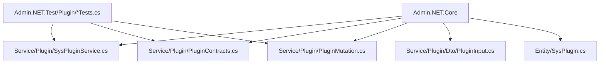
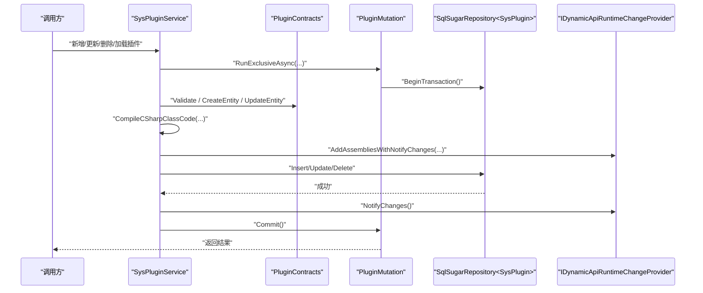
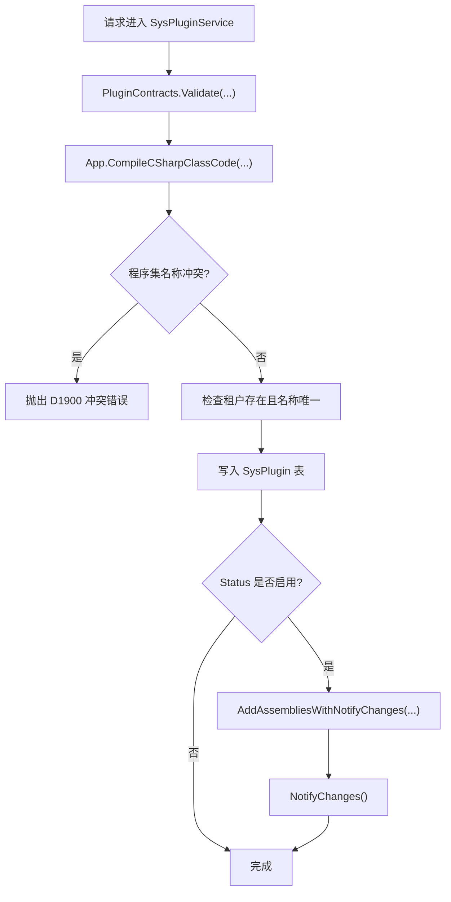
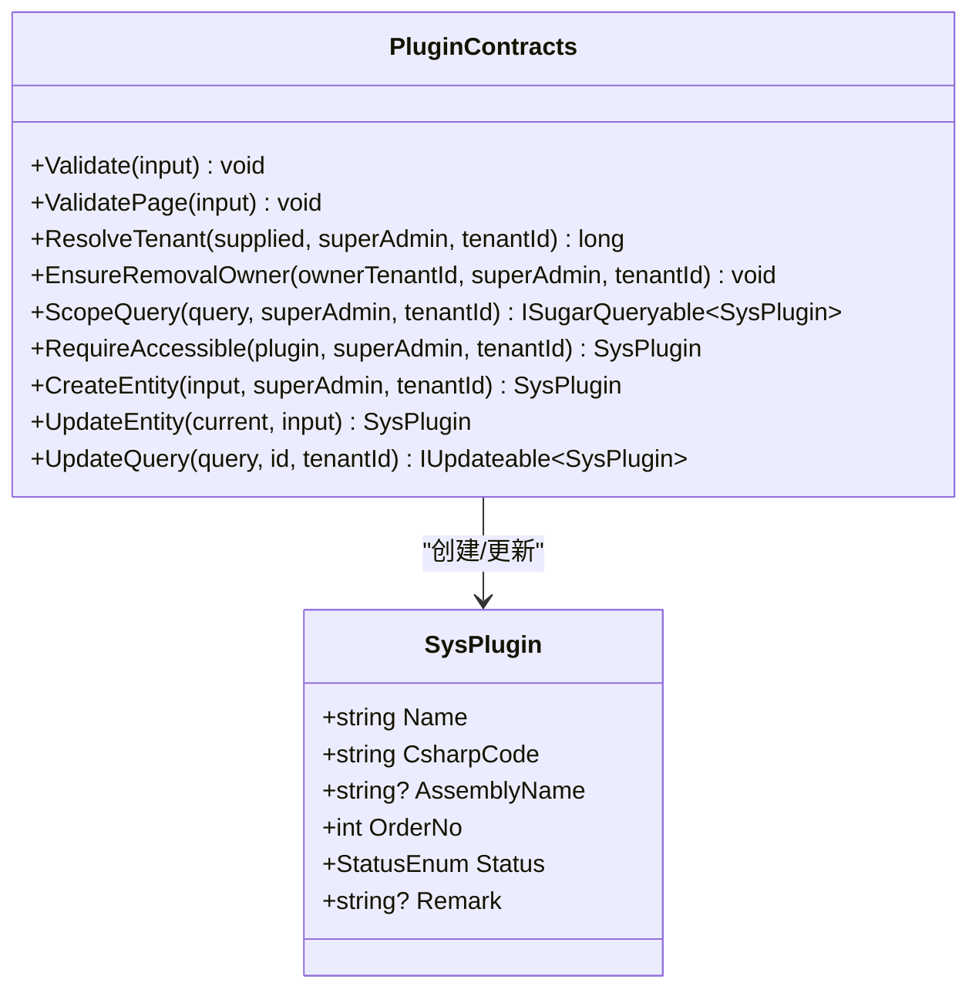
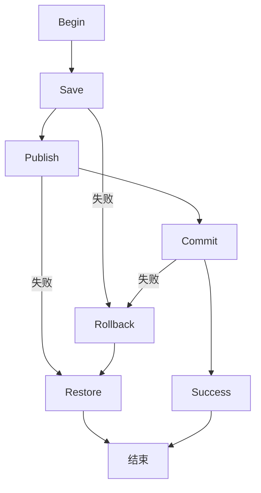
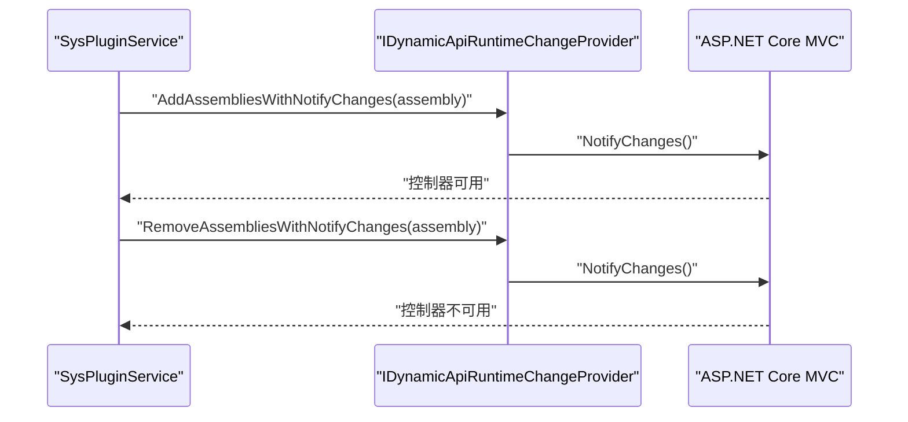
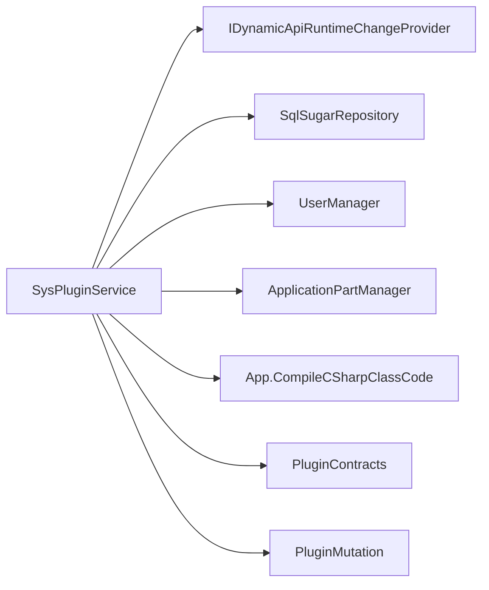

# 插件系统

<cite>
**本文引用的文件**   
- [SysPluginService.cs](file://Admin.NET/Admin.NET.Core/Service/Plugin/SysPluginService.cs)
- [PluginContracts.cs](file://Admin.NET/Admin.NET.Core/Service/Plugin/PluginContracts.cs)
- [PluginMutation.cs](file://Admin.NET/Admin.NET.Core/Service/Plugin/PluginMutation.cs)
- [SysPlugin.cs](file://Admin.NET/Admin.NET.Core/Entity/SysPlugin.cs)
- [PluginInput.cs](file://Admin.NET/Admin.NET.Core/Service/Plugin/Dto/PluginInput.cs)
- [PluginContractTests.cs](file://Admin.NET/Admin.NET.Test/Plugin/PluginContractTests.cs)
- [PluginMutationTests.cs](file://Admin.NET/Admin.NET.Test/Plugin/PluginMutationTests.cs)
- [PluginRuntimeTests.cs](file://Admin.NET/Admin.NET.Test/Plugin/PluginRuntimeTests.cs)
</cite>

## 目录
1. [引言](#引言)
2. [项目结构](#项目结构)
3. [核心组件](#核心组件)
4. [架构总览](#架构总览)
5. [详细组件分析](#详细组件分析)
6. [依赖关系分析](#依赖关系分析)
7. [性能与并发特性](#性能与并发特性)
8. [故障排查指南](#故障排查指南)
9. [结论](#结论)
10. [附录：插件开发流程与常见问题](#附录插件开发流程与常见问题)

## 引言
本仓库的插件系统以“运行时动态编译 C# 代码并注册为动态 API”为核心能力，通过 SysPluginService 提供插件的查询、新增、更新、删除、程序集加载与卸载等管理能力。插件契约由 PluginContracts 统一约束输入、租户隔离、实体映射和更新范围；PluginMutation 负责单进程内数据库事务与运行时代码发布的原子性协调。数据模型 SysPlugin 将插件名称、C# 源码、目标程序集名称、排序、状态和备注持久化到数据库，并结合 SqlSugar 进行查询与更新。

需要特别说明的是：当前仓库中并未发现名为 ReZero 插件、K3Cloud 插件、WorkWeixin 插件、GoView 插件或 DingTalk 插件的完整实现类；同时也没有名为 IPlugin 或 PluginMutation 生命周期钩子的抽象接口。因此，本文对“内置插件扩展机制”的描述仅基于现有 SysPluginService 的能力边界进行分析，不虚构具体业务插件的实现细节。

## 项目结构
插件相关代码集中在 Admin.NET.Admin.NET.Core 层的 Service/Plugin 子目录，以及对应的 Entity 与测试工程：

**图示来源**
- [SysPluginService.cs:1-264](file://Admin.NET/Admin.NET.Core/Service/Plugin/SysPluginService.cs#L1-L264)
- [PluginContracts.cs:1-97](file://Admin.NET/Admin.NET.Core/Service/Plugin/PluginContracts.cs#L1-L97)
- [PluginMutation.cs:1-55](file://Admin.NET/Admin.NET.Core/Service/Plugin/PluginMutation.cs#L1-L55)
- [SysPlugin.cs:1-56](file://Admin.NET/Admin.NET.Core/Entity/SysPlugin.cs#L1-L56)
- [PluginContractTests.cs:1-132](file://Admin.NET/Admin.NET.Test/Plugin/PluginContractTests.cs#L1-L132)
- [PluginMutationTests.cs:1-68](file://Admin.NET/Admin.NET.Test/Plugin/PluginMutationTests.cs#L1-L68)
- [PluginRuntimeTests.cs:1-103](file://Admin.NET/Admin.NET.Test/Plugin/PluginRuntimeTests.cs#L1-L103)

**章节来源**
- [SysPluginService.cs:1-264](file://Admin.NET/Admin.NET.Core/Service/Plugin/SysPluginService.cs#L1-L264)
- [PluginContracts.cs:1-97](file://Admin.NET/Admin.NET.Core/Service/Plugin/PluginContracts.cs#L1-L97)
- [PluginMutation.cs:1-55](file://Admin.NET/Admin.NET.Core/Service/Plugin/PluginMutation.cs#L1-L55)
- [SysPlugin.cs:1-56](file://Admin.NET/Admin.NET.Core/Entity/SysPlugin.cs#L1-L56)

## 核心组件
- SysPluginService：插件运行时管理服务，暴露分页查询、新增、更新、删除、动态程序集添加、移除和启用插件批量加载等 API。
- PluginContracts：插件输入校验、租户解析、实体创建与更新、可访问性检查及 SQL 更新范围控制。
- PluginMutation：单进程互斥与多阶段事务协调器，保证数据库与运行时代码发布的一致性。
- SysPlugin：插件持久化实体，包含名称、C# 源码、程序集名称、排序、状态和备注。
- PluginInput：插件操作相关的 DTO（如 AddPluginInput、UpdatePluginInput、PagePluginInput、DeletePluginInput）。

**章节来源**
- [SysPluginService.cs:1-264](file://Admin.NET/Admin.NET.Core/Service/Plugin/SysPluginService.cs#L1-L264)
- [PluginContracts.cs:1-97](file://Admin.NET/Admin.NET.Core/Service/Plugin/PluginContracts.cs#L1-L97)
- [PluginMutation.cs:1-55](file://Admin.NET/Admin.NET.Core/Service/Plugin/PluginMutation.cs#L1-L55)
- [SysPlugin.cs:1-56](file://Admin.NET/Admin.NET.Core/Entity/SysPlugin.cs#L1-L56)
- [PluginInput.cs](file://Admin.NET/Admin.NET.Core/Service/Plugin/Dto/PluginInput.cs)

## 架构总览
插件系统的整体流程是：前端或外部调用方通过 SysPluginService 提供的动态 API 提交插件源码；服务层校验参数、校验租户权限、编译 C# 代码生成动态程序集，并通过 Furion 的动态 API 运行时提供者将程序集注入 ASP.NET Core MVC 控制器发现机制；数据库记录与运行时代码变更在 PluginMutation 的保护下保持原子一致。

**图示来源**
- [SysPluginService.cs:24-180](file://Admin.NET/Admin.NET.Core/Service/Plugin/SysPluginService.cs#L24-L180)
- [PluginMutation.cs:10-55](file://Admin.NET/Admin.NET.Core/Service/Plugin/PluginMutation.cs#L10-L55)
- [PluginContracts.cs:12-97](file://Admin.NET/Admin.NET.Core/Service/Plugin/PluginContracts.cs#L12-L97)

## 详细组件分析

### SysPluginService：插件运行时管理服务
SysPluginService 是一个动态 API 控制器，内部持有以下关键依赖：
- IDynamicApiRuntimeChangeProvider：用于向动态 API 运行时添加、移除程序集并通知控制器描述符变更。
- SqlSugarRepository<SysPlugin>：插件数据的持久化访问。
- UserManager：获取当前用户是否为超级管理员以及租户标识。
- ApplicationPartManager：枚举已注册的 AssemblyPart，用于检测程序集是否已被加载。

主要职责包括：
- Page：分页查询插件列表，支持按名称过滤、按租户过滤，并按 OrderNo 和 Id 排序。
- AddPlugin：校验输入、创建 SysPlugin、编译 C# 代码、确保程序集名称未冲突、写入数据库并在启用状态下注册程序集。
- UpdatePlugin：校验输入、读取已有插件、编译新代码、快照旧程序集、更新数据库、替换动态程序集并通知运行时。
- DeletePlugin：校验所有权、快照旧程序集、删除数据库记录、移除已注册程序集。
- CompileAssembly：临时编译 C# 代码并注册程序集，用于调试或快速验证，但不持久化为正式插件。
- RemoveAssembly：根据程序集名称移除运行时程序集，支持持久化插件和临时编译程序集的所有权校验。
- LoadAllAssembly：启动时重新加载所有 StatusEnum.Enable 的插件程序集。

**图示来源**
- [SysPluginService.cs:40-180](file://Admin.NET/Admin.NET.Core/Service/Plugin/SysPluginService.cs#L40-L180)
- [PluginContracts.cs:12-97](file://Admin.NET/Admin.NET.Core/Service/Plugin/PluginContracts.cs#L12-L97)

**章节来源**
- [SysPluginService.cs:1-264](file://Admin.NET/Admin.NET.Core/Service/Plugin/SysPluginService.cs#L1-L264)

### PluginContracts：插件契约与租户边界
PluginContracts 是纯静态工具类，承担以下职责：
- Validate：校验新增插件的名称长度、C# 源码非空、程序集名称长度、备注长度、状态枚举和租户 ID。
- ValidatePage：校验分页查询参数。
- ResolveTenant：普通用户不能跨租户指定插件归属；超管可切换租户。
- EnsureRemovalOwner：校验移除程序集的所有权，防止普通用户或超管移除不属于自己或宿主程序集的程序集。
- ScopeQuery：为非超管租户自动附加租户过滤条件。
- RequireAccessible：校验插件是否存在且属于当前租户。
- CreateEntity / UpdateEntity：从输入构造或更新 SysPlugin，显式控制写入字段，防止对象属性被 ORM 覆盖。
- UpdateQuery：明确设置要更新的列，并强制包含主键与租户条件。

该类的单元测试覆盖了非法输入、跨租户限制、字段裁剪、SQL 更新列白名单以及租户过滤行为。

**图示来源**
- [PluginContracts.cs:12-97](file://Admin.NET/Admin.NET.Core/Service/Plugin/PluginContracts.cs#L12-L97)
- [SysPlugin.cs:13-56](file://Admin.NET/Admin.NET.Core/Entity/SysPlugin.cs#L13-L56)

**章节来源**
- [PluginContracts.cs:1-97](file://Admin.NET/Admin.NET.Core/Service/Plugin/PluginContracts.cs#L1-L97)
- [PluginContractTests.cs:1-132](file://Admin.NET/Admin.NET.Test/Plugin/PluginContractTests.cs#L1-L132)

### PluginMutation：单进程变更协调
PluginMutation 提供两类能力：
- RunExclusiveAsync / RunExclusive：使用 SemaphoreSlim 保证同一时刻只有一个插件变更操作执行，避免并发注册或卸载程序集导致的状态不一致。
- ExecuteAsync：封装五阶段事务协调器：begin、save、publish、commit、rollback、restore。若 publish 之后 commit 失败，会执行 restore 恢复运行时代码；若 rollback 也失败，则聚合异常。

测试覆盖了不同阶段的失败路径、并发等待、恢复逻辑以及 AggregateException 的行为。

**图示来源**
- [PluginMutation.cs:10-55](file://Admin.NET/Admin.NET.Core/Service/Plugin/PluginMutation.cs#L10-L55)
- [PluginMutationTests.cs:14-68](file://Admin.NET/Admin.NET.Test/Plugin/PluginMutationTests.cs#L14-L68)

**章节来源**
- [PluginMutation.cs:1-55](file://Admin.NET/Admin.NET.Core/Service/Plugin/PluginMutation.cs#L1-L55)
- [PluginMutationTests.cs:1-68](file://Admin.NET/Admin.NET.Test/Plugin/PluginMutationTests.cs#L1-L68)

### SysPlugin：插件数据模型
SysPlugin 继承租户基类，关键字段包括：
- Name：插件名称，最大 64 字符，建立索引。
- CsharpCode：C# 源码，使用大字符串类型存储。
- AssemblyName：运行时编译后的程序集名称，最大 512 字符。
- OrderNo：排序号，默认 100。
- Status：启用状态。
- Remark：备注，最大 128 字符。

该实体配合 SqlSugar 的属性映射，成为插件配置与运行时的持久化锚点。

**章节来源**
- [SysPlugin.cs:1-56](file://Admin.NET/Admin.NET.Core/Entity/SysPlugin.cs#L1-L56)

### 动态 API 运行时集成
SysPluginService 通过 IDynamicApiRuntimeChangeProvider 与 Furion 的动态 API 运行时集成：
- AddAssembliesWithNotifyChanges：添加动态程序集并通知控制器描述符变化。
- RemoveAssembliesWithNotifyChanges：移除程序集并通知变更。
- AddAssemblies / RemoveAssemblies：仅修改程序集集合。
- NotifyChanges：触发运行时刷新控制器发现。

PluginRuntimeTests 通过反射实例化 Furion 的内部实现，验证了动态控制器注册、释放后仍可由 MVC 调用、替换程序集以及在提交失败时恢复原程序集的行为。

**图示来源**
- [SysPluginService.cs:140-264](file://Admin.NET/Admin.NET.Core/Service/Plugin/SysPluginService.cs#L140-L264)
- [PluginRuntimeTests.cs:18-103](file://Admin.NET/Admin.NET.Test/Plugin/PluginRuntimeTests.cs#L18-L103)

**章节来源**
- [PluginRuntimeTests.cs:1-103](file://Admin.NET/Admin.NET.Test/Plugin/PluginRuntimeTests.cs#L1-L103)

## 依赖关系分析
SysPluginService 依赖多个子系统：
- Furion 动态 API：通过 IDynamicApiRuntimeChangeProvider 暴露动态控制器。
- SqlSugar：通过 Repository 访问 SysPlugin 数据。
- UserManager：租户与权限上下文。
- ApplicationPartManager：程序集发现与冲突检测。
- App.CompileCSharpClassCode：动态编译 C# 源码。

**图示来源**
- [SysPluginService.cs:16-39](file://Admin.NET/Admin.NET.Core/Service/Plugin/SysPluginService.cs#L16-L39)

**章节来源**
- [SysPluginService.cs:1-264](file://Admin.NET/Admin.NET.Core/Service/Plugin/SysPluginService.cs#L1-L264)

## 性能与并发特性
- 单进程互斥：PluginMutation 使用信号量串行化插件变更，避免并发注册、卸载导致的程序集状态竞争。
- 数据库事务：通过 ADO.BeginTranAsync / Commit / Rollback 包裹保存、发布与恢复逻辑，保证数据一致性。
- 程序集快照：更新和删除前快照已注册程序集，以便失败时恢复。
- 动态编译：每次新增或更新都会编译 C# 源码，编译失败不会改变数据库或运行时状态。
- 运行时通知：仅在成功注册或替换程序集后调用 NotifyChanges，减少不必要的 MVC 刷新。

这些设计适合中小型系统的轻量级扩展场景；在高并发或高吞吐环境中，应关注频繁动态编译、程序集替换和控制器描述符刷新的开销。

[本节为通用性能讨论，不直接分析具体文件]

## 故障排查指南
常见错误与定位方式：
- 插件参数无效：检查 PluginContracts.Validate 和 ValidatePage 的输入长度、枚举值和租户 ID。
- 租户越权：确认 ResolveTenant、ScopeQuery、RequireAccessible、EnsureRemovalOwner 的权限判断是否符合预期。
- 程序集名称冲突：AddPlugin、UpdatePlugin、CompileAssembly 会检查 AssemblyName 是否与已有插件或已加载程序集重复。
- 租户不存在：新增插件前会检查 SysTenant 是否存在且启用。
- 更新或删除目标已变化：乐观并发保护会在更新或删除行数不等于 1 时报错。
- 发布或恢复失败：PluginMutation.ExecuteAsync 可能抛出 AggregateException，需同时查看原始异常、回滚异常和恢复异常。
- 动态控制器无法调用：确认程序集已成功添加到 IDynamicApiRuntimeChangeProvider，且 MVC 控制器发现能列出对应控制器。

建议排查顺序：
1. 确认输入参数合法。
2. 确认当前用户租户与插件归属一致。
3. 确认程序集名称未被占用。
4. 确认数据库写入成功。
5. 确认运行时程序集已注册。
6. 检查 PluginMutation 的异常聚合信息。

**章节来源**
- [PluginContracts.cs:12-97](file://Admin.NET/Admin.NET.Core/Service/Plugin/PluginContracts.cs#L12-L97)
- [SysPluginService.cs:60-264](file://Admin.NET/Admin.NET.Core/Service/Plugin/SysPluginService.cs#L60-L264)
- [PluginMutation.cs:10-55](file://Admin.NET/Admin.NET.Core/Service/Plugin/PluginMutation.cs#L10-L55)

## 结论
Admin.NET 的插件系统以 SysPluginService 为中心，结合 PluginContracts 的数据契约和 PluginMutation 的事务协调，实现了“源码即插件、运行时编译、动态 API 注册”的轻量扩展模式。它适合在单体或多租户系统中按需启用功能模块，并通过租户隔离保障多环境安全。由于当前仓库未提供 ReZero、K3Cloud、WorkWeixin、GoView、DingTalk 等具体插件实现，也不存在 IPlugin 或 PluginMutation 生命周期钩子，后续扩展时应遵循现有 SysPluginService 的设计范式，而不是引入尚未存在的抽象。

[本节为总结性内容，不直接分析具体文件]

## 附录：插件开发流程与常见问题

### 标准开发流程
1. **确定插件形态**  
   如果插件只是后端 API，可直接通过 SysPluginService 提交 C# 源码；如果需要独立项目结构，应参考现有插件目录组织方式，但当前仓库中的插件目录未展示完整实现类。
2. **准备 C# 源码**  
   源码必须能被 App.CompileCSharpClassCode 编译，并包含至少一个可被 MVC 发现的控制器类型。
3. **调用动态 API**  
   - 新增插件：调用 AddPlugin，传入 Name、CsharpCode、OrderNo、Status、Remark、TenantId。
   - 更新插件：调用 UpdatePlugin，传入 Id、Name、CsharpCode、OrderNo、Status、Remark。
   - 删除插件：调用 DeletePlugin，传入 Id。
   - 临时编译：调用 CompileAssembly，用于快速验证代码而不持久化。
   - 移除程序集：调用 RemoveAssembly，传入 AssemblyName。
   - 加载启用插件：调用 LoadAllAssembly，通常在应用启动阶段执行。
4. **验证运行时**  
   通过浏览器或 API 客户端调用新注册的控制器方法，确认动态 API 已生效。
5. **处理失败**  
   若出现 AggregateException，按 PluginMutation 的阶段日志定位是保存、发布、提交还是恢复阶段失败。

### 插件项目结构与依赖管理
当前仓库中 Plugins 目录下存在多个命名空间，例如：
- Admin.NET.Plugin.ReZero
- Admin.NET.Plugin.K3Cloud
- Admin.NET.Plugin.WorkWeixin
- Admin.NET.Plugin.GoView
- Admin.NET.Plugin.DingTalk
- Admin.NET.Plugin.DataBridge
- Admin.NET.Plugin.WmsOracle

但这些目录在当前检索范围内没有匹配到具体实现类；因此不能据此断言其已完成实现。编写自定义插件时，应优先复用 SysPluginService 的 API，而不是假设平台已经提供 IPlugin 生命周期。

### 服务注册、API 暴露与前端集成
- 后端 API 暴露：SysPluginService 通过动态 API 控制器机制暴露接口，前端可通过 Admin.NET 的前端 API 层调用。
- 前端集成：前端应调用插件管理页面或 API，上传或编辑 C# 源码，并刷新控制器列表。当前文档不展开前端具体路由，因为重点在后端插件运行时。

### 插件配置、安装卸载、版本管理与热重载
- 配置：插件配置主要由 SysPlugin 的 Name、CsharpCode、AssemblyName、OrderNo、Status、Remark 组成。
- 安装：AddPlugin 或 CompileAssembly 将源码编译为程序集并注册到动态 API 运行时。
- 卸载：DeletePlugin 或 RemoveAssembly 移除数据库记录和运行时程序集。
- 版本管理：当前实现未提供独立的版本号字段；如需版本管理，可在备注或 C# 源码元数据中约定策略，并在业务层自行校验。
- 热重载：UpdatePlugin 会替换已注册程序集并通知 MVC 刷新，从而实现“在线更新”；但这是进程内替换，并非传统意义上的进程外热重载。

### 插件间通信、事件发布订阅与资源共享
当前插件系统没有提供插件间专用通信总线或共享内存对象池。插件之间可以：
- 通过公共 API 调用彼此暴露的控制器。
- 通过平台已有的 EventBus 机制进行事件发布订阅（如果插件自身引用并使用该机制）。
- 通过数据库或缓存共享数据，但应避免强耦合。

需要注意的是，这属于平台能力边界说明，而非现有插件间通信框架的实现细节。

### 自定义插件示例思路
由于不能直接粘贴源码，以下为开发步骤说明：
1. 创建一个可编译的 C# 类库，包含一个控制器类型。
2. 将该控制器所在程序集名称作为 AssemblyName。
3. 通过 SysPluginService.AddPlugin 提交源码，并将 Status 设置为启用。
4. 调用控制器方法验证 API 是否可用。
5. 如需更新，调用 UpdatePlugin 替换源码；如需撤销，调用 RemoveAssembly 或 DeletePlugin。

### 常见问题解决方案
- “插件新增未写入”：检查数据库连接、事务提交和插入返回值。
- “插件更新目标已变化”：并发更新导致乐观并发保护触发，重试或优化并发。
- “插件删除目标已变化”：同上，检查并发删除。
- “租户不存在”：先启用 SysTenant。
- “程序集名称冲突”：更换 AssemblyName 或清理旧插件。
- “动态程序集移除失败”：检查是否还有其他请求持有控制器实例，必要时重启应用或等待 GC。

**章节来源**
- [SysPluginService.cs:40-264](file://Admin.NET/Admin.NET.Core/Service/Plugin/SysPluginService.cs#L40-L264)
- [PluginContracts.cs:12-97](file://Admin.NET/Admin.NET.Core/Service/Plugin/PluginContracts.cs#L12-L97)
- [PluginMutation.cs:10-55](file://Admin.NET/Admin.NET.Core/Service/Plugin/PluginMutation.cs#L10-L55)