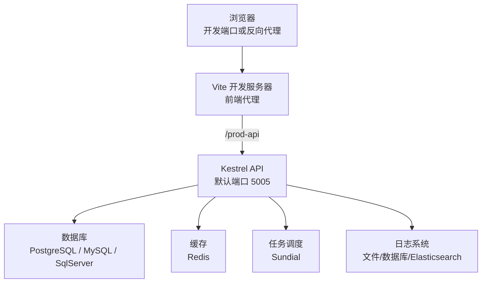
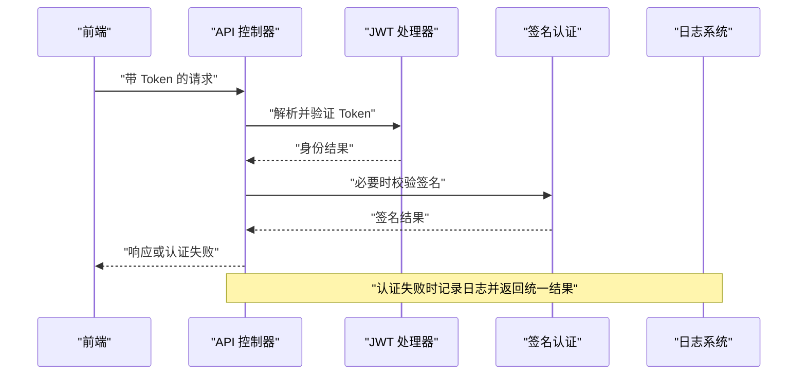
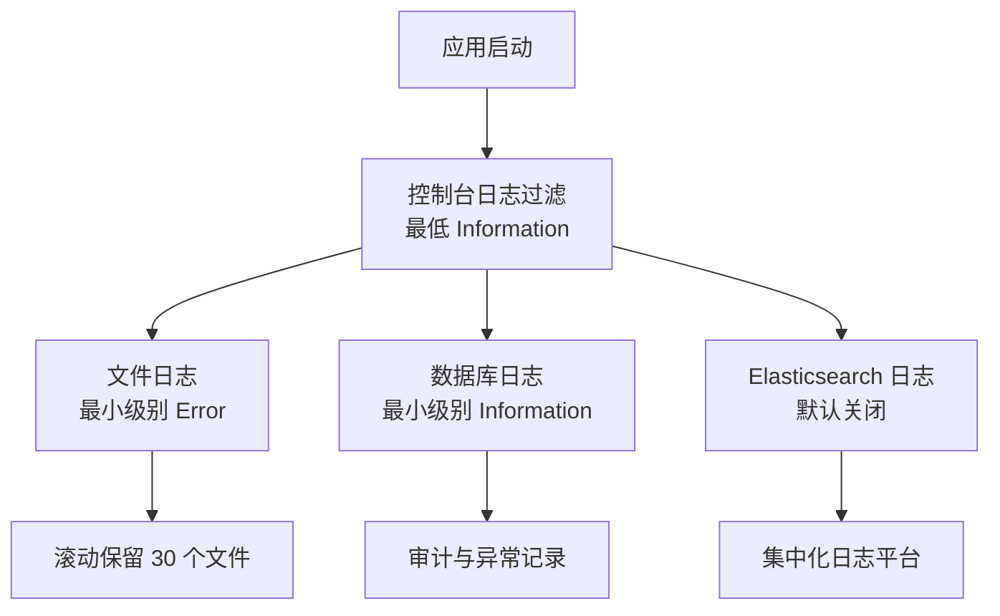

# 故障排除与常见问题解答

<cite>
**本文引用的文件**
- [README.md](file://README.md)
- [开发与验证指南](file://docs/development.md)
- [仓库维护说明](file://docs/maintenance.md)
- [global.json](file://Admin.NET/global.json)
- [Program.cs](file://Admin.NET/Admin.NET.Web.Entry/Program.cs)
- [appsettings.json](file://Admin.NET/Admin.NET.Web.Entry/appsettings.json)
- [Startup.cs](file://Admin.NET/Admin.NET.Web.Core/Startup.cs)
- [App.json](file://Admin.NET/Admin.NET.Application/Configuration/App.json)
- [Logging.json](file://Admin.NET/Admin.NET.Application/Configuration/Logging.json)
- [DbConnectionOptions.cs](file://Admin.NET/Admin.NET.Core/Option/DbConnectionOptions.cs)
- [RateLimitOptions.cs](file://Admin.NET/Admin.NET.Core/Option/RateLimitOptions.cs)
- [Limit.json](file://Admin.NET/Admin.NET.Application/Configuration/Limit.json)
- [vite.config.ts](file://Web/apps/web-antdv-next/vite.config.ts)
- [playwright.config.ts](file://Web/playwright.config.ts)
- [package.json](file://Web/package.json)
- [docker-compose.yml](file://docker/docker-compose.yml)
</cite>

## 目录
1. [简介](#简介)
2. [项目结构与定位](#项目结构与定位)
3. [快速排障路径](#快速排障路径)
4. [环境问题与依赖冲突](#环境问题与依赖冲突)
5. [数据库连接问题](#数据库连接问题)
6. [API 调用问题](#api-调用问题)
7. [性能问题](#性能问题)
8. [安全问题](#安全问题)
9. [日志分析与监控指标](#日志分析与监控指标)
10. [升级与维护问题](#升级与维护问题)
11. [错误信息对照表](#错误信息对照表)
12. [社区支持与反馈渠道](#社区支持与反馈渠道)
13. [结论](#结论)

## 简介
本故障排除文档面向 Admin.NET 后端、前端业务应用及本地开发环境的运维与开发者。目标是在不深入阅读源码的情况下，根据症状快速判断是环境问题、数据库配置、API 鉴权、跨域、限流、日志或部署配置导致的问题，并给出可操作的修复步骤。

当前基线要点：
- 后端解决方案位于 `Admin.NET/Admin.NET.sln`，API 入口为 `Admin.NET/Admin.NET.Web.Entry/`。
- 前端业务应用为 `Web/apps/web-antdv-next/`，使用 pnpm workspace 管理。
- 文档和 README 明确优先以当前仓库配置为准；上游在线文档可能与本分支前端实现不同。

**章节来源**
- [README.md:10-45](file://README.md#L10-L45)
- [开发与验证指南:1-20](file://docs/development.md#L1-L20)

## 项目结构与定位
Admin.NET 采用前后端分离架构：
- 后端由 Furion、SqlSugar、JWT、限流、任务调度、事件总线等基础设施组成。
- 前端基于 Vue 3、Vben、antdv-next 和 Vite 8，通过 pnpm workspace 构建。
- 开发环境通常同时启动 Kestrel API 与 Vite 开发服务器；生产部署可使用 Nginx 反向代理。

**图表来源**
- [Program.cs:21-36](file://Admin.NET/Admin.NET.Web.Entry/Program.cs#L21-L36)
- [App.json:5-10](file://Admin.NET/Admin.NET.Application/Configuration/App.json#L5-L10)
- [vite.config.ts:14-32](file://Web/apps/web-antdv-next/vite.config.ts#L14-L32)
- [Startup.cs:47-115](file://Admin.NET/Admin.NET.Web.Core/Startup.cs#L47-L115)

**章节来源**
- [README.md:20-45](file://README.md#L20-L45)
- [开发与验证指南:1-20](file://docs/development.md#L1-L20)

## 快速排障路径
遇到问题时，按以下顺序检查：

1. **确认运行位置**  
   - 后端命令在 `Admin.NET/` 目录执行。  
   - 前端命令在 `Web/` 目录执行。

2. **确认服务是否启动**  
   - 查看控制台输出中 Kestrel 监听地址。  
   - 浏览器访问前端开发端口或反向代理地址。

3. **区分三类链路**  
   - 纯逻辑问题：使用 Vitest 或单元测试。  
   - 浏览器流程问题：使用 Playwright 桌面 E2E。  
   - 真实数据链路：需要独立 PostgreSQL，不能仅凭 SQLite 或 Mock 断言联调成功。

4. **先看日志**  
   - 文件日志默认开启，最小级别为 Error。  
   - 控制台默认过滤掉部分 Microsoft 类别日志，且最低输出 Information。

5. **再看配置**  
   - 连接字符串、端口、跨域、限流、ES、缓存、OAuth、文件存储等应来自本机忽略文件或环境变量。

6. **最后看外部依赖**  
   - 数据库、Redis、Nginx、MinIO、Elasticsearch 等是否可用。

**章节来源**
- [开发与验证指南:21-64](file://docs/development.md#L21-L64)

## 环境问题与依赖冲突

### .NET SDK 与测试运行器
- 后端要求安装 .NET 10 SDK。各工程目标框架以 `.csproj` 为准。
- `Admin.NET/global.json` 当前只选择 Microsoft.Testing.Platform，并未固定 SDK 版本。
- 测试应在 `Admin.NET/` 目录运行；从仓库根目录直接运行 `dotnet test` 可能选择 VSTest，参数和行为不同。

常见症状：
- 运行测试时报找不到运行器或参数无效。
- 同一命令在不同目录行为不一致。

处理步骤：
1. 确认已安装 .NET 10 SDK。
2. 在 `Admin.NET/` 目录执行 `dotnet restore` 和 `dotnet build`。
3. 使用 `dotnet test --project Admin.NET.Test/Admin.NET.Test.csproj`。
4. 不要混用 VSTest 与 Microsoft.Testing.Platform 的参数。

**章节来源**
- [README.md:25-35](file://README.md#L25-L35)
- [global.json:1-5](file://Admin.NET/global.json#L1-L5)
- [开发与验证指南:21-40](file://docs/development.md#L21-L40)

### Node.js、pnpm 与前端工作区
- Node.js 版本受 `engines` 约束：`^22.18.0 || ^24.12.0`。
- packageManager 固定为 `pnpm@11.16.0`。
- 所有脚本以 `Web/package.json` 为准，`dev`、`build`、`lint`、`check:type` 面向业务应用 `@vben/web-antdv-next`，不是全 workspace 的完整类型检查。

常见症状：
- `pnpm install` 报 Node.js 版本不匹配。
- `pnpm dev` 无法找到业务应用。
- 全局 npm/yarn 行为与 workspace 不一致。

处理步骤：
1. 使用 nvm 或包管理器切换到受支持的 Node.js 版本。
2. 在 `Web/` 目录执行 `pnpm install --frozen-lockfile`。
3. 使用 `pnpm dev`、`pnpm build`、`pnpm lint`、`pnpm check:type`。
4. 若共享包改动，需补充对应范围的 lint 和 typecheck。

**章节来源**
- [package.json:1-102](file://Web/package.json#L1-L102)
- [开发与验证指南:42-60](file://docs/development.md#L42-L60)

### 端口占用与服务冲突
- Kestrel 默认监听 `http://*:5005`。
- Vite 开发服务器在 Playwright E2E 中默认启动于 `http://127.0.0.1:8890`。
- Docker 示例中 Nginx 映射 9100/9103，API 容器映射 9102。

常见症状：
- 启动 API 时报端口已被占用。
- 前端代理到后端失败。
- 多个实例互相抢占端口。

处理步骤：
1. 检查本机是否有其他 Admin.NET 实例或旧进程。
2. 修改 `App.json` 中的 `Urls` 或通过运行时配置覆盖端口。
3. 调整 Vite 代理目标地址。
4. 使用隔离的开发数据库和临时端口，避免重复初始化。

**章节来源**
- [App.json:5-10](file://Admin.NET/Admin.NET.Application/Configuration/App.json#L5-L10)
- [playwright.config.ts:3-31](file://Web/playwright.config.ts#L3-L31)
- [docker-compose.yml:4-10](file://docker/docker-compose.yml#L4-L10)
- [docker-compose.yml:90-110](file://docker/docker-compose.yml#L90-L110)

### Windows 事件日志权限
- 控制台运行时禁用 Windows 事件日志写入，避免普通用户权限异常。
- 仅在 Windows 非 Windows Service 模式下生效。

常见症状：
- 控制台启动时出现事件日志写入权限错误。
- 事件查看器中没有 Admin.NET 日志。

处理步骤：
1. 以管理员身份运行终端，或使用 Windows Service 模式。
2. 保持默认行为：控制台运行时不写事件日志。
3. 将诊断日志转移到文件日志或数据库日志。

**章节来源**
- [Program.cs:21-28](file://Admin.NET/Admin.NET.Web.Entry/Program.cs#L21-L28)

## 数据库连接问题

### 连接字符串错误
DbConnectionOptions 支持多连接配置，并通过 `EnableConnStringEncrypt` 启用连接串加密策略。首次启动可能创建表和种子数据，因此必须使用独立开发库。

常见症状：
- 启动时报无法连接数据库。
- 连接串中包含明文密码被拒绝。
- 数据库名称、主机、端口或驱动不正确。

处理步骤：
1. 确认数据库服务可用。
2. 检查连接字符串格式和数据库类型。
3. 如启用连接串加密，确认解密配置正确。
4. 使用独立数据库，避免误初始化生产数据。
5. 观察文件日志中的数据库初始化信息和 SQL 打印（需显式启用）。

**章节来源**
- [DbConnectionOptions.cs:18-136](file://Admin.NET/Admin.NET.Core/Option/DbConnectionOptions.cs#L18-L136)
- [README.md:35-45](file://README.md#L35-L45)

### 权限不足
- 连接用户无权创建数据库、表、视图或种子数据。
- Docker 示例中 MySQL root 用户具有较高权限，但不应直接用于生产。

常见症状：
- 初始化阶段报权限拒绝。
- 能查询但不能建表。
- 租户隔离后某些库不可见。

处理步骤：
1. 为应用分配最小必要权限。
2. 如需自动建库建表，单独授予相应权限。
3. 生产环境关闭自动初始化开关。
4. 记录所需权限清单，不记录真实凭据。

**章节来源**
- [DbConnectionOptions.cs:74-136](file://Admin.NET/Admin.NET.Core/Option/DbConnectionOptions.cs#L74-L136)
- [docker-compose.yml:12-39](file://docker/docker-compose.yml#L12-L39)

### 字符集与命名约定
- 可通过配置启用驼峰转下划线映射。
- 不同数据库对大小写、字符集、排序规则敏感。

常见症状：
- 实体字段与数据库列名不一致。
- 中文显示乱码或排序异常。
- 迁移后列名大小写变化导致查询失败。

处理步骤：
1. 确认数据库字符集和排序规则。
2. 根据需要启用驼峰转下划线。
3. 对比实体定义与数据库实际结构。
4. 使用差异日志功能辅助排查表结构变更。

**章节来源**
- [DbConnectionOptions.cs:86-110](file://Admin.NET/Admin.NET.Core/Option/DbConnectionOptions.cs#L86-L110)

### 多租户与隔离
- 每个连接配置可指定租户隔离方式。
- 多库或多 schema 场景需分别验证连接和权限。

常见症状：
- 某个租户查不到数据。
- 切换租户后连接失效。
- 主库和从库配置混淆。

处理步骤：
1. 核对每个连接的 `TenantType` 和连接串。
2. 验证租户上下文是否正确注入。
3. 使用独立测试租户和数据。
4. 检查数据库层面是否实现了预期的隔离策略。

**章节来源**
- [DbConnectionOptions.cs:62-73](file://Admin.NET/Admin.NET.Core/Option/DbConnectionOptions.cs#L62-L73)

## API 调用问题

### 认证失败
后端启用了 JWT 全局授权，并支持从 URL 查询参数或 SignalR Hub 的 access_token 中获取 Token；同时提供签名认证能力。

常见症状：
- 请求返回未认证或禁止访问。
- 浏览器直接访问接口失败，但 Swagger 可访问。
- WebSocket 连接携带 token 仍失败。

处理步骤：
1. 确认前端是否携带有效 Token。
2. 确认请求头或查询参数中的 token 名称正确。
3. 检查 Token 是否过期。
4. 如涉及签名认证，核对签名算法、密钥和请求签名。
5. 查看日志中的鉴权相关错误。

**图表来源**
- [Startup.cs:47-79](file://Admin.NET/Admin.NET.Web.Core/Startup.cs#L47-L79)

**章节来源**
- [Startup.cs:47-115](file://Admin.NET/Admin.NET.Web.Core/Startup.cs#L47-L115)

### 跨域配置
- CORS 已注册。
- `AllowedHosts` 默认为 `*`。
- 暴露了 `Content-Disposition`、`X-Pagination`、`access-token`、`x-access-token` 等响应头。
- SignalR 跨域支持已启用。

常见症状：
- 浏览器控制台报跨域错误。
- 上传下载响应头缺失。
- SignalR 连接失败。

处理步骤：
1. 确认前端是否通过 Vite 代理访问 `/prod-api`。
2. 如绕过代理直连，确认前端来源在后端允许范围内。
3. 检查自定义响应头是否被反向代理过滤。
4. 检查浏览器开发者工具的网络面板和 Console。

**章节来源**
- [App.json:27-37](file://Admin.NET/Admin.NET.Application/Configuration/App.json#L27-L37)
- [Startup.cs:87-89](file://Admin.NET/Admin.NET.Web.Core/Startup.cs#L87-L89)
- [vite.config.ts:24-32](file://Web/apps/web-antdv-next/vite.config.ts#L24-L32)

### 超时与上传大小
- Kestrel 的 KeepAlive 超时和请求头超时均设置为 30 分钟。
- 请求体大小限制被设置为 null，但这不代表所有类型和大小的文件都会被业务层接受。
- 反向代理、网关和业务校验也可能限制上传大小。

常见症状：
- 大文件上传失败。
- 长耗时接口超时。
- 代理层返回 413 或 504。

处理步骤：
1. 先确认 Kestrel 是否放行。
2. 再检查 Nginx、负载均衡器或网关限制。
3. 检查业务上传校验逻辑。
4. 结合日志分析具体失败阶段。

**章节来源**
- [Program.cs:29-36](file://Admin.NET/Admin.NET.Web.Entry/Program.cs#L29-L36)
- [README.md:35-45](file://README.md#L35-L45)

### 代理与路由
- Vite 将 `/schedule` 和 `/prod-api` 转发到 `http://localhost:5005`。
- `/prod-api` 会去掉前缀并启用 WebSocket。
- Playwright E2E 默认启动前端开发服务器并设置 baseURL。

常见症状：
- 前端页面能加载，但接口 404。
- WebSocket 连接失败。
- E2E 用例因 baseURL 或端口不一致失败。

处理步骤：
1. 检查 Vite 代理 target 是否指向正确的 API 地址。
2. 确认业务路由前缀未被额外改写。
3. 检查反向代理是否透传 WebSocket。
4. E2E 失败时先手动打开 Playwright 配置的 baseURL。

**章节来源**
- [vite.config.ts:14-32](file://Web/apps/web-antdv-next/vite.config.ts#L14-L32)
- [playwright.config.ts:3-31](file://Web/playwright.config.ts#L3-L31)

### 客户端 IP 与转发头
- 后端已配置 ForwardedHeaders，并清空已知网络或代理列表。
- 限流配置读取 `X-Real-IP` 作为真实客户端 IP。

常见症状：
- 限流统计到的是内网 IP。
- 审计日志中客户端 IP 不准确。
- 反向代理未传递 X-Real-IP。

处理步骤：
1. 确保反向代理设置 `X-Real-IP` 或限流配置中的真实 IP 头。
2. 如使用负载均衡，检查其转发策略。
3. 结合日志和限流响应验证 IP 来源。

**章节来源**
- [Startup.cs:107-122](file://Admin.NET/Admin.NET.Web.Core/Startup.cs#L107-L122)
- [Limit.json:8-19](file://Admin.NET/Admin.NET.Application/Configuration/Limit.json#L8-L19)

## 性能问题

### 慢查询
- 可通过数据库选项启用控制台 SQL 打印，便于定位慢查询。
- 建议结合数据库慢查询日志和 SqlSugar 行为进行分析。

处理步骤：
1. 启用控制台 SQL 打印。
2. 复现慢查询并记录 SQL。
3. 在数据库中执行 EXPLAIN 或等价分析。
4. 增加索引、优化查询条件或分页策略。
5. 关闭调试输出后再回归压测。

**章节来源**
- [DbConnectionOptions.cs:24-30](file://Admin.NET/Admin.NET.Core/Option/DbConnectionOptions.cs#L24-L30)

### 内存泄漏与对象循环引用
- JSON 序列化已启用忽略循环引用。
- 长时间运行服务时应关注日志中未处理异常、事件总线异常和监控拦截日志。

处理步骤：
1. 检查是否返回包含循环引用的复杂对象。
2. 检查事件总线执行器和监视器日志。
3. 使用 .NET 性能分析工具采样堆和 GC 行为。
4. 避免在单例中持有大量瞬时对象。

**章节来源**
- [Startup.cs:96-105](file://Admin.NET/Admin.NET.Web.Core/Startup.cs#L96-L105)
- [Startup.cs:129-156](file://Admin.NET/Admin.NET.Web.Core/Startup.cs#L129-L156)

### CPU 占用过高
- 限流使用内存存储，高并发下可能增加压力。
- 事件总线、任务调度、ES 日志、监控拦截都会产生额外开销。

处理步骤：
1. 检查是否启用了全局方法监控拦截。
2. 检查 ES 日志是否开启。
3. 检查限流规则是否过松或过于频繁。
4. 使用压测工具评估 QPS、延迟和错误率。
5. 逐步关闭非必要功能定位瓶颈。

**章节来源**
- [Startup.cs:122-128](file://Admin.NET/Admin.NET.Web.Core/Startup.cs#L122-L128)
- [Logging.json:30-50](file://Admin.NET/Admin.NET.Application/Configuration/Logging.json#L30-L50)
- [Limit.json:1-107](file://Admin.NET/Admin.NET.Application/Configuration/Limit.json#L1-L107)

### 前端构建内存
- 前端 build 脚本设置了较大的 Node.js 堆内存上限。
- 若构建仍 OOM，可减少并行任务或清理 node_modules。

处理步骤：
1. 使用 `pnpm build` 触发业务应用构建。
2. 清理缓存后重试。
3. 降低构建并行度或分模块构建。
4. 检查是否有超大静态资源或未压缩产物。

**章节来源**
- [package.json:14-24](file://Web/package.json#L14-L24)

## 安全问题

### SQL 注入
- 框架使用 SqlSugar，建议始终使用参数化查询。
- 动态 SQL、拼接查询、导出模板和开放接口尤其需要校验。

处理步骤：
1. 审查所有动态 SQL 和模糊查询。
2. 禁止直接使用用户输入拼接 SQL。
3. 对外部输入进行白名单校验。
4. 对高风险接口添加限流和审计。

### XSS 攻击
- JSON 编码器使用了较宽松策略以处理中文乱码，但前端渲染仍需遵循安全规范。
- 上传文件名、富文本、模板内容都需要转义或净化。

处理步骤：
1. 前端对用户输入进行转义，避免直接插入 DOM。
2. 富文本内容使用安全的 HTML 净化库。
3. 文件上传限制类型、大小和白名单。
4. 设置合理的 Content-Security-Policy。

### CSRF 防护
- 本项目为前后端分离，主要依赖 Cookie 或 Token 机制。
- 如果启用 Cookie 认证，需配合 SameSite、Secure、HttpOnly 和 CSRF Token。
- 若仅使用 Bearer Token，则需确保 Token 不被泄露。

处理步骤：
1. 确认认证方式。
2. 检查 Cookie 安全属性。
3. 对写操作实施 Token 校验。
4. 检查反向代理是否保留或改写关键头。

### 限流与暴力破解
- 限流默认对 IP 和客户端启用，并返回 429。
- 需注意 `IpRateLimitPolicies` 中存在一条对 `0.0.0.0` 完全屏蔽的规则，可能影响预期行为。

处理步骤：
1. 检查是否误命中黑名单。
2. 调整限流阈值，避免误伤正常流量。
3. 结合日志分析高频来源。
4. 在生产环境替换为更可靠的限流存储。

**章节来源**
- [Limit.json:1-107](file://Admin.NET/Admin.NET.Application/Configuration/Limit.json#L1-L107)
- [Startup.cs:122-128](file://Admin.NET/Admin.NET.Web.Core/Startup.cs#L122-L128)

## 日志分析与监控指标

### 日志位置与级别
- 文件日志默认开启，最小级别为 Error，最大滚动文件数 30，单文件 10MB。
- 数据库日志默认开启，最小级别为 Information。
- Elasticsearch 日志默认关闭，示例中带有占位地址和凭据，不得直接用于生产。
- 控制台日志默认过滤 Microsoft.Hosting 和 Microsoft.AspNetCore，且最低为 Information。

常见症状：
- 看不到业务异常。
- 日志文件增长过快。
- 没有数据库或 ES 日志。

处理步骤：
1. 确认文件日志路径和磁盘空间。
2. 按需调整 MinimumLevel。
3. 关闭不必要的 ES 日志或改用生产配置。
4. 使用数据库日志做持久化审计。

**图表来源**
- [Program.cs:25-28](file://Admin.NET/Admin.NET.Web.Entry/Program.cs#L25-L28)
- [Logging.json:1-50](file://Admin.NET/Admin.NET.Application/Configuration/Logging.json#L1-L50)

**章节来源**
- [Program.cs:25-28](file://Admin.NET/Admin.NET.Web.Entry/Program.cs#L25-L28)
- [Logging.json:1-50](file://Admin.NET/Admin.NET.Application/Configuration/Logging.json#L1-L50)

### 监控指标解读
- AppSettings 中的 `InjectSpecificationDocument` 控制是否注入接口文档。
- CorsAccessorSettings 暴露了 SignalR 跨域支持。
- JobSchedule.Enabled 控制任务调度是否启用。
- SnowId 的 WorkerId 在多机部署时需全局唯一。

处理步骤：
1. 生产环境关闭 Swagger 注入。
2. 核对 SignalR 跨域是否需要。
3. 检查任务调度是否意外启用。
4. 多实例部署时保证雪花 ID 机器码唯一。

**章节来源**
- [App.json:5-65](file://Admin.NET/Admin.NET.Application/Configuration/App.json#L5-L65)

## 升级与维护问题

### 版本兼容性
- 后端方案支持 .NET 8 和 .NET 10，API 入口与测试项目使用 .NET 10。
- global.json 仅指定测试运行器，不固定 SDK 版本。
- 前端 Node.js 版本需满足 engines 约束，pnpm 版本以 lockfile 为准。

常见症状：
- 编译目标框架不匹配。
- 测试运行器不一致。
- 前端依赖安装失败。

处理步骤：
1. 升级 .NET SDK 到 10。
2. 在 `Admin.NET/` 目录恢复和测试。
3. 在 `Web/` 目录使用指定 pnpm 版本安装。
4. 不随意升级 lockfile 中未声明的版本。

**章节来源**
- [README.md:10-35](file://README.md#L10-L35)
- [global.json:1-5](file://Admin.NET/global.json#L1-L5)
- [package.json:90-102](file://Web/package.json#L90-L102)

### 数据迁移与初始化
- 数据库连接配置支持启用库表初始化、视图初始化、差异日志和种子数据初始化。
- 初次运行可能创建表结构和种子数据，务必使用独立开发库。

常见症状：
- 升级后表结构不一致。
- 种子数据重复或丢失。
- 视图未更新。

处理步骤：
1. 备份现有数据。
2. 在独立库验证迁移。
3. 使用差异日志对比结构。
4. 分批启用增量更新和种子更新。
5. 回滚前先确认数据一致性。

**章节来源**
- [DbConnectionOptions.cs:86-136](file://Admin.NET/Admin.NET.Core/Option/DbConnectionOptions.cs#L86-L136)
- [README.md:35-45](file://README.md#L35-L45)

### 配置变更影响
- 跨域、限流、日志、ES、任务调度、雪花 ID、CORS 暴露头等都可能影响线上行为。
- 配置扫描目录由 appsettings 指定，Configuration 文件夹下的 JSON 会被合并。

常见症状：
- 上线后突然 429。
- 日志不再写入。
- 跨域或 SignalR 断开。
- 多实例 ID 冲突。

处理步骤：
1. 使用配置变更清单逐项核对。
2. 先在预发环境验证。
3. 灰度发布并观察限流、日志和监控。
4. 准备好回滚配置和数据迁移脚本。

**章节来源**
- [appsettings.json:1-5](file://Admin.NET/Admin.NET.Web.Entry/appsettings.json#L1-L5)
- [Limit.json:1-107](file://Admin.NET/Admin.NET.Application/Configuration/Limit.json#L1-L107)
- [Logging.json:1-50](file://Admin.NET/Admin.NET.Application/Configuration/Logging.json#L1-L50)
- [App.json:5-65](file://Admin.NET/Admin.NET.Application/Configuration/App.json#L5-L65)

### 临时资料与构建产物清理
- 不应把临时任务记录、缓存、构建产物或绝对路径当作长期依据。
- bin、obj、dist、test-results、playwright-report 等可再生产物可在无运行任务后清理。
- node_modules 和 pnpm 缓存属于开发环境，不属于日常文档默认清理范围。
- 数据库文件、上传目录、证书、凭据不得批量删除。

**章节来源**
- [仓库维护说明:15-37](file://docs/maintenance.md#L15-L37)

## 错误信息对照表

| 现象 | 可能原因 | 定位步骤 | 解决建议 |
|---|---|---|---|
| 启动时报端口占用 | Kestrel 默认监听 5005，已有进程占用 | 查看控制台输出和网络端口 | 停止旧进程或修改监听地址 |
| 前端页面能打开但接口 404 | Vite 代理目标错误或路由前缀不匹配 | 检查 vite.config.ts 和 API 路由 | 修正代理 target 和 rewrite |
| 浏览器报跨域 | 前端直连后端或响应头未暴露 | 检查 CORS 配置和代理 | 使用代理或配置允许的 Origin 和 Expose-Headers |
| 认证失败 | Token 缺失、过期或签名错误 | 检查请求头、Token 生命周期和签名配置 | 刷新 Token，核对签名算法和密钥 |
| WebSocket 连接失败 | /prod-api 未透传 WS 或 Token 参数错误 | 检查代理 ws 配置和 hub 参数 | 启用 ws，确认 access_token 参数 |
| 上传失败 | Kestrel、代理或业务校验限制大小 | 查看日志和响应状态码 | 分层调整上传大小限制 |
| 登录或操作频繁被拒 | 触发 IP 或客户端限流 | 检查 Limit.json 和响应 429 | 调整阈值、白名单或真实 IP 头 |
| 数据库连接失败 | 连接串错误、权限不足、网络不通 | 检查连接串、数据库服务和用户权限 | 修正连接串并分配最小权限 |
| 表结构不一致 | 未执行迁移或增量更新 | 启用差异日志并对比结构 | 在独立库验证迁移后发布 |
| 中文乱码 | JSON 编码或数据库字符集问题 | 检查 JSON 编码器和数据库字符集 | 统一字符集，必要时调整编码策略 |
| 日志很少 | 控制台过滤或文件日志最小级别为 Error | 检查 Program.cs 和 Logging.json | 临时提高日志级别并定位 |
| ES 日志无数据 | ES 未启用或地址凭据错误 | 检查 Logging.json | 配置真实 ES 服务并关闭示例凭据 |
| 构建 OOM | Node 堆内存不足或依赖过大 | 查看构建日志和内存占用 | 增加 NODE_OPTIONS 或减少并行任务 |
| E2E 失败 | baseURL 或端口不一致 | 检查 playwright.config.ts | 设置 ADMINNET_E2E_BASE_URL 或修正端口 |
| 多实例 ID 冲突 | SnowId WorkerId 相同 | 检查 App.json 中的雪花 ID 配置 | 为每台机器分配唯一 WorkerId |

**章节来源**
- [Program.cs:21-36](file://Admin.NET/Admin.NET.Web.Entry/Program.cs#L21-L36)
- [vite.config.ts:14-32](file://Web/apps/web-antdv-next/vite.config.ts#L14-L32)
- [App.json:5-65](file://Admin.NET/Admin.NET.Application/Configuration/App.json#L5-L65)
- [Limit.json:1-107](file://Admin.NET/Admin.NET.Application/Configuration/Limit.json#L1-L107)
- [Logging.json:1-50](file://Admin.NET/Admin.NET.Application/Configuration/Logging.json#L1-L50)
- [playwright.config.ts:3-31](file://Web/playwright.config.ts#L3-L31)
- [DbConnectionOptions.cs:24-136](file://Admin.NET/Admin.NET.Core/Option/DbConnectionOptions.cs#L24-L136)

## 社区支持与反馈渠道
- 上游在线文档：[https://adminnet.top/](https://adminnet.top/)
- 上游演示：[https://demo.adminnet.top](https://demo.adminnet.top)
- 上游仓库：GitHub、Gitee、GitCode（详见 README）
- Gitee 仓库的 ISSUE_TEMPLATE 和 PULL_REQUEST_TEMPLATE 可作为反馈模板参考。

注意事项：
- 提交问题前，先确认是否为当前分支的前端实现，而不是上游旧前端。
- 报告问题时附上操作系统、SDK 版本、Node/pnpm 版本、数据库类型和版本、日志片段。
- 不要附带真实连接串、密码、令牌或个人信息。

**章节来源**
- [README.md:40-55](file://README.md#L40-L55)
- [.gitee/.gitee\PULL_REQUEST_TEMPLATE.md](file://.gitee/PULL_REQUEST_TEMPLATE.md)

## 结论
Admin.NET 的排障核心在于区分“环境—连接—鉴权—代理—限流—日志—部署”七类问题。大多数故障可以通过以下路径快速收敛：确认 SDK 与 pnpm 版本、检查端口和代理、验证数据库连接和权限、查看 Token 和跨域、分析限流 429、定位日志输出、最后回到配置和部署拓扑。升级和维护时，始终以当前仓库配置和 lockfile 为准，并在独立环境中完成数据库迁移和安全验证。