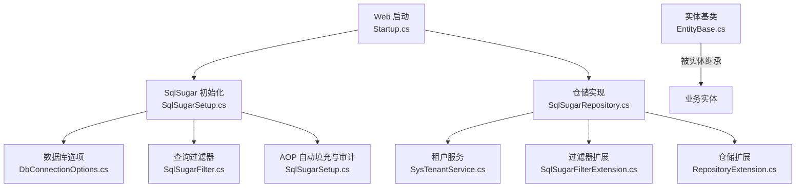
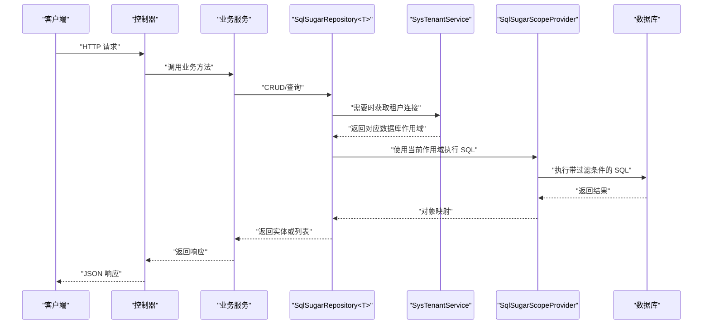
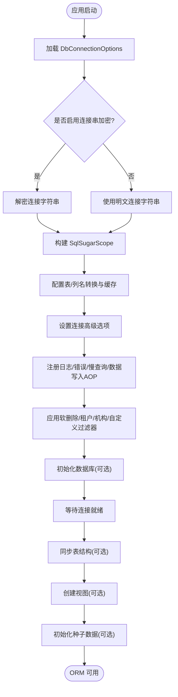
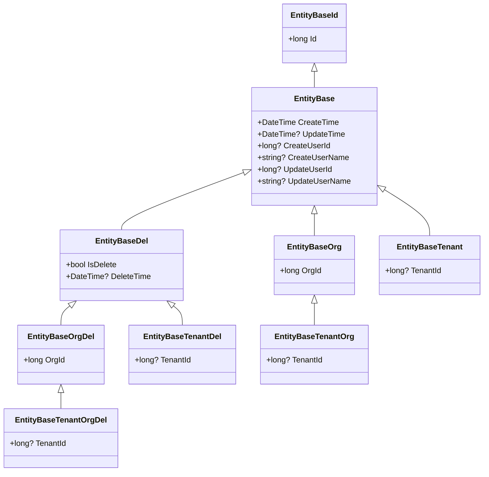
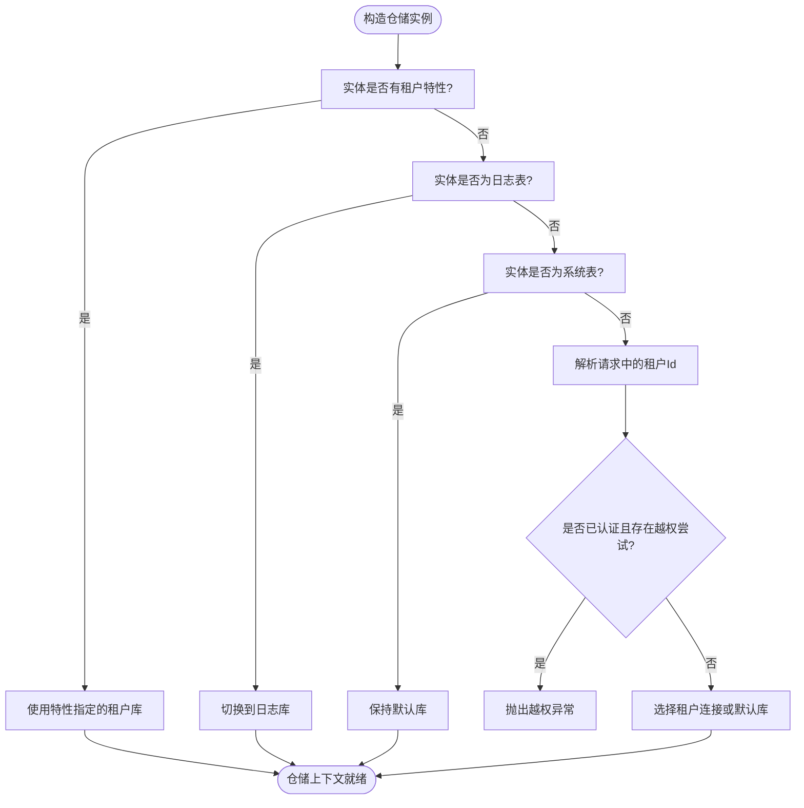
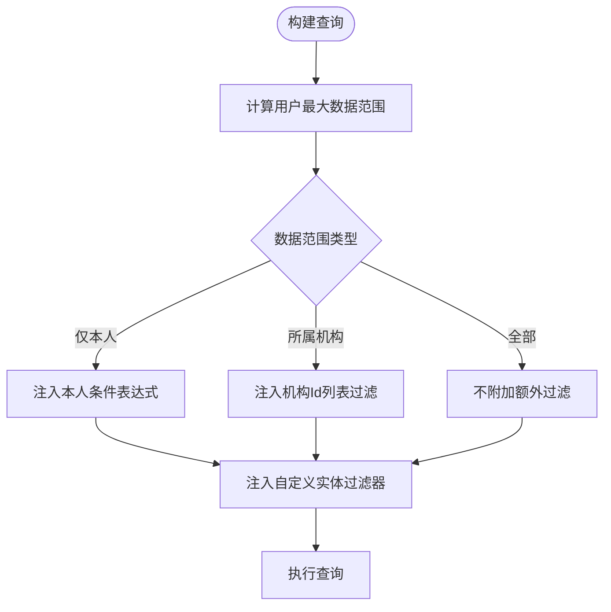
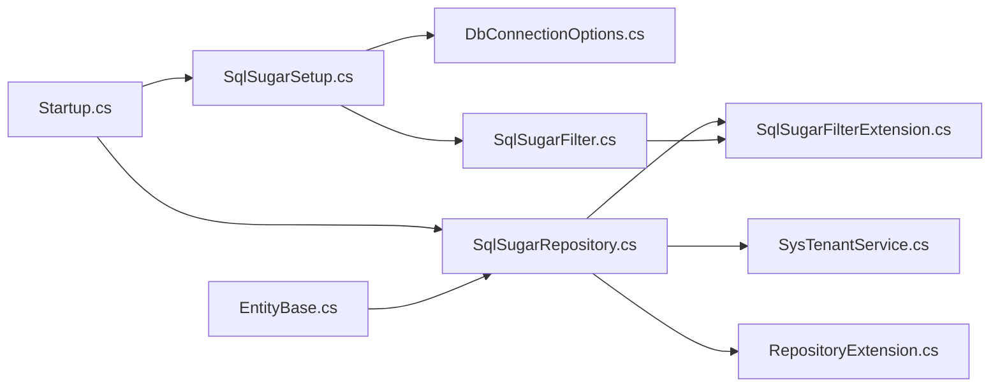

# ORM 映射与配置

<cite>
**本文引用的文件**   
- [SqlSugarSetup.cs](file://Admin.NET/Admin.NET.Core/SqlSugar/SqlSugarSetup.cs)
- [SqlSugarRepository.cs](file://Admin.NET/Admin.NET.Core/SqlSugar/SqlSugarRepository.cs)
- [ISqlSugarRepository.cs](file://Admin.NET/Admin.NET.Core/SqlSugar/ISqlSugarRepository.cs)
- [SqlSugarFilter.cs](file://Admin.NET/Admin.NET.Core/SqlSugar/SqlSugarFilter.cs)
- [EntityBase.cs](file://Admin.NET/Admin.NET.Core/Entity/EntityBase.cs)
- [DbConnectionOptions.cs](file://Admin.NET/Admin.NET.Core/Option/DbConnectionOptions.cs)
- [Startup.cs](file://Admin.NET/Admin.NET.Web.Core/Startup.cs)
- [RepositoryExtension.cs](file://Admin.NET/Admin.NET.Core/Extension/RepositoryExtension.cs)
- [SqlSugarFilterExtension.cs](file://Admin.NET/Admin.NET.Core/Extension/SqlSugarFilterExtension.cs)
- [SysTenantService.cs](file://Admin.NET/Admin.NET.Core/Service/Tenant/SysTenantService.cs)
</cite>

## 目录
1. [引言](#引言)
2. [项目结构](#项目结构)
3. [核心组件](#核心组件)
4. [架构总览](#架构总览)
5. [详细组件分析](#详细组件分析)
6. [依赖关系分析](#依赖关系分析)
7. [性能与优化建议](#性能与优化建议)
8. [故障排查指南](#故障排查指南)
9. [结论](#结论)

## 引言
本文围绕 Admin.NET 后端中基于 SqlSugar 的 ORM 层展开，系统性说明数据库连接管理、实体基类设计、特性约定、仓储模式、过滤机制、多租户与跨库适配，以及性能优化实践。读者可据此理解框架如何把业务实体、SQL 生成、事务边界、数据权限和日志审计统一起来。

## 项目结构
ORM 相关代码主要集中在以下模块：
- SqlSugar 初始化与全局配置：`Admin.NET.Admin.NET.Core/SqlSugar/SqlSugarSetup.cs`
- 仓储实现与分表操作：`Admin.NET.Admin.NET.Core/SqlSugar/SqlSugarRepository.cs`、`Admin.NET.Admin.NET.Core/SqlSugar/ISqlSugarRepository.cs`
- 查询过滤器与数据权限：`Admin.NET.Admin.NET.Core/SqlSugar/SqlSugarFilter.cs`
- 实体模型与通用字段：`Admin.NET.Admin.NET.Core/Entity/EntityBase.cs`
- 数据库连接选项：`Admin.NET.Admin.NET.Core/Option/DbConnectionOptions.cs`
- Web 启动集成：`Admin.NET.Admin.NET.Web.Core/Startup.cs`
- 仓储扩展能力：`Admin.NET.Admin.NET.Core/Extension/RepositoryExtension.cs`
- 过滤器表达式构建扩展：`Admin.NET.Admin.NET.Core/Extension/SqlSugarFilterExtension.cs`
- 租户动态连接：`Admin.NET.Admin.NET.Core/Service/Tenant/SysTenantService.cs`

图表来源
- [Startup.cs:1-120](file://Admin.NET/Admin.NET.Web.Core/Startup.cs#L1-L120)
- [SqlSugarSetup.cs:1-120](file://Admin.NET/Admin.NET.Core/SqlSugar/SqlSugarSetup.cs#L1-L120)
- [DbConnectionOptions.cs:1-136](file://Admin.NET/Admin.NET.Core/Option/DbConnectionOptions.cs#L1-L136)
- [SqlSugarRepository.cs:1-125](file://Admin.NET/Admin.NET.Core/SqlSugar/SqlSugarRepository.cs#L1-L125)
- [SysTenantService.cs:767-810](file://Admin.NET/Admin.NET.Core/Service/Tenant/SysTenantService.cs#L767-L810)
- [SqlSugarFilter.cs:1-200](file://Admin.NET/Admin.NET.Core/SqlSugar/SqlSugarFilter.cs#L1-L200)

章节来源
- [Startup.cs:1-120](file://Admin.NET/Admin.NET.Web.Core/Startup.cs#L1-L120)
- [SqlSugarSetup.cs:1-120](file://Admin.NET/Admin.NET.Core/SqlSugar/SqlSugarSetup.cs#L1-L120)

## 核心组件
- SqlSugar 全局初始化器：负责注册雪花主键、动态表达式解析、连接配置、外部服务映射、AOP、视图与种子数据初始化等。
- 仓储抽象与实现：封装 CRUD、批量、分表与按租户切换连接的逻辑。
- 实体基类族：定义 Id、创建/更新时间、创建/更新人、删除标志、机构与租户等通用字段及索引。
- 查询过滤器：提供软删除、租户隔离、机构数据范围、自定义实体过滤等全局条件注入。
- 连接选项：集中描述控制台 SQL、加密、下划线命名、增量建表、差异日志等开关。
- 仓储扩展：提供假删除、排序分页构造、差异日志更新等常用能力。
- 过滤器表达式扩展：根据特性自动生成“本人或指定用户集合”的条件表达式。
- 租户服务：按租户动态获取或创建数据库连接，支持按 Id 或独立库的多租户模式。

章节来源
- [SqlSugarSetup.cs:1-200](file://Admin.NET/Admin.NET.Core/SqlSugar/SqlSugarSetup.cs#L1-L200)
- [SqlSugarRepository.cs:1-125](file://Admin.NET/Admin.NET.Core/SqlSugar/SqlSugarRepository.cs#L1-L125)
- [EntityBase.cs:1-203](file://Admin.NET/Admin.NET.Core/Entity/EntityBase.cs#L1-L203)
- [SqlSugarFilter.cs:1-200](file://Admin.NET/Admin.NET.Core/SqlSugar/SqlSugarFilter.cs#L1-L200)
- [DbConnectionOptions.cs:1-136](file://Admin.NET/Admin.NET.Core/Option/DbConnectionOptions.cs#L1-L136)
- [RepositoryExtension.cs:1-200](file://Admin.NET/Admin.NET.Core/Extension/RepositoryExtension.cs#L1-L200)
- [SqlSugarFilterExtension.cs:1-65](file://Admin.NET/Admin.NET.Core/Extension/SqlSugarFilterExtension.cs#L1-L65)
- [SysTenantService.cs:767-810](file://Admin.NET/Admin.NET.Core/Service/Tenant/SysTenantService.cs#L767-L810)

## 架构总览
下图展示一次典型请求从 Web 启动到 ORM 访问的全链路，包括连接选择、过滤器注入、AOP 自动填充与审计。

图表来源
- [Startup.cs:1-120](file://Admin.NET/Admin.NET.Web.Core/Startup.cs#L1-L120)
- [SqlSugarRepository.cs:1-125](file://Admin.NET/Admin.NET.Core/SqlSugar/SqlSugarRepository.cs#L1-L125)
- [SysTenantService.cs:767-810](file://Admin.NET/Admin.NET.Core/Service/Tenant/SysTenantService.cs#L767-L810)
- [SqlSugarSetup.cs:120-250](file://Admin.NET/Admin.NET.Core/SqlSugar/SqlSugarSetup.cs#L120-L250)

## 详细组件分析

### SqlSugar 初始化与数据库连接管理
- 连接读取与解密：从 `DbConnectionOptions.ConnectionConfigs` 加载连接；若启用连接串加密则解密后再使用。
- 全局设置：
  - 雪花 Id：注册 YitIdHelper 并覆盖 SqlSugar 雪花算法，使主键默认使用雪花 Id。
  - 动态表达式解析：通过 `DynamicExpressionParser` 与自定义类型提供者支持复杂查询表达式。
  - 外部服务映射：表名、列名转换、缓存服务等。
- 连接属性：
  - 自动关闭连接、自动清理缓存、自动更新/删除查询过滤器。
  - SQL Server 使用 Nvarchar。
  - 人大金仓以 PostgreSQL 模式兼容系统表差异。
  - Oracle 参数名长度限制为 30。
- AOP 行为：
  - 控制台 SQL 打印（可按 SELECT/INSERT/UPDATE/DELETE 着色）。
  - 错误与慢 SQL 日志（超过 5 秒记录慢查询）。
  - 数据写入前自动填充：主键、创建时间、租户 Id、创建者信息、组织信息；更新时更新时间、更新者；软删除时写删除时间与更新信息。
- 过滤器：
  - 非超级管理员或未忽略策略时，应用软删除过滤器。
  - 根据当前用户注入租户过滤器。
  - 调用 `SqlSugarFilter` 注入机构数据范围与自定义过滤器。
- 初始化流程：
  - 按需创建数据库（Oracle 除外）、等待连接就绪、同步表结构、创建视图、初始化种子数据。
  - 视图初始化会扫描实现 `ISqlSugarView` 的类型并执行其提供的 SQL 建视图。
  - 表结构初始化会根据 `SugarTable` 与 `IgnoreTableAttribute`、`IncreTableAttribute`、`SysTableAttribute`、`LogTableAttribute`、`TenantAttribute` 决定哪些实体参与初始化。

图表来源
- [SqlSugarSetup.cs:1-200](file://Admin.NET/Admin.NET.Core/SqlSugar/SqlSugarSetup.cs#L1-L200)
- [SqlSugarSetup.cs:200-519](file://Admin.NET/Admin.NET.Core/SqlSugar/SqlSugarSetup.cs#L200-L519)
- [DbConnectionOptions.cs:1-136](file://Admin.NET/Admin.NET.Core/Option/DbConnectionOptions.cs#L1-L136)

章节来源
- [SqlSugarSetup.cs:1-519](file://Admin.NET/Admin.NET.Core/SqlSugar/SqlSugarSetup.cs#L1-L519)
- [DbConnectionOptions.cs:1-136](file://Admin.NET/Admin.NET.Core/Option/DbConnectionOptions.cs#L1-L136)

### 实体基类与通用字段自动填充
- 主键与 Id 基类：`EntityBaseId` 使用雪花 Id，作为所有实体的根。
- 通用审计字段：
  - `CreateTime`：新增时自动填充当前时间。
  - `UpdateTime`：更新时自动填充当前时间。
  - `CreateUserId` / `CreateUserName`：新增时自动填充当前用户。
  - `UpdateUserId` / `UpdateUserName`：更新时自动填充当前用户。
- 删除标志：
  - `EntityBaseDel` 引入 `IsDelete` 与 `DeleteTime`，配合软删除过滤器。
- 机构与租户：
  - `EntityBaseOrg` / `EntityBaseOrgDel`：增加 `OrgId`，用于数据权限过滤。
  - `EntityBaseTenant*`：增加 `TenantId`，用于租户隔离。
- 索引：
  - 在基类上声明 `CreateTime`、`IsDelete`、`DeleteTime` 的升序索引模板，便于按时间或软删除标记查询。

图表来源
- [EntityBase.cs:1-203](file://Admin.NET/Admin.NET.Core/Entity/EntityBase.cs#L1-L203)

章节来源
- [EntityBase.cs:1-203](file://Admin.NET/Admin.NET.Core/Entity/EntityBase.cs#L1-L203)
- [SqlSugarSetup.cs:200-350](file://Admin.NET/Admin.NET.Core/SqlSugar/SqlSugarSetup.cs#L200-L350)

### 自定义特性与约定优于配置
- 表级特性：
  - `SugarTable`：标识需要由 ORM 管理的实体表；结合 `TableModuleAttribute` 添加表名前缀；配合 `EnableUnderLine` 自动驼峰转下划线。
  - `IgnoreTableAttribute`：排除表初始化。
  - `IncreTableAttribute`：启用增量建表。
  - `SysTableAttribute`：归属系统库。
  - `LogTableAttribute`：归属日志库。
  - `TenantAttribute`：绑定特定租户库。
- 列级特性：
  - `SugarColumn`：控制列名、描述、可空、主键、自增、仅忽略更新等。
  - `OwnerUser`：用于数据权限过滤，表示该列存储“拥有者用户 Id”。
- 索引特性：
  - `SugarIndex`：在基类或实体上声明索引，如按创建时间、删除标志、删除时间建立升序索引。
- 约定优先原则：
  - 未显式贴特性的属性不会进入 ORM 映射。
  - 未贴 `SugarTable` 的实体不参与表初始化。
  - 未贴 `SugarColumn` 的属性不会进行列映射与下划线转换。

章节来源
- [SqlSugarSetup.cs:120-200](file://Admin.NET/Admin.NET.Core/SqlSugar/SqlSugarSetup.cs#L120-L200)
- [EntityBase.cs:1-120](file://Admin.NET/Admin.NET.Core/Entity/EntityBase.cs#L1-L120)

### SqlSugarRepository 仓储模式与连接选择
- 继承 `SimpleClient<T>` 并实现 `ISqlSugarRepository<T>`，对外暴露分表操作接口。
- 构造函数优先级：
  1. 默认主库连接。
  2. 实体标注 `TenantAttribute`：按特性解析出目标库。
  3. 实体标注 `LogTableAttribute`：切换到日志库。
  4. 实体标注 `SysTableAttribute`：保持默认库。
  5. 否则根据请求头或 Claims 中的租户 Id 选择租户库；对已认证用户禁止通过请求头绕过身份选择其他租户库。
- 分表操作：提供插入、更新、删除、查询的分表版本，内部调用 SqlSugar 的 `SplitTable()`。
- 批量操作：仓储接口定义了单条与批量插入、更新、删除方法；实际业务还可借助仓储扩展方法进行批量假删除与差异日志更新。

图表来源
- [SqlSugarRepository.cs:1-125](file://Admin.NET/Admin.NET.Core/SqlSugar/SqlSugarRepository.cs#L1-L125)

章节来源
- [SqlSugarRepository.cs:1-125](file://Admin.NET/Admin.NET.Core/SqlSugar/SqlSugarRepository.cs#L1-L125)
- [ISqlSugarRepository.cs:1-91](file://Admin.NET/Admin.NET.Core/SqlSugar/ISqlSugarRepository.cs#L1-L91)

### 多租户过滤器与数据权限过滤器
- 软删除过滤器：
  - 默认对所有实现 `IDeletedFilter` 的实体追加 `IsDelete == false` 条件；超级管理员可忽略该过滤器。
- 租户过滤器：
  - 当当前用户携带租户 Id 时，对实现 `ITenantIdFilter` 的实体追加 `TenantId == 当前租户Id`。
- 机构数据范围过滤器：
  - 根据用户最大数据范围判断是否跳过。
  - 若为“仅本人”，则基于 `OwnerUser` 特性生成的条件表达式注入。
  - 若为“所属机构”，则根据用户所属机构 Id 列表注入 `OrgId IN (...)`。
- 自定义实体过滤器：
  - 扫描实现 `IEntityFilter` 的类型，调用 `AddEntityFilter()` 返回一组 `TableFilterItem<object>`，并按当前库与租户过滤后注入。
- 缓存与刷新：
  - 用户机构缓存、角色最大数据范围缓存、按钮权限缓存、自定义过滤器缓存均通过缓存服务管理，并在必要时主动删除。

图表来源
- [SqlSugarFilter.cs:1-200](file://Admin.NET/Admin.NET.Core/SqlSugar/SqlSugarFilter.cs#L1-L200)
- [SqlSugarFilterExtension.cs:1-65](file://Admin.NET/Admin.NET.Core/Extension/SqlSugarFilterExtension.cs#L1-L65)

章节来源
- [SqlSugarFilter.cs:1-200](file://Admin.NET/Admin.NET.Core/SqlSugar/SqlSugarFilter.cs#L1-L200)
- [SqlSugarFilterExtension.cs:1-65](file://Admin.NET/Admin.NET.Core/Extension/SqlSugarFilterExtension.cs#L1-L65)

### 事务与工作单元
- 工作单元注册：通过 `AddUnitOfWork<SqlSugarUnitOfWork>()` 注册工作单元，配合 SqlSugar 的事务语义。
- 事务边界：
  - 在 Web 应用中，通常以 HTTP 请求为单位；仓储操作在同一作用域内共享连接。
  - 可通过工作单元包装多个仓储操作，保证原子性。
- 差异日志：
  - 关键更新路径使用 `EnableDiffLogEvent()`，将字段差异持久化到差异日志表。

章节来源
- [SqlSugarSetup.cs:1-120](file://Admin.NET/Admin.NET.Core/SqlSugar/SqlSugarSetup.cs#L1-L120)
- [RepositoryExtension.cs:1-200](file://Admin.NET/Admin.NET.Core/Extension/RepositoryExtension.cs#L1-L200)

### 跨数据库兼容性处理
- 人大金仓：自动以 PostgreSQL 模式运行，以兼容系统表差异。
- Oracle：限制参数名长度为 30，避免底层驱动限制。
- SQL Server：使用 `Nvarchar` 以提升中文与 Unicode 处理能力。
- 通用行为：
  - 自动关闭连接、自动清理缓存、自动更新/删除查询过滤器。
  - 表/列名下划线转换、视图初始化、增量建表与种子数据初始化均可按库独立开关。

章节来源
- [SqlSugarSetup.cs:120-200](file://Admin.NET/Admin.NET.Core/SqlSugar/SqlSugarSetup.cs#L120-L200)

## 依赖关系分析

图表来源
- [Startup.cs:1-120](file://Admin.NET/Admin.NET.Web.Core/Startup.cs#L1-L120)
- [SqlSugarSetup.cs:1-200](file://Admin.NET/Admin.NET.Core/SqlSugar/SqlSugarSetup.cs#L1-L200)
- [DbConnectionOptions.cs:1-136](file://Admin.NET/Admin.NET.Core/Option/DbConnectionOptions.cs#L1-L136)
- [SqlSugarRepository.cs:1-125](file://Admin.NET/Admin.NET.Core/SqlSugar/SqlSugarRepository.cs#L1-L125)
- [SysTenantService.cs:767-810](file://Admin.NET/Admin.NET.Core/Service/Tenant/SysTenantService.cs#L767-L810)
- [RepositoryExtension.cs:1-200](file://Admin.NET/Admin.NET.Core/Extension/RepositoryExtension.cs#L1-L200)
- [SqlSugarFilterExtension.cs:1-65](file://Admin.NET/Admin.NET.Core/Extension/SqlSugarFilterExtension.cs#L1-L65)
- [EntityBase.cs:1-203](file://Admin.NET/Admin.NET.Core/Entity/EntityBase.cs#L1-L203)

章节来源
- [Startup.cs:1-120](file://Admin.NET/Admin.NET.Web.Core/Startup.cs#L1-L120)
- [SqlSugarRepository.cs:1-125](file://Admin.NET/Admin.NET.Core/SqlSugar/SqlSugarRepository.cs#L1-L125)
- [SqlSugarSetup.cs:1-200](file://Admin.NET/Admin.NET.Core/SqlSugar/SqlSugarSetup.cs#L1-L200)

## 性能与优化建议
- 避免 N+1 查询问题：
  - 尽量在一次查询中拉取所需数据，避免在服务层循环发起多次仓储查询。
  - 使用分页查询时，确保分页参数合理，避免一次性加载过多数据。
- 批量插入与更新：
  - 优先使用批量接口，减少往返次数。
  - 对大体积数据分批提交，控制单次事务体量。
- 分页与排序：
  - 利用 `OrderBuilder` 等扩展方法，将排序字段转换为数据库列名，防止注入并提升可读性。
  - 默认排序字段建议使用 `Id`，并确保有合适索引。
- 慢查询监控：
  - 开启控制台 SQL 输出辅助定位；关注超过 5 秒的慢查询告警。
- 缓存策略：
  - 利用数据权限与机构过滤的缓存键，减少重复计算。
  - 谨慎使用内存缓存，注意过期与失效策略。
- 连接池与资源：
  - 使用自动关闭连接，避免长连接泄漏。
  - 针对 Oracle、SQL Server 等数据库的特性进行参数长度与字符集调优。

[本节为通用性能建议，不直接分析具体文件]

## 故障排查指南
- 连接失败或初始化超时：
  - 检查 `DbConnectionOptions.ConnectionConfigs` 是否正确加载。
  - 确认 `EnableInitDb`、`EnableInitTable`、`EnableInitSeed` 是否符合预期。
  - 查看慢查询与错误日志，确认数据库可达性与凭据正确性。
- 越权选择租户库：
  - 仓储会校验已认证用户的租户 Id 与请求头是否一致，不一致将抛出异常。
- 软删除数据查不到：
  - 确认是否启用了软删除过滤器；超级管理员可通过配置忽略。
- 数据权限不符合预期：
  - 检查角色最大数据范围缓存是否刷新。
  - 确认 `OwnerUser` 特性与机构 Id 是否正确设置。
- 自定义过滤器未生效：
  - 确认实现了 `IEntityFilter` 并返回正确的 `TableFilterItem<object>`。
  - 检查当前库与租户匹配条件。

章节来源
- [SqlSugarRepository.cs:20-70](file://Admin.NET/Admin.NET.Core/SqlSugar/SqlSugarRepository.cs#L20-L70)
- [SqlSugarFilter.cs:1-200](file://Admin.NET/Admin.NET.Core/SqlSugar/SqlSugarFilter.cs#L1-L200)
- [SqlSugarSetup.cs:200-519](file://Admin.NET/Admin.NET.Core/SqlSugar/SqlSugarSetup.cs#L200-L519)

## 结论
Admin.NET 的 ORM 层以 SqlSugar 为基础，通过集中化的初始化器、仓储模式、实体基类与过滤器体系，将数据库连接管理、自动填充、软删除、租户隔离、数据权限、差异日志与多库兼容整合成一套可复用的基础设施。开发者只需关注业务实体与仓储调用，即可享受一致的 ORM 体验与强大的扩展能力。