# 业务实体表设计

<cite>
**本文引用的文件**   
- [SysOrg.cs](file://Admin.NET/Admin.NET.Core/Entity/SysOrg.cs)
- [SysPos.cs](file://Admin.NET/Admin.NET.Core/Entity/SysPos.cs)
- [SysDictType.cs](file://Admin.NET/Admin.NET.Core/Entity/SysDictType.cs)
- [SysDictData.cs](file://Admin.NET/Admin.NET.Core/Entity/SysDictData.cs)
- [SysRegion.cs](file://Admin.NET/Admin.NET.Core/Entity/SysRegion.cs)
- [SysNotice.cs](file://Admin.NET/Admin.NET.Core/Entity/SysNotice.cs)
- [SysNoticeUser.cs](file://Admin.NET/Admin.NET.Core/Entity/SysNoticeUser.cs)
- [SysTemplate.cs](file://Admin.NET/Admin.NET.Core/Entity/SysTemplate.cs)
- [SysLang.cs](file://Admin.NET/Admin.NET.Core/Entity/SysLang.cs)
- [SysLangText.cs](file://Admin.NET/Admin.NET.Core/Entity/SysLangText.cs)
- [EntityBase.cs](file://Admin.NET/Admin.NET.Core/Entity/EntityBase.cs)
- [NoticeTypeEnum.cs](file://Admin.NET/Admin.NET.Core/Enum/NoticeTypeEnum.cs)
- [NoticeUserStatusEnum.cs](file://Admin.NET/Admin.NET.Core/Enum/NoticeUserStatusEnum.cs)
- [TemplateTypeEnum.cs](file://Admin.NET/Admin.NET.Core/Enum/TemplateTypeEnum.cs)
- [DirectionEnum.cs](file://Admin.NET/Admin.NET.Core/Enum/DirectionEnum.cs)
- [WeekEnum.cs](file://Admin.NET/Admin.NET.Core/Enum/WeekEnum.cs)
</cite>

## 目录
1. [引言](#引言)
2. [项目结构与范围](#项目结构与范围)
3. [核心领域模型总览](#核心领域模型总览)
4. [架构与基类设计](#架构与基类设计)
5. [详细实体设计](#详细实体设计)
6. [树形结构实现](#树形结构实现)
7. [字典数据与动态配置](#字典数据与动态配置)
8. [通知消息与用户关联机制](#通知消息与用户关联机制)
9. [多语言文本存储与国际化的支持方案](#多语言文本存储与国际化的支持方案)
10. [依赖关系分析](#依赖关系分析)
11. [典型业务操作示例](#典型业务操作示例)
12. [性能与索引建议](#性能与索引建议)
13. [故障排查要点](#故障排查要点)
14. [结论](#结论)

## 引言
本设计文档聚焦 Admin.NET 框架中的业务实体表，覆盖组织机构、职位、字典、地区、通知公告、模板以及多语言等基础能力。文档以当前源码为事实依据，重点说明：
- 实体的字段定义、约束条件、索引设计与相互关系。
- 树形结构的自引用实现方式，尤其是 SysOrg 的层级管理。
- 字典类型与值的分离设计及其对动态业务规则的支持。
- 通知消息的用户关联、状态管理与生命周期。
- 多语言配置和翻译文本的存储结构及扩展方式。

## 项目结构与范围
本次设计涉及的实体位于 `Admin.NET.Admin.NET.Core` 的 `Entity` 目录中，枚举位于 `Enum` 目录中。所有实体通过 SqlSugar 特性进行映射，并继承统一的框架基类，以获得主键、审计字段、租户或机构隔离等通用能力。

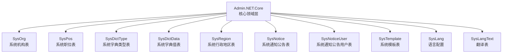

**图表来源**
- [SysOrg.cs:12-96](file://Admin.NET/Admin.NET.Core/Entity/SysOrg.cs#L12-L96)
- [SysPos.cs:12-56](file://Admin.NET/Admin.NET.Core/Entity/SysPos.cs#L12-L56)
- [SysDictType.cs:12-68](file://Admin.NET/Admin.NET.Core/Entity/SysDictType.cs#L12-L68)
- [SysDictData.cs:12-105](file://Admin.NET/Admin.NET.Core/Entity/SysDictData.cs#L12-L105)
- [SysRegion.cs:12-109](file://Admin.NET/Admin.NET.Core/Entity/SysRegion.cs#L12-L109)
- [SysNotice.cs:12-82](file://Admin.NET/Admin.NET.Core/Entity/SysNotice.cs#L12-L82)
- [SysNoticeUser.cs:12-45](file://Admin.NET/Admin.NET.Core/Entity/SysNoticeUser.cs#L12-L45)
- [SysTemplate.cs:12-63](file://Admin.NET/Admin.NET.Core/Entity/SysTemplate.cs#L12-L63)
- [SysLang.cs:12-86](file://Admin.NET/Admin.NET.Core/Entity/SysLang.cs#L12-L86)
- [SysLangText.cs:12-44](file://Admin.NET/Admin.NET.Core/Entity/SysLangText.cs#L12-L44)

**章节来源**
- [SysOrg.cs:12-96](file://Admin.NET/Admin.NET.Core/Entity/SysOrg.cs#L12-L96)
- [SysPos.cs:12-56](file://Admin.NET/Admin.NET.Core/Entity/SysPos.cs#L12-L56)
- [SysDictType.cs:12-68](file://Admin.NET/Admin.NET.Core/Entity/SysDictType.cs#L12-L68)
- [SysDictData.cs:12-105](file://Admin.NET/Admin.NET.Core/Entity/SysDictData.cs#L12-L105)
- [SysRegion.cs:12-109](file://Admin.NET/Admin.NET.Core/Entity/SysRegion.cs#L12-L109)
- [SysNotice.cs:12-82](file://Admin.NET/Admin.NET.Core/Entity/SysNotice.cs#L12-L82)
- [SysNoticeUser.cs:12-45](file://Admin.NET/Admin.NET.Core/Entity/SysNoticeUser.cs#L12-L45)
- [SysTemplate.cs:12-63](file://Admin.NET/Admin.NET.Core/Entity/SysTemplate.cs#L12-L63)
- [SysLang.cs:12-86](file://Admin.NET/Admin.NET.Core/Entity/SysLang.cs#L12-L86)
- [SysLangText.cs:12-44](file://Admin.NET/Admin.NET.Core/Entity/SysLangText.cs#L12-L44)

## 核心领域模型总览
| 领域 | 主要实体 | 职责简述 | 关键关系 |
|---|---|---|---|
| 组织与职位 | `SysOrg`、`SysPos` | 维护组织架构与职位信息 | `SysOrg` 通过 `Pid` 自引用形成树；`SysPos` 可关联在职人员 |
| 字典 | `SysDictType`、`SysDictData` | 描述业务字典类型及其取值 | 一对多：一个字典类型对应多个字典值 |
| 地区 | `SysRegion` | 维护行政区划树 | 通过 `Pid` 自引用形成多级地区树 |
| 通知 | `SysNotice`、`SysNoticeUser` | 发布通知公告并记录用户阅读状态 | 一对一标题与用户明细；用户侧有未读/已读状态 |
| 模板 | `SysTemplate` | 管理通知、短信、邮件、微信等模板 | 按分组与编码唯一标识 |
| 多语言 | `SysLang`、`SysLangText` | 管理语言配置与实体字段翻译 | 语言代码 + 实体名 + 字段名 + 内容 |

**章节来源**
- [SysOrg.cs:12-96](file://Admin.NET/Admin.NET.Core/Entity/SysOrg.cs#L12-L96)
- [SysPos.cs:12-56](file://Admin.NET/Admin.NET.Core/Entity/SysPos.cs#L12-L56)
- [SysDictType.cs:12-68](file://Admin.NET/Admin.NET.Core/Entity/SysDictType.cs#L12-L68)
- [SysDictData.cs:12-105](file://Admin.NET/Admin.NET.Core/Entity/SysDictData.cs#L12-L105)
- [SysRegion.cs:12-109](file://Admin.NET/Admin.NET.Core/Entity/SysRegion.cs#L12-L109)
- [SysNotice.cs:12-82](file://Admin.NET/Admin.NET.Core/Entity/SysNotice.cs#L12-L82)
- [SysNoticeUser.cs:12-45](file://Admin.NET/Admin.NET.Core/Entity/SysNoticeUser.cs#L12-L45)
- [SysTemplate.cs:12-63](file://Admin.NET/Admin.NET.Core/Entity/SysTemplate.cs#L12-L63)
- [SysLang.cs:12-86](file://Admin.NET/Admin.NET.Core/Entity/SysLang.cs#L12-L86)
- [SysLangText.cs:12-44](file://Admin.NET/Admin.NET.Core/Entity/SysLangText.cs#L12-L44)

## 架构与基类设计
所有业务实体都基于统一基类，从而获得一致的标识、审计与隔离策略：
- `EntityBaseId`：提供雪花主键 `Id`。
- `EntityBase`：在 `EntityBaseId` 基础上增加创建时间、更新时间、创建者、修改者等审计字段。
- `EntityBaseTenant`：增加租户隔离字段 `TenantId`。
- `EntityBaseTenantId`：同时具备雪花主键与租户隔离。

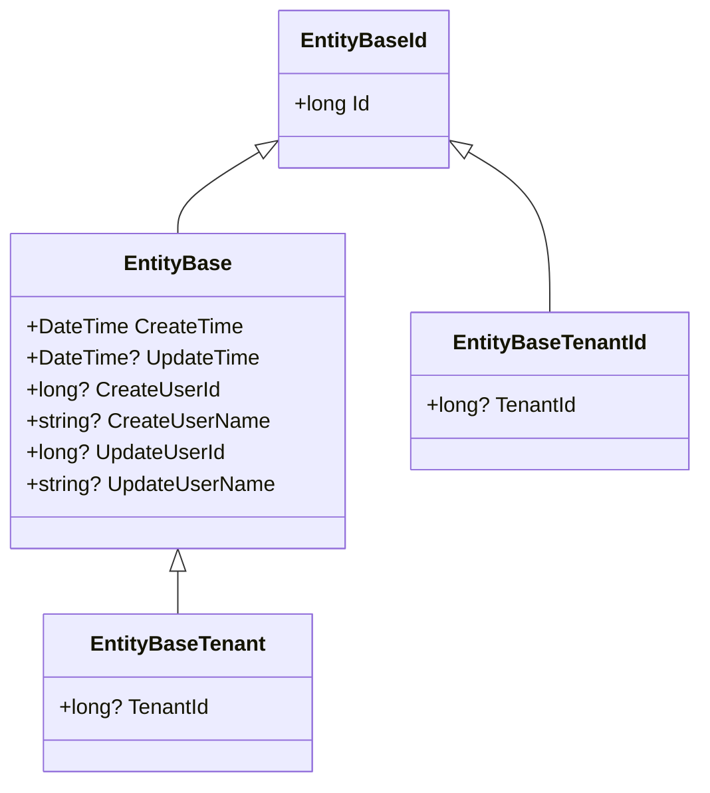

**图表来源**
- [EntityBase.cs:12-203](file://Admin.NET/Admin.NET.Core/Entity/EntityBase.cs#L12-L203)

**章节来源**
- [EntityBase.cs:12-203](file://Admin.NET/Admin.NET.Core/Entity/EntityBase.cs#L12-L203)

## 详细实体设计

### 系统机构表 SysOrg
- 主键：继承 `EntityBaseTenant`，含雪花主键与租户隔离。
- 父节点：`Pid` 指向同级或上级机构，形成自引用树。
- 名称与编码：`Name` 必填且最大长度 64；`Code` 可选且最大长度 64。
- 级别：`Level` 用于记录层级深度，便于前端展示与排序。
- 类型：`Type` 使用字典类型存储，体现机构分类。
- 负责人：`DirectorId` 关联用户；导航属性 `Director` 提供对象级访问。
- 排序与状态：`OrderNo` 默认 100；`Status` 使用 `StatusEnum`。
- 备注：`Remark` 最大长度 128。
- 前端扩展：`Children` 和 `Disabled` 为忽略持久化的计算属性，用于构建树形组件。

| 字段 | 类型 | 是否必填 | 长度或约束 | 说明 |
|---|---|---:|---:|---|
| `Id` | `long` | 是 | 雪花主键 | 继承基类 |
| `TenantId` | `long?` | 否 | 租户隔离 | 继承基类 |
| `Pid` | `long` | 是 | 自引用父节点 | 根节点通常指向自身或根标识 |
| `Name` | `string` | 是 | 最大 64 | 机构名称 |
| `Code` | `string?` | 否 | 最大 64 | 机构编码 |
| `Level` | `int?` | 否 | — | 层级深度 |
| `Type` | `string?` | 否 | 最大 64 | 机构类型，通常为字典编码 |
| `DirectorId` | `long?` | 否 | — | 负责人用户标识 |
| `OrderNo` | `int` | 是 | 默认 100 | 排序 |
| `Status` | `StatusEnum` | 是 | — | 启用/禁用 |
| `Remark` | `string?` | 否 | 最大 128 | 备注 |
| `Children` | `List<SysOrg>` | 否 | 非持久化 | 子机构集合 |
| `Disabled` | `bool` | 否 | 非持久化 | 是否禁止选中 |

**章节来源**
- [SysOrg.cs:12-96](file://Admin.NET/Admin.NET.Core/Entity/SysOrg.cs#L12-L96)

### 系统职位表 SysPos
- 主键：继承 `EntityBaseTenant`，含雪花主键与租户隔离。
- 名称与编码：`Name` 必填且最大长度 64；`Code` 可选且最大长度 64。
- 排序与状态：`OrderNo` 默认 100；`Status` 使用 `StatusEnum`。
- 备注：`Remark` 最大长度 128。
- 关联用户：`UserList` 为非持久化导航属性，表示当前职位下的在职人员。

| 字段 | 类型 | 是否必填 | 长度或约束 | 说明 |
|---|---|---:|---:|---|
| `Id` | `long` | 是 | 雪花主键 | 继承基类 |
| `TenantId` | `long?` | 否 | 租户隔离 | 继承基类 |
| `Name` | `string` | 是 | 最大 64 | 职位名称 |
| `Code` | `string?` | 否 | 最大 64 | 职位编码 |
| `OrderNo` | `int` | 是 | 默认 100 | 排序 |
| `Remark` | `string?` | 否 | 最大 128 | 备注 |
| `Status` | `StatusEnum` | 是 | — | 启用/禁用 |
| `UserList` | `List<SysUser>` | 否 | 非持久化 | 在职人员集合 |

**章节来源**
- [SysPos.cs:12-56](file://Admin.NET/Admin.NET.Core/Entity/SysPos.cs#L12-L56)

### 系统字典类型表 SysDictType
- 主键：继承 `EntityBase`，不含租户隔离。
- 名称与编码：`Name` 和 `Code` 均必填且最大长度 64。
- 排序：`OrderNo` 默认 100。
- 备注：`Remark` 最大长度 256。
- 状态：`Status` 使用 `StatusEnum`。
- 内置标记：`SysFlag` 表示是否为内置字典。
- 租户标记：`IsTenant` 表示是否为租户字典。
- 子项：`Children` 通过导航属性关联字典值。

| 字段 | 类型 | 是否必填 | 长度或约束 | 说明 |
|---|---|---:|---:|---|
| `Id` | `long` | 是 | 雪花主键 | 继承基类 |
| `CreateTime` / `UpdateTime` | `DateTime?` | 否 | — | 审计时间 |
| `CreateUserId` / `UpdateUserId` | `long?` | 否 | — | 审计用户 |
| `Name` | `string` | 是 | 最大 64 | 字典类型名称 |
| `Code` | `string` | 是 | 最大 64 | 字典类型编码 |
| `OrderNo` | `int` | 是 | 默认 100 | 排序 |
| `Remark` | `string?` | 否 | 最大 256 | 备注 |
| `Status` | `StatusEnum` | 是 | — | 启用/禁用 |
| `SysFlag` | `YesNoEnum` | 是 | — | 是否内置 |
| `IsTenant` | `YesNoEnum` | 是 | — | 是否租户字典 |
| `Children` | `List<SysDictData>` | 否 | 导航属性 | 字典值集合 |

**章节来源**
- [SysDictType.cs:12-68](file://Admin.NET/Admin.NET.Core/Entity/SysDictType.cs#L12-L68)

### 系统字典值表 SysDictData
- 主键：继承 `EntityBase`。
- 类型关联：`DictTypeId` 外键指向 `SysDictType`。
- 显示文本与值：`Label` 与 `Value` 必填且最大长度 256。
- 编码与名称：`Code` 与 `Name` 可选，最大长度 256。
- 样式扩展：`TagType`、`StyleSetting`、`ClassSetting` 支持前端标签颜色与样式控制。
- 排序与备注：`OrderNo` 默认 100；`Remark` 最大长度 2048。
- 拓展数据：`ExtData` 使用大字符串列，保存业务功能的自定义配置项。
- 状态：`Status` 使用 `StatusEnum`。
- 唯一性：`DictTypeId` + `Value` 组合唯一，防止同一类型下重复值。

| 字段 | 类型 | 是否必填 | 长度或约束 | 说明 |
|---|---|---:|---:|---|
| `Id` | `long` | 是 | 雪花主键 | 继承基类 |
| `DictTypeId` | `long` | 是 | — | 字典类型主键 |
| `Label` | `string` | 是 | 最大 256 | 显示文本 |
| `Value` | `string` | 是 | 最大 256 | 实际值 |
| `Code` | `string?` | 否 | 最大 256 | 编码 |
| `Name` | `string?` | 否 | 最大 256 | 名称 |
| `TagType` | `string?` | 否 | 最大 16 | 标签颜色 |
| `StyleSetting` | `string?` | 否 | 最大 512 | 行内样式 |
| `ClassSetting` | `string?` | 否 | 最大 512 | 样式类名 |
| `OrderNo` | `int` | 是 | 默认 100 | 排序 |
| `Remark` | `string?` | 否 | 最大 2048 | 备注 |
| `ExtData` | `string?` | 否 | 大字符串 | 业务拓展配置 |
| `Status` | `StatusEnum` | 是 | — | 启用/禁用 |

**章节来源**
- [SysDictData.cs:12-105](file://Admin.NET/Admin.NET.Core/Entity/SysDictData.cs#L12-L105)

### 系统行政地区表 SysRegion
- 主键：继承 `EntityBaseId`，雪花主键。
- 父节点：`Pid` 自引用形成行政区树。
- 名称与简称：`Name` 必填且最大长度 128；`ShortName` 可选且最大长度 32。
- 组合名：`MergerName` 最大长度 64，常用于完整路径展示。
- 标准代码：`Code` 最大长度 32，通常对应国家行政区划代码。
- 通信信息：`ZipCode` 邮政编码最大长度 6；`CityCode` 区号最大长度 6。
- 层级与拼音：`Level` 记录层级；`PinYin` 最大长度 128。
- 地理坐标：`Lng` 经度、`Lat` 维度使用浮点数。
- 排序与备注：`OrderNo` 默认 100；`Remark` 最大长度 128。
- 前端扩展：`Children` 为非持久化子节点集合。

| 字段 | 类型 | 是否必填 | 长度或约束 | 说明 |
|---|---|---:|---:|---|
| `Id` | `long` | 是 | 雪花主键 | 继承基类 |
| `Pid` | `long` | 是 | — | 父地区标识 |
| `Name` | `string` | 是 | 最大 128 | 地区名称 |
| `ShortName` | `string?` | 否 | 最大 32 | 简称 |
| `MergerName` | `string?` | 否 | 最大 64 | 组合名 |
| `Code` | `string?` | 否 | 最大 32 | 行政代码 |
| `ZipCode` | `string?` | 否 | 最大 6 | 邮政编码 |
| `CityCode` | `string?` | 否 | 最大 6 | 区号 |
| `Level` | `int` | 是 | — | 层级 |
| `PinYin` | `string?` | 否 | 最大 128 | 拼音 |
| `Lng` | `float` | 是 | — | 经度 |
| `Lat` | `float` | 是 | — | 纬度 |
| `OrderNo` | `int` | 是 | 默认 100 | 排序 |
| `Remark` | `string?` | 否 | 最大 128 | 备注 |
| `Children` | `List<SysRegion>` | 否 | 非持久化 | 子地区集合 |

**章节来源**
- [SysRegion.cs:12-109](file://Admin.NET/Admin.NET.Core/Entity/SysRegion.cs#L12-L109)

### 系统通知公告表 SysNotice
- 主键：继承 `EntityBaseTenant`，含雪花主键与租户隔离。
- 标题与内容：`Title` 必填且最大长度 32；`Content` 为大字符串字段，必填。
- 类型：`Type` 使用 `NoticeTypeEnum`，区分通知与公告。
- 发布人信息：`PublicUserId` 与 `PublicUserName` 记录发布者。
- 发布机构信息：`PublicOrgId` 与 `PublicOrgName` 记录发布机构。
- 时间字段：`PublicTime` 发布时间、`CancelTime` 撤回时间。
- 状态：`Status` 使用 `NoticeStatusEnum`，表示草稿、发布、撤回、删除等生命周期。

| 字段 | 类型 | 是否必填 | 长度或约束 | 说明 |
|---|---|---:|---:|---|
| `Id` | `long` | 是 | 雪花主键 | 继承基类 |
| `TenantId` | `long?` | 否 | 租户隔离 | 继承基类 |
| `Title` | `string` | 是 | 最大 32 | 通知标题 |
| `Content` | `string` | 是 | 大字符串 | 通知内容 |
| `Type` | `NoticeTypeEnum` | 是 | — | 通知或公告 |
| `PublicUserId` | `long` | 是 | — | 发布人标识 |
| `PublicUserName` | `string?` | 否 | 最大 32 | 发布人姓名 |
| `PublicOrgId` | `long` | 是 | — | 发布机构标识 |
| `PublicOrgName` | `string?` | 否 | 最大 64 | 发布机构名称 |
| `PublicTime` | `DateTime?` | 否 | — | 发布时间 |
| `CancelTime` | `DateTime?` | 否 | — | 撤回时间 |
| `Status` | `NoticeStatusEnum` | 是 | — | 通知状态 |

**章节来源**
- [SysNotice.cs:12-82](file://Admin.NET/Admin.NET.Core/Entity/SysNotice.cs#L12-L82)
- [NoticeTypeEnum.cs:12-26](file://Admin.NET/Admin.NET.Core/Enum/NoticeTypeEnum.cs#L12-L26)

### 系统通知公告用户表 SysNoticeUser
- 主键：继承 `EntityBaseTenantId`，雪花主键与租户隔离。
- 通知关联：`NoticeId` 外键指向 `SysNotice`。
- 用户关联：`UserId` 表示接收通知的用户。
- 阅读状态：`ReadStatus` 使用 `NoticeUserStatusEnum`，区分未读与已读。
- 阅读时间：`ReadTime` 记录用户首次阅读时间。

| 字段 | 类型 | 是否必填 | 长度或约束 | 说明 |
|---|---|---:|---:|---|
| `Id` | `long` | 是 | 雪花主键 | 继承基类 |
| `TenantId` | `long?` | 否 | 租户隔离 | 继承基类 |
| `NoticeId` | `long` | 是 | — | 通知主键 |
| `UserId` | `long` | 是 | — | 用户主键 |
| `ReadTime` | `DateTime?` | 否 | — | 阅读时间 |
| `ReadStatus` | `NoticeUserStatusEnum` | 是 | — | 未读或已读 |

**章节来源**
- [SysNoticeUser.cs:12-45](file://Admin.NET/Admin.NET.Core/Entity/SysNoticeUser.cs#L12-L45)
- [NoticeUserStatusEnum.cs:12-26](file://Admin.NET/Admin.NET.Core/Enum/NoticeUserStatusEnum.cs#L12-L26)

### 系统模板表 SysTemplate
- 主键：继承 `EntityBaseTenant`，含雪花主键与租户隔离。
- 名称与编码：`Name` 最大长度 128；`Code` 最大长度 128，且唯一。
- 分组：`GroupName` 最大长度 32；`Type` 使用 `TemplateTypeEnum`。
- 内容：`Content` 为大字符串，用于存储模板正文。
- 备注与排序：`Remark` 最大长度 128；`OrderNo` 默认 100。

| 字段 | 类型 | 是否必填 | 长度或约束 | 说明 |
|---|---|---:|---:|---|
| `Id` | `long` | 是 | 雪花主键 | 继承基类 |
| `TenantId` | `long?` | 否 | 租户隔离 | 继承基类 |
| `Name` | `string` | 是 | 最大 128 | 模板名称 |
| `Code` | `string` | 是 | 最大 128 | 模板编码，唯一 |
| `GroupName` | `string` | 是 | 最大 32 | 分组名称 |
| `Type` | `TemplateTypeEnum` | 是 | — | 通知、短信、邮件、微信等 |
| `Content` | `string` | 是 | 大字符串 | 模板内容 |
| `Remark` | `string?` | 否 | 最大 128 | 备注 |
| `OrderNo` | `int` | 是 | 默认 100 | 排序 |

**章节来源**
- [SysTemplate.cs:12-63](file://Admin.NET/Admin.NET.Core/Entity/SysTemplate.cs#L12-L63)
- [TemplateTypeEnum.cs:12-44](file://Admin.NET/Admin.NET.Core/Enum/TemplateTypeEnum.cs#L12-L44)

### 语言配置表 SysLang
- 主键：继承 `EntityBase`，雪花主键与审计字段。
- 语言元数据：`Name` 语言名称；`Code` 语言代码，例如 `zh-CN`；`IsoCode` ISO 语言代码；`UrlCode` URL 语言代码。
- 方向与格式：`Direction` 书写方向；`DateFormat`、`TimeFormat` 日期与时间格式；`WeekStart` 每周起始日；`Grouping`、`DecimalPoint`、`ThousandsSep` 数字格式化符号。
- 启用状态：`Active` 表示该语言是否启用。

| 字段 | 类型 | 是否必填 | 长度或约束 | 说明 |
|---|---|---:|---:|---|
| `Id` | `long` | 是 | 雪花主键 | 继承基类 |
| `CreateTime` / `UpdateTime` | `DateTime?` | 否 | — | 审计时间 |
| `CreateUserId` / `UpdateUserId` | `long?` | 否 | — | 审计用户 |
| `Name` | `string` | 是 | — | 语言名称 |
| `Code` | `string` | 是 | — | 语言代码 |
| `IsoCode` | `string` | 是 | — | ISO 语言代码 |
| `UrlCode` | `string` | 是 | — | URL 语言代码 |
| `Direction` | `DirectionEnum` | 是 | — | 从左到右或从右到左 |
| `DateFormat` | `string` | 是 | — | 日期格式 |
| `TimeFormat` | `string` | 是 | — | 时间格式 |
| `WeekStart` | `WeekEnum` | 是 | — | 每周起始日 |
| `Grouping` | `string` | 是 | — | 分组符号 |
| `DecimalPoint` | `string` | 是 | — | 小数点符号 |
| `ThousandsSep` | `string?` | 否 | — | 千分位分隔符 |
| `Active` | `bool` | 是 | — | 是否启用 |

**章节来源**
- [SysLang.cs:12-86](file://Admin.NET/Admin.NET.Core/Entity/SysLang.cs#L12-L86)
- [DirectionEnum.cs:12-26](file://Admin.NET/Admin.NET.Core/Enum/DirectionEnum.cs#L12-L26)
- [WeekEnum.cs:12-56](file://Admin.NET/Admin.NET.Core/Enum/WeekEnum.cs#L12-L56)

### 翻译表 SysLangText
- 主键：继承 `EntityBase`。
- 实体定位：`EntityName` 与 `EntityId` 共同定位被翻译的业务实体。
- 字段定位：`FieldName` 指定需要翻译的字段名。
- 语言定位：`LangCode` 指定目标语言。
- 内容：`Content` 保存具体翻译文本。

| 字段 | 类型 | 是否必填 | 长度或约束 | 说明 |
|---|---|---:|---:|---|
| `Id` | `long` | 是 | 雪花主键 | 继承基类 |
| `CreateTime` / `UpdateTime` | `DateTime?` | 否 | — | 审计时间 |
| `CreateUserId` / `UpdateUserId` | `long?` | 否 | — | 审计用户 |
| `EntityName` | `string` | 是 | — | 所属实体名 |
| `EntityId` | `long` | 是 | — | 所属实体主键 |
| `FieldName` | `string` | 是 | — | 字段名 |
| `LangCode` | `string` | 是 | — | 语言代码 |
| `Content` | `string` | 是 | — | 翻译内容 |

**章节来源**
- [SysLangText.cs:12-44](file://Admin.NET/Admin.NET.Core/Entity/SysLangText.cs#L12-L44)

## 树形结构实现
树形结构在本项目中主要通过两种方式实现：
1. **自引用 `Pid` 字段**：`SysOrg` 与 `SysRegion` 都通过 `Pid` 指向父节点，从而形成任意深度的层级结构。
2. **非持久化 `Children` 列表**：两个实体都包含 `Children` 属性，并在查询后填充子节点，供前端树形组件渲染。

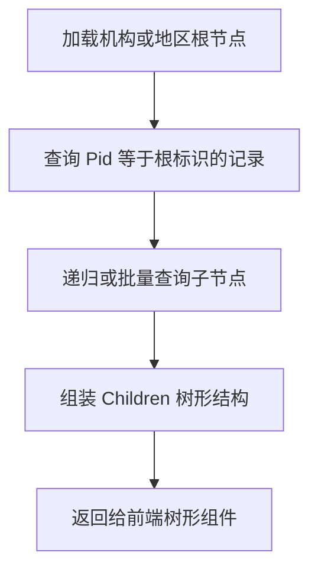

**图表来源**
- [SysOrg.cs:12-96](file://Admin.NET/Admin.NET.Core/Entity/SysOrg.cs#L12-L96)
- [SysRegion.cs:12-109](file://Admin.NET/Admin.NET.Core/Entity/SysRegion.cs#L12-L109)

对于 `SysOrg`，层级管理还结合以下字段：
- `Level`：明确记录层级深度，便于排序、权限过滤与前端缩进。
- `OrderNo`：同层节点排序。
- `Status`：允许停用某个机构，但保留历史数据。
- `Type`：使用字典类型区分机构类别，便于按类型筛选。

**章节来源**
- [SysOrg.cs:12-96](file://Admin.NET/Admin.NET.Core/Entity/SysOrg.cs#L12-L96)
- [SysRegion.cs:12-109](file://Admin.NET/Admin.NET.Core/Entity/SysRegion.cs#L12-L109)

## 字典数据与动态配置
字典采用“类型与值分离”的设计：
- `SysDictType` 定义业务字典的分类，如机构类型、表单开关、业务规则分类等。
- `SysDictData` 定义具体取值，包括显示文本 `Label`、实际值 `Value`、样式控制 `TagType`、`StyleSetting`、`ClassSetting`，以及业务拓展 `ExtData`。

这种设计使业务规则可以动态配置，而不需要硬编码枚举或常量。例如：
- 新增一种机构类型时，只需添加字典类型与对应的字典值。
- 前端根据 `Label` 展示，后端根据 `Value` 进行逻辑判断。
- `ExtData` 可保存额外配置，例如校验规则、默认值、联动行为等。

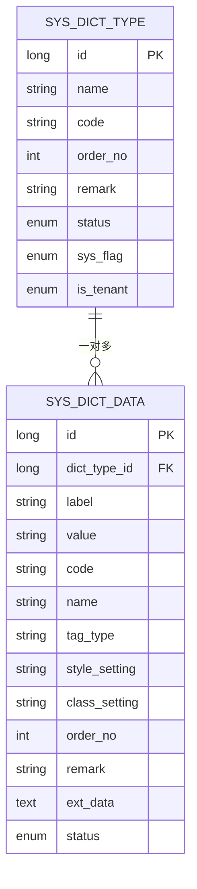

**图表来源**
- [SysDictType.cs:12-68](file://Admin.NET/Admin.NET.Core/Entity/SysDictType.cs#L12-L68)
- [SysDictData.cs:12-105](file://Admin.NET/Admin.NET.Core/Entity/SysDictData.cs#L12-L105)

**章节来源**
- [SysDictType.cs:12-68](file://Admin.NET/Admin.NET.Core/Entity/SysDictType.cs#L12-L68)
- [SysDictData.cs:12-105](file://Admin.NET/Admin.NET.Core/Entity/SysDictData.cs#L12-L105)

## 通知消息与用户关联机制
通知消息的生命周期由 `SysNotice` 的状态字段管理，用户阅读情况由 `SysNoticeUser` 记录。

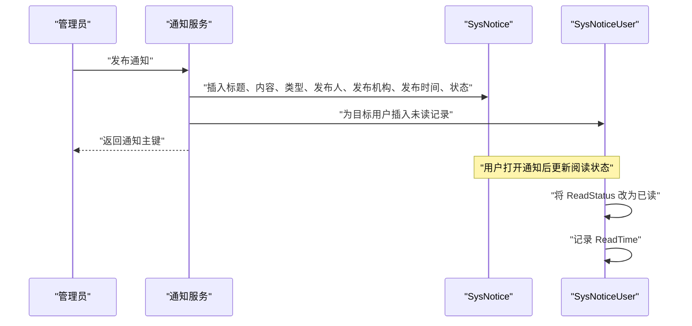

**图表来源**
- [SysNotice.cs:12-82](file://Admin.NET/Admin.NET.Core/Entity/SysNotice.cs#L12-L82)
- [SysNoticeUser.cs:12-45](file://Admin.NET/Admin.NET.Core/Entity/SysNoticeUser.cs#L12-L45)
- [NoticeTypeEnum.cs:12-26](file://Admin.NET/Admin.NET.Core/Enum/NoticeTypeEnum.cs#L12-L26)
- [NoticeUserStatusEnum.cs:12-26](file://Admin.NET/Admin.NET.Core/Enum/NoticeUserStatusEnum.cs#L12-L26)

状态说明：
- `SysNotice.Status`：草稿、发布、撤回、删除等生命周期状态。
- `SysNotice.Type`：通知或公告。
- `SysNoticeUser.ReadStatus`：未读或已读。
- `SysNoticeUser.ReadTime`：用户首次阅读时间，可用于统计与提醒。

**章节来源**
- [SysNotice.cs:12-82](file://Admin.NET/Admin.NET.Core/Entity/SysNotice.cs#L12-L82)
- [SysNoticeUser.cs:12-45](file://Admin.NET/Admin.NET.Core/Entity/SysNoticeUser.cs#L12-L45)
- [NoticeTypeEnum.cs:12-26](file://Admin.NET/Admin.NET.Core/Enum/NoticeTypeEnum.cs#L12-L26)
- [NoticeUserStatusEnum.cs:12-26](file://Admin.NET/Admin.NET.Core/Enum/NoticeUserStatusEnum.cs#L12-L26)

## 多语言文本存储与国际化的支持方案
多语言支持分为两层：
1. **语言配置层**：`SysLang` 描述语言本身，包括语言代码、ISO 代码、URL 代码、书写方向、日期时间格式、数字格式符号等。
2. **翻译内容层**：`SysLangText` 针对具体实体、实体主键、字段名与语言代码保存翻译文本。

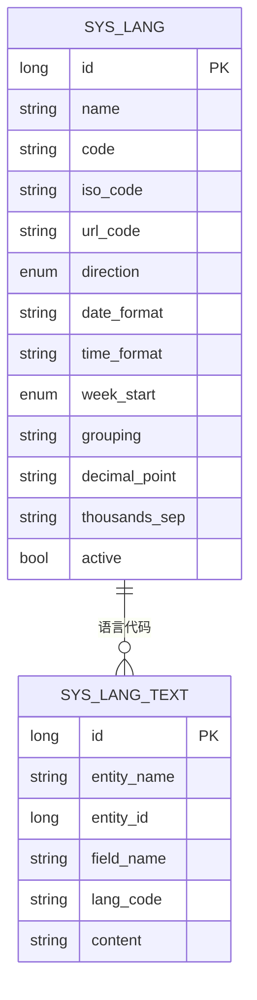

**图表来源**
- [SysLang.cs:12-86](file://Admin.NET/Admin.NET.Core/Entity/SysLang.cs#L12-L86)
- [SysLangText.cs:12-44](file://Admin.NET/Admin.NET.Core/Entity/SysLangText.cs#L12-L44)
- [DirectionEnum.cs:12-26](file://Admin.NET/Admin.NET.Core/Enum/DirectionEnum.cs#L12-L26)
- [WeekEnum.cs:12-56](file://Admin.NET/Admin.NET.Core/Enum/WeekEnum.cs#L12-L56)

国际化支持的关键点：
- 使用 `Code` 作为应用内部语言标识，例如中文简体。
- 使用 `IsoCode` 与 `UrlCode` 对接国际标准与路由参数。
- 使用 `Direction` 支持从左到右或从右到左布局。
- 使用 `DateFormat`、`TimeFormat`、`Grouping`、`DecimalPoint`、`ThousandsSep` 支持本地化数字与日期时间展示。
- 使用 `SysLangText` 实现实体字段级的多语言翻译，而不是把翻译内容直接写入业务实体。

**章节来源**
- [SysLang.cs:12-86](file://Admin.NET/Admin.NET.Core/Entity/SysLang.cs#L12-L86)
- [SysLangText.cs:12-44](file://Admin.NET/Admin.NET.Core/Entity/SysLangText.cs#L12-L44)
- [DirectionEnum.cs:12-26](file://Admin.NET/Admin.NET.Core/Enum/DirectionEnum.cs#L12-L26)
- [WeekEnum.cs:12-56](file://Admin.NET/Admin.NET.Core/Enum/WeekEnum.cs#L12-L56)

## 依赖关系分析
各实体之间的主要依赖如下：
- `SysOrg.Director` 依赖用户实体（导航属性），用于获取负责人信息。
- `SysDictData.DictType` 依赖 `SysDictType`，表示字典值所属类型。
- `SysNoticeUser.SysNotice` 依赖 `SysNotice`，表示某条通知的用户阅读记录。
- `SysNotice` 与 `SysNoticeUser` 是一对多关系：一条通知可对应多条用户阅读记录。
- `SysLang` 与 `SysLangText` 通过语言代码关联：一种语言对应多条翻译记录。

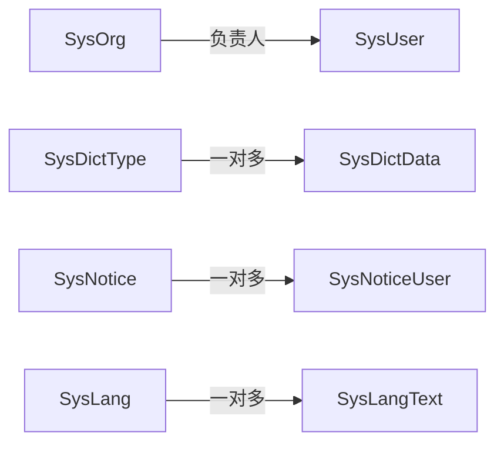

**图表来源**
- [SysOrg.cs:12-96](file://Admin.NET/Admin.NET.Core/Entity/SysOrg.cs#L12-L96)
- [SysDictType.cs:12-68](file://Admin.NET/Admin.NET.Core/Entity/SysDictType.cs#L12-L68)
- [SysDictData.cs:12-105](file://Admin.NET/Admin.NET.Core/Entity/SysDictData.cs#L12-L105)
- [SysNotice.cs:12-82](file://Admin.NET/Admin.NET.Core/Entity/SysNotice.cs#L12-L82)
- [SysNoticeUser.cs:12-45](file://Admin.NET/Admin.NET.Core/Entity/SysNoticeUser.cs#L12-L45)
- [SysLang.cs:12-86](file://Admin.NET/Admin.NET.Core/Entity/SysLang.cs#L12-L86)
- [SysLangText.cs:12-44](file://Admin.NET/Admin.NET.Core/Entity/SysLangText.cs#L12-L44)

**章节来源**
- [SysOrg.cs:12-96](file://Admin.NET/Admin.NET.Core/Entity/SysOrg.cs#L12-L96)
- [SysDictType.cs:12-68](file://Admin.NET/Admin.NET.Core/Entity/SysDictType.cs#L12-L68)
- [SysDictData.cs:12-105](file://Admin.NET/Admin.NET.Core/Entity/SysDictData.cs#L12-L105)
- [SysNotice.cs:12-82](file://Admin.NET/Admin.NET.Core/Entity/SysNotice.cs#L12-L82)
- [SysNoticeUser.cs:12-45](file://Admin.NET/Admin.NET.Core/Entity/SysNoticeUser.cs#L12-L45)
- [SysLang.cs:12-86](file://Admin.NET/Admin.NET.Core/Entity/SysLang.cs#L12-L86)
- [SysLangText.cs:12-44](file://Admin.NET/Admin.NET.Core/Entity/SysLangText.cs#L12-L44)

## 典型业务操作示例

### 组织架构增删改查
- 新增机构：填写名称、编码、类型、负责人、排序等，设置父节点 `Pid`，若为根节点则使用根标识。
- 修改机构：更新名称、编码、类型、负责人、状态、排序等；移动机构时调整 `Pid` 和 `Level`。
- 删除机构：优先检查是否有子节点或关联用户；通常采用软删除或状态禁用。
- 查询机构树：先查根节点，再递归或批量查询子节点，最后填充 `Children` 列表。

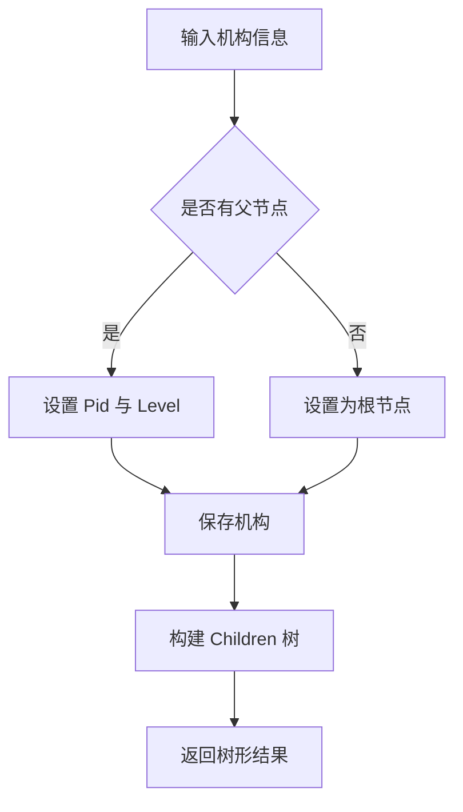

**图表来源**
- [SysOrg.cs:12-96](file://Admin.NET/Admin.NET.Core/Entity/SysOrg.cs#L12-L96)

**章节来源**
- [SysOrg.cs:12-96](file://Admin.NET/Admin.NET.Core/Entity/SysOrg.cs#L12-L96)

### 字典数据的动态加载
- 新增字典类型：填写名称与编码，设置排序、状态、是否内置、是否租户字典。
- 新增字典值：选择字典类型，填写显示文本与实际值，可设置样式与拓展数据。
- 动态读取：前端按字典编码加载字典值列表，后端按 `DictTypeId` 查询，并按 `OrderNo` 排序。
- 业务规则扩展：在 `ExtData` 中保存校验规则、联动字段、默认值等，由业务服务解析后应用到表单或流程。

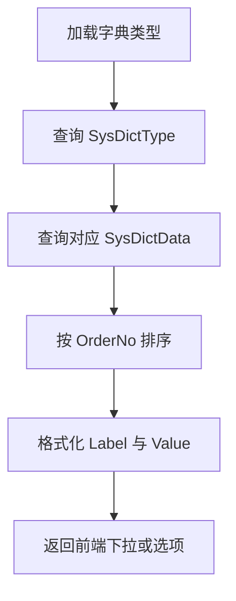

**图表来源**
- [SysDictType.cs:12-68](file://Admin.NET/Admin.NET.Core/Entity/SysDictType.cs#L12-L68)
- [SysDictData.cs:12-105](file://Admin.NET/Admin.NET.Core/Entity/SysDictData.cs#L12-L105)

**章节来源**
- [SysDictType.cs:12-68](file://Admin.NET/Admin.NET.Core/Entity/SysDictType.cs#L12-L68)
- [SysDictData.cs:12-105](file://Admin.NET/Admin.NET.Core/Entity/SysDictData.cs#L12-L105)

### 通知消息的发布与阅读
- 管理员发布通知：填写标题、内容、类型、发布人与发布机构信息，设置初始状态。
- 推送用户：为目标用户生成 `SysNoticeUser` 记录，初始状态为未读。
- 用户阅读：更新 `ReadStatus` 为已读，并记录 `ReadTime`。
- 撤回通知：更新 `SysNotice.Status` 为撤回，并可记录 `CancelTime`。

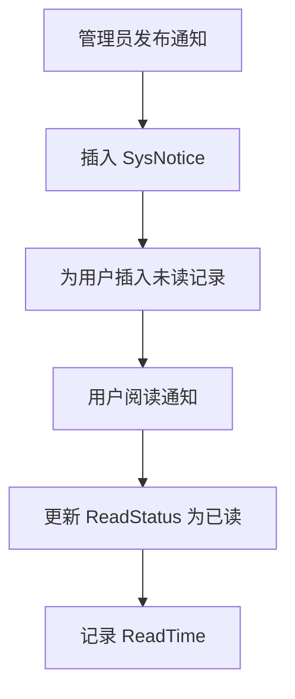

**图表来源**
- [SysNotice.cs:12-82](file://Admin.NET/Admin.NET.Core/Entity/SysNotice.cs#L12-L82)
- [SysNoticeUser.cs:12-45](file://Admin.NET/Admin.NET.Core/Entity/SysNoticeUser.cs#L12-L45)

**章节来源**
- [SysNotice.cs:12-82](file://Admin.NET/Admin.NET.Core/Entity/SysNotice.cs#L12-L82)
- [SysNoticeUser.cs:12-45](file://Admin.NET/Admin.NET.Core/Entity/SysNoticeUser.cs#L12-L45)

### 多语言文本的编辑与展示
- 新增语言：在 `SysLang` 中配置语言代码、ISO 代码、URL 代码、方向、日期时间格式等。
- 新增翻译：在 `SysLangText` 中填写实体名、实体主键、字段名、语言代码与内容。
- 展示翻译：根据当前语言代码与实体字段名，查询 `SysLangText` 并回退到默认语言或空值。

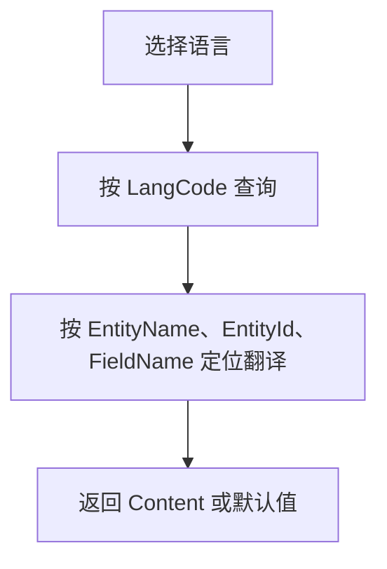

**图表来源**
- [SysLang.cs:12-86](file://Admin.NET/Admin.NET.Core/Entity/SysLang.cs#L12-L86)
- [SysLangText.cs:12-44](file://Admin.NET/Admin.NET.Core/Entity/SysLangText.cs#L12-L44)

**章节来源**
- [SysLang.cs:12-86](file://Admin.NET/Admin.NET.Core/Entity/SysLang.cs#L12-L86)
- [SysLangText.cs:12-44](file://Admin.NET/Admin.NET.Core/Entity/SysLangText.cs#L12-L44)

## 性能与索引建议
当前实体已经定义了部分索引，以下是对查询性能的补充建议：
- `SysOrg`：已有名称、编码、类型索引；若经常按 `Pid` 查询，建议增加 `Pid` 索引以提升树形展开性能。
- `SysRegion`：已有名称、编码索引；若频繁按 `Pid` 查询，建议增加 `Pid` 索引。
- `SysDictData`：已有 `DictTypeId` + `Value` 唯一索引；若按 `DictTypeId` 频繁查询，建议增加 `DictTypeId` 索引。
- `SysNotice`：已有类型索引；若按状态或时间查询较多，建议增加状态和时间索引。
- `SysNoticeUser`：建议增加 `NoticeId`、`UserId`、`ReadStatus` 的组合索引，提升按通知和用户维度的查询性能。
- `SysLangText`：已有实体名和字段名索引；建议增加 `EntityName` + `EntityId` + `FieldName` + `LangCode` 的组合索引，加速翻译查找。

**章节来源**
- [SysOrg.cs:12-96](file://Admin.NET/Admin.NET.Core/Entity/SysOrg.cs#L12-L96)
- [SysRegion.cs:12-109](file://Admin.NET/Admin.NET.Core/Entity/SysRegion.cs#L12-L109)
- [SysDictData.cs:12-105](file://Admin.NET/Admin.NET.Core/Entity/SysDictData.cs#L12-L105)
- [SysNotice.cs:12-82](file://Admin.NET/Admin.NET.Core/Entity/SysNotice.cs#L12-L82)
- [SysNoticeUser.cs:12-45](file://Admin.NET/Admin.NET.Core/Entity/SysNoticeUser.cs#L12-L45)
- [SysLangText.cs:12-44](file://Admin.NET/Admin.NET.Core/Entity/SysLangText.cs#L12-L44)

## 故障排查要点
- 树形节点无法展开：检查 `Pid` 是否正确，根节点标识是否一致，是否存在循环引用。
- 字典值不显示：检查 `SysDictType.Code` 是否与前端请求一致，`SysDictData.Status` 是否启用。
- 通知未读数量异常：检查 `SysNoticeUser.ReadStatus` 与 `ReadTime` 是否更新成功，注意并发场景下的幂等处理。
- 多语言翻译缺失：检查 `SysLangText.LangCode` 是否与当前语言一致，实体名、实体主键、字段名是否匹配。
- 模板找不到：检查 `SysTemplate.Code` 是否唯一且存在，分组与类型是否正确。

**章节来源**
- [SysOrg.cs:12-96](file://Admin.NET/Admin.NET.Core/Entity/SysOrg.cs#L12-L96)
- [SysDictType.cs:12-68](file://Admin.NET/Admin.NET.Core/Entity/SysDictType.cs#L12-L68)
- [SysDictData.cs:12-105](file://Admin.NET/Admin.NET.Core/Entity/SysDictData.cs#L12-L105)
- [SysNotice.cs:12-82](file://Admin.NET/Admin.NET.Core/Entity/SysNotice.cs#L12-L82)
- [SysNoticeUser.cs:12-45](file://Admin.NET/Admin.NET.Core/Entity/SysNoticeUser.cs#L12-L45)
- [SysTemplate.cs:12-63](file://Admin.NET/Admin.NET.Core/Entity/SysTemplate.cs#L12-L63)
- [SysLangText.cs:12-44](file://Admin.NET/Admin.NET.Core/Entity/SysLangText.cs#L12-L44)

## 结论
Admin.NET 的业务实体设计围绕“基础能力复用、业务灵活扩展”展开：
- 通过统一基类获得主键、审计、租户隔离等通用能力。
- 通过自引用 `Pid` 实现组织和地区的树形结构。
- 通过字典类型与值的分离实现动态业务规则。
- 通过通知主表与用户明细表解耦发布与阅读状态。
- 通过语言配置与翻译表实现可扩展的多语言支持。

这些设计既保证了基础能力的稳定性，也为上层业务提供了灵活的扩展空间。