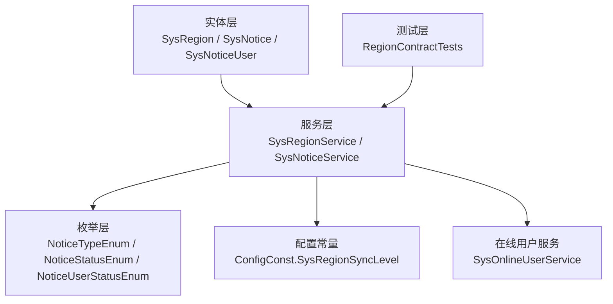
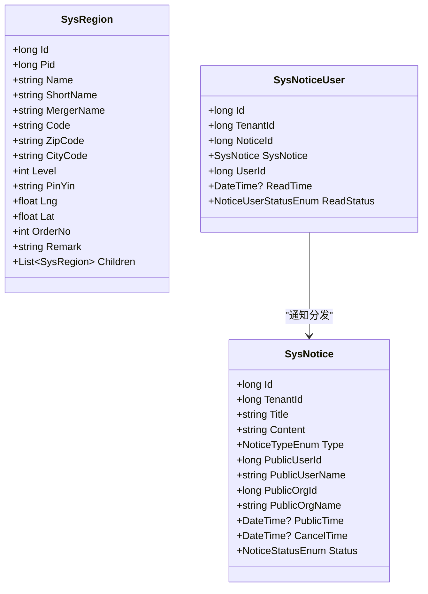
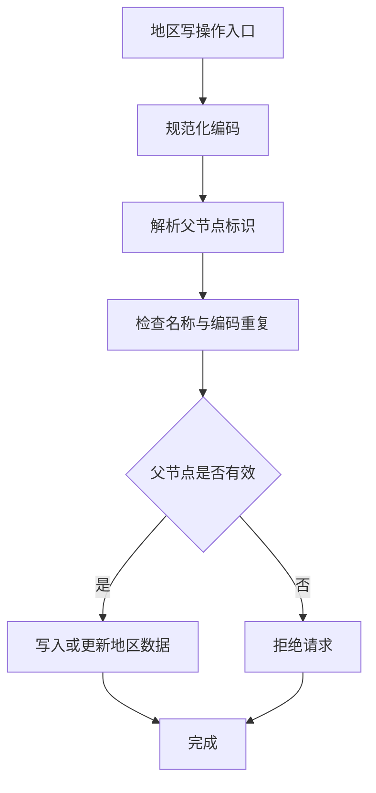
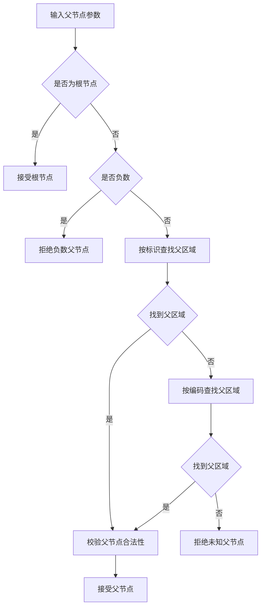
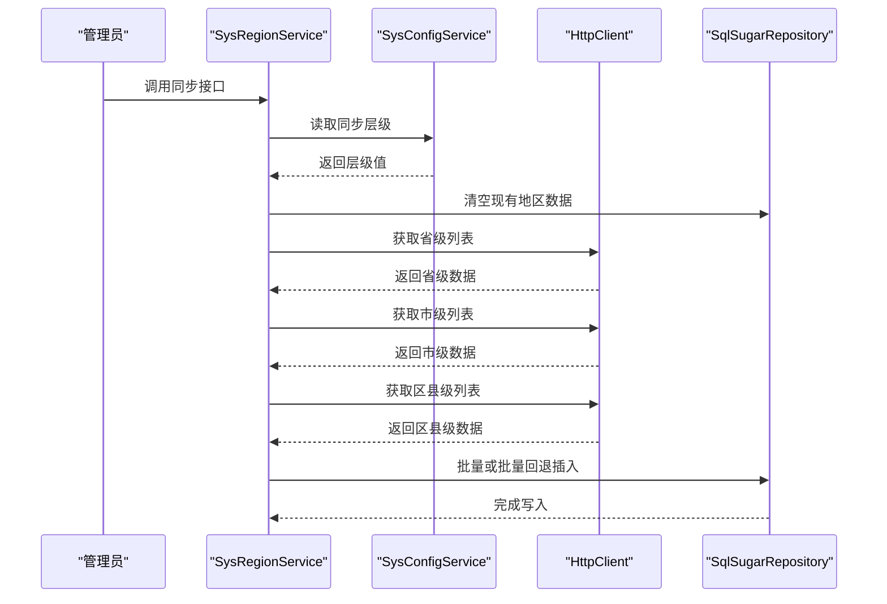
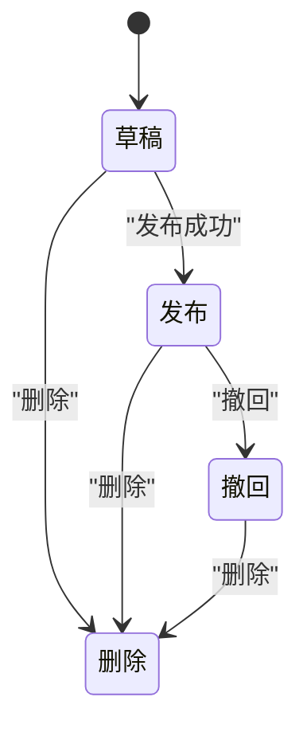
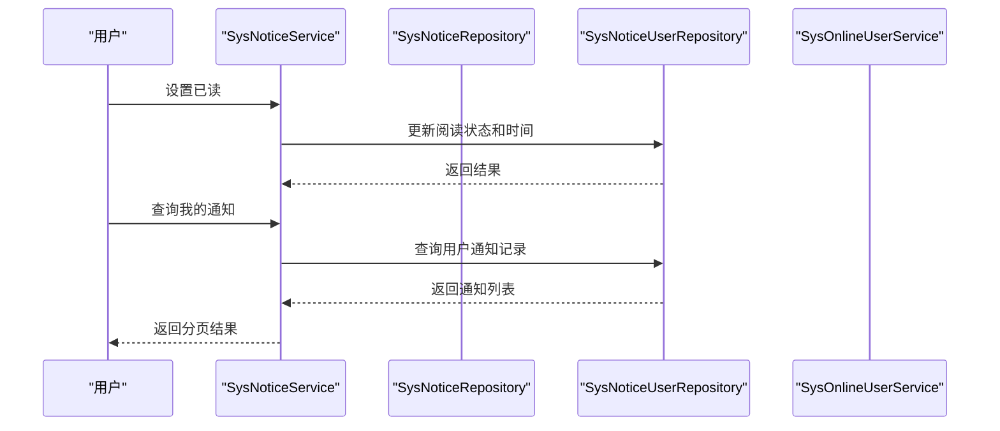
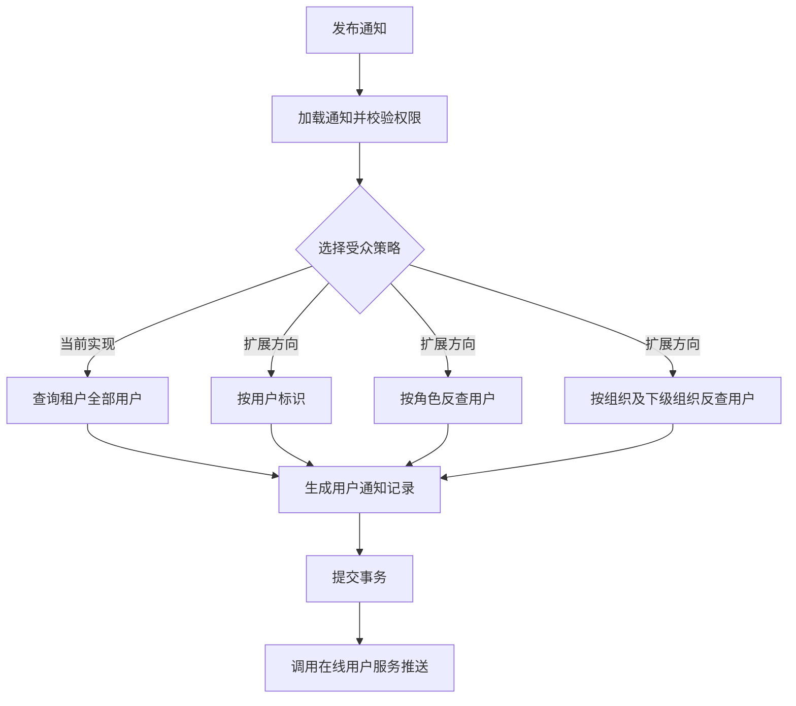
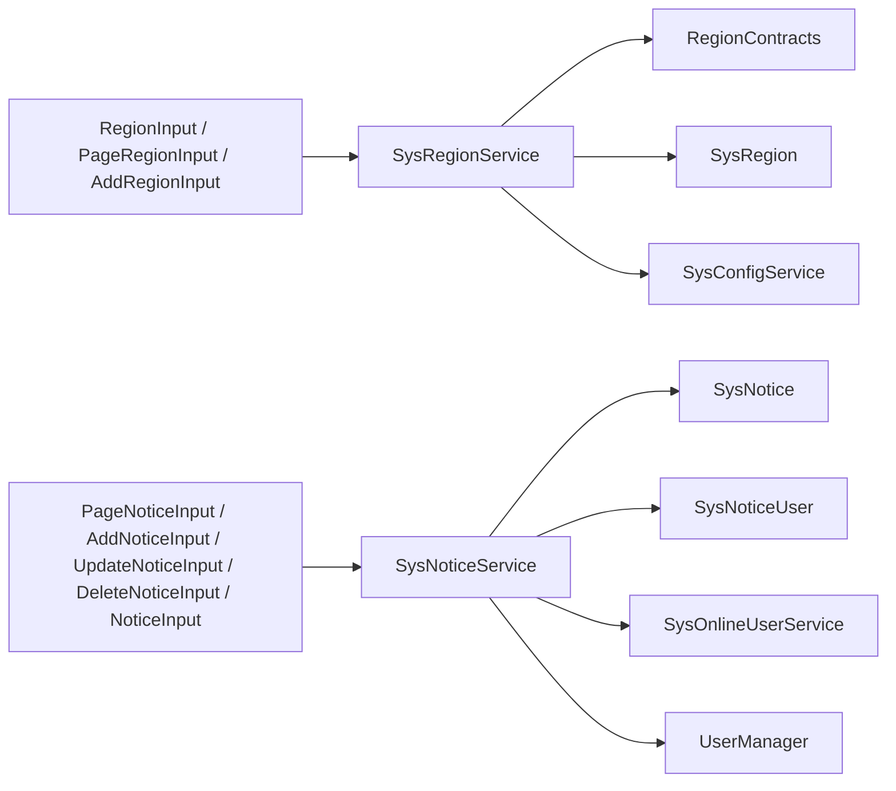

# 地区与通知实体

<cite>
**本文引用的文件**   
- [SysRegion.cs](file://Admin.NET/Admin.NET.Core/Entity/SysRegion.cs)
- [SysNotice.cs](file://Admin.NET/Admin.NET.Core/Entity/SysNotice.cs)
- [SysNoticeUser.cs](file://Admin.NET/Admin.NET.Core/Entity/SysNoticeUser.cs)
- [SysRegionService.cs](file://Admin.NET/Admin.NET.Core/Service/Region/SysRegionService.cs)
- [RegionContracts.cs](file://Admin.NET/Admin.NET.Core/Service/Region/RegionContracts.cs)
- [RegionInput.cs](file://Admin.NET/Admin.NET.Core/Service/Region/Dto/RegionInput.cs)
- [SysNoticeService.cs](file://Admin.NET/Admin.NET.Core/Service/Notice/SysNoticeService.cs)
- [NoticeInput.cs](file://Admin.NET/Admin.NET.Core/Service/Notice/Dto/NoticeInput.cs)
- [NoticeTypeEnum.cs](file://Admin.NET/Admin.NET.Core/Enum/NoticeTypeEnum.cs)
- [NoticeStatusEnum.cs](file://Admin.NET/Admin.NET.Core/Enum/NoticeStatusEnum.cs)
- [NoticeUserStatusEnum.cs](file://Admin.NET/Admin.NET.Core/Enum/NoticeUserStatusEnum.cs)
- [ConfigConst.cs](file://Admin.NET/Admin.NET.Core/Const/ConfigConst.cs)
- [RegionContractTests.cs](file://Admin.NET/Admin.NET.Test/Region/RegionContractTests.cs)
</cite>

## 目录
1. [引言](#引言)
2. [项目结构定位](#项目结构定位)
3. [核心实体模型](#核心实体模型)
4. [架构总览](#架构总览)
5. [地区模块详细设计](#地区模块详细设计)
6. [通知模块详细设计](#通知模块详细设计)
7. [依赖关系分析](#依赖关系分析)
8. [性能与一致性特征](#性能与一致性特征)
9. [常见问题排查](#常见问题排查)
10. [结论](#结论)

## 引言
本文聚焦 Admin.NET 后端中的地区与通知能力，围绕三个核心实体展开：

- `SysRegion`：系统行政地区树形数据，用于省市区县等行政区划、地理信息和排序展示。
- `SysNotice`：通知公告业务实体，承载标题、内容、类型、发布人、机构、时间和状态。
- `SysNoticeUser`：用户与通知的关联记录，支持一对多分发和阅读状态跟踪。

文档从实体字段、枚举、服务接口、校验规则、初始化同步流程、在线推送集成和业务场景五个层面进行说明，并给出面向开发者的可操作指引。

## 项目结构定位
地区和通知功能位于 `.NET` 后端核心层中：

- 实体定义位于 `Admin.NET.Admin.NET.Core/Entity`。
- 地区服务和契约逻辑位于 `Admin.NET.Admin.NET.Core/Service/Region`。
- 通知服务位于 `Admin.NET.Admin.NET.Core/Service/Notice`。
- 相关枚举和配置常量位于 `Admin.NET.Admin.NET.Core/Enum` 与 `Admin.NET.Admin.NET.Core/Const`。
- 单元测试覆盖地区契约行为，路径位于 `Admin.NET.Admin.NET.Test/Region`。

**图表来源**  
- [SysRegion.cs:1-109](file://Admin.NET/Admin.NET.Core/Entity/SysRegion.cs#L1-L109)  
- [SysNotice.cs:1-82](file://Admin.NET/Admin.NET.Core/Entity/SysNotice.cs#L1-L82)  
- [SysNoticeUser.cs:1-45](file://Admin.NET/Admin.NET.Core/Entity/SysNoticeUser.cs#L1-L45)  
- [SysRegionService.cs:1-254](file://Admin.NET/Admin.NET.Core/Service/Region/SysRegionService.cs#L1-L254)  
- [SysNoticeService.cs:1-252](file://Admin.NET/Admin.NET.Core/Service/Notice/SysNoticeService.cs#L1-L252)  
- [NoticeTypeEnum.cs:1-26](file://Admin.NET/Admin.NET.Core/Enum/NoticeTypeEnum.cs#L1-L26)  
- [NoticeStatusEnum.cs:1-38](file://Admin.NET/Admin.NET.Core/Enum/NoticeStatusEnum.cs#L1-L38)  
- [NoticeUserStatusEnum.cs:1-26](file://Admin.NET/Admin.NET.Core/Enum/NoticeUserStatusEnum.cs#L1-L26)  
- [ConfigConst.cs:1-148](file://Admin.NET/Admin.NET.Core/Const/ConfigConst.cs#L1-L148)  
- [RegionContractTests.cs:1-200](file://Admin.NET/Admin.NET.Test/Region/RegionContractTests.cs#L1-L200)

**章节来源**  
- [SysRegion.cs:1-109](file://Admin.NET/Admin.NET.Core/Entity/SysRegion.cs#L1-L109)  
- [SysNotice.cs:1-82](file://Admin.NET/Admin.NET.Core/Entity/SysNotice.cs#L1-L82)  
- [SysNoticeUser.cs:1-45](file://Admin.NET/Admin.NET.Core/Entity/SysNoticeUser.cs#L1-L45)

## 核心实体模型

### 地区实体 `SysRegion`
`SysRegion` 表示一条行政地区记录，采用自引用父节点 `Pid` 形成树形结构，并通过 `Level`、`Code`、`OrderNo` 提供层级、编码和排序语义。

| 字段 | 含义 | 约束或特点 |
|---|---|---|
| `Id` | 主键 | 继承基础实体标识 |
| `Pid` | 父地区标识 | 根节点通常为 `0` |
| `Name` | 地区名称 | 必填，最大长度 `128` |
| `ShortName` | 简称 | 可选，最大长度 `32` |
| `MergerName` | 组合名 | 可选，最大长度 `64` |
| `Code` | 行政区划编码 | 可选，最大长度 `32`；服务层要求规范化长度为 `6`、`9` 或 `12` |
| `ZipCode` | 邮政编码 | 可选，最大长度 `6` |
| `CityCode` | 区号 | 可选，最大长度 `6` |
| `Level` | 层级 | 数值型，用于区分省、市、区县等 |
| `PinYin` | 拼音 | 可选，最大长度 `128` |
| `Lng` | 经度 | 浮点地理坐标 |
| `Lat` | 纬度 | 浮点地理坐标 |
| `OrderNo` | 排序号 | 默认 `100` |
| `Remark` | 备注 | 可选，最大长度 `128` |
| `Children` | 子节点列表 | 内存映射字段，不参与数据库列 |

该实体通过索引优化 `Name` 和 `Code` 查询，并通过 `Children` 字段配合服务层构建前端树形结构。

**章节来源**  
- [SysRegion.cs:1-109](file://Admin.NET/Admin.NET.Core/Entity/SysRegion.cs#L1-L109)

### 通知实体 `SysNotice`
`SysNotice` 是通知公告的核心业务对象，包含标题、内容、类型、发布人和机构信息，以及发布、撤回和删除生命周期状态。

| 字段 | 含义 | 约束或特点 |
|---|---|---|
| `Id` | 主键 | 继承租户级基础实体标识 |
| `TenantId` | 租户标识 | 多租户隔离 |
| `Title` | 标题 | 必填，最大长度 `32`，含敏感词检测 |
| `Content` | 内容 | 必填，大文本存储，含敏感词检测 |
| `Type` | 类型 | 使用 `NoticeTypeEnum`，当前支持“通知”和“公告” |
| `PublicUserId` | 发布人标识 | 由服务层填充 |
| `PublicUserName` | 发布人姓名 | 由服务层填充 |
| `PublicOrgId` | 发布机构标识 | 由服务层填充 |
| `PublicOrgName` | 发布机构名称 | 由服务层填充 |
| `PublicTime` | 发布时间 | 发布时写入 |
| `CancelTime` | 撤回时间 | 撤回时写入 |
| `Status` | 状态 | 使用 `NoticeStatusEnum`，取值包括草稿、发布、撤回、删除 |

类型和状态分别由独立枚举控制，便于前端渲染、权限控制和业务判断。

**章节来源**  
- [SysNotice.cs:1-82](file://Admin.NET/Admin.NET.Core/Entity/SysNotice.cs#L1-L82)  
- [NoticeTypeEnum.cs:1-26](file://Admin.NET/Admin.NET.Core/Enum/NoticeTypeEnum.cs#L1-L26)  
- [NoticeStatusEnum.cs:1-38](file://Admin.NET/Admin.NET.Core/Enum/NoticeStatusEnum.cs#L1-L38)

### 用户通知关联实体 `SysNoticeUser`
`SysNoticeUser` 表示某用户对某条通知的分发记录，实现“一条通知对应多条用户记录”的一对多关系。

| 字段 | 含义 | 约束或特点 |
|---|---|---|
| `Id` | 主键 | 继承租户级基础实体标识 |
| `TenantId` | 租户标识 | 多租户隔离 |
| `NoticeId` | 通知标识 | 外键语义，关联 `SysNotice` |
| `SysNotice` | 导航属性 | 一对一导航到通知实体 |
| `UserId` | 用户标识 | 接收者 |
| `ReadTime` | 阅读时间 | 已读时写入 |
| `ReadStatus` | 阅读状态 | 默认未读，使用 `NoticeUserStatusEnum` |

该表既承担通知分发表职责，也承担用户阅读状态追踪职责。

**章节来源**  
- [SysNoticeUser.cs:1-45](file://Admin.NET/Admin.NET.Core/Entity/SysNoticeUser.cs#L1-L45)  
- [NoticeUserStatusEnum.cs:1-26](file://Admin.NET/Admin.NET.Core/Enum/NoticeUserStatusEnum.cs#L1-L26)

## 架构总览

**图表来源**  
- [SysRegion.cs:1-109](file://Admin.NET/Admin.NET.Core/Entity/SysRegion.cs#L1-L109)  
- [SysNotice.cs:1-82](file://Admin.NET/Admin.NET.Core/Entity/SysNotice.cs#L1-L82)  
- [SysNoticeUser.cs:1-45](file://Admin.NET/Admin.NET.Core/Entity/SysNoticeUser.cs#L1-L45)

## 地区模块详细设计

### 树形结构与层级关系
`SysRegion` 通过 `Pid` 建立父子关系，并通过 `Level` 表达行政层级。服务层提供以下能力：

- 分页列表：按父节点、名称、编码过滤。
- 子列表：按父节点获取下一层。
- 完整树：一次性返回整棵地区树。
- 增删改查：增加、更新、删除均经过编码规范、父节点解析、重复检查和防环校验。

**图表来源**  
- [SysRegionService.cs:60-130](file://Admin.NET/Admin.NET.Core/Service/Region/SysRegionService.cs#L60-L130)  
- [RegionContracts.cs:1-81](file://Admin.NET/Admin.NET.Core/Service/Region/RegionContracts.cs#L1-L81)

### 行政区划编码标准
地区编码在服务层通过 `RegionContracts.NormalizeCode` 强制规范化：

- 允许空值或空白字符串被转换为空字符串。
- 只接受长度为 `6`、`9` 或 `12` 的编码。
- 不限制编码字符集，保留原有业务约定。
- 不符合长度要求的编码直接抛出异常，避免进入持久化层。

这意味着实际部署时应保证导入或同步数据符合上述长度约定。测试用例覆盖了合法长度、空白处理、非法长度和边界值。

**章节来源**  
- [RegionContracts.cs:1-81](file://Admin.NET/Admin.NET.Core/Service/Region/RegionContracts.cs#L1-L81)  
- [RegionContractTests.cs:1-200](file://Admin.NET/Admin.NET.Test/Region/RegionContractTests.cs#L1-L200)

### 父节点解析与防环校验
地区写操作的父节点解析遵循“标识优先、编码兜底”的规则：

- 父节点为 `0` 时表示根节点。
- 负数父节点立即拒绝。
- 先按父节点标识查找，找不到再按编码精确查找。
- 若两者都找不到，则拒绝请求。
- 更新前会检查是否存在自引用或后代循环，防止把子区域设为其自身后代的父区域。

**图表来源**  
- [RegionContracts.cs:1-81](file://Admin.NET/Admin.NET.Core/Service/Region/RegionContracts.cs#L1-L81)  
- [RegionContractTests.cs:1-200](file://Admin.NET/Admin.NET.Test/Region/RegionContractTests.cs#L1-L200)

### 地理信息与排序
`SysRegion` 同时保存经纬度、区号、邮编和排序号：

- `Lng`、`Lat` 用于地理位置展示和地图联动。
- `CityCode`、`ZipCode` 支持电话区号和邮政信息。
- `OrderNo` 控制同级地区显示顺序，服务层在排序时结合 `Id` 提供稳定顺序。

### 地区数据初始化与管理
地区数据可通过系统配置驱动的同步任务从外部民政部地图页面拉取：

- 配置项 `ConfigConst.SysRegionSyncLevel` 控制同步层级，范围建议为 `1` 至 `5`，默认回退到区县级。
- 同步过程清空现有地区数据，然后按省级、市级、区县级逐级抓取。
- 响应可能包含 `GBK` 编码，代码注册了现有代码页提供者以兼容。
- 大数据量时使用批量复制，失败时回退普通插入；Oracle 不支持该方式时会走普通插入分支。
- 同步使用事务包装，失败时抛出统一错误码。

**图表来源**  
- [SysRegionService.cs:130-254](file://Admin.NET/Admin.NET.Core/Service/Region/SysRegionService.cs#L130-L254)  
- [ConfigConst.cs:1-148](file://Admin.NET/Admin.NET.Core/Const/ConfigConst.cs#L1-L148)

**章节来源**  
- [SysRegionService.cs:1-254](file://Admin.NET/Admin.NET.Core/Service/Region/SysRegionService.cs#L1-L254)  
- [RegionContracts.cs:1-81](file://Admin.NET/Admin.NET.Core/Service/Region/RegionContracts.cs#L1-L81)  
- [RegionInput.cs:1-46](file://Admin.NET/Admin.NET.Core/Service/Region/Dto/RegionInput.cs#L1-L46)  
- [ConfigConst.cs:1-148](file://Admin.NET/Admin.NET.Core/Const/ConfigConst.cs#L1-L148)  
- [RegionContractTests.cs:1-200](file://Admin.NET/Admin.NET.Test/Region/RegionContractTests.cs#L1-L200)

## 通知模块详细设计

### 消息类型与优先级
通知类型由 `NoticeTypeEnum` 控制：

| 枚举值 | 中文含义 | 用途 |
|---|---|---|
| `NOTICE` | 通知 | 一般性通知类消息 |
| `ANNOUNCEMENT` | 公告 | 正式公告类消息 |

当前实体没有独立的“优先级”字段；如需优先级，可在扩展层增加枚举或数字字段，并在查询、排序和前端展示中体现。

**章节来源**  
- [NoticeTypeEnum.cs:1-26](file://Admin.NET/Admin.NET.Core/Enum/NoticeTypeEnum.cs#L1-L26)

### 状态管理与生命周期
通知状态由 `NoticeStatusEnum` 控制：

| 枚举值 | 中文含义 | 生命周期含义 |
|---|---|---|
| `DRAFT` | 草稿 | 创建后默认状态，尚未对外发布 |
| `PUBLIC` | 发布 | 已正式发布并可被用户接收 |
| `CANCEL` | 撤回 | 已发布后被撤回 |
| `DELETED` | 删除 | 逻辑删除或业务删除 |

服务层对草稿态和发布态有严格保护：

- 新增通知时默认写入草稿状态。
- 更新和删除仅允许非发布态记录修改。
- 发布时将状态改为发布，并写入发布时间。
- 已发布通知的重试发布不会重建收件记录或重置阅读状态。

**图表来源**  
- [NoticeStatusEnum.cs:1-38](file://Admin.NET/Admin.NET.Core/Enum/NoticeStatusEnum.cs#L1-L38)  
- [SysNoticeService.cs:1-200](file://Admin.NET/Admin.NET.Core/Service/Notice/SysNoticeService.cs#L1-L200)

**章节来源**  
- [NoticeStatusEnum.cs:1-38](file://Admin.NET/Admin.NET.Core/Enum/NoticeStatusEnum.cs#L1-L38)  
- [SysNoticeService.cs:1-200](file://Admin.NET/Admin.NET.Core/Service/Notice/SysNoticeService.cs#L1-L200)

### 用户订阅与阅读状态
`SysNoticeUser` 维护每个用户对每条通知的阅读状态：

- 新增时默认未读。
- 用户阅读后更新为已读，并写入阅读时间。
- 查询用户收到的通知时，可按标题、类型过滤，并按通知创建时间倒序分页。
- 未读列表查询基于用户标识、租户标识和未读状态。

**图表来源**  
- [SysNoticeService.cs:201-252](file://Admin.NET/Admin.NET.Core/Service/Notice/SysNoticeService.cs#L201-L252)  
- [SysNoticeUser.cs:1-45](file://Admin.NET/Admin.NET.Core/Entity/SysNoticeUser.cs#L1-L45)

**章节来源**  
- [SysNoticeService.cs:201-252](file://Admin.NET/Admin.NET.Core/Service/Notice/SysNoticeService.cs#L201-L252)  
- [NoticeInput.cs:1-36](file://Admin.NET/Admin.NET.Core/Service/Notice/Dto/NoticeInput.cs#L1-L36)

### 定向发送机制
当前实现的默认发布策略是“向租户内所有用户分发”：

- 发布时查询租户下全部用户。
- 删除该通知已有的用户收件记录。
- 批量插入新用户收件记录。
- 随后调用在线用户服务进行实时推送。

如果未来需要按用户、角色或组织精准推送，应在 `Public` 方法之前增加受众选择器，例如：

- 按用户标识列表筛选。
- 按角色标识反查用户。
- 按组织标识及其下级组织反查用户。
- 将最终用户标识集合替换当前全租户查询。

**图表来源**  
- [SysNoticeService.cs:120-200](file://Admin.NET/Admin.NET.Core/Service/Notice/SysNoticeService.cs#L120-L200)

**章节来源**  
- [SysNoticeService.cs:120-200](file://Admin.NET/Admin.NET.Core/Service/Notice/SysNoticeService.cs#L120-L200)

### 模板化支持与多渠道分发现状
当前源码中：

- `SysNotice.Content` 是大文本字段，没有内置模板引擎或模板实体。
- 没有发现模板变量、模板版本、模板管理或模板渲染服务的直接实现。
- 通知发布后通过 `SysOnlineUserService.PublicNotice` 进行在线用户推送。
- 未发现微信、钉钉、短信、邮件等渠道的专用通知分发实现。

因此，当前能力更适合“单通道、纯文本或富文本内容”的通知场景。如需模板化和多渠道分发，应新增：

- 模板实体和模板变量体系。
- 模板渲染服务。
- 渠道抽象接口和具体渠道实现。
- 通知投递队列和重试机制。
- 投递记录和失败告警。

**章节来源**  
- [SysNoticeService.cs:120-200](file://Admin.NET/Admin.NET.Core/Service/Notice/SysNoticeService.cs#L120-L200)

## 依赖关系分析

**图表来源**  
- [RegionInput.cs:1-46](file://Admin.NET/Admin.NET.Core/Service/Region/Dto/RegionInput.cs#L1-L46)  
- [SysRegionService.cs:1-254](file://Admin.NET/Admin.NET.Core/Service/Region/SysRegionService.cs#L1-L254)  
- [RegionContracts.cs:1-81](file://Admin.NET/Admin.NET.Core/Service/Region/RegionContracts.cs#L1-L81)  
- [NoticeInput.cs:1-36](file://Admin.NET/Admin.NET.Core/Service/Notice/Dto/NoticeInput.cs#L1-L36)  
- [SysNoticeService.cs:1-252](file://Admin.NET/Admin.NET.Core/Service/Notice/SysNoticeService.cs#L1-L252)

**章节来源**  
- [SysRegionService.cs:1-254](file://Admin.NET/Admin.NET.Core/Service/Region/SysRegionService.cs#L1-L254)  
- [SysNoticeService.cs:1-252](file://Admin.NET/Admin.NET.Core/Service/Notice/SysNoticeService.cs#L1-L252)

## 性能与一致性特征

### 地区查询性能
- 名称和编码建有升序索引。
- 排序通过 `OrderNo` 加 `Id` 提供稳定顺序。
- 树形构建由服务层聚合，适合中小规模地区数据。
- 同步阶段对大批量数据优先使用批量复制，失败时回退普通插入。

### 通知发布一致性
- 发布操作使用事务：更新通知状态、清理旧收件记录、插入新收件记录。
- 事务失败时回滚，避免部分写入。
- 发布成功后才调用在线用户服务推送，确保客户端读取到的未读列表与数据库一致。
- 已发布通知的重试发布仅重新推送，不重建收件记录，避免重复分发。

### 并发保护
- 更新和删除通知时附加状态条件，防止发布后被覆盖或删除。
- 发布更新也附加状态条件，提高并发安全。

**章节来源**  
- [SysRegionService.cs:1-254](file://Admin.NET/Admin.NET.Core/Service/Region/SysRegionService.cs#L1-L254)  
- [SysNoticeService.cs:1-200](file://Admin.NET/Admin.NET.Core/Service/Notice/SysNoticeService.cs#L1-L200)

## 常见问题排查

### 地区编码报错
- 现象：新增或更新地区时报错。
- 常见原因：编码长度不是 `6`、`9` 或 `12`。
- 处理建议：清洗外部数据，或调整导入脚本，确保编码长度符合 `RegionContracts.NormalizeCode` 的要求。

**章节来源**  
- [RegionContracts.cs:1-81](file://Admin.NET/Admin.NET.Core/Service/Region/RegionContracts.cs#L1-L81)  
- [RegionContractTests.cs:1-200](file://Admin.NET/Admin.NET.Test/Region/RegionContractTests.cs#L1-L200)

### 地区父节点无效
- 现象：设置父节点时报错。
- 常见原因：父节点标识不存在、编码不存在，或父节点为负数。
- 处理建议：确认父节点真实存在；优先使用标识，其次使用精确编码。

**章节来源**  
- [RegionContracts.cs:1-81](file://Admin.NET/Admin.NET.Core/Service/Region/RegionContracts.cs#L1-L81)

### 地区出现环状结构
- 现象：尝试将某个区域设置为其后代区域的父区域时报错。
- 常见原因：误把祖先区域作为后代区域的父节点。
- 处理建议：先取消错误的父子关系，再重新设置正确父节点。

**章节来源**  
- [RegionContracts.cs:1-81](file://Admin.NET/Admin.NET.Core/Service/Region/RegionContracts.cs#L1-L81)

### 通知无法更新或删除
- 现象：更新或删除已发布通知失败。
- 常见原因：通知状态为“发布”，服务层禁止修改。
- 处理建议：先撤回或等待业务流程允许变更后再操作。

**章节来源**  
- [SysNoticeService.cs:1-200](file://Admin.NET/Admin.NET.Core/Service/Notice/SysNoticeService.cs#L1-L200)

### 通知未出现在用户列表中
- 现象：用户看不到刚发布的通知。
- 常见原因：事务尚未提交、在线推送尚未到达、或未刷新前端列表。
- 处理建议：检查事务提交日志、在线用户推送日志，并确认前端轮询或实时通道正常。

**章节来源**  
- [SysNoticeService.cs:120-200](file://Admin.NET/Admin.NET.Core/Service/Notice/SysNoticeService.cs#L120-L200)

## 结论
- `SysRegion` 通过自引用父节点和层级字段实现行政区划树，服务层在编码规范化、父节点解析、防环校验和批量同步方面提供了较完整的治理能力。
- `SysNotice` 通过类型和状态枚举明确通知的业务分类和生命周期，服务层对草稿态和发布态施加了较强的保护。
- `SysNoticeUser` 将通知分发和用户阅读状态解耦为一张关联表，便于统计未读数、已读数和用户收件列表。
- 当前默认通知分发策略面向“全租户用户”，尚未实现按用户、角色、组织的精准推送，也未实现模板化与多渠道分发。这些能力可作为后续扩展点。
- 地区查询和通知查询均以租户隔离为基础，适合在多租户系统中复用。