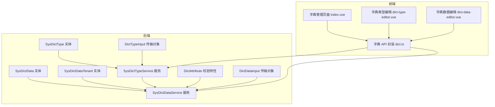
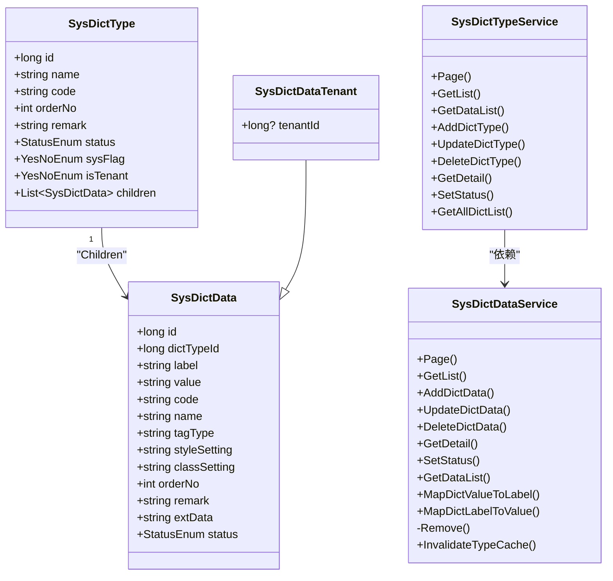
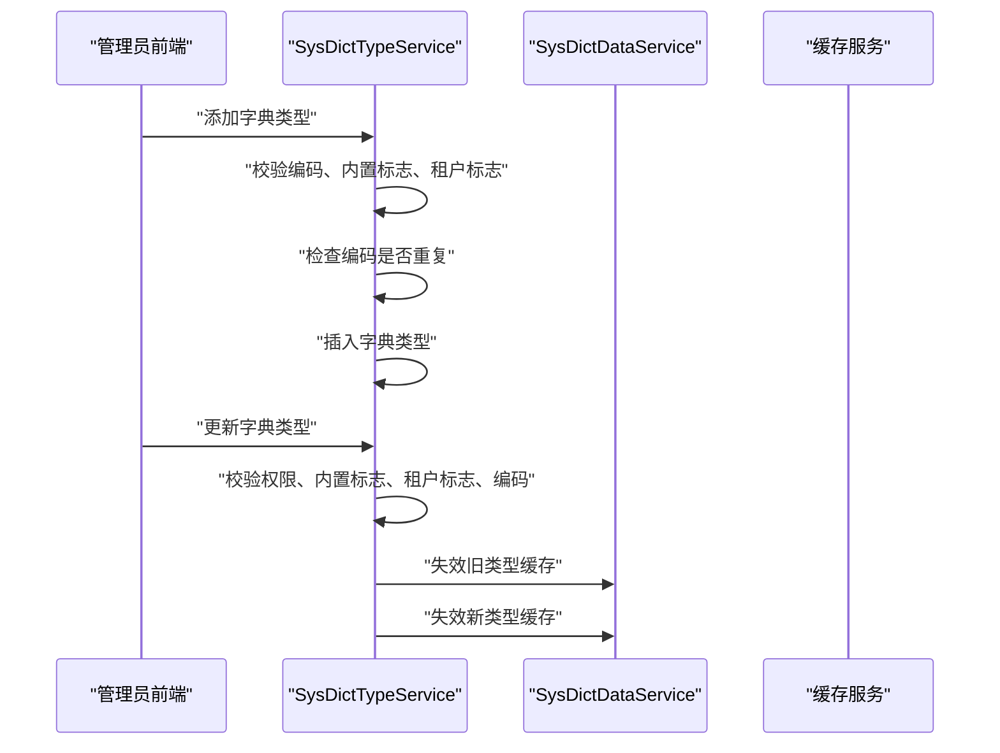
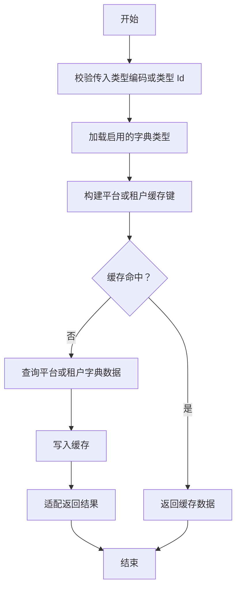
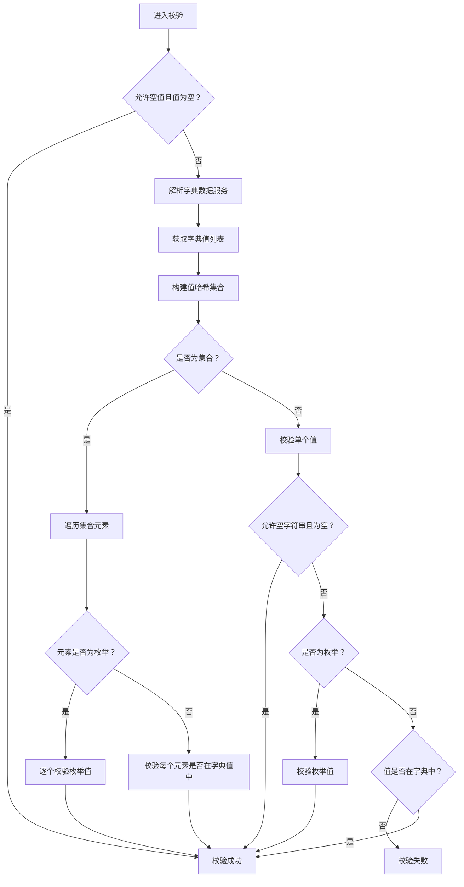
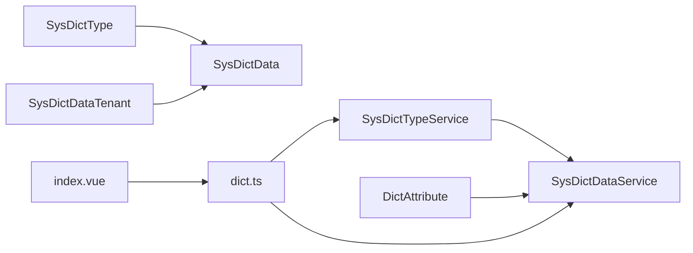
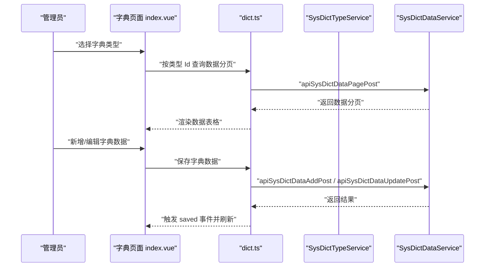

# 字典管理实体

<cite>
**本文引用的文件**   
- [SysDictType.cs](file://Admin.NET/Admin.NET.Core/Entity/SysDictType.cs)
- [SysDictData.cs](file://Admin.NET/Admin.NET.Core/Entity/SysDictData.cs)
- [SysDictDataTenant.cs](file://Admin.NET/Admin.NET.Core/Entity/SysDictDataTenant.cs)
- [SysDictTypeService.cs](file://Admin.NET/Admin.NET.Core/Service/Dict/SysDictTypeService.cs)
- [SysDictDataService.cs](file://Admin.NET/Admin.NET.Core/Service/Dict/SysDictDataService.cs)
- [DictAttribute.cs](file://Admin.NET/Admin.NET.Core/Attribute/DictAttribute.cs)
- [DictTypeInput.cs](file://Admin.NET/Admin.NET.Core/Service/Dict/Dto/DictTypeInput.cs)
- [DictDataInput.cs](file://Admin.NET/Admin.NET.Core/Service/Dict/Dto/DictDataInput.cs)
- [dict.ts](file://Web/apps/web-antdv-next/src/api/system/dict.ts)
- [index.vue](file://Web/apps/web-antdv-next/src/views/system/dict/index.vue)
- [dict-data-editor.vue](file://Web/apps/web-antdv-next/src/views/system/dict/component/dict-data-editor.vue)
- [dict-type-editor.vue](file://Web/apps/web-antdv-next/src/views/system/dict/component/dict-type-editor.vue)
</cite>

## 目录
1. [引言](#引言)
2. [项目结构中的字典模块](#项目结构中的字典模块)
3. [核心实体设计](#核心实体设计)
4. [架构总览](#架构总览)
5. [详细组件分析](#详细组件分析)
6. [依赖关系分析](#依赖关系分析)
7. [性能与缓存策略](#性能与缓存策略)
8. [前端使用与动态加载](#前端使用与动态加载)
9. [业务规则、验证与扩展性](#业务规则验证与扩展性)
10. [常见问题排查](#常见问题排查)
11. [结论](#结论)

## 引言
本设计文档围绕 Admin.NET 的字典管理子系统，说明字典类型 `SysDictType` 与字典数据 `SysDictData` 的设计模式、层次结构、分类管理机制、动态配置方式、缓存优化方案，以及前后端协作流程。文档同时给出面向开发者的典型使用场景，包括新增字典类型、维护字典数据、在业务表单中使用字典值校验和下拉选项，并解释系统内置字典、租户字典和业务枚举之间的边界与扩展点。

## 项目结构中的字典模块
字典模块采用“实体 + 服务 + 数据传输对象 + 特性校验 + 前端页面”的分层组织：
- 后端实体位于核心工程实体目录，描述数据库模型和基础关联。
- 服务类暴露动态 API，实现分页查询、增删改、状态变更、全局字典聚合、缓存失效等逻辑。
- 输入输出对象定义在 Dto 目录，用于接口参数、分页条件、添加更新请求体。
- 特性 `DictAttribute` 提供基于字典值的运行时校验，支持单值、集合、枚举及导入场景。
- 前端业务入口是 Web 应用下的字典管理页面，负责类型列表、数据列表、编辑器弹窗及权限控制。

**图示来源**
- [SysDictType.cs:1-68](file://Admin.NET/Admin.NET.Core/Entity/SysDictType.cs#L1-L68)
- [SysDictData.cs:1-105](file://Admin.NET/Admin.NET.Core/Entity/SysDictData.cs#L1-L105)
- [SysDictDataTenant.cs:1-22](file://Admin.NET/Admin.NET.Core/Entity/SysDictDataTenant.cs#L1-L22)
- [SysDictTypeService.cs:1-261](file://Admin.NET/Admin.NET.Core/Service/Dict/SysDictTypeService.cs#L1-L261)
- [SysDictDataService.cs:1-348](file://Admin.NET/Admin.NET.Core/Service/Dict/SysDictDataService.cs#L1-L348)
- [DictAttribute.cs:1-138](file://Admin.NET/Admin.NET.Core/Attribute/DictAttribute.cs#L1-L138)
- [DictTypeInput.cs:1-54](file://Admin.NET/Admin.NET.Core/Service/Dict/Dto/DictTypeInput.cs#L1-L54)
- [DictDataInput.cs:1-64](file://Admin.NET/Admin.NET.Core/Service/Dict/Dto/DictDataInput.cs#L1-L64)
- [index.vue:1-216](file://Web/apps/web-antdv-next/src/views/system/dict/index.vue#L1-L216)
- [dict.ts:1-27](file://Web/apps/web-antdv-next/src/api/system/dict.ts#L1-L27)

**章节来源**
- [SysDictType.cs:1-68](file://Admin.NET/Admin.NET.Core/Entity/SysDictType.cs#L1-L68)
- [SysDictData.cs:1-105](file://Admin.NET/Admin.NET.Core/Entity/SysDictData.cs#L1-L105)
- [SysDictDataTenant.cs:1-22](file://Admin.NET/Admin.NET.Core/Entity/SysDictDataTenant.cs#L1-L22)
- [SysDictTypeService.cs:1-261](file://Admin.NET/Admin.NET.Core/Service/Dict/SysDictTypeService.cs#L1-L261)
- [SysDictDataService.cs:1-348](file://Admin.NET/Admin.NET.Core/Service/Dict/SysDictDataService.cs#L1-L348)
- [DictAttribute.cs:1-138](file://Admin.NET/Admin.NET.Core/Attribute/DictAttribute.cs#L1-L138)
- [DictTypeInput.cs:1-54](file://Admin.NET/Admin.NET.Core/Service/Dict/Dto/DictTypeInput.cs#L1-L54)
- [DictDataInput.cs:1-64](file://Admin.NET/Admin.NET.Core/Service/Dict/Dto/DictDataInput.cs#L1-L64)
- [index.vue:1-216](file://Web/apps/web-antdv-next/src/views/system/dict/index.vue#L1-L216)
- [dict.ts:1-27](file://Web/apps/web-antdv-next/src/api/system/dict.ts#L1-L27)

## 核心实体设计
### SysDictType 字典类型
`SysDictType` 表示一个字典分类，例如组织架构类型、订单状态、支付方式等。关键字段包括：
- 名称：显示给管理员使用的中文或本地化名称。
- 编码：字典类型的稳定标识，常用于 API 查询、缓存键、业务枚举映射。
- 排序：控制字典类型在前端列表中的顺序。
- 备注：辅助说明。
- 状态：启用或禁用。
- 是否内置：区分系统内置字典与普通业务字典。
- 是否租户字典：区分平台级字典与租户级字典。
- 子节点：一对多关联到 `SysDictData`，便于 ORM 读取时直接获取该类型下的所有数据项。

该实体通过注解建立数据库表、索引和多语言翻译关联的基础语义，并通过导航属性表达类型与数据的关系。

**章节来源**
- [SysDictType.cs:1-68](file://Admin.NET/Admin.NET.Core/Entity/SysDictType.cs#L1-L68)

### SysDictData 字典数据
`SysDictData` 表示某个字典类型下的具体选项，例如“男/女”“启用/禁用”。关键字段包括：
- 字典类型 Id：外键式关联字段，指向所属字典类型。
- 显示文本 Label：用户可见文案，支持多语言翻译。
- 值 Value：持久化存储的业务键，通常不可变且唯一。
- 编码 Code：可选的业务辅助编码。
- 名称 Name：可选展示名称。
- 标签样式 TagType、StyleSetting、ClassSetting：用于前端渲染为不同颜色、样式或 CSS 类。
- 排序 OrderNo：控制同一类型下选项的顺序。
- 备注 Remark：补充说明。
- 扩展数据 ExtData：保存业务功能所需的 JSON 或其他配置。
- 状态 Status：启用或禁用。

数据库上对“类型 Id + 值”建立了唯一索引，确保同一字典类型下值不重复。

**章节来源**
- [SysDictData.cs:1-105](file://Admin.NET/Admin.NET.Core/Entity/SysDictData.cs#L1-L105)

### SysDictDataTenant 租户字典数据
`SysDictDataTenant` 继承 `SysDictData`，增加租户 Id，用于实现租户隔离的字典值。服务层通过联合查询统一访问平台字典和租户字典，从而对外暴露一致的字典数据接口。

**章节来源**
- [SysDictDataTenant.cs:1-22](file://Admin.NET/Admin.NET.Core/Entity/SysDictDataTenant.cs#L1-L22)

## 架构总览
字典模块采用“类型与值分离”的设计：
- 类型层负责分类、元信息、排序、状态、是否内置、是否租户字典。
- 值层负责具体选项的显示文本、值、样式、排序、扩展配置。
- 服务层封装 CRUD、分页、全局字典聚合、缓存、多语言翻译注入、租户隔离和权限校验。
- 特性层提供声明式校验，使业务模型可以直接用特性约束字段值属于某个字典。
- 前端页面提供可视化维护界面，并在业务表单中按需加载字典数据。

**图示来源**
- [SysDictType.cs:1-68](file://Admin.NET/Admin.NET.Core/Entity/SysDictType.cs#L1-L68)
- [SysDictData.cs:1-105](file://Admin.NET/Admin.NET.Core/Entity/SysDictData.cs#L1-L105)
- [SysDictDataTenant.cs:1-22](file://Admin.NET/Admin.NET.Core/Entity/SysDictDataTenant.cs#L1-L22)
- [SysDictTypeService.cs:1-261](file://Admin.NET/Admin.NET.Core/Service/Dict/SysDictTypeService.cs#L1-L261)
- [SysDictDataService.cs:1-348](file://Admin.NET/Admin.NET.Core/Service/Dict/SysDictDataService.cs#L1-L348)

## 详细组件分析

### 字典类型服务 SysDictTypeService
职责：
- 提供字典类型的分页列表、完整列表、详情、添加、更新、删除、状态修改。
- 根据编码获取某类型下的字典数据列表。
- 返回所有字典类型及其数据的聚合结果，按类型编码分组。
- 在分页和列表查询中，结合多语言翻译服务替换名称或标签。

关键行为：
- 普通用户不能创建以 “enum” 结尾的类型编码；内置字典只能由超级管理员修改。
- 非超级管理员新增类型时，默认标记为租户字典。
- 更新时不允许随意切换内置标志和租户标志；若类型编码以 “enum” 结尾则不允许修改编码。
- 删除类型时会先删除对应字典数据，再删除类型本身。
- 修改状态后调用数据服务失效相关缓存。

**图示来源**
- [SysDictTypeService.cs:1-261](file://Admin.NET/Admin.NET.Core/Service/Dict/SysDictTypeService.cs#L1-L261)
- [SysDictDataService.cs:1-348](file://Admin.NET/Admin.NET.Core/Service/Dict/SysDictDataService.cs#L1-L348)

**章节来源**
- [SysDictTypeService.cs:1-261](file://Admin.NET/Admin.NET.Core/Service/Dict/SysDictTypeService.cs#L1-L261)

### 字典数据服务 SysDictDataService
职责：
- 提供字典数据的分页、列表、详情、添加、更新、删除、状态修改。
- 根据类型 Id 或类型编码获取启用状态的字典数据集合。
- 将平台字典和租户字典合并为统一可查询视图。
- 提供值转标签、标签转值的映射方法，用于列表展示和导入导出。
- 维护字典数据的缓存键，并在增删改后失效缓存。

关键行为：
- 同一类型下值必须唯一。
- 更新或删除时，先校验记录是否存在、类型是否匹配。
- 内置字典的数据操作需要超级管理员权限。
- 租户字典写入时使用租户 Id，并按租户维度查询。
- 获取字典数据时优先从缓存读取，未命中则查库并写入缓存。
- 删除类型时，根据是否租户字典分别删除平台或租户数据表。

**图示来源**
- [SysDictDataService.cs:1-348](file://Admin.NET/Admin.NET.Core/Service/Dict/SysDictDataService.cs#L1-L348)

**章节来源**
- [SysDictDataService.cs:1-348](file://Admin.NET/Admin.NET.Core/Service/Dict/SysDictDataService.cs#L1-L348)

### 数据传输对象与输入校验
- 字典类型输入对象包含分页条件、添加更新请求体和删除请求体，其中添加类型默认设为租户字典，非内置。
- 字典数据输入对象包含分页条件、添加更新请求体、删除请求体、按类型 Id 查询和按值查询的对象。
- 这些对象复用基础分页、基础状态输入和基础 Id 输入，保证接口一致性。

**章节来源**
- [DictTypeInput.cs:1-54](file://Admin.NET/Admin.NET.Core/Service/Dict/Dto/DictTypeInput.cs#L1-L54)
- [DictDataInput.cs:1-64](file://Admin.NET/Admin.NET.Core/Service/Dict/Dto/DictDataInput.cs#L1-L64)

### 字典值校验特性 DictAttribute
`DictAttribute` 提供声明式校验，使业务模型字段可以直接绑定到某个字典类型：
- 支持空值允许、空字符串允许。
- 自动从依赖注入容器或全局容器解析 `SysDictDataService`。
- 内部将字典值列表转为哈希集合，提升查找效率。
- 支持普通单值、集合类型、枚举类型。
- 支持导入场景，通过导入头名定位失败字段。

典型用法：在业务实体字段上标注 `DictAttribute`，传入目标字典类型编码，即可在验证阶段自动校验值是否合法。

**图示来源**
- [DictAttribute.cs:1-138](file://Admin.NET/Admin.NET.Core/Attribute/DictAttribute.cs#L1-L138)
- [SysDictDataService.cs:1-348](file://Admin.NET/Admin.NET.Core/Service/Dict/SysDictDataService.cs#L1-L348)

**章节来源**
- [DictAttribute.cs:1-138](file://Admin.NET/Admin.NET.Core/Attribute/DictAttribute.cs#L1-L138)

## 依赖关系分析
- 实体之间：`SysDictType` 与 `SysDictData` 是一对多关系；`SysDictDataTenant` 继承 `SysDictData`，扩展租户隔离能力。
- 服务之间：`SysDictTypeService` 依赖 `SysDictDataService` 完成字典数据查询和缓存失效；`SysDictDataService` 依赖缓存服务和用户上下文。
- 特性与服务：`DictAttribute` 在校验时依赖 `SysDictDataService` 获取字典值集合。
- 前端与服务：前端通过 `dict.ts` 封装 API，调用类型和数据两个服务接口；页面组件负责交互、权限控制和本地状态。

**图示来源**
- [SysDictType.cs:1-68](file://Admin.NET/Admin.NET.Core/Entity/SysDictType.cs#L1-L68)
- [SysDictData.cs:1-105](file://Admin.NET/Admin.NET.Core/Entity/SysDictData.cs#L1-L105)
- [SysDictDataTenant.cs:1-22](file://Admin.NET/Admin.NET.Core/Entity/SysDictDataTenant.cs#L1-L22)
- [SysDictTypeService.cs:1-261](file://Admin.NET/Admin.NET.Core/Service/Dict/SysDictTypeService.cs#L1-L261)
- [SysDictDataService.cs:1-348](file://Admin.NET/Admin.NET.Core/Service/Dict/SysDictDataService.cs#L1-L348)
- [DictAttribute.cs:1-138](file://Admin.NET/Admin.NET.Core/Attribute/DictAttribute.cs#L1-L138)
- [dict.ts:1-27](file://Web/apps/web-antdv-next/src/api/system/dict.ts#L1-L27)
- [index.vue:1-216](file://Web/apps/web-antdv-next/src/views/system/dict/index.vue#L1-L216)

**章节来源**
- [SysDictTypeService.cs:1-261](file://Admin.NET/Admin.NET.Core/Service/Dict/SysDictTypeService.cs#L1-L261)
- [SysDictDataService.cs:1-348](file://Admin.NET/Admin.NET.Core/Service/Dict/SysDictDataService.cs#L1-L348)
- [DictAttribute.cs:1-138](file://Admin.NET/Admin.NET.Core/Attribute/DictAttribute.cs#L1-L138)
- [dict.ts:1-27](file://Web/apps/web-antdv-next/src/api/system/dict.ts#L1-L27)
- [index.vue:1-216](file://Web/apps/web-antdv-next/src/views/system/dict/index.vue#L1-L216)

## 性能与缓存策略
### 类型与值分离的优势
- 类型变化频率低，值变化频率高。分离后可独立优化：类型列表缓存更简单，值列表可按租户维度拆分缓存。
- 避免频繁重建大对象图；查询值时无需加载类型全量对象，只按需加载启用项。
- 便于扩展：同一值可用于多个类型，或在不同租户拥有不同值集。

### 缓存键设计
- 平台字典缓存键包含类型编码。
- 租户字典缓存键包含租户 Id 和类型编码。
- 写操作后主动移除对应缓存键，保证一致性。
- 类型元数据变更会影响所有租户，服务层会扫描已存在的租户字典数据，逐租户失效缓存键，避免前缀误删。

### 查询优化
- 获取字典数据时优先读缓存，未命中再查库。
- 数据库层对“类型 Id + 值”建唯一索引，避免重复值。
- 分页查询使用有序字段组合排序，提高列表稳定性。
- 多语言翻译在服务层一次性批量获取并注入响应，避免 N+1 翻译查询。

**章节来源**
- [SysDictDataService.cs:1-348](file://Admin.NET/Admin.NET.Core/Service/Dict/SysDictDataService.cs#L1-L348)
- [SysDictTypeService.cs:1-261](file://Admin.NET/Admin.NET.Core/Service/Dict/SysDictTypeService.cs#L1-L261)
- [SysDictData.cs:1-105](file://Admin.NET/Admin.NET.Core/Entity/SysDictData.cs#L1-L105)

## 前端使用与动态加载
### 字典管理页面
字典管理页面分为左右两部分：
- 左侧：字典类型列表，支持搜索、新增、编辑、删除、审计记录查看。
- 右侧：选中类型下的字典数据列表，支持搜索、新增、复制、编辑、删除。
- 权限控制：根据角色和内置标志决定按钮是否可用。
- 操作成功后刷新类型和数据列表，并重置引用缓存，使业务页面重新加载字典。

**图示来源**
- [index.vue:1-216](file://Web/apps/web-antdv-next/src/views/system/dict/index.vue#L1-L216)
- [dict.ts:1-27](file://Web/apps/web-antdv-next/src/api/system/dict.ts#L1-L27)
- [SysDictDataService.cs:1-348](file://Admin.NET/Admin.NET.Core/Service/Dict/SysDictDataService.cs#L1-L348)

### 字典类型编辑组件
- 表单字段包括名称、编码、是否内置、是否租户字典、状态、排序、备注。
- 内置字典编辑时部分字段禁用，防止普通管理员破坏系统字典。
- 提交后回调父组件刷新类型列表。

**章节来源**
- [dict-type-editor.vue:1-119](file://Web/apps/web-antdv-next/src/views/system/dict/component/dict-type-editor.vue#L1-L119)

### 字典数据编辑组件
- 表单字段包括显示文本、值、编码、标签类型、样式 Style、样式 Class、状态、排序、备注、扩展数据。
- 内置类型的数据值字段可能禁用，确保系统值不被随意修改。
- 提交后触发 saved 事件，让父页面刷新数据列表。

**章节来源**
- [dict-data-editor.vue:1-123](file://Web/apps/web-antdv-next/src/views/system/dict/component/dict-data-editor.vue#L1-L123)

### 前端下拉选项的动态加载
虽然当前仓库中的字典 API 封装主要提供类型分页、数据分页和增删改接口，但服务层已经提供了以下能力供前端或业务组件动态加载下拉选项：
- 按类型 Id 获取字典数据列表。
- 按类型编码获取字典数据列表。
- 获取所有字典集合，按类型编码分组，适合一次性加载全局下拉选项。
- 字典数据包含标签颜色、样式、类名和扩展数据，可直接映射为前端下拉项的显示值和附加样式。

典型集成方式：
- 在业务表单初始化时，根据字段绑定的字典类型编码调用数据服务。
- 将返回的 `label` 作为下拉显示文本，`value` 作为提交值。
- 如需一次性加载所有字典，可使用全局字典聚合接口，再在前端按编码分组。

**章节来源**
- [SysDictDataService.cs:1-348](file://Admin.NET/Admin.NET.Core/Service/Dict/SysDictDataService.cs#L1-L348)
- [SysDictTypeService.cs:1-261](file://Admin.NET/Admin.NET.Core/Service/Dict/SysDictTypeService.cs#L1-L261)
- [dict.ts:1-27](file://Web/apps/web-antdv-next/src/api/system/dict.ts#L1-L27)

## 业务规则、验证与扩展性

### 类型与值分离的架构优势
- 解耦：类型管理关注分类和元信息，值管理关注选项和展示。
- 安全：内置字典限制修改范围，租户字典限制数据可见性和写入范围。
- 可扩展：值可携带扩展数据，用于业务枚举、开关、复杂配置。
- 易维护：类型编码作为稳定键，前端和服务端均可直接使用，降低耦合。

### 字典项的层次结构与分类管理
- 当前实体层面没有多级树形层级，而是通过“类型 → 数据”两级结构组织。
- 如果需要更复杂的层次结构，可在业务系统中引入父级 Id，或在扩展数据中维护层级关系。
- 分类管理主要通过类型编码进行，例如按业务域划分：组织、订单、支付、审批等。

### 动态配置机制
- 值层的 `ExtData` 字段可以保存 JSON 配置，用于业务功能扩展。
- 值层支持标签颜色、样式 Style、样式 Class，使 UI 可动态渲染。
- 服务层提供值到标签、标签到值的映射方法，方便导入导出和列表展示。

### CRUD 操作、批量导入导出、数据验证与业务规则
- 增删改：类型和数据都提供独立的增删改接口，并包含状态修改接口。
- 分页查询：类型和数据均支持分页，并支持关键词过滤。
- 数据验证：
  - 服务端：唯一性校验、权限校验、内置字典保护、租户隔离。
  - 客户端：前端表单必填校验，后端可通过 `DictAttribute` 做值合法性校验。
- 批量导入导出：
  - 当前代码未直接暴露批量导入导出控制器，但 `DictAttribute` 支持导入场景的错误提示，配合通用导入框架可实现 Excel 导入。
  - 批量导出可基于分页查询和映射方法，将值转换为标签，或将标签转换为值。

### 自定义业务枚举与系统配置项
- 自定义业务枚举：建议为业务枚举创建专门的字典类型，使用稳定的编码标识，并通过 `DictAttribute` 在业务模型中校验。
- 系统配置项：对于系统级固定配置，建议使用内置字典；对于租户级可变配置，使用租户字典。
- 扩展点：
  - 在 `SysDictData.ExtData` 中存储业务配置。
  - 在前端使用 `tagType`、`styleSetting`、`classSetting` 控制展示样式。
  - 在服务层扩展新的字典聚合或映射方法，满足特殊报表或导出需求。

**章节来源**
- [SysDictTypeService.cs:1-261](file://Admin.NET/Admin.NET.Core/Service/Dict/SysDictTypeService.cs#L1-L261)
- [SysDictDataService.cs:1-348](file://Admin.NET/Admin.NET.Core/Service/Dict/SysDictDataService.cs#L1-L348)
- [DictAttribute.cs:1-138](file://Admin.NET/Admin.NET.Core/Attribute/DictAttribute.cs#L1-L138)
- [SysDictData.cs:1-105](file://Admin.NET/Admin.NET.Core/Entity/SysDictData.cs#L1-L105)

## 常见问题排查
- 无法新增以 “enum” 结尾的字典类型：这是受保护的命名约定，用于区分业务枚举类型。
- 无法修改内置字典或内置字典数据：内置字典和内置数据只能由超级管理员操作。
- 同一类型下重复值：数据库唯一索引和服务端唯一性校验都会阻止重复值。
- 租户字典数据查不到：确认类型是否为租户字典，并且当前租户 Id 是否正确。
- 字典数据未生效：检查是否修改了类型或数据，导致缓存失效；必要时重启服务或清理缓存。
- 多语言名称不显示：检查多语言翻译是否配置，服务层会根据当前语言代码替换名称或标签。

**章节来源**
- [SysDictTypeService.cs:1-261](file://Admin.NET/Admin.NET.Core/Service/Dict/SysDictTypeService.cs#L1-L261)
- [SysDictDataService.cs:1-348](file://Admin.NET/Admin.NET.Core/Service/Dict/SysDictDataService.cs#L1-L348)
- [DictAttribute.cs:1-138](file://Admin.NET/Admin.NET.Core/Attribute/DictAttribute.cs#L1-L138)

## 结论
字典管理实体以类型与值分离为核心设计，既保证了分类管理的清晰性，又提供了灵活的选项配置能力。通过平台字典与租户字典的统一抽象、缓存优化、多语言翻译注入、权限保护和声明式校验，系统能够在复杂业务场景中稳定地支撑下拉选项、状态码、枚举值、业务配置项等需求。开发者应优先使用稳定编码标识字典类型，合理划分平台字典与租户字典，并在扩展数据中谨慎保存业务配置，以保持字典系统的可维护性和可扩展性。