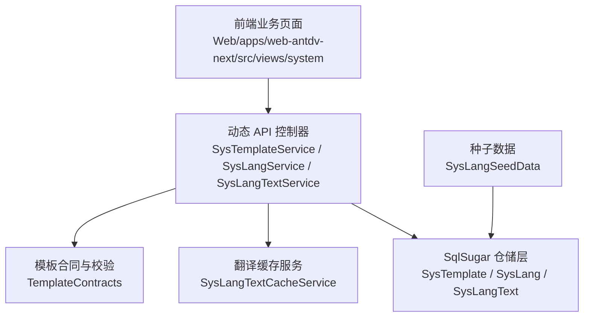
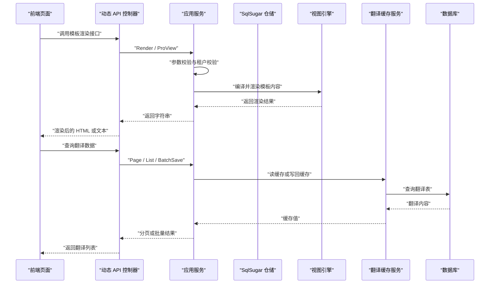
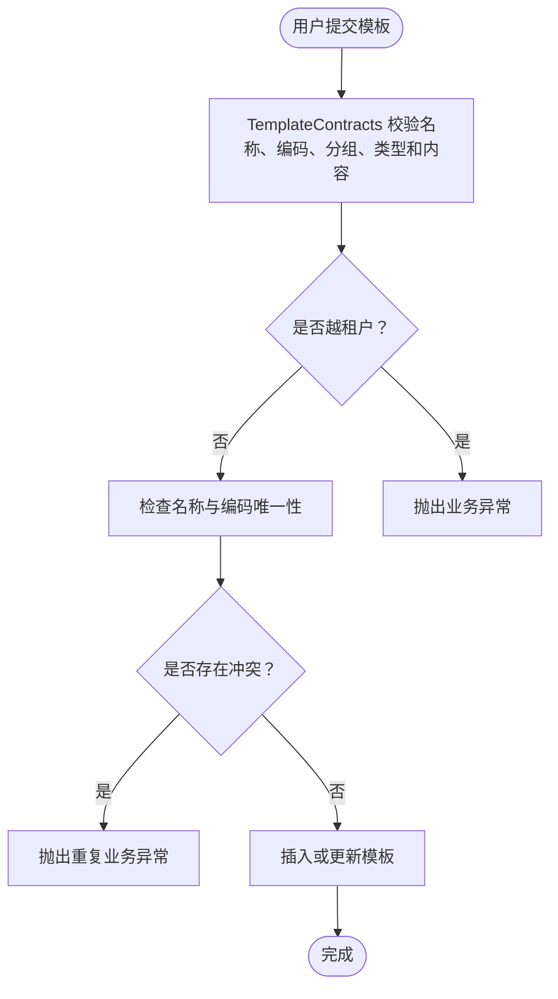
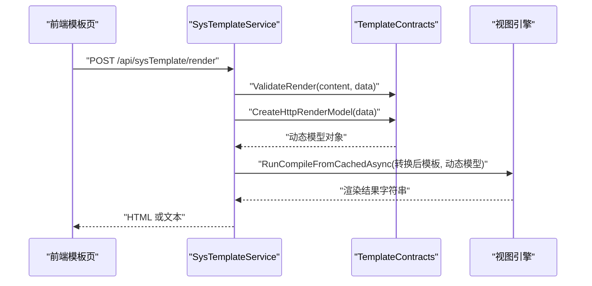
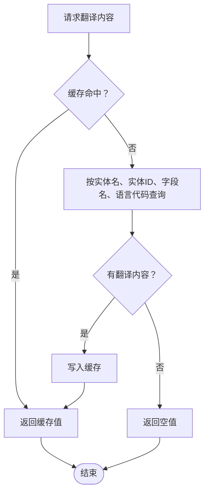
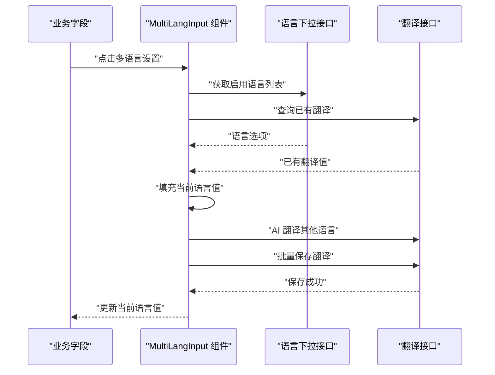
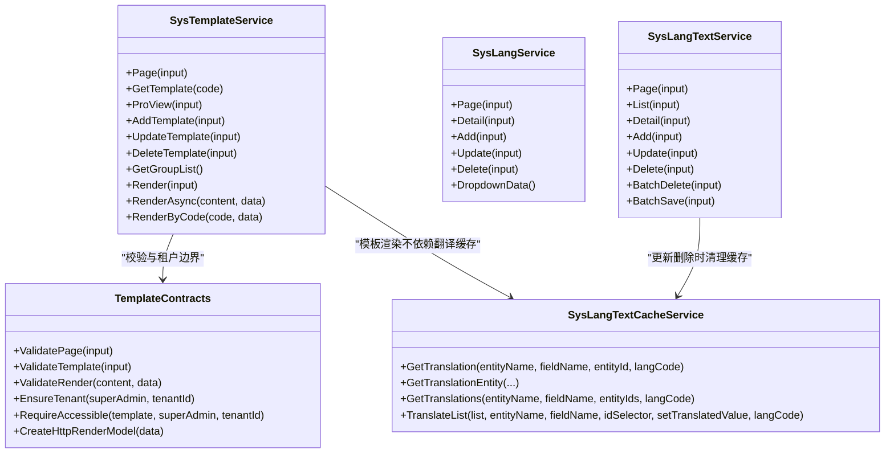

# 模板与多语言实体

<cite>
**本文引用的文件**   
- [SysTemplate.cs](file://Admin.NET/Admin.NET.Core/Entity/SysTemplate.cs)
- [SysLang.cs](file://Admin.NET/Admin.NET.Core/Entity/SysLang.cs)
- [SysLangText.cs](file://Admin.NET/Admin.NET.Core/Entity/SysLangText.cs)
- [SysTemplateService.cs](file://Admin.NET/Admin.NET.Core/Service/Template/SysTemplateService.cs)
- [TemplateContracts.cs](file://Admin.NET/Admin.NET.Core/Service/Template/TemplateContracts.cs)
- [SysLangService.cs](file://Admin.NET/Admin.NET.Core/Service/Lang/SysLangService.cs)
- [SysLangTextService.cs](file://Admin.NET/Admin.NET.Core/Service/LangText/SysLangTextService.cs)
- [SysLangTextCacheService.cs](file://Admin.NET/Admin.NET.Core/Service/LangText/SysLangTextCacheService.cs)
- [SysLangSeedData.cs](file://Admin.NET/Admin.NET.Core/SeedData/SysLangSeedData.cs)
- [template/index.vue](file://Web/apps/web-antdv-next/src/views/system/template/index.vue)
- [template.ts](file://Web/apps/web-antdv-next/src/api/system/template.ts)
- [lang/index.vue](file://Web/apps/web-antdv-next/src/views/system/lang/index.vue)
- [langText/index.vue](file://Web/apps/web-antdv-next/src/views/system/langText/index.vue)
- [multi-lang-input.vue](file://Web/apps/web-antdv-next/src/components/admin/multi-lang-input.vue)
</cite>

## 目录
1. [引言](#引言)
2. [项目结构定位](#项目结构定位)
3. [核心数据模型](#核心数据模型)
4. [系统架构总览](#系统架构总览)
5. [模板管理设计](#模板管理设计)
6. [多语言包与多语言文本设计](#多语言包与多语言文本设计)
7. [前端界面与交互流程](#前端界面与交互流程)
8. [依赖关系分析](#依赖关系分析)
9. [性能与缓存特性](#性能与缓存特性)
10. [常见问题排查](#常见问题排查)
11. [结论](#结论)

## 引言
本文聚焦 Admin.NET 代码库中的模板管理与多语言能力，围绕以下三个核心实体展开：

- `SysTemplate`：系统级模板实体，用于持久化存储可渲染的模板内容、类型、分组和编码。
- `SysLang`：语言配置实体，定义语言名称、语言代码、国际化格式规则和启用状态。
- `SysLangText`：翻译表实体，按实体名、实体主键、字段名和语言代码存储本地化文本。

后端通过动态 API 控制器暴露模板查询、预览、渲染以及多语言数据的增删改查、批量保存与缓存刷新能力；前端以 `Web/apps/web-antdv-next` 为业务入口，提供模板编辑、语言包管理和翻译维护界面。

本说明不虚构数据库建表语句，而是根据实体类、服务类和种子数据推导存储结构；也不直接粘贴源码，而是通过路径引用定位实现位置。

## 项目结构定位
当前分支已完成前端移植，业务前端入口位于 `Web/apps/web-antdv-next`。后端相关逻辑主要分布在 `Admin.NET/Admin.NET.Core` 的 `Entity`、`Service` 和 `SeedData` 目录中：

| 层级 | 职责 | 关键路径 |
|---|---|---|
| 领域实体层 | 定义模板、语言、翻译的数据结构 | `Admin.NET/Core/Entity/SysTemplate.cs`、`SysLang.cs`、`SysLangText.cs` |
| 应用服务层 | 暴露模板与翻译的 CRUD、渲染、缓存刷新等 API | `Admin.NET/Core/Service/Template/SysTemplateService.cs`、`Service/Lang/SysLangService.cs`、`Service/LangText/SysLangTextService.cs` |
| 合同校验层 | 模板输入校验、租户边界、唯一性约束 | `Admin.NET/Core/Service/Template/TemplateContracts.cs` |
| 缓存层 | 翻译结果缓存与批量回填 | `Admin.NET/Core/Service/LangText/SysLangTextCacheService.cs` |
| 种子数据层 | 初始化默认语言配置 | `Admin.NET/Core/SeedData/SysLangSeedData.cs` |
| 前端业务层 | 模板管理、语言管理、翻译管理界面 | `Web/apps/web-antdv-next/src/views/system/{template,lang,langText}` |

**图表来源**
- [SysTemplateService.cs:1-40](file://Admin.NET/Admin.NET.Core/Service/Template/SysTemplateService.cs#L1-L40)
- [SysLangService.cs:1-25](file://Admin.NET/Admin.NET.Core/Service/Lang/SysLangService.cs#L1-L25)
- [SysLangTextService.cs:1-40](file://Admin.NET/Admin.NET.Core/Service/LangText/SysLangTextService.cs#L1-L40)
- [TemplateContracts.cs:1-20](file://Admin.NET/Admin.NET.Core/Service/Template/TemplateContracts.cs#L1-L20)
- [SysLangSeedData.cs:1-20](file://Admin.NET/Admin.NET.Core/SeedData/SysLangSeedData.cs#L1-L20)

**章节来源**
- [SysTemplate.cs:1-63](file://Admin.NET/Admin.NET.Core/Entity/SysTemplate.cs#L1-L63)
- [SysLang.cs:1-86](file://Admin.NET/Admin.NET.Core/Entity/SysLang.cs#L1-L86)
- [SysLangText.cs:1-44](file://Admin.NET/Admin.NET.Core/Entity/SysLangText.cs#L1-L44)
- [SysTemplateService.cs:1-40](file://Admin.NET/Admin.NET.Core/Service/Template/SysTemplateService.cs#L1-L40)
- [SysLangService.cs:1-25](file://Admin.NET/Admin.NET.Core/Service/Lang/SysLangService.cs#L1-L25)
- [SysLangTextService.cs:1-40](file://Admin.NET/Admin.NET.Core/Service/LangText/SysLangTextService.cs#L1-L40)
- [TemplateContracts.cs:1-20](file://Admin.NET/Admin.NET.Core/Service/Template/TemplateContracts.cs#L1-L20)
- [SysLangSeedData.cs:1-20](file://Admin.NET/Admin.NET.Core/SeedData/SysLangSeedData.cs#L1-L20)

## 核心数据模型
### 模板实体 SysTemplate
`SysTemplate` 是模板管理的核心实体，继承租户隔离基类，支持按租户隔离访问。其业务含义如下：

| 字段 | 类型 | 说明 |
|---|---|---|
| `Name` | 字符串，最大 128 | 模板名称 |
| `Type` | 枚举 `TemplateTypeEnum` | 模板类型，用于区分消息模板、生成器模板等业务用途 |
| `Code` | 字符串，最大 128 | 模板编码，全局唯一索引 |
| `GroupName` | 字符串，最大 32 | 模板分组，便于列表筛选和组织 |
| `Content` | 大字符串 | 模板内容，使用 BigString 列类型存储 |
| `Remark` | 可选字符串，最大 128 | 备注 |
| `OrderNo` | 整数 | 排序号，默认 100 |
| 租户字段 | 来自基类 | 支持多租户隔离 |

该实体包含两个索引：按 `Code` 的唯一索引和按 `GroupName` 的普通索引。

**章节来源**
- [SysTemplate.cs:15-63](file://Admin.NET/Admin.NET.Core/Entity/SysTemplate.cs#L15-L63)

### 语言实体 SysLang
`SysLang` 描述一种语言及其本地化规则：

| 字段 | 类型 | 说明 |
|---|---|---|
| `Name` | 字符串 | 语言显示名称 |
| `Code` | 字符串 | 语言代码，如 `zh-CN` |
| `IsoCode` | 字符串 | ISO 语言代码 |
| `UrlCode` | 字符串 | URL 中使用的语言代码 |
| `Direction` | 枚举 | 书写方向，左到右或右到左 |
| `DateFormat` | 字符串 | 日期格式模式 |
| `TimeFormat` | 字符串 | 时间格式模式 |
| `WeekStart` | 枚举 | 每周起始日 |
| `Grouping` | 字符串 | 分组符号 |
| `DecimalPoint` | 字符串 | 小数点符号 |
| `ThousandsSep` | 可选字符串 | 千分位分隔符 |
| `Active` | 布尔值 | 是否启用 |

种子数据中预置了简体中文、繁体中文、英语、意大利语、阿拉伯语等多种语言，并明确区分从左到右和从右到左的书写方向。

**章节来源**
- [SysLang.cs:14-86](file://Admin.NET/Admin.NET.Core/Entity/SysLang.cs#L14-L86)
- [SysLangSeedData.cs:21-70](file://Admin.NET/Admin.NET.Core/SeedData/SysLangSeedData.cs#L21-L70)

### 翻译实体 SysLangText
`SysLangText` 是多语言文本的存储表，记录某个实体的某个字段在特定语言下的翻译值：

| 字段 | 类型 | 说明 |
|---|---|---|
| `EntityName` | 字符串 | 所属实体名 |
| `EntityId` | 长整型 | 所属实体主键 |
| `FieldName` | 字符串 | 需要翻译的字段名 |
| `LangCode` | 字符串 | 语言代码 |
| `Content` | 字符串 | 翻译内容 |

该表按 `EntityName` 和 `FieldName` 建立索引，方便按实体字段维度检索。

**章节来源**
- [SysLangText.cs:14-44](file://Admin.NET/Admin.NET.Core/Entity/SysLangText.cs#L14-L44)

## 系统架构总览
模板和多语言功能由“前端页面 → 动态 API → 服务层 → 仓储层 → 数据库”构成。模板渲染还依赖视图引擎进行变量替换；翻译读取则可通过缓存服务加速。

**图表来源**
- [SysTemplateService.cs:41-118](file://Admin.NET/Admin.NET.Core/Service/Template/SysTemplateService.cs#L41-L118)
- [SysTemplateService.cs:201-243](file://Admin.NET/Admin.NET.Core/Service/Template/SysTemplateService.cs#L201-L243)
- [SysLangTextService.cs:41-130](file://Admin.NET/Admin.NET.Core/Service/LangText/SysLangTextService.cs#L41-L130)
- [SysLangTextCacheService.cs:21-120](file://Admin.NET/Admin.NET.Core/Service/LangText/SysLangTextCacheService.cs#L21-L120)

**章节来源**
- [SysTemplateService.cs:41-118](file://Admin.NET/Admin.NET.Core/Service/Template/SysTemplateService.cs#L41-L118)
- [SysLangTextService.cs:41-130](file://Admin.NET/Admin.NET.Core/Service/LangText/SysLangTextService.cs#L41-L130)
- [SysLangTextCacheService.cs:21-120](file://Admin.NET/Admin.NET.Core/Service/LangText/SysLangTextCacheService.cs#L21-L120)

## 模板管理设计
### 模板类型与内容格式
`SysTemplate.Type` 使用 `TemplateTypeEnum` 表示模板类型。当前前端模板接口将模板类型定义为 `1 | 2 | 3 | 4 | 7`，对应不同业务场景。后端在服务层对传入类型执行枚举校验，无效类型会抛出业务异常。

模板内容存储在 `Content` 字段中，支持两种内容类型：

- 富文本模板：由前端富文本编辑器处理，适合结构化文档。
- 纯文本模板：适合简单文本、邮件正文、通知文案等。

后端渲染时会将模板中的 `@(xxx)` 占位符转换为视图引擎识别的 `@(Model.xxx)`，从而支持变量替换。

**章节来源**
- [SysTemplate.cs:28-53](file://Admin.NET/Admin.NET.Core/Entity/SysTemplate.cs#L28-L53)
- [template.ts:1-64](file://Web/apps/web-antdv-next/src/api/system/template.ts#L1-L64)
- [SysTemplateService.cs:156-187](file://Admin.NET/Admin.NET.Core/Service/Template/SysTemplateService.cs#L156-L187)
- [TemplateContracts.cs:231-249](file://Admin.NET/Admin.NET.Core/Service/Template/TemplateContracts.cs#L231-L249)

### 版本控制与生命周期
当前代码库未引入显式版本号字段。模板的版本演进通过更新操作完成：新增、更新、删除均走服务层事务边界和错误包装。若未来需要版本历史，可在 `SysTemplate` 上扩展版本字段，并在服务层增加版本快照逻辑。

当前变更流程如下：

**图表来源**
- [TemplateContracts.cs:22-60](file://Admin.NET/Admin.NET.Core/Service/Template/TemplateContracts.cs#L22-L60)
- [TemplateContracts.cs:120-170](file://Admin.NET/Admin.NET.Core/Service/Template/TemplateContracts.cs#L120-L170)
- [SysTemplateService.cs:119-155](file://Admin.NET/Admin.NET.Core/Service/Template/SysTemplateService.cs#L119-L155)

**章节来源**
- [TemplateContracts.cs:22-60](file://Admin.NET/Admin.NET.Core/Service/Template/TemplateContracts.cs#L22-L60)
- [TemplateContracts.cs:120-170](file://Admin.NET/Admin.NET.Core/Service/Template/TemplateContracts.cs#L120-L170)
- [SysTemplateService.cs:119-155](file://Admin.NET/Admin.NET.Core/Service/Template/SysTemplateService.cs#L119-L155)

### 渲染机制与模板引擎集成
模板渲染由 `SysTemplateService.RenderAsync` 实现，核心行为包括：

1. 接收模板内容和渲染数据。
2. 将模板中的 `@(xxx)` 语法转换为 `@(Model.xxx)`。
3. 调用视图引擎 `IViewEngine.RunCompileFromCachedAsync` 编译并执行模板。
4. 添加必要程序集引用，包括正则表达式、集合和 LINQ。
5. 对外暴露 `Render` 和 `ProView` 两个 API，分别用于通用渲染和模板预览。

渲染数据经过 `TemplateContracts.CreateHttpRenderModel` 转换，把 HTTP JSON 树转换为 `ExpandoObject`，使模板可以按属性访问对象、数组和基础类型。

**图表来源**
- [SysTemplateService.cs:156-187](file://Admin.NET/Admin.NET.Core/Service/Template/SysTemplateService.cs#L156-L187)
- [SysTemplateService.cs:201-215](file://Admin.NET/Admin.NET.Core/Service/Template/SysTemplateService.cs#L201-L215)
- [TemplateContracts.cs:61-99](file://Admin.NET/Admin.NET.Core/Service/Template/TemplateContracts.cs#L61-L99)

**章节来源**
- [SysTemplateService.cs:156-187](file://Admin.NET/Admin.NET.Core/Service/Template/SysTemplateService.cs#L156-L187)
- [SysTemplateService.cs:201-215](file://Admin.NET/Admin.NET.Core/Service/Template/SysTemplateService.cs#L201-L215)
- [TemplateContracts.cs:61-99](file://Admin.NET/Admin.NET.Core/Service/Template/TemplateContracts.cs#L61-L99)

### 模板创建、编辑与预览的业务示例
以下示例仅描述调用方式和数据结构，不展示源码内容：

| 场景 | 前端调用 | 后端方法 | 输入要点 |
|---|---|---|---|
| 创建模板 | `templateApi.add(draft, signal)` | `AddTemplate` | 名称、编码、分组、类型、内容、排序、备注、租户 |
| 更新模板 | `templateApi.update(draft, signal)` | `UpdateTemplate` | 模板 ID、业务字段、租户一致性 |
| 删除模板 | `templateApi.delete(id, signal)` | `DeleteTemplate` | 模板 ID，需满足租户边界 |
| 预览模板 | `templateApi.render({ content, data }, signal)` | `ProView` | 模板 ID 或内容、渲染数据对象 |
| 获取分组 | `templateApi.groups(signal)` | `GetGroupList` | 无参数，返回分组名称列表 |

前端模板页面 `template/index.vue` 负责：

- 按名称、编码、分组、类型过滤模板。
- 打开新增、编辑和预览弹窗。
- 支持富文本和纯文本两种模板内容类型。
- 调用后端渲染接口并展示结果。

**章节来源**
- [template.ts:33-64](file://Web/apps/web-antdv-next/src/api/system/template.ts#L33-L64)
- [SysTemplateService.cs:41-155](file://Admin.NET/Admin.NET.Core/Service/Template/SysTemplateService.cs#L41-L155)
- [template/index.vue:1-120](file://Web/apps/web-antdv-next/src/views/system/template/index.vue#L1-L120)

## 多语言包与多语言文本设计
### 多语言包 SysLang
`SysLang` 是语言包的元数据，不是具体文本。它定义了语言标识和本地化格式，例如：

- `Code`、`IsoCode`、`UrlCode` 共同描述语言标识。
- `DateFormat`、`TimeFormat`、`Grouping`、`DecimalPoint`、`ThousandsSep` 决定数字、日期和时间显示方式。
- `Direction` 决定界面书写方向。
- `Active` 控制该语言是否参与下拉选择。

服务层提供分页查询、详情、新增、更新、删除，以及一个匿名可访问的下拉数据接口，供前端语言切换组件使用。

**章节来源**
- [SysLang.cs:14-86](file://Admin.NET/Admin.NET.Core/Entity/SysLang.cs#L14-L86)
- [SysLangService.cs:26-114](file://Admin.NET/Admin.NET.Core/Service/Lang/SysLangService.cs#L26-L114)
- [SysLangSeedData.cs:21-70](file://Admin.NET/Admin.NET.Core/SeedData/SysLangSeedData.cs#L21-L70)

### 多语言文本 SysLangText
`SysLangText` 是多语言文本的具体载体。它采用“实体 + 主键 + 字段 + 语言”作为语义键，而不是单一的全局键空间。这意味着：

- 同一个实体字段的不同实例可以有不同翻译。
- 不同实体可以复用相同字段名。
- 同一实体字段的同一实例在不同语言下有多条记录。

服务层提供分页、列表、详情、新增、更新、删除、批量删除和批量保存。批量保存使用 SqlSugar 的 `Storageable`，按 `EntityId`、`EntityName`、`FieldName`、`LangCode` 判断插入或更新，并同步清理缓存。

**章节来源**
- [SysLangText.cs:14-44](file://Admin.NET/Admin.NET.Core/Entity/SysLangText.cs#L14-L44)
- [SysLangTextService.cs:41-200](file://Admin.NET/Admin.NET.Core/Service/LangText/SysLangTextService.cs#L41-L200)

### 键值对的语言切换机制
多语言切换的核心链路是：

1. 前端根据当前语言代码加载已翻译文本。
2. 后端通过 `SysLangTextService.List` 或 `SysLangTextCacheService.GetTranslation` 按 `EntityName`、`EntityId`、`FieldName`、`LangCode` 查询。
3. 如果命中缓存，直接返回；否则查库并写入缓存。
4. 列表场景可使用 `TranslateList` 将翻译值回填到实体字段。

这种设计适合“实体字段多语言”，而不适合“静态全局键值对”。如果需要全局键值对，应扩展独立的 Key-Value 翻译表，或在现有表中约定固定 `EntityName` 作为命名空间。

**章节来源**
- [SysLangTextService.cs:73-100](file://Admin.NET/Admin.NET.Core/Service/LangText/SysLangTextService.cs#L73-L100)
- [SysLangTextCacheService.cs:60-120](file://Admin.NET/Admin.NET.Core/Service/LangText/SysLangTextCacheService.cs#L60-L120)
- [SysLangTextCacheService.cs:121-180](file://Admin.NET/Admin.NET.Core/Service/LangText/SysLangTextCacheService.cs#L121-L180)

### 多语言数据存储结构
多语言数据至少涉及两张表：

| 表 | 关键字段 | 作用 |
|---|---|---|
| `SysLang` | `Id`、`Code`、`Name`、`IsoCode`、`UrlCode`、`Direction`、`DateFormat`、`TimeFormat`、`WeekStart`、`Grouping`、`DecimalPoint`、`ThousandsSep`、`Active` | 定义语言包和本地化格式 |
| `SysLangText` | `Id`、`EntityName`、`EntityId`、`FieldName`、`LangCode`、`Content` | 存储具体翻译文本 |

语言代码映射关系为：

- `Code`：业务语言代码，如 `zh-CN`。
- `IsoCode`：ISO 风格语言代码，如 `zh_CN`。
- `UrlCode`： URL 友好语言代码，如 `zh-cn`。
- `LangCode`：翻译记录中的语言代码，通常与 `SysLang.Code` 对齐。

文本分组没有独立分组表，而是通过 `EntityName`、`FieldName` 和 `EntityId` 组合形成语义分组。前端翻译页面支持按实体名、实体 ID、字段名、语言代码和内容过滤。

**章节来源**
- [SysLang.cs:14-86](file://Admin.NET/Admin.NET.Core/Entity/SysLang.cs#L14-L86)
- [SysLangText.cs:14-44](file://Admin.NET/Admin.NET.Core/Entity/SysLangText.cs#L14-L44)
- [langText/index.vue:28-60](file://Web/apps/web-antdv-next/src/views/system/langText/index.vue#L28-L60)

### 动态加载策略
翻译数据的动态加载主要通过两种方式：

- 单条或实体级加载：调用缓存服务的 `GetTranslation` 或 `GetTranslationEntity`。
- 批量加载：调用 `GetTranslations` 或 `TranslateList`，先读缓存，再按需查询缺失项。

缓存键结构为 `LangCache_{entityName}_{fieldName}_{entityId}_{langCode}`，默认过期时间为 1 小时。更新或删除翻译时会主动清除对应缓存，保证后续读取获得最新值。

**图表来源**
- [SysLangTextCacheService.cs:60-120](file://Admin.NET/Admin.NET.Core/Service/LangText/SysLangTextCacheService.cs#L60-L120)
- [SysLangTextService.cs:101-130](file://Admin.NET/Admin.NET.Core/Service/LangText/SysLangTextService.cs#L101-L130)

**章节来源**
- [SysLangTextCacheService.cs:60-120](file://Admin.NET/Admin.NET.Core/Service/LangText/SysLangTextCacheService.cs#L60-L120)
- [SysLangTextService.cs:101-130](file://Admin.NET/Admin.NET.Core/Service/LangText/SysLangTextService.cs#L101-L130)

## 前端界面与交互流程
### 模板管理界面
模板管理页面位于 `Web/apps/web-antdv-next/src/views/system/template/index.vue`，主要能力包括：

- 模板列表分页查询。
- 按名称、编码、分组、类型过滤。
- 新增、编辑、删除模板。
- 预览模板渲染结果。
- 支持富文本与纯文本两种内容类型。
- 支持插入模板参数占位符。

前端 API 封装在 `template.ts`，调用 `/api/sysTemplate/page`、`/api/sysTemplate/groupList`、`/api/sysTemplate/add`、`/api/sysTemplate/update`、`/api/sysTemplate/delete`、`/api/sysTemplate/render`。

**章节来源**
- [template/index.vue:1-120](file://Web/apps/web-antdv-next/src/views/system/template/index.vue#L1-L120)
- [template/index.vue:121-200](file://Web/apps/web-antdv-next/src/views/system/template/index.vue#L121-L200)
- [template.ts:1-64](file://Web/apps/web-antdv-next/src/api/system/template.ts#L1-L64)

### 语言包管理界面
语言管理页面位于 `Web/apps/web-antdv-next/src/views/system/lang/index.vue`，负责：

- 查询语言配置。
- 新增、编辑、删除语言。
- 查看修改审计记录。
- 使用高级筛选条件按名称、代码、ISO 代码、URL 代码和启用状态过滤。

后端语言分页接口支持关键词和多个字段模糊匹配，下拉数据接口只返回启用的语言，供前端语言切换使用。

**章节来源**
- [lang/index.vue:1-128](file://Web/apps/web-antdv-next/src/views/system/lang/index.vue#L1-L128)
- [SysLangService.cs:26-114](file://Admin.NET/Admin.NET.Core/Service/Lang/SysLangService.cs#L26-L114)

### 翻译管理界面
翻译管理页面位于 `Web/apps/web-antdv-next/src/views/system/langText/index.vue`，负责：

- 分页查询翻译记录。
- 新增、编辑、删除翻译。
- 批量删除翻译。
- 导出翻译 Excel。
- 导入翻译 Excel。
- 按实体名、实体 ID、字段名、语言代码和内容过滤。

该页面配合 `translation-editor.vue` 和 `ImportDialog` 完成翻译录入与批量导入。

**章节来源**
- [langText/index.vue:1-166](file://Web/apps/web-antdv-next/src/views/system/langText/index.vue#L1-L166)

### 多语言输入组件
`multi-lang-input.vue` 是一个嵌入表单的多语言输入控件，适用于需要为某个实体字段维护多语言值的场景。其行为如下：

1. 用户点击“多语言设置”按钮打开弹窗。
2. 组件并行请求语言下拉数据和已有翻译数据。
3. 当前语言的值与主双向绑定字段同步。
4. 支持 AI 翻译目标语言。
5. 保存时将非空翻译条目批量提交到后端。
6. 保存成功后更新当前语言对应的值。

权限控制基于 `sysLangText:*` 前缀，例如 `aiTranslateText`、`batchSave`。

**图表来源**
- [multi-lang-input.vue:1-144](file://Web/apps/web-antdv-next/src/components/admin/multi-lang-input.vue#L1-L144)
- [SysLangService.cs:90-114](file://Admin.NET/Admin.NET.Core/Service/Lang/SysLangService.cs#L90-L114)
- [SysLangTextService.cs:131-200](file://Admin.NET/Admin.NET.Core/Service/LangText/SysLangTextService.cs#L131-L200)

**章节来源**
- [multi-lang-input.vue:1-144](file://Web/apps/web-antdv-next/src/components/admin/multi-lang-input.vue#L1-L144)

## 依赖关系分析
### 后端组件依赖
模板与多语言功能的后端依赖关系如下：

**图表来源**
- [SysTemplateService.cs:1-40](file://Admin.NET/Admin.NET.Core/Service/Template/SysTemplateService.cs#L1-L40)
- [SysLangService.cs:1-25](file://Admin.NET/Admin.NET.Core/Service/Lang/SysLangService.cs#L1-L25)
- [SysLangTextService.cs:1-40](file://Admin.NET/Admin.NET.Core/Service/LangText/SysLangTextService.cs#L1-L40)
- [SysLangTextCacheService.cs:21-60](file://Admin.NET/Admin.NET.Core/Service/LangText/SysLangTextCacheService.cs#L21-L60)
- [TemplateContracts.cs:1-20](file://Admin.NET/Admin.NET.Core/Service/Template/TemplateContracts.cs#L1-L20)

### 前端模块依赖
前端模板、语言和翻译页面都依赖统一的请求客户端、权限系统和审计记录组件：

| 前端模块 | 依赖 |
|---|---|
| 模板页面 | `templateApi`、`AuditRecord`、模板编辑器、会话边界、权限 |
| 语言页面 | `languagePage`、`removeLanguage`、`directionOptions`、`weekOptions`、审计记录 |
| 翻译页面 | `translationPage`、`exportTranslations`、`importTranslations`、导入对话框、审计记录 |
| 多语言输入组件 | `SysLangTextApi`、语言下拉接口、权限、会话边界 |

**章节来源**
- [template/index.vue:1-120](file://Web/apps/web-antdv-next/src/views/system/template/index.vue#L1-L120)
- [lang/index.vue:1-80](file://Web/apps/web-antdv-next/src/views/system/lang/index.vue#L1-L80)
- [langText/index.vue:1-80](file://Web/apps/web-antdv-next/src/views/system/langText/index.vue#L1-L80)
- [multi-lang-input.vue:1-60](file://Web/apps/web-antdv-next/src/components/admin/multi-lang-input.vue#L1-L60)

## 性能与缓存特性
### 模板渲染性能
模板渲染每次都会调用视图引擎编译执行，因此不适合高频热路径。建议：

- 对稳定模板进行服务端缓存，避免重复编译。
- 对频繁渲染的短模板评估是否可直接拼接或使用轻量模板引擎。
- 对复杂渲染结果考虑异步任务或消息通道输出。

当前服务层已通过 `RunCompileFromCachedAsync` 利用视图引擎内部缓存，但业务侧仍应避免无意义的高频渲染。

**章节来源**
- [SysTemplateService.cs:156-187](file://Admin.NET/Admin.NET.Core/Service/Template/SysTemplateService.cs#L156-L187)

### 翻译缓存性能
翻译缓存服务针对单条、实体和列表三种场景优化：

- 单条查询优先读缓存，未命中再查库。
- 批量查询去重主键，减少重复缓存键。
- 列表翻译通过委托注入翻译值，避免业务层重复组装。
- 更新、删除、批量保存后主动清理缓存。

对于高并发读低频写的翻译数据，建议使用缓存服务；对于高频写入场景，需注意缓存失效延迟。

**章节来源**
- [SysLangTextCacheService.cs:60-180](file://Admin.NET/Admin.NET.Core/Service/LangText/SysLangTextCacheService.cs#L60-L180)
- [SysLangTextService.cs:101-200](file://Admin.NET/Admin.NET.Core/Service/LangText/SysLangTextService.cs#L101-L200)

## 常见问题排查
### 模板渲染失败
常见原因包括：

- 模板内容为空。
- 渲染数据为空。
- 模板中使用占位符但未提供对应属性。
- 模板语法不符合视图引擎预期。
- 渲染参数类型不匹配。

排查步骤：

1. 确认后端 `ValidateRender` 已通过。
2. 检查模板中是否使用了 `@(Model.xxx)` 形式的属性。
3. 确认前端传入的数据对象包含所需字段。
4. 使用预览接口单独测试模板内容与数据。

**章节来源**
- [SysTemplateService.cs:156-215](file://Admin.NET/Admin.NET.Core/Service/Template/SysTemplateService.cs#L156-L215)
- [TemplateContracts.cs:61-99](file://Admin.NET/Admin.NET.Core/Service/Template/TemplateContracts.cs#L61-L99)

### 模板保存失败
可能原因：

- 名称重复。
- 编码重复。
- 租户越权。
- 类型无效。
- 数据库写入异常。

排查重点：

- 使用 `TemplateContracts.ValidateTemplate` 和 `ValidateType` 检查输入。
- 使用 `EnsureSuppliedTenant` 检查租户边界。
- 使用 `CodeDuplicatePredicate` 注意编码是唯一索引，不能仅按租户判断。

**章节来源**
- [TemplateContracts.cs:22-60](file://Admin.NET/Admin.NET.Core/Service/Template/TemplateContracts.cs#L22-L60)
- [TemplateContracts.cs:140-170](file://Admin.NET/Admin.NET.Core/Service/Template/TemplateContracts.cs#L140-L170)
- [TemplateContracts.cs:231-249](file://Admin.NET/Admin.NET.Core/Service/Template/TemplateContracts.cs#L231-L249)

### 翻译未生效
可能原因：

- 缓存未失效。
- 语言代码不一致。
- 实体名、实体 ID 或字段名不一致。
- 翻译内容为空或未保存。
- 前端当前语言不在语言下拉列表中。

排查重点：

- 检查 `SysLangText` 中 `EntityName`、`EntityId`、`FieldName`、`LangCode` 是否与读取一致。
- 更新翻译后确认缓存已被清理。
- 使用语言下拉接口确认当前语言是否启用。

**章节来源**
- [SysLangTextService.cs:101-200](file://Admin.NET/Admin.NET.Core/Service/LangText/SysLangTextService.cs#L101-L200)
- [SysLangTextCacheService.cs:60-120](file://Admin.NET/Admin.NET.Core/Service/LangText/SysLangTextCacheService.cs#L60-L120)
- [SysLangService.cs:90-114](file://Admin.NET/Admin.NET.Core/Service/Lang/SysLangService.cs#L90-L114)

## 结论
本仓库的模板与多语言能力围绕三个核心实体构建：模板用于集中管理可渲染内容，语言包用于描述语言和本地化格式，翻译表用于按实体字段存储多语言文本。

模板渲染通过视图引擎实现变量替换，适合消息、通知、报表等场景；多语言翻译通过“实体 + 主键 + 字段 + 语言”建模，适合实体字段本地化，并通过缓存服务提升批量读取性能。

在实际使用中，建议：

- 模板内容保持简洁，避免过度复杂的逻辑。
- 多语言文本统一通过翻译接口写入，不要绕过缓存。
- 前端界面遵循权限控制，避免越租户访问模板或翻译数据。
- 如需全局键值对国际化，应在现有模型基础上扩展命名空间或独立键值表。
- 如需模板版本历史，应在服务层引入版本快照和发布流程。