# 组织机构与职位实体

<cite>
**本文引用的文件 **
- [SysOrg.cs](file://Admin.NET/Admin.NET.Core/Entity/SysOrg.cs)
- [SysPos.cs](file://Admin.NET/Admin.NET.Core/Entity/SysPos.cs)
- [SysUserExtOrg.cs](file://Admin.NET/Admin.NET.Core/Entity/SysUserExtOrg.cs)
- [SysOrgService.cs](file://Admin.NET/Admin.NET.Core/Service/Org/SysOrgService.cs)
- [SysPosService.cs](file://Admin.NET/Admin.NET.Core/Service/Pos/SysPosService.cs)
- [SysUserExtOrgService.cs](file://Admin.NET/Admin.NET.Core/Service/User/SysUserExtOrgService.cs)
- [ErrorCodeEnum.cs](file://Admin.NET/Admin.NET.Core/Enum/ErrorCodeEnum.cs)
- [SysOrgSeedData.cs](file://Admin.NET/Admin.NET.Core/SeedData/SysOrgSeedData.cs)
- [SysPosSeedData.cs](file://Admin.NET/Admin.NET.Core/SeedData/SysPosSeedData.cs)
</cite>

## 目录
1. [引言](#引言)
2. [项目结构定位](#项目结构定位)
3. [核心实体设计](#核心实体设计)
4. [架构总览](#架构总览)
5. [详细组件分析](#详细组件分析)
6. [依赖关系分析](#依赖关系分析)
7. [树形数据与性能策略](#树形数据与性能策略)
8. [典型业务场景示例](#典型业务场景示例)
9. [故障排查指南](#故障排查指南)
10. [结论](#结论)

## 引言
本文聚焦 Admin.NET 中的组织机构与职位实体设计，重点说明以下问题：
- `SysOrg` 的自引用树形组织结构、层级管理、排序和状态控制。
- `SysPos` 职位实体的职责及其在组织架构中的作用。
- 组织树的增删改查流程、权限校验和数据一致性保证。
- 用户、组织与职位的多对多关联模型。
- 当前实现中未提供祖先路径字段时的存储策略与性能建议。

需要特别说明的是，当前仓库中的 `SysOrg` 使用父节点标识进行树形建模，并未显式维护祖先路径或层级深度字段；层级计算由服务层通过递归查询完成。

## 项目结构定位
- 后端核心领域位于 `Admin.NET/Admin.NET.Core`，其中：
  - 实体定义位于 `Entity` 目录。
  - 业务服务位于 `Service/Org` 与 `Service/Pos`。
  - 扩展组织关系位于 `Entity/SysUserExtOrg.cs`。
  - 错误码位于 `Enum/ErrorCodeEnum.cs`。
  - 初始数据位于 `SeedData/SysOrgSeedData.cs` 与 `SeedData/SysPosSeedData.cs`。
- 前端业务入口为 `Web/apps/web-antdv-next`，但本文聚焦后端实体与服务设计。

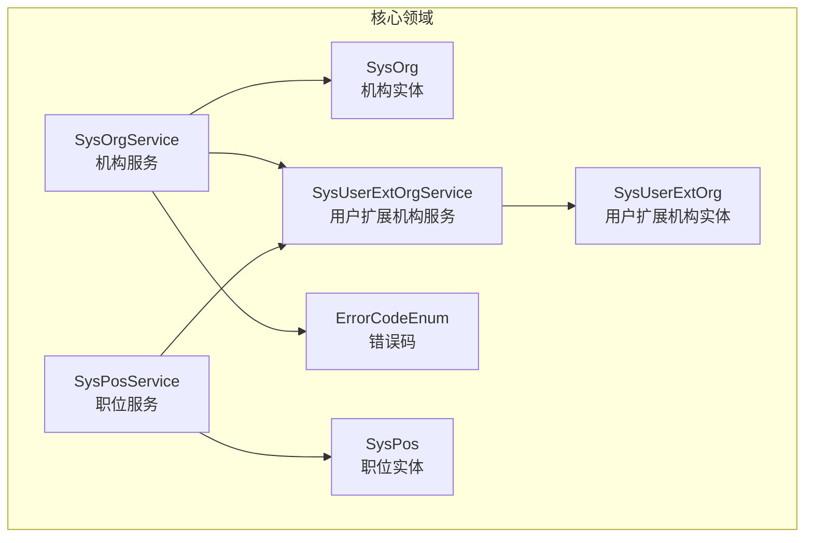

**图表来源**
- [SysOrg.cs:1-96](file://Admin.NET/Admin.NET.Core/Entity/SysOrg.cs#L1-L96)
- [SysPos.cs:1-56](file://Admin.NET/Admin.NET.Core/Entity/SysPos.cs#L1-L56)
- [SysUserExtOrg.cs:1-77](file://Admin.NET/Admin.NET.Core/Entity/SysUserExtOrg.cs#L1-L77)
- [SysOrgService.cs:1-502](file://Admin.NET/Admin.NET.Core/Service/Org/SysOrgService.cs#L1-L502)
- [SysPosService.cs:1-113](file://Admin.NET/Admin.NET.Core/Service/Pos/SysPosService.cs#L1-L113)
- [SysUserExtOrgService.cs:1-88](file://Admin.NET/Admin.NET.Core/Service/User/SysUserExtOrgService.cs#L1-L88)
- [ErrorCodeEnum.cs:1-536](file://Admin.NET/Admin.NET.Core/Enum/ErrorCodeEnum.cs#L1-L536)

**章节来源**
- [SysOrg.cs:1-96](file://Admin.NET/Admin.NET.Core/Entity/SysOrg.cs#L1-L96)
- [SysPos.cs:1-56](file://Admin.NET/Admin.NET.Core/Entity/SysPos.cs#L1-L56)
- [SysUserExtOrg.cs:1-77](file://Admin.NET/Admin.NET.Core/Entity/SysUserExtOrg.cs#L1-L77)

## 核心实体设计
本节从字段、约束、关系与行为四个维度说明三个核心实体。

### SysOrg 机构实体
- 自引用树形结构：
  - `Pid` 表示父机构标识，形成自引用父子关系。
  - `Children` 是忽略持久化的导航属性，用于返回树形结果。
- 基础信息：
  - `Name`、`Code`、`Type` 分别表示名称、编码与类型。
  - `Level` 表示级别，但未在服务层自动维护。
  - `DirectorId` 与 `Director` 表示负责人与其导航对象。
- 排序与状态：
  - `OrderNo` 默认值 100，用于同级排序。
  - `Status` 使用全局状态枚举，默认启用。
- 辅助展示字段：
  - `Disabled` 用于前端禁用无权限的节点。
  - `Remark` 备注字段。

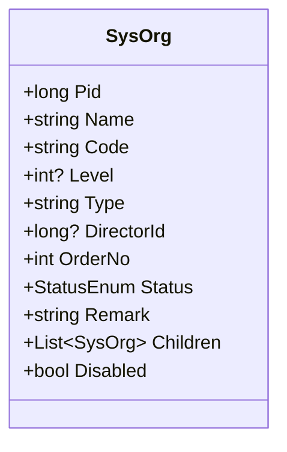

**图表来源**
- [SysOrg.cs:1-96](file://Admin.NET/Admin.NET.Core/Entity/SysOrg.cs#L1-L96)

**章节来源**
- [SysOrg.cs:1-96](file://Admin.NET/Admin.NET.Core/Entity/SysOrg.cs#L1-L96)

### SysPos 职位实体
- 基本信息：
  - `Name`、`Code` 表示职位名称与编码。
  - `OrderNo` 默认值 100，用于排序。
  - `Status` 使用全局状态枚举，默认启用。
  - `Remark` 备注。
- 人员关联：
  - `UserList` 是忽略持久化的导航属性，表示任职该职位的用户集合。
  - 实际任职关系包括主职位 `SysUser.PosId` 以及扩展组织中的 `SysUserExtOrg.PosId`。

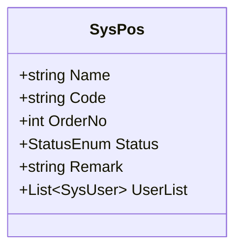

**图表来源**
- [SysPos.cs:1-56](file://Admin.NET/Admin.NET.Core/Entity/SysPos.cs#L1-L56)

**章节来源**
- [SysPos.cs:1-56](file://Admin.NET/Admin.NET.Core/Entity/SysPos.cs#L1-L56)

### SysUserExtOrg 用户扩展机构实体
该实体是多对多关系的桥接表，同时承载用户在某个组织中的职位信息。

- 关键关联：
  - `UserId` 关联用户。
  - `OrgId` 关联组织。
  - `PosId` 关联职位。
- 用户侧附加信息：
  - `JobNum` 工号。
  - `PosLevel` 职级。
  - `JoinDate` 入职日期。

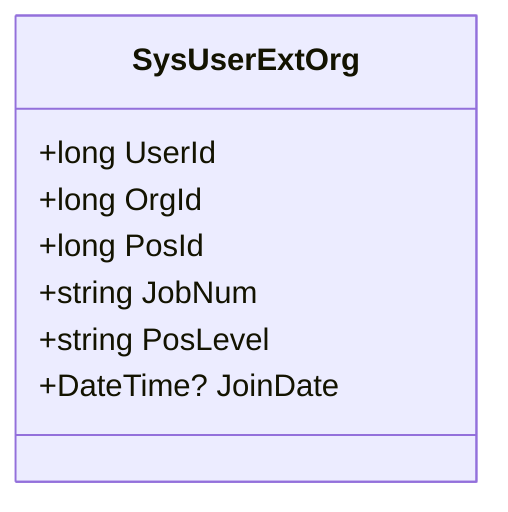

**图表来源**
- [SysUserExtOrg.cs:1-77](file://Admin.NET/Admin.NET.Core/Entity/SysUserExtOrg.cs#L1-L77)

**章节来源**
- [SysUserExtOrg.cs:1-77](file://Admin.NET/Admin.NET.Core/Entity/SysUserExtOrg.cs#L1-L77)

## 架构总览
组织与职位相关的关键交互如下：
- 前端调用动态 API，进入 `SysOrgService` 或 `SysPosService`。
- 服务层通过 `SqlSugarRepository` 访问数据库。
- 组织树查询会结合用户权限、角色数据范围、缓存和用户扩展组织。
- 删除组织时，会级联清理角色-组织、用户-扩展组织等关联数据。
- 删除职位前，会检查是否仍有用户任职。

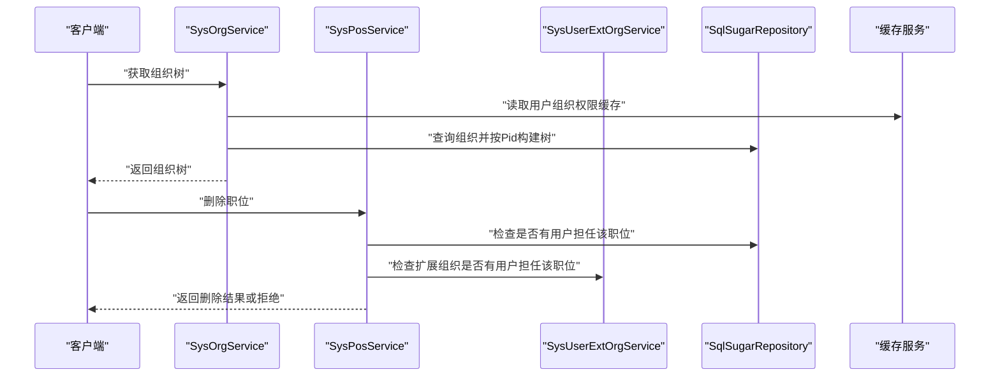

**图表来源**
- [SysOrgService.cs:1-502](file://Admin.NET/Admin.NET.Core/Service/Org/SysOrgService.cs#L1-L502)
- [SysPosService.cs:1-113](file://Admin.NET/Admin.NET.Core/Service/Pos/SysPosService.cs#L1-L113)
- [SysUserExtOrgService.cs:1-88](file://Admin.NET/Admin.NET.Core/Service/User/SysUserExtOrgService.cs#L1-L88)

## 详细组件分析

### SysOrgService 组织服务
`SysOrgService` 负责组织的树形查询、新增、更新、删除，以及与用户权限、角色、扩展组织和缓存的集成。

#### 主要职责
- 获取组织列表与组织树。
- 新增组织并校验父组织、租户、唯一性。
- 更新组织并防止自环、非法父子关系。
- 删除组织并进行多重存在性检查与级联清理。
- 计算用户可访问的组织集合。
- 根据角色数据范围计算组织范围。
- 清理组织变更后的用户权限缓存。

#### 树形查询与权限过滤
- 非超管用户只能看到自己有权的组织。
- 无权节点会被标记为不可选择。
- 支持按租户、名称、编码、类型筛选。
- 支持以指定节点作为根节点返回其子树。

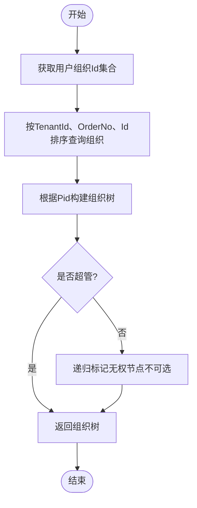

**图表来源**
- [SysOrgService.cs:1-200](file://Admin.NET/Admin.NET.Core/Service/Org/SysOrgService.cs#L1-L200)

#### 新增组织流程
新增组织的关键规则：
- 非超管不能直接创建顶级组织。
- 非超管新增到非顶级组织时，必须拥有父组织权限。
- 名称加编码组合必须唯一。
- 新增后清理受影响的用户组织缓存。

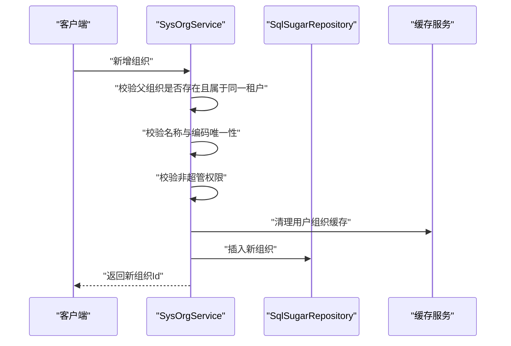

**图表来源**
- [SysOrgService.cs:120-190](file://Admin.NET/Admin.NET.Core/Service/Org/SysOrgService.cs#L120-L190)

#### 更新组织流程
更新组织的关键规则：
- 不允许修改到自身。
- 不允许将组织移动到其子节点下。
- 名称加编码唯一性需排除自身。
- 非超管不能直接改为顶级组织。
- 父组织变化时需要清理用户组织缓存。

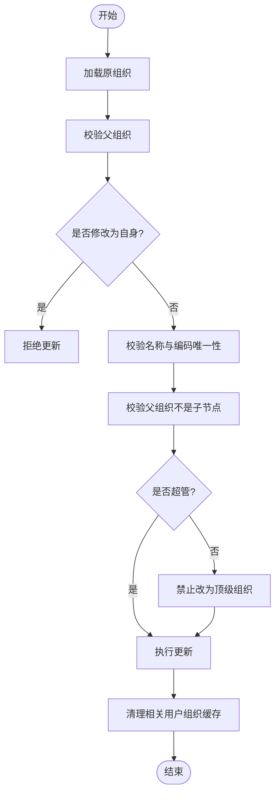

**图表来源**
- [SysOrgService.cs:201-260](file://Admin.NET/Admin.NET.Core/Service/Org/SysOrgService.cs#L201-L260)

#### 删除组织流程
删除组织前必须进行多重存在性检查：
- 组织是否为租户默认组织。
- 组织中是否已有用户。
- 扩展组织中是否已有用户。
- 子组织中是否已有用户。
- 是否绑定注册方案。

删除成功后：
- 清理用户组织缓存。
- 级联删除子组织。
- 级联删除角色-组织关系。
- 级联删除用户-扩展组织关系。

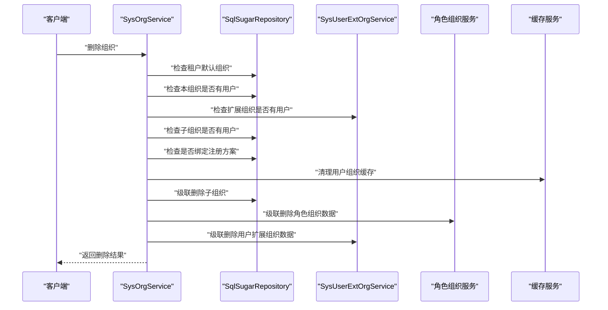

**图表来源**
- [SysOrgService.cs:260-380](file://Admin.NET/Admin.NET.Core/Service/Org/SysOrgService.cs#L260-L380)

#### 用户组织权限计算
`GetUserOrgIdList` 合并三类来源：
- 用户创建的机构。
- 用户的扩展机构。
- 用户角色的数据范围机构。
- 最后补充用户当前所属机构。

角色数据范围支持：
- 全部组织。
- 本部门及以下。
- 仅本部门。

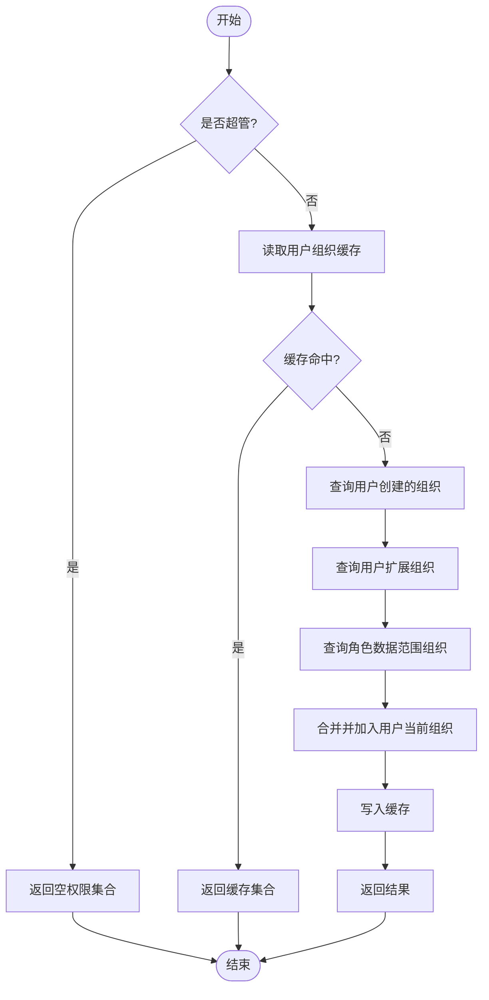

**图表来源**
- [SysOrgService.cs:380-502](file://Admin.NET/Admin.NET.Core/Service/Org/SysOrgService.cs#L380-L502)

**章节来源**
- [SysOrgService.cs:1-502](file://Admin.NET/Admin.NET.Core/Service/Org/SysOrgService.cs#L1-L502)

### SysPosService 职位服务
`SysPosService` 负责职位的基础增删改查，并在查询时将任职用户填充到 `UserList`。

#### 主要职责
- 获取职位列表，并关联主职位和扩展组织职位的用户。
- 新增职位时校验名称加编码唯一性。
- 更新职位时校验唯一性和创建者权限。
- 删除职位前检查是否仍有用户任职。

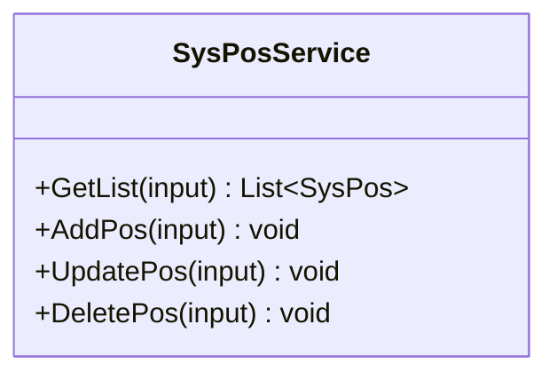

**图表来源**
- [SysPosService.cs:1-113](file://Admin.NET/Admin.NET.Core/Service/Pos/SysPosService.cs#L1-L113)

**章节来源**
- [SysPosService.cs:1-113](file://Admin.NET/Admin.NET.Core/Service/Pos/SysPosService.cs#L1-L113)

### SysUserExtOrgService 用户扩展机构服务
该服务提供用户扩展组织的基本操作，包括读取、批量更新、按组织或用户删除，以及判断是否有用户占用某组织或职位。

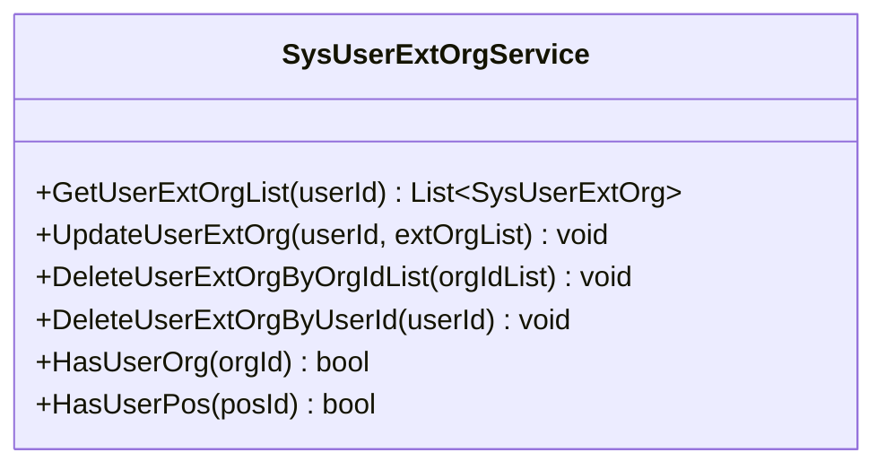

**图表来源**
- [SysUserExtOrgService.cs:1-88](file://Admin.NET/Admin.NET.Core/Service/User/SysUserExtOrgService.cs#L1-L88)

**章节来源**
- [SysUserExtOrgService.cs:1-88](file://Admin.NET/Admin.NET.Core/Service/User/SysUserExtOrgService.cs#L1-L88)

## 依赖关系分析
组织与职位相关的依赖关系如下：

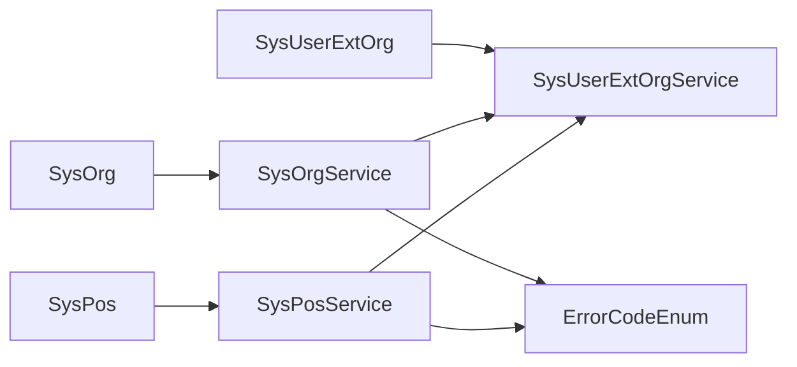

**图表来源**
- [SysOrgService.cs:1-502](file://Admin.NET/Admin.NET.Core/Service/Org/SysOrgService.cs#L1-L502)
- [SysPosService.cs:1-113](file://Admin.NET/Admin.NET.Core/Service/Pos/SysPosService.cs#L1-L113)
- [SysUserExtOrgService.cs:1-88](file://Admin.NET/Admin.NET.Core/Service/User/SysUserExtOrgService.cs#L1-L88)
- [ErrorCodeEnum.cs:1-536](file://Admin.NET/Admin.NET.Core/Enum/ErrorCodeEnum.cs#L1-L536)

**章节来源**
- [SysOrgService.cs:1-502](file://Admin.NET/Admin.NET.Core/Service/Org/SysOrgService.cs#L1-L502)
- [SysPosService.cs:1-113](file://Admin.NET/Admin.NET.Core/Service/Pos/SysPosService.cs#L1-L113)
- [SysUserExtOrgService.cs:1-88](file://Admin.NET/Admin.NET.Core/Service/User/SysUserExtOrgService.cs#L1-L88)
- [ErrorCodeEnum.cs:1-536](file://Admin.NET/Admin.NET.Core/Enum/ErrorCodeEnum.cs#L1-L536)

## 树形数据与性能策略
### 当前实现特点
- 树形结构基于 `Pid` 自引用。
- 使用 `ToTreeAsync` 构建子树。
- 使用 `ToChildListAsync` 获取子节点集合。
- 层级深度未持久化，由查询时递归计算。
- 未维护祖先路径字段。
- 用户组织权限通过缓存降低重复查询成本。

### 性能优化现状
- 用户组织权限缓存有效期为 7 天。
- 组织变更时会清理相关用户组织缓存。
- 角色最大数据范围也进行缓存。
- 查询组织树时先按 `OrderNo` 和 `Id` 排序，提升树构建稳定性。

### 改进建议
- 若组织树较深或频繁查询，可考虑增加 `Ancestors` 祖先路径字段，例如用分隔符拼接祖先节点标识，便于快速判断祖先关系。
- 可增加 `Depth` 层级字段，避免每次递归计算层级。
- 可为常用查询条件建立复合索引，例如租户、父节点、状态、类型。
- 对于大规模组织树，可引入组织缓存快照或增量同步机制，减少全量构建树的成本。

[本节为通用性能建议，不直接分析具体代码文件]

## 典型业务场景示例
以下示例描述如何在现有服务中使用 API，而不是粘贴源码。

### 创建部门树
- 使用“新增组织”接口创建多个组织节点。
- 首次创建顶级组织时，应由具备权限的用户或超管完成。
- 后续组织以已创建组织的 `Id` 作为父节点 `Pid`。
- 建议在初始化时使用批量新增逻辑，并确保名称与编码唯一。

参考位置：
- [SysOrgService.cs:120-190](file://Admin.NET/Admin.NET.Core/Service/Org/SysOrgService.cs#L120-L190)
- [SysOrgSeedData.cs](file://Admin.NET/Admin.NET.Core/SeedData/SysOrgSeedData.cs)

### 调整组织层级
- 使用“更新组织”接口修改 `Pid`。
- 注意：
  - 非超管不能把组织改为顶级组织。
  - 不能把组织移到自己的子节点下。
  - 名称与编码组合必须保持唯一。
- 更新父组织后，系统会自动清理相关用户组织缓存。

参考位置：
- [SysOrgService.cs:201-260](file://Admin.NET/Admin.NET.Core/Service/Org/SysOrgService.cs#L201-L260)

### 分配职位
- 职位本身通过“新增职位”“更新职位”管理。
- 用户任职分为两类：
  - 主职位：用户主表的 `PosId`。
  - 扩展组织职位：用户扩展机构表 `SysUserExtOrg.PosId`。
- 删除职位前，系统会检查主职位和扩展组织职位是否仍有用户。

参考位置：
- [SysPosService.cs:1-113](file://Admin.NET/Admin.NET.Core/Service/Pos/SysPosService.cs#L1-L113)
- [SysUserExtOrg.cs:1-77](file://Admin.NET/Admin.NET.Core/Entity/SysUserExtOrg.cs#L1-L77)

### 查看用户组织与职位
- 获取组织树时，服务会根据用户身份、角色数据范围和扩展组织计算权限。
- 获取职位列表时，服务会将担任该职位的用户填充到 `UserList`。

参考位置：
- [SysOrgService.cs:1-200](file://Admin.NET/Admin.NET.Core/Service/Org/SysOrgService.cs#L1-L200)
- [SysPosService.cs:1-113](file://Admin.NET/Admin.NET.Core/Service/Pos/SysPosService.cs#L1-L113)

**章节来源**
- [SysOrgService.cs:120-260](file://Admin.NET/Admin.NET.Core/Service/Org/SysOrgService.cs#L120-L260)
- [SysPosService.cs:1-113](file://Admin.NET/Admin.NET.Core/Service/Pos/SysPosService.cs#L1-L113)
- [SysUserExtOrg.cs:1-77](file://Admin.NET/Admin.NET.Core/Entity/SysUserExtOrg.cs#L1-L77)

## 故障排查指南
常见错误码及含义：
- D2000：组织不存在。
- D2001：组织操作非法，例如自环、父节点为子节点。
- D2002：组织名称与编码重复。
- D2003：无权限访问目标组织。
- D2004：组织下有用户，禁止删除。
- D2005：扩展组织下有用户，禁止删除。
- D2007：子组织下有用户，禁止删除。
- D2008：组织为租户默认组织，禁止删除。
- D2009：非超管不能创建顶级组织。
- D2010：组织绑定注册方案，禁止删除。
- D2012：非超管不能更新为顶级组织。
- D6000：职位名称与编码重复。
- D6001：职位仍有用户，禁止删除。
- D6002：非创建者无权限修改或删除职位。
- D6003：职位不存在。
- D6004：职位绑定注册方案，禁止删除。

排查建议：
- 组织删除失败时，优先检查是否为主组织、是否绑定租户、是否有用户或子组织用户、是否绑定注册方案。
- 组织更新失败时，优先检查是否超管、是否修改为顶级组织、是否出现父子循环。
- 职位删除失败时，优先检查主职位和扩展组织职位是否仍有用户。
- 权限相关问题，应检查用户组织缓存、角色数据范围、扩展组织配置。

**章节来源**
- [ErrorCodeEnum.cs:248-536](file://Admin.NET/Admin.NET.Core/Enum/ErrorCodeEnum.cs#L248-L536)
- [SysOrgService.cs:201-380](file://Admin.NET/Admin.NET.Core/Service/Org/SysOrgService.cs#L201-L380)
- [SysPosService.cs:60-113](file://Admin.NET/Admin.NET.Core/Service/Pos/SysPosService.cs#L60-L113)

## 结论
当前 Admin.NET 的组织与职位设计采用轻量、直观的自引用树模型，并通过服务层完成权限、缓存和一致性保障。其优点是实现简单、易于理解；不足是层级深度和祖先路径未持久化，深层树或高频查询场景可能需要额外优化。职位与用户的关系通过主职位和扩展组织双通道支持，适合多组织、多职位的业务场景。

在实际使用中，应重点关注：
- 组织树的父节点合法性与权限边界。
- 删除组织与职位时的存在性检查。
- 用户组织权限缓存失效时机。
- 如需高性能树查询，应考虑引入祖先路径或层级字段。

[本节为总结性内容，不直接分析具体代码文件]