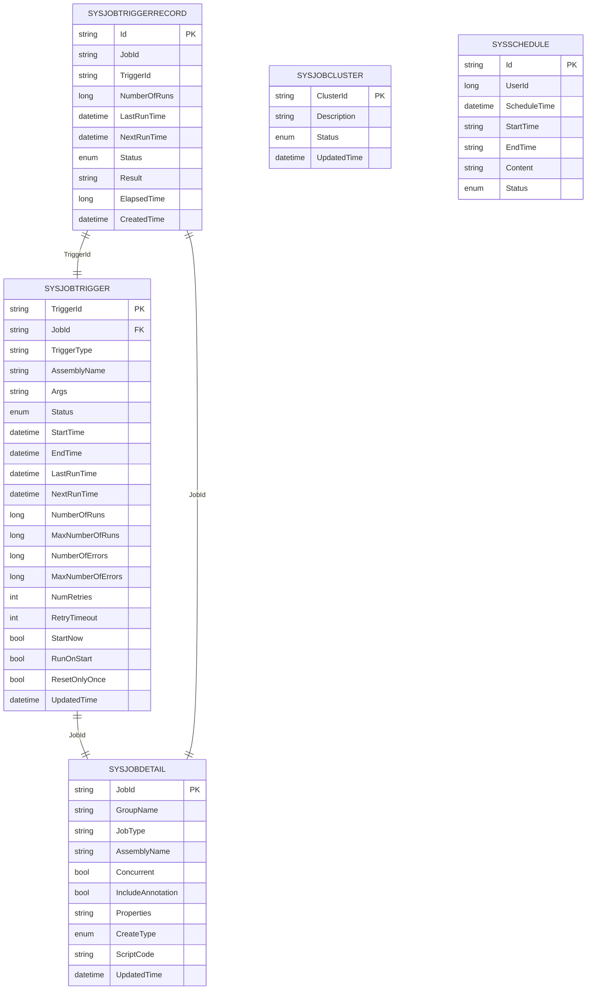
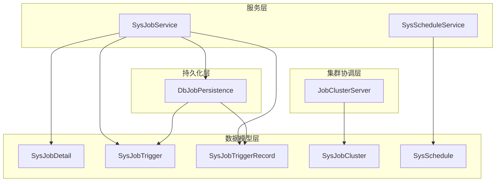
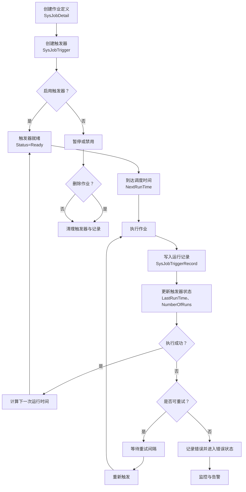
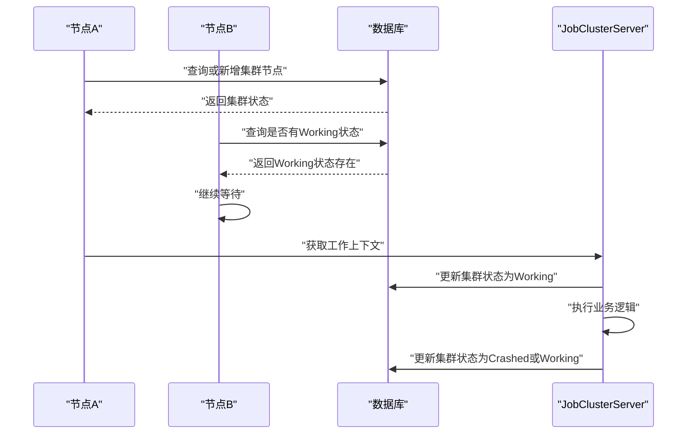
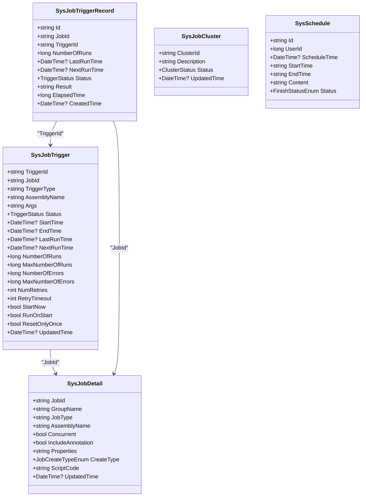

# 任务调度实体设计

<cite>
**本文引用的文件**   
- [SysJobDetail.cs](file://Admin.NET/Admin.NET.Core/Entity/SysJobDetail.cs)
- [SysJobTrigger.cs](file://Admin.NET/Admin.NET.Core/Entity/SysJobTrigger.cs)
- [SysJobTriggerRecord.cs](file://Admin.NET/Admin.NET.Core/Entity/SysJobTriggerRecord.cs)
- [SysJobCluster.cs](file://Admin.NET/Admin.NET.Core/Entity/SysJobCluster.cs)
- [SysSchedule.cs](file://Admin.NET/Admin.NET.Core/Entity/SysSchedule.cs)
- [JobCreateTypeEnum.cs](file://Admin.NET/Admin.NET.Core/Enum/JobCreateTypeEnum.cs)
- [SysJobService.cs](file://Admin.NET/Admin.NET.Core/Service/Job/SysJobService.cs)
- [DbJobPersistence.cs](file://Admin.NET/Admin.NET.Core/Service/Job/DbJobPersistence.cs)
- [JobClusterServer.cs](file://Admin.NET/Admin.NET.Core/Service/Job/JobClusterServer.cs)
- [SysScheduleService.cs](file://Admin.NET/Admin.NET.Core/Service/Schedule/SysScheduleService.cs)
- [JobDetailInput.cs](file://Admin.NET/Admin.NET.Core/Service/Job/Dto/JobDetailInput.cs)
- [JobDetailOutput.cs](file://Admin.NET/Admin.NET.Core/Service/Job/Dto/JobDetailOutput.cs)
- [JobTriggerInput.cs](file://Admin.NET/Admin.NET.Core/Service/Job/Dto/JobTriggerInput.cs)
- [ScheduleInput.cs](file://Admin.NET/Admin.NET.Core/Service/Schedule/Dto/ScheduleInput.cs)
- [JobRecordTests.cs](file://Admin.NET/Admin.NET.Test/Schedule/JobRecordTests.cs)
- [ScheduleIsolationTests.cs](file://Admin.NET/Admin.NET.Test/Schedule/ScheduleIsolationTests.cs)
</cite>

## 目录
1. [引言](#引言)
2. [项目结构定位](#项目结构定位)
3. [核心数据模型总览](#核心数据模型总览)
4. [架构与组件关系](#架构与组件关系)
5. [详细实体设计分析](#详细实体设计分析)
6. [作业生命周期与状态流转](#作业生命周期与状态流转)
7. [Cron 表达式与触发机制](#cron-表达式与触发机制)
8. [作业分组、并行执行与幂等性](#作业分组并行执行与幂等性)
9. [分布式集群与负载均衡](#分布式集群与负载均衡)
10. [监控日志与失败重试](#监控日志与失败重试)
11. [SysSchedule 与定时任务的关系](#sysschedule-与定时任务的关系)
12. [依赖关系分析](#依赖关系分析)
13. [性能与可维护性建议](#性能与可维护性建议)
14. [故障排查指南](#故障排查指南)
15. [结论](#结论)

## 引言
本文聚焦 Admin.NET 任务调度系统的数据模型，围绕 SysJobDetail、SysJobTrigger、SysJobTriggerRecord、SysJobCluster 和 SysSchedule 五个核心实体展开。目标是帮助开发者理解：
- 作业定义、触发器、运行记录、集群与日程表的数据结构；
- Cron 表达式的存储位置、触发器的时间字段以及调度配置；
- 作业分组、并行执行、幂等性和失败重试的数据支撑；
- 作业从创建、启用、暂停到删除的状态流转；
- 分布式环境下集群状态、工作抢占与崩溃恢复；
- 作业监控指标、执行耗时、结果状态和异常信息如何落库。

## 项目结构定位
任务调度相关代码主要位于后端 Core 层：
- 实体类集中在 `Admin.NET.Admin.NET.Core/Entity`；
- 枚举类型位于 `Admin.NET.Admin.NET.Core/Enum`；
- 服务实现位于 `Admin.NET.Admin.NET.Core/Service/Job` 与 `Admin.NET.Admin.NET.Core/Service/Schedule`；
- 测试覆盖在 `Admin.NET.Admin.NET.Test/Schedule`。

前端业务入口为 `Web/apps/web-antdv-next`，但本文件仅关注后端数据模型与服务逻辑，不展开前端页面实现。

**章节来源**
- [SysJobDetail.cs:1-87](file://Admin.NET/Admin.NET.Core/Entity/SysJobDetail.cs#L1-L87)
- [SysJobTrigger.cs:1-147](file://Admin.NET/Admin.NET.Core/Entity/SysJobTrigger.cs#L1-L147)
- [SysJobTriggerRecord.cs:1-72](file://Admin.NET/Admin.NET.Core/Entity/SysJobTriggerRecord.cs#L1-L72)
- [SysJobCluster.cs:1-41](file://Admin.NET/Admin.NET.Core/Entity/SysJobCluster.cs#L1-L41)
- [SysSchedule.cs:1-52](file://Admin.NET/Admin.NET.Core/Entity/SysSchedule.cs#L1-L52)

## 核心数据模型总览
| 实体 | 主键 | 主要用途 | 关键业务字段 |
|---|---|---|---|
| SysJobDetail | JobId | 作业元数据定义 | GroupName、JobType、AssemblyName、Concurrent、IncludeAnnotation、Properties、CreateType、ScriptCode |
| SysJobTrigger | TriggerId | 作业触发规则与调度参数 | JobId、TriggerType、AssemblyName、Args、Status、StartTime、EndTime、LastRunTime、NextRunTime、NumberOfRuns、MaxNumberOfRuns、NumberOfErrors、MaxNumberOfErrors、NumRetries、RetryTimeout、StartNow、RunOnStart、ResetOnlyOnce |
| SysJobTriggerRecord | Id | 每次触发执行的明细记录 | JobId、TriggerId、NumberOfRuns、LastRunTime、NextRunTime、Status、Result、ElapsedTime |
| SysJobCluster | ClusterId | 分布式作业集群节点状态 | Description、Status |
| SysSchedule | Id | 用户日程管理 | UserId、ScheduleTime、StartTime、EndTime、Content、Status |

**图表来源**
- [SysJobDetail.cs:1-87](file://Admin.NET/Admin.NET.Core/Entity/SysJobDetail.cs#L1-L87)
- [SysJobTrigger.cs:1-147](file://Admin.NET/Admin.NET.Core/Entity/SysJobTrigger.cs#L1-L147)
- [SysJobTriggerRecord.cs:1-72](file://Admin.NET/Admin.NET.Core/Entity/SysJobTriggerRecord.cs#L1-L72)
- [SysJobCluster.cs:1-41](file://Admin.NET/Admin.NET.Core/Entity/SysJobCluster.cs#L1-L41)
- [SysSchedule.cs:1-52](file://Admin.NET/Admin.NET.Core/Entity/SysSchedule.cs#L1-L52)

**章节来源**
- [SysJobDetail.cs:1-87](file://Admin.NET/Admin.NET.Core/Entity/SysJobDetail.cs#L1-L87)
- [SysJobTrigger.cs:1-147](file://Admin.NET/Admin.NET.Core/Entity/SysJobTrigger.cs#L1-L147)
- [SysJobTriggerRecord.cs:1-72](file://Admin.NET/Admin.NET.Core/Entity/SysJobTriggerRecord.cs#L1-L72)
- [SysJobCluster.cs:1-41](file://Admin.NET/Admin.NET.Core/Entity/SysJobCluster.cs#L1-L41)
- [SysSchedule.cs:1-52](file://Admin.NET/Admin.NET.Core/Entity/SysSchedule.cs#L1-L52)

## 架构与组件关系
任务调度系统由实体层、服务层、持久化层和集群协调层组成：
- 实体层负责描述作业、触发器、运行记录和集群的数据库结构；
- 服务层提供作业管理、触发器管理与日程管理 API；
- 持久化层将触发器状态、运行记录写入数据库；
- 集群层负责分布式节点的状态抢占、工作执行和崩溃标记。

**图表来源**
- [SysJobService.cs](file://Admin.NET/Admin.NET.Core/Service/Job/SysJobService.cs)
- [DbJobPersistence.cs](file://Admin.NET/Admin.NET.Core/Service/Job/DbJobPersistence.cs)
- [JobClusterServer.cs](file://Admin.NET/Admin.NET.Core/Service/Job/JobClusterServer.cs)
- [SysScheduleService.cs](file://Admin.NET/Admin.NET.Core/Service/Schedule/SysScheduleService.cs)
- [SysJobDetail.cs:1-87](file://Admin.NET/Admin.NET.Core/Entity/SysJobDetail.cs#L1-L87)
- [SysJobTrigger.cs:1-147](file://Admin.NET/Admin.NET.Core/Entity/SysJobTrigger.cs#L1-L147)
- [SysJobTriggerRecord.cs:1-72](file://Admin.NET/Admin.NET.Core/Entity/SysJobTriggerRecord.cs#L1-L72)
- [SysJobCluster.cs:1-41](file://Admin.NET/Admin.NET.Core/Entity/SysJobCluster.cs#L1-L41)
- [SysSchedule.cs:1-52](file://Admin.NET/Admin.NET.Core/Entity/SysSchedule.cs#L1-L52)

## 详细实体设计分析

### SysJobDetail：作业详情
SysJobDetail 是作业的静态定义，描述“要执行什么”。关键字段包括：
- JobId：作业唯一标识；
- GroupName：作业分组，默认值为 default；
- JobType：作业类型全限定名；
- AssemblyName：程序集名称；
- Concurrent：是否允许并行执行；
- IncludeAnnotation：是否扫描特性触发器；
- Properties：额外数据，使用大字符串类型存储 JSON；
- CreateType：作业创建类型，支持内置、脚本、HTTP 请求；
- ScriptCode：脚本代码；
- UpdatedTime：更新时间。

该表通过 SugarTable、SugarIndex 等特性映射到数据库，并为 JobId 建立索引以提升按作业查询效率。

**章节来源**
- [SysJobDetail.cs:1-87](file://Admin.NET/Admin.NET.Core/Entity/SysJobDetail.cs#L1-L87)
- [JobCreateTypeEnum.cs:1-32](file://Admin.NET/Admin.NET.Core/Enum/JobCreateTypeEnum.cs#L1-L32)

### SysJobTrigger：作业触发器
SysJobTrigger 描述“何时以何种方式执行作业”，是一个作业与触发规则之间的中间实体。关键字段包括：
- TriggerId：触发器唯一标识；
- JobId：关联的作业；
- TriggerType：触发器类型全限定名；
- AssemblyName：触发器所在程序集，默认 Furion；
- Args：触发器参数；
- Status：触发器状态；
- StartTime、EndTime：有效时间范围；
- LastRunTime、NextRunTime：最近一次与下一次运行时间；
- NumberOfRuns、MaxNumberOfRuns：已触发次数与最大触发次数；
- NumberOfErrors、MaxNumberOfErrors：错误次数与最大错误次数；
- NumRetries、RetryTimeout：重试次数与重试间隔毫秒数；
- StartNow、RunOnStart、ResetOnlyOnce：启动策略；
- UpdatedTime：更新时间。

该实体直接承载调度器对触发器生命周期的控制字段，是 Cron 或特性触发后调度器更新运行状态的核心落点。

**章节来源**
- [SysJobTrigger.cs:1-147](file://Admin.NET/Admin.NET.Core/Entity/SysJobTrigger.cs#L1-L147)

### SysJobTriggerRecord：触发记录
SysJobTriggerRecord 是每次触发执行的审计与监控记录，关键字段包括：
- JobId、TriggerId：关联作业与触发器；
- NumberOfRuns：当前运行次数；
- LastRunTime、NextRunTime：最近运行时间与下一次运行时间；
- Status：触发器状态；
- Result：本次执行结果；
- ElapsedTime：本次执行耗时；
- CreatedTime：记录创建时间。

该表适合用于查看作业历史执行情况、统计成功率、观察延迟趋势和定位异常。

**章节来源**
- [SysJobTriggerRecord.cs:1-72](file://Admin.NET/Admin.NET.Core/Entity/SysJobTriggerRecord.cs#L1-L72)

### SysJobCluster：作业集群
SysJobCluster 表示分布式环境中的作业集群节点，关键字段包括：
- ClusterId：集群节点唯一标识；
- Description：描述信息；
- Status：集群状态；
- UpdatedTime：更新时间。

该表配合 JobClusterServer 实现集群抢占、工作状态切换与崩溃标记。

**章节来源**
- [SysJobCluster.cs:1-41](file://Admin.NET/Admin.NET.Core/Entity/SysJobCluster.cs#L1-L41)
- [JobClusterServer.cs](file://Admin.NET/Admin.NET.Core/Service/Job/JobClusterServer.cs)

### SysSchedule：系统日程
SysSchedule 是用户日程表，并非作业调度核心，但与定时任务概念相近。关键字段包括：
- UserId：用户标识；
- ScheduleTime：日程日期；
- StartTime、EndTime：开始时间与结束时间；
- Content：日程内容；
- Status：完成状态。

该实体更适合面向用户的日程提醒与待办管理，而不是底层作业调度引擎。

**章节来源**
- [SysSchedule.cs:1-52](file://Admin.NET/Admin.NET.Core/Entity/SysSchedule.cs#L1-L52)

## 作业生命周期与状态流转
作业的生命周期涉及三个层面：
1. 作业定义层：SysJobDetail 中记录作业类型、分组、并行策略和创建来源；
2. 触发器层：SysJobTrigger 中记录触发器状态、时间窗口、运行次数与错误计数；
3. 运行记录层：SysJobTriggerRecord 中记录每次触发的结果、耗时和状态。

**图表来源**
- [SysJobDetail.cs:1-87](file://Admin.NET/Admin.NET.Core/Entity/SysJobDetail.cs#L1-L87)
- [SysJobTrigger.cs:1-147](file://Admin.NET/Admin.NET.Core/Entity/SysJobTrigger.cs#L1-L147)
- [SysJobTriggerRecord.cs:1-72](file://Admin.NET/Admin.NET.Core/Entity/SysJobTriggerRecord.cs#L1-L72)

**章节来源**
- [SysJobDetail.cs:1-87](file://Admin.NET/Admin.NET.Core/Entity/SysJobDetail.cs#L1-L87)
- [SysJobTrigger.cs:1-147](file://Admin.NET/Admin.NET.Core/Entity/SysJobTrigger.cs#L1-L147)
- [SysJobTriggerRecord.cs:1-72](file://Admin.NET/Admin.NET.Core/Entity/SysJobTriggerRecord.cs#L1-L72)

## Cron 表达式与触发机制
在当前数据模型中，没有独立的 Cron 表达式字段。Cron 相关的调度语义主要通过以下字段体现：
- TriggerType：触发器类型全限定名，通常由底层调度框架（如 Furion）解析；
- Args：触发器参数，可能包含 Cron 表达式或其他触发配置；
- StartTime、EndTime：触发器生效时间窗口；
- NextRunTime：下一次运行时间，由调度器计算后写入；
- LastRunTime：最近一次运行时间；
- NumberOfRuns、MaxNumberOfRuns：控制触发次数上限；
- StartNow、RunOnStart：控制启动行为。

因此，Cron 表达式更可能作为触发器参数存储在 Args 中，或由 TriggerType 对应的触发器类型自行解析。调度器根据这些字段判断是否触发作业，并更新 NextRunTime。

**章节来源**
- [SysJobTrigger.cs:1-147](file://Admin.NET/Admin.NET.Core/Entity/SysJobTrigger.cs#L1-L147)
- [JobTriggerInput.cs](file://Admin.NET/Admin.NET.Core/Service/Job/Dto/JobTriggerInput.cs)

## 作业分组、并行执行与幂等性

### 作业分组
GroupName 字段位于 SysJobDetail，默认值为 default。它用于对作业进行逻辑分组，便于批量管理、权限控制和运维监控。实际分组查询应基于 JobId 与 GroupName 的组合条件。

**章节来源**
- [SysJobDetail.cs:1-87](file://Admin.NET/Admin.NET.Core/Entity/SysJobDetail.cs#L1-L87)

### 并行执行
Concurrent 字段表示作业是否允许并行执行。当并发开启时，同一作业的不同触发实例可能同时运行；关闭时则倾向于串行或互斥执行。该字段需要与触发器并发控制、集群抢占逻辑共同考虑。

**章节来源**
- [SysJobDetail.cs:1-87](file://Admin.NET/Admin.NET.Core/Entity/SysJobDetail.cs#L1-L87)

### 幂等性保证
数据模型中没有直接的幂等键或去重 ID 字段。幂等性保障更适合在业务层实现，例如：
- 使用业务唯一键防止重复处理；
- 在执行前检查目标资源状态；
- 使用外部分布式锁或幂等令牌；
- 在 SysJobTriggerRecord.Result 中记录幂等校验结果。

当前模型为幂等性提供了扩展空间，但没有强制约束。

**章节来源**
- [SysJobTriggerRecord.cs:1-72](file://Admin.NET/Admin.NET.Core/Entity/SysJobTriggerRecord.cs#L1-L72)

## 分布式集群与负载均衡
SysJobCluster 与 JobClusterServer 共同实现分布式作业调度中的节点协作。根据 JobClusterServer 的实现注释可见：
- 当集群节点不存在时，插入一条状态为等待的记录；
- 多个节点竞争工作时，优先检查是否存在 Working 状态的集群记录；
- 若存在 Working 状态，其他节点继续等待；
- 若无 Working 状态，则尝试执行业务逻辑；
- 执行完成后将状态更新为 Working；
- 异常情况会将状态标记为 Crashed。

**图表来源**
- [JobClusterServer.cs](file://Admin.NET/Admin.NET.Core/Service/Job/JobClusterServer.cs)
- [SysJobCluster.cs:1-41](file://Admin.NET/Admin.NET.Core/Entity/SysJobCluster.cs#L1-L41)

**章节来源**
- [JobClusterServer.cs](file://Admin.NET/Admin.NET.Core/Service/Job/JobClusterServer.cs)
- [SysJobCluster.cs:1-41](file://Admin.NET/Admin.NET.Core/Entity/SysJobCluster.cs#L1-L41)

## 监控日志与失败重试
SysJobTriggerRecord 承担作业执行监控与日志记录职责：
- NumberOfRuns：累计运行次数；
- LastRunTime、NextRunTime：最近与下一次运行时间；
- Status：触发器状态；
- Result：执行结果文本；
- ElapsedTime：执行耗时毫秒；
- CreatedTime：记录创建时间。

SysJobTrigger 提供重试能力：
- NumRetries：重试次数；
- RetryTimeout：重试间隔毫秒；
- NumberOfErrors、MaxNumberOfErrors：错误计数与上限；
- NumberOfRuns、MaxNumberOfRuns：触发次数控制。

结合这两个实体，可以构建以下监控视图：
- 作业成功率 = 成功记录数 / 总记录数；
- 平均执行耗时 = 所有记录的 elapsedTime 均值；
- 高频失败作业 = 高 NumberOfErrors 且接近 MaxNumberOfErrors 的触发器；
- 长期未运行作业 = NextRunTime 长时间未更新或为空。

**章节来源**
- [SysJobTriggerRecord.cs:1-72](file://Admin.NET/Admin.NET.Core/Entity/SysJobTriggerRecord.cs#L1-L72)
- [SysJobTrigger.cs:1-147](file://Admin.NET/Admin.NET.Core/Entity/SysJobTrigger.cs#L1-L147)

## SysSchedule 与定时任务的关系
SysSchedule 是用户日程实体，不是作业调度引擎的核心表。它更接近日历提醒功能，而 SysJobDetail 与 SysJobTrigger 才是任务调度的核心。两者可能的集成方式是：
- 用户日程变更触发某个作业；
- 作业执行后将日程状态更新为已完成；
- 或者日程提醒通过 HTTP 作业调用通知服务。

但就数据模型而言，SysSchedule 与 SysJobDetail、SysJobTrigger 之间没有直接外键关系。

**章节来源**
- [SysSchedule.cs:1-52](file://Admin.NET/Admin.NET.Core/Entity/SysSchedule.cs#L1-L52)
- [SysScheduleService.cs](file://Admin.NET/Admin.NET.Core/Service/Schedule/SysScheduleService.cs)

## 依赖关系分析

**图表来源**
- [SysJobDetail.cs:1-87](file://Admin.NET/Admin.NET.Core/Entity/SysJobDetail.cs#L1-L87)
- [SysJobTrigger.cs:1-147](file://Admin.NET/Admin.NET.Core/Entity/SysJobTrigger.cs#L1-L147)
- [SysJobTriggerRecord.cs:1-72](file://Admin.NET/Admin.NET.Core/Entity/SysJobTriggerRecord.cs#L1-L72)
- [SysJobCluster.cs:1-41](file://Admin.NET/Admin.NET.Core/Entity/SysJobCluster.cs#L1-L41)
- [SysSchedule.cs:1-52](file://Admin.NET/Admin.NET.Core/Entity/SysSchedule.cs#L1-L52)

**章节来源**
- [SysJobDetail.cs:1-87](file://Admin.NET/Admin.NET.Core/Entity/SysJobDetail.cs#L1-L87)
- [SysJobTrigger.cs:1-147](file://Admin.NET/Admin.NET.Core/Entity/SysJobTrigger.cs#L1-L147)
- [SysJobTriggerRecord.cs:1-72](file://Admin.NET/Admin.NET.Core/Entity/SysJobTriggerRecord.cs#L1-L72)
- [SysJobCluster.cs:1-41](file://Admin.NET/Admin.NET.Core/Entity/SysJobCluster.cs#L1-L41)
- [SysSchedule.cs:1-52](file://Admin.NET/Admin.NET.Core/Entity/SysSchedule.cs#L1-L52)

## 性能与可维护性建议
- 为 SysJobTrigger 的 JobId、Status、NextRunTime 建立复合索引，可提升调度器按作业和下次运行时间筛选的性能；
- 为 SysJobTriggerRecord 的 JobId、TriggerId、CreatedTime 建立索引，有利于按作业和历史时间范围查询；
- 对 SysJobTriggerRecord 做归档策略，避免运行记录无限增长影响查询性能；
- 合理设置 MaxNumberOfRuns 与 MaxNumberOfErrors，避免长时间无效触发；
- 谨慎开启 Concurrent，避免同一作业高并发导致下游资源争用；
- 将 Cron 表达式或触发参数标准化到 Args JSON 结构中，便于统一校验和迁移；
- 为 Properties 和 ScriptCode 等大字段使用只读或版本化访问，避免频繁全表扫描。

[本节为通用优化建议，不直接分析具体代码行]

## 故障排查指南
常见问题与数据模型对应关系：
- 作业不触发：检查 SysJobTrigger.Status、StartTime、EndTime、NextRunTime；
- 作业重复执行：检查 SysJobDetail.Concurrent 与集群状态，确认是否允许多实例并发；
- 作业频繁失败：查看 SysJobTrigger.NumberOfErrors、MaxNumberOfErrors 与 SysJobTriggerRecord.Result；
- 执行缓慢：查看 SysJobTriggerRecord.ElapsedTime 并结合业务日志定位瓶颈；
- 集群卡死：检查 SysJobCluster.Status 是否为 Crashed 或长期 Working；
- 日程未完成任务：检查 SysSchedule.Status 与 ScheduleTime、StartTime、EndTime。

**章节来源**
- [SysJobTrigger.cs:1-147](file://Admin.NET/Admin.NET.Core/Entity/SysJobTrigger.cs#L1-L147)
- [SysJobTriggerRecord.cs:1-72](file://Admin.NET/Admin.NET.Core/Entity/SysJobTriggerRecord.cs#L1-L72)
- [SysJobCluster.cs:1-41](file://Admin.NET/Admin.NET.Core/Entity/SysJobCluster.cs#L1-L41)
- [SysSchedule.cs:1-52](file://Admin.NET/Admin.NET.Core/Entity/SysSchedule.cs#L1-L52)

## 结论
Admin.NET 的任务调度数据模型以 SysJobDetail 描述作业定义，以 SysJobTrigger 描述触发规则与调度状态，以 SysJobTriggerRecord 记录每次执行结果，以 SysJobCluster 支持分布式节点协作，以 SysSchedule 提供用户日程能力。该模型具备较强的可扩展性，但在 Cron 表达式存储、幂等性约束、索引设计与记录归档方面仍需结合业务场景完善。实际落地时，应以数据模型为基础，在服务层补充校验、幂等、重试、监控与归档逻辑，并在分布式环境中借助集群状态字段实现可靠的工作抢占与崩溃恢复。