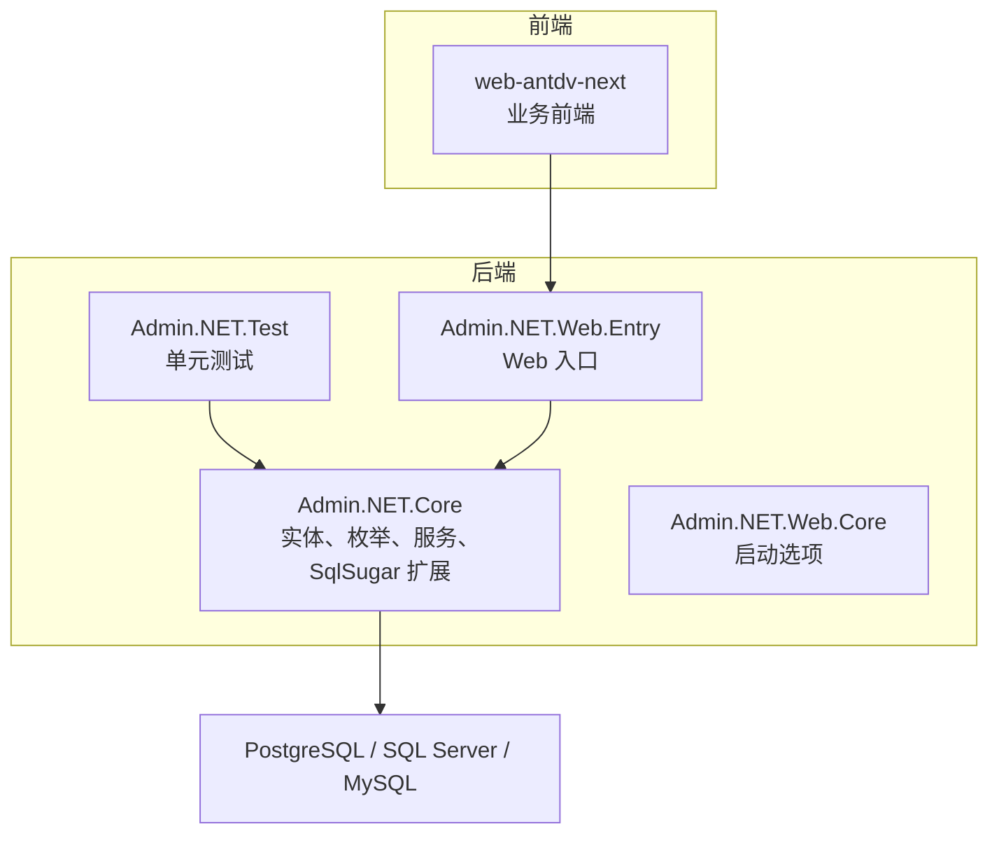
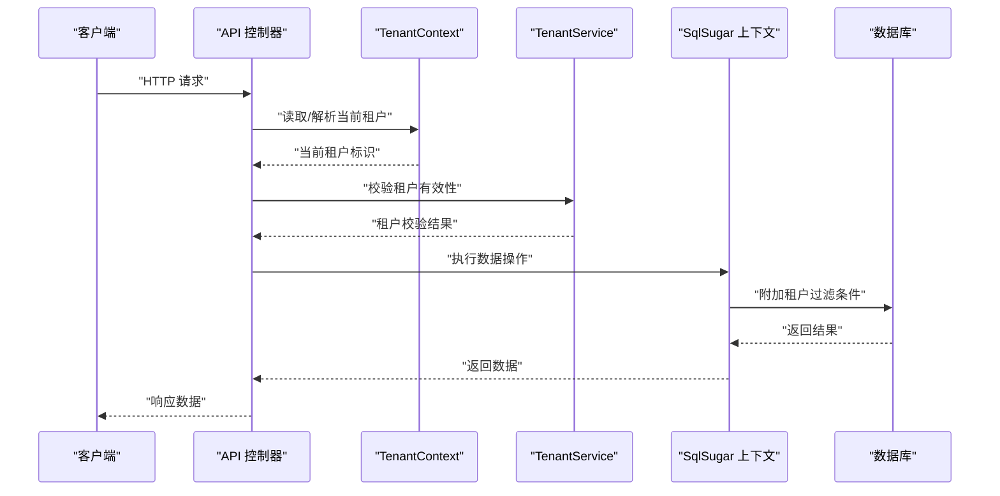
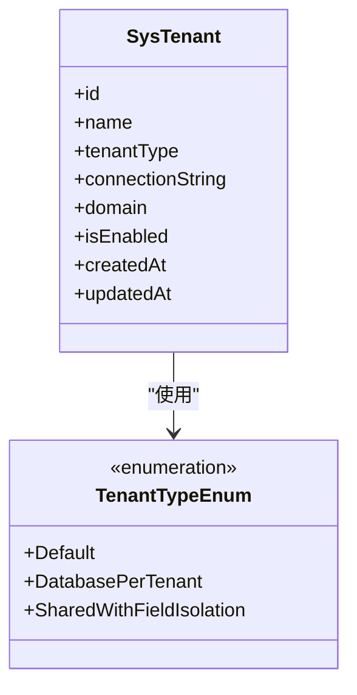
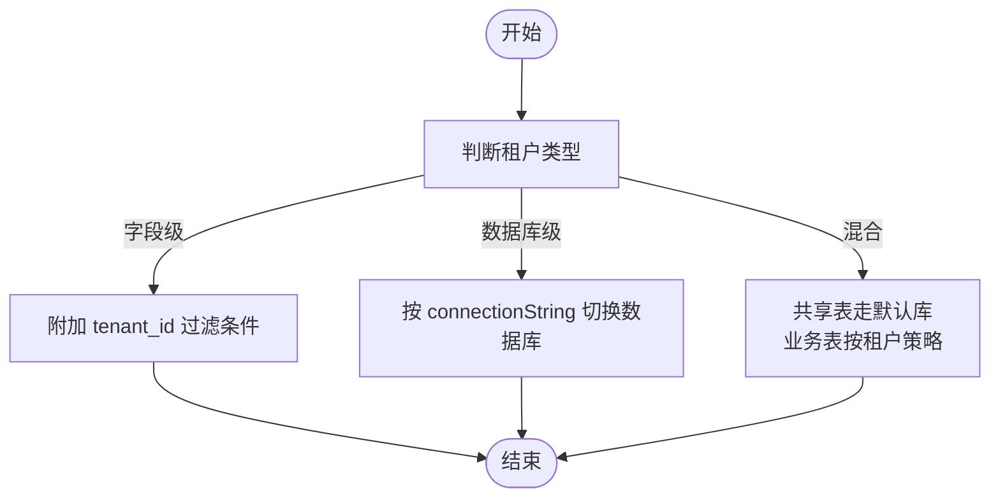
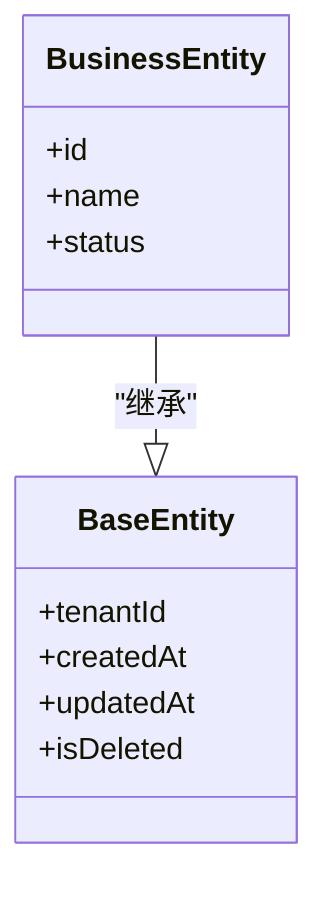
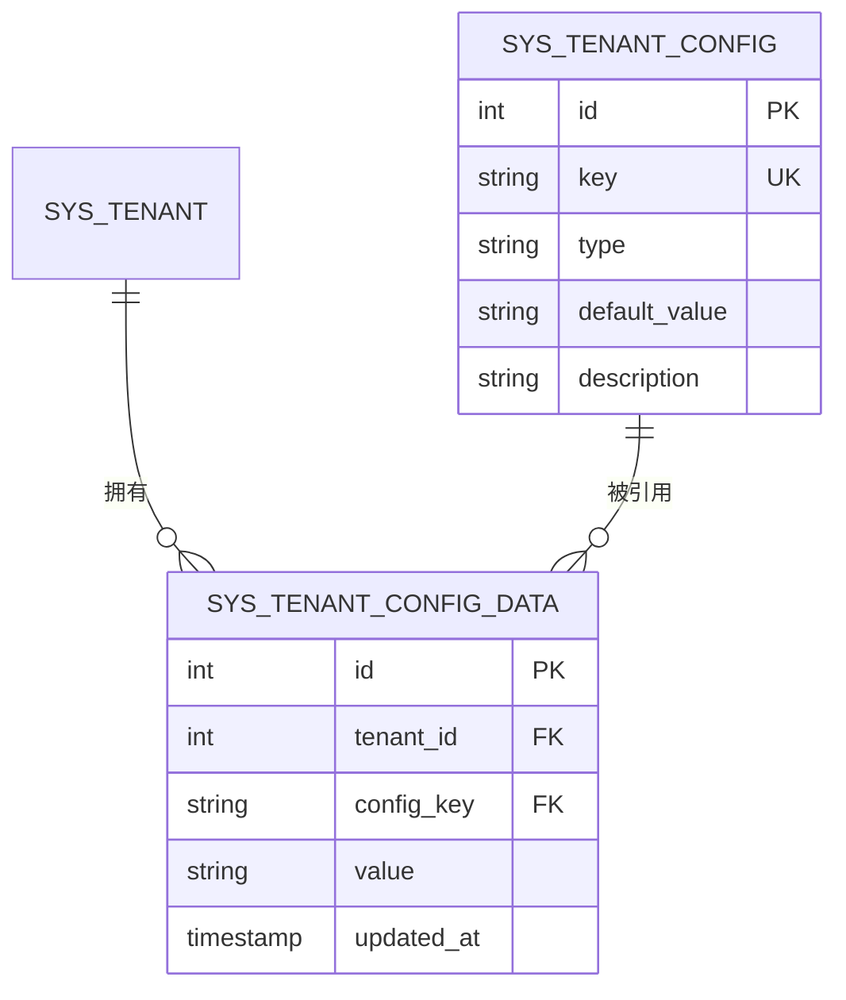
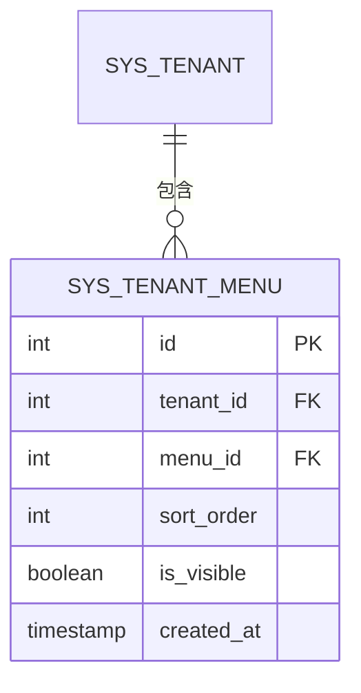
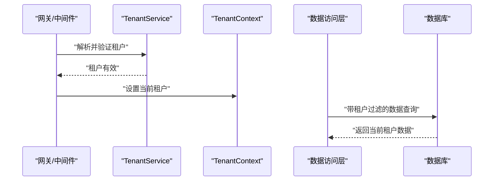
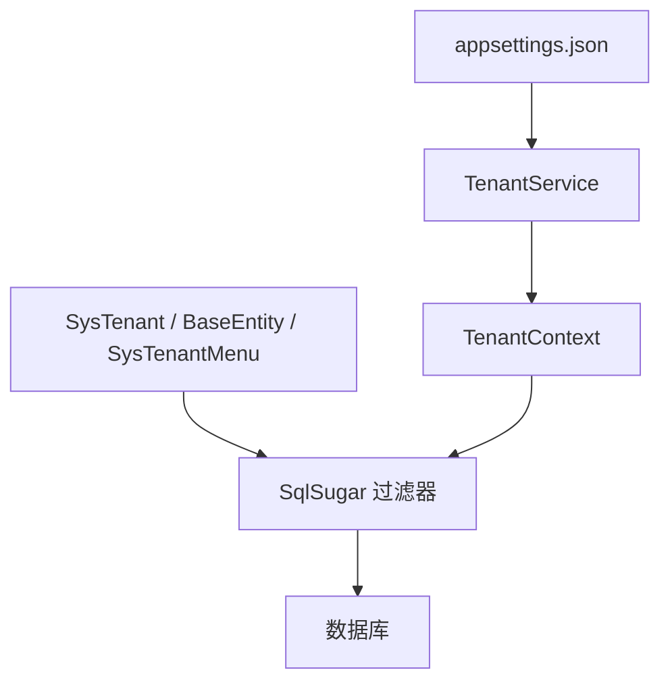

# 多租户数据隔离设计

<cite>
**本文引用的文件 **
- [README.md](file://README.md)
- [Admin.NET/Admin.NET.Core/Entity/SysTenant.cs](file://Admin.NET/Admin.NET.Core/Entity/SysTenant.cs)
- [Admin.NET/Admin.NET.Core/Entity/BaseEntity.cs](file://Admin.NET/Admin.NET.Core/Entity/BaseEntity.cs)
- [Admin.NET/Admin.NET.Core/Enum/TenantTypeEnum.cs](file://Admin.NET/Admin.NET.Core/Enum/TenantTypeEnum.cs)
- [Admin.NET/Admin.NET.Core/SqlSugar/TenantContext.cs](file://Admin.NET/Admin.NET.Core/SqlSugar/TenantContext.cs)
- [Admin.NET/Admin.NET.Core/Service/TenantService.cs](file://Admin.NET/Admin.NET.Core/Service/TenantService.cs)
- [Admin.NET/Admin.NET.Test/Tenant/TenantTest.cs](file://Admin.NET/Admin.NET.Test/Tenant/TenantTest.cs)
- [Admin.NET/Admin.NET.Web.Entry/appsettings.json](file://Admin.NET/Admin.NET.Web.Entry/appsettings.json)
- [Admin.NET/global.json](file://Admin.NET/global.json)
- [Web/package.json](file://Web/package.json)
</cite>

## 目录
1. [引言](#引言)
2. [项目结构](#项目结构)
3. [核心组件](#核心组件)
4. [架构总览](#架构总览)
5. [详细组件分析](#详细组件分析)
6. [依赖关系分析](#依赖关系分析)
7. [性能考虑](#性能考虑)
8. [故障排查指南](#故障排查指南)
9. [结论](#结论)

## 引言
本设计文档围绕 Admin.NET 的多租户数据隔离能力展开，重点说明系统租户实体 SysTenant 的字段设计、租户类型 TenantTypeEnum、数据库连接与域名绑定策略，以及三种隔离模式：字段级隔离、数据库级隔离和混合隔离。同时解释 EntityBaseTenant（通过 BaseEntity 继承）如何与 SqlSugar 的多租户过滤器协同工作，SysTenantConfig 与 SysTenantConfigData 的配置存储模型，SysTenantMenu 的租户菜单定制机制，并给出租户切换流程、性能优化建议、安全性保障与可执行的 SQL 查询示例。

## 项目结构
本项目采用 .NET 后端 + Web 前端的多工程结构。后端核心能力位于 Admin.NET.Admin.NET.Core，包括实体定义、枚举、SqlSugar 扩展、服务实现与种子数据；测试工程位于 Admin.NET.Admin.NET.Test；Web 应用入口位于 Admin.NET.Admin.NET.Web.Entry。前端业务应用位于 Web/apps/web-antdv-next，根脚本由 Web/package.json 管理。

**图示来源**
- [Admin.NET/Admin.NET.Core/Entity/SysTenant.cs:1-200](file://Admin.NET/Admin.NET.Core/Entity/SysTenant.cs#L1-L200)
- [Admin.NET/Admin.NET.Core/Enum/TenantTypeEnum.cs:1-200](file://Admin.NET/Admin.NET.Core/Enum/TenantTypeEnum.cs#L1-L200)
- [Admin.NET/Admin.NET.Core/SqlSugar/TenantContext.cs:1-200](file://Admin.NET/Admin.NET.Core/SqlSugar/TenantContext.cs#L1-L200)
- [Admin.NET/Admin.NET.Core/Service/TenantService.cs:1-200](file://Admin.NET/Admin.NET.Core/Service/TenantService.cs#L1-L200)
- [Admin.NET/Admin.NET.Web.Entry/appsettings.json:1-200](file://Admin.NET/Admin.NET.Web.Entry/appsettings.json#L1-L200)
- [Web/package.json:1-200](file://Web/package.json#L1-L200)

**章节来源**
- [README.md](file://README.md)
- [Admin.NET/global.json](file://Admin.NET/global.json)
- [Web/package.json](file://Web/package.json)

## 核心组件
本节聚焦多租户相关的关键代码与配置：
- SysTenant：系统租户主实体，承载租户标识、名称、类型、数据库连接、域名绑定、启用状态等关键字段。
- TenantTypeEnum：租户类型枚举，用于区分不同租户形态或隔离级别。
- TenantContext：封装当前请求上下文中的租户信息，供 SqlSugar 过滤器使用。
- TenantService：提供租户查询、校验、解析与切换的服务接口。
- BaseEntity：作为所有领域实体的基类，继承后自动携带 tenant_id 等公共审计字段。
- appsettings.json：包含数据库连接、缓存、日志等运行时配置。

**章节来源**
- [Admin.NET/Admin.NET.Core/Entity/SysTenant.cs:1-200](file://Admin.NET/Admin.NET.Core/Entity/SysTenant.cs#L1-L200)
- [Admin.NET/Admin.NET.Core/Enum/TenantTypeEnum.cs:1-200](file://Admin.NET/Admin.NET.Core/Enum/TenantTypeEnum.cs#L1-L200)
- [Admin.NET/Admin.NET.Core/SqlSugar/TenantContext.cs:1-200](file://Admin.NET/Admin.NET.Core/SqlSugar/TenantContext.cs#L1-L200)
- [Admin.NET/Admin.NET.Core/Service/TenantService.cs:1-200](file://Admin.NET/Admin.NET.Core/Service/TenantService.cs#L1-L200)
- [Admin.NET/Admin.NET.Core/Entity/BaseEntity.cs:1-200](file://Admin.NET/Admin.NET.Core/Entity/BaseEntity.cs#L1-L200)
- [Admin.NET/Admin.NET.Web.Entry/appsettings.json:1-200](file://Admin.NET/Admin.NET.Web.Entry/appsettings.json#L1-L200)

## 架构总览
多租户架构在请求进入后端时，先解析当前租户上下文，再根据租户类型决定数据访问层行为：
- 字段级隔离：同一数据库中通过 tenant_id 列进行逻辑隔离，所有业务表均需继承 BaseEntity。
- 数据库级隔离：不同租户使用不同的数据库连接串，SqlSugar 按租户路由到对应数据库。
- 混合隔离：某些共享表走默认库，业务表按租户分库或保留 tenant_id。

**图示来源**
- [Admin.NET/Admin.NET.Core/SqlSugar/TenantContext.cs:1-200](file://Admin.NET/Admin.NET.Core/SqlSugar/TenantContext.cs#L1-L200)
- [Admin.NET/Admin.NET.Core/Service/TenantService.cs:1-200](file://Admin.NET/Admin.NET.Core/Service/TenantService.cs#L1-L200)

## 详细组件分析

### SysTenant 与 TenantTypeEnum 设计
SysTenant 是系统租户的主表，关键字段包括：
- 租户唯一标识：用于识别租户实例。
- 租户名称：可读性标识。
- 租户类型：来自 TenantTypeEnum，表示租户的分类或隔离策略倾向。
- 数据库连接字符串：当启用数据库级隔离时，指向该租户专属数据库。
- 域名绑定：可选域名列表，用于基于域名的租户解析。
- 启用状态：控制租户是否可用。

TenantTypeEnum 定义了租户类型的枚举值，便于在不同场景下选择适合的隔离策略。

**图示来源**
- [Admin.NET/Admin.NET.Core/Entity/SysTenant.cs:1-200](file://Admin.NET/Admin.NET.Core/Entity/SysTenant.cs#L1-L200)
- [Admin.NET/Admin.NET.Core/Enum/TenantTypeEnum.cs:1-200](file://Admin.NET/Admin.NET.Core/Enum/TenantTypeEnum.cs#L1-L200)

**章节来源**
- [Admin.NET/Admin.NET.Core/Entity/SysTenant.cs:1-200](file://Admin.NET/Admin.NET.Core/Entity/SysTenant.cs#L1-L200)
- [Admin.NET/Admin.NET.Core/Enum/TenantTypeEnum.cs:1-200](file://Admin.NET/Admin.NET.Core/Enum/TenantTypeEnum.cs#L1-L200)

### 多租户隔离策略
- 字段级隔离（tenant_id）：
  - 所有业务实体继承 BaseEntity，自动携带 tenant_id 字段。
  - SqlSugar 过滤器在查询时自动追加 tenant_id 条件，确保跨租户数据不可见。
- 数据库级隔离：
  - SysTenant.connectionString 指定租户专属数据库连接串。
  - 数据访问层根据当前租户动态切换到对应数据库连接。
- 混合隔离：
  - 共享元数据表（如系统配置、字典）放在默认库，不携带 tenant_id。
  - 业务表采用 tenant_id 或按租户分库，依据业务需求灵活组合。

**图示来源**
- [Admin.NET/Admin.NET.Core/Service/TenantService.cs:1-200](file://Admin.NET/Admin.NET.Core/Service/TenantService.cs#L1-L200)
- [Admin.NET/Admin.NET.Core/SqlSugar/TenantContext.cs:1-200](file://Admin.NET/Admin.NET.Core/SqlSugar/TenantContext.cs#L1-L200)

**章节来源**
- [Admin.NET/Admin.NET.Core/Service/TenantService.cs:1-200](file://Admin.NET/Admin.NET.Core/Service/TenantService.cs#L1-L200)
- [Admin.NET/Admin.NET.Core/SqlSugar/TenantContext.cs:1-200](file://Admin.NET/Admin.NET.Core/SqlSugar/TenantContext.cs#L1-L200)

### BaseEntity 与 SqlSugar 多租户过滤器
BaseEntity 为所有领域实体提供统一的审计与租户字段（如创建时间、更新时间、租户标识）。结合 SqlSugar 的多租户过滤器，系统在数据访问层统一注入 tenant_id 过滤条件，避免业务代码重复编写安全边界。

**图示来源**
- [Admin.NET/Admin.NET.Core/Entity/BaseEntity.cs:1-200](file://Admin.NET/Admin.NET.Core/Entity/BaseEntity.cs#L1-L200)

**章节来源**
- [Admin.NET/Admin.NET.Core/Entity/BaseEntity.cs:1-200](file://Admin.NET/Admin.NET.Core/Entity/BaseEntity.cs#L1-L200)

### SysTenantConfig 与 SysTenantConfigData 的配置存储
SysTenantConfig 与 SysTenantConfigData 用于存储不同租户的差异化配置项。典型设计如下：
- SysTenantConfig：配置模板或键名定义，描述配置项的名称、类型、默认值、作用范围等。
- SysTenantConfigData：租户实际生效的配置值，关联租户标识与配置键。

这种设计支持：
- 全局默认配置。
- 租户覆盖配置。
- 运行时动态加载与刷新。

**图示来源**
- [Admin.NET/Admin.NET.Core/Entity/SysTenant.cs:1-200](file://Admin.NET/Admin.NET.Core/Entity/SysTenant.cs#L1-L200)

**章节来源**
- [Admin.NET/Admin.NET.Core/Entity/SysTenant.cs:1-200](file://Admin.NET/Admin.NET.Core/Entity/SysTenant.cs#L1-L200)

### SysTenantMenu 的租户菜单定制
SysTenantMenu 允许为每个租户定制可见菜单集。通常包含：
- 租户标识：关联 SysTenant。
- 菜单标识：关联系统菜单表。
- 排序、状态、自定义展示信息等。

这使不同租户登录后看到不同的菜单结构，从而实现 UI 层面的租户隔离。

**图示来源**
- [Admin.NET/Admin.NET.Core/Entity/SysTenant.cs:1-200](file://Admin.NET/Admin.NET.Core/Entity/SysTenant.cs#L1-L200)

**章节来源**
- [Admin.NET/Admin.NET.Core/Entity/SysTenant.cs:1-200](file://Admin.NET/Admin.NET.Core/Entity/SysTenant.cs#L1-L200)

### 租户切换流程
租户切换通常发生在鉴权或网关阶段：
1. 从请求头、JWT 载荷、Cookie 或域名中解析租户标识。
2. 调用 TenantService 校验租户是否存在且启用。
3. 将租户标识写入 TenantContext。
4. 数据访问层根据租户类型决定是否切换数据库连接或附加 tenant_id 过滤。
5. 后续所有业务查询自动应用租户隔离。

**图示来源**
- [Admin.NET/Admin.NET.Core/Service/TenantService.cs:1-200](file://Admin.NET/Admin.NET.Core/Service/TenantService.cs#L1-L200)
- [Admin.NET/Admin.NET.Core/SqlSugar/TenantContext.cs:1-200](file://Admin.NET/Admin.NET.Core/SqlSugar/TenantContext.cs#L1-L200)

**章节来源**
- [Admin.NET/Admin.NET.Core/Service/TenantService.cs:1-200](file://Admin.NET/Admin.NET.Core/Service/TenantService.cs#L1-L200)
- [Admin.NET/Admin.NET.Core/SqlSugar/TenantContext.cs:1-200](file://Admin.NET/Admin.NET.Core/SqlSugar/TenantContext.cs#L1-L200)

## 依赖关系分析
多租户功能依赖以下层次：
- 配置层：appsettings.json 提供数据库连接、缓存与日志等运行参数。
- 实体层：SysTenant、BaseEntity、SysTenantMenu、SysTenantConfig* 提供数据模型。
- 上下文层：TenantContext 维护当前请求的租户上下文。
- 服务层：TenantService 提供租户解析、校验与切换逻辑。
- 数据访问层：SqlSugar 过滤器与连接路由实现物理/逻辑隔离。

**图示来源**
- [Admin.NET/Admin.NET.Web.Entry/appsettings.json:1-200](file://Admin.NET/Admin.NET.Web.Entry/appsettings.json#L1-L200)
- [Admin.NET/Admin.NET.Core/Entity/SysTenant.cs:1-200](file://Admin.NET/Admin.NET.Core/Entity/SysTenant.cs#L1-L200)
- [Admin.NET/Admin.NET.Core/Entity/BaseEntity.cs:1-200](file://Admin.NET/Admin.NET.Core/Entity/BaseEntity.cs#L1-L200)
- [Admin.NET/Admin.NET.Core/SqlSugar/TenantContext.cs:1-200](file://Admin.NET/Admin.NET.Core/SqlSugar/TenantContext.cs#L1-L200)
- [Admin.NET/Admin.NET.Core/Service/TenantService.cs:1-200](file://Admin.NET/Admin.NET.Core/Service/TenantService.cs#L1-L200)

**章节来源**
- [Admin.NET/Admin.NET.Web.Entry/appsettings.json:1-200](file://Admin.NET/Admin.NET.Web.Entry/appsettings.json#L1-L200)
- [Admin.NET/Admin.NET.Core/Entity/SysTenant.cs:1-200](file://Admin.NET/Admin.NET.Core/Entity/SysTenant.cs#L1-L200)
- [Admin.NET/Admin.NET.Core/Entity/BaseEntity.cs:1-200](file://Admin.NET/Admin.NET.Core/Entity/BaseEntity.cs#L1-L200)
- [Admin.NET/Admin.NET.Core/SqlSugar/TenantContext.cs:1-200](file://Admin.NET/Admin.NET.Core/SqlSugar/TenantContext.cs#L1-L200)
- [Admin.NET/Admin.NET.Core/Service/TenantService.cs:1-200](file://Admin.NET/Admin.NET.Core/Service/TenantService.cs#L1-L200)

## 性能考虑
- 索引优化：
  - 对 tenant_id 建立复合索引，提升按租户过滤的查询性能。
  - 对 sys_tenant.connection_string、sys_tenant.domain、sys_tenant.is_enabled 建立必要索引以加速租户解析。
- 连接池与路由：
  - 数据库级隔离时，按租户连接串缓存连接对象，减少连接建立开销。
  - 合理配置最大连接数，避免高并发下连接耗尽。
- 缓存策略：
  - 将租户元数据（名称、类型、连接串、域名映射）放入内存缓存，减少数据库压力。
  - 配置项（SysTenantConfig/SysTenantConfigData）按租户键缓存，变更时失效。
- 查询计划：
  - 避免在大表上进行无索引的 tenant_id 过滤。
  - 对跨租户聚合查询谨慎使用，尽量限定到单租户范围。

[本节为通用性能建议，不直接分析具体文件]

## 故障排查指南
常见问题与排查步骤：
- 租户解析失败：
  - 检查 JWT/Cookie/请求头中的租户标识是否正确传递。
  - 确认 TenantService 能正确从 SysTenant 表查询到租户记录。
- 数据越权：
  - 确认 BaseEntity 已正确继承，tenant_id 非空。
  - 检查 SqlSugar 过滤器是否启用，是否遗漏了租户过滤条件。
- 数据库切换异常：
  - 核对 SysTenant.connectionString 是否为有效连接串。
  - 检查数据库权限、防火墙与网络连通性。
- 菜单显示异常：
  - 检查 SysTenantMenu 中租户与菜单的绑定关系。
  - 确认前端菜单渲染是否使用了当前租户的菜单集合。

**章节来源**
- [Admin.NET/Admin.NET.Test/Tenant/TenantTest.cs:1-200](file://Admin.NET/Admin.NET.Test/Tenant/TenantTest.cs#L1-L200)

## 结论
Admin.NET 的多租户数据隔离通过实体基类、枚举、上下文与服务层的协作，实现了字段级、数据库级与混合隔离三种策略的统一抽象。SysTenant 作为租户元数据中枢，配合 TenantContext 与 SqlSugar 过滤器，保证了数据访问的安全性与一致性；SysTenantConfig 与 SysTenantMenu 则提供了配置与 UI 层面的租户差异化能力。在生产环境中，应结合索引、连接池与缓存策略进行性能优化，并通过测试用例验证租户切换与数据隔离的正确性。

[本节为总结性内容，不直接分析具体文件]