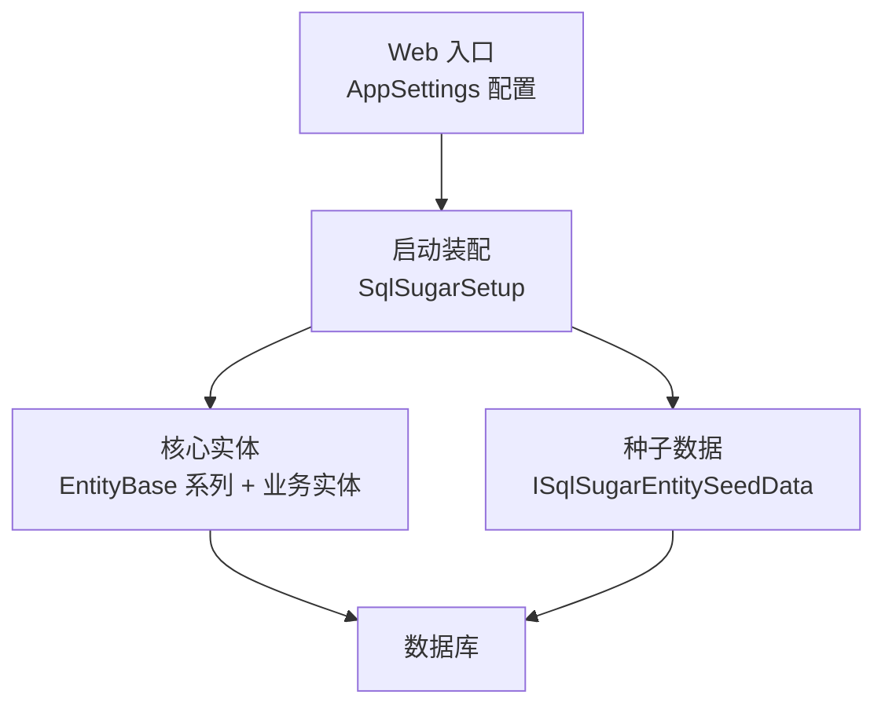
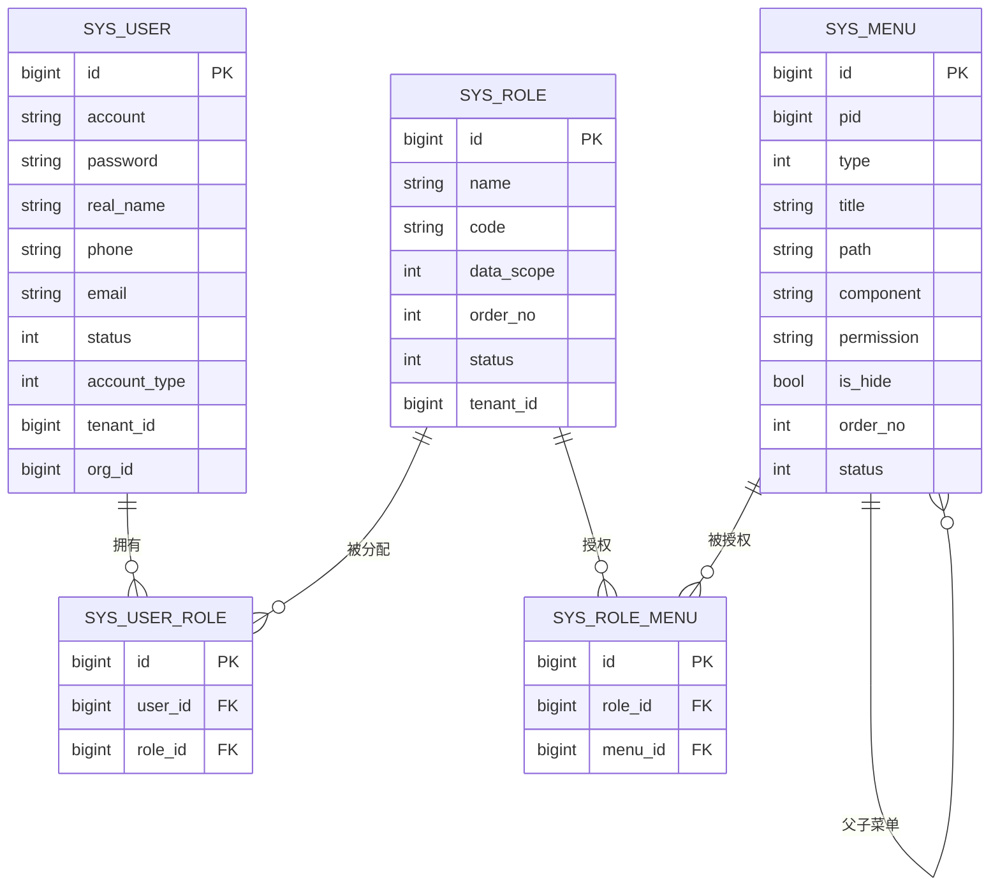
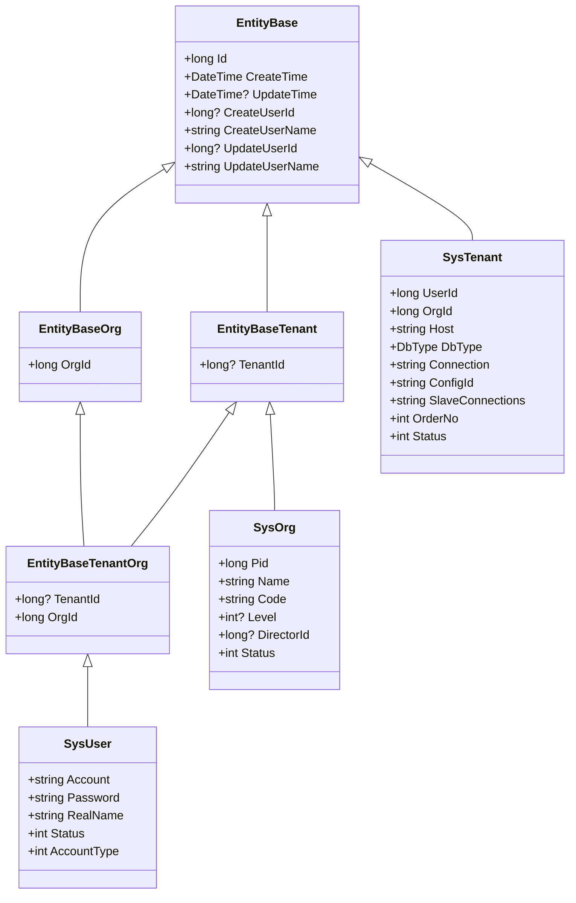
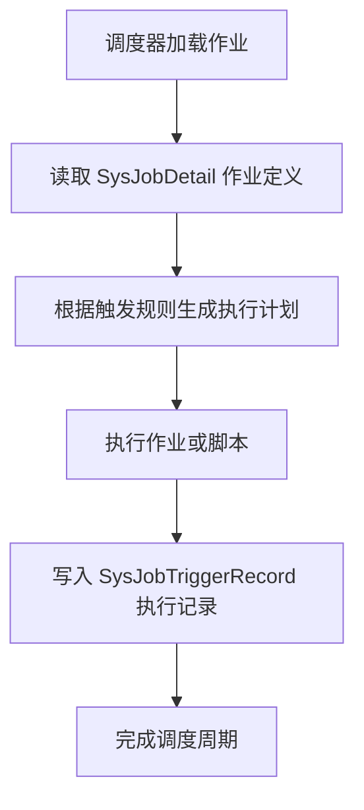
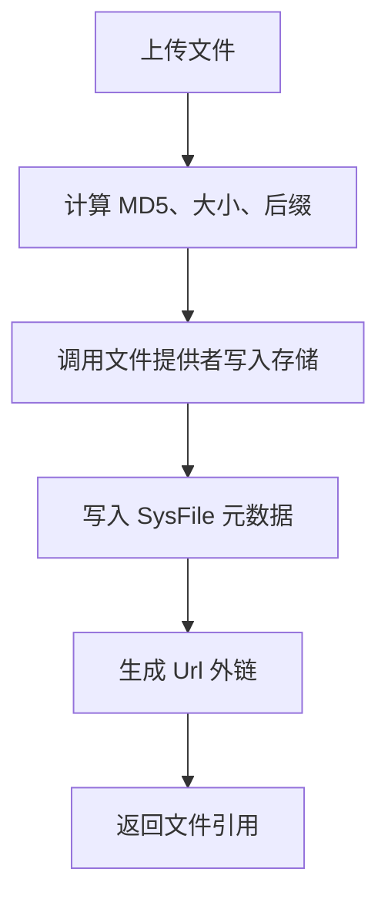
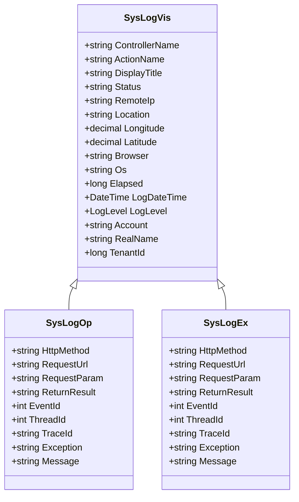
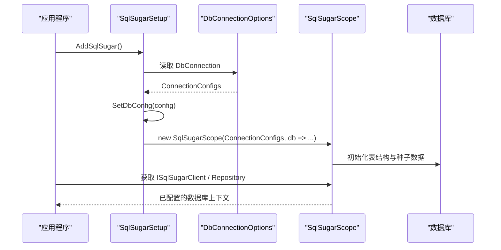
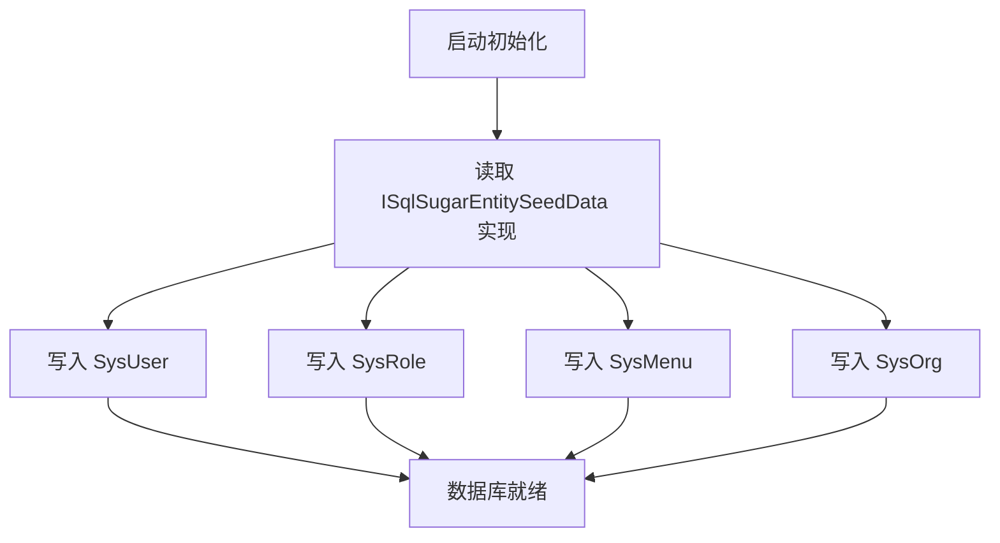

# 数据库设计

<cite>
**本文引用的文件**   
- [README.md](file://README.md)
- [EntityBase.cs](file://Admin.NET/Admin.NET.Core/Entity/EntityBase.cs)
- [SysUser.cs](file://Admin.NET/Admin.NET.Core/Entity/SysUser.cs)
- [SysRole.cs](file://Admin.NET/Admin.NET.Core/Entity/SysRole.cs)
- [SysMenu.cs](file://Admin.NET/Admin.NET.Core/Entity/SysMenu.cs)
- [SysUserRole.cs](file://Admin.NET/Admin.NET.Core/Entity/SysUserRole.cs)
- [SysRoleMenu.cs](file://Admin.NET/Admin.NET.Core/Entity/SysRoleMenu.cs)
- [SysOrg.cs](file://Admin.NET/Admin.NET.Core/Entity/SysOrg.cs)
- [SysTenant.cs](file://Admin.NET/Admin.NET.Core/Entity/SysTenant.cs)
- [SysFile.cs](file://Admin.NET/Admin.NET.Core/Entity/SysFile.cs)
- [SysLogVis.cs](file://Admin.NET/Admin.NET.Core/Entity/SysLogVis.cs)
- [SysLogOp.cs](file://Admin.NET/Admin.NET.Core/Entity/SysLogOp.cs)
- [SysLogEx.cs](file://Admin.NET/Admin.NET.Core/Entity/SysLogEx.cs)
- [SysJobDetail.cs](file://Admin.NET/Admin.NET.Core/Entity/SysJobDetail.cs)
- [SysSchedule.cs](file://Admin.NET/Admin.NET.Core/Entity/SysSchedule.cs)
- [SqlSugarSetup.cs](file://Admin.NET/Admin.NET.Core/SqlSugar/SqlSugarSetup.cs)
- [appsettings.json](file://Admin.NET/Admin.NET.Web.Entry/appsettings.json)
- [appsettings.Development.json](file://Admin.NET/Admin.NET.Web.Entry/appsettings.Development.json)
- [SysUserSeedData.cs](file://Admin.NET/Admin.NET.Core/SeedData/SysUserSeedData.cs)
- [SysRoleSeedData.cs](file://Admin.NET/Admin.NET.Core/SeedData/SysRoleSeedData.cs)
- [SysMenuSeedData.cs](file://Admin.NET/Admin.NET.Core/SeedData/SysMenuSeedData.cs)
- [SysOrgSeedData.cs](file://Admin.NET/Admin.NET.Core/SeedData/SysOrgSeedData.cs)
</cite>

## 目录
1. [引言](#引言)
2. [项目结构与数据边界](#项目结构与数据边界)
3. [核心实体与表结构总览](#核心实体与表结构总览)
4. [权限模型关系](#权限模型关系)
5. [多租户与组织隔离策略](#多租户与组织隔离策略)
6. [任务调度相关表](#任务调度相关表)
7. [文件管理表](#文件管理表)
8. [日志与监控表](#日志与监控表)
9. [SqlSugar ORM 配置、迁移与查询优化](#sqlsugar-orm-配置迁移与查询优化)
10. [主外键约束、索引与数据完整性](#主外键约束索引与数据完整性)
11. [种子数据初始化与版本演进](#种子数据初始化与版本演进)
12. [多数据库兼容性](#多数据库兼容性)
13. [性能与扩展建议](#性能与扩展建议)
14. [故障排查指南](#故障排查指南)
15. [结论](#结论)

## 引言
本仓库中的 Admin.NET 是一个基于 ASP.NET Core、Furion 和 SqlSugar 的通用权限开发框架。后端共享能力集中在 `Admin.NET.Admin.NET.Core`，业务入口位于 `Admin.NET.Admin.NET.Web.Entry`，当前前端业务应用位于 `Web/apps/web-antdv-next`。框架支持多租户、权限管理、任务调度、消息通知、文件管理、日志记录等能力；集成验收以 PostgreSQL 为主。

本文聚焦数据库层：说明核心实体、权限模型、多租户隔离、任务调度、文件管理和日志监控的数据模型，并结合 SqlSugar 配置解释连接、迁移、审计与多数据库兼容行为。

**章节来源**
- [README.md:1-40](file://README.md#L1-L40)

## 项目结构与数据边界
从数据库视角，Admin.NET 的核心实体定义在 `Admin.NET.Admin.NET.Core/Entity` 中，基础基类定义了主键、审计字段、软删除、机构维度与租户维度；具体领域实体围绕用户、角色、菜单、机构、租户、文件、日志、作业和日程展开。配置与运行期连接由 Web 入口读取，并在启动时通过 SqlSugar 完成上下文注册、AOP、表结构初始化及种子数据写入。

**图表来源**
- [SqlSugarSetup.cs](file://Admin.NET/Admin.NET.Core/SqlSugar/SqlSugarSetup.cs)
- [EntityBase.cs](file://Admin.NET/Admin.NET.Core/Entity/EntityBase.cs)
- [SysUserSeedData.cs](file://Admin.NET/Admin.NET.Core/SeedData/SysUserSeedData.cs)
- [appsettings.json](file://Admin.NET/Admin.NET.Web.Entry/appsettings.json)

**章节来源**
- [README.md:20-40](file://README.md#L20-L40)
- [appsettings.json:1-5](file://Admin.NET/Admin.NET.Web.Entry/appsettings.json#L1-L5)
- [appsettings.Development.json:1-5](file://Admin.NET/Admin.NET.Web.Entry/appsettings.Development.json#L1-L5)
- [SqlSugarSetup.cs](file://Admin.NET/Admin.NET.Core/SqlSugar/SqlSugarSetup.cs)

## 核心实体与表结构总览
以下表格归纳主要业务表及其职责。所有表均通过 SqlSugar 特性映射到数据库列，公共审计字段来自基类。

| 表名 | 对应实体 | 主要用途 | 关键字段 | 典型关系 |
|---|---|---|---|---|
| 系统用户表 | SysUser | 登录账号、个人信息、账号类型与状态 | Account、Password、RealName、Phone、Email、Status、AccountType、TenantId、OrgId | 多对多关联角色、组织、快捷菜单 |
| 系统角色表 | SysRole | 角色、编码、数据范围、状态 | Name、Code、DataScope、OrderNo、Status、TenantId | 多对多关联菜单 |
| 系统菜单表 | SysMenu | 目录、菜单、按钮树形权限资源 | Pid、Title、Path、Component、Permission、Type、IsHide、Status | 自关联父级菜单 |
| 系统用户角色表 | SysUserRole | 用户与角色中间表 | UserId、RoleId | 关联 SysUser、SysRole |
| 系统角色菜单表 | SysRoleMenu | 角色与菜单中间表 | RoleId、MenuId | 关联 SysRole、SysMenu |
| 系统机构表 | SysOrg | 组织架构树、负责人、类型、级别 | Pid、Name、Code、Level、Type、DirectorId、Status、TenantId | 自关联父机构 |
| 系统租户表 | SysTenant | 平台租户元数据、数据库连接标识 | UserId、OrgId、Host、DbType、Connection、ConfigId、SlaveConnections | 管理租户运行时连接 |
| 系统文件表 | SysFile | 文件元数据、提供者、存储路径、外链 | Provider、BucketName、FileName、Suffix、FilePath、SizeKb、Url、FileMd5、FileType、DataId、TenantId、OrgId | 可关联业务数据 Id |
| 系统访问日志表 | SysLogVis | 访问与操作日志公共字段 | ControllerName、ActionName、DisplayTitle、Status、RemoteIp、Location、Browser、Os、Elapsed、LogDateTime、Account、RealName、TenantId | 被 SysLogOp、SysLogEx 继承 |
| 系统操作日志表 | SysLogOp | 正常请求的操作日志 | HttpMethod、RequestUrl、RequestParam、ReturnResult、EventId、ThreadId、TraceId、Exception、Message | 继承 SysLogVis |
| 系统异常日志表 | SysLogEx | 异常场景日志 | HttpMethod、RequestUrl、RequestParam、ReturnResult、EventId、ThreadId、TraceId、Exception、Message | 继承 SysLogVis |
| 系统作业信息表 | SysJobDetail | 调度作业定义 | JobId、GroupName、JobType、AssemblyName、Description、Concurrent、IncludeAnnotation、Properties、UpdatedTime、CreateType、ScriptCode | 调度器持久化作业 |
| 系统日程表 | SysSchedule | 用户日程内容 | UserId、ScheduleTime、StartTime、EndTime、Content、Status、TenantId | 按租户和用户维度管理日程 |

**章节来源**
- [SysUser.cs:1-200](file://Admin.NET/Admin.NET.Core/Entity/SysUser.cs#L1-L200)
- [SysRole.cs:1-56](file://Admin.NET/Admin.NET.Core/Entity/SysRole.cs#L1-L56)
- [SysMenu.cs:1-134](file://Admin.NET/Admin.NET.Core/Entity/SysMenu.cs#L1-L134)
- [SysUserRole.cs:1-41](file://Admin.NET/Admin.NET.Core/Entity/SysUserRole.cs#L1-L41)
- [SysRoleMenu.cs:1-35](file://Admin.NET/Admin.NET.Core/Entity/SysRoleMenu.cs#L1-L35)
- [SysOrg.cs:1-96](file://Admin.NET/Admin.NET.Core/Entity/SysOrg.cs#L1-L96)
- [SysTenant.cs:1-145](file://Admin.NET/Admin.NET.Core/Entity/SysTenant.cs#L1-L145)
- [SysFile.cs:1-104](file://Admin.NET/Admin.NET.Core/Entity/SysFile.cs#L1-L104)
- [SysLogVis.cs:1-116](file://Admin.NET/Admin.NET.Core/Entity/SysLogVis.cs#L1-L116)
- [SysLogOp.cs:1-72](file://Admin.NET/Admin.NET.Core/Entity/SysLogOp.cs#L1-L72)
- [SysLogEx.cs:1-72](file://Admin.NET/Admin.NET.Core/Entity/SysLogEx.cs#L1-L72)
- [SysJobDetail.cs:1-87](file://Admin.NET/Admin.NET.Core/Entity/SysJobDetail.cs#L1-L87)
- [SysSchedule.cs:1-52](file://Admin.NET/Admin.NET.Core/Entity/SysSchedule.cs#L1-L52)

## 权限模型关系
权限模型采用 RBAC 风格：用户通过角色获得菜单与按钮权限，菜单形成树形导航结构，同时用户可拥有个人快捷菜单。

**图表来源**
- [SysUser.cs:1-200](file://Admin.NET/Admin.NET.Core/Entity/SysUser.cs#L1-L200)
- [SysRole.cs:1-56](file://Admin.NET/Admin.NET.Core/Entity/SysRole.cs#L1-L56)
- [SysMenu.cs:1-134](file://Admin.NET/Admin.NET.Core/Entity/SysMenu.cs#L1-L134)
- [SysUserRole.cs:1-41](file://Admin.NET/Admin.NET.Core/Entity/SysUserRole.cs#L1-L41)
- [SysRoleMenu.cs:1-35](file://Admin.NET/Admin.NET.Core/Entity/SysRoleMenu.cs#L1-L35)

关键设计要点：
- 菜单使用 `Pid` 实现树形结构，`Type` 区分目录、菜单、按钮。
- 角色具备 `DataScope`，用于数据范围控制，例如全部数据、本部门及以下、仅本人等。
- 用户与角色是多对多关系，通过 `SysUserRole` 维护。
- 角色与菜单是多对多关系，通过 `SysRoleMenu` 维护。
- 用户还可绑定个人快捷菜单，由 `SysUserMenu` 表示。

**章节来源**
- [SysUser.cs:1-200](file://Admin.NET/Admin.NET.Core/Entity/SysUser.cs#L1-L200)
- [SysRole.cs:1-56](file://Admin.NET/Admin.NET.Core/Entity/SysRole.cs#L1-L56)
- [SysMenu.cs:1-134](file://Admin.NET/Admin.NET.Core/Entity/SysMenu.cs#L1-L134)
- [SysUserRole.cs:1-41](file://Admin.NET/Admin.NET.Core/Entity/SysUserRole.cs#L1-L41)
- [SysRoleMenu.cs:1-35](file://Admin.NET/Admin.NET.Core/Entity/SysRoleMenu.cs#L1-L35)

## 多租户与组织隔离策略
多租户和组织隔离由基类与实体字段共同实现：

- 租户维度：
  - `EntityBaseTenant`、`EntityBaseTenantOrg` 等基类包含 `TenantId`，用于逻辑隔离。
  - `SysTenant` 保存租户元数据、数据库类型、连接字符串、从库连接与配置标识，支持多租户动态连接。
- 组织维度：
  - `EntityBaseOrg`、`EntityBaseTenantOrg` 引入 `OrgId`，配合数据权限过滤接口实现组织级数据范围。
  - `SysOrg` 是树形组织表，`Pid` 指向父机构，`DirectorId` 指向负责人。
- 用户维度：
  - `SysUser` 继承租户与组织基类，因此每个用户记录属于特定租户和组织。
  - 用户还包含 `AccountType`，用于区分超级管理员、系统管理员和普通用户等。

**图表来源**
- [EntityBase.cs](file://Admin.NET/Admin.NET.Core/Entity/EntityBase.cs)
- [SysUser.cs:1-200](file://Admin.NET/Admin.NET.Core/Entity/SysUser.cs#L1-L200)
- [SysOrg.cs:1-96](file://Admin.NET/Admin.NET.Core/Entity/SysOrg.cs#L1-L96)
- [SysTenant.cs:1-145](file://Admin.NET/Admin.NET.Core/Entity/SysTenant.cs#L1-L145)

注意事项：
- 当前源码中的多租户更多体现为逻辑字段隔离与动态连接配置；是否启用“数据库级隔离”应结合部署时各租户是否拥有独立数据库实例来确认。
- `SysTenant.Connection`、`SysTenant.SlaveConnections`、`SysTenant.DbType`、`SysTenant.ConfigId` 表明框架支持按租户切换数据库连接，甚至读写分离。

**章节来源**
- [EntityBase.cs](file://Admin.NET/Admin.NET.Core/Entity/EntityBase.cs)
- [SysTenant.cs:1-145](file://Admin.NET/Admin.NET.Core/Entity/SysTenant.cs#L1-L145)
- [SysUser.cs:1-200](file://Admin.NET/Admin.NET.Core/Entity/SysUser.cs#L1-L200)
- [SysOrg.cs:1-96](file://Admin.NET/Admin.NET.Core/Entity/SysOrg.cs#L1-L96)

## 任务调度相关表
任务调度相关数据主要包括作业定义、触发记录、集群信息与用户日程。

| 表 | 实体 | 关键字段 | 说明 |
|---|---|---|---|
| 系统作业信息表 | SysJobDetail | JobId、GroupName、JobType、AssemblyName、Concurrent、IncludeAnnotation、Properties、UpdatedTime、CreateType、ScriptCode | 定义可执行作业的类型、程序集、脚本、并发与属性 |
| 系统作业触发记录表 | SysJobTriggerRecord | 记录触发执行历史 | 用于追踪调度执行情况 |
| 系统作业集群表 | SysJobCluster | 集群相关信息 | 分布式调度节点或集群元数据 |
| 系统日程表 | SysSchedule | UserId、ScheduleTime、StartTime、EndTime、Content、Status、TenantId | 用户日程，支持完成状态和时间区间 |

**图表来源**
- [SysJobDetail.cs:1-87](file://Admin.NET/Admin.NET.Core/Entity/SysJobDetail.cs#L1-L87)
- [SysSchedule.cs:1-52](file://Admin.NET/Admin.NET.Core/Entity/SysSchedule.cs#L1-L52)

**章节来源**
- [SysJobDetail.cs:1-87](file://Admin.NET/Admin.NET.Core/Entity/SysJobDetail.cs#L1-L87)
- [SysSchedule.cs:1-52](file://Admin.NET/Admin.NET.Core/Entity/SysSchedule.cs#L1-L52)

## 文件管理表
文件管理表 `SysFile` 存储文件的元数据，实际文件内容由外部提供者处理。

| 字段 | 含义 | 设计要点 |
|---|---|---|
| Provider | 提供者名称 | 支持本地、阿里云 OSS、腾讯云 COS 等多种存储后端 |
| BucketName | 仓储名称 | 对应对象存储容器或本地目录命名空间 |
| FileName | 源文件名 | 原始文件名，便于展示 |
| Suffix | 文件后缀 | 用于类型判断与下载 |
| FilePath | 存储路径 | 内部物理或对象存储路径 |
| SizeKb | 文件大小 KB | 数值型大小 |
| SizeInfo | 文件大小信息 | 计算后的人类可读大小 |
| Url | 外链地址 | 上传后生成的预览链接 |
| FileMd5 | 文件 MD5 | 用于去重或校验 |
| FileType | 文件类别 | 业务分类 |
| DataId | 业务数据 Id | 可选关联业务主键 |
| TenantId、OrgId | 租户与组织 | 多租户与组织隔离 |

**图表来源**
- [SysFile.cs:1-104](file://Admin.NET/Admin.NET.Core/Entity/SysFile.cs#L1-L104)

**章节来源**
- [SysFile.cs:1-104](file://Admin.NET/Admin.NET.Core/Entity/SysFile.cs#L1-L104)

## 日志与监控表
日志体系分为访问日志、操作日志与异常日志。访问日志作为公共基类，被操作日志与异常日志继承，便于统一查询。

| 表 | 实体 | 核心字段 | 用途 |
|---|---|---|---|
| 系统访问日志表 | SysLogVis | ControllerName、ActionName、DisplayTitle、Status、RemoteIp、Location、Browser、Os、Elapsed、LogDateTime、Account、RealName、TenantId | 访问维度公共信息 |
| 系统操作日志表 | SysLogOp | HttpMethod、RequestUrl、RequestParam、ReturnResult、EventId、ThreadId、TraceId、Exception、Message | 正常请求链路日志 |
| 系统异常日志表 | SysLogEx | HttpMethod、RequestUrl、RequestParam、ReturnResult、EventId、ThreadId、TraceId、Exception、Message | 异常链路日志 |

**图表来源**
- [SysLogVis.cs:1-116](file://Admin.NET/Admin.NET.Core/Entity/SysLogVis.cs#L1-L116)
- [SysLogOp.cs:1-72](file://Admin.NET/Admin.NET.Core/Entity/SysLogOp.cs#L1-L72)
- [SysLogEx.cs:1-72](file://Admin.NET/Admin.NET.Core/Entity/SysLogEx.cs#L1-L72)

**章节来源**
- [SysLogVis.cs:1-116](file://Admin.NET/Admin.NET.Core/Entity/SysLogVis.cs#L1-L116)
- [SysLogOp.cs:1-72](file://Admin.NET/Admin.NET.Core/Entity/SysLogOp.cs#L1-L72)
- [SysLogEx.cs:1-72](file://Admin.NET/Admin.NET.Core/Entity/SysLogEx.cs#L1-L72)

## SqlSugar ORM 配置、迁移与查询优化
### 连接配置
- 应用通过 Furion 配置扫描目录合并配置，数据库连接配置位于 `DbConnection` 配置项。
- 启动时 `SqlSugarSetup.AddSqlSugar` 读取 `DbConnectionOptions`，遍历 `ConnectionConfigs`，调用 `SetDbConfig` 并创建 `SqlSugarScope`。
- 支持连接字符串加密解密、自动关闭连接、雪花 Id 注入、动态表达式解析、数据缓存服务。

### 迁移策略
- 代码优先模式：通过 `[SugarTable]`、`[SugarColumn]`、`[SugarIndex]` 等特性描述表结构。
- 启动阶段会初始化数据库表结构并执行种子数据；`InitDatabase` 会为每个连接配置执行初始化流程。
- 默认禁用非 SqlSugar 创建的列删除，避免误删手动维护字段。

### 查询优化
- 自动删除数据缓存：增删改后调用 `RemoveDataCache()`。
- 自动更新查询过滤器：启用租户、组织、软删除等全局过滤器。
- SQL 输出与错误日志：可开启控制台 SQL 输出，记录错误 SQL 和执行时间超过阈值的慢查询。
- 命令超时：默认设置为 30 秒。

**图表来源**
- [SqlSugarSetup.cs](file://Admin.NET/Admin.NET.Core/SqlSugar/SqlSugarSetup.cs)
- [appsettings.json:1-5](file://Admin.NET/Admin.NET.Web.Entry/appsettings.json#L1-L5)

**章节来源**
- [SqlSugarSetup.cs](file://Admin.NET/Admin.NET.Core/SqlSugar/SqlSugarSetup.cs)
- [appsettings.json:1-5](file://Admin.NET/Admin.NET.Web.Entry/appsettings.json#L1-L5)
- [appsettings.Development.json:1-5](file://Admin.NET/Admin.NET.Web.Entry/appsettings.Development.json#L1-L5)

## 主外键约束、索引与数据完整性
### 主键与基础字段
- 主键：
  - 多数实体继承 `EntityBaseId`，使用长整型雪花 Id，标记为主键且非自增。
  - 部分中间表或轻量表直接使用 `EntityBaseId`。
- 审计字段：
  - `CreateTime`、`UpdateTime`、`CreateUserId`、`CreateUserName`、`UpdateUserId`、`UpdateUserName` 由 `EntityBase` 提供。
- 软删除：
  - `EntityBaseDel` 提供 `IsDelete`、`DeleteTime`，并添加相应索引。
- 组织与租户：
  - `EntityBaseOrg` 提供 `OrgId`。
  - `EntityBaseTenant` 提供 `TenantId`。
  - 组合基类 `EntityBaseTenantOrg` 同时包含租户与组织维度。

### 索引设计
- 用户表：账号索引、手机号索引。
- 角色表：名称索引、编码索引。
- 菜单表：标题索引、类型索引。
- 机构表：名称索引、编码索引、类型索引。
- 文件表：文件名索引。
- 作业表：作业 Id 索引。
- 基础基类：创建时间、删除标志、删除时间索引。

### 数据完整性规则
- 必填校验：多处使用 `[Required]`、`[MaxLength]` 限制长度与必填。
- 枚举字段：性别、状态、数据类型、菜单类型、账号类型、数据范围等使用枚举约束业务值。
- 大字段：JSON、脚本、请求参数、返回结果等使用大文本类型，避免截断。
- 逻辑关系：
  - 菜单树通过 `Pid` 自关联。
  - 用户与角色、角色与菜单通过中间表解耦。
  - 文件可通过 `DataId` 关联业务数据。

**章节来源**
- [EntityBase.cs](file://Admin.NET/Admin.NET.Core/Entity/EntityBase.cs)
- [SysUser.cs:1-200](file://Admin.NET/Admin.NET.Core/Entity/SysUser.cs#L1-L200)
- [SysRole.cs:1-56](file://Admin.NET/Admin.NET.Core/Entity/SysRole.cs#L1-L56)
- [SysMenu.cs:1-134](file://Admin.NET/Admin.NET.Core/Entity/SysMenu.cs#L1-L134)
- [SysOrg.cs:1-96](file://Admin.NET/Admin.NET.Core/Entity/SysOrg.cs#L1-L96)
- [SysFile.cs:1-104](file://Admin.NET/Admin.NET.Core/Entity/SysFile.cs#L1-L104)
- [SysJobDetail.cs:1-87](file://Admin.NET/Admin.NET.Core/Entity/SysJobDetail.cs#L1-L87)

## 种子数据初始化与版本演进
种子数据通过实现 `ISqlSugarEntitySeedData<T>` 提供，并在启动阶段由 SqlSugar 初始化流程执行。

| 种子数据 | 作用 | 典型数据 |
|---|---|---|
| SysUserSeedData | 初始化默认用户 | 超级管理员、系统管理员、部门主管、普通用户等 |
| SysRoleSeedData | 初始化默认角色 | 系统管理员、本部门及以下、本部门、仅本人、自定义 |
| SysMenuSeedData | 初始化菜单树 | 工作台、系统管理、平台管理等菜单与按钮 |
| SysOrgSeedData | 初始化组织树 | 默认组织、市场部、开发部、售后部、其他 |

种子数据特点：
- 使用固定 Id 或依赖常量，保证初始数据稳定。
- 密码通过配置项读取并加密后写入。
- 组织与用户通过 `TenantId`、`OrgId` 建立初始关联。
- 菜单包含系统管理与平台管理两类，覆盖常见后台功能入口。

**图表来源**
- [SysUserSeedData.cs:1-33](file://Admin.NET/Admin.NET.Core/SeedData/SysUserSeedData.cs#L1-L33)
- [SysRoleSeedData.cs:1-29](file://Admin.NET/Admin.NET.Core/SeedData/SysRoleSeedData.cs#L1-L29)
- [SysMenuSeedData.cs:1-116](file://Admin.NET/Admin.NET.Core/SeedData/SysMenuSeedData.cs#L1-L116)
- [SysOrgSeedData.cs:1-31](file://Admin.NET/Admin.NET.Core/SeedData/SysOrgSeedData.cs#L1-L31)

**章节来源**
- [SysUserSeedData.cs:1-33](file://Admin.NET/Admin.NET.Core/SeedData/SysUserSeedData.cs#L1-L33)
- [SysRoleSeedData.cs:1-29](file://Admin.NET/Admin.NET.Core/SeedData/SysRoleSeedData.cs#L1-L29)
- [SysMenuSeedData.cs:1-116](file://Admin.NET/Admin.NET.Core/SeedData/SysMenuSeedData.cs#L1-L116)
- [SysOrgSeedData.cs:1-31](file://Admin.NET/Admin.NET.Core/SeedData/SysOrgSeedData.cs#L1-L31)

## 多数据库兼容性
SqlSugar 配置中对不同数据库做了兼容处理：

| 数据库 | 兼容性处理 |
|---|---|
| PostgreSQL | 集成验收首选数据库；人大金仓驱动会被识别为 PostgreSQL 模式以兼容系统表差异 |
| SQL Server | 使用 `Nvarchar` 模式，避免中文与 Unicode 问题 |
| MySQL | 未看到特殊语法开关；需关注字符集、排序规则和自增策略 |
| Oracle | 最大参数名长度设置为 30，符合 Oracle 标识符长度限制 |
| 人大金仓 | 当检测到该驱动时，强制使用 PostgreSQL 模式 |

额外行为：
- 表名和列名支持驼峰转下划线，受 `EnableUnderLine` 配置影响。
- 模块前缀支持通过 `TableModuleAttribute` 给表名加前缀。
- 连接字符串支持加密，避免明文密钥泄露。

**章节来源**
- [SqlSugarSetup.cs](file://Admin.NET/Admin.NET.Core/SqlSugar/SqlSugarSetup.cs)
- [README.md:20-40](file://README.md#L20-L40)

## 性能与扩展建议
- 日志表体积增长较快，建议：
  - 定期归档或清理过期 `SysLogOp`、`SysLogEx`。
  - 为 `LogDateTime`、`TenantId`、`Account` 等常用查询条件补充索引。
  - 将大字段 `RequestUrl`、`RequestParam`、`ReturnResult`、`Exception`、`Message` 单独拆分到扩展日志表。
- 菜单与权限查询：
  - 频繁构建菜单树时，建议在应用层缓存角色菜单映射。
  - 对高频查询条件如 `Status`、`Type`、`Permission` 增加复合索引。
- 文件表：
  - 对 `FileName`、`Provider`、`FileType`、`TenantId` 等字段按需建立索引。
  - 大文件上传建议使用分片与异步校验，避免长时间事务占用数据库连接。
- 多租户：
  - 如果采用数据库级隔离，应确保租户连接池配置合理，避免连接泄漏。
  - 对跨租户统计查询应明确隔离边界，避免误查其他租户数据。

## 故障排查指南
常见问题与定位方向：

| 现象 | 可能原因 | 排查建议 |
|---|---|---|
| 启动时报数据库连接失败 | 连接字符串错误或加密未解密 | 检查 `DbConnection` 配置、加密开关、数据库服务可用性 |
| 表未创建或字段缺失 | 未执行初始化或未正确配置特性 | 确认 `SqlSugarSetup` 初始化流程，检查 `[SugarTable]`、`[SugarColumn]` |
| SQL 执行缓慢 | 缺少索引或查询未走租户过滤 | 查看慢 SQL 日志，补充索引，确认租户过滤生效 |
| 日志不写入 | 日志配置或连接配置异常 | 检查日志数据库连接、`LogTable` 特性、AOP 配置 |
| 菜单权限不生效 | 角色菜单未绑定或菜单状态禁用 | 检查 `SysRoleMenu`、`SysMenu.Status`、`SysRole.DataScope` |
| 多租户数据串扰 | 租户上下文未设置或过滤失效 | 确认租户切换逻辑，检查 `TenantId` 过滤器和连接配置 |

**章节来源**
- [SqlSugarSetup.cs](file://Admin.NET/Admin.NET.Core/SqlSugar/SqlSugarSetup.cs)
- [SysLogOp.cs:1-72](file://Admin.NET/Admin.NET.Core/Entity/SysLogOp.cs#L1-L72)
- [SysLogEx.cs:1-72](file://Admin.NET/Admin.NET.Core/Entity/SysLogEx.cs#L1-L72)

## 结论
Admin.NET 的数据库设计以 SqlSugar 为核心，通过基类统一主键、审计、软删除、组织和租户维度，再围绕用户、角色、菜单、机构、租户、文件、日志、作业和日程构建完整的管理后台数据模型。权限模型采用 RBAC，菜单树与角色菜单、用户角色关系清晰；多租户通过逻辑字段与动态连接配置实现，并可结合部署策略升级为数据库级隔离。日志体系以访问日志为基础，区分操作日志与异常日志，便于审计与排障。

在实际使用中，应重点关注索引设计、日志归档、菜单缓存、多租户连接管理和多数据库兼容性。对于新增业务表，建议遵循现有基类和特性约定，保持表结构一致性和可维护性。