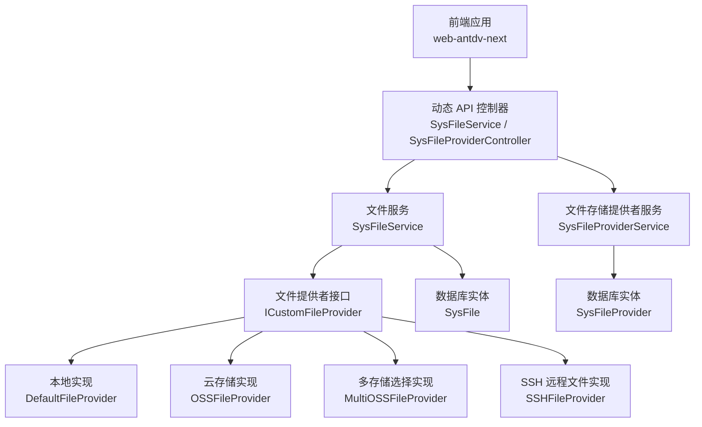
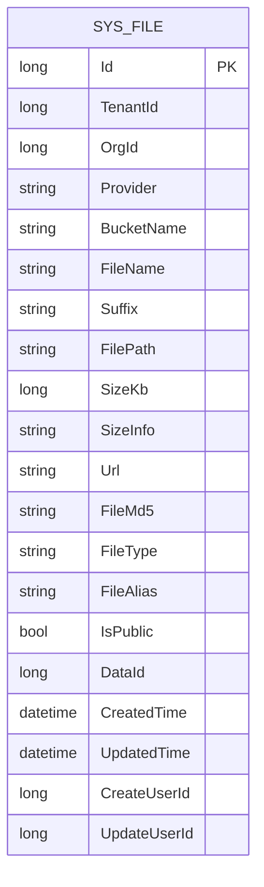
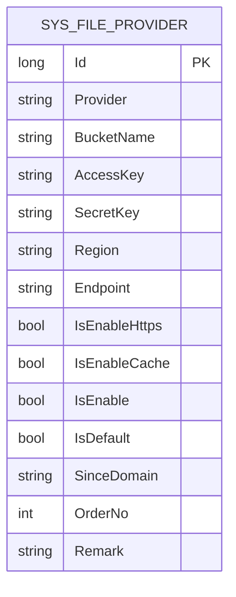
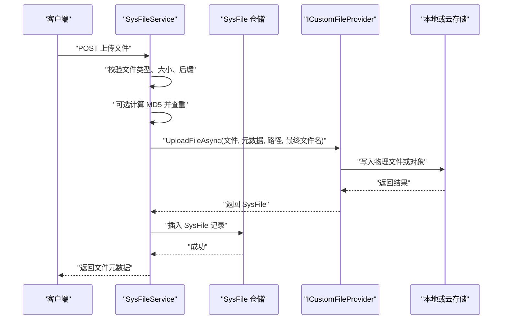
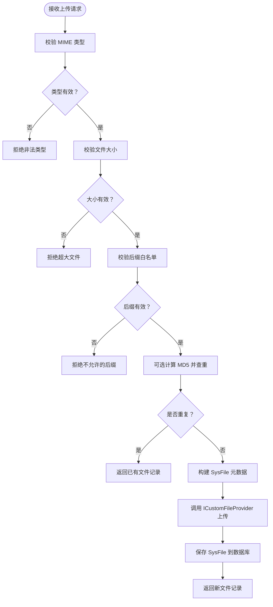
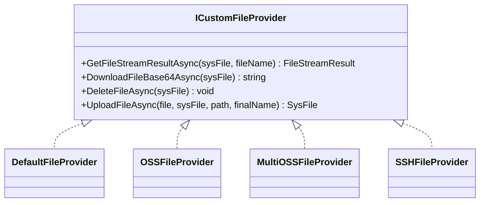
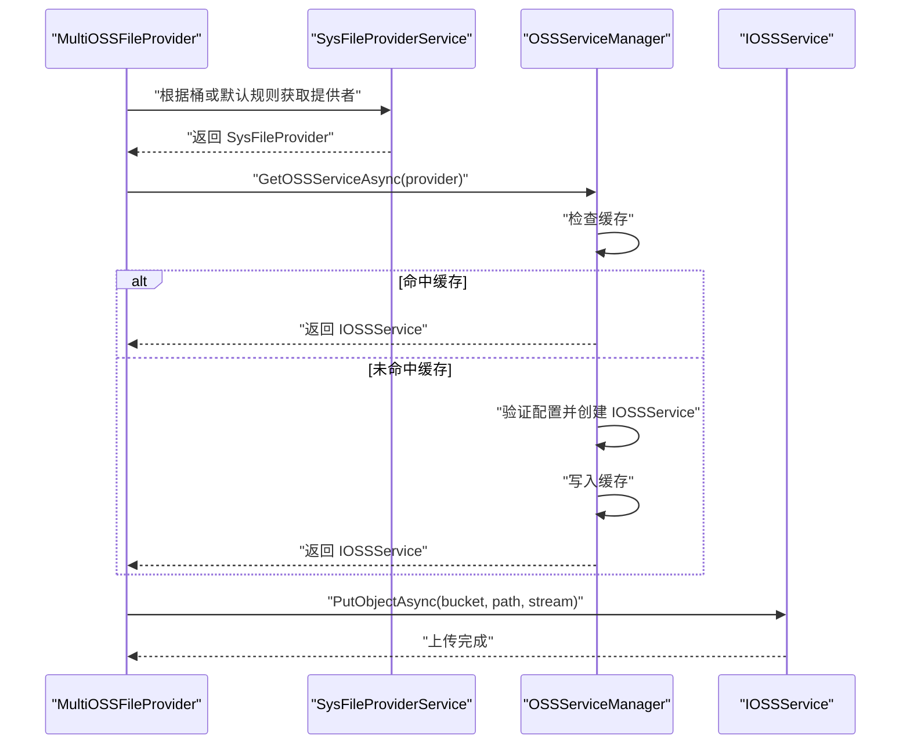
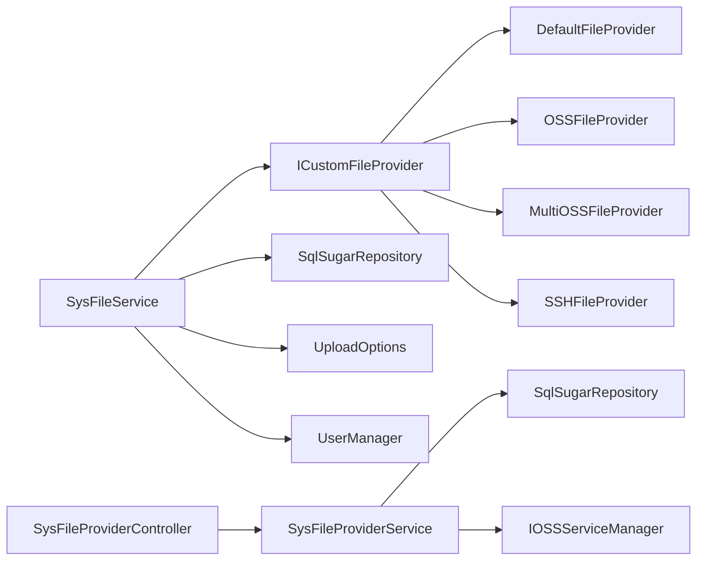
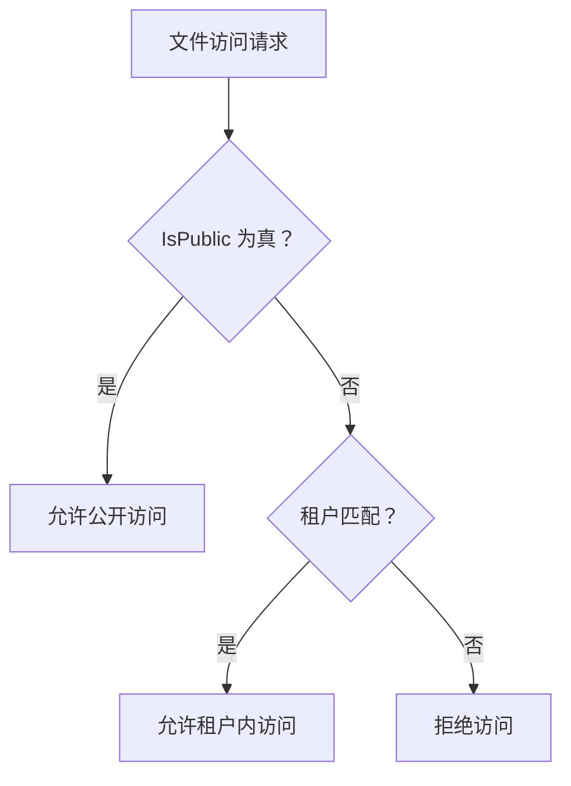
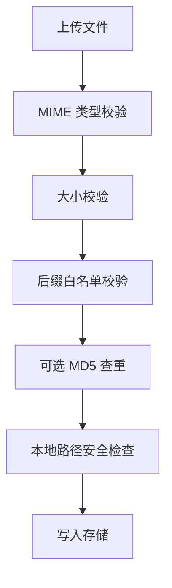

# 文件管理实体设计

<cite>
**本文引用的文件**   
- [SysFile.cs](file://Admin.NET/Admin.NET.Core/Entity/SysFile.cs)
- [SysFileProvider.cs](file://Admin.NET/Admin.NET.Core/Entity/SysFileProvider.cs)
- [SysFileService.cs](file://Admin.NET/Admin.NET.Core/Service/File/SysFileService.cs)
- [SysFileProviderController.cs](file://Admin.NET/Admin.NET.Core/Service/File/SysFileProviderController.cs)
- [SysFileProviderService.cs](file://Admin.NET/Admin.NET.Core/Service/File/SysFileProviderService.cs)
- [FileInput.cs](file://Admin.NET/Admin.NET.Core/Service/File/Dto/FileInput.cs)
- [FileProviderInput.cs](file://Admin.NET/Admin.NET.Core/Service/File/Dto/FileProviderInput.cs)
- [IOSSServiceManager.cs](file://Admin.NET/Admin.NET.Core/Service/File/IOSSServiceManager.cs)
- [ICustomFileProvider.cs](file://Admin.NET/Admin.NET.Core/Service/File/FileProvider/ICustomFileProvider.cs)
- [DefaultFileProvider.cs](file://Admin.NET/Admin.NET.Core/Service/File/FileProvider/DefaultFileProvider.cs)
- [OSSFileProvider.cs](file://Admin.NET/Admin.NET.Core/Service/File/FileProvider/OSSFileProvider.cs)
- [MultiOSSFileProvider.cs](file://Admin.NET/Admin.NET.Core/Service/File/FileProvider/MultiOSSFileProvider.cs)
- [SSHFileProvider.cs](file://Admin.NET/Admin.NET.Core/Service/File/FileProvider/SSHFileProvider.cs)
- [UploadOptions.cs](file://Admin.NET/Admin.NET.Core/Option/UploadOptions.cs)
- [VerifyFileExtensionName.cs](file://Admin.NET/Admin.NET.Core/Utils/VerifyFileExtensionName.cs)
- [FileIsolationTests.cs](file://Admin.NET/Admin.NET.Test/File/FileIsolationTests.cs)
- [file.ts](file://Web/apps/web-antdv-next/src/api/system/file.ts)
</cite>

## 目录
1. [引言](#引言)
2. [项目结构定位](#项目结构定位)
3. [核心数据模型](#核心数据模型)
4. [架构总览](#架构总览)
5. [详细组件分析](#详细组件分析)
6. [依赖关系分析](#依赖关系分析)
7. [性能与扩展性](#性能与扩展性)
8. [安全与访问控制](#安全与访问控制)
9. [故障排查指南](#故障排查指南)
10. [结论](#结论)
11. [附录：API 与前端调用约定](#附录api-与前端调用约定)

## 引言
本文面向 Admin.NET 文件管理系统的数据模型与实现，重点说明以下目标：
- `SysFile`（系统文件）表字段及其语义。
- 多存储后端的抽象接口和实现，包括本地文件系统、阿里云 OSS、腾讯云 COS、MinIO 及 SSH 远端文件。
- 文件上传、下载、预览、删除、更新元数据的数据流向。
- 文件类型校验、大小限制、MD5 去重、路径越界防护等安全机制。
- 文件版本管理现状：当前代码未提供独立历史版本表或差异比较能力，但可通过业务关联字段和设计建议实现演进方案。
- 临时文件清理策略：当前仓库未实现自动清理任务，需要结合业务生命周期与外部调度补充。
- 存储空间统计：当前提供者统计仅统计配置数量，不统计物理文件大小；可扩展为按桶统计。
- 大文件分片上传与断点续传：当前代码未包含分片上传相关实体与服务，可基于现有 Provider 抽象进行扩展。

## 项目结构定位
文件管理功能位于后端 `Admin.NET.Core` 的 `Service/File` 与 `Entity` 目录，并通过动态 API 控制器暴露 REST 风格接口；前端业务入口使用 `Web/apps/web-antdv-next` 中的文件 API 封装。

**图表来源**
- [SysFileService.cs:1-120](file://Admin.NET/Admin.NET.Core/Service/File/SysFileService.cs#L1-L120)
- [SysFileProviderController.cs:1-120](file://Admin.NET/Admin.NET.Core/Service/File/SysFileProviderController.cs#L1-L120)
- [ICustomFileProvider.cs:1-45](file://Admin.NET/Admin.NET.Core/Service/File/FileProvider/ICustomFileProvider.cs#L1-L45)
- [DefaultFileProvider.cs:1-89](file://Admin.NET/Admin.NET.Core/Service/File/FileProvider/DefaultFileProvider.cs#L1-L89)
- [OSSFileProvider.cs:1-81](file://Admin.NET/Admin.NET.Core/Service/File/FileProvider/OSSFileProvider.cs#L1-L81)
- [MultiOSSFileProvider.cs:1-120](file://Admin.NET/Admin.NET.Core/Service/File/FileProvider/MultiOSSFileProvider.cs#L1-L120)
- [SSHFileProvider.cs:1-65](file://Admin.NET/Admin.NET.Core/Service/File/FileProvider/SSHFileProvider.cs#L1-L65)

**章节来源**
- [SysFileService.cs:1-200](file://Admin.NET/Admin.NET.Core/Service/File/SysFileService.cs#L1-L200)
- [SysFileProviderController.cs:1-199](file://Admin.NET/Admin.NET.Core/Service/File/SysFileProviderController.cs#L1-L199)

## 核心数据模型

### 系统文件实体 SysFile
`SysFile` 表示一条已落库的文件记录，用于描述文件元数据、归属租户和组织、存储位置、访问地址和安全标记。关键字段如下：

| 字段 | 类型 | 是否必填 | 含义与约束 |
|---|---|---:|---|
| `Id` | 长整型主键 | 是 | 继承自基础实体，由服务端生成唯一 ID。 |
| `TenantId` | 长整型 | 是 | 所属租户，用于多租户隔离。 |
| `OrgId` | 长整型 | 否 | 所属组织，继承自基础实体。 |
| `Provider` | 字符串，最大 128 | 否 | 文件所属存储提供者名称，如本地为空字符串，OSS 实现中会写入提供者枚举名。 |
| `BucketName` | 字符串，最大 128 | 否 | 仓储名称或存储桶名称，用于区分不同存储后端。 |
| `FileName` | 字符串，最大 128 | 否 | 源文件名，不含后缀；更新时会校验非法字符和长度。 |
| `Suffix` | 字符串，最大 16 | 否 | 文件后缀，例如 `.jpg`、`.png`。 |
| `FilePath` | 字符串，最大 512 | 否 | 存储路径，例如 `upload/avatar` 或云对象前缀。 |
| `SizeKb` | 长整型 | 是 | 文件大小，以 KB 为单位。 |
| `SizeInfo` | 字符串，最大 64 | 否 | 人类可读的大小信息，例如 `1.2 MB`，由上层逻辑计算。 |
| `Url` | 字符串，最大 512 | 否 | 外链地址，常用于云存储直接预览和下载。 |
| `FileMd5` | 字符串，最大 128 | 否 | 文件内容 MD5，用于启用 MD5 时的重复检测。 |
| `FileType` | 字符串，最大 128 | 否 | 文件类别，例如图片、文档等业务分类。 |
| `FileAlias` | 字符串，最大 128 | 否 | 文件别名，可用于展示名称或备注。 |
| `IsPublic` | 布尔值 | 否 | 是否公开，公开文件可被同租户或其他逻辑读取。 |
| `DataId` | 长整型 | 否 | 关联业务数据 ID，便于按业务实体聚合文件。 |
| 时间戳与审计字段 | 继承自基础实体 | 是 | 创建时间、更新时间、创建者、修改者等。 |

`SysFile` 上对 `FileName` 建立了索引，便于按文件名搜索。

**图表来源**
- [SysFile.cs:1-104](file://Admin.NET/Admin.NET.Core/Entity/SysFile.cs#L1-L104)

**章节来源**
- [SysFile.cs:1-104](file://Admin.NET/Admin.NET.Core/Entity/SysFile.cs#L1-L104)

### 文件存储提供者实体 SysFileProvider
`SysFileProvider` 表示一个启用的文件存储后端配置，支持阿里云、腾讯云、MinIO 等多种云厂商以及自定义扩展。关键字段如下：

| 字段 | 类型 | 是否必填 | 含义与约束 |
|---|---|---:|---|
| `Id` | 长整型主键 | 是 | 提供者配置主键。 |
| `Provider` | 字符串，最大 16 | 是 | 存储提供者类型，例如 `Aliyun`、`QCloud`、`Minio`。 |
| `BucketName` | 字符串，最大 32 | 是 | 存储桶名称。 |
| `AccessKey` | 字符串，最大 128 | 否 | 访问密钥 ID，各云厂商统一使用该字段。 |
| `SecretKey` | 字符串，最大 128 | 否 | 访问密钥 Secret。 |
| `Region` | 字符串，最大 64 | 否 | 地域信息，阿里云和腾讯云通常需要。 |
| `Endpoint` | 字符串，最大 256 | 否 | 端点地址，部分厂商需要。 |
| `IsEnableHttps` | 布尔值 | 否 | 是否启用 HTTPS。 |
| `IsEnableCache` | 布尔值 | 否 | 是否启用缓存。 |
| `IsEnable` | 布尔值 | 否 | 是否启用该提供者。 |
| `IsDefault` | 布尔值 | 否 | 是否为默认提供者。 |
| `SinceDomain` | 字符串，最大 256 | 否 | 自定义域名，用于生成文件访问 URL。 |
| `OrderNo` | 整数 | 否 | 排序号。 |
| `Remark` | 字符串，最大 512 | 否 | 备注。 |
| `DisplayName` | 计算属性 | 否 | 显示名称，由 `Provider-BucketName` 组成。 |
| `ConfigKey` | 计算属性 | 否 | 配置键名，用于服务实例缓存。 |

该实体上有三个索引：按 `BucketName`、`IsEnable`、`IsDefault` 建立，便于快速查询可用提供者。

**图表来源**
- [SysFileProvider.cs:1-118](file://Admin.NET/Admin.NET.Core/Entity/SysFileProvider.cs#L1-L118)

**章节来源**
- [SysFileProvider.cs:1-118](file://Admin.NET/Admin.NET.Core/Entity/SysFileProvider.cs#L1-L118)

### 文件上传与提供者输入模型
文件上传请求使用 `UploadFileInput`，允许指定文件、文件类别、公开标记、允许后缀、目标桶和提供者、业务数据 ID。

| 字段 | 含义 |
|---|---|
| `File` | 上传文件流。 |
| `FileType` | 业务文件类别。 |
| `IsPublic` | 是否公开。 |
| `AllowSuffix` | 允许的后缀白名单。 |
| `BucketName` | 指定存储桶名称。 |
| `ProviderId` | 指定提供者 ID。 |
| `DataId` | 关联业务数据 ID。 |

提供者管理输入模型定义在 `FileProviderInput.cs`，包括分页、新增、更新、删除、测试连接、设置默认提供者、选择提供者等 DTO。

**章节来源**
- [FileInput.cs:1-137](file://Admin.NET/Admin.NET.Core/Service/File/Dto/FileInput.cs#L1-L137)
- [FileProviderInput.cs:1-182](file://Admin.NET/Admin.NET.Core/Service/File/Dto/FileProviderInput.cs#L1-L182)

## 架构总览
文件系统的整体流程分为三层：
1. **API 层**：`SysFileService` 暴露文件上传、下载、预览、删除、更新等接口；`SysFileProviderController` 暴露存储提供者增删改查、启用禁用、统计、默认提供者设置等接口。
2. **服务层**：`SysFileService` 负责权限校验、参数校验、MD5 去重、大小与类型限制、文件元数据持久化；`SysFileProviderService` 负责提供者配置的 CRUD、缓存、默认提供者逻辑和桶映射。
3. **存储适配层**：通过 `ICustomFileProvider` 接口抽象具体存储实现，包括本地文件、云 OSS、多桶选择和 SSH 远端文件。

**图表来源**
- [SysFileService.cs:200-380](file://Admin.NET/Admin.NET.Core/Service/File/SysFileService.cs#L200-L380)
- [ICustomFileProvider.cs:1-45](file://Admin.NET/Admin.NET.Core/Service/File/FileProvider/ICustomFileProvider.cs#L1-L45)

**章节来源**
- [SysFileService.cs:1-493](file://Admin.NET/Admin.NET.Core/Service/File/SysFileService.cs#L1-L493)
- [SysFileProviderController.cs:1-199](file://Admin.NET/Admin.NET.Core/Service/File/SysFileProviderController.cs#L1-L199)

## 详细组件分析

### 文件服务 SysFileService
`SysFileService` 是文件操作的核心服务，职责包括：
- 文件分页列表，合并公开文件与私有文件，并按租户隔离。
- Base64 上传、多文件上传、单文件上传。
- 根据 ID 或 URL 下载、预览。
- 头像和电子签名上传，同时替换用户旧资源。
- 删除文件时先删除物理文件，再删除数据库记录。
- 更新文件元数据，但不允许绕过权限修改敏感字段。
- 按业务数据 ID 批量同步或删除文件。

关键行为：
- 读取文件时，公开文件对所有用户可见，私有文件限制到当前租户。
- 写操作要求文件属于当前租户，除非是超级管理员且显式传入租户条件。
- 上传前先校验 MIME、大小、后缀，防止恶意文件。
- 若启用 MD5 且未指定桶或提供者，则根据 MD5、大小、租户、创建者、公开标记、文件类别、业务 ID、文件名和后缀做去重。
- 云存储场景下，URL 由提供者生成，便于前端直链预览。

**图表来源**
- [SysFileService.cs:200-380](file://Admin.NET/Admin.NET.Core/Service/File/SysFileService.cs#L200-L380)

**章节来源**
- [SysFileService.cs:1-493](file://Admin.NET/Admin.NET.Core/Service/File/SysFileService.cs#L1-L493)

### 文件存储提供者抽象与实现
`ICustomFileProvider` 定义了四个核心方法：
- `GetFileStreamResultAsync`：返回文件流，供下载或预览。
- `DownloadFileBase64Async`：将文件内容转换为 Base64。
- `DeleteFileAsync`：删除物理文件。
- `UploadFileAsync`：上传文件并填充 `SysFile` 元数据。

具体实现：

| 实现类 | 存储后端 | 特点 |
|---|---|---|
| `DefaultFileProvider` | 本地文件系统 | 基于 WebRootPath 构建绝对路径，检查路径越界，写入磁盘。 |
| `OSSFileProvider` | 阿里云 OSS、腾讯云 COS、MinIO | 使用 `IOSSServiceFactory` 创建 OSS 客户端，生成直链 URL。 |
| `MultiOSSFileProvider` | 多桶 OSS | 根据 `BucketName`、`ProviderId`、默认提供者选择具体配置，并复用 `IOSSServiceManager`。 |
| `SSHFileProvider` | SSH 远端文件 | 通过 `SSHHelper` 上传、读取、删除远端文件。 |

**图表来源**
- [ICustomFileProvider.cs:1-45](file://Admin.NET/Admin.NET.Core/Service/File/FileProvider/ICustomFileProvider.cs#L1-L45)
- [DefaultFileProvider.cs:1-89](file://Admin.NET/Admin.NET.Core/Service/File/FileProvider/DefaultFileProvider.cs#L1-L89)
- [OSSFileProvider.cs:1-81](file://Admin.NET/Admin.NET.Core/Service/File/FileProvider/OSSFileProvider.cs#L1-L81)
- [MultiOSSFileProvider.cs:1-255](file://Admin.NET/Admin.NET.Core/Service/File/FileProvider/MultiOSSFileProvider.cs#L1-L255)
- [SSHFileProvider.cs:1-65](file://Admin.NET/Admin.NET.Core/Service/File/FileProvider/SSHFileProvider.cs#L1-L65)

**章节来源**
- [ICustomFileProvider.cs:1-45](file://Admin.NET/Admin.NET.Core/Service/File/FileProvider/ICustomFileProvider.cs#L1-L45)
- [DefaultFileProvider.cs:1-89](file://Admin.NET/Admin.NET.Core/Service/File/FileProvider/DefaultFileProvider.cs#L1-L89)
- [OSSFileProvider.cs:1-81](file://Admin.NET/Admin.NET.Core/Service/File/FileProvider/OSSFileProvider.cs#L1-L81)
- [MultiOSSFileProvider.cs:1-255](file://Admin.NET/Admin.NET.Core/Service/File/FileProvider/MultiOSSFileProvider.cs#L1-L255)
- [SSHFileProvider.cs:1-65](file://Admin.NET/Admin.NET.Core/Service/File/FileProvider/SSHFileProvider.cs#L1-L65)

### 多存储后端选择与 OSS 服务管理
`MultiOSSFileProvider` 根据以下优先级选择存储提供者：
1. 若 `SysFile.BucketName` 已存在，则按 `Provider` 和 `BucketName` 查找提供者。
2. 若上传时有 `ProviderId`，优先使用该提供者。
3. 若上传时有 `BucketName`，则查找对应桶。
4. 否则使用默认提供者。
5. 兜底从配置文件构造临时提供者，但不写入数据库。

`OSSServiceManager` 缓存每个提供者的 `IOSSService` 实例，避免频繁创建客户端。它使用线程安全的并发字典和双重检查锁定模式，并在配置变更或提供者更新时清空缓存。

**图表来源**
- [MultiOSSFileProvider.cs:1-255](file://Admin.NET/Admin.NET.Core/Service/File/FileProvider/MultiOSSFileProvider.cs#L1-L255)
- [IOSSServiceManager.cs:1-211](file://Admin.NET/Admin.NET.Core/Service/File/IOSSServiceManager.cs#L1-L211)
- [SysFileProviderService.cs:200-520](file://Admin.NET/Admin.NET.Core/Service/File/SysFileProviderService.cs#L200-L520)

**章节来源**
- [MultiOSSFileProvider.cs:1-255](file://Admin.NET/Admin.NET.Core/Service/File/FileProvider/MultiOSSFileProvider.cs#L1-L255)
- [IOSSServiceManager.cs:1-211](file://Admin.NET/Admin.NET.Core/Service/File/IOSSServiceManager.cs#L1-L211)
- [SysFileProviderService.cs:1-520](file://Admin.NET/Admin.NET.Core/Service/File/SysFileProviderService.cs#L1-L520)

### 文件版本管理与差异比较
当前仓库中没有独立的文件版本实体、历史版本表、差异比较算法或版本切换接口。现有设计中，`SysFile.DataId` 可用于将多个文件关联到同一业务记录，但这并不等同于“同一文件的多个版本”。

建议的数据模型演进方向：
- 新增 `SysFileVersion` 表，包含 `FileId`、`VersionNumber`、`ParentFileId`、`SnapshotUrl`、`SnapshotMd5`、`ChangeDescription`、`CreatedTime`、`CreatorId`。
- 保留 `SysFile.Url` 指向最新版本，历史版本通过快照 URL 或只读对象访问。
- 差异比较可在服务端读取两个版本的二进制流，计算哈希或字节级 diff，并返回差异摘要；对于文本文件可按行比较，对于二进制文件可只返回哈希差和体积差。
- 回滚操作将历史版本提升为当前版本，并记录版本链。

注意：以上版本设计与差异比较建议属于演进方案，当前源码未实现。

[本节为概念性设计建议，不直接分析具体实现文件]

### 临时文件清理策略
当前代码未实现定时任务或后台作业清理临时文件。典型临时文件来源包括：
- 上传失败或中断产生的局部文件。
- 分片上传中间产物。
- 预览或处理过程中生成的中间文件。

建议策略：
- 所有临时文件应放在固定根目录，并以会话 ID、任务 ID 或文件 ID 命名。
- 在服务异常或上传完成后立即清理对应临时目录。
- 引入定时任务扫描超过过期时间的临时文件并删除。
- 对云存储，可使用生命周期规则或临时对象前缀配合过期策略。

当前仓库未提供自动清理实现，需在业务层补充。

[本节为通用运维建议，不直接分析具体实现文件]

### 存储空间使用统计
当前 `SysFileProviderController.GetProviderStatistics` 返回的是存储提供者配置的统计，而不是物理文件大小统计：
- 总数、启用数、禁用数。
- 按提供者类型分组计数。
- 按地域分组计数。

若要统计存储空间，应在 `SysFile` 维度聚合 `SizeKb`，并按 `BucketName` 或 `Provider` 分组；也可扩展 `SysFileProvider` 统计字段或使用外部监控系统采集云厂商用量指标。

**章节来源**
- [SysFileProviderController.cs:120-199](file://Admin.NET/Admin.NET.Core/Service/File/SysFileProviderController.cs#L120-L199)
- [SysFile.cs:1-104](file://Admin.NET/Admin.NET.Core/Entity/SysFile.cs#L1-L104)

## 依赖关系分析

**图表来源**
- [SysFileService.cs:1-120](file://Admin.NET/Admin.NET.Core/Service/File/SysFileService.cs#L1-L120)
- [SysFileProviderController.cs:1-120](file://Admin.NET/Admin.NET.Core/Service/File/SysFileProviderController.cs#L1-L120)
- [SysFileProviderService.cs:1-120](file://Admin.NET/Admin.NET.Core/Service/File/SysFileProviderService.cs#L1-L120)
- [ICustomFileProvider.cs:1-45](file://Admin.NET/Admin.NET.Core/Service/File/FileProvider/ICustomFileProvider.cs#L1-L45)

**章节来源**
- [SysFileService.cs:1-493](file://Admin.NET/Admin.NET.Core/Service/File/SysFileService.cs#L1-L493)
- [SysFileProviderService.cs:1-520](file://Admin.NET/Admin.NET.Core/Service/File/SysFileProviderService.cs#L1-L520)

## 性能与扩展性
- 分页查询：文件列表使用分页，并对文件名、路径、创建时间过滤；公开与私有文件通过联合查询合并。
- 提供者缓存：`SysFileProviderService` 对启用状态的提供者列表缓存 30 分钟，减少频繁数据库查询。
- OSS 客户端缓存：`OSSServiceManager` 缓存 `IOSSService` 实例，避免每次上传或下载都创建新的 SDK 客户端。
- 直链下载：云存储通过预签名 URL 或直链返回流，减少应用服务器作为中转带宽压力。
- 扩展点：新增存储后端只需实现 `ICustomFileProvider`，并在服务中选择注入。

优化建议：
- 对大文件预览，可考虑流式传输和范围请求。
- 对高频访问文件，可增加 CDN 缓存层。
- 对统计查询，可增加物化视图或异步统计任务，避免实时聚合大表。

[本节为通用性能建议，不直接分析具体实现文件]

## 安全与访问控制

### 文件访问控制
- 公开文件：`IsPublic=true` 的文件对所有用户可见。
- 私有文件：仅当前租户内用户可访问。
- 写操作：非超级管理员只能修改自己租户内的文件。
- 测试覆盖：`FileIsolationTests` 验证伪造租户无法读取私有文件，也无法修改或删除其他租户文件。

**图表来源**
- [SysFileService.cs:120-200](file://Admin.NET/Admin.NET.Core/Service/File/SysFileService.cs#L120-L200)
- [FileIsolationTests.cs:1-200](file://Admin.NET/Admin.NET.Test/File/FileIsolationTests.cs#L1-L200)

**章节来源**
- [SysFileService.cs:120-200](file://Admin.NET/Admin.NET.Core/Service/File/SysFileService.cs#L120-L200)
- [FileIsolationTests.cs:1-200](file://Admin.NET/Admin.NET.Test/File/FileIsolationTests.cs#L1-L200)

### 文件上传安全校验
- MIME 类型校验：根据 `UploadOptions.ContentType` 和白名单校验。
- 文件大小校验：根据 `UploadOptions.MaxSize` 限制 KB 大小。
- 后缀白名单：支持 `AllowSuffix` 进一步限制允许的后缀。
- MD5 去重：启用 `EnableMd5` 时，根据 MD5、大小、租户、创建者、公开标记、文件类别、业务 ID、文件名和后缀判断重复。
- 路径安全：本地提供者构建绝对路径并检查是否越界，防止目录遍历。
- 文件头类型校验：`VerifyFileExtensionName` 提供文件头特征码校验能力，可用于增强 MIME 伪造防护。

**图表来源**
- [SysFileService.cs:200-380](file://Admin.NET/Admin.NET.Core/Service/File/SysFileService.cs#L200-L380)
- [DefaultFileProvider.cs:1-89](file://Admin.NET/Admin.NET.Core/Service/File/FileProvider/DefaultFileProvider.cs#L1-L89)
- [VerifyFileExtensionName.cs:1-163](file://Admin.NET/Admin.NET.Core/Utils/VerifyFileExtensionName.cs#L1-L163)
- [UploadOptions.cs:1-60](file://Admin.NET/Admin.NET.Core/Option/UploadOptions.cs#L1-L60)

**章节来源**
- [SysFileService.cs:200-380](file://Admin.NET/Admin.NET.Core/Service/File/SysFileService.cs#L200-L380)
- [DefaultFileProvider.cs:1-89](file://Admin.NET/Admin.NET.Core/Service/File/FileProvider/DefaultFileProvider.cs#L1-L89)
- [VerifyFileExtensionName.cs:1-163](file://Admin.NET/Admin.NET.Core/Utils/VerifyFileExtensionName.cs#L1-L163)
- [UploadOptions.cs:1-60](file://Admin.NET/Admin.NET.Core/Option/UploadOptions.cs#L1-L60)

## 故障排查指南

### 常见问题
| 现象 | 可能原因 | 排查建议 |
|---|---|---|
| 上传时报非法类型 | MIME 不在 `UploadOptions.ContentType` | 检查配置和前端请求头。 |
| 上传时报超出大小 | 文件超过 `UploadOptions.MaxSize` | 调整配置或拆分大文件。 |
| 上传后被拒绝后缀 | `AllowSuffix` 不包含实际后缀 | 检查白名单和后缀解析逻辑。 |
| 下载报文件不存在 | 数据库记录存在但物理文件缺失 | 检查提供者配置、URL、桶路径。 |
| 云存储 URL 不可访问 | 自定义域名或 endpoint 配置错误 | 检查 `SinceDomain`、`Endpoint`、HTTPS 开关。 |
| 多桶上传找不到提供者 | 未配置默认提供者或桶映射 | 检查 `SysFileProviderService` 默认提供者逻辑。 |
| 本地文件路径异常 | 路径拼接或越界校验失败 | 检查 `FilePath` 和文件名合法性。 |

### 删除失败导致数据不一致
当物理存储删除失败时，当前 `SysFileService.DeleteFile` 会先调用提供者删除，再删除数据库记录。如果底层抛出异常，数据库记录可能仍存在而物理文件已被删除。测试用例覆盖了存储层抛异常的场景，建议在业务侧增加补偿任务或幂等删除。

**章节来源**
- [SysFileService.cs:200-240](file://Admin.NET/Admin.NET.Core/Service/File/SysFileService.cs#L200-L240)
- [FileIsolationTests.cs:120-200](file://Admin.NET/Admin.NET.Test/File/FileIsolationTests.cs#L120-L200)

## 结论
Admin.NET 文件管理系统通过 `SysFile` 和 `SysFileProvider` 两个核心实体，结合 `ICustomFileProvider` 抽象接口，实现了本地、云存储和 SSH 远端文件的统一接入。`SysFileService` 承担权限、校验、去重和元数据管理，`SysFileProviderService` 管理存储提供者配置与缓存，`MultiOSSFileProvider` 与 `OSSServiceManager` 提供多桶选择和客户端缓存能力。

当前实现尚未包含：
- 文件历史版本表和差异比较。
- 分片上传与断点续传。
- 自动临时文件清理任务。
- 基于物理大小的存储空间统计。

这些能力可作为后续演进方向，在不破坏现有 Provider 抽象的前提下扩展。

[本节为总结性内容，不直接分析具体实现文件]

## 附录：API 与前端调用约定

### 后端 API
文件相关 API 由 `SysFileService` 暴露，主要包含：
- 分页查询文件列表。
- 上传 Base64、多文件、单文件。
- 根据 ID 或 URL 下载。
- 文件预览。
- 删除文件。
- 更新文件元数据。

存储提供者管理 API 由 `SysFileProviderController` 暴露，主要包含：
- 获取提供者列表和分页。
- 获取、新增、更新、删除提供者。
- 根据桶名称获取提供者。
- 清除提供者缓存。
- 批量启用或禁用。
- 获取提供者统计信息。
- 获取可用桶列表和桶与提供者映射。

**章节来源**
- [SysFileService.cs:1-493](file://Admin.NET/Admin.NET.Core/Service/File/SysFileService.cs#L1-L493)
- [SysFileProviderController.cs:1-199](file://Admin.NET/Admin.NET.Core/Service/File/SysFileProviderController.cs#L1-L199)

### 前端调用
前端 `Web/apps/web-antdv-next/src/api/system/file.ts` 封装了文件分页、上传、保存、删除和读取接口，并将响应解码为文件二进制。该文件体现了业务前端对文件管理接口的使用方式。

**章节来源**
- [file.ts:1-45](file://Web/apps/web-antdv-next/src/api/system/file.ts#L1-L45)