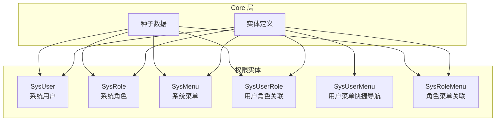
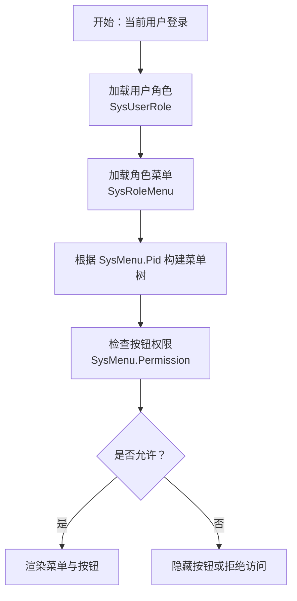
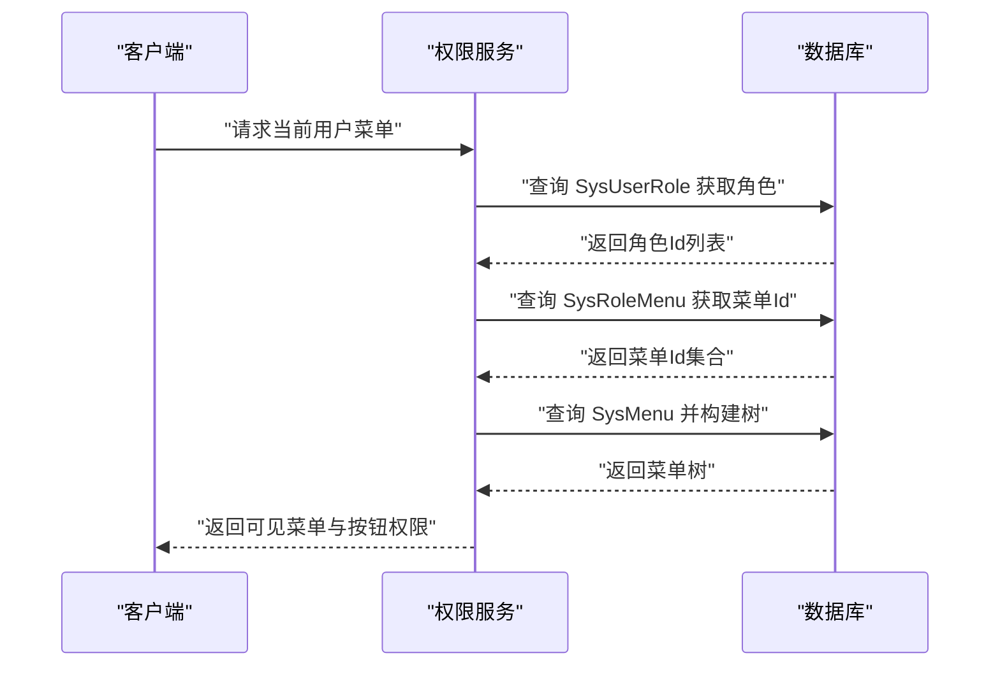
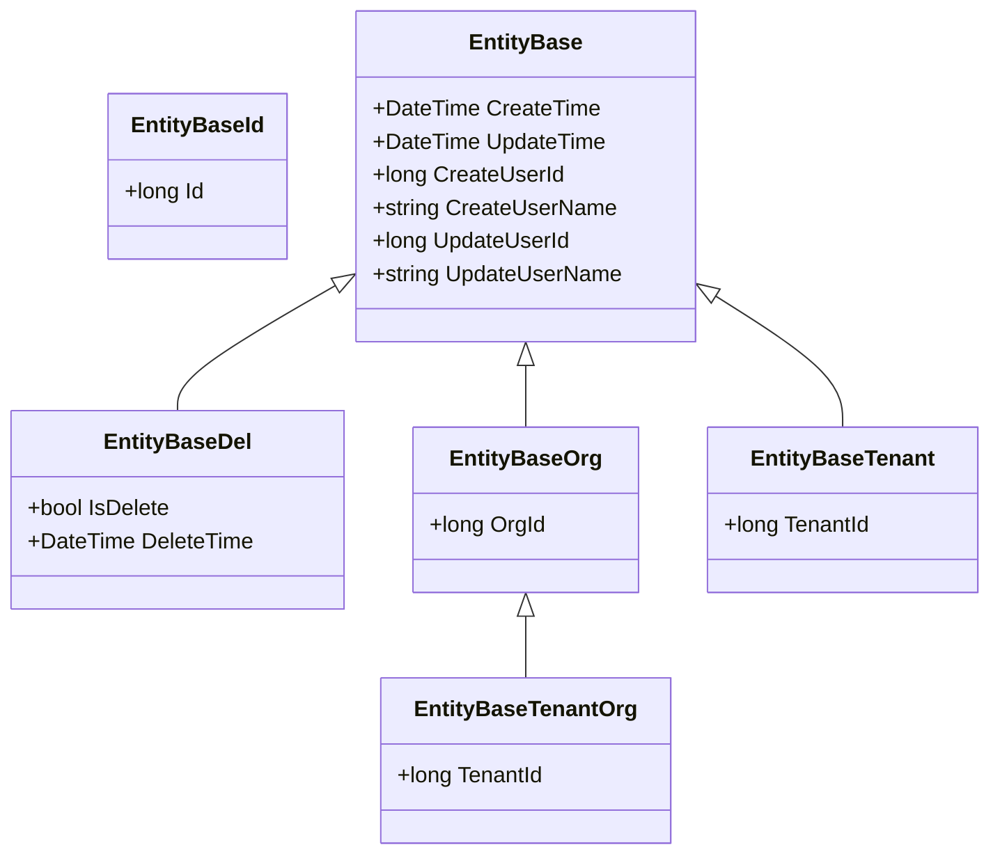
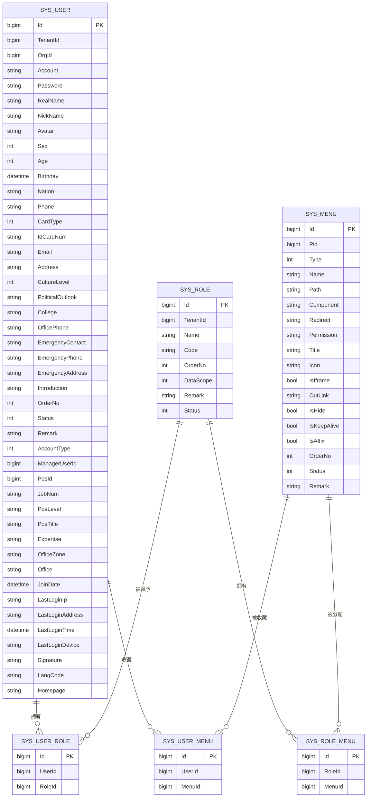

# 权限相关表设计

<cite>
**本文引用的文件**
- [SysUser.cs](file://Admin.NET/Admin.NET.Core/Entity/SysUser.cs)
- [SysRole.cs](file://Admin.NET/Admin.NET.Core/Entity/SysRole.cs)
- [SysMenu.cs](file://Admin.NET/Admin.NET.Core/Entity/SysMenu.cs)
- [SysUserRole.cs](file://Admin.NET/Admin.NET.Core/Entity/SysUserRole.cs)
- [SysUserMenu.cs](file://Admin.NET/Admin.NET.Core/Entity/SysUserMenu.cs)
- [SysRoleMenu.cs](file://Admin.NET/Admin.NET.Core/Entity/SysRoleMenu.cs)
- [EntityBase.cs](file://Admin.NET/Admin.NET.Core/Entity/EntityBase.cs)
- [SysUserSeedData.cs](file://Admin.NET/Admin.NET.Core/SeedData/SysUserSeedData.cs)
- [SysRoleSeedData.cs](file://Admin.NET/Admin.NET.Core/SeedData/SysRoleSeedData.cs)
- [SysMenuSeedData.cs](file://Admin.NET/Admin.NET.Core/SeedData/SysMenuSeedData.cs)
- [SysUserRoleSeedData.cs](file://Admin.NET/Admin.NET.Core/SeedData/SysUserRoleSeedData.cs)
- [SysRoleMenuSeedData.cs](file://Admin.NET/Admin.NET.Core/SeedData/SysRoleMenuSeedData.cs)
</cite>

## 目录
1. [引言](#引言)
2. [项目结构定位](#项目结构定位)
3. [核心实体总览](#核心实体总览)
4. [数据库模型与字段说明](#数据库模型与字段说明)
5. [索引设计](#索引设计)
6. [RBAC 权限模型实现](#rbac-权限模型实现)
7. [种子数据初始化](#种子数据初始化)
8. [权限验证查询模式](#权限验证查询模式)
9. [依赖关系分析](#依赖关系分析)
10. [性能与扩展建议](#性能与扩展建议)
11. [常见问题排查](#常见问题排查)
12. [结论](#结论)

## 引言
本文围绕 Admin.NET 权限体系中的用户、角色、菜单三类核心实体，以及它们之间的关联中间表，给出面向数据库设计与权限实现的完整说明。重点包括：
- SysUser、SysRole、SysMenu 三个核心实体的字段类型、约束和业务含义。
- SysUserRole、SysUserMenu、SysRoleMenu 等中间表的设计目标与使用场景。
- RBAC 基于角色的访问控制在数据模型上的体现，包括菜单权限和按钮级权限。
- 实体继承层次中 EntityBaseTenantOrg 与 EntityBaseTenant 提供的租户和组织隔离能力。
- 种子数据如何建立初始用户、角色、菜单及其授权关系。
- 权限校验时常见的多表关联查询思路。

## 项目结构定位
权限相关实体位于后端 Core 层的实体目录中，使用 SqlSugar ORM 注解描述表名、列名、长度、索引和导航属性；种子数据位于 SeedData 目录，用于初始化系统默认用户、角色、菜单及授权关系。

**图示来源**
- [SysUser.cs:1-353](file://Admin.NET/Admin.NET.Core/Entity/SysUser.cs#L1-L353)
- [SysRole.cs:1-56](file://Admin.NET/Admin.NET.Core/Entity/SysRole.cs#L1-L56)
- [SysMenu.cs:1-134](file://Admin.NET/Admin.NET.Core/Entity/SysMenu.cs#L1-L134)
- [SysUserRole.cs:1-41](file://Admin.NET/Admin.NET.Core/Entity/SysUserRole.cs#L1-L41)
- [SysUserMenu.cs:1-41](file://Admin.NET/Admin.NET.Core/Entity/SysUserMenu.cs#L1-L41)
- [SysRoleMenu.cs:1-35](file://Admin.NET/Admin.NET.Core/Entity/SysRoleMenu.cs#L1-L35)
- [SysUserSeedData.cs:1-33](file://Admin.NET/Admin.NET.Core/SeedData/SysUserSeedData.cs#L1-L33)
- [SysRoleSeedData.cs:1-29](file://Admin.NET/Admin.NET.Core/SeedData/SysRoleSeedData.cs#L1-L29)
- [SysMenuSeedData.cs:1-116](file://Admin.NET/Admin.NET.Core/SeedData/SysMenuSeedData.cs#L1-L116)
- [SysUserRoleSeedData.cs:1-30](file://Admin.NET/Admin.NET.Core/SeedData/SysUserRoleSeedData.cs#L1-L30)
- [SysRoleMenuSeedData.cs:1-38](file://Admin.NET/Admin.NET.Core/SeedData/SysRoleMenuSeedData.cs#L1-L38)

**章节来源**
- [SysUser.cs:1-353](file://Admin.NET/Admin.NET.Core/Entity/SysUser.cs#L1-L353)
- [SysRole.cs:1-56](file://Admin.NET/Admin.NET.Core/Entity/SysRole.cs#L1-L56)
- [SysMenu.cs:1-134](file://Admin.NET/Admin.NET.Core/Entity/SysMenu.cs#L1-L134)

## 核心实体总览
| 实体 | 对应表 | 主要职责 | 继承基类 | 关键业务含义 |
|---|---|---|---|---|
| SysUser | 系统用户表 | 登录账号、个人信息、组织职位、状态、语言等 | EntityBaseTenantOrg | 租户+机构隔离，支持账号类型、状态、排序等 |
| SysRole | 系统角色表 | 角色名称、编码、排序、数据范围、状态 | EntityBaseTenant | 租户隔离，数据范围决定数据权限边界 |
| SysMenu | 系统菜单表 | 菜单树、路由、组件、权限标识、按钮操作 | EntityBase | 目录、菜单、按钮三级权限资源 |
| SysUserRole | 系统用户角色表 | 用户到角色的多对多映射 | EntityBaseId | 表示“用户拥有哪些角色” |
| SysUserMenu | 系统用户菜单快捷导航表 | 用户个人收藏的快捷菜单 | EntityBaseId | 用户级菜单偏好，不等同于权限 |
| SysRoleMenu | 系统角色菜单表 | 角色到菜单的多对多映射 | EntityBaseId | 表示“角色可以访问哪些菜单或按钮” |

**章节来源**
- [SysUser.cs:1-353](file://Admin.NET/Admin.NET.Core/Entity/SysUser.cs#L1-L353)
- [SysRole.cs:1-56](file://Admin.NET/Admin.NET.Core/Entity/SysRole.cs#L1-L56)
- [SysMenu.cs:1-134](file://Admin.NET/Admin.NET.Core/Entity/SysMenu.cs#L1-L134)
- [SysUserRole.cs:1-41](file://Admin.NET/Admin.NET.Core/Entity/SysUserRole.cs#L1-L41)
- [SysUserMenu.cs:1-41](file://Admin.NET/Admin.NET.Core/Entity/SysUserMenu.cs#L1-L41)
- [SysRoleMenu.cs:1-35](file://Admin.NET/Admin.NET.Core/Entity/SysRoleMenu.cs#L1-L35)

## 数据库模型与字段说明

### 基类与审计字段
所有主键实体都继承自框架基类，提供统一主键、审计信息和可选删除标记。

| 基类 | 引入字段 | 说明 |
|---|---|---|
| EntityBaseId | Id | 雪花主键，非自增 |
| EntityBase | CreateTime、UpdateTime、CreateUserId、CreateUserName、UpdateUserId、UpdateUserName | 创建时间、更新时间、创建者、修改者 |
| EntityBaseDel | IsDelete、DeleteTime | 软删除标志和删除时间（本权限模型未直接使用该基类） |
| EntityBaseOrg | OrgId | 机构字段，配合数据权限过滤 |
| EntityBaseTenant | TenantId | 租户字段，配合租户隔离 |
| EntityBaseTenantOrg | TenantId + OrgId | 同时具备租户与机构隔离 |

**章节来源**
- [EntityBase.cs:1-203](file://Admin.NET/Admin.NET.Core/Entity/EntityBase.cs#L1-L203)

### SysUser 系统用户表
SysUser 是登录主体，携带身份信息、联系信息、组织职位信息、登录日志信息和账号控制信息。

| 字段 | 类型 | 长度或取值 | 是否必填 | 约束与说明 |
|---|---|---|---|---|
| Id | long | 雪花Id | 是 | 主键，来自 EntityBaseId |
| TenantId | long? | 可为空 | 否 | 租户Id，来自 EntityBaseTenantOrg |
| OrgId | long | 可为空 | 否 | 直属机构Id，来自 EntityBaseOrg |
| Account | string | 32 | 是 | 登录账号，最大长度32 |
| Password | string | 512 | 是 | 密码，序列化时忽略 |
| RealName | string | 32 | 是 | 真实姓名 |
| NickName | string? | 32 | 否 | 昵称 |
| Avatar | string? | 512 | 否 | 头像地址 |
| Sex | GenderEnum | 枚举 | 是 | 性别，默认男 |
| Age | int | 整数 | 是 | 年龄 |
| Birthday | DateTime? | 日期 | 否 | 出生日期 |
| Nation | string? | 32 | 否 | 民族 |
| Phone | string? | 16 | 否 | 手机号码 |
| CardType | CardTypeEnum | 枚举 | 是 | 证件类型 |
| IdCardNum | string? | 32 | 否 | 身份证号 |
| Email | string? | 64 | 否 | 邮箱 |
| Address | string? | 256 | 否 | 地址 |
| CultureLevel | CultureLevelEnum | 枚举 | 是 | 文化程度 |
| PoliticalOutlook | string? | 16 | 否 | 政治面貌 |
| College | string? | 128 | 否 | 毕业院校 |
| OfficePhone | string? | 16 | 否 | 办公电话 |
| EmergencyContact | string? | 32 | 否 | 紧急联系人 |
| EmergencyPhone | string? | 16 | 否 | 紧急联系人电话 |
| EmergencyAddress | string? | 256 | 否 | 紧急联系人地址 |
| Introduction | string? | 512 | 否 | 个人简介 |
| OrderNo | int | 整数 | 是 | 默认排序为100 |
| Status | StatusEnum | 枚举 | 是 | 状态，默认启用 |
| Remark | string? | 256 | 否 | 备注 |
| AccountType | AccountTypeEnum | 枚举 | 是 | 账号类型，默认普通用户 |
| ManagerUserId | long? | 可为空 | 否 | 直属主管Id |
| PosId | long | 整数 | 是 | 职位Id |
| JobNum | string? | 32 | 否 | 工号 |
| PosLevel | string? | 32 | 否 | 职级 |
| PosTitle | string? | 32 | 否 | 职称 |
| Expertise | string? | 32 | 否 | 擅长领域 |
| OfficeZone | string? | 32 | 否 | 办公区域 |
| Office | string? | 32 | 否 | 办公室 |
| JoinDate | DateTime? | 日期 | 否 | 入职日期 |
| LastLoginIp | string? | 256 | 否 | 最新登录Ip |
| LastLoginAddress | string? | 128 | 否 | 最新登录地点 |
| LastLoginTime | DateTime? | 日期 | 否 | 最新登录时间 |
| LastLoginDevice | string? | 128 | 否 | 最新登录设备 |
| Signature | string? | 512 | 否 | 电子签名 |
| LangCode | string | 语言代码 | 是 | 默认来自本地化配置 |
| Homepage | string? | 512 | 否 | 个性化首页地址 |

SysUser 还提供两个业务验证方法：禁止超级管理员账号执行特定操作，以及禁止当前用户修改自身Id。

**章节来源**
- [SysUser.cs:1-353](file://Admin.NET/Admin.NET.Core/Entity/SysUser.cs#L1-L353)

### SysRole 系统角色表
SysRole 描述系统角色及其数据范围。

| 字段 | 类型 | 长度或取值 | 是否必填 | 约束与说明 |
|---|---|---|---|---|
| Id | long | 雪花Id | 是 | 主键 |
| TenantId | long? | 可为空 | 否 | 租户Id |
| Name | string | 64 | 是 | 角色名称 |
| Code | string? | 64 | 否 | 角色编码 |
| OrderNo | int | 整数 | 是 | 排序，默认100 |
| DataScope | DataScopeEnum | 枚举 | 是 | 数据范围：全部、本部门及以下、本部门、仅本人、自定义 |
| Remark | string? | 128 | 否 | 备注 |
| Status | StatusEnum | 枚举 | 是 | 状态，默认启用 |

**章节来源**
- [SysRole.cs:1-56](file://Admin.NET/Admin.NET.Core/Entity/SysRole.cs#L1-L56)

### SysMenu 系统菜单表
SysMenu 采用父子 Pid 构建菜单树，并区分目录、菜单、按钮三种类型。

| 字段 | 类型 | 长度或取值 | 是否必填 | 约束与说明 |
|---|---|---|---|---|
| Id | long | 雪花Id | 是 | 主键 |
| Pid | long | 整数 | 是 | 父Id，根节点通常为0 |
| Type | MenuTypeEnum | 枚举 | 是 | 1目录、2菜单、3按钮 |
| Name | string? | 64 | 否 | 路由名称 |
| Path | string? | 128 | 否 | 路由地址 |
| Component | string? | 128 | 否 | 组件路径 |
| Redirect | string? | 128 | 否 | 重定向地址 |
| Permission | string? | 128 | 否 | 权限标识，按钮常用 |
| Title | string | 64 | 是 | 菜单名称 |
| Icon | string? | 128 | 否 | 图标，默认值存在 |
| IsIframe | bool | 布尔 | 是 | 是否内嵌页面 |
| OutLink | string? | 256 | 否 | 外链链接 |
| IsHide | bool | 布尔 | 是 | 是否隐藏 |
| IsKeepAlive | bool | 布尔 | 是 | 是否缓存，默认true |
| IsAffix | bool | 布尔 | 是 | 是否固定标签页 |
| OrderNo | int | 整数 | 是 | 排序，默认100 |
| Status | StatusEnum | 枚举 | 是 | 状态，默认启用 |
| Remark | string? | 256 | 否 | 备注 |
| Children | List<SysMenu> | 集合 | 是 | 导航子项，数据库忽略 |

Children 被标记为忽略存储，仅用于内存中组装菜单树。

**章节来源**
- [SysMenu.cs:1-134](file://Admin.NET/Admin.NET.Core/Entity/SysMenu.cs#L1-L134)

### SysUserRole 用户角色关联表
用于表达“一个用户可以拥有多个角色”。

| 字段 | 类型 | 是否必填 | 说明 |
|---|---|---|---|
| Id | long | 是 | 主键 |
| UserId | long | 是 | 用户Id |
| RoleId | long | 是 | 角色Id |
| SysUser | SysUser | 否 | 导航对象，序列化忽略 |
| SysRole | SysRole | 否 | 导航对象，序列化忽略 |

该表没有显式唯一联合索引注解，但语义上应保证同一用户对同一角色只有一条记录。

**章节来源**
- [SysUserRole.cs:1-41](file://Admin.NET/Admin.NET.Core/Entity/SysUserRole.cs#L1-L41)

### SysUserMenu 用户菜单快捷导航表
用于用户收藏或设置个人快捷菜单，不是 RBAC 权限本身。

| 字段 | 类型 | 是否必填 | 说明 |
|---|---|---|---|
| Id | long | 是 | 主键 |
| UserId | long | 是 | 用户Id |
| MenuId | long | 是 | 菜单Id |
| SysUser | SysUser | 否 | 导航对象 |
| SysMenu | SysMenu | 否 | 导航对象 |

**章节来源**
- [SysUserMenu.cs:1-41](file://Admin.NET/Admin.NET.Core/Entity/SysUserMenu.cs#L1-L41)

### SysRoleMenu 角色菜单关联表
用于表达“一个角色可以访问多个菜单或按钮”。

| 字段 | 类型 | 是否必填 | 说明 |
|---|---|---|---|
| Id | long | 是 | 主键 |
| RoleId | long | 是 | 角色Id |
| MenuId | long | 是 | 菜单Id |
| SysMenu | SysMenu | 否 | 导航对象，序列化忽略 |

该表是按钮级权限的核心载体之一。

**章节来源**
- [SysRoleMenu.cs:1-35](file://Admin.NET/Admin.NET.Core/Entity/SysRoleMenu.cs#L1-L35)

## 索引设计
权限相关实体通过 SqlSugar 注解声明了部分索引命名约定。

| 实体 | 索引名称 | 索引字段 | 用途 |
|---|---|---|---|
| SysUser | index_{table}_A | Account | 按账号查找用户 |
| SysUser | index_{table}_P | Phone | 按手机号查询 |
| SysRole | index_{table}_N | Name | 按角色名称排序或查找 |
| SysRole | index_{table}_C | Code | 按角色编码快速定位 |
| SysMenu | index_{table}_T | Title | 按菜单标题排序或查找 |
| SysMenu | index_{table}_T2 | Type | 按菜单类型筛选 |
| EntityBase | index_{table}_CT | CreateTime | 审计时间排序 |
| EntityBaseDel | index_{table}_D | IsDelete | 软删除过滤 |
| EntityBaseDel | index_{table}_DT | DeleteTime | 软删除时间排序 |

注意：index_{table}_A、index_{table}_N、index_{table}_C、index_{table}_T、index_{table}_T2 等是 SqlSugar 模板占位符，实际生成时会替换为具体表名。

**章节来源**
- [SysUser.cs:1-20](file://Admin.NET/Admin.NET.Core/Entity/SysUser.cs#L1-L20)
- [SysRole.cs:1-15](file://Admin.NET/Admin.NET.Core/Entity/SysRole.cs#L1-L15)
- [SysMenu.cs:1-15](file://Admin.NET/Admin.NET.Core/Entity/SysMenu.cs#L1-L15)
- [EntityBase.cs:1-203](file://Admin.NET/Admin.NET.Core/Entity/EntityBase.cs#L1-L203)

## RBAC 权限模型实现

### 基于角色的访问控制总体思路
RBAC 在本项目中通过“用户—角色—菜单”三层模型实现：
1. 用户拥有角色：SysUserRole。
2. 角色拥有菜单或按钮：SysRoleMenu。
3. 菜单资源由 SysMenu 描述，包含路由、组件和权限标识。
4. 用户可直接收藏菜单：SysUserMenu，但这属于用户偏好，不等同于权限。

**图示来源**
- [SysUserRole.cs:1-41](file://Admin.NET/Admin.NET.Core/Entity/SysUserRole.cs#L1-L41)
- [SysRoleMenu.cs:1-35](file://Admin.NET/Admin.NET.Core/Entity/SysRoleMenu.cs#L1-L35)
- [SysMenu.cs:1-134](file://Admin.NET/Admin.NET.Core/Entity/SysMenu.cs#L1-L134)

### 菜单权限控制
菜单权限通过 SysMenu.Type 区分：
- 目录：用于分组导航，通常不直接授予按钮权限。
- 菜单：对应页面或路由。
- 按钮：对应页面内的操作按钮，如查询、新增、编辑、删除。

菜单树通过 SysMenu.Pid 构建，根节点 Pid 通常为0，子节点指向父菜单Id。

### 按钮级权限控制
按钮级权限依赖 SysMenu.Permission 字段，例如示例种子数据中使用形如 `sysUser:add`、`sysUser:update`、`sysUser:delete` 的权限标识。后端可通过角色关联的菜单 Permission 字段判断用户是否具备某按钮权限。

### 数据权限控制
SysRole.DataScope 决定数据范围：
- 全部数据
- 本部门及以下数据
- 本部门数据
- 仅本人数据
- 自定义数据

这不属于菜单可见性，而是影响业务数据查询结果集。

**章节来源**
- [SysMenu.cs:1-134](file://Admin.NET/Admin.NET.Core/Entity/SysMenu.cs#L1-L134)
- [SysRole.cs:1-56](file://Admin.NET/Admin.NET.Core/Entity/SysRole.cs#L1-L56)
- [SysMenuSeedData.cs:1-116](file://Admin.NET/Admin.NET.Core/SeedData/SysMenuSeedData.cs#L1-L116)

## 种子数据初始化

### 用户种子
SysUserSeedData 初始化了超级管理员、系统管理员、部门主管、部门职员、普通用户、会员等典型用户，并设置了租户Id、机构Id、职位Id和账号类型。

| 账号 | 角色含义 | 账号类型 | 租户Id | 说明 |
|---|---|---|---|---|
| superAdmin.NET | 超级管理员 | SuperAdmin | 默认租户 | 最高权限账户 |
| Admin.NET | 系统管理员 | SysAdmin | 默认租户 | 管理系统功能 |
| TestUser1 | 部门主管 | NormalUser | 默认租户 | 绑定部门及以下数据范围角色 |
| TestUser2 | 部门职员 | NormalUser | 默认租户 | 绑定本部门数据范围角色 |
| TestUser3 | 普通用户 | NormalUser | 默认租户 | 绑定仅本人数据范围角色 |
| TestUser4 | 其他 | Member | 默认租户 | 绑定自定义数据范围角色 |

**章节来源**
- [SysUserSeedData.cs:1-33](file://Admin.NET/Admin.NET.Core/SeedData/SysUserSeedData.cs#L1-L33)

### 角色种子
SysRoleSeedData 初始化了五个典型角色：系统管理员、本部门及以下数据、本部门数据、仅本人数据、自定义数据。

| 角色名称 | 编码 | 数据范围 | 说明 |
|---|---|---|---|
| 系统管理员 | sys_admin | 全部 | 默认拥有全部数据范围 |
| 本部门及以下数据 | sys_deptChild | 本部门及以下 | 适合部门主管 |
| 本部门数据 | sys_dept | 本部门 | 适合一般管理人员 |
| 仅本人数据 | sys_self | 仅本人 | 适合普通员工 |
| 自定义数据 | sys_define | 自定义 | 可灵活配置数据范围 |

**章节来源**
- [SysRoleSeedData.cs:1-29](file://Admin.NET/Admin.NET.Core/SeedData/SysRoleSeedData.cs#L1-L29)

### 菜单种子
SysMenuSeedData 构建了工作台、系统管理、平台管理等菜单树，包含目录、菜单和按钮三类资源，并使用 Permission 字段描述按钮权限。

示例权限标识：
- `sysUser:page`
- `sysUser:update`
- `sysUser:add`
- `sysUser:delete`
- `sysRole:page`
- `sysRole:add`
- `sysOrg:list`
- `sysNotice:page`
- `sysTenant:page`

这些标识可用于前端按钮显示控制和后端接口权限校验。

**章节来源**
- [SysMenuSeedData.cs:1-116](file://Admin.NET/Admin.NET.Core/SeedData/SysMenuSeedData.cs#L1-L116)

### 用户角色种子
SysUserRoleSeedData 将测试用户与其数据范围角色进行绑定，形成用户到角色的授权关系。

| 用户 | 绑定角色编码 | 数据范围 |
|---|---|---|
| TestUser1 | sys_deptChild | 本部门及以下 |
| TestUser2 | sys_dept | 本部门 |
| TestUser3 | sys_self | 仅本人 |
| TestUser4 | sys_define | 自定义 |

**章节来源**
- [SysUserRoleSeedData.cs:1-30](file://Admin.NET/Admin.NET.Core/SeedData/SysUserRoleSeedData.cs#L1-L30)

### 角色菜单种子
SysRoleMenuSeedData 将角色与菜单资源进行绑定。默认逻辑包括：
- 第一个角色获得全部默认租户菜单。
- 其他角色获得工作台、帮助文档、关于项目、个人中心以及系统管理目录等菜单。

种子数据使用确定性哈希方式生成Id，避免重复插入冲突。

**章节来源**
- [SysRoleMenuSeedData.cs:1-38](file://Admin.NET/Admin.NET.Core/SeedData/SysRoleMenuSeedData.cs#L1-L38)

## 权限验证查询模式

### 获取用户可用菜单
典型流程：
1. 根据 UserId 查询 SysUserRole 得到角色列表。
2. 根据角色列表查询 SysRoleMenu 得到菜单Id集合。
3. 根据菜单Id集合查询 SysMenu，并按 Pid 构建菜单树。
4. 过滤 Status 为启用的菜单。
5. 对按钮型菜单进一步检查 Permission 是否匹配当前操作。

**图示来源**
- [SysUserRole.cs:1-41](file://Admin.NET/Admin.NET.Core/Entity/SysUserRole.cs#L1-L41)
- [SysRoleMenu.cs:1-35](file://Admin.NET/Admin.NET.Core/Entity/SysRoleMenu.cs#L1-L35)
- [SysMenu.cs:1-134](file://Admin.NET/Admin.NET.Core/Entity/SysMenu.cs#L1-L134)

### 按钮权限校验
当用户访问某个按钮时，系统应：
1. 解析按钮对应的 SysMenu.Permission。
2. 查询用户角色拥有的菜单集合。
3. 判断是否存在相同 Permission 且 Type 为按钮的记录。
4. 若不存在，则隐藏按钮或拒绝请求。

### 数据权限过滤
当业务查询涉及数据范围时，系统应根据用户角色 DataScope 附加数据过滤条件，例如限制到本部门、本部门及以下或仅本人。

**章节来源**
- [SysRole.cs:1-56](file://Admin.NET/Admin.NET.Core/Entity/SysRole.cs#L1-L56)
- [SysMenu.cs:1-134](file://Admin.NET/Admin.NET.Core/Entity/SysMenu.cs#L1-L134)

## 依赖关系分析

### 实体继承层次

**图示来源**
- [EntityBase.cs:1-203](file://Admin.NET/Admin.NET.Core/Entity/EntityBase.cs#L1-L203)

### 权限实体关系

**图示来源**
- [SysUser.cs:1-353](file://Admin.NET/Admin.NET.Core/Entity/SysUser.cs#L1-L353)
- [SysRole.cs:1-56](file://Admin.NET/Admin.NET.Core/Entity/SysRole.cs#L1-L56)
- [SysMenu.cs:1-134](file://Admin.NET/Admin.NET.Core/Entity/SysMenu.cs#L1-L134)
- [SysUserRole.cs:1-41](file://Admin.NET/Admin.NET.Core/Entity/SysUserRole.cs#L1-L41)
- [SysUserMenu.cs:1-41](file://Admin.NET/Admin.NET.Core/Entity/SysUserMenu.cs#L1-L41)
- [SysRoleMenu.cs:1-35](file://Admin.NET/Admin.NET.Core/Entity/SysRoleMenu.cs#L1-L35)

## 性能与扩展建议

### 索引优化
- 建议在 SysUserRole 上添加 (UserId, RoleId) 唯一索引，防止重复授权。
- 建议在 SysRoleMenu 上添加 (RoleId, MenuId) 唯一索引，防止重复菜单授权。
- 建议在 SysUserMenu 上添加 (UserId, MenuId) 唯一索引，防止用户重复收藏同一菜单。
- 如果经常按 Permission 查询按钮权限，可考虑为 SysMenu.Permission 建立索引，但需权衡写入成本和查询频率。

### 查询优化
- 菜单树查询应一次性加载必要字段，再在应用层按 Pid 构建，避免多次往返数据库。
- 权限校验时应先缓存用户角色和菜单集合，减少频繁多表连接。
- 数据范围过滤应在 SQL 层尽早应用，减少无效数据加载。

### 扩展建议
- 可增加 SysUserRole 的 AssignBy、AssignTime 字段，记录授权来源和时间。
- 可增加 SysRoleMenu 的 PermissionType 或 Level 字段，明确菜单、按钮、接口等不同层级。
- 可增加 SysMenu.IsVisible 字段，与 Status 区分“配置启用”和“界面可见”。

[本节为通用性能建议，不直接分析具体代码文件]

## 常见问题排查

### 问题一：用户登录后看不到菜单
可能原因：
- SysUserRole 中没有该用户的角色记录。
- SysRoleMenu 中没有该角色对应的菜单记录。
- SysMenu.Status 不是启用状态。
- SysMenu.Type 不是期望的类型。

排查步骤：
1. 确认用户Id是否在 SysUserRole 中存在。
2. 确认角色Id是否在 SysRoleMenu 中存在。
3. 确认 SysMenu 的 Id 是否存在且 Status 启用。
4. 检查菜单树构建逻辑是否正确处理 Pid。

**章节来源**
- [SysUserRole.cs:1-41](file://Admin.NET/Admin.NET.Core/Entity/SysUserRole.cs#L1-L41)
- [SysRoleMenu.cs:1-35](file://Admin.NET/Admin.NET.Core/Entity/SysRoleMenu.cs#L1-L35)
- [SysMenu.cs:1-134](file://Admin.NET/Admin.NET.Core/Entity/SysMenu.cs#L1-L134)

### 问题二：按钮显示异常
可能原因：
- 按钮对应的 SysMenu.Type 不是按钮类型。
- SysMenu.Permission 与前端或后端期望不一致。
- 角色未授权该按钮菜单。

排查步骤：
1. 查看按钮菜单记录的 Type 是否为按钮。
2. 对比 Permission 字段是否与调用点一致。
3. 检查 SysRoleMenu 是否包含该菜单Id。

**章节来源**
- [SysMenu.cs:1-134](file://Admin.NET/Admin.NET.Core/Entity/SysMenu.cs#L1-L134)
- [SysRoleMenu.cs:1-35](file://Admin.NET/Admin.NET.Core/Entity/SysRoleMenu.cs#L1-L35)

### 问题三：数据范围不符合预期
可能原因：
- 用户角色 DataScope 设置不正确。
- 业务查询未应用数据范围过滤。
- 用户所属机构或主管关系导致数据范围计算偏差。

排查步骤：
1. 检查用户角色 DataScope。
2. 检查用户 OrgId、ManagerUserId、PosId 等业务字段。
3. 确认数据权限过滤逻辑是否基于角色和用户上下文生成。

**章节来源**
- [SysRole.cs:1-56](file://Admin.NET/Admin.NET.Core/Entity/SysRole.cs#L1-L56)
- [SysUser.cs:1-353](file://Admin.NET/Admin.NET.Core/Entity/SysUser.cs#L1-L353)

## 结论
Admin.NET 的权限模型以 SysUser、SysRole、SysMenu 为核心，通过 SysUserRole、SysRoleMenu 实现基于角色的菜单与按钮授权，并通过 SysUserMenu 提供用户级菜单收藏能力。基类 EntityBaseTenantOrg 和 EntityBaseTenant 提供了统一的租户与组织隔离字段，使权限数据天然具备多租户和多机构隔离能力。种子数据为用户、角色、菜单和授权关系提供了开箱即用的初始环境。在实际使用中，应重点关注索引设计、菜单树构建、按钮 Permission 一致性以及数据范围过滤逻辑，以确保权限校验准确、性能可控、可扩展性强。