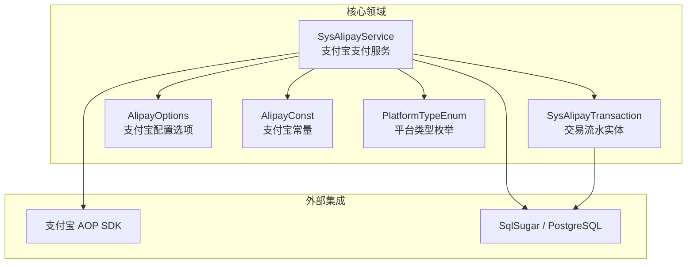
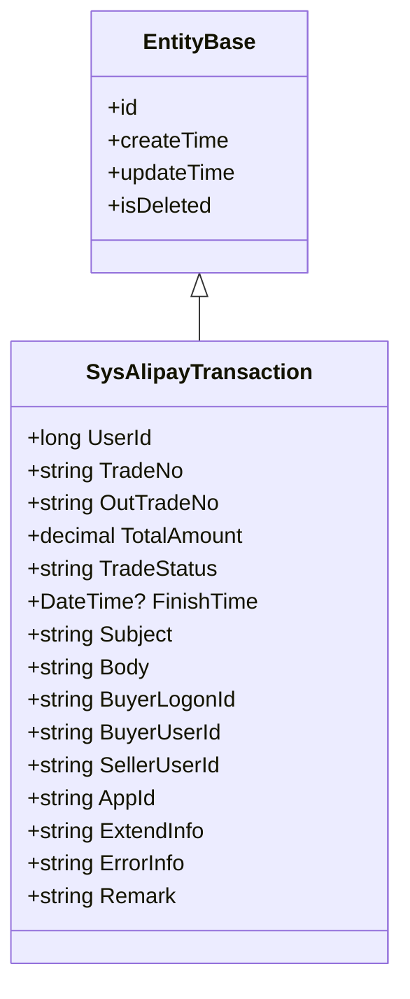
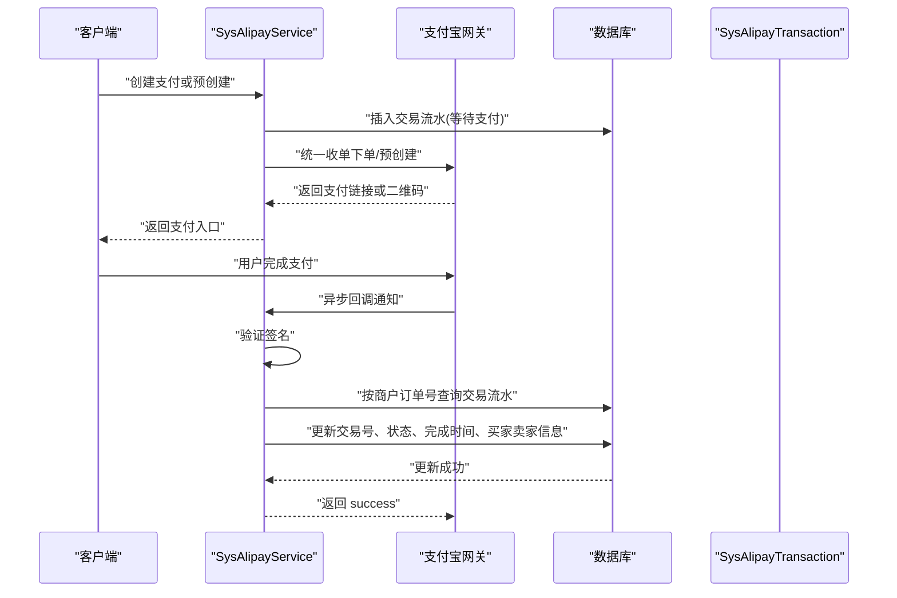
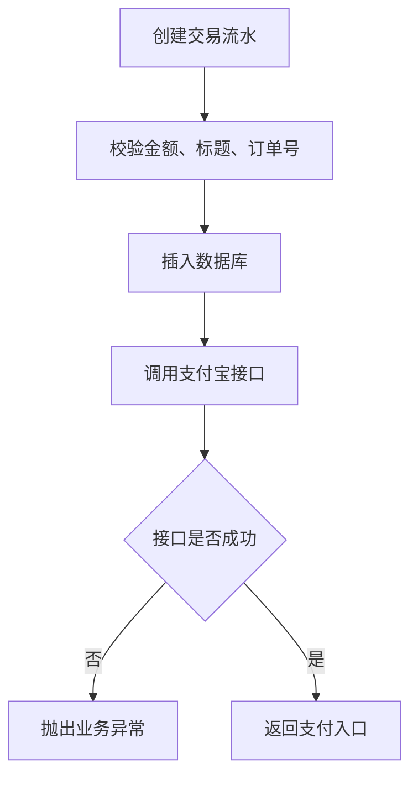
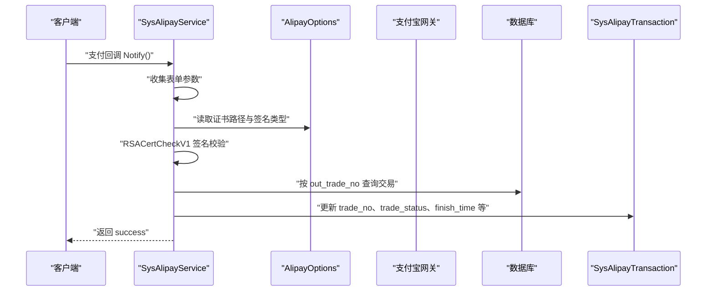
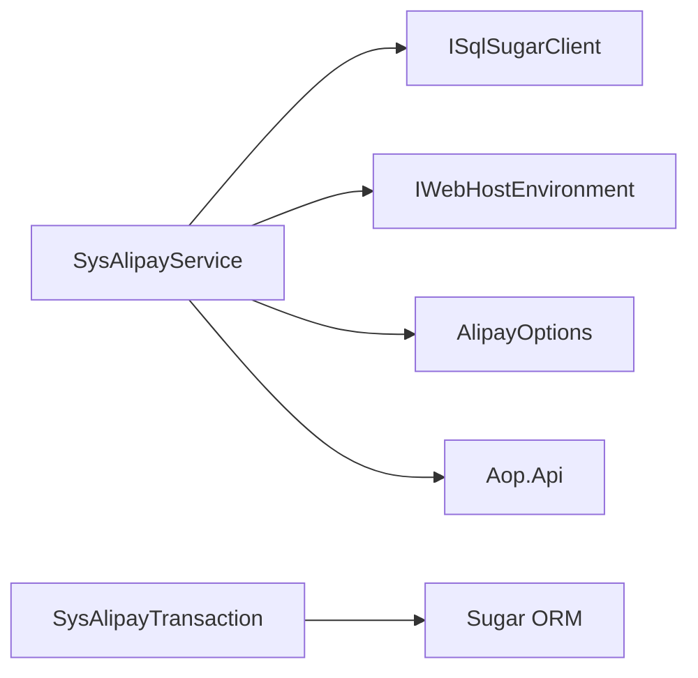
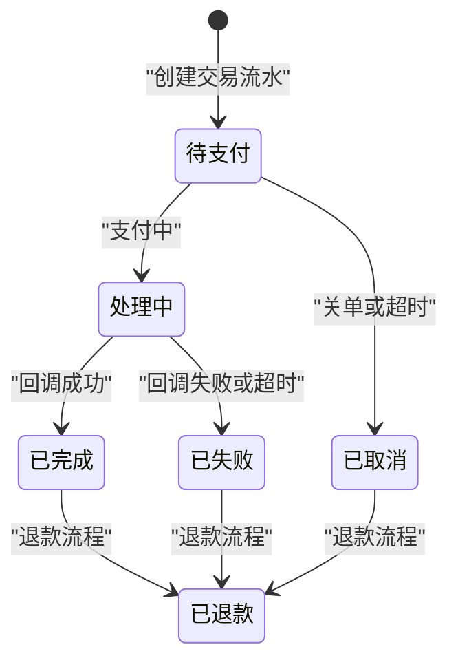

# 交易流水实体设计

<cite>
**本文引用的文件**
- [SysAlipayTransaction.cs](file://Admin.NET/Admin.NET.Core/Entity/SysAlipayTransaction.cs)
- [SysAlipayService.cs](file://Admin.NET/Admin.NET.Core/Service/Alipay/SysAlipayService.cs)
- [AlipayOptions.cs](file://Admin.NET/Admin.NET.Core/Option/AlipayOptions.cs)
- [PayCallBackOptions.cs](file://Admin.NET/Admin.NET.Core/Option/PayCallBackOptions.cs)
- [AlipayConst.cs](file://Admin.NET/Admin.NET.Core/Const/AlipayConst.cs)
- [PlatformTypeEnum.cs](file://Admin.NET/Admin.NET.Core/Enum/PlatformTypeEnum.cs)
- [SysAlipayAuthInfo.cs](file://Admin.NET/Admin.NET.Core/Entity/SysAlipayAuthInfo.cs)
</cite>

## 目录
1. [引言](#引言)
2. [项目结构定位](#项目结构定位)
3. [核心数据模型](#核心数据模型)
4. [架构总览](#架构总览)
5. [详细组件分析](#详细组件分析)
6. [依赖关系分析](#依赖关系分析)
7. [性能与可观测性](#性能与可观测性)
8. [故障排查指南](#故障排查指南)
9. [结论](#结论)
10. [附录：字段定义表](#附录字段定义表)

## 引言
本文围绕 Admin.NET 中的支付宝交易流水实体 SysAlipayTransaction，系统化说明其数据模型、生命周期、状态语义、查询统计场景以及安全与可靠性设计。该实体用于记录系统内由支付宝发起或处理的所有交易行为，包括支付下单、预创建二维码、异步回调更新、转账等关键业务节点。文档既面向后端开发者，也帮助运维和财务人员理解对账、异常监控和数据治理方式。

## 项目结构定位
SysAlipayTransaction 属于 Admin.NET.Core 层的数据实体，配合 Alipay 相关服务类、配置选项、常量及枚举共同构成支付宝交易能力。当前代码库中，交易流水的创建、更新与扩展主要位于 SysAlipayService；支付回调签名校验、订单号到交易记录的映射、交易状态更新逻辑均在该服务中实现。

图示来源
- [SysAlipayTransaction.cs:1-108](file://Admin.NET/Admin.NET.Core/Entity/SysAlipayTransaction.cs#L1-L108)
- [SysAlipayService.cs:1-271](file://Admin.NET/Admin.NET.Core/Service/Alipay/SysAlipayService.cs#L1-L271)
- [AlipayOptions.cs:1-119](file://Admin.NET/Admin.NET.Core/Option/AlipayOptions.cs#L1-L119)
- [AlipayConst.cs:1-39](file://Admin.NET/Admin.NET.Core/Const/AlipayConst.cs#L1-L39)
- [PlatformTypeEnum.cs:1-44](file://Admin.NET/Admin.NET.Core/Enum/PlatformTypeEnum.cs#L1-L44)

章节来源
- [SysAlipayTransaction.cs:1-108](file://Admin.NET/Admin.NET.Core/Entity/SysAlipayTransaction.cs#L1-L108)
- [SysAlipayService.cs:1-271](file://Admin.NET/Admin.NET.Core/Service/Alipay/SysAlipayService.cs#L1-L271)

## 核心数据模型
SysAlipayTransaction 是支付宝交易流水的核心实体，继承自基础实体基类，使用 Sugar ORM 进行数据库映射。关键字段涵盖用户标识、交易编号、商户订单号、金额、状态、完成时间、标题与描述、买家与卖家信息、商户 AppId、扩展信息与错误信息等。该表通过 UserId、TradeNo、OutTradeNo 建立索引，便于按用户维度、支付宝交易号和商户订单号快速检索。

### 实体类关系图

图示来源
- [SysAlipayTransaction.cs:1-108](file://Admin.NET/Admin.NET.Core/Entity/SysAlipayTransaction.cs#L1-L108)

### 字段语义与数据类型
| 字段 | 类型 | 长度/约束 | 业务含义 | 是否必填 | 备注 |
|---|---|---|---|---|---|
| UserId | long | 无显式长度 | 内部用户标识 | 否 | 转账流程会写入；普通支付下单时未强制填充 |
| TradeNo | string? | 64 | 支付宝交易号 | 否 | 回调或转账成功后回填 |
| OutTradeNo | string | 64 | 商户订单号 | 是 | 本地业务唯一，幂等与对账的关键键 |
| TotalAmount | decimal | 20 | 交易金额 | 是 | 单位与币种需结合业务配置确认 |
| TradeStatus | string | 32 | 交易状态 | 是 | 初始为等待支付，后续由回调或转账结果更新 |
| FinishTime | DateTime? | 无显式长度 | 交易完成时间 | 否 | 回调中根据支付成功时间回填 |
| Subject | string | 256 | 交易标题 | 是 | 对外展示的交易主题 |
| Body | string? | 512 | 交易描述 | 否 | 补充说明 |
| BuyerLogonId | string? | 128 | 买家支付宝账号 | 否 | 来自支付宝回调 |
| BuyerUserId | string? | 32 | 买家支付宝用户ID | 否 | 来自支付宝回调 |
| SellerUserId | string? | 32 | 卖家支付宝用户ID | 否 | 回调中使用 seller_id 回填 |
| AppId | string? | 64 | 商户应用标识 | 否 | 多商户时可区分渠道 |
| ExtendInfo | string? | 1024 | 扩展信息 | 否 | 建议存放结构化扩展 JSON |
| ErrorInfo | string? | 1024 | 异常信息 | 否 | 用于失败原因记录 |
| Remark | string? | 512 | 备注 | 否 | 可用于人工备注或状态流转注释 |

章节来源
- [SysAlipayTransaction.cs:1-108](file://Admin.NET/Admin.NET.Core/Entity/SysAlipayTransaction.cs#L1-L108)

## 架构总览
交易流水的生命周期由前端或上游业务调用 SysAlipayService 的各个接口驱动，最终落库到 SysAlipayTransaction，并通过支付宝异步回调完成状态闭环。同时，单笔转账流程也会直接写入交易流水。

图示来源
- [SysAlipayService.cs:1-271](file://Admin.NET/Admin.NET.Core/Service/Alipay/SysAlipayService.cs#L1-L271)
- [SysAlipayTransaction.cs:1-108](file://Admin.NET/Admin.NET.Core/Entity/SysAlipayTransaction.cs#L1-L108)

## 详细组件分析

### 交易流水实体 SysAlipayTransaction
该实体负责持久化支付宝侧交易信息，并承载系统侧业务上下文。它包含以下职责：
- 作为支付下单与预创建的初始记录载体。
- 作为异步回调的状态更新目标。
- 作为转账业务的流水落点。
- 通过索引支持按用户、交易号、商户订单号的查询与对账。

图示来源
- [SysAlipayService.cs:140-199](file://Admin.NET/Admin.NET.Core/Service/Alipay/SysAlipayService.cs#L140-L199)
- [SysAlipayService.cs:201-225](file://Admin.NET/Admin.NET.Core/Service/Alipay/SysAlipayService.cs#L201-L225)

章节来源
- [SysAlipayTransaction.cs:1-108](file://Admin.NET/Admin.NET.Core/Entity/SysAlipayTransaction.cs#L1-L108)

### 支付宝支付服务 SysAlipayService
该服务承担支付宝集成的主要编排工作，包括：
- 初始化多个支付宝商户客户端。
- 获取授权信息并维护授权记录。
- 处理支付回调，执行签名校验与交易流水更新。
- 提供统一收单下单页面接口与交易预创建接口。
- 提供单笔转账到支付宝账户的能力，并在转账后写入交易流水。

图示来源
- [SysAlipayService.cs:100-139](file://Admin.NET/Admin.NET.Core/Service/Alipay/SysAlipayService.cs#L100-L139)
- [AlipayOptions.cs:60-119](file://Admin.NET/Admin.NET.Core/Option/AlipayOptions.cs#L60-L119)

章节来源
- [SysAlipayService.cs:1-271](file://Admin.NET/Admin.NET.Core/Service/Alipay/SysAlipayService.cs#L1-L271)

### 配置与常量
- AlipayOptions：集中管理支付宝网关地址、授权回调、WebSocket 地址、异步通知地址、根证书路径、商户账号列表及客户端工厂方法。
- PayCallBackOptions：提供支付回调与退款回调的统一路由配置项。
- AlipayConst：封装转账业务场景、产品码、交易状态参数名与成功标识等常量。
- PlatformTypeEnum：用于标识不同第三方平台，其中包含支付宝平台值。

章节来源
- [AlipayOptions.cs:1-119](file://Admin.NET/Admin.NET.Core/Option/AlipayOptions.cs#L1-L119)
- [PayCallBackOptions.cs:1-23](file://Admin.NET/Admin.NET.Core/Option/PayCallBackOptions.cs#L1-L23)
- [AlipayConst.cs:1-39](file://Admin.NET/Admin.NET.Core/Const/AlipayConst.cs#L1-L39)
- [PlatformTypeEnum.cs:1-44](file://Admin.NET/Admin.NET.Core/Enum/PlatformTypeEnum.cs#L1-L44)

### 关联实体 SysAlipayAuthInfo
虽然不属于交易流水本身，但授权实体与支付流程密切相关。支付授权过程会拉取用户信息并持久化到 SysAlipayAuthInfo，供后续支付或业务使用。

章节来源
- [SysAlipayAuthInfo.cs:1-149](file://Admin.NET/Admin.NET.Core/Entity/SysAlipayAuthInfo.cs#L1-L149)
- [SysAlipayService.cs:52-99](file://Admin.NET/Admin.NET.Core/Service/Alipay/SysAlipayService.cs#L52-L99)

## 依赖关系分析
- SysAlipayService 依赖 SqlSugar 客户端进行数据库读写。
- SysAlipayService 依赖 IWebHostEnvironment 以解析证书路径。
- SysAlipayService 依赖 AlipayOptions 提供的商户账号与客户端工厂。
- 回调签名校验依赖支付宝 SDK 的 RSACertCheckV1。
- 交易流水实体依赖 Sugar ORM 注解映射数据库字段与索引。

图示来源
- [SysAlipayService.cs:1-271](file://Admin.NET/Admin.NET.Core/Service/Alipay/SysAlipayService.cs#L1-L271)
- [SysAlipayTransaction.cs:1-108](file://Admin.NET/Admin.NET.Core/Entity/SysAlipayTransaction.cs#L1-L108)
- [AlipayOptions.cs:1-119](file://Admin.NET/Admin.NET.Core/Option/AlipayOptions.cs#L1-L119)

章节来源
- [SysAlipayService.cs:1-271](file://Admin.NET/Admin.NET.Core/Service/Alipay/SysAlipayService.cs#L1-L271)
- [AlipayOptions.cs:1-119](file://Admin.NET/Admin.NET.Core/Option/AlipayOptions.cs#L1-L119)
- [SysAlipayTransaction.cs:1-108](file://Admin.NET/Admin.NET.Core/Entity/SysAlipayTransaction.cs#L1-L108)

## 性能与可观测性
- 索引优化：UserId、TradeNo、OutTradeNo 分别建索引，有利于用户维度查询、支付宝交易号查找与商户订单号幂等查询。
- 金额精度：TotalAmount 使用 decimal，避免浮点误差。
- 扩展字段：ExtendInfo 允许存放结构化扩展信息，适合未来扩展字段而不频繁变更表结构。
- 日志与异常：ErrorInfo 与 Remark 可用于记录失败原因与人工备注，辅助排障与审计。
- 查询建议：对账报表可按时间段、AppId、TradeStatus 聚合统计；异常交易可通过 ErrorInfo 非空筛选。

[本节为通用指导，不直接分析具体文件]

## 故障排查指南

### 常见错误与处理
- 回调签名校验失败：当支付宝回调签名不通过时，服务直接抛出业务异常。应检查证书路径、签名类型与支付宝公钥是否正确。
- 商户订单号不存在：回调中若找不到对应交易流水，会抛出异常。应核查下单流程是否成功插入交易记录，以及回调参数 out_trade_no 是否与业务一致。
- 支付接口报错：下单或预创建接口返回 IsError 时会抛出业务异常，异常信息来自支付宝响应 SubMsg。

章节来源
- [SysAlipayService.cs:100-139](file://Admin.NET/Admin.NET.Core/Service/Alipay/SysAlipayService.cs#L100-L139)
- [SysAlipayService.cs:140-199](file://Admin.NET/Admin.NET.Core/Service/Alipay/SysAlipayService.cs#L140-L199)
- [SysAlipayService.cs:201-225](file://Admin.NET/Admin.NET.Core/Service/Alipay/SysAlipayService.cs#L201-L225)

### 补偿与重试机制
当前代码未内置自动重试或补偿任务。建议采用以下方式增强可靠性：
- 幂等控制：以 OutTradeNo 作为幂等键，确保重复回调不会造成重复入账。
- 对账补偿：定时任务拉取支付宝账单，比对本地交易流水，发现差异则触发补单或冲正。
- 超时关单：对长时间处于 WAIT_PAY 的交易，主动调用支付宝关闭接口并更新状态。
- 消息队列：将回调处理拆分为“接收+处理”两步，失败入死信队列重试。

[本节为通用建议，不直接分析具体文件]

### 安全机制
- 签名验证：回调使用 RSACertCheckV1 进行证书签名校验，防止伪造回调。
- 证书管理：通过 AlipayOptions 管理根证书、应用证书与支付宝公钥证书路径，降低密钥泄露风险。
- 敏感信息保护：EncryptKey 可用于从支付宝获取敏感信息时的加密；ExtendInfo 中应避免明文存储敏感数据。
- 防重放：建议结合请求时间戳、随机数与签名联合校验，避免历史请求被重放。

章节来源
- [SysAlipayService.cs:100-139](file://Admin.NET/Admin.NET.Core/Service/Alipay/SysAlipayService.cs#L100-L139)
- [AlipayOptions.cs:1-119](file://Admin.NET/Admin.NET.Core/Option/AlipayOptions.cs#L1-L119)

### 状态机与业务规则
当前代码在多处直接以字符串表示状态，例如 WAIT_PAY、SUCCESS、FAILED 等。建议在领域层引入明确的交易状态枚举与状态转换规则，避免散落的魔法字符串。

图示来源
- [SysAlipayService.cs:140-199](file://Admin.NET/Admin.NET.Core/Service/Alipay/SysAlipayService.cs#L140-L199)
- [SysAlipayService.cs:201-225](file://Admin.NET/Admin.NET.Core/Service/Alipay/SysAlipayService.cs#L201-L225)
- [SysAlipayService.cs:227-271](file://Admin.NET/Admin.NET.Core/Service/Alipay/SysAlipayService.cs#L227-L271)

### 查询与统计场景
- 交易报表：按日期范围、AppId、TradeStatus 汇总交易笔数与总金额。
- 对账文件：导出 OutTradeNo、TradeNo、TotalAmount、FinishTime、TradeStatus，与支付宝账单核对。
- 异常交易监控：筛选 ErrorInfo 非空或 TradeStatus 为失败态的记录，结合 Remark 人工复核。
- 用户维度分析：按 UserId 统计消费频次与金额分布。

[本节为通用指导，不直接分析具体文件]

## 结论
SysAlipayTransaction 作为 Admin.NET 的支付宝交易流水实体，具备清晰的业务字段设计与合理的索引策略，能够支撑支付下单、预创建、回调更新与转账等核心流程。当前实现通过服务层完成签名校验与状态更新，具备基本的安全保障。为进一步提升可靠性与可维护性，建议引入明确的状态机、幂等控制、对账补偿与更完善的异常监控体系。

[本节为总结，不直接分析具体文件]

## 附录：字段定义表
以下为 SysAlipayTransaction 的完整字段定义摘要，便于查阅与对照。

| 字段 | 类型 | 长度 | 业务含义 | 典型取值或来源 |
|---|---|---|---|---|
| UserId | long | 无显式长度 | 内部用户标识 | 转账流程写入；支付下单可选 |
| TradeNo | string? | 64 | 支付宝交易号 | 回调或转账成功后回填 |
| OutTradeNo | string | 64 | 商户订单号 | 业务主键，幂等依据 |
| TotalAmount | decimal | 20 | 交易金额 | 下单或转账金额 |
| TradeStatus | string | 32 | 交易状态 | WAIT_PAY、SUCCESS、FAILED 等 |
| FinishTime | DateTime? | 无显式长度 | 交易完成时间 | 回调中 gmt_payment |
| Subject | string | 256 | 交易标题 | 下单传入 |
| Body | string? | 512 | 交易描述 | 下单传入 |
| BuyerLogonId | string? | 128 | 买家支付宝账号 | 回调 buyer_logon_id |
| BuyerUserId | string? | 32 | 买家支付宝用户ID | 回调 buyer_user_id |
| SellerUserId | string? | 32 | 卖家支付宝用户ID | 回调 seller_id |
| AppId | string? | 64 | 商户应用标识 | 配置中的 AppId |
| ExtendInfo | string? | 1024 | 扩展信息 | 建议 JSON 序列化 |
| ErrorInfo | string? | 1024 | 异常信息 | 失败原因或子消息 |
| Remark | string? | 512 | 备注 | 人工或系统备注 |

章节来源
- [SysAlipayTransaction.cs:1-108](file://Admin.NET/Admin.NET.Core/Entity/SysAlipayTransaction.cs#L1-L108)