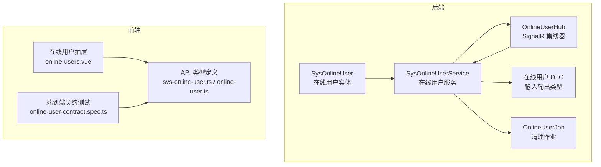
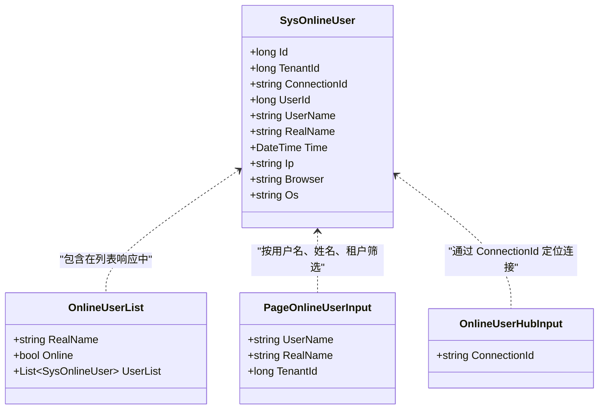
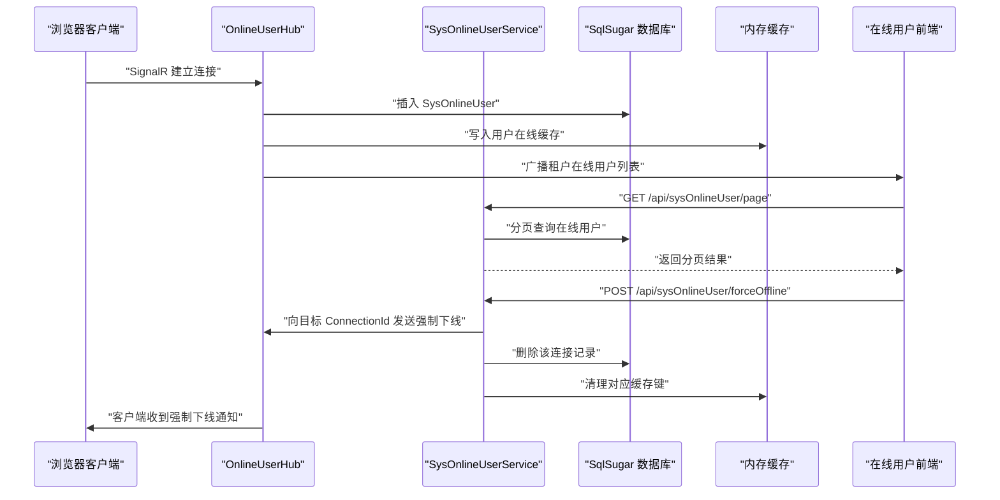
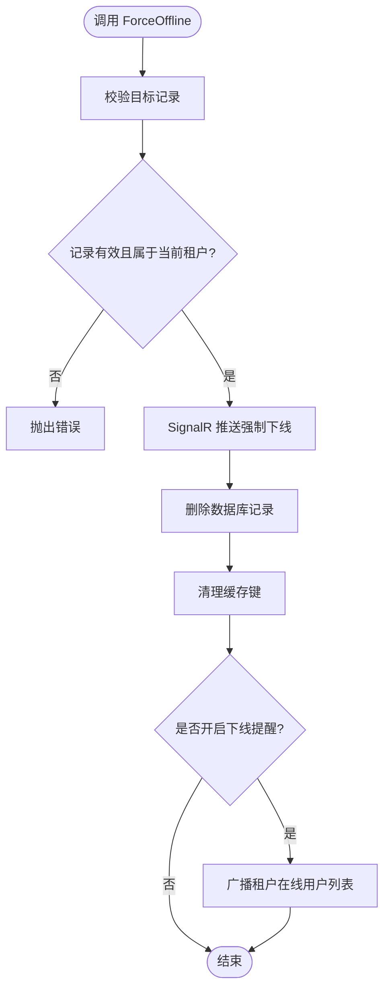
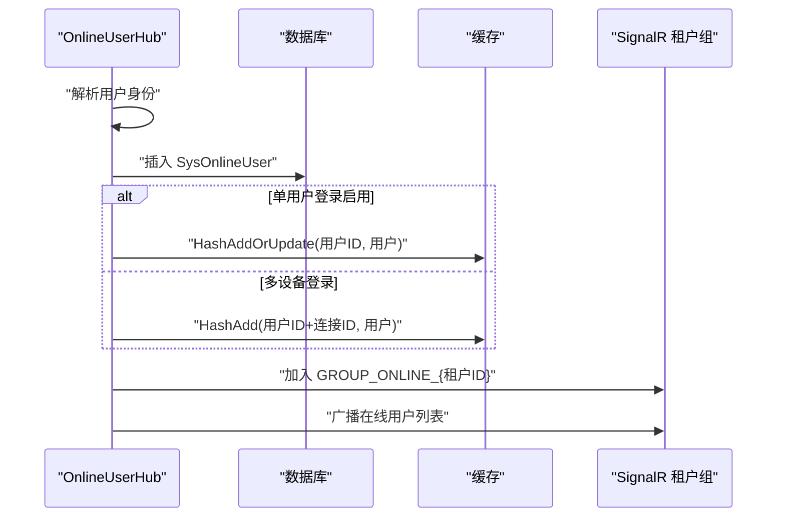
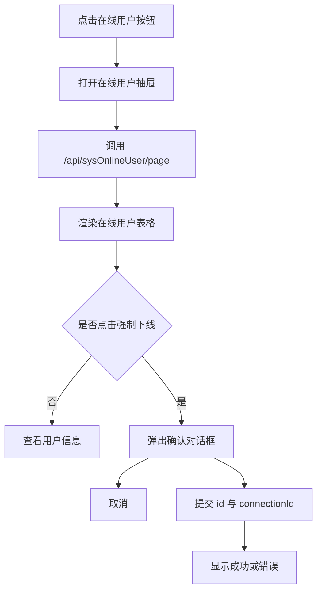
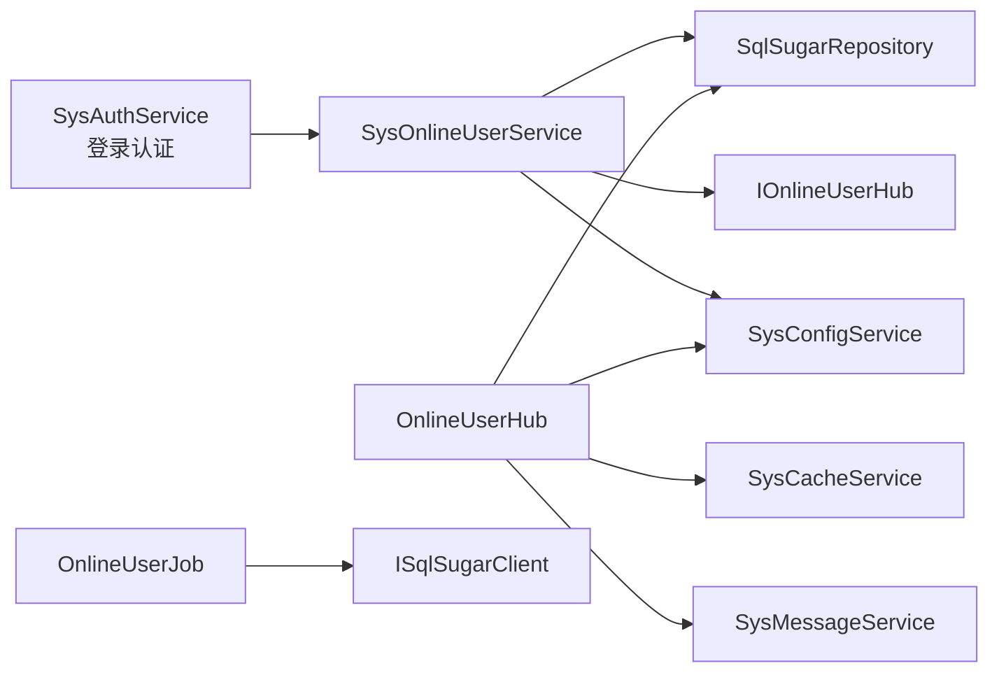
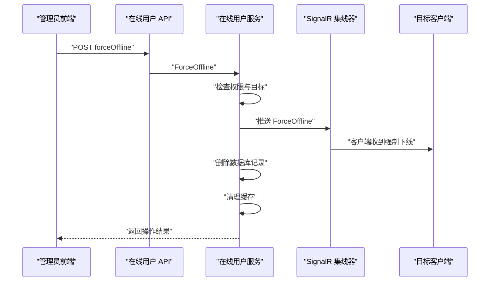

# 在线用户实体设计

<cite>
**本文引用的文件**   
- [SysOnlineUser.cs](file://Admin.NET/Admin.NET.Core/Entity/SysOnlineUser.cs)
- [SysOnlineUserService.cs](file://Admin.NET/Admin.NET.Core/Service/OnlineUser/SysOnlineUserService.cs)
- [OnlineUserHub.cs](file://Admin.NET/Admin.NET.Core/Hub/OnlineUserHub.cs)
- [IOnlineUserHub.cs](file://Admin.NET/Admin.NET.Core/Hub/IOnlineUserHub.cs)
- [OnlineUserJob.cs](file://Admin.NET/Admin.NET.Core/Job/OnlineUserJob.cs)
- [OnlineUserInput.cs](file://Admin.NET/Admin.NET.Core/Service/OnlineUser/Dto/OnlineUserInput.cs)
- [OnlineUserHubInput.cs](file://Admin.NET/Admin.NET.Core/Hub/Dto/OnlineUserHubInput.cs)
- [OnlineUserHubOutput.cs](file://Admin.NET/Admin.NET.Core/Hub/Dto/OnlineUserHubOutput.cs)
- [sys-online-user.ts](file://Web/apps/web-antdv-next/src/api-services/models/sys-online-user.ts)
- [online-user.ts](file://Web/apps/web-antdv-next/src/api/system/online-user.ts)
- [online-users.vue](file://Web/apps/web-antdv-next/src/layouts/components/online-users.vue)
- [online-user-contract.spec.ts](file://Web/apps/web-antdv-next/e2e/online-user-contract.spec.ts)
- [OnlineUserSessionTests.cs](file://Admin.NET/Admin.NET.Test/OnlineUser/OnlineUserSessionTests.cs)
</cite>

## 目录
1. [简介](#简介)
2. [项目结构中的在线用户定位](#项目结构中的在线用户定位)
3. [核心数据模型](#核心数据模型)
4. [架构总览](#架构总览)
5. [详细组件分析](#详细组件分析)
6. [依赖关系分析](#依赖关系分析)
7. [性能与存储优化](#性能与存储优化)
8. [监控指标与分析建议](#监控指标与分析建议)
9. [在线用户管理功能](#在线用户管理功能)
10. [故障排查指南](#故障排查指南)
11. [结论](#结论)

## 简介
本文围绕 Admin.NET 的在线用户能力，系统梳理 `SysOnlineUser` 实体的数据结构、连接生命周期、状态同步策略、分布式一致性约束、监控指标、管理操作以及前端集成。重点说明：
- 在线用户表如何表达用户标识、会话标识、登录时间、客户端信息等字段；
- 基于 SignalR 的连接建立、断开、强制下线流程；
- 内存缓存与数据库之间的一致性边界；
- 单用户登录、租户分组、权限控制等关键机制；
- 前端在线用户抽屉、分页查询、强制下线交互契约；
- 测试覆盖的关键行为，包括伪造目标、跨租户隔离和缓存清理。

## 项目结构中的在线用户定位
在线用户相关代码分布在后端核心层、SignalR 集线器、作业任务、前端 API 类型定义、前端页面与端到端测试中：

**图表来源**
- [SysOnlineUser.cs:1-68](file://Admin.NET/Admin.NET.Core/Entity/SysOnlineUser.cs#L1-L68)
- [SysOnlineUserService.cs:1-164](file://Admin.NET/Admin.NET.Core/Service/OnlineUser/SysOnlineUserService.cs#L1-L164)
- [OnlineUserHub.cs:1-193](file://Admin.NET/Admin.NET.Core/Hub/OnlineUserHub.cs#L1-L193)
- [OnlineUserJob.cs:1-49](file://Admin.NET/Admin.NET.Core/Job/OnlineUserJob.cs#L1-L49)
- [sys-online-user.ts:1-82](file://Web/apps/web-antdv-next/src/api-services/models/sys-online-user.ts#L1-L82)
- [online-user.ts:1-30](file://Web/apps/web-antdv-next/src/api/system/online-user.ts#L1-L30)
- [online-users.vue:1-22](file://Web/apps/web-antdv-next/src/layouts/components/online-users.vue#L1-L22)
- [online-user-contract.spec.ts:1-105](file://Web/apps/web-antdv-next/e2e/online-user-contract.spec.ts#L1-L105)

**章节来源**
- [SysOnlineUser.cs:1-68](file://Admin.NET/Admin.NET.Core/Entity/SysOnlineUser.cs#L1-L68)
- [SysOnlineUserService.cs:1-164](file://Admin.NET/Admin.NET.Core/Service/OnlineUser/SysOnlineUserService.cs#L1-L164)
- [OnlineUserHub.cs:1-193](file://Admin.NET/Admin.NET.Core/Hub/OnlineUserHub.cs#L1-L193)
- [OnlineUserJob.cs:1-49](file://Admin.NET/Admin.NET.Core/Job/OnlineUserJob.cs#L1-L49)
- [sys-online-user.ts:1-82](file://Web/apps/web-antdv-next/src/api-services/models/sys-online-user.ts#L1-L82)
- [online-user.ts:1-30](file://Web/apps/web-antdv-next/src/api/system/online-user.ts#L1-L30)
- [online-users.vue:1-22](file://Web/apps/web-antdv-next/src/layouts/components/online-users.vue#L1-L22)
- [online-user-contract.spec.ts:1-105](file://Web/apps/web-antdv-next/e2e/online-user-contract.spec.ts#L1-L105)

## 核心数据模型
`SysOnlineUser` 表示一次在线连接记录，继承租户实体基类，具备多租户隔离能力。其字段含义如下：

| 字段 | 类型 | 是否必填 | 业务含义 | 复杂度或限制 |
|---|---|---:|---|---|
| `Id` | 长整型主键 | 是 | 在线连接记录主键 | 由基类提供 |
| `TenantId` | 长整型 | 是 | 所属租户标识 | 用于多租户过滤 |
| `ConnectionId` | 字符串 | 否 | SignalR 连接标识 | 用于精准推送与强制下线 |
| `UserId` | 长整型 | 是 | 系统用户标识 | 一个用户可存在多条连接 |
| `UserName` | 字符串，最大长度 32 | 是 | 登录账号 | 用于检索和展示 |
| `RealName` | 字符串，最大长度 32 | 否 | 真实姓名 | 用于展示 |
| `Time` | 日期时间 | 否 | 连接建立时间 | 可用于统计首次连接时长 |
| `Ip` | 字符串，最大长度 256 | 否 | 客户端 IP | 支持 IPv4 地址转换 |
| `Browser` | 字符串，最大长度 128 | 否 | 浏览器信息 | 来自 HTTP 上下文 |
| `Os` | 字符串，最大长度 128 | 否 | 操作系统信息 | 来自 HTTP 上下文 |

该模型不是传统意义上的“最终持久化会话表”，更偏向于“当前进程内活跃连接的审计快照”。它由 SignalR 连接事件写入，也由断开事件删除。因此，它的准确性高度依赖连接生命周期回调和定时清理逻辑。

**图表来源**
- [SysOnlineUser.cs:1-68](file://Admin.NET/Admin.NET.Core/Entity/SysOnlineUser.cs#L1-L68)
- [OnlineUserInput.cs:1-25](file://Admin.NET/Admin.NET.Core/Service/OnlineUser/Dto/OnlineUserInput.cs#L1-L25)
- [OnlineUserHubOutput.cs:1-16](file://Admin.NET/Admin.NET.Core/Hub/Dto/OnlineUserHubOutput.cs#L1-L16)
- [OnlineUserHubInput.cs:1-12](file://Admin.NET/Admin.NET.Core/Hub/Dto/OnlineUserHubInput.cs#L1-L12)

**章节来源**
- [SysOnlineUser.cs:1-68](file://Admin.NET/Admin.NET.Core/Entity/SysOnlineUser.cs#L1-L68)
- [OnlineUserInput.cs:1-25](file://Admin.NET/Admin.NET.Core/Service/OnlineUser/Dto/OnlineUserInput.cs#L1-L25)
- [OnlineUserHubOutput.cs:1-16](file://Admin.NET/Admin.NET.Core/Hub/Dto/OnlineUserHubOutput.cs#L1-L16)
- [OnlineUserHubInput.cs:1-12](file://Admin.NET/Admin.NET.Core/Hub/Dto/OnlineUserHubInput.cs#L1-L12)

## 架构总览
在线用户能力由四层组成：
- 实体层：`SysOnlineUser` 描述连接元数据；
- 信号层：`OnlineUserHub` 处理 SignalR 连接、断连、组广播；
- 服务层：`SysOnlineUserService` 暴露分页查询、强制下线、单用户登录、站内消息等接口；
- 运维层：`OnlineUserJob` 负责服务重启后的在线用户数据清理。

**图表来源**
- [OnlineUserHub.cs:1-193](file://Admin.NET/Admin.NET.Core/Hub/OnlineUserHub.cs#L1-L193)
- [SysOnlineUserService.cs:1-164](file://Admin.NET/Admin.NET.Core/Service/OnlineUser/SysOnlineUserService.cs#L1-L164)
- [online-user.ts:1-30](file://Web/apps/web-antdv-next/src/api/system/online-user.ts#L1-L30)

**章节来源**
- [OnlineUserHub.cs:1-193](file://Admin.NET/Admin.NET.Core/Hub/OnlineUserHub.cs#L1-L193)
- [SysOnlineUserService.cs:1-164](file://Admin.NET/Admin.NET.Core/Service/OnlineUser/SysOnlineUserService.cs#L1-L164)
- [online-user.ts:1-30](file://Web/apps/web-antdv-next/src/api/system/online-user.ts#L1-L30)

## 详细组件分析

### 在线用户实体：SysOnlineUser
`SysOnlineUser` 使用 SqlSugar 注解标记为系统在线用户表，并继承租户实体基类。关键字段设计体现以下原则：
- 以 `ConnectionId` 作为 SignalR 连接标识，便于精准推送；
- 以 `UserId` 关联系统用户，支持同一用户多个连接；
- 以 `Time` 记录连接建立时间，便于计算会话时长；
- 以 `Ip`、`Browser`、`Os` 记录客户端环境，便于安全审计和设备分析；
- 以 `TenantId` 实现多租户隔离，配合服务层过滤条件防止越权。

需要注意：当前实体没有显式索引声明，也没有唯一约束。若未来需要高频按 `ConnectionId`、`UserId`、`TenantId` 查询，应评估添加数据库索引。

**章节来源**
- [SysOnlineUser.cs:1-68](file://Admin.NET/Admin.NET.Core/Entity/SysOnlineUser.cs#L1-L68)

### 在线用户服务：SysOnlineUserService
服务层承担三类职责：
1. **查询职责**：根据用户名、真实姓名、租户 ID 分页获取在线用户；
2. **管理职责**：强制下线单个连接、按连接 ID 下线、按用户 ID 下线所有连接；
3. **协作职责**：通过 SignalR 向客户端推送离线提示、站内消息，并维护缓存一致性。

分页查询会区分超级管理员与普通管理员：
- 普通管理员只能看到自己租户的在线用户；
- 超级管理员可按传入的 `TenantId` 过滤其他租户；
- 用户名和真实姓名为模糊匹配。

强制下线流程包括：
- 校验目标记录是否存在；
- 校验连接归属和租户权限；
- 通过 SignalR 向目标连接发送强制下线；
- 从数据库删除该连接记录；
- 清理内存缓存中与目标连接相关的键；
- 可选地向同租户广播新的在线用户列表。

**图表来源**
- [SysOnlineUserService.cs:1-164](file://Admin.NET/Admin.NET.Core/Service/OnlineUser/SysOnlineUserService.cs#L1-L164)

**章节来源**
- [SysOnlineUserService.cs:1-164](file://Admin.NET/Admin.NET.Core/Service/OnlineUser/SysOnlineUserService.cs#L1-L164)

### SignalR 集线器：OnlineUserHub
`OnlineUserHub` 是连接生命周期的入口：
- `OnConnectedAsync`：从 HTTP 上下文提取用户身份、租户、IP、浏览器、操作系统，创建 `SysOnlineUser` 并写入数据库；同时写入内存缓存，并按租户加入 SignalR 分组；
- `OnDisconnectedAsync`：查找并删除对应的在线用户记录，清理缓存，并向租户组广播最新在线列表；
- 对外暴露强制下线、站内消息等方法，委托给服务层或消息服务。

连接建立时的缓存写入有两种模式：
- 单用户登录：缓存键为用户 ID，后登录者覆盖前者；
- 多设备登录：缓存键为用户 ID 与连接 ID 拼接，避免相互覆盖。

**图表来源**
- [OnlineUserHub.cs:1-193](file://Admin.NET/Admin.NET.Core/Hub/OnlineUserHub.cs#L1-L193)

**章节来源**
- [OnlineUserHub.cs:1-193](file://Admin.NET/Admin.NET.Core/Hub/OnlineUserHub.cs#L1-L193)

### 清理作业：OnlineUserJob
`OnlineUserJob` 是一个定时作业，当前实现会在执行时清空 `SysOnlineUser` 表，然后重新缓存租户列表并加载动态程序集。这个行为适合部署后重建在线状态，但不适合作为常规心跳清理方案。原因：
- 它会直接删除全部在线用户记录；
- 不区分连接是否仍存活；
- 日志输出中包含“服务已重启”语义，说明主要用途是服务启动后的状态重置。

因此，不应把它理解为“心跳超时自动清理空闲会话”的作业。若需心跳机制，应新增独立逻辑，例如更新最后活动时间、按过期阈值清理。

**章节来源**
- [OnlineUserJob.cs:1-49](file://Admin.NET/Admin.NET.Core/Job/OnlineUserJob.cs#L1-L49)

### 前端集成：API 类型、抽屉与端到端契约
前端对在线用户的访问分为三层：
1. **OpenAPI 生成类型**：`sys-online-user.ts` 定义后端返回的 `SysOnlineUser` 类型；
2. **业务 API 封装**：`online-user.ts` 定义 `OnlineUser`、`OnlineUserQuery`、分页查询和强制下线请求；
3. **界面入口**：`online-users.vue` 提供头部按钮和抽屉，打开后加载在线用户列表。

端到端测试覆盖了：
- 分页筛选参数传递；
- 强制下线只发送选中行数据；
- 取消确认不会触发下线；
- 失败重试保持目标选择；
- 无权限用户不可见下线按钮；
- 桌面和移动端抽屉可用性。

**图表来源**
- [online-users.vue:1-22](file://Web/apps/web-antdv-next/src/layouts/components/online-users.vue#L1-L22)
- [online-user.ts:1-30](file://Web/apps/web-antdv-next/src/api/system/online-user.ts#L1-L30)
- [online-user-contract.spec.ts:1-105](file://Web/apps/web-antdv-next/e2e/online-user-contract.spec.ts#L1-L105)

**章节来源**
- [sys-online-user.ts:1-82](file://Web/apps/web-antdv-next/src/api-services/models/sys-online-user.ts#L1-L82)
- [online-user.ts:1-30](file://Web/apps/web-antdv-next/src/api/system/online-user.ts#L1-L30)
- [online-users.vue:1-22](file://Web/apps/web-antdv-next/src/layouts/components/online-users.vue#L1-L22)
- [online-user-contract.spec.ts:1-105](file://Web/apps/web-antdv-next/e2e/online-user-contract.spec.ts#L1-L105)

## 依赖关系分析
在线用户能力的依赖关系如下：

关键点：
- 在线用户服务依赖 SignalR 上下文推送消息；
- 集线器依赖缓存服务维护用户在线映射；
- 配置服务控制单用户登录、下线提醒等行为开关；
- 作业依赖数据库和租户、插件服务完成启动期初始化。

**图表来源**
- [SysOnlineUserService.cs:1-164](file://Admin.NET/Admin.NET.Core/Service/OnlineUser/SysOnlineUserService.cs#L1-L164)
- [OnlineUserHub.cs:1-193](file://Admin.NET/Admin.NET.Core/Hub/OnlineUserHub.cs#L1-L193)
- [OnlineUserJob.cs:1-49](file://Admin.NET/Admin.NET.Core/Job/OnlineUserJob.cs#L1-L49)

**章节来源**
- [SysOnlineUserService.cs:1-164](file://Admin.NET/Admin.NET.Core/Service/OnlineUser/SysOnlineUserService.cs#L1-L164)
- [OnlineUserHub.cs:1-193](file://Admin.NET/Admin.NET.Core/Hub/OnlineUserHub.cs#L1-L193)
- [OnlineUserJob.cs:1-49](file://Admin.NET/Admin.NET.Core/Job/OnlineUserJob.cs#L1-L49)

## 性能与存储优化
当前实现的核心特征可以概括为：**数据库写连接、缓存辅助映射、SignalR 实时广播**。

### 优点
- 连接建立和断开直接落库，便于审计；
- 使用缓存减少重复构造用户对象；
- 按租户分组广播，避免全仓广播；
- 前端分页查询支持用户名、姓名、租户过滤。

### 风险与优化建议
1. **缺少心跳字段**  
   当前实体只有连接时间，没有最后活动时间。若需心跳保活，应增加 `LastActivityTime` 并在心跳接口更新。

2. **缺少连接超时清理**  
   `OnlineUserJob` 直接清空全表，不适合心跳清理。应引入按超时阈值清理的逻辑，避免误删活跃连接。

3. **分布式一致性不足**  
   当前缓存键使用进程内缓存，未体现 Redis 共享。在多实例部署下，不同进程看到的在线用户可能不一致。建议将用户在线映射迁移到 Redis，并以 `UserId`、`ConnectionId`、`TenantId` 构建稳定键。

4. **查询性能未显式优化**  
   当前分页查询依赖 SQL 生成，但实体没有显式索引。若在线用户规模较大，建议为 `ConnectionId`、`UserId`、`TenantId`、`Time` 添加合适索引。

5. **强制下线缓存清理较谨慎**  
   服务层只删除目标连接相关缓存键，避免影响同账号新连接。这是正确做法，扩展时应保留该保护。

### 存储方案对比
| 方案 | 适用场景 | 优势 | 风险 |
|---|---|---|---|
| 仅内存缓存 | 单机开发 | 简单快速 | 进程重启丢失 |
| 内存缓存加数据库审计 | 当前实现 | 可追溯连接历史 | 非最终一致 |
| Redis 共享会话 | 多实例部署 | 多进程一致 | 需要额外运维 |
| 心跳加超时清理 | 长期活跃连接 | 自动回收僵尸连接 | 实现复杂度高 |

**章节来源**
- [SysOnlineUserService.cs:1-164](file://Admin.NET/Admin.NET.Core/Service/OnlineUser/SysOnlineUserService.cs#L1-L164)
- [OnlineUserHub.cs:1-193](file://Admin.NET/Admin.NET.Core/Hub/OnlineUserHub.cs#L1-L193)
- [OnlineUserJob.cs:1-49](file://Admin.NET/Admin.NET.Core/Job/OnlineUserJob.cs#L1-L49)

## 监控指标与分析建议
虽然仓库中没有专门的监控系统指标采集代码，但现有数据足以支撑基础运营分析：

| 指标 | 数据来源 | 计算方式 | 业务价值 |
|---|---|---|---|
| 当前在线人数 | `SysOnlineUser` 表 | 按租户统计记录数 | 衡量系统活跃度 |
| 单用户并发连接数 | `SysOnlineUser.UserId` | 按用户 ID 分组计数 | 检测多设备登录、异常并发 |
| 平均会话时长 | `SysOnlineUser.Time` | 当前时间与连接时间差均值 | 评估用户使用深度 |
| 最长会话时长 | `SysOnlineUser.Time` | 当前时间与最早连接时间差 | 发现长时间未活动会话 |
| 客户端分布 | `Browser`、`Os` | 按浏览器、操作系统分组 | 了解终端生态 |
| 地域或网络分布 | `Ip` | 按 IP 或网段分组 | 辅助安全分析和流量分析 |
| 强制下线次数 | 应用日志或扩展审计表 | 统计下线操作 | 评估安全管理效果 |

建议后续补充：
- 在线人数趋势图；
- 按租户、角色、客户端类型的活跃用户分析；
- 会话时长直方图；
- 强制下线原因分类；
- 与登录日志、登出日志关联形成完整审计链。

**章节来源**
- [SysOnlineUser.cs:1-68](file://Admin.NET/Admin.NET.Core/Entity/SysOnlineUser.cs#L1-L68)
- [online-user-contract.spec.ts:1-105](file://Web/apps/web-antdv-next/e2e/online-user-contract.spec.ts#L1-L105)

## 在线用户管理功能
在线用户管理主要由后端服务和前端交互共同实现：

### 分页查询
- 接口路径：`/api/sysOnlineUser/page`；
- 查询参数：用户名、真实姓名、租户 ID、页码、页大小；
- 权限控制：普通管理员仅能看到本租户，超级管理员可指定租户；
- 前端封装：`pageOnlineUsers` 函数。

### 强制下线
- 接口路径：`/api/sysOnlineUser/forceOffline`；
- 请求体：`id`、`connectionId`；
- 后端校验：
  - 目标记录必须存在；
  - 非超级管理员需校验租户；
  - 普通管理员需具备 `sysOnlineUser:forceOffline` 按钮权限；
- 后端动作：
  - 通过 SignalR 向目标连接推送强制下线；
  - 删除数据库记录；
  - 清理缓存键；
  - 可选广播租户在线用户列表；
- 前端行为：
  - 点击下线按钮弹出确认；
  - 成功后移除该行；
  - 失败时保留目标并允许重试。

### 单用户登录
当配置启用单用户登录时，新登录会踢掉旧连接。该逻辑在服务层通过枚举同一用户的所有连接并逐个强制下线实现。

### 站内消息与广播
服务层还提供站内消息广播能力，通过 SignalR 向在线用户推送通知。该能力与在线用户表解耦，但依赖 `ConnectionId` 进行投递。

**图表来源**
- [SysOnlineUserService.cs:1-164](file://Admin.NET/Admin.NET.Core/Service/OnlineUser/SysOnlineUserService.cs#L1-L164)
- [online-user.ts:1-30](file://Web/apps/web-antdv-next/src/api/system/online-user.ts#L1-L30)
- [online-user-contract.spec.ts:1-105](file://Web/apps/web-antdv-next/e2e/online-user-contract.spec.ts#L1-L105)

**章节来源**
- [SysOnlineUserService.cs:1-164](file://Admin.NET/Admin.NET.Core/Service/OnlineUser/SysOnlineUserService.cs#L1-L164)
- [online-user.ts:1-30](file://Web/apps/web-antdv-next/src/api/system/online-user.ts#L1-L30)
- [online-user-contract.spec.ts:1-105](file://Web/apps/web-antdv-next/e2e/online-user-contract.spec.ts#L1-L105)

## 故障排查指南
常见问题和排查方向如下：

| 现象 | 可能原因 | 排查步骤 | 修复建议 |
|---|---|---|---|
| 在线用户列表为空 | 连接未建立、连接已断开、作业清空了表 | 检查 SignalR 连接、数据库记录、作业执行日志 | 确认连接是否正常、调整作业策略 |
| 强制下线无效 | 目标不存在、连接 ID 不匹配、权限不足 | 检查请求参数、数据库记录、按钮权限 | 修正前端传参或授权配置 |
| 同一用户被意外下线 | 单用户登录开启且新连接覆盖缓存 | 检查单用户登录配置、缓存键 | 明确业务是否允许多设备登录 |
| 多实例在线用户不一致 | 缓存未共享 | 检查缓存实现是否为进程内缓存 | 迁移到 Redis 或共享中间件 |
| 强制下线后仍有残留连接 | 缓存键未清理或连接延迟断开 | 检查缓存清理逻辑、SignalR 断开回调 | 复用现有连接 ID 校验逻辑 |
| 前端无法下线某条记录 | 后端返回错误或前端未刷新 | 查看端到端测试契约、网络请求 | 确保错误提示和重试行为符合契约 |

测试用例覆盖了以下关键场景：
- 伪造目标 ID 或连接 ID 应拒绝；
- 跨租户连接不应被普通管理员操作；
- 非空连接 ID 才允许通过内部方法下线；
- 匿名用户访问集线器应被拒绝；
- 前端取消确认不应触发下线；
- 前端失败后保留选中目标并允许重试。

**章节来源**
- [OnlineUserSessionTests.cs:1-181](file://Admin.NET/Admin.NET.Test/OnlineUser/OnlineUserSessionTests.cs#L1-L181)
- [SysOnlineUserService.cs:1-164](file://Admin.NET/Admin.NET.Core/Service/OnlineUser/SysOnlineUserService.cs#L1-L164)
- [online-user-contract.spec.ts:1-105](file://Web/apps/web-antdv-next/e2e/online-user-contract.spec.ts#L1-L105)

## 结论
Admin.NET 的在线用户能力以 `SysOnlineUser` 为核心，结合 SignalR、缓存和服务层实现了连接审计、在线列表、强制下线、单用户登录等基础功能。其当前实现更适合单机或轻量多实例场景，并已通过单元测试和端到端测试验证关键行为。

若要在生产环境中增强可靠性，建议优先补充：
- 心跳字段与超时清理逻辑；
- 分布式缓存或共享会话存储；
- 在线用户索引与慢查询监控；
- 更丰富的监控指标和审计日志；
- 明确的扩展点，支持自定义会话存储和扩展属性。

这样可以在不破坏现有协议的前提下，逐步把在线用户能力从“进程内连接快照”演进为“分布式会话基础设施”。