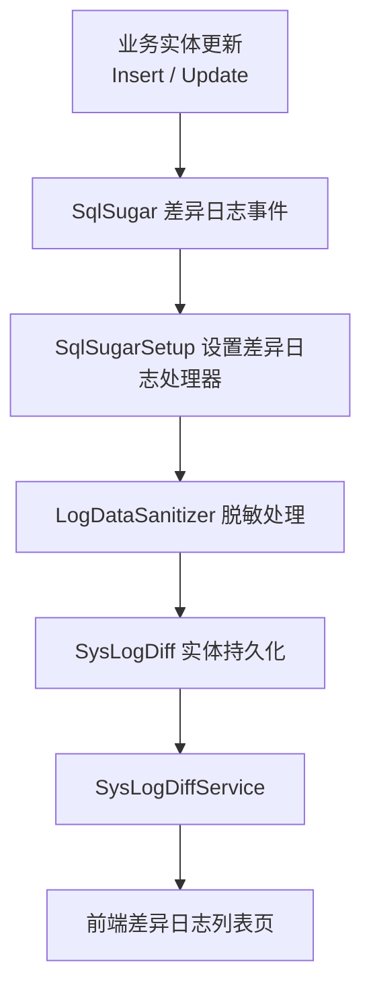
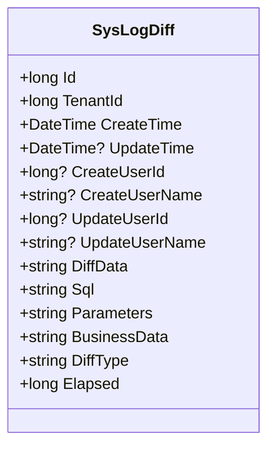
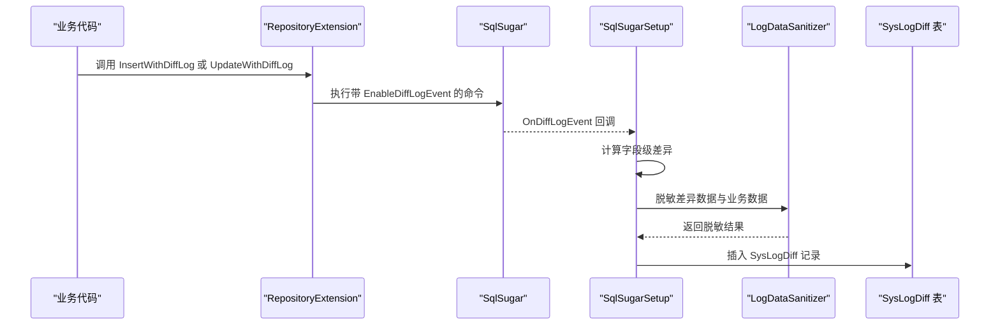
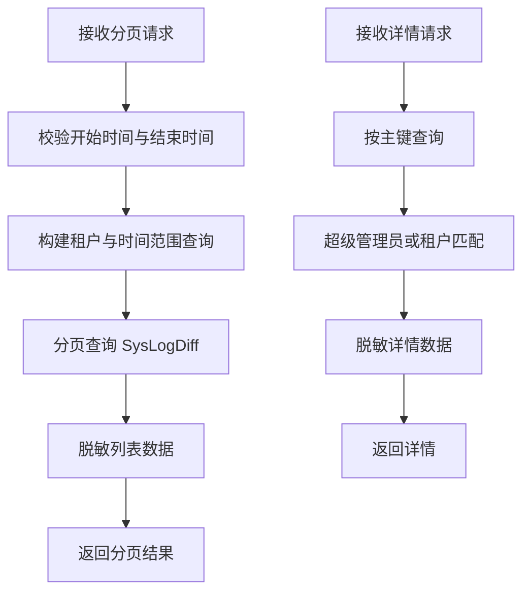
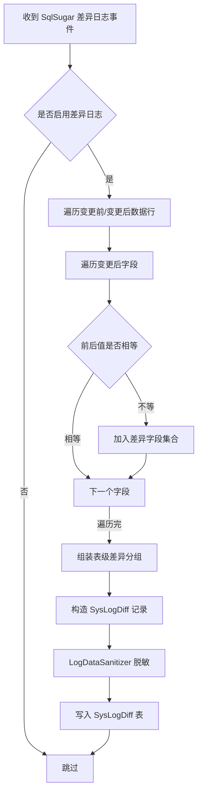
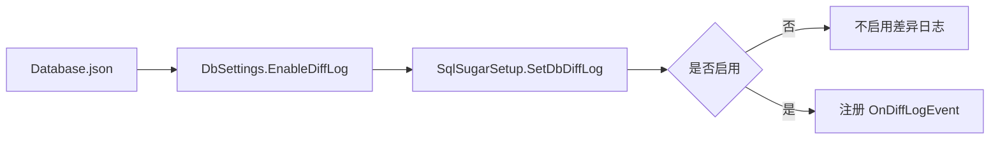
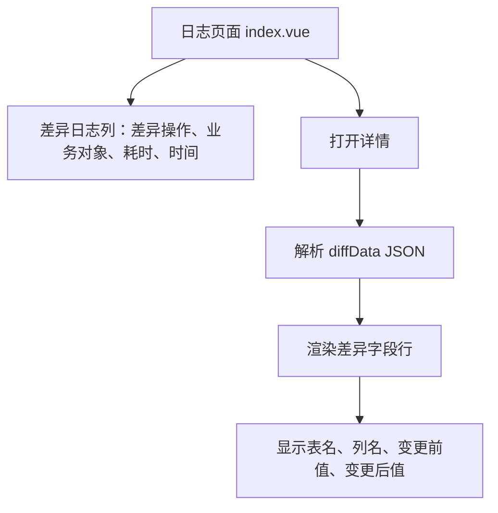
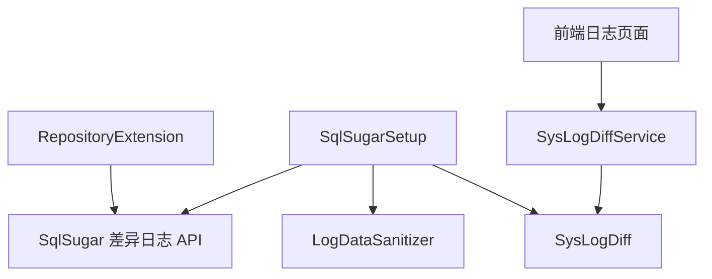
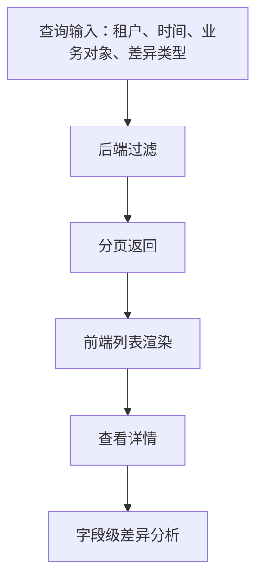
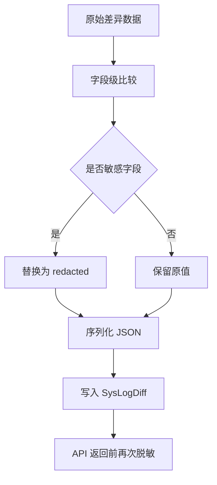

# 差异日志实体设计

<cite>
**本文引用的文件**
- [SysLogDiff.cs](file://Admin.NET/Admin.NET.Core/Entity/SysLogDiff.cs)
- [SysLogDiffService.cs](file://Admin.NET/Admin.NET.Core/Service/Log/SysLogDiffService.cs)
- [RepositoryExtension.cs](file://Admin.NET/Admin.NET.Core/Extension/RepositoryExtension.cs)
- [SqlSugarSetup.cs](file://Admin.NET/Admin.NET.Core/SqlSugar/SqlSugarSetup.cs)
- [DbConnectionOptions.cs](file://Admin.NET/Admin.NET.Core/Option/DbConnectionOptions.cs)
- [Database.json](file://docker/app/Configuration/Database.json)
- [LogDataSanitizer.cs](file://Admin.NET/Admin.NET.Core/Logging/LogDataSanitizer.cs)
- [sys-log-diff.ts](file://Web/apps/web-antdv-next/src/api-services/models/sys-log-diff.ts)
- [index.vue](file://Web/apps/web-antdv-next/src/views/system/log/index.vue)
</cite>

## 目录
1. [引言](#引言)
2. [项目结构中的差异日志位置](#项目结构中的差异日志位置)
3. [核心数据模型](#核心数据模型)
4. [架构总览](#架构总览)
5. [详细组件分析](#详细组件分析)
6. [依赖关系分析](#依赖关系分析)
7. [性能与存储策略](#性能与存储策略)
8. [查询与分析能力](#查询与分析能力)
9. [安全与完整性](#安全与完整性)
10. [常见问题排查](#常见问题排查)
11. [结论](#结论)

## 引言
本文件面向 Admin.NET 的“系统差异日志”，即 `SysLogDiff`。它用于记录数据库表级别的字段级变更历史，包括修改前后值、变更类型、耗时、业务对象描述、以及脱敏后的差异数据。差异日志并非由业务代码逐行比较生成，而是通过 SqlSugar 的差异日志事件自动捕获，并由 Admin.NET 在启动时注入处理器，把变更信息写入差异日志表。

## 项目结构中的差异日志位置
- 后端实体定义位于核心层实体目录。
- 差异日志服务提供分页查询和详情接口。
- 差异日志触发点位于 SqlSugar 初始化配置中，按连接配置开关控制。
- 前端使用统一日志页面，对差异日志展示差异行、业务对象、耗时和时间等列。

**图表来源**
- [SqlSugarSetup.cs:306-357](file://Admin.NET/Admin.NET.Core/SqlSugar/SqlSugarSetup.cs#L306-L357)
- [SysLogDiff.cs:15-52](file://Admin.NET/Admin.NET.Core/Entity/SysLogDiff.cs#L15-L52)
- [SysLogDiffService.cs:13-54](file://Admin.NET/Admin.NET.Core/Service/Log/SysLogDiffService.cs#L13-L54)

**章节来源**
- [SysLogDiff.cs:15-52](file://Admin.NET/Admin.NET.Core/Entity/SysLogDiff.cs#L15-L52)
- [SysLogDiffService.cs:13-54](file://Admin.NET/Admin.NET.Core/Service/Log/SysLogDiffService.cs#L13-L54)

## 核心数据模型
`SysLogDiff` 继承租户基类，因此天然包含租户、创建时间、更新时间、创建人、更新人等通用审计字段；同时扩展了差异日志专用字段：

| 字段 | 数据类型 | 是否必填 | 含义与用途 |
|---|---|---:|---|
| `Id` | 长整型主键 | 是 | 差异日志记录主键，由框架或数据库生成 |
| `TenantId` | 长整型 | 否 | 租户隔离标识，便于多租户查询过滤 |
| `CreateTime` | 时间戳 | 是 | 差异日志创建时间，用于排序和范围查询 |
| `UpdateTime` | 时间戳 | 否 | 差异日志最后更新时间，通常不变化 |
| `CreateUserId` | 长整型 | 否 | 触发变更的业务用户标识 |
| `CreateUserName` | 字符串 | 否 | 触发变更的业务用户姓名 |
| `UpdateUserId` | 长整型 | 否 | 差异日志本身的更新人，一般不写 |
| `UpdateUserName` | 字符串 | 否 | 差异日志本身的更新人姓名，一般不写 |
| `DiffData` | 大文本 | 否 | 结构化差异数据，以 JSON 文本保存 |
| `Sql` | 大文本 | 否 | 原始 SQL，当前实现不持久化 |
| `Parameters` | 大文本 | 否 | 参数信息，当前实现不持久化 |
| `BusinessData` | 大文本 | 否 | 业务对象名称或序列化内容，用于定位变更主体 |
| `DiffType` | 字符串 | 否 | 差异操作类型，如新增、更新、删除 |
| `Elapsed` | 长整型 | 否 | 差异日志记录耗时，单位为毫秒 |

其中 `DiffData` 的结构不是简单的前后值对比，而是按“表分组 + 字段行”组织。每个表对应一个分组，分组内列出发生变化的字段，并包含列名、列描述、主键标记、变更前值和变更后值。

**图表来源**
- [SysLogDiff.cs:15-52](file://Admin.NET/Admin.NET.Core/Entity/SysLogDiff.cs#L15-L52)

**章节来源**
- [SysLogDiff.cs:15-52](file://Admin.NET/Admin.NET.Core/Entity/SysLogDiff.cs#L15-L52)

## 架构总览
差异日志的整体流程分为三个阶段：

1. **变更触发阶段**：业务代码执行插入或更新操作时，可通过扩展方法启用差异日志事件。
2. **差异采集阶段**：SqlSugar 在执行数据变更时产生差异日志事件，携带变更前数据、变更后数据、SQL、参数、耗时等信息。
3. **持久化阶段**：Admin.NET 的 `SqlSugarSetup` 将差异数据序列化为 JSON，经脱敏后写入 `SysLogDiff`。

**图表来源**
- [RepositoryExtension.cs:150-260](file://Admin.NET/Admin.NET.Core/Extension/RepositoryExtension.cs#L150-L260)
- [SqlSugarSetup.cs:306-357](file://Admin.NET/Admin.NET.Core/SqlSugar/SqlSugarSetup.cs#L306-L357)
- [LogDataSanitizer.cs:1-98](file://Admin.NET/Admin.NET.Core/Logging/LogDataSanitizer.cs#L1-L98)

## 详细组件分析

### 差异日志实体：SysLogDiff
该实体是差异日志的最终落库形态。关键字段语义如下：

- `DiffData`：差异数据，采用 JSON 字符串保存。当前实现按“表名、表描述、字段数组”组织，字段数组只保留发生变化的列。
- `BusinessData`：业务对象。优先使用传入的业务对象描述；如果为空，则回退到变更后数据的第一个表名。
- `DiffType`：差异类型，来源于 SqlSugar 的差异枚举，例如新增、更新、删除。
- `Sql` 与 `Parameters`：虽然实体存在这两个字段，但当前实现明确不持久化 SQL 和参数，以避免敏感凭据落入日志库。
- `Elapsed`：记录差异日志生成的耗时，便于性能分析和慢日志排查。

该实体还继承租户基类，因此所有差异记录都带有租户上下文，满足多租户隔离需求。

**章节来源**
- [SysLogDiff.cs:15-52](file://Admin.NET/Admin.NET.Core/Entity/SysLogDiff.cs#L15-L52)

### 差异日志服务：SysLogDiffService
`SysLogDiffService` 暴露差异日志的分页查询和详情查询两个主要能力：

- **分页查询**：支持按租户、开始时间、结束时间过滤，并按创建时间倒序排列。非超级管理员只能查看本租户数据。
- **详情查询**：根据主键获取单条差异日志，同样受租户权限限制。
- **数据脱敏**：查询结果会经过 `LogDataSanitizer.SanitizeRecord`，确保敏感字段不会泄露给前端。

该服务没有自行实现差异比较逻辑，而是读取 SqlSugar 已生成的差异数据。

**图表来源**
- [SysLogDiffService.cs:13-54](file://Admin.NET/Admin.NET.Core/Service/Log/SysLogDiffService.cs#L13-L54)

**章节来源**
- [SysLogDiffService.cs:13-54](file://Admin.NET/Admin.NET.Core/Service/Log/SysLogDiffService.cs#L13-L54)

### 差异日志触发机制：RepositoryExtension
`RepositoryExtension` 提供了便捷扩展方法，帮助业务代码以更简洁的方式启用差异日志：

- `UpdateWithDiffLog`：更新实体并启用差异日志。
- `UpdateWithDiffLogAsync`：异步更新实体并启用差异日志。
- `InsertWithDiffLog`：新增实体并启用差异日志。
- `InsertWithDiffLogAsync`：异步新增实体并启用差异日志。

这些方法内部调用 SqlSugar 的更新或插入命令，并通过 `EnableDiffLogEvent()` 开启差异日志事件。对于假删除场景，代码也显式启用了差异日志事件，使逻辑删除操作可被追踪。

需要注意：当前实现依赖 SqlSugar 提供的 `EnableDiffLogEvent` 能力，而不是由 Admin.NET 自己编写字段级比较算法。

**章节来源**
- [RepositoryExtension.cs:150-260](file://Admin.NET/Admin.NET.Core/Extension/RepositoryExtension.cs#L150-L260)

### 差异日志采集与持久化：SqlSugarSetup
`SqlSugarSetup.SetDbDiffLog` 是差异日志的核心入口：

1. 检查连接配置中的 `EnableDiffLog`。如果未启用，则直接返回。
2. 注册 `Aop.OnDiffLogEvent` 回调。
3. 遍历差异事件中的变更前数据和变更后数据。
4. 逐项比较字段值，仅收集发生变化的字段。
5. 构造差异数据结构，包含表名、表描述、字段列名、列描述、主键标记、变更前值和变更后值。
6. 填充 `SysLogDiff` 记录的租户、用户、耗时、差异类型和业务对象。
7. 将 SQL 和参数设为空，避免敏感信息进入日志库。
8. 选择日志连接或主连接，插入差异日志记录。

**图表来源**
- [SqlSugarSetup.cs:306-357](file://Admin.NET/Admin.NET.Core/SqlSugar/SqlSugarSetup.cs#L306-L357)

**章节来源**
- [SqlSugarSetup.cs:306-357](file://Admin.NET/Admin.NET.Core/SqlSugar/SqlSugarSetup.cs#L306-L357)

### 配置开关：DbConnectionOptions 与 Database.json
差异日志是可选功能，默认关闭：

- `DbSettings.EnableDiffLog` 决定单个数据库连接是否启用差异日志。
- 默认配置文件 `Database.json` 中将 `EnableDiffLog` 设置为 `false`。
- 生产环境需要显式开启目标连接的差异日志开关。

此外，`SqlSugarSetup` 还通过 `ITenant.IsAnyConnection(SqlSugarConst.LogConfigId)` 判断是否使用独立日志连接；如果存在日志库，则差异日志会写入日志库，否则写入主库。

**图表来源**
- [Database.json:1-72](file://docker/app/Configuration/Database.json#L1-L72)
- [DbConnectionOptions.cs:1-136](file://Admin.NET/Admin.NET.Core/Option/DbConnectionOptions.cs#L1-L136)
- [SqlSugarSetup.cs:306-312](file://Admin.NET/Admin.NET.Core/SqlSugar/SqlSugarSetup.cs#L306-L312)

**章节来源**
- [DbConnectionOptions.cs:1-136](file://Admin.NET/Admin.NET.Core/Option/DbConnectionOptions.cs#L1-L136)
- [Database.json:1-72](file://docker/app/Configuration/Database.json#L1-L72)
- [SqlSugarSetup.cs:306-312](file://Admin.NET/Admin.NET.Core/SqlSugar/SqlSugarSetup.cs#L306-L312)

### 前端展示：日志列表与差异解析
前端日志页面支持四种日志类型：差异日志、异常日志、操作日志、访问日志。差异日志列包括：

- 差异操作
- 业务对象
- 耗时（毫秒）
- 时间
- 详情

点击详情后，前端会解析 `diffData` JSON，将每条表的差异展开为行，显示表名、列名、列描述、变更前值和变更后值。前端同时兼容大小写不同的字段命名，提高向后兼容性。

**图表来源**
- [index.vue](file://Web/apps/web-antdv-next/src/views/system/log/index.vue)
- [sys-log-diff.ts](file://Web/apps/web-antdv-next/src/api-services/models/sys-log-diff.ts)

**章节来源**
- [index.vue](file://Web/apps/web-antdv-next/src/views/system/log/index.vue)
- [sys-log-diff.ts:1-106](file://Web/apps/web-antdv-next/src/api-services/models/sys-log-diff.ts#L1-L106)

## 依赖关系分析
差异日志相关代码的关键依赖关系如下：

**图表来源**
- [RepositoryExtension.cs:150-260](file://Admin.NET/Admin.NET.Core/Extension/RepositoryExtension.cs#L150-L260)
- [SqlSugarSetup.cs:306-357](file://Admin.NET/Admin.NET.Core/SqlSugar/SqlSugarSetup.cs#L306-L357)
- [LogDataSanitizer.cs:1-98](file://Admin.NET/Admin.NET.Core/Logging/LogDataSanitizer.cs#L1-L98)
- [SysLogDiff.cs:15-52](file://Admin.NET/Admin.NET.Core/Entity/SysLogDiff.cs#L15-L52)
- [SysLogDiffService.cs:13-54](file://Admin.NET/Admin.NET.Core/Service/Log/SysLogDiffService.cs#L13-L54)

## 性能与存储策略
当前差异日志的实现具有以下特征和优化点：

- **增量差异**：只对发生变化的字段生成差异行，避免记录全量字段快照。
- **JSON 压缩存储**：差异数据以字符串形式存储，适合快速写入和跨库迁移。
- **耗时统计**：记录差异日志生成耗时，便于评估差异日志对事务性能的影响。
- **SQL 与参数不持久化**：避免大对象和敏感信息进入日志库。
- **可配置开关**：通过 `EnableDiffLog` 控制是否启用，避免无感知的性能损耗。
- **可选日志库**：支持将差异日志写入独立日志连接，降低主库压力。

建议的最佳实践：

1. 仅在关键业务实体上使用 `InsertWithDiffLog` 或 `UpdateWithDiffLog`，避免对所有表开启差异日志。
2. 对高频写入表谨慎启用差异日志，必要时结合业务分层记录变更。
3. 定期清理历史差异日志，尤其是大对象和复杂业务对象的序列化数据。
4. 如需更复杂的版本对比，可在业务层维护额外版本表，并把差异日志作为审计辅助。
5. 对差异日志表建立合适索引，例如按 `CreateTime`、`TenantId`、`CreateUserId`、`DiffType` 组合查询优化。

**章节来源**
- [SqlSugarSetup.cs:306-357](file://Admin.NET/Admin.NET.Core/SqlSugar/SqlSugarSetup.cs#L306-L357)
- [RepositoryExtension.cs:150-260](file://Admin.NET/Admin.NET.Core/Extension/RepositoryExtension.cs#L150-L260)
- [Database.json:1-72](file://docker/app/Configuration/Database.json#L1-L72)

## 查询与分析能力
当前后端提供的差异日志查询能力偏基础，主要围绕分页和详情：

- **分页查询**：支持按租户、时间范围过滤，按创建时间倒序。
- **详情查询**：按主键获取完整差异记录。
- **前端展示**：差异日志列表展示关键摘要，详情面板展示字段级差异。

尚未在后端看到专门的“版本对比”“变更追踪”“审计追溯”高级查询接口。如果需要这些能力，可以在 `SysLogDiffService` 上扩展查询条件，例如：

- 按业务对象名称模糊查询。
- 按差异类型筛选。
- 按创建人筛选。
- 按字段名或列描述筛选。
- 按时间窗口对比同一实体的多次变更。

**图表来源**
- [SysLogDiffService.cs:13-54](file://Admin.NET/Admin.NET.Core/Service/Log/SysLogDiffService.cs#L13-L54)
- [index.vue](file://Web/apps/web-antdv-next/src/views/system/log/index.vue)

**章节来源**
- [SysLogDiffService.cs:13-54](file://Admin.NET/Admin.NET.Core/Service/Log/SysLogDiffService.cs#L13-L54)
- [index.vue](file://Web/apps/web-antdv-next/src/views/system/log/index.vue)

## 安全与完整性
差异日志涉及业务数据的历史值，可能包含密码、令牌、密钥、连接串等敏感信息。Admin.NET 通过以下措施保障安全性和完整性：

1. **差异值脱敏**：`LogDataSanitizer` 对差异数据中的敏感字段进行替换，输出 `[redacted]`。
2. **URL 和请求参数脱敏**：针对其他日志类型，也会清洗认证令牌和敏感参数。
3. **SQL 与参数不持久化**：差异日志实体虽支持 SQL 和参数，但当前实现将其设为空。
4. **响应前二次脱敏**：`SysLogDiffService` 返回详情前再次调用脱敏方法，防止遗漏。
5. **租户隔离**：非超级管理员只能查看本租户差异日志。
6. **审计元数据**：记录创建人、创建时间、租户，便于责任追溯。

注意：当前脱敏逻辑主要针对已知敏感字段名和常见令牌格式。若业务自定义字段包含敏感值，应扩展 `LogDataSanitizer` 的敏感字段列表。

**图表来源**
- [SqlSugarSetup.cs:306-357](file://Admin.NET/Admin.NET.Core/SqlSugar/SqlSugarSetup.cs#L306-L357)
- [LogDataSanitizer.cs:1-98](file://Admin.NET/Admin.NET.Core/Logging/LogDataSanitizer.cs#L1-L98)
- [SysLogDiffService.cs:13-54](file://Admin.NET/Admin.NET.Core/Service/Log/SysLogDiffService.cs#L13-L54)

**章节来源**
- [LogDataSanitizer.cs:1-98](file://Admin.NET/Admin.NET.Core/Logging/LogDataSanitizer.cs#L1-L98)
- [SysLogDiffService.cs:13-54](file://Admin.NET/Admin.NET.Core/Service/Log/SysLogDiffService.cs#L13-L54)
- [SqlSugarSetup.cs:306-357](file://Admin.NET/Admin.NET.Core/SqlSugar/SqlSugarSetup.cs#L306-L357)

## 常见问题排查
- **差异日志未生成**：检查数据库配置中 `EnableDiffLog` 是否为 `true`，并确认使用了 `InsertWithDiffLog` 或 `UpdateWithDiffLog`。
- **差异数据为空**：检查业务实体属性是否有实际变更；如果没有字段值变化，不会产生差异字段。
- **敏感信息泄露**：检查 `LogDataSanitizer` 是否覆盖业务自定义敏感字段名。
- **性能下降**：差异日志会序列化前后数据并写入数据库，高并发写入场景下需评估吞吐影响。
- **无法查看其他租户数据**：非超级管理员默认只能查看本租户差异日志。
- **SQL 和参数缺失**：这是当前实现的设计行为，目的是避免敏感凭据进入日志库。

**章节来源**
- [Database.json:1-72](file://docker/app/Configuration/Database.json#L1-L72)
- [RepositoryExtension.cs:150-260](file://Admin.NET/Admin.NET.Core/Extension/RepositoryExtension.cs#L150-L260)
- [SqlSugarSetup.cs:306-357](file://Admin.NET/Admin.NET.Core/SqlSugar/SqlSugarSetup.cs#L306-L357)
- [LogDataSanitizer.cs:1-98](file://Admin.NET/Admin.NET.Core/Logging/LogDataSanitizer.cs#L1-L98)

## 结论
`SysLogDiff` 是 Admin.NET 的字段级差异审计实体。它基于 SqlSugar 的差异日志事件自动生成变更记录，并将结构化差异数据保存到 JSON 文本字段中。系统通过配置开关控制是否启用差异日志，通过脱敏器保护敏感信息，并通过租户隔离保证多租户安全性。

当前实现的优点是可插拔、侵入小、字段级差异直观；不足是高级查询能力有限，且差异数据仍占用较大文本空间。未来可在现有基础上扩展更多查询维度、归档策略和索引策略，以满足更大规模的数据审计需求。