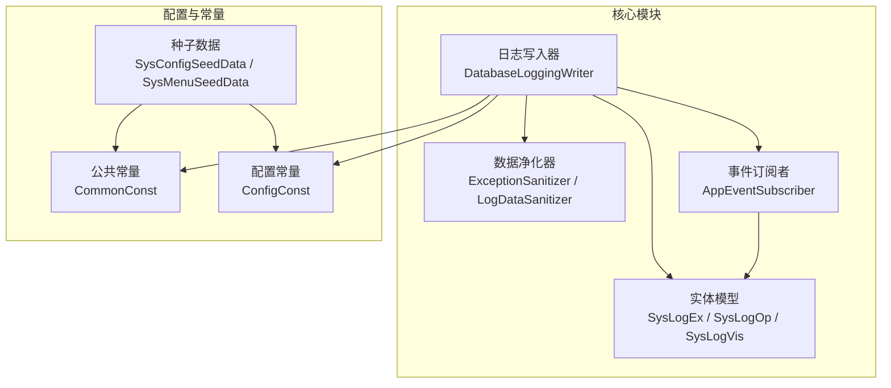
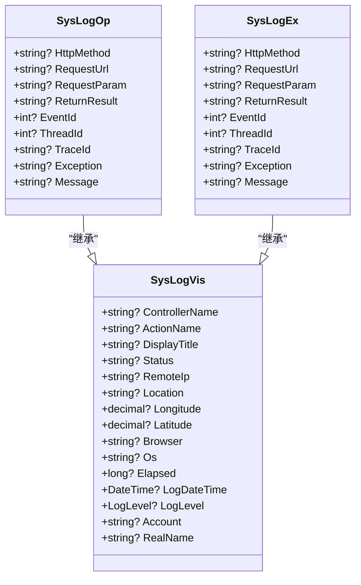
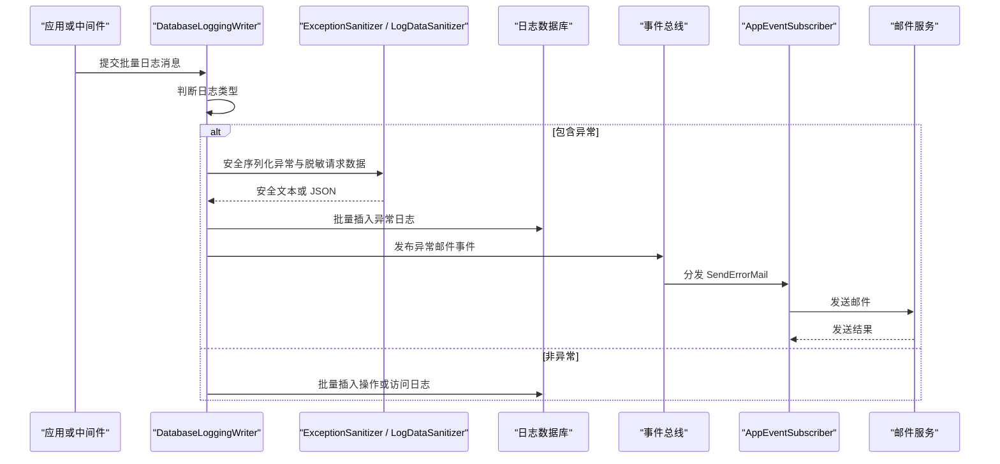
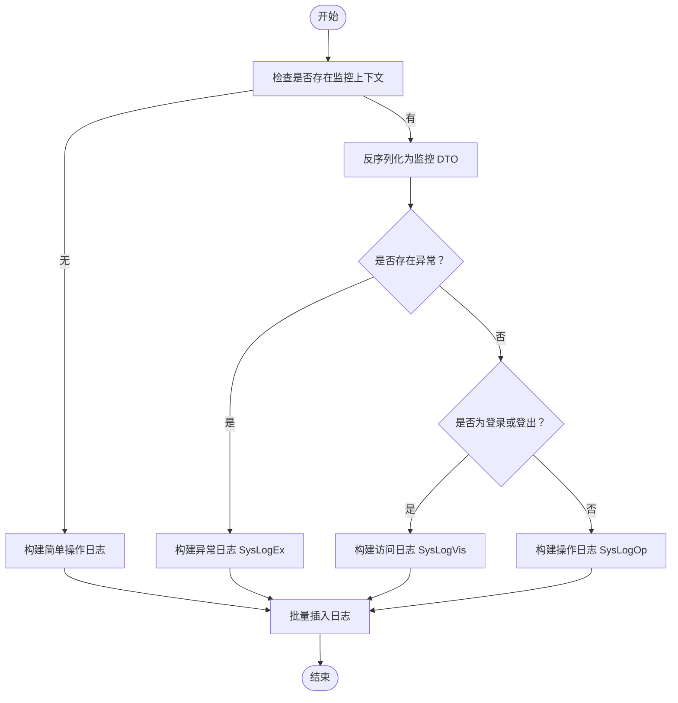
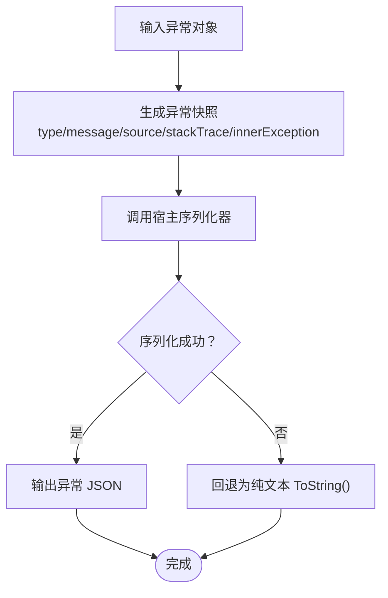
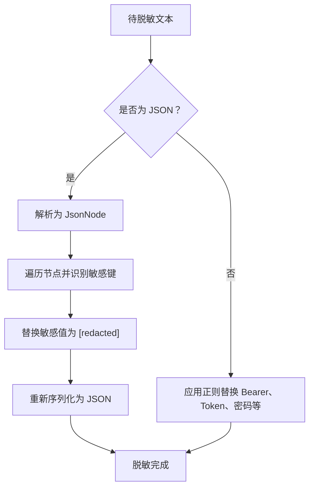
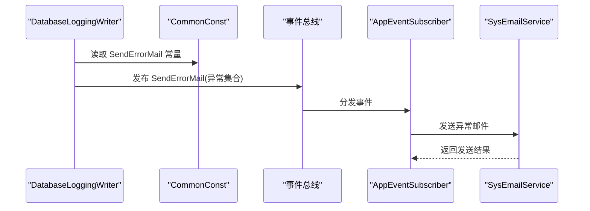
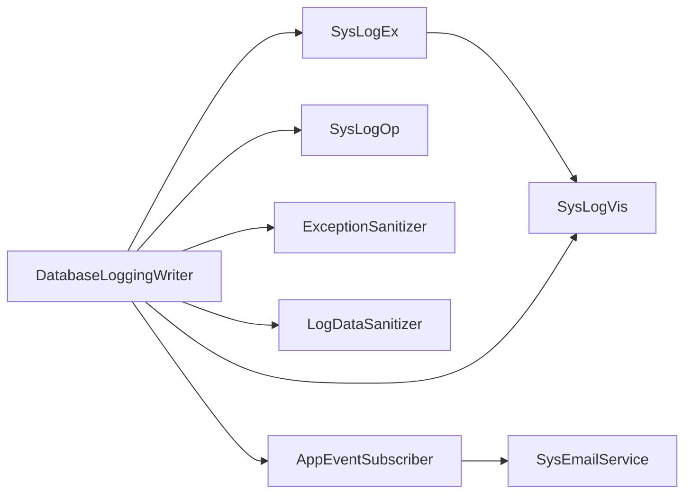

# 异常日志实体设计

<cite>
**本文引用的文件 **
- [SysLogEx.cs](file://Admin.NET/Admin.NET.Core/Entity/SysLogEx.cs)
- [SysLogVis.cs](file://Admin.NET/Admin.NET.Core/Entity/SysLogVis.cs)
- [SysLogOp.cs](file://Admin.NET/Admin.NET.Core/Entity/SysLogOp.cs)
- [DatabaseLoggingWriter.cs](file://Admin.NET/Admin.NET.Core/Logging/DatabaseLoggingWriter.cs)
- [ExceptionSanitizer.cs](file://Admin.NET/Admin.NET.Core/Logging/ExceptionSanitizer.cs)
- [LogDataSanitizer.cs](file://Admin.NET/Admin.NET.Core/Logging/LogDataSanitizer.cs)
- [AppEventSubscriber.cs](file://Admin.NET/Admin.NET.Core/EventBus/AppEventSubscriber.cs)
- [CommonConst.cs](file://Admin.NET/Admin.NET.Core/Const/CommonConst.cs)
- [ConfigConst.cs](file://Admin.NET/Admin.NET.Core/Const/ConfigConst.cs)
- [SysConfigSeedData.cs](file://Admin.NET/Admin.NET.Core/SeedData/SysConfigSeedData.cs)
- [SysMenuSeedData.cs](file://Admin.NET/Admin.NET.Core/SeedData/SysMenuSeedData.cs)
</cite>

## 目录
1. [引言](#引言)
2. [项目结构与定位](#项目结构与定位)
3. [核心数据模型](#核心数据模型)
4. [架构总览](#架构总览)
5. [详细组件分析](#详细组件分析)
6. [依赖关系分析](#依赖关系分析)
7. [性能与存储优化](#性能与存储优化)
8. [故障排查指南](#故障排查指南)
9. [结论](#结论)

## 引言
本文围绕 Admin.NET 的异常日志体系，重点说明系统异常日志实体 `SysLogEx` 的数据模型、字段语义、继承结构、捕获写入流程、分类分级策略、脱敏机制、告警通知以及后续可扩展的分析能力。文档同时解释该实体如何与访问日志 `SysLogVis`、操作日志 `SysLogOp` 协同工作，并给出在生产环境中对异常日志进行归档、压缩、趋势分析和告警配置的实践建议。

## 项目结构与定位
异常日志属于 Admin.NET 核心模块中的日志子系统：
- 数据模型位于核心实体层，用于持久化系统运行过程中的异常记录。
- 日志写入由数据库日志写入器统一处理，负责将结构化日志消息分类为访问日志、操作日志或异常日志。
- 事件订阅者负责将异常日志写入独立日志库，并在满足条件时触发异常邮件通知。
- 前端菜单与权限已提供“异常日志”功能入口，便于运维和管理员查看。

**图表来源**
- [DatabaseLoggingWriter.cs:1-200](file://Admin.NET/Admin.NET.Core/Logging/DatabaseLoggingWriter.cs#L1-L200)
- [AppEventSubscriber.cs:27-49](file://Admin.NET/Admin.NET.Core/EventBus/AppEventSubscriber.cs#L27-L49)
- [CommonConst.cs:28-37](file://Admin.NET/Admin.NET.Core/Const/CommonConst.cs#L28-L37)
- [SysConfigSeedData.cs:18-34](file://Admin.NET/Admin.NET.Core/SeedData/SysConfigSeedData.cs#L18-L34)

**章节来源**
- [DatabaseLoggingWriter.cs:1-282](file://Admin.NET/Admin.NET.Core/Logging/DatabaseLoggingWriter.cs#L1-L282)
- [SysConfigSeedData.cs:18-34](file://Admin.NET/Admin.NET.Core/SeedData/SysConfigSeedData.cs#L18-L34)
- [SysMenuSeedData.cs:285-294](file://Admin.NET/Admin.NET.Core/SeedData/SysMenuSeedData.cs#L285-L294)

## 核心数据模型
`SysLogEx` 表示系统异常日志表，它继承自 `SysLogVis`，从而复用访问日志的基础元数据，如用户、租户、时间、网络和设备信息，再扩展异常相关的请求上下文和堆栈信息。

### 继承关系与职责划分
- `SysLogVis`：访问日志基类，包含模块名、方法名、显示标题、状态码、客户端 IP、地理位置、经纬度、浏览器、操作系统、执行耗时、日志时间、日志级别、账号、真实姓名等通用元数据。
- `SysLogOp`：操作日志，复用访问日志基础字段，补充 HTTP 方法、请求地址、请求参数、返回结果、事件 ID、线程 ID、跟踪 ID、异常信息和日志消息 JSON。
- `SysLogEx`：异常日志，复用操作日志的扩展字段，强调异常发生时的完整请求上下文、异常堆栈、事件 ID、线程 ID、跟踪 ID、日志消息 JSON 等。

**图表来源**
- [SysLogVis.cs:1-116](file://Admin.NET/Admin.NET.Core/Entity/SysLogVis.cs#L1-L116)
- [SysLogOp.cs:1-72](file://Admin.NET/Admin.NET.Core/Entity/SysLogOp.cs#L1-L72)
- [SysLogEx.cs:1-72](file://Admin.NET/Admin.NET.Core/Entity/SysLogEx.cs#L1-L72)

### 关键字段说明
- 异常类型与消息：通过 `Exception` 字段保存；该字段在写入前会被安全序列化，避免直接序列化原始异常对象导致底层序列化失败。
- 堆栈跟踪：包含在异常快照中，通常体现为异常的 `StackTrace`，并通过安全序列化保留到持久化字段。
- 发生位置：由 `ControllerName`、`ActionName`、`DisplayTitle`、`RequestUrl`、`HttpMethod` 共同描述异常发生的控制器、方法和请求路径。
- 请求上下文：包括 `RequestParam`、`ReturnResult`、`Message`，其中参数与返回值会经过敏感字段脱敏。
- 用户与租户：从 `SysLogVis` 继承，包括 `Account`、`RealName`、`CreateUserId`、`CreateUserName`、`TenantId`。
- 时间与级别：`LogDateTime` 记录异常发生时间，`LogLevel` 记录日志级别。
- 追踪标识：`TraceId` 支持链路追踪，`EventId`、`ThreadId` 分别记录事件 ID 与线程 ID，便于分布式与并发场景下的问题定位。

**章节来源**
- [SysLogEx.cs:15-72](file://Admin.NET/Admin.NET.Core/Entity/SysLogEx.cs#L15-L72)
- [SysLogVis.cs:15-116](file://Admin.NET/Admin.NET.Core/Entity/SysLogVis.cs#L15-L116)
- [SysLogOp.cs:15-72](file://Admin.NET/Admin.NET.Core/Entity/SysLogOp.cs#L15-L72)

## 架构总览
异常日志的捕获与记录流程如下：
1. 业务或框架产生日志消息，可能携带异常对象和监控上下文。
2. `DatabaseLoggingWriter` 接收批量日志消息，根据是否有监控信息及是否包含异常进行分类。
3. 若存在异常，则构建 `SysLogEx` 实体，并对异常进行安全序列化、对敏感数据进行脱敏。
4. 批量插入操作日志、异常日志、访问日志到日志数据库。
5. 收集到的异常可通过事件总线发布“发送异常邮件”事件，由 `AppEventSubscriber` 订阅并调用邮件服务发送告警。

**图表来源**
- [DatabaseLoggingWriter.cs:45-120](file://Admin.NET/Admin.NET.Core/Logging/DatabaseLoggingWriter.cs#L45-L120)
- [DatabaseLoggingWriter.cs:201-282](file://Admin.NET/Admin.NET.Core/Logging/DatabaseLoggingWriter.cs#L201-L282)
- [ExceptionSanitizer.cs:1-56](file://Admin.NET/Admin.NET.Core/Logging/ExceptionSanitizer.cs#L1-L56)
- [LogDataSanitizer.cs:1-98](file://Admin.NET/Admin.NET.Core/Logging/LogDataSanitizer.cs#L1-L98)
- [AppEventSubscriber.cs:27-49](file://Admin.NET/Admin.NET.Core/EventBus/AppEventSubscriber.cs#L27-L49)

**章节来源**
- [DatabaseLoggingWriter.cs:45-120](file://Admin.NET/Admin.NET.Core/Logging/DatabaseLoggingWriter.cs#L45-L120)
- [DatabaseLoggingWriter.cs:201-282](file://Admin.NET/Admin.NET.Core/Logging/DatabaseLoggingWriter.cs#L201-L282)
- [AppEventSubscriber.cs:27-49](file://Admin.NET/Admin.NET.Core/EventBus/AppEventSubscriber.cs#L27-L49)

## 详细组件分析

### 异常日志写入分类逻辑
`DatabaseLoggingWriter` 根据日志消息上下文决定是否写入异常日志：
- 若无监控上下文，视为自定义操作日志，构造 `SysLogOp`。
- 若有监控上下文且存在异常对象，则构造 `SysLogEx`。
- 若登录或登出动作，则构造 `SysLogVis`。
- 其他情况构造 `SysLogOp`。

**图表来源**
- [DatabaseLoggingWriter.cs:45-120](file://Admin.NET/Admin.NET.Core/Logging/DatabaseLoggingWriter.cs#L45-L120)
- [DatabaseLoggingWriter.cs:201-282](file://Admin.NET/Admin.NET.Core/Logging/DatabaseLoggingWriter.cs#L201-L282)

**章节来源**
- [DatabaseLoggingWriter.cs:45-120](file://Admin.NET/Admin.NET.Core/Logging/DatabaseLoggingWriter.cs#L45-L120)
- [DatabaseLoggingWriter.cs:201-282](file://Admin.NET/Admin.NET.Core/Logging/DatabaseLoggingWriter.cs#L201-L282)

### 异常安全序列化
直接序列化原始 `Exception` 对象可能抛出序列化异常，因为部分反射成员不被 `System.Text.Json` 支持。`ExceptionSanitizer` 将异常转换为可安全序列化的快照，包含类型、消息、来源、堆栈和内层异常递归，避免丢失日志。

**图表来源**
- [ExceptionSanitizer.cs:1-56](file://Admin.NET/Admin.NET.Core/Logging/ExceptionSanitizer.cs#L1-L56)

**章节来源**
- [ExceptionSanitizer.cs:1-56](file://Admin.NET/Admin.NET.Core/Logging/ExceptionSanitizer.cs#L1-L56)

### 敏感数据脱敏
日志入库和查询响应前，使用 `LogDataSanitizer` 对认证相关字段进行脱敏：
- 识别敏感键名，如密码、令牌、密钥、连接字符串、签名等。
- 对 JSON 结构中的敏感值替换为 `[redacted]`。
- 对 URL 查询参数中的敏感键进行正则匹配替换。
- 对 Bearer Token 进行整体替换。
- 对 `SysLogDiff` 的 SQL 与参数历史数据做额外清理，防止泄露。

**图表来源**
- [LogDataSanitizer.cs:1-98](file://Admin.NET/Admin.NET.Core/Logging/LogDataSanitizer.cs#L1-L98)

**章节来源**
- [LogDataSanitizer.cs:1-98](file://Admin.NET/Admin.NET.Core/Logging/LogDataSanitizer.cs#L1-L98)

### 异常告警通知
当批量写入日志过程中收集到异常，并且启用错误邮件通知开关时，系统发布 `SendErrorMail` 事件：
- 常量定义：`CommonConst.SendErrorMail`。
- 开关配置：`Logging:NotifyErrorMail` 默认启用。
- 事件订阅者：`AppEventSubscriber.SendOrderErrorMail` 订阅该事件，从当前租户信息获取标题，并将异常列表序列化后调用 `SysEmailService` 发送邮件。

**图表来源**
- [DatabaseLoggingWriter.cs:95-115](file://Admin.NET/Admin.NET.Core/Logging/DatabaseLoggingWriter.cs#L95-L115)
- [CommonConst.cs:28-37](file://Admin.NET/Admin.NET.Core/Const/CommonConst.cs#L28-L37)
- [AppEventSubscriber.cs:42-49](file://Admin.NET/Admin.NET.Core/EventBus/AppEventSubscriber.cs#L42-L49)

**章节来源**
- [DatabaseLoggingWriter.cs:95-115](file://Admin.NET/Admin.NET.Core/Logging/DatabaseLoggingWriter.cs#L95-L115)
- [CommonConst.cs:28-37](file://Admin.NET/Admin.NET.Core/Const/CommonConst.cs#L28-L37)
- [AppEventSubscriber.cs:42-49](file://Admin.NET/Admin.NET.Core/EventBus/AppEventSubscriber.cs#L42-L49)

### 前端展示与权限
系统菜单已提供“异常日志”页面，具备查询、清空、导出等操作权限，便于管理员在线分析异常日志。

**章节来源**
- [SysMenuSeedData.cs:290-294](file://Admin.NET/Admin.NET.Core/SeedData/SysMenuSeedData.cs#L290-L294)

## 依赖关系分析
- `SysLogEx` 依赖 `SysLogVis` 提供的通用日志元数据。
- `DatabaseLoggingWriter` 依赖配置项（是否记录操作日志）、事件总线（发送异常邮件）、SQLSugar（写入日志库）。
- `ExceptionSanitizer` 和 `LogDataSanitizer` 作为工具类被写入器调用，确保异常数据安全和敏感信息脱敏。
- `AppEventSubscriber` 依赖租户服务和邮件服务，实现异常告警。

**图表来源**
- [SysLogEx.cs:15-72](file://Admin.NET/Admin.NET.Core/Entity/SysLogEx.cs#L15-L72)
- [DatabaseLoggingWriter.cs:45-120](file://Admin.NET/Admin.NET.Core/Logging/DatabaseLoggingWriter.cs#L45-L120)
- [AppEventSubscriber.cs:27-49](file://Admin.NET/Admin.NET.Core/EventBus/AppEventSubscriber.cs#L27-L49)

**章节来源**
- [DatabaseLoggingWriter.cs:45-120](file://Admin.NET/Admin.NET.Core/Logging/DatabaseLoggingWriter.cs#L45-L120)
- [AppEventSubscriber.cs:27-49](file://Admin.NET/Admin.NET.Core/EventBus/AppEventSubscriber.cs#L27-L49)

## 性能与存储优化
当前仓库实现了以下写入与存储特性：
- 批量并行插入：操作日志、异常日志、访问日志分别批量插入，减少数据库往返次数。
- 独立日志数据库：日志写入使用独立的 SQLSugar 连接配置，降低主库压力。
- 日志去重与清洗：通过异常安全序列化和敏感数据脱敏，保证日志可序列化且不泄露敏感信息。
- 开关控制：是否记录操作日志由配置项控制，异常日志始终记录但可配合告警开关控制通知频率。

建议的最佳实践（结合现有实现扩展）：
- 定期归档：基于 `SysConfigSeedData` 中“日志保留天数”配置，编写定时任务按天或周归档旧异常日志到冷存储。
- 压缩存储：对历史异常日志进行 GZIP 或 ZSTD 压缩后再落盘，降低磁盘占用。
- 索引优化：对高频查询字段建立索引，如 `LogDateTime`、`ControllerName`、`ActionName`、`TraceId`、`LogLevel`、`AccountId`、`TenantId`。
- 分区分表：按月份或季度对异常日志表分区，提升查询性能和归档效率。
- 采样与限流：在高并发场景下，对低级别日志进行采样或限流，避免异常风暴导致数据库抖动。
- 外部分析：将异常日志同步到 Elasticsearch 或其他分析引擎，支持模式识别、重复异常检测、趋势分析与可视化看板。

[本节为一般性指导，不直接分析具体代码文件]

## 故障排查指南
常见问题与处理方法：
- 异常日志未入库：检查 `DatabaseLoggingWriter` 的分类逻辑是否正确识别异常，确认日志库连接配置正确。
- 异常内容缺失：检查 `ExceptionSanitizer.ToJson` 是否成功序列化，必要时查看回退的纯文本输出。
- 敏感信息泄露：检查 `LogDataSanitizer.Sanitize` 是否生效，确认请求参数、返回结果、URL 和消息内容均被脱敏。
- 异常邮件未发送：确认 `Logging:NotifyErrorMail` 配置为启用，检查 `AppEventSubscriber.SendOrderErrorMail` 订阅是否注册，验证邮件服务配置。
- 操作日志未记录：确认 `ConfigConst.SysOpLog` 对应配置项开启，检查 `DatabaseLoggingWriter` 是否因配置关闭而跳过操作日志。

**章节来源**
- [DatabaseLoggingWriter.cs:45-120](file://Admin.NET/Admin.NET.Core/Logging/DatabaseLoggingWriter.cs#L45-L120)
- [ExceptionSanitizer.cs:1-56](file://Admin.NET/Admin.NET.Core/Logging/ExceptionSanitizer.cs#L1-L56)
- [LogDataSanitizer.cs:1-98](file://Admin.NET/Admin.NET.Core/Logging/LogDataSanitizer.cs#L1-L98)
- [AppEventSubscriber.cs:42-49](file://Admin.NET/Admin.NET.Core/EventBus/AppEventSubscriber.cs#L42-L49)
- [ConfigConst.cs:28-37](file://Admin.NET/Admin.NET.Core/Const/ConfigConst.cs#L28-L37)
- [SysConfigSeedData.cs:18-34](file://Admin.NET/Admin.NET.Core/SeedData/SysConfigSeedData.cs#L18-L34)

## 结论
`SysLogEx` 在 Admin.NET 异常日志体系中承担关键角色：它继承访问日志基础元数据，扩展异常发生时的请求上下文、异常信息与追踪标识，并通过安全序列化和敏感数据脱敏保障日志完整性与安全性。`DatabaseLoggingWriter` 将异常日志与其他日志统一分类写入，`AppEventSubscriber` 提供异常告警通道。结合现有配置与前端菜单，系统已形成完整的异常日志采集、存储、展示与通知闭环。未来可在现有基础上引入更完善的归档、压缩、分区分表、采样限流以及外部分析集成，进一步提升异常日志的可观测性与运维效率。