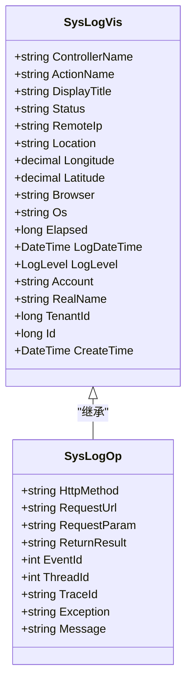
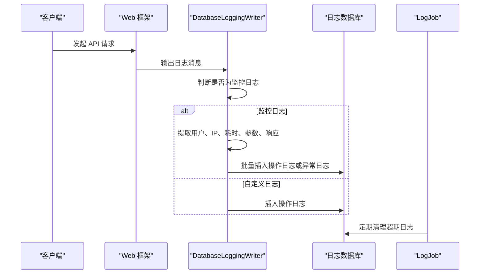
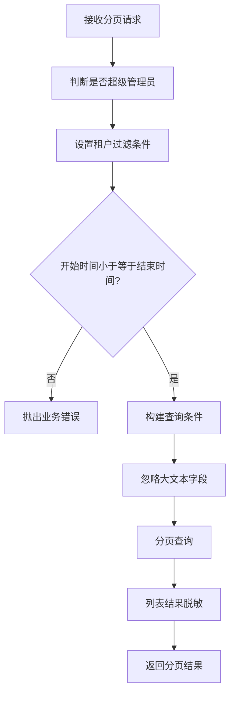
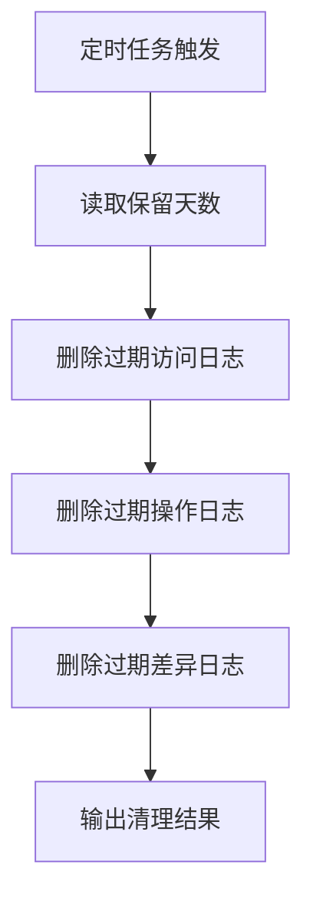

# 操作日志实体设计

<cite>
**本文引用的文件**
- [SysLogOp.cs](file://Admin.NET/Admin.NET.Core/Entity/SysLogOp.cs)
- [SysLogVis.cs](file://Admin.NET/Admin.NET.Core/Entity/SysLogVis.cs)
- [DatabaseLoggingWriter.cs](file://Admin.NET/Admin.NET.Core/Logging/DatabaseLoggingWriter.cs)
- [SysLogOpService.cs](file://Admin.NET/Admin.NET.Core/Service/Log/SysLogOpService.cs)
- [LogInput.cs](file://Admin.NET/Admin.NET.Core/Service/Log/Dto/LogInput.cs)
- [ExportLogDto.cs](file://Admin.NET/Admin.NET.Core/Service/Log/Dto/ExportLogDto.cs)
- [LogJob.cs](file://Admin.NET/Admin.NET.Core/Job/LogJob.cs)
- [ConfigConst.cs](file://Admin.NET/Admin.NET.Core/Const/ConfigConst.cs)
- [CommonConst.cs](file://Admin.NET/Admin.NET.Core/Const/CommonConst.cs)
</cite>

## 目录
1. [引言](#引言)
2. [数据模型总览](#数据模型总览)
3. [字段定义与数据类型](#字段定义与数据类型)
4. [记录时机与触发机制](#记录时机与触发机制)
5. [分页查询与过滤条件](#分页查询与过滤条件)
6. [统计分析与应用场景](#统计分析与应用场景)
7. [数据清理与归档策略](#数据清理与归档策略)
8. [性能与优化建议](#性能与优化建议)
9. [常见问题排查](#常见问题排查)
10. [结论](#结论)

## 引言
本文件聚焦 Admin.NET 中的系统操作日志实体 SysLogOp，从数据模型、写入流程、查询接口、统计分析和生命周期管理五个维度进行说明。SysLogOp 用于记录业务接口的调用过程，包括用户标识、模块与方法、请求方法、URL、参数、响应、异常、耗时、状态码、IP、地理位置、设备信息等关键信息，是审计、排障、监控和合规的重要基础设施。

## 数据模型总览
SysLogOp 继承自访问日志基类 SysLogVis，并进一步扩展请求级详情字段。其核心职责是记录一次完整的业务接口调用结果，而不仅仅是“是否登录”的访问事件。

该继承结构意味着 SysLogOp 同时具备：
- 访问日志基础信息：模块、方法、显示标题、状态、IP、位置、经纬度、浏览器、操作系统、执行耗时、日志时间、账号、真实姓名等；
- 操作日志增强字段：HTTP 方法、请求 URL、请求参数、返回结果、事件 ID、线程 ID、TraceId、异常信息、结构化日志消息等。

**图表来源**
- [SysLogVis.cs:1-116](file://Admin.NET/Admin.NET.Core/Entity/SysLogVis.cs#L1-L116)
- [SysLogOp.cs:1-72](file://Admin.NET/Admin.NET.Core/Entity/SysLogOp.cs#L1-L72)

**章节来源**
- [SysLogOp.cs:1-72](file://Admin.NET/Admin.NET.Core/Entity/SysLogOp.cs#L1-L72)
- [SysLogVis.cs:1-116](file://Admin.NET/Admin.NET.Core/Entity/SysLogVis.cs#L1-L116)

## 字段定义与数据类型
以下字段按用途分组说明。类型以 C# 属性声明为准，数据库列类型由 SqlSugar 映射配置决定。

### 身份与租户
| 字段 | 含义 | 类型 | 说明 |
|---|---|---|---|
| TenantId | 租户标识 | long | 多租户隔离字段，来自基类；分页和导出时用于限制数据范围 |
| Id | 主键 | long | 日志记录唯一标识 |
| CreateUserId | 创建用户ID | long | 来自基类，表示触发动作的用户ID |
| CreateUserName | 创建用户名 | string | 来自基类，通常与 RealName 一致 |
| Account | 账号 | string | 可空，来源于登录上下文或自定义日志上下文 |
| RealName | 真实姓名 | string | 可空，便于界面展示 |

### 模块与方法
| 字段 | 含义 | 类型 | 说明 |
|---|---|---|---|
| ControllerName | 模块名称 | string, 长度 256 | 控制器或业务模块名称 |
| ActionName | 方法名称 | string, 长度 256 | 操作方法名 |
| DisplayTitle | 显示名称 | string, 长度 256 | 面向用户的可读标题 |

### 网络与设备
| 字段 | 含义 | 类型 | 说明 |
|---|---|---|---|
| RemoteIp | IP 地址 | string, 长度 256 | 客户端 IP，优先使用 X-Forwarded-For |
| Location | 地点 | string, 长度 128 | IP 解析出的省市等信息 |
| Longitude | 经度 | decimal | IP 地理坐标经度 |
| Latitude | 纬度 | decimal | IP 地理坐标纬度 |
| Browser | 浏览器 | string, 长度 1024 | 解析后的浏览器信息 |
| Os | 操作系统 | string, 长度 256 | 解析后的操作系统信息 |

### 请求与响应
| 字段 | 含义 | 类型 | 说明 |
|---|---|---|---|
| HttpMethod | 请求方法 | string, 长度 32 | GET、POST、PUT、DELETE 等 |
| RequestUrl | 请求地址 | string（大文本） | 完整请求 URL |
| RequestParam | 请求参数 | string（大文本） | 序列化后的请求参数 |
| ReturnResult | 返回结果 | string（大文本） | 序列化后的响应结果 |
| Status | 状态码 | string, 长度 32 | HTTP 状态码字符串，如 200、500 |
| Elapsed | 执行耗时 | long? | 毫秒级耗时 |

### 追踪与诊断
| 字段 | 含义 | 类型 | 说明 |
|---|---|---|---|
| EventId | 事件 ID | int? | 日志事件标识 |
| ThreadId | 线程 ID | int? | 处理请求的线程标识 |
| TraceId | 请求跟踪 ID | string, 长度 128 | 链路追踪 ID |
| LogDateTime | 日志时间 | DateTime? | 记录时间 |
| LogLevel | 日志级别 | LogLevel? | Info、Warn、Error 等 |
| Exception | 异常信息 | string（大文本） | 序列化后的异常对象 |
| Message | 日志消息 | string（大文本） | 结构化日志内容 |

注意：
- 大文本字段 RequestParam、ReturnResult、Exception、Message 使用统一的大字符串类型映射，避免频繁截断导致信息丢失。
- 所有敏感内容在入库前会经过脱敏处理。

**章节来源**
- [SysLogOp.cs:1-72](file://Admin.NET/Admin.NET.Core/Entity/SysLogOp.cs#L1-L72)
- [SysLogVis.cs:1-116](file://Admin.NET/Admin.NET.Core/Entity/SysLogVis.cs#L1-L116)
- [DatabaseLoggingWriter.cs:1-282](file://Admin.NET/Admin.NET.Core/Logging/DatabaseLoggingWriter.cs#L1-L282)

## 记录时机与触发机制
操作日志的记录分为两类：框架监控日志与自定义日志。

具体行为如下：
- 框架监控日志：当存在 `loggingMonitor` 上下文时，根据 ActionName 判断：
  - login、loginPhone、logout 归类为访问日志；
  - 有异常则归类为异常日志；
  - 其他情况归类为操作日志。
- 自定义日志：没有监控上下文时，按简单日志模式构造 SysLogOp，默认状态码为 200。
- 操作日志开关：通过配置项 `sys_oplog` 控制是否记录操作日志。
- 写入方式：批量并行插入，降低高频日志对数据库的压力。
- 安全脱敏：入库前对 Message、Exception、RequestUrl 等进行脱敏。

**图表来源**
- [DatabaseLoggingWriter.cs:1-282](file://Admin.NET/Admin.NET.Core/Logging/DatabaseLoggingWriter.cs#L1-L282)
- [CommonConst.cs:18-18](file://Admin.NET/Admin.NET.Core/Const/CommonConst.cs#L18-L18)

**章节来源**
- [DatabaseLoggingWriter.cs:1-282](file://Admin.NET/Admin.NET.Core/Logging/DatabaseLoggingWriter.cs#L1-L282)
- [ConfigConst.cs:32-37](file://Admin.NET/Admin.NET.Core/Const/ConfigConst.cs#L32-L37)
- [CommonConst.cs:18-18](file://Admin.NET/Admin.NET.Core/Const/CommonConst.cs#L18-L18)

## 分页查询与过滤条件
SysLogOpService 提供操作日志分页、详情、清空和导出能力。分页查询支持多条件过滤，并忽略大文本字段以减少传输开销。

### 分页输入参数
| 参数 | 类型 | 说明 |
|---|---|---|
| TenantId | long | 租户筛选；非超级管理员固定当前租户 |
| StartTime | DateTime? | 开始时间 |
| EndTime | DateTime? | 结束时间 |
| Account | string? | 账号模糊或精确匹配 |
| RemoteIp | string? | IP 地址筛选 |
| ControllerName | string? | 模块名称筛选 |
| ActionName | string? | 方法名称筛选 |
| Elapsed | long? | 最小耗时筛选 |
| Status | string | 200 表示成功，其他值表示非 200 |

### 查询规则
- 开始时间不能晚于结束时间，否则抛出业务错误。
- 非超级管理员无法查看其他租户数据。
- 分页结果忽略 RequestParam、ReturnResult、Message，避免大字段影响性能。
- 列表结果会对敏感字段执行脱敏。
- 详情接口不忽略大字段，但同样会脱敏。
- 导出接口按时间范围和租户筛选，并将 Message、Exception 脱敏后导出 Excel。

**图表来源**
- [SysLogOpService.cs:1-101](file://Admin.NET/Admin.NET.Core/Service/Log/SysLogOpService.cs#L1-L101)
- [LogInput.cs:1-70](file://Admin.NET/Admin.NET.Core/Service/Log/Dto/LogInput.cs#L1-L70)

**章节来源**
- [SysLogOpService.cs:1-101](file://Admin.NET/Admin.NET.Core/Service/Log/SysLogOpService.cs#L1-L101)
- [LogInput.cs:1-70](file://Admin.NET/Admin.NET.Core/Service/Log/Dto/LogInput.cs#L1-L70)

## 统计分析与应用场景
基于 SysLogOp 的结构，可以支撑多种运维分析场景。

### 高频操作识别
- 按 ControllerName、ActionName 分组统计调用次数；
- 结合 Status 区分成功与失败比例；
- 适合发现热点接口、潜在滥用接口或未被充分测试的高频接口。

### 慢操作监控
- 基于 Elapsed 字段筛选大于阈值的记录；
- 可结合 Status 排除正常高耗时场景；
- 配合 TraceId 定位跨服务链路瓶颈。

### 异常操作预警
- 筛选 Status 非 200 或 Exception 非空的记录；
- 结合 RemoteIp、Account 分析异常来源；
- 可触发告警或自动封禁策略。

### 用户行为审计
- 按 Account、RealName 追踪特定用户的关键操作；
- 结合 RequestUrl、RequestParam 了解操作上下文；
- 满足合规审计要求。

### 实施建议
- 在数据库层建立索引：CreateTime、TenantId、ControllerName、ActionName、Status、RemoteIp、Elapsed。
- 对大文本字段仅按需加载，列表查询已忽略 RequestParam、ReturnResult、Message。
- 分析任务建议使用只读副本或 OLAP 引擎，避免影响在线事务。

[本节为通用分析指导，不直接分析具体代码文件]

## 数据清理与归档策略
项目内置定时任务 LogJob，按配置天数删除过期日志，防止大表拖慢数据库性能。

### 清理范围
- 访问日志 SysLogVis；
- 操作日志 SysLogOp；
- 差异日志 SysLogDiff。

### 清理逻辑
- 读取保留天数配置 sys_log_retention_days；
- 删除 CreateTime 早于当前时间减去保留天数的记录；
- 打印清理结果并记录到日志类别 System.Logging.LoggingMonitor。

**图表来源**
- [LogJob.cs:1-46](file://Admin.NET/Admin.NET.Core/Job/LogJob.cs#L1-L46)
- [ConfigConst.cs:32-37](file://Admin.NET/Admin.NET.Core/Const/ConfigConst.cs#L32-L37)
- [CommonConst.cs:18-18](file://Admin.NET/Admin.NET.Core/Const/CommonConst.cs#L18-L18)

**章节来源**
- [LogJob.cs:1-46](file://Admin.NET/Admin.NET.Core/Job/LogJob.cs#L1-L46)
- [ConfigConst.cs:32-37](file://Admin.NET/Admin.NET.Core/Const/ConfigConst.cs#L32-L37)
- [CommonConst.cs:18-18](file://Admin.NET/Admin.NET.Core/Const/CommonConst.cs#L18-L18)

## 性能与优化建议
- 列表查询忽略大字段：分页接口已忽略 RequestParam、ReturnResult、Message，减少网络与序列化开销。
- 批量写入：DatabaseLoggingWriter 将操作日志、异常日志、访问日志分别收集后并行插入，降低锁竞争。
- 独立日志库：DatabaseLoggingWriter 使用独立日志数据库连接，避免与业务库互相影响。
- 可选延迟写入：源码中保留了延迟写入注释，可根据压测结果决定是否启用以降低高频写入死锁风险。
- 合理索引：建议在 CreateTime、TenantId、ControllerName、ActionName、Status、RemoteIp、Elapsed 上建立合适索引。
- 数据分片：如果单表增长过快，可按月份或租户分表，并结合 LogJob 按分片清理。
- 只读分析：分析报表应走只读副本或离线数仓，避免影响线上事务。
- 脱敏成本：脱敏发生在入库前，应避免对超大对象重复序列化。

[本节为通用性能建议，不直接分析具体代码文件]

## 常见问题排查
- 未看到操作日志：
  - 检查配置项 sys_oplog 是否开启；
  - 确认日志类别是否正确，框架监控日志类别为 System.Logging.LoggingMonitor；
  - 确认请求是否命中框架监控路径，或是否使用自定义日志输出。
- 分页无数据：
  - 检查 TimeRange 是否合法；
  - 非超级管理员只能查看当前租户数据；
  - 确认是否需要放宽 ControllerName、ActionName、RemoteIp 等过滤条件。
- 列表缺少请求参数或响应：
  - 列表接口故意忽略大字段；
  - 需要查看详情接口获取完整数据。
- 导出文件为空：
  - 检查导出时间范围；
  - 确认租户权限与筛选条件。
- 日志表持续增长：
  - 检查 LogJob 是否正常运行；
  - 调整 sys_log_retention_days 配置；
  - 评估是否需要分表或迁移至冷存储。

**章节来源**
- [SysLogOpService.cs:1-101](file://Admin.NET/Admin.NET.Core/Service/Log/SysLogOpService.cs#L1-L101)
- [DatabaseLoggingWriter.cs:1-282](file://Admin.NET/Admin.NET.Core/Logging/DatabaseLoggingWriter.cs#L1-L282)
- [LogJob.cs:1-46](file://Admin.NET/Admin.NET.Core/Job/LogJob.cs#L1-L46)
- [ConfigConst.cs:32-37](file://Admin.NET/Admin.NET.Core/Const/ConfigConst.cs#L32-L37)
- [CommonConst.cs:18-18](file://Admin.NET/Admin.NET.Core/Const/CommonConst.cs#L18-L18)

## 结论
SysLogOp 是 Admin.NET 操作审计的核心数据模型。它继承访问日志的基础上下文，并在请求级补充 HTTP 方法、URL、参数、响应、异常、耗时、状态码、IP 和设备信息等关键字段。写入流程兼顾性能与安全，分页查询针对大字段做了优化，定时任务保障数据生命周期可控。在实际使用中，建议结合索引、分表和只读分析提升稳定性，并通过高频、慢操作、异常等分析场景实现可观测性闭环。

[本节为总结性内容，不直接分析具体代码文件]