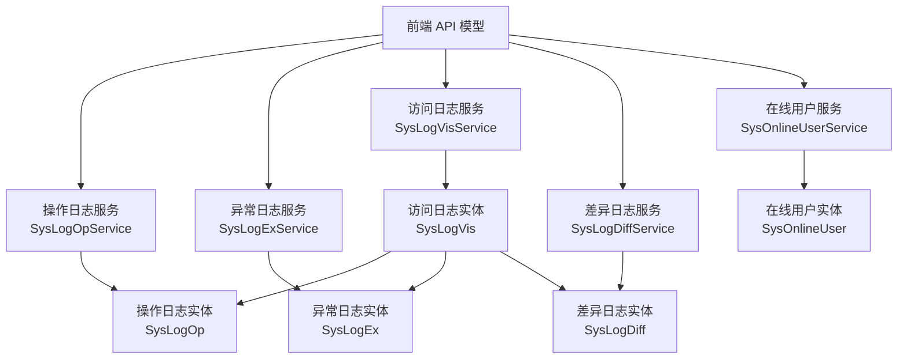
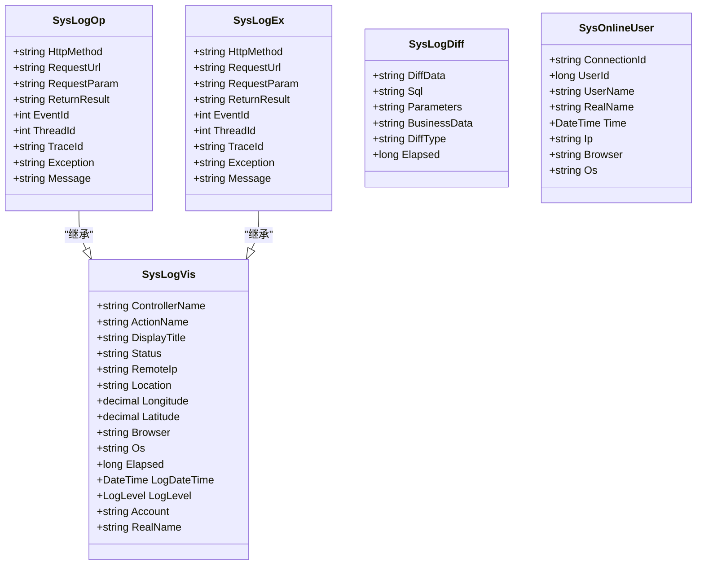
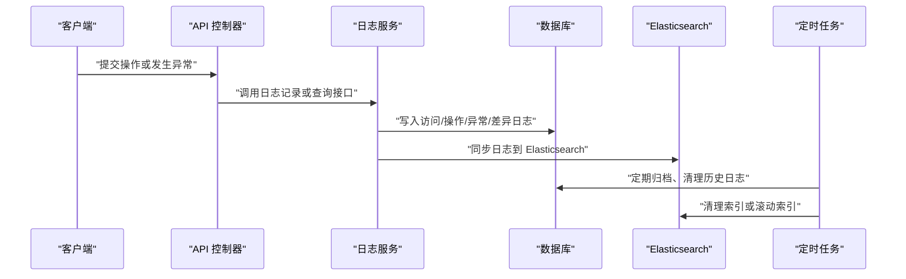
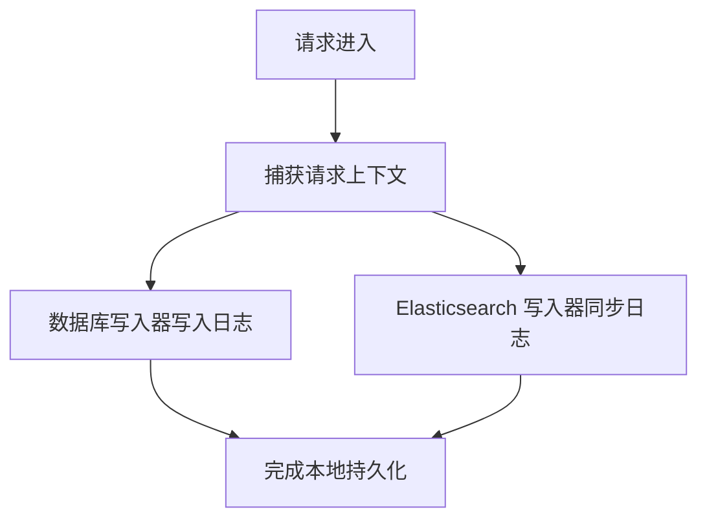
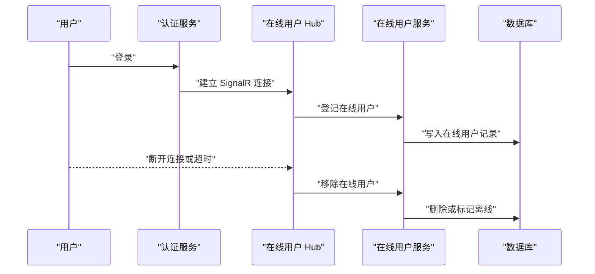
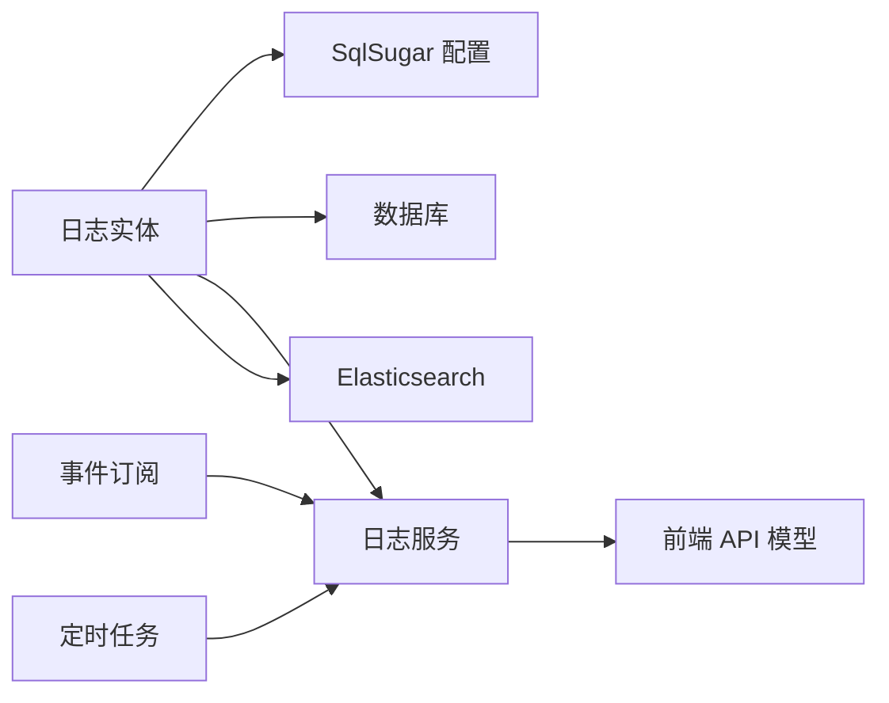
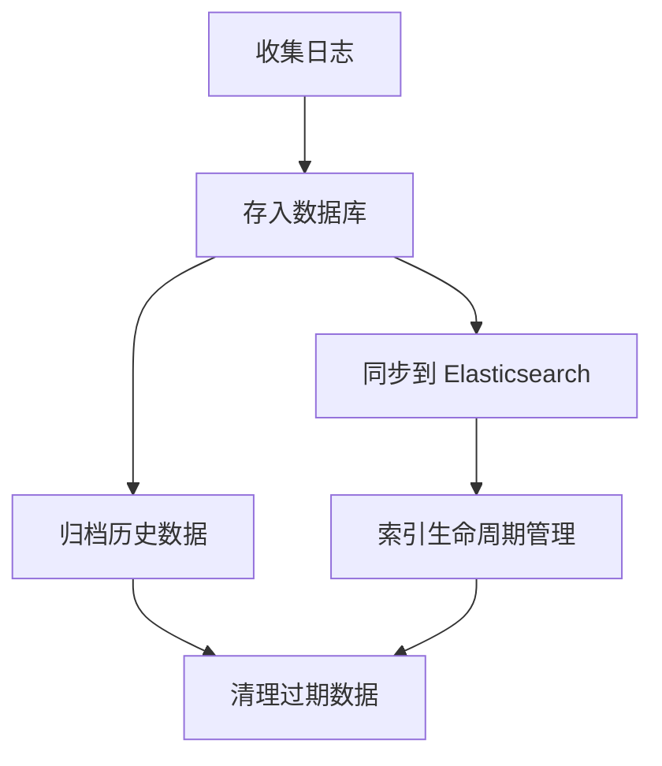
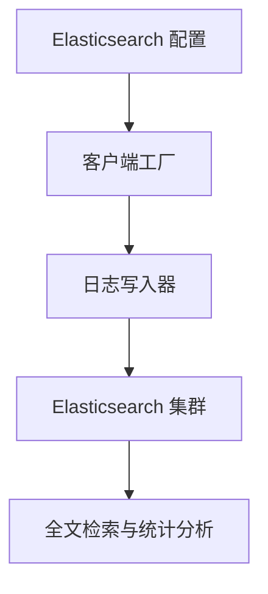

# 监控日志实体设计

<cite>
**本文引用的文件**   
- [SysLogVis.cs](file://Admin.NET/Admin.NET.Core/Entity/SysLogVis.cs)
- [SysLogOp.cs](file://Admin.NET/Admin.NET.Core/Entity/SysLogOp.cs)
- [SysLogEx.cs](file://Admin.NET/Admin.NET.Core/Entity/SysLogEx.cs)
- [SysLogDiff.cs](file://Admin.NET/Admin.NET.Core/Entity/SysLogDiff.cs)
- [SysOnlineUser.cs](file://Admin.NET/Admin.NET.Core/Entity/SysOnlineUser.cs)
- [SqlSugarSetup.cs](file://Admin.NET/Admin.NET.Core/SqlSugar/SqlSugarSetup.cs)
- [DatabaseLoggingWriter.cs](file://Admin.NET/Admin.NET.Core/Logging/DatabaseLoggingWriter.cs)
- [ElasticSearchLoggingWriter.cs](file://Admin.NET/Admin.NET.Core/Logging/ElasticSearchLoggingWriter.cs)
- [ElasticSearchClientFactory.cs](file://Admin.NET/Admin.NET.Core/ElasticSearch/ElasticSearchClientFactory.cs)
- [ElasticSearchOptions.cs](file://Admin.NET/Admin.NET.Core/Option/ElasticSearchOptions.cs)
- [AppEventSubscriber.cs](file://Admin.NET/Admin.NET.Core/EventBus/AppEventSubscriber.cs)
- [LogJob.cs](file://Admin.NET/Admin.NET.Core/Job/LogJob.cs)
- [OnlineUserJob.cs](file://Admin.NET/Admin.NET.Core/Job/OnlineUserJob.cs)
- [SysLogOpService.cs](file://Admin.NET/Admin.NET.Core/Service\Log\SysLogOpService.cs)
- [SysLogExService.cs](file://Admin.NET/Admin.NET.Core/Service\Log\SysLogExService.cs)
- [SysLogVisService.cs](file://Admin.NET/Admin.NET.Core/Service\Log\SysLogVisService.cs)
- [SysLogDiffService.cs](file://Admin.NET/Admin.NET.Core/Service\Log/SysLogDiffService.cs)
- [SysOnlineUserService.cs](file://Admin.NET/Admin.NET.Core/Service/OnlineUser/SysOnlineUserService.cs)
- [SysAuthService.cs](file://Admin.NET/Admin.NET.Core/Service/Auth/SysAuthService.cs)
- [On lineUserHub.cs](file://Admin.NET/Admin.NET.Core/Hub/OnlineUserHub.cs)
- [Web 在线用户接口模型](file://Web/apps/web-antdv-next/src/api-services/models/sys-online-user.ts)
- [Web 操作日志接口模型](file://Web/apps/web-antdv-next/src/api-services/models/sys-log-op.ts)
- [Web 异常日志接口模型](file://Web/apps/web-antdv-next/src/api-services/models/sys-log-ex.ts)
- [Web 访问日志接口模型](file://Web/apps/web-antdv-next/src/api-services/models/sys-log-vis.ts)
- [Web 差异日志接口模型](file://Web/apps/web-antdv-next/src/api-services/models/sys-log-diff.ts)
</cite>

## 目录
1. [引言](#引言)
2. [项目结构与定位](#项目结构与定位)
3. [核心数据模型](#核心数据模型)
4. [系统架构总览](#系统架构总览)
5. [详细组件分析](#详细组件分析)
6. [依赖关系分析](#依赖关系分析)
7. [分页查询与性能优化](#分页查询与性能优化)
8. [归档清理策略](#归档清理策略)
9. [Elasticsearch 集成与全文检索](#elasticsearch-集成与全文检索)
10. [故障排查指南](#故障排查指南)
11. [结论](#结论)

## 引言
本文件面向 Admin.NET 的监控日志子系统，重点说明五类核心实体：系统访问日志、系统操作日志、系统异常日志、系统差异日志，以及在线用户表。文档从字段规范、继承结构、写入链路、分页查询、归档清理和 Elasticsearch 同步等角度展开，帮助后端开发、运维人员和数据分析人员统一理解日志数据模型及其在生产环境中的使用方式。

## 项目结构与定位
监控日志相关实体集中在 `Admin.NET.Admin.NET.Core` 的 `Entity` 目录中，并由日志服务、事件订阅、定时任务、SignalR 在线用户 Hub、前端 API 服务模型共同消费。整体采用“实体 + 服务 + 事件/任务 + 前端模型”的分层组织方式。

**图表来源**
- [SysLogVis.cs:1-116](file://Admin.NET/Admin.NET.Core/Entity/SysLogVis.cs#L1-L116)
- [SysLogOp.cs:1-72](file://Admin.NET/Admin.NET.Core/Entity/SysLogOp.cs#L1-L72)
- [SysLogEx.cs:1-72](file://Admin.NET/Admin.NET.Core/Entity/SysLogEx.cs#L1-L72)
- [SysLogDiff.cs:1-52](file://Admin.NET/Admin.NET.Core/Entity/SysLogDiff.cs#L1-L52)
- [SysOnlineUser.cs:1-68](file://Admin.NET/Admin.NET.Core/Entity/SysOnlineUser.cs#L1-L68)

**章节来源**
- [SysLogVis.cs:1-116](file://Admin.NET/Admin.NET.Core/Entity/SysLogVis.cs#L1-L116)
- [SysLogOp.cs:1-72](file://Admin.NET/Admin.NET.Core/Entity/SysLogOp.cs#L1-L72)
- [SysLogEx.cs:1-72](file://Admin.NET/Admin.NET.Core/Entity/SysLogEx.cs#L1-L72)
- [SysLogDiff.cs:1-52](file://Admin.NET/Admin.NET.Core/Entity/SysLogDiff.cs#L1-L52)
- [SysOnlineUser.cs:1-68](file://Admin.NET/Admin.NET.Core/Entity/SysOnlineUser.cs#L1-L68)

## 核心数据模型
本节按“基表 → 扩展表”的方式解释实体结构，并补充公共字段含义。

### 基表：系统访问日志 SysLogVis
`SysLogVis` 是所有访问类日志的基础表，包含模块、方法、显示名称、状态、IP、地点、经纬度、浏览器、操作系统、执行时间、日志时间、日志级别、账号、真实姓名等通用指标。它继承自租户基实体，因此天然具备多租户隔离能力。

| 字段 | 类型 | 长度或精度 | 说明 |
|---|---|---:|---|
| ControllerName | string | 256 | 模块名称 |
| ActionName | string | 256 | 方法名称 |
| DisplayTitle | string | 256 | 显示名称 |
| Status | string | 32 | 执行状态 |
| RemoteIp | string | 256 | IP 地址 |
| Location | string | 128 | 登录地点 |
| Longitude | decimal | - | 经度 |
| Latitude | decimal | - | 维度 |
| Browser | string | 1024 | 浏览器 |
| Os | string | 256 | 操作系统 |
| Elapsed | long? | - | 操作用时，单位通常为毫秒级数值 |
| LogDateTime | DateTime? | - | 日志时间 |
| LogLevel | LogLevel? | - | 日志级别 |
| Account | string | 32 | 账号 |
| RealName | string | 32 | 真实姓名 |

继承说明：
- 继承 `EntityBaseTenant`，获得租户标识等基础字段，便于多租户场景下日志隔离与统计。

**章节来源**
- [SysLogVis.cs:1-116](file://Admin.NET/Admin.NET.Core/Entity/SysLogVis.cs#L1-L116)

### 扩展表：系统操作日志 SysLogOp
`SysLogOp` 继承 `SysLogVis`，用于记录一次业务操作的完整请求上下文。新增字段包括 HTTP 方法、请求 URL、请求参数、返回结果、事件 ID、线程 ID、请求跟踪 ID、异常信息、日志消息 JSON。

| 字段 | 类型 | 长度或精度 | 说明 |
|---|---|---:|---|
| HttpMethod | string | 32 | 请求方式 |
| RequestUrl | string | 大字符串 | 请求地址 |
| RequestParam | string | 大字符串 | 请求参数 |
| ReturnResult | string | 大字符串 | 返回结果 |
| EventId | int? | - | 事件 ID |
| ThreadId | int? | - | 线程 ID |
| TraceId | string | 128 | 请求跟踪 ID |
| Exception | string | 大字符串 | 异常信息 |
| Message | string | 大字符串 | 日志消息 JSON |

关键设计点：
- 请求参数、返回结果、异常信息和日志消息使用大字符串列，适合保存结构化 JSON 或堆栈文本。
- `TraceId` 可用于跨进程、跨服务的请求追踪。
- 通过继承复用访问日志通用字段，减少重复建模。

**章节来源**
- [SysLogOp.cs:1-72](file://Admin.NET/Admin.NET.Core/Entity/SysLogOp.cs#L1-L72)

### 扩展表：系统异常日志 SysLogEx
`SysLogEx` 也继承 `SysLogVis`，字段集合与 `SysLogOp` 基本一致，语义上专用于异常路径。通常由全局异常处理或错误日志记录逻辑写入。

| 字段 | 类型 | 长度或精度 | 说明 |
|---|---|---:|---|
| HttpMethod | string | 32 | 请求方式 |
| RequestUrl | string | 大字符串 | 请求地址 |
| RequestParam | string | 大字符串 | 请求参数 |
| ReturnResult | string | 大字符串 | 返回结果 |
| EventId | int? | - | 事件 ID |
| ThreadId | int? | - | 线程 ID |
| TraceId | string | 128 | 请求跟踪 ID |
| Exception | string | 大字符串 | 异常信息 |
| Message | string | 大字符串 | 日志消息 JSON |

关键设计点：
- 与 `SysLogOp` 共享相同字段，便于统一展示异常请求上下文。
- 建议将 `Exception` 保留原始堆栈摘要，同时用 `Message` 存储更结构化的诊断信息。

**章节来源**
- [SysLogEx.cs:1-72](file://Admin.NET/Admin.NET.Core/Entity/SysLogEx.cs#L1-L72)

### 扩展表：系统差异日志 SysLogDiff
`SysLogDiff` 不继承 `SysLogVis`，而是直接继承 `EntityBaseTenant`，用于记录数据变更的差异内容，常见于审计、SQL 审计或变更对比场景。

| 字段 | 类型 | 长度或精度 | 说明 |
|---|---|---:|---|
| DiffData | string | 大字符串 | 差异数据 |
| Sql | string | 大字符串 | SQL 语句 |
| Parameters | string | 大字符串 | 手动传入的参数 |
| BusinessData | string | 大字符串 | 业务对象 |
| DiffType | string | 大字符串 | 差异操作 |
| Elapsed | long? | - | 耗时 |

关键设计点：
- 差异日志偏向“审计型”数据，强调可回溯性。
- `DiffType` 可用于区分插入、更新、删除、SQL 审计等不同审计来源。
- 与大字符串字段配合，可保存 JSON 差异、SQL 片段、前后值快照等。

**章节来源**
- [SysLogDiff.cs:1-52](file://Admin.NET/Admin.NET.Core/Entity/SysLogDiff.cs#L1-L52)

### 在线用户：SysOnlineUser
`SysOnlineUser` 表示当前在线连接的用户，常用于 SignalR 会话管理、在线人数统计、强制下线等场景。

| 字段 | 类型 | 长度或精度 | 说明 |
|---|---|---:|---|
| ConnectionId | string? | - | SignalR 连接 ID |
| UserId | long | - | 用户 ID |
| UserName | string | 32 | 账号，必填 |
| RealName | string | 32 | 真实姓名 |
| Time | DateTime? | - | 连接时间 |
| Ip | string | 256 | 连接 IP |
| Browser | string | 128 | 浏览器 |
| Os | string | 128 | 操作系统 |

关键设计点：
- 继承 `EntityBaseTenantId`，支持基于租户 ID 的在线用户隔离。
- `ConnectionId` 是 SignalR 连接标识，用于推送消息、踢人、统计在线连接。
- `Time` 可用于判断长时间未心跳的连接是否应清理。

**章节来源**
- [SysOnlineUser.cs:1-68](file://Admin.NET/Admin.NET.Core/Entity/SysOnlineUser.cs#L1-L68)

### 实体关系图

**图表来源**
- [SysLogVis.cs:1-116](file://Admin.NET/Admin.NET.Core/Entity/SysLogVis.cs#L1-L116)
- [SysLogOp.cs:1-72](file://Admin.NET/Admin.NET.Core/Entity/SysLogOp.cs#L1-L72)
- [SysLogEx.cs:1-72](file://Admin.NET/Admin.NET.Core/Entity/SysLogEx.cs#L1-L72)
- [SysLogDiff.cs:1-52](file://Admin.NET/Admin.NET.Core/Entity/SysLogDiff.cs#L1-L52)
- [SysOnlineUser.cs:1-68](file://Admin.NET/Admin.NET.Core/Entity/SysOnlineUser.cs#L1-L68)

## 系统架构总览
监控日志系统由以下层次组成：

- 实体层：定义数据库表结构和字段约束。
- 服务层：提供分页查询、导出、删除、在线用户管理等业务接口。
- 日志写入层：通过数据库写入器、Elasticsearch 写入器、全局异常处理器写入日志。
- 事件与任务层：通过事件订阅触发异步处理，通过定时任务完成归档、清理、在线用户维护。
- 前端层：API 服务模型与服务端实体对应，提供日志查询界面。

**图表来源**
- [DatabaseLoggingWriter.cs](file://Admin.NET/Admin.NET.Core/Logging/DatabaseLoggingWriter.cs)
- [ElasticSearchLoggingWriter.cs](file://Admin.NET/Admin.NET.Core/Logging/ElasticSearchLoggingWriter.cs)
- [LogJob.cs](file://Admin.NET/Admin.NET.Core/Job/LogJob.cs)
- [SysLogOpService.cs](file://Admin.NET/Admin.NET.Core/Service\Log\SysLogOpService.cs)
- [SysLogExService.cs](file://Admin.NET/Admin.NET.Core/Service\Log\SysLogExService.cs)
- [SysLogVisService.cs](file://Admin.NET/Admin.NET.Core/Service\Log\SysLogVisService.cs)
- [SysLogDiffService.cs](file://Admin.NET/Admin.NET.Core/Service\Log/SysLogDiffService.cs)

## 详细组件分析

### 日志写入链路
日志写入通常发生在请求进入控制器、业务方法执行、异常抛出或数据变更时。写入目标包括数据库表和 Elasticsearch。

**图表来源**
- [DatabaseLoggingWriter.cs](file://Admin.NET/Admin.NET.Core/Logging/DatabaseLoggingWriter.cs)
- [ElasticSearchLoggingWriter.cs](file://Admin.NET/Admin.NET.Core/Logging/ElasticSearchLoggingWriter.cs)

**章节来源**
- [DatabaseLoggingWriter.cs](file://Admin.NET/Admin.NET.Core/Logging/DatabaseLoggingWriter.cs)
- [ElasticSearchLoggingWriter.cs](file://Admin.NET/Admin.NET.Core/Logging/ElasticSearchLoggingWriter.cs)

### 在线用户会话管理
在线用户由 SignalR 连接驱动，结合服务层进行增删改查。典型流程包括登录建立连接、连接断开清理、定时任务清理过期连接、前端轮询在线列表。

**图表来源**
- [SysOnlineUserService.cs](file://Admin.NET/Admin.NET.Core/Service/OnlineUser/SysOnlineUserService.cs)
- [OnlineUserHub.cs](file://Admin.NET/Admin.NET.Core/Hub/OnlineUserHub.cs)
- [SysAuthService.cs](file://Admin.NET/Admin.NET.Core/Service/Auth/SysAuthService.cs)
- [SysOnlineUser.cs](file://Admin.NET/Admin.NET.Core/Entity/SysOnlineUser.cs)

**章节来源**
- [SysOnlineUser.cs:1-68](file://Admin.NET/Admin.NET.Core/Entity/SysOnlineUser.cs#L1-L68)
- [SysOnlineUserService.cs](file://Admin.NET/Admin.NET.Core/Service/OnlineUser/SysOnlineUserService.cs)
- [OnlineUserHub.cs](file://Admin.NET/Admin.NET.Core/Hub/OnlineUserHub.cs)
- [SysAuthService.cs](file://Admin.NET/Admin.NET.Core/Service/Auth/SysAuthService.cs)

### 日志服务职责划分
- `SysLogOpService`：操作日志的分页查询、筛选、导出等。
- `SysLogExService`：异常日志的分页查询、异常模式分析支撑。
- `SysLogVisService`：访问日志的分页查询、访问趋势分析支撑。
- `SysLogDiffService`：差异日志的查询、审计回溯支撑。

这些服务通常封装 SqlSugar 查询条件，对外暴露分页结果，供前端表格展示和导出。

**章节来源**
- [SysLogOpService.cs](file://Admin.NET/Admin.NET.Core/Service\Log\SysLogOpService.cs)
- [SysLogExService.cs](file://Admin.NET/Admin.NET.Core/Service\Log\SysLogExService.cs)
- [SysLogVisService.cs](file://Admin.NET/Admin.NET.Core/Service\Log\SysLogVisService.cs)
- [SysLogDiffService.cs](file://Admin.NET/Admin.NET.Core/Service\Log/SysLogDiffService.cs)

## 依赖关系分析
日志实体依赖 SqlSugar ORM 配置、日志写入器、Elasticsearch 客户端、事件总线以及前端 API 模型。

**图表来源**
- [SqlSugarSetup.cs](file://Admin.NET/Admin.NET.Core/SqlSugar/SqlSugarSetup.cs)
- [AppEventSubscriber.cs](file://Admin.NET/Admin.NET.Core/EventBus/AppEventSubscriber.cs)
- [LogJob.cs](file://Admin.NET/Admin.NET.Core/Job/LogJob.cs)
- [SysLogOpService.cs](file://Admin.NET/Admin.NET.Core/Service\Log\SysLogOpService.cs)
- [Web 操作日志接口模型](file://Web/apps/web-antdv-next/src/api-services/models/sys-log-op.ts)

**章节来源**
- [SqlSugarSetup.cs](file://Admin.NET/Admin.NET.Core/SqlSugar/SqlSugarSetup.cs)
- [AppEventSubscriber.cs](file://Admin.NET/Admin.NET.Core/EventBus/AppEventSubscriber.cs)
- [LogJob.cs](file://Admin.NET/Admin.NET.Core/Job/LogJob.cs)

## 分页查询与性能优化

### 常见查询场景
- 按时间范围过滤：使用 `LogDateTime` 或 `Time` 字段限定起止时间。
- 按用户筛选：使用 `Account`、`RealName`、`UserId`（在线用户）缩小范围。
- 按模块分类：使用 `ControllerName`、`ActionName`、`DisplayTitle` 筛选功能模块。
- 按状态筛选：使用 `Status` 区分成功、失败、异常等。
- 按 IP 或地点筛选：使用 `RemoteIp`、`Location` 定位访问来源。
- 按异常关键字筛选：使用 `Exception`、`Message` 做模糊匹配。

### 分页策略建议
- 优先使用服务端分页，避免一次性加载大量日志。
- 在高频筛选字段上建立复合索引，例如：
  - `(LogDateTime, Account)`
  - `(LogDateTime, ControllerName)`
  - `(LogDateTime, Status)`
  - `(Time, ConnectionId)`
- 对大字符串字段如 `RequestParam`、`ReturnResult`、`Exception`、`Message`、`DiffData` 不宜直接参与常规分页排序，建议在 Elasticsearch 中进行全文检索。
- 前端分页参数应与后端服务保持一致，避免偏移量过大导致性能下降。

### 慢查询识别
- 关注 `Elapsed` 较大的记录，结合 `ControllerName`、`ActionName`、`RequestUrl` 定位慢接口。
- 对频繁出现的异常类型进行聚合，识别热点异常。
- 对高并发模块按时间段统计访问量和失败率。

**章节来源**
- [SysLogVis.cs:1-116](file://Admin.NET/Admin.NET.Core/Entity/SysLogVis.cs#L1-L116)
- [SysLogOp.cs:1-72](file://Admin.NET/Admin.NET.Core/Entity/SysLogOp.cs#L1-L72)
- [SysLogEx.cs:1-72](file://Admin.NET/Admin.NET.Core/Entity/SysLogEx.cs#L1-L72)
- [SysLogDiff.cs:1-52](file://Admin.NET/Admin.NET.Core/Entity/SysLogDiff.cs#L1-L52)
- [SysOnlineUser.cs:1-68](file://Admin.NET/Admin.NET.Core/Entity/SysOnlineUser.cs#L1-L68)

## 归档清理策略
日志表随着时间增长会快速膨胀，必须制定归档与清理策略：

- 数据库归档：
  - 按月或按周拆分历史表，或使用分区表。
  - 将超过保留期的记录迁移到归档库或冷存储。
- 数据库清理：
  - 定时任务删除或归档超出保留时间的记录。
  - 对在线用户表进行心跳检测，清理长时间无心跳的连接。
- Elasticsearch 清理：
  - 使用索引生命周期管理，按天或按周滚动索引。
  - 对历史索引设置生存周期，到期自动删除。

**图表来源**
- [LogJob.cs](file://Admin.NET/Admin.NET.Core/Job/LogJob.cs)
- [OnlineUserJob.cs](file://Admin.NET/Admin.NET.Core/Job/OnlineUserJob.cs)
- [ElasticSearchClientFactory.cs](file://Admin.NET/Admin.NET.Core/ElasticSearch/ElasticSearchClientFactory.cs)
- [ElasticSearchOptions.cs](file://Admin.NET/Admin.NET.Core/Option/ElasticSearchOptions.cs)

**章节来源**
- [LogJob.cs](file://Admin.NET/Admin.NET.Core/Job/LogJob.cs)
- [OnlineUserJob.cs](file://Admin.NET/Admin.NET.Core/Job/OnlineUserJob.cs)
- [ElasticSearchClientFactory.cs](file://Admin.NET/Admin.NET.Core/ElasticSearch/ElasticSearchClientFactory.cs)
- [ElasticSearchOptions.cs](file://Admin.NET/Admin.NET.Core/Option/ElasticSearchOptions.cs)

## Elasticsearch 集成与全文检索
Elasticsearch 用于增强日志的全文检索、聚合分析和可视化能力。

- 配置与客户端：
  - 通过 `ElasticSearchOptions` 管理连接参数。
  - 通过 `ElasticSearchClientFactory` 创建和管理客户端实例。
- 写入与同步：
  - `ElasticSearchLoggingWriter` 负责将日志写入 Elasticsearch。
  - 可与数据库写入并行，保证本地持久化和远程检索的双重保障。
- 查询与分析：
  - 支持按关键词搜索 `Exception`、`Message`、`RequestUrl` 等文本字段。
  - 支持按时间、模块、用户、状态进行聚合统计。
  - 支持生成访问趋势、异常趋势、用户行为轨迹。

**图表来源**
- [ElasticSearchOptions.cs](file://Admin.NET/Admin.NET.Core/Option/ElasticSearchOptions.cs)
- [ElasticSearchClientFactory.cs](file://Admin.NET/Admin.NET.Core/ElasticSearch/ElasticSearchClientFactory.cs)
- [ElasticSearchLoggingWriter.cs](file://Admin.NET/Admin.NET.Core/Logging/ElasticSearchLoggingWriter.cs)

**章节来源**
- [ElasticSearchOptions.cs](file://Admin.NET/Admin.NET.Core/Option/ElasticSearchOptions.cs)
- [ElasticSearchClientFactory.cs](file://Admin.NET/Admin.NET.Core/ElasticSearch/ElasticSearchClientFactory.cs)
- [ElasticSearchLoggingWriter.cs](file://Admin.NET/Admin.NET.Core/Logging/ElasticSearchLoggingWriter.cs)

## 故障排查指南

### 日志无法写入数据库
- 检查 SqlSugar 连接配置是否正确。
- 确认日志表是否存在且权限正确。
- 查看数据库写入器是否有异常被吞掉。

**章节来源**
- [SqlSugarSetup.cs](file://Admin.NET/Admin.NET.Core/SqlSugar/SqlSugarSetup.cs)
- [DatabaseLoggingWriter.cs](file://Admin.NET/Admin.NET.Core/Logging/DatabaseLoggingWriter.cs)

### Elasticsearch 不可用
- 检查 `ElasticSearchOptions` 中的地址、认证、索引名配置。
- 验证 `ElasticSearchClientFactory` 是否能创建客户端。
- 确认写入器是否在启用 Elasticsearch 后仍能降级写入数据库。

**章节来源**
- [ElasticSearchOptions.cs](file://Admin.NET/Admin.NET.Core/Option/ElasticSearchOptions.cs)
- [ElasticSearchClientFactory.cs](file://Admin.NET/Admin.NET.Core/ElasticSearch/ElasticSearchClientFactory.cs)
- [ElasticSearchLoggingWriter.cs](file://Admin.NET/Admin.NET.Core/Logging/ElasticSearchLoggingWriter.cs)

### 在线用户不更新或残留
- 检查 SignalR 连接是否正常建立和断开。
- 检查在线用户服务是否正确登记和移除用户。
- 检查定时任务是否清理了长时间无心跳的连接。

**章节来源**
- [SysOnlineUserService.cs](file://Admin.NET/Admin.NET.Core/Service/OnlineUser/SysOnlineUserService.cs)
- [OnlineUserHub.cs](file://Admin.NET/Admin.NET.Core/Hub/OnlineUserHub.cs)
- [OnlineUserJob.cs](file://Admin.NET/Admin.NET.Core/Job/OnlineUserJob.cs)
- [SysOnlineUser.cs:1-68](file://Admin.NET/Admin.NET.Core/Entity/SysOnlineUser.cs#L1-L68)

### 前端模型与服务端不一致
- 核对前端 `sys-log-op.ts`、`sys-log-ex.ts`、`sys-log-vis.ts`、`sys-log-diff.ts`、`sys-online-user.ts` 与服务端实体字段映射。
- 确保分页响应结构与服务端返回一致。

**章节来源**
- [Web 操作日志接口模型](file://Web/apps/web-antdv-next/src/api-services/models/sys-log-op.ts)
- [Web 异常日志接口模型](file://Web/apps/web-antdv-next/src/api-services/models/sys-log-ex.ts)
- [Web 访问日志接口模型](file://Web/apps/web-antdv-next/src/api-services/models/sys-log-vis.ts)
- [Web 差异日志接口模型](file://Web/apps/web-antdv-next/src/api-services/models/sys-log-diff.ts)
- [Web 在线用户接口模型](file://Web/apps/web-antdv-next/src/api-services/models/sys-online-user.ts)

## 结论
Admin.NET 的监控日志体系以 `SysLogVis` 为基表，向上扩展出操作日志、异常日志；差异日志独立建模用于审计；在线用户单独建模用于会话管理。通过数据库与 Elasticsearch 双写、事件与定时任务协同、前端模型对齐，系统能够支撑日常运维、异常诊断、性能分析和用户行为追踪。生产环境中应重点关注索引设计、分页性能、归档清理和 Elasticsearch 生命周期管理，以避免大表和大索引对系统造成压力。