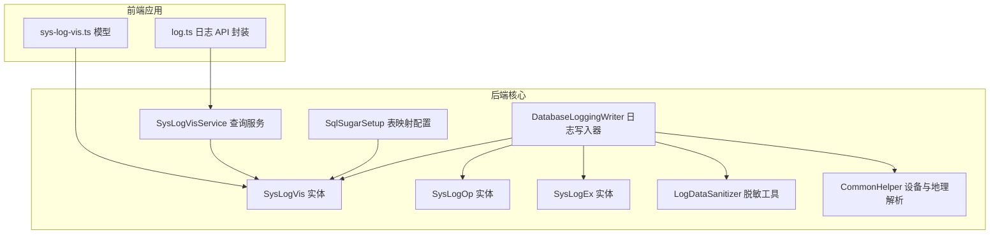
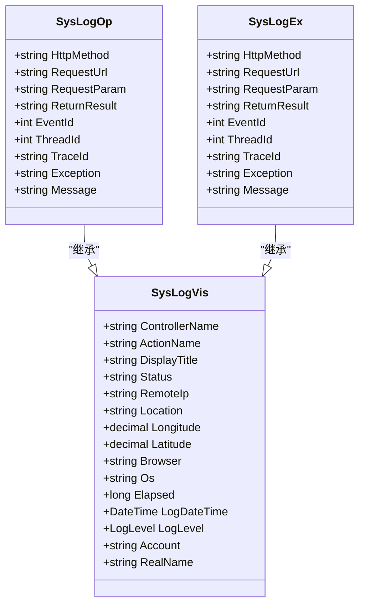
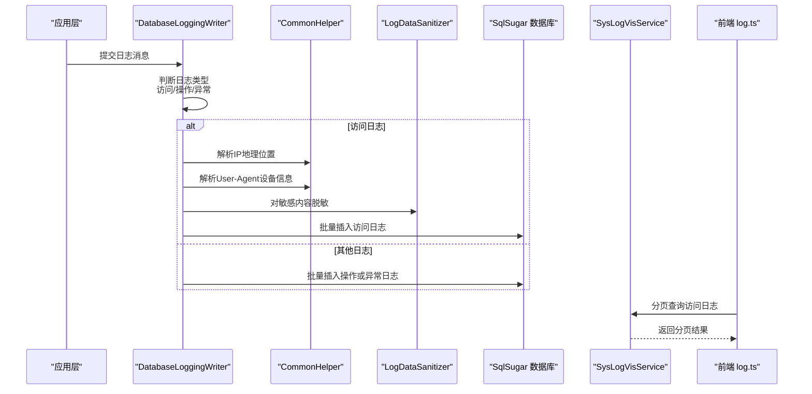
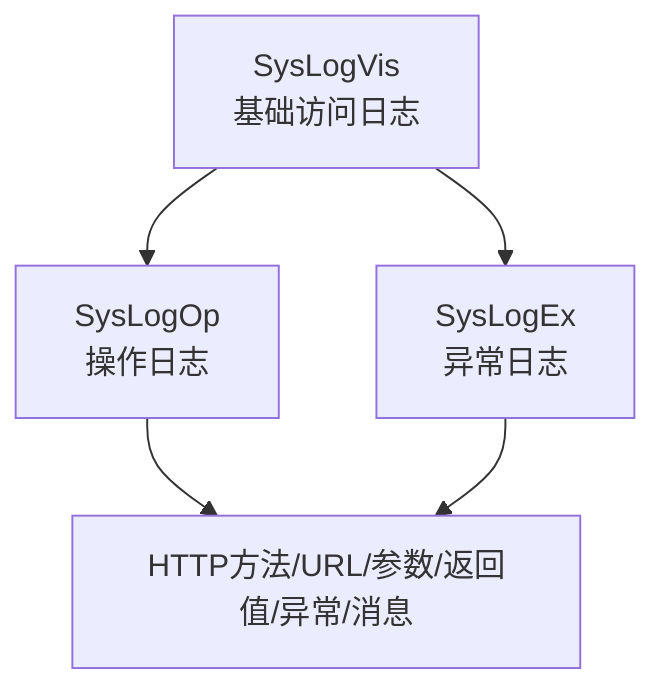
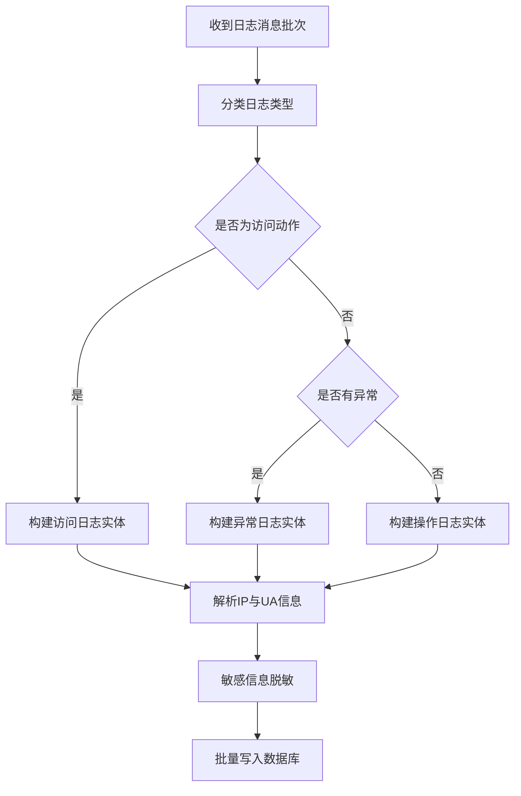
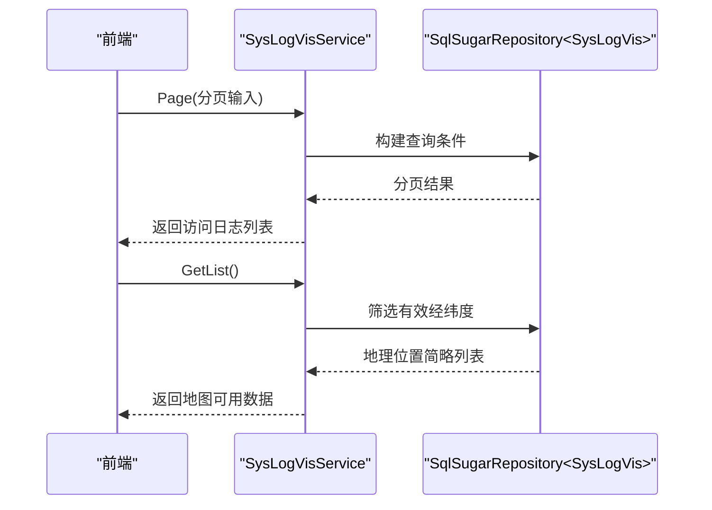
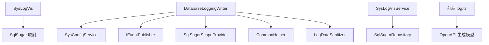
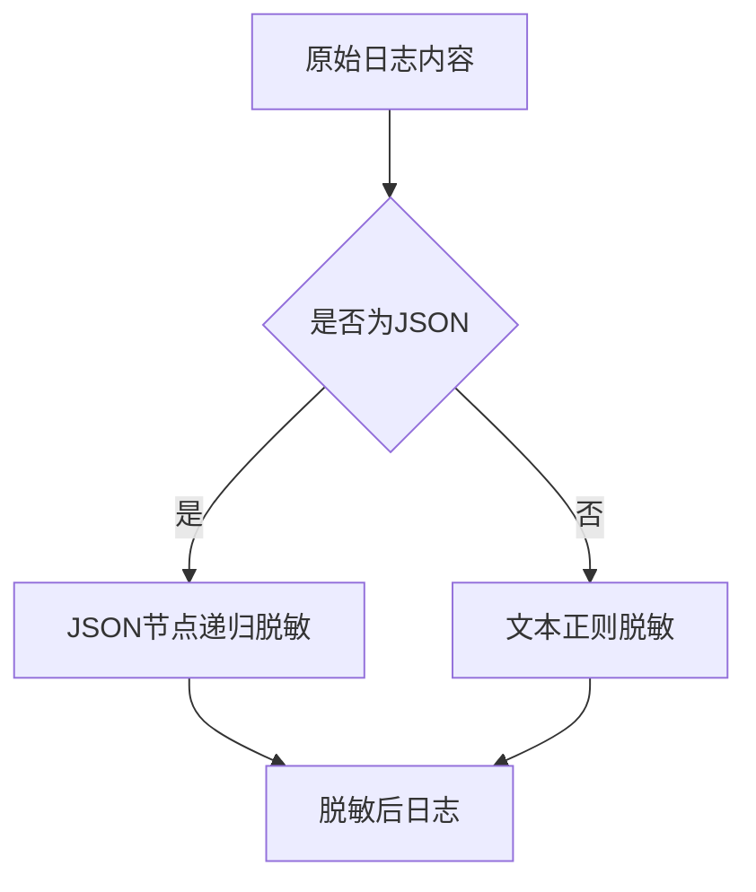
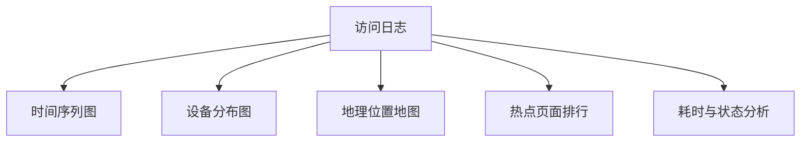

# 访问日志实体设计

<cite>
**本文引用的文件**   
- [SysLogVis.cs](file://Admin.NET/Admin.NET.Core/Entity/SysLogVis.cs)
- [SysLogOp.cs](file://Admin.NET/Admin.NET.Core/Entity/SysLogOp.cs)
- [SysLogEx.cs](file://Admin.NET/Admin.NET.Core/Entity/SysLogEx.cs)
- [DatabaseLoggingWriter.cs](file://Admin.NET/Admin.NET.Core/Logging/DatabaseLoggingWriter.cs)
- [LogDataSanitizer.cs](file://Admin.NET/Admin.NET.Core/Logging/LogDataSanitizer.cs)
- [CommonHelper.cs](file://Admin.NET/Admin.NET.Core/Utils/CommonHelper.cs)
- [SqlSugarSetup.cs](file://Admin.NET/Admin.NET.Core/SqlSugar/SqlSugarSetup.cs)
- [SysLogVisService.cs](file://Admin.NET/Admin.NET.Core/Service/Log/SysLogVisService.cs)
- [LogInput.cs](file://Admin.NET/Admin.NET.Core/Service/Log/Dto/LogInput.cs)
- [LogVisOutput.cs](file://Admin.NET/Admin.NET.Core/Service/Log/Dto/LogVisOutput.cs)
- [sys-log-vis.ts](file://Web/apps/web-antdv-next/src/api-services/models/sys-log-vis.ts)
- [log.ts](file://Web/apps/web-antdv-next/src/api/system/log.ts)
</cite>

## 目录
1. [引言](#引言)
2. [项目结构定位](#项目结构定位)
3. [核心数据模型](#核心数据模型)
4. [架构总览](#架构总览)
5. [详细组件分析](#详细组件分析)
6. [依赖关系分析](#依赖关系分析)
7. [性能考虑](#性能考虑)
8. [安全与合规](#安全与合规)
9. [可视化与分析方案](#可视化与分析方案)
10. [故障排查指南](#故障排查指南)
11. [结论](#结论)

## 引言
本文件聚焦 Admin.NET 的访问日志体系，围绕 `SysLogVis` 访问日志实体展开。文档说明其字段设计、继承结构、采集机制、查询接口、前端类型定义、性能优化、安全脱敏以及可视化分析思路，帮助后端、前端和运维人员统一理解“访问日志”的数据含义和使用方式。

需要特别说明：
- 当前实现中，“访问日志”主要用于记录登录、退出等访问类行为；普通业务接口的完整请求响应信息主要由操作日志 `SysLogOp` 承载。
- `SysLogVis` 是基础访问日志模型，`SysLogOp` 与 `SysLogEx` 在其基础上扩展了 HTTP 方法、请求地址、参数、返回值、异常信息等更详细的链路字段。

## 项目结构定位
访问日志相关代码分布在以下位置：
- 后端实体：`Admin.NET/Admin.NET.Core/Entity/SysLogVis.cs`
- 日志写入器：`Admin.NET/Admin.NET.Core/Logging/DatabaseLoggingWriter.cs`
- 日志脱敏：`Admin.NET/Admin.NET.Core/Logging/LogDataSanitizer.cs`
- 设备与地理位置解析：`Admin.NET/Admin.NET.Core/Utils/CommonHelper.cs`
- 日志表标识与 SqlSugar 映射配置：`Admin.NET/Admin.NET.Core/SqlSugar/SqlSugarSetup.cs`
- 查询服务与分页输入输出：`Admin.NET/Admin.NET.Core/Service/Log/SysLogVisService.cs`、`LogInput.cs`、`LogVisOutput.cs`
- 前端模型与日志 API 封装：`Web/apps/web-antdv-next/src/api-services/models/sys-log-vis.ts`、`Web/apps/web-antdv-next/src/api/system/log.ts`

**图表来源**
- [SysLogVis.cs:1-116](file://Admin.NET/Admin.NET.Core/Entity/SysLogVis.cs#L1-L116)
- [SysLogOp.cs:1-72](file://Admin.NET/Admin.NET.Core/Entity/SysLogOp.cs#L1-L72)
- [SysLogEx.cs:1-72](file://Admin.NET/Admin.NET.Core/Entity/SysLogEx.cs#L1-L72)
- [DatabaseLoggingWriter.cs:1-282](file://Admin.NET/Admin.NET.Core/Logging/DatabaseLoggingWriter.cs#L1-L282)
- [LogDataSanitizer.cs:1-98](file://Admin.NET/Admin.NET.Core/Logging/LogDataSanitizer.cs#L1-L98)
- [CommonHelper.cs:500-560](file://Admin.NET/Admin.NET.Core/Utils/CommonHelper.cs#L500-L560)
- [SqlSugarSetup.cs:487-492](file://Admin.NET/Admin.NET.Core/SqlSugar/SqlSugarSetup.cs#L487-L492)
- [SysLogVisService.cs:1-79](file://Admin.NET/Admin.NET.Core/Service/Log/SysLogVisService.cs#L1-L79)
- [sys-log-vis.ts:1-161](file://Web/apps/web-antdv-next/src/api-services/models/sys-log-vis.ts#L1-L161)
- [log.ts:1-45](file://Web/apps/web-antdv-next/src/api/system/log.ts#L1-L45)

**章节来源**
- [SysLogVis.cs:1-116](file://Admin.NET/Admin.NET.Core/Entity/SysLogVis.cs#L1-L116)
- [DatabaseLoggingWriter.cs:1-282](file://Admin.NET/Admin.NET.Core/Logging/DatabaseLoggingWriter.cs#L1-L282)
- [sys-log-vis.ts:1-161](file://Web/apps/web-antdv-next/src/api-services/models/sys-log-vis.ts#L1-L161)
- [log.ts:1-45](file://Web/apps/web-antdv-next/src/api/system/log.ts#L1-L45)

## 核心数据模型
`SysLogVis` 是系统访问日志的核心实体，继承自多租户基类 `EntityBaseTenant`，并标记为系统表和日志表。它包含模块名、方法名、显示标题、执行状态、客户端 IP、登录地点、经纬度、浏览器、操作系统、耗时、日志时间、日志级别、账号、真实姓名等字段。

| 字段 | 类型 | 是否可空 | 长度或精度 | 含义 |
|---|---|---:|---:|---|
| `ControllerName` | string | 是 | 256 | 控制器名称 |
| `ActionName` | string | 是 | 256 | 方法名称 |
| `DisplayTitle` | string | 是 | 256 | 显示标题 |
| `Status` | string | 是 | 32 | 执行状态，通常为 HTTP 状态码 |
| `RemoteIp` | string | 是 | 256 | 客户端 IP 地址 |
| `Location` | string | 是 | 128 | 登录地点，由 IP 解析得到 |
| `Longitude` | decimal | 是 | - | 经度 |
| `Latitude` | decimal | 是 | - | 纬度 |
| `Browser` | string | 是 | 1024 | 浏览器及版本信息 |
| `Os` | string | 是 | 256 | 操作系统信息 |
| `Elapsed` | long | 是 | - | 操作用时，单位毫秒 |
| `LogDateTime` | DateTime | 是 | - | 日志时间 |
| `LogLevel` | LogLevel? | 是 | - | 日志级别 |
| `Account` | string | 是 | 32 | 账号 |
| `RealName` | string | 是 | 32 | 真实姓名 |

此外，由于继承自 `EntityBaseTenant`，该实体还具备通用审计字段，如主键、创建时间、更新时间、创建用户、更新用户、租户 ID 等，这些字段会出现在前端生成的 `SysLogVis` 类型中。

**图表来源**
- [SysLogVis.cs:1-116](file://Admin.NET/Admin.NET.Core/Entity/SysLogVis.cs#L1-L116)
- [SysLogOp.cs:1-72](file://Admin.NET/Admin.NET.Core/Entity/SysLogOp.cs#L1-L72)
- [SysLogEx.cs:1-72](file://Admin.NET/Admin.NET.Core/Entity/SysLogEx.cs#L1-L72)

**章节来源**
- [SysLogVis.cs:1-116](file://Admin.NET/Admin.NET.Core/Entity/SysLogVis.cs#L1-L116)
- [SysLogOp.cs:1-72](file://Admin.NET/Admin.NET.Core/Entity/SysLogOp.cs#L1-L72)
- [SysLogEx.cs:1-72](file://Admin.NET/Admin.NET.Core/Entity/SysLogEx.cs#L1-L72)

## 架构总览
访问日志的生命周期包括：日志事件产生、日志消息分类、设备与地理位置解析、敏感信息脱敏、批量写入数据库、对外提供分页查询与地图坐标列表。

**图表来源**
- [DatabaseLoggingWriter.cs:1-282](file://Admin.NET/Admin.NET.Core/Logging/DatabaseLoggingWriter.cs#L1-L282)
- [CommonHelper.cs:500-560](file://Admin.NET/Admin.NET.Core/Utils/CommonHelper.cs#L500-L560)
- [LogDataSanitizer.cs:1-98](file://Admin.NET/Admin.NET.Core/Logging/LogDataSanitizer.cs#L1-L98)
- [SysLogVisService.cs:1-79](file://Admin.NET/Admin.NET.Core/Service/Log/SysLogVisService.cs#L1-L79)
- [log.ts:1-45](file://Web/apps/web-antdv-next/src/api/system/log.ts#L1-L45)

**章节来源**
- [DatabaseLoggingWriter.cs:1-282](file://Admin.NET/Admin.NET.Core/Logging/DatabaseLoggingWriter.cs#L1-L282)
- [SysLogVisService.cs:1-79](file://Admin.NET/Admin.NET.Core/Service/Log/SysLogVisService.cs#L1-L79)
- [log.ts:1-45](file://Web/apps/web-antdv-next/src/api/system/log.ts#L1-L45)

## 详细组件分析

### 访问日志实体 `SysLogVis`
`SysLogVis` 通过 SqlSugar 特性标注列描述、最大长度，并通过 `[SysTable]` 与 `[LogTable]` 标记为系统表和日志表。它的职责是保存一次访问行为的基础上下文，包括模块、方法、状态、IP、地点、经纬度、浏览器、操作系统、耗时、时间、日志级别、账号与真实姓名。

需要注意：
- 经纬度使用 `decimal` 存储，便于在数据库中保留较高精度。
- `Browser` 允许到 1024 字符，用于容纳较完整的 UA 解析结果。
- `Status` 以字符串形式保存 HTTP 状态码，例如 `"200"`。
- `LogLevel` 使用枚举类型，表示日志重要性等级。

**章节来源**
- [SysLogVis.cs:1-116](file://Admin.NET/Admin.NET.Core/Entity/SysLogVis.cs#L1-L116)
- [SqlSugarSetup.cs:487-492](file://Admin.NET/Admin.NET.Core/SqlSugar/SqlSugarSetup.cs#L487-L492)

### 访问日志继承体系
`SysLogOp` 与 `SysLogEx` 均继承 `SysLogVis`，分别用于操作日志与异常日志。它们增加了 HTTP 方法、请求 URL、请求参数、返回结果、事件 ID、线程 ID、追踪 ID、异常信息和消息体等字段。

这种设计的优点是：
- 访问日志、操作日志、异常日志共享基础访问上下文。
- 可根据日志类型灵活扩展更详细的请求响应字段。
- 查询和展示时可以复用基础过滤条件。

**图表来源**
- [SysLogVis.cs:1-116](file://Admin.NET/Admin.NET.Core/Entity/SysLogVis.cs#L1-L116)
- [SysLogOp.cs:1-72](file://Admin.NET/Admin.NET.Core/Entity/SysLogOp.cs#L1-L72)
- [SysLogEx.cs:1-72](file://Admin.NET/Admin.NET.Core/Entity/SysLogEx.cs#L1-L72)

**章节来源**
- [SysLogOp.cs:1-72](file://Admin.NET/Admin.NET.Core/Entity/SysLogOp.cs#L1-L72)
- [SysLogEx.cs:1-72](file://Admin.NET/Admin.NET.Core/Entity/SysLogEx.cs#L1-L72)

### 日志采集机制
日志采集入口是 `DatabaseLoggingWriter.WriteAsync`。它接收一批 `LogMessage`，按日志类型分类为操作日志、异常日志和访问日志，然后并行批量写入数据库。

关键逻辑如下：
1. 从日志上下文中读取监控信息。
2. 若无监控信息，则视为自定义操作日志。
3. 若存在异常，则归类为异常日志。
4. 若 `ActionName` 是 `login`、`loginPhone` 或 `logout`，则归类为访问日志。
5. 其他情况归为操作日志。
6. 解析客户端 IP、地理位置、浏览器和操作系统。
7. 对敏感字段进行脱敏。
8. 批量写入数据库。

**图表来源**
- [DatabaseLoggingWriter.cs:1-282](file://Admin.NET/Admin.NET.Core/Logging/DatabaseLoggingWriter.cs#L1-L282)
- [CommonHelper.cs:500-560](file://Admin.NET/Admin.NET.Core/Utils/CommonHelper.cs#L500-L560)
- [LogDataSanitizer.cs:1-98](file://Admin.NET/Admin.NET.Core/Logging/LogDataSanitizer.cs#L1-L98)

**章节来源**
- [DatabaseLoggingWriter.cs:1-282](file://Admin.NET/Admin.NET.Core/Logging/DatabaseLoggingWriter.cs#L1-L282)

### 用户环境与地理位置解析
设备与地理位置解析由 `CommonHelper` 提供：
- `GetIpAddress`：根据 IP 查询国家、省份、城市、运营商，拼接成地点字符串，并返回经纬度。
- `GetClientDeviceInfo`：解析 User-Agent，提取操作系统和浏览器信息，同时识别爬虫。

这意味着访问日志中的 `Location`、`Longitude`、`Latitude`、`Browser`、`Os` 字段来源于用户代理和 IP 解析结果。

**章节来源**
- [CommonHelper.cs:500-560](file://Admin.NET/Admin.NET.Core/Utils/CommonHelper.cs#L500-L560)

### 查询与服务接口
`SysLogVisService` 提供访问日志的分页查询、清空操作和地理位置列表查询。

分页查询支持：
- 租户隔离：非超级管理员默认限制到当前租户。
- 时间范围：开始时间与结束时间。
- 账号、方法名、IP、耗时、状态过滤。
- 按创建时间倒序分页。

清空接口仅允许超级管理员执行。

地理位置列表接口返回具有有效经纬度的记录，供地图或热力图展示。

**图表来源**
- [SysLogVisService.cs:1-79](file://Admin.NET/Admin.NET.Core/Service/Log/SysLogVisService.cs#L1-L79)

**章节来源**
- [SysLogVisService.cs:1-79](file://Admin.NET/Admin.NET.Core/Service/Log/SysLogVisService.cs#L1-L79)
- [LogInput.cs:1-70](file://Admin.NET/Admin.NET.Core/Service/Log/Dto/LogInput.cs#L1-L70)
- [LogVisOutput.cs:1-35](file://Admin.NET/Admin.NET.Core/Service/Log/Dto/LogVisOutput.cs#L1-L35)

### 前端模型与调用方式
前端通过 OpenAPI 生成 `sys-log-vis.ts` 模型，其中包含基础审计字段、租户 ID、控制器名、方法名、状态、IP、地点、经纬度、浏览器、操作系统、耗时、日志时间、日志级别、账号、真实姓名等属性。

`log.ts` 将访问日志与其他日志类型统一封装，调用 `SysLogVisApi` 获取分页数据，并提供清空接口。

**图表来源**
- [sys-log-vis.ts:1-161](file://Web/apps/web-antdv-next/src/api-services/models/sys-log-vis.ts#L1-L161)
- [log.ts:1-45](file://Web/apps/web-antdv-next/src/api/system/log.ts#L1-L45)

**章节来源**
- [sys-log-vis.ts:1-161](file://Web/apps/web-antdv-next/src/api-services/models/sys-log-vis.ts#L1-L161)
- [log.ts:1-45](file://Web/apps/web-antdv-next/src/api/system/log.ts#L1-L45)

## 依赖关系分析
访问日志相关依赖主要包括：
- 实体依赖 SqlSugar 映射特性。
- 日志写入依赖日志框架、配置服务、事件总线、SqlSugar 数据库连接。
- 设备与地理位置依赖 IP 解析和用户代理解析工具。
- 前端依赖 OpenAPI 生成的模型和 API 客户端。

**图表来源**
- [SysLogVis.cs:1-116](file://Admin.NET/Admin.NET.Core/Entity/SysLogVis.cs#L1-L116)
- [DatabaseLoggingWriter.cs:1-282](file://Admin.NET/Admin.NET.Core/Logging/DatabaseLoggingWriter.cs#L1-L282)
- [SysLogVisService.cs:1-79](file://Admin.NET/Admin.NET.Core/Service/Log/SysLogVisService.cs#L1-L79)
- [sys-log-vis.ts:1-161](file://Web/apps/web-antdv-next/src/api-services/models/sys-log-vis.ts#L1-L161)

**章节来源**
- [DatabaseLoggingWriter.cs:1-282](file://Admin.NET/Admin.NET.Core/Logging/DatabaseLoggingWriter.cs#L1-L282)
- [SqlSugarSetup.cs:487-492](file://Admin.NET/Admin.NET.Core/SqlSugar/SqlSugarSetup.cs#L487-L492)

## 性能考虑
当前实现已包含若干性能相关设计：
- 批量写入：日志写入器按类型分组后批量插入，减少数据库往返。
- 并行写入：操作日志、异常日志、访问日志分别并行写入。
- 独立日志库：通过 `SqlSugarSetup.LogDb` 切换日志独立数据库，避免影响业务库负载。
- 异常隔离：单条日志处理失败不会中断整批写入。

可进一步优化的方向：
- 异步队列：引入消息队列缓冲高并发日志，削峰填谷。
- 采样策略：对高频非关键访问降低采样率。
- 冷热分层：近期日志存高性能库，历史日志归档到低成本存储。
- 压缩存储：对大体积请求参数、返回结果进行压缩后再落库。
- 索引优化：为 `CreateTime`、`Account`、`ActionName`、`RemoteIp`、`Status` 建立合理索引。

[本节为通用性能建议，不直接分析具体文件]

## 安全与合规
访问日志可能包含敏感信息，因此项目实现了日志数据脱敏：
- 敏感字段名集合：包括密码、令牌、密钥、授权头、Cookie、连接字符串等。
- JSON 脱敏：对 JSON 结构的值进行递归检查，替换敏感字段值为 `[redacted]`。
- Bearer Token 脱敏：匹配 Authorization 头部中的 Bearer 令牌。
- URL 参数脱敏：匹配 token、password、apiKey 等常见敏感参数。
- 历史日志响应脱敏：对外返回的历史日志数据也会经过脱敏。

权限控制方面：
- 访问日志分页查询支持租户隔离。
- 清空访问日志接口仅限超级管理员。

**图表来源**
- [LogDataSanitizer.cs:1-98](file://Admin.NET/Admin.NET.Core/Logging/LogDataSanitizer.cs#L1-L98)

**章节来源**
- [LogDataSanitizer.cs:1-98](file://Admin.NET/Admin.NET.Core/Logging/LogDataSanitizer.cs#L1-L98)
- [SysLogVisService.cs:1-79](file://Admin.NET/Admin.NET.Core/Service/Log/SysLogVisService.cs#L1-L79)

## 可视化与分析方案
基于现有字段，访问日志可用于以下分析场景：

| 分析维度 | 使用字段 | 说明 |
|---|---|---|
| 访问量统计 | `LogDateTime`、`Status` | 按小时、天、周统计访问次数和成功失败比例 |
| 热点页面识别 | `ControllerName`、`ActionName`、`DisplayTitle` | 统计热门控制器和方法 |
| 用户行为分析 | `Account`、`RealName`、`LogDateTime` | 分析用户登录频率、活跃时段 |
| 设备环境分析 | `Browser`、`Os` | 统计浏览器和操作系统分布 |
| 地域访问分析 | `Location`、`Longitude`、`Latitude` | 在地图上展示登录或访问来源 |
| 性能瓶颈识别 | `Elapsed`、`Status` | 结合耗时与状态码识别慢接口和错误接口 |

前端可使用地图组件展示 `LogVisOutput` 提供的地点与经纬度，并结合时间轴做趋势分析。

[本图为概念性可视化方案，不对应具体源码结构]

## 故障排查指南
常见问题与排查建议：

| 问题 | 可能原因 | 排查建议 |
|---|---|---|
| 访问日志未出现 | 访问动作不是登录或退出 | 确认日志分类逻辑是否命中访问日志 |
| 地点为空或未知 | IP 解析失败 | 检查 IP 是否内网地址或地理位置库不可用 |
| 浏览器或操作系统未知 | User-Agent 为空或解析失败 | 检查客户端 UA 是否被拦截或修改 |
| 日志写入缓慢 | 数据库压力大 | 检查独立日志库性能、批量写入是否正常 |
| 敏感信息泄露 | 脱敏规则未覆盖新字段 | 检查 `LogDataSanitizer` 敏感字段集合 |
| 分页查询超时 | 缺少索引或时间范围过大 | 增加索引、缩小查询范围 |

**章节来源**
- [DatabaseLoggingWriter.cs:1-282](file://Admin.NET/Admin.NET.Core/Logging/DatabaseLoggingWriter.cs#L1-L282)
- [LogDataSanitizer.cs:1-98](file://Admin.NET/Admin.NET.Core/Logging/LogDataSanitizer.cs#L1-L98)
- [SysLogVisService.cs:1-79](file://Admin.NET/Admin.NET.Core/Service/Log/SysLogVisService.cs#L1-L79)

## 结论
`SysLogVis` 提供了访问日志的基础数据模型，涵盖访问来源、设备环境、地理位置、执行状态和耗时等关键字段。当前实现通过日志写入器自动分类访问日志，结合设备与地理位置解析、敏感信息脱敏和批量写入，形成较完整的日志采集链路。前端通过 OpenAPI 模型与日志 API 实现对访问日志的查询与展示。

在实际使用中，应注意：
- 明确“访问日志”在当前代码中的语义偏向登录、退出等行为。
- 如需记录完整请求响应，应参考 `SysLogOp` 的操作日志字段。
- 生产环境建议启用独立日志库、合理索引、采样策略和脱敏策略。
- 可视化方案可基于现有经纬度、浏览器、操作系统、状态码和耗时字段构建多维度分析大屏。