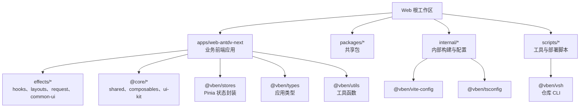
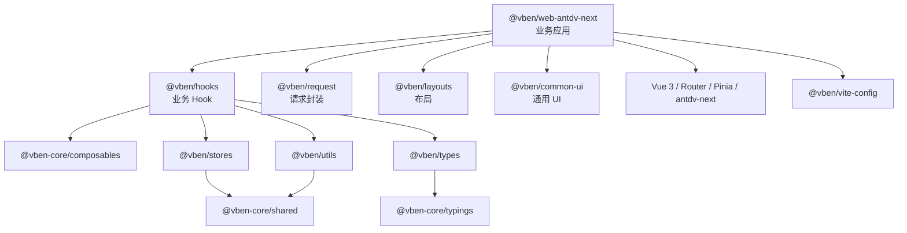
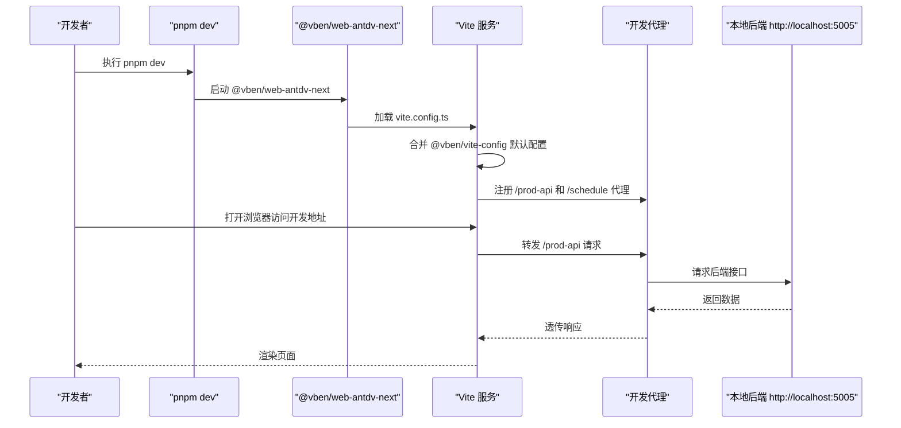
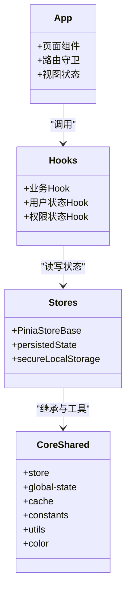
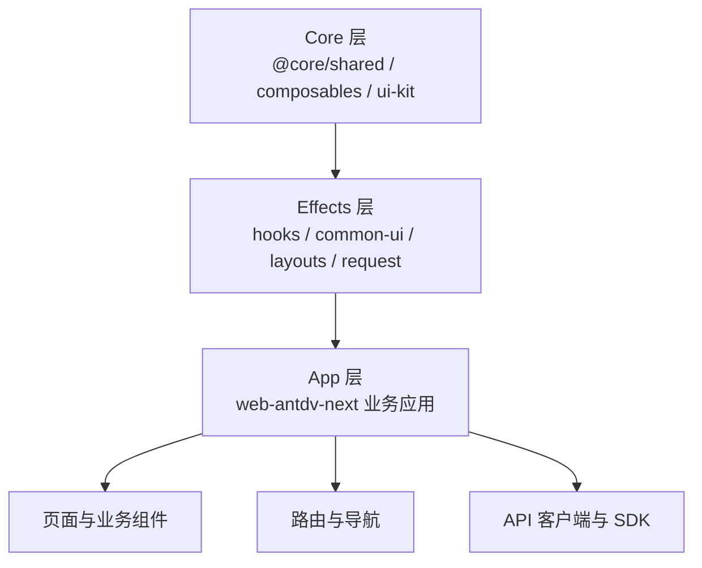
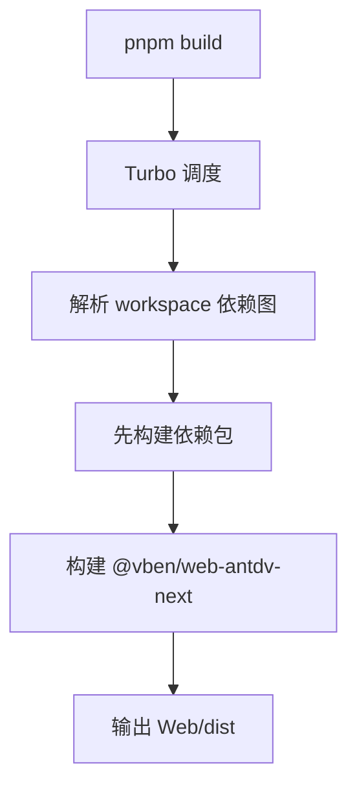
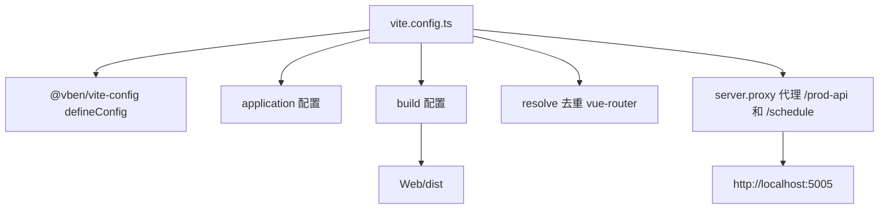

# 前端 Monorepo 结构

<cite>
**本文引用的文件**   
- [Web/package.json](file://Web/package.json)
- [Web/pnpm-workspace.yaml](file://Web/pnpm-workspace.yaml)
- [Web/README.md](file://Web/README.md)
- [Web/turbo.json](file://Web/turbo.json)
- [Web/eslint.config.mjs](file://Web/eslint.config.mjs)
- [Web/.prettierrc.cjs](file://Web/.prettierrc.cjs)
- [Web/apps/web-antdv-next/package.json](file://Web/apps/web-antdv-next/package.json)
- [Web/apps/web-antdv-next/vite.config.ts](file://Web/apps/web-antdv-next/vite.config.ts)
- [Web/packages/@core/base/shared/package.json](file://Web/packages/@core/base/shared/package.json)
- [Web/packages/@core/composables/package.json](file://Web/packages/@core/composables/package.json)
- [Web/packages/effects/hooks/package.json](file://Web/packages/effects/hooks/package.json)
- [Web/packages/stores/package.json](file://Web/packages/stores/package.json)
- [Web/packages/utils/package.json](file://Web/packages/utils/package.json)
- [Web/packages/types/package.json](file://Web/packages/types/package.json)
- [Web/internal/vite-config/package.json](file://Web/internal/vite-config/package.json)
- [Web/internal/tsconfig/package.json](file://Web/internal/tsconfig/package.json)
- [Web/scripts/vsh/package.json](file://Web/scripts/vsh/package.json)
</cite>

## 目录
1. [引言](#引言)
2. [项目结构](#项目结构)
3. [核心组件与包职责](#核心组件与包职责)
4. [架构总览](#架构总览)
5. [详细组件分析](#详细组件分析)
6. [依赖关系分析](#依赖关系分析)
7. [TypeScript 类型系统](#typescript-类型系统)
8. [Vite 构建配置](#vite-构建配置)
9. [代码规范与质量检查](#代码规范与质量检查)
10. [开发工作流示例](#开发工作流示例)
11. [Monorepo 优势与团队协作最佳实践](#monorepo-优势与团队协作最佳实践)
12. [常见问题排查](#常见问题排查)
13. [结论](#结论)

## 引言
本仓库的前端部分位于 `Web/`，是一个基于 pnpm workspace 的 Monorepo。当前业务应用是 `apps/web-antdv-next`，技术栈为 Vue 3、TypeScript、Vite 和 antdv-next，并复用上游 Vben Admin 的共享能力。根 `package.json` 声明 Node 与 pnpm 版本要求，并通过脚本把本地开发、构建、预览、类型检查、Lint、格式化、单元测试、端到端测试以及 API SDK 生成等任务聚合到统一入口。

本文件重点说明：
- pnpm workspace 如何组织业务应用、共享包、内部工具和脚本。
- 各包的作用、依赖方向与边界。
- 组件层次设计、状态管理架构。
- TypeScript、Vite、ESLint、Prettier 的配置要点。
- 本地开发、构建打包、类型检查的实际命令及注意事项。

**章节来源**
- [Web/README.md:1-75](file://Web/README.md#L1-L75)
- [Web/package.json:1-102](file://Web/package.json#L1-L102)

## 项目结构
`Web/` 下的主要目录如下：

| 路径 | 角色 |
| --- | --- |
| `apps/web-antdv-next` | 业务前端主应用，Vue 3 + Vite + antdv-next，提供页面、路由、组件、API 调用和国际化资源。 |
| `packages/@core/*` | 核心基础能力，包括共享常量工具、组合式函数、UI Kit、偏好设置、类型定义等。 |
| `packages/effects/*` | 面向业务的副作用层，包含 hooks、布局、请求封装、通用 UI、插件等。 |
| `packages/stores` | Pinia 状态管理封装，提供可持久化的全局 Store 基类。 |
| `packages/utils` | 轻量工具函数，依赖 core shared 和 vue-router。 |
| `packages/types` | 应用级 TypeScript 类型定义，暴露根类型和全局类型扩展。 |
| `packages/icons / locales / preferences / styles / constants` | 图标、国际化、偏好设置、样式和常量等横切能力。 |
| `internal/*` | 不对外发布的内部工程：Vite 配置、TSConfig 基线、Tailwind 配置、Node 工具、Lint 配置等。 |
| `scripts/*` | 仓库工具与部署脚本，如 `vsh`、`turbo-run`、清理脚本、Nginx 发布相关脚本。 |
| `api_build` | Swagger SDK 生成和后处理脚本。 |
| `dist` | 生产构建输出目录，由应用构建生成。 |

**图表来源**
- [Web/pnpm-workspace.yaml:1-20](file://Web/pnpm-workspace.yaml#L1-L20)
- [Web/apps/web-antdv-next/package.json:35-72](file://Web/apps/web-antdv-next/package.json#L35-L72)
- [Web/internal/vite-config/package.json:1-59](file://Web/internal/vite-config/package.json#L1-L59)
- [Web/scripts/vsh/package.json:1-31](file://Web/scripts/vsh/package.json#L1-L31)

**章节来源**
- [Web/README.md:29-75](file://Web/README.md#L29-L75)
- [Web/pnpm-workspace.yaml:1-20](file://Web/pnpm-workspace.yaml#L1-L20)

## 核心组件与包职责
### 业务应用：`@vben/web-antdv-next`
- 名称：`@vben/web-antdv-next`。
- 入口：通过 Vite 启动，脚本使用 development、production、analyze 模式。
- 运行时依赖包括 Vue、vue-router、pinia、axios、antdv-next、PDF.js、wangeditor-next、MQTT、SignalR、Monaco 编辑器等。
- 通过 `workspace:*` 引用多个共享包，形成业务应用对上层能力的消费端。

关键依赖方向：
- 访问控制：`@vben/access`
- 通用 UI：`@vben/common-ui`
- 常量：`@vben/constants`
- Hooks：`@vben/hooks`
- 图标：`@vben/icons`
- 布局：`@vben/layouts`
- 国际化：`@vben/locales`
- 插件：`@vben/plugins`
- 偏好设置：`@vben/preferences`
- 网络请求：`@vben/request`
- 状态存储：`@vben/stores`
- 样式：`@vben/styles`
- 类型：`@vben/types`
- 工具：`@vben/utils`

**章节来源**
- [Web/apps/web-antdv-next/package.json:1-72](file://Web/apps/web-antdv-next/package.json#L1-L72)

### 核心基础包：`@core`
- `@vben-core/shared`：最底层共享实现，导出常量、工具、颜色、缓存、Store 基类和全局状态；使用 tsdown 构建，并在 `exports` 中区分开发源码与生产产物。
- `@vben-core/composables`：组合式函数库，依赖 `@vben-core/shared`、`@vben-core/typings`、`@vueuse/core`、`reka-ui`、`sortablejs` 和 Vue。
- 其他 `@core` 子包包括 UI Kit（表单、布局、菜单、弹窗、Tabs、Shadcn UI）等，共同组成可复用的 UI 抽象层。

**章节来源**
- [Web/packages/@core/base/shared/package.json:1-104](file://Web/packages/@core/base/shared/package.json#L1-L104)
- [Web/packages/@core/composables/package.json:1-49](file://Web/packages/@core/composables/package.json#L1-L49)

### 副作用层：`effects`
- `@vben/hooks`：业务级 Vue 组合式 Hook，依赖 core composables、preferences、stores、types、utils、vue-router、@vueuse/core 和水印库。
- `effects` 下还包含 common-ui、layouts、request、plugins 等包，负责 UI 交互、页面布局、HTTP 请求封装和插件集成。

**章节来源**
- [Web/packages/effects/hooks/package.json:1-33](file://Web/packages/effects/hooks/package.json#L1-L33)

### 状态管理：`@vben/stores`
- 基于 Pinia 封装 Store 能力，引入 `pinia-plugin-persistedstate` 和 `secure-ls` 做持久化。
- 依赖 `@vben-core/preferences`、`@vben-core/shared`、`@vben-core/typings`、Vue 和 vue-router。

**章节来源**
- [Web/packages/stores/package.json:1-32](file://Web/packages/stores/package.json#L1-L32)

### 工具与类型：`utils` 与 `types`
- `@vben/utils`：轻量工具函数，依赖 `@vben-core/shared`、`@vben-core/typings` 和 vue-router。
- `@vben/types`：应用级类型定义，依赖 `@vben-core/typings`、Vue 和 vue-router，并提供 `./global` 全局类型入口。

**章节来源**
- [Web/packages/utils/package.json:1-27](file://Web/packages/utils/package.json#L1-L27)
- [Web/packages/types/package.json:1-27](file://Web/packages/types/package.json#L1-L27)

### 内部工程：`internal`
- `@vben/vite-config`：内部 Vite 配置库，聚合 i18n、Tailwind、PWA、DevTools、压缩、可视化等插件。
- `@vben/tsconfig`：集中管理的 TSConfig 基线，向其他包提供 `base.json`、`library.json`、`node.json`、`web-app.json`、`web.json`。

**章节来源**
- [Web/internal/vite-config/package.json:1-59](file://Web/internal/vite-config/package.json#L1-L59)
- [Web/internal/tsconfig/package.json:1-25](file://Web/internal/tsconfig/package.json#L1-L25)

### 脚本与工具：`scripts`
- `@vben/vsh`：仓库 CLI，提供 `vsh` 命令，支持循环依赖扫描、knip 依赖分析和 publint 包校验。
- 其他脚本目录包含部署、Turbo 运行器、清理模块和锁文件等维护工具。

**章节来源**
- [Web/scripts/vsh/package.json:1-31](file://Web/scripts/vsh/package.json#L1-L31)

## 架构总览
前端整体采用“应用 → 副作用层 → 核心基础层 → 运行时框架”的分层结构。业务页面通过 hooks 和 stores 驱动状态，通过 request 访问后端 API，通过 layouts 和 common-ui 渲染界面，最终由 Vue 3、router、pinia 和 antdv-next 完成运行时表现。

**图表来源**
- [Web/apps/web-antdv-next/package.json:35-72](file://Web/apps/web-antdv-next/package.json#L35-L72)
- [Web/packages/effects/hooks/package.json:1-33](file://Web/packages/effects/hooks/package.json#L1-L33)
- [Web/packages/stores/package.json:1-32](file://Web/packages/stores/package.json#L1-L32)
- [Web/packages/utils/package.json:1-27](file://Web/packages/utils/package.json#L1-L27)
- [Web/packages/types/package.json:1-27](file://Web/packages/types/package.json#L1-L27)
- [Web/packages/@core/base/shared/package.json:1-104](file://Web/packages/@core/base/shared/package.json#L1-L104)
- [Web/packages/@core/composables/package.json:1-49](file://Web/packages/@core/composables/package.json#L1-L49)
- [Web/internal/vite-config/package.json:1-59](file://Web/internal/vite-config/package.json#L1-L59)

## 详细组件分析
### 应用构建与代理流程
业务应用通过 `@vben/vite-config` 提供的 `defineConfig` 扩展默认配置，再叠加应用自身的路由注入去重、构建目标、输出目录和开发代理。

**图表来源**
- [Web/package.json:23-33](file://Web/package.json#L23-L33)
- [Web/apps/web-antdv-next/vite.config.ts:1-36](file://Web/apps/web-antdv-next/vite.config.ts#L1-L36)

**章节来源**
- [Web/apps/web-antdv-next/vite.config.ts:1-36](file://Web/apps/web-antdv-next/vite.config.ts#L1-L36)

### 状态管理架构
状态管理以 Pinia 为核心，`@vben/stores` 提供 Store 基类和持久化能力，`@vben/hooks` 在业务侧封装常用状态操作，`@vben-core/shared` 提供更底层的 store 和全局状态实现。

**图表来源**
- [Web/packages/@core/base/shared/package.json:1-104](file://Web/packages/@core/base/shared/package.json#L1-L104)
- [Web/packages/stores/package.json:1-32](file://Web/packages/stores/package.json#L1-L32)
- [Web/packages/effects/hooks/package.json:1-33](file://Web/packages/effects/hooks/package.json#L1-L33)

**章节来源**
- [Web/packages/stores/package.json:1-32](file://Web/packages/stores/package.json#L1-L32)
- [Web/packages/effects/hooks/package.json:1-33](file://Web/packages/effects/hooks/package.json#L1-L33)
- [Web/packages/@core/base/shared/package.json:1-104](file://Web/packages/@core/base/shared/package.json#L1-L104)

### 组件层次设计
组件层次从内向外分为三层：
1. **Core 层**：`@core/shared`、`@core/composables`、`@core/ui-kit` 提供跨应用复用的基础能力。
2. **Effects 层**：`hooks`、`common-ui`、`layouts`、`request`、`plugins` 将核心能力组合成面向业务场景的组件和逻辑。
3. **App 层**：`apps/web-antdv-next` 组装页面、路由、业务组件和 API 调用，直接消费 effects 和 core 能力。

**图表来源**
- [Web/packages/@core/base/shared/package.json:1-104](file://Web/packages/@core/base/shared/package.json#L1-L104)
- [Web/packages/@core/composables/package.json:1-49](file://Web/packages/@core/composables/package.json#L1-L49)
- [Web/packages/effects/hooks/package.json:1-33](file://Web/packages/effects/hooks/package.json#L1-L33)
- [Web/apps/web-antdv-next/package.json:35-72](file://Web/apps/web-antdv-next/package.json#L35-L72)

## 依赖关系分析
### pnpm workspace 与 catalog
- `pnpm-workspace.yaml` 定义了 `internal/*`、`packages/*`、`apps/*`、`scripts/*` 等包范围，并启用自动安装 peer 依赖、去重 peer 依赖和宽松 peer 依赖策略。
- `overrides` 将 `vue`、`pinia`、`clsx`、`@ast-grep/napi`、`@ctrl/tinycolor` 等关键依赖统一指向 `catalog:`。
- `catalog` 集中声明了 Vue 3、Vite、TypeScript、Antdv Next、Playwright、ECharts、Tiptap、Axios、Day.js 等主流依赖的版本区间。

这种设计保证整个 Monorepo 中同一依赖只存在一个稳定版本，减少重复安装和运行时不一致问题。

### 构建与缓存
- `turbo.json` 定义了 `build`、`preview`、`build:analyze`、`dev`、`typecheck`、`test:e2e` 等任务。
- `build` 和 `preview` 依赖同层或下层包的 `^build`，确保依赖先构建。
- `dev` 标记为持久任务且禁用缓存，适合热更新开发。
- `globalDependencies` 锁定锁文件、环境变量、TSConfig 和内部工具源码变化对缓存的影响。

**图表来源**
- [Web/turbo.json:1-48](file://Web/turbo.json#L1-L48)
- [Web/package.json:23-33](file://Web/package.json#L23-L33)

**章节来源**
- [Web/pnpm-workspace.yaml:1-215](file://Web/pnpm-workspace.yaml#L1-L215)
- [Web/turbo.json:1-48](file://Web/turbo.json#L1-L48)

## TypeScript 类型系统
TypeScript 类型系统由三个层面组成：
1. **核心类型**：`@vben-core/typings` 提供框架级基础类型。
2. **应用类型**：`@vben/types` 暴露应用级类型和全局类型扩展，依赖 `@vben-core/typings`、Vue 和 vue-router。
3. **工程基线**：`@vben/tsconfig` 提供统一的 TSConfig 基线，供 library、Node、Web 应用分别继承。

应用侧的类型检查由根脚本触发：
- 根 `pnpm check:type` 会调用 `pnpm --filter @vben/web-antdv-next typecheck`。
- 应用脚本中的 `typecheck` 执行 `vue-tsc --noEmit --skipLibCheck`。
- 根 `pnpm check` 还会串联循环依赖检查、依赖检查和拼写检查，覆盖范围比单个应用的类型检查更广。

注意：根 `check:type` 当前只针对业务应用，不自动检查所有共享包；修改共享包时应按需扩大检查范围。

**章节来源**
- [Web/packages/types/package.json:1-27](file://Web/packages/types/package.json#L1-L27)
- [Web/internal/tsconfig/package.json:1-25](file://Web/internal/tsconfig/package.json#L1-L25)
- [Web/package.json:23-33](file://Web/package.json#L23-L33)
- [Web/apps/web-antdv-next/package.json:15-23](file://Web/apps/web-antdv-next/package.json#L15-L23)

## Vite 构建配置
业务应用的 `vite.config.ts` 使用 `@vben/vite-config` 的 `defineConfig`，并追加以下关键行为：
- `application.vxeTableLazyImport` 关闭 vxe-table 懒导入。
- `build.target` 设为 `es2022`。
- `build.outDir` 输出到 `Web/dist`。
- `build.emptyOutDir` 清空旧产物。
- `resolve.dedupe` 固定 `vue-router`，避免 workspace peer 依赖上下文导致路由注入键不一致。
- `server.proxy` 将 `/schedule` 和 `/prod-api` 转发到 `http://localhost:5005`，其中 `/prod-api` 会去掉前缀并开启 WebSocket。

**图表来源**
- [Web/apps/web-antdv-next/vite.config.ts:1-36](file://Web/apps/web-antdv-next/vite.config.ts#L1-L36)
- [Web/internal/vite-config/package.json:1-59](file://Web/internal/vite-config/package.json#L1-L59)

**章节来源**
- [Web/apps/web-antdv-next/vite.config.ts:1-36](file://Web/apps/web-antdv-next/vite.config.ts#L1-L36)

## 代码规范与质量检查
### ESLint
根 `eslint.config.mjs` 使用 `@vben/eslint-config`，并接入 `eslint-config-prettier`。生成的 API SDK 目录 `apps/web-antdv-next/src/api-services/**` 被忽略，因为该目录由自动生成链产出，不应受手写代码格式规则约束。

### Prettier
`.prettierrc.cjs` 规定：
- 单行宽度 200。
- 缩进 2 空格，使用制表符。
- 分号结尾。
- 字符串优先单引号。
- 尾随逗号遵循 ES5。
- Vue 文件中脚本和样式标签缩进保持默认。
- 换行符使用 LF。

### 其他工具
- `oxlint` 与 `oxfmt` 作为高性能 Lint 和格式化工具出现在依赖中。
- `stylelint.config.mjs` 和 `.stylelintignore` 存在，用于样式检查。
- `playwright.config.ts` 与 `vitest.config.ts` 分别管理端到端测试和单元测试环境。

**章节来源**
- [Web/eslint.config.mjs:1-9](file://Web/eslint.config.mjs#L1-L9)
- [Web/.prettierrc.cjs:1-39](file://Web/.prettierrc.cjs#L1-L39)
- [Web/package.json:23-58](file://Web/package.json#L23-L58)

## 开发工作流示例
以下命令均从 `Web/` 目录执行。

| 场景 | 命令 | 说明 |
| --- | --- | --- |
| 安装依赖 | `pnpm install` 或 `pnpm bootstrap` | 使用 `packageManager` 指定的 pnpm 版本，并执行 postinstall stub。 |
| 本地开发 | `pnpm dev` | 启动 `@vben/web-antdv-next`，端口由 Vite 实际输出决定；`/prod-api` 和 `/schedule` 代理到本地后端。 |
| 指定应用别名开发 | `pnpm dev:antdv-next` | 与 `pnpm dev` 等效的业务应用别名。 |
| 构建打包 | `pnpm build` | 构建业务应用，输出到 `Web/dist`。 |
| 构建分析 | `pnpm build:analyze` | 使用 analyze 模式分析包体积。 |
| 本地预览 | `pnpm preview` | 预览已有构建产物，不提供生产 API 反向代理。 |
| 类型检查 | `pnpm check:type` | 调用业务应用的 `vue-tsc --noEmit --skipLibCheck`。 |
| Lint 检查 | `pnpm lint` | 检查 `apps/web-antdv-next/src/`。 |
| Lint 修复 | `pnpm lint-fix` | 对业务应用源码执行 ESLint 自动修复。 |
| 格式化 | `pnpm format` | 对业务应用源码执行 Prettier 写入。 |
| 单元测试 | `pnpm test:unit` | 使用 Vitest 和 happy-dom 运行逻辑测试。 |
| 端到端测试 | `pnpm test:e2e` | 使用 Playwright 运行桌面浏览器测试。 |
| 全量检查 | `pnpm check` | 串联循环依赖、依赖、类型和拼写检查。 |
| 生成 API SDK | `pnpm build-api-ps` | 从 Swagger 生成并替换前端 API SDK。 |

重要边界：
- 根 `lint` 和 `check:type` 不覆盖整个共享包树。
- `pnpm lint-fix` 和 `pnpm format` 会写文件，应检查差异后再提交。
- Vitest 逻辑测试不能替代真实 API 与数据库验收。
- Playwright 端到端测试仅定义桌面 Chrome 项目，未设置 `ADMINNET_E2E_BASE_URL` 时会自动启动前端服务。

**章节来源**
- [Web/package.json:23-58](file://Web/package.json#L23-L58)
- [Web/README.md:10-75](file://Web/README.md#L10-L75)

## Monorepo 优势与团队协作最佳实践
### 优势
1. **依赖统一**：通过 `pnpm-workspace.yaml` 的 `catalog` 和 `overrides`，集中管理 Vue、Pinia、Vite、Antdv Next 等核心依赖版本，避免多包多版本导致的运行时冲突。
2. **代码复用**：`@core`、`effects`、`stores`、`utils`、`types` 等包将通用能力沉淀，业务应用只消费稳定接口。
3. **构建加速**：Turbo 根据依赖图增量构建，避免无关包重复编译。
4. **工具统一**：ESLint、Prettier、Stylelint、Oxlint、Oxfmt、Playwright、Vitest 集中在根配置，团队风格一致。
5. **发布可控**：Changesets 与根脚本配合，便于按包管理变更集和版本号。

### 包版本管理建议
- 新增依赖时优先放入 `catalog`，再通过 `catalog:` 引用。
- 对需要严格对齐的关键依赖使用 `overrides`，例如 `vue`、`pinia`、`clsx`。
- 业务应用尽量使用 `workspace:*` 引用内部包，避免误引入外部同名包。
- 公共包变更应同时更新 `exports`、`publishConfig`、`files` 和 `sideEffects`，确保开发和发布行为一致。

### 团队协作最佳实践
- 在 `Web/` 根目录执行统一命令，不要只在某个子包执行孤立命令。
- 修改共享包后，至少重新检查受影响的应用和全局类型。
- 提交前运行 `pnpm lint`、`pnpm format` 和 `pnpm check:type`，必要时运行 `pnpm check`。
- 浏览器验证通过不代表真实 API、PostgreSQL、Nginx、上传或事件流已验收，应按文档准备隔离的真实后端环境。

**章节来源**
- [Web/pnpm-workspace.yaml:1-215](file://Web/pnpm-workspace.yaml#L1-L215)
- [Web/package.json:23-58](file://Web/package.json#L23-L58)
- [Web/README.md:33-75](file://Web/README.md#L33-L75)

## 常见问题排查
| 问题 | 可能原因 | 处理方式 |
| --- | --- | --- |
| 本地开发无法访问后端接口 | 后端未启动或未监听 `localhost:5005` | 先启动后端，确认 `/prod-api` 和 `/schedule` 代理目标可达。 |
| 类型检查报错但依赖正常 | 修改了共享包但未检查对应包 | 单独进入受影响包执行类型检查，或使用根 `pnpm check`。 |
| 构建体积异常 | 第三方库重复引入或路由注入键不一致 | 检查 `resolve.dedupe` 是否保留 `vue-router`，并使用 `pnpm build:analyze` 分析。 |
| Lint 报告格式不一致 | 使用了不同版本的 Prettier 或手动改动 | 使用根 `pnpm format` 和 `pnpm lint-fix` 统一格式化。 |
| 端到端测试失败 | 缺少桌面浏览器或环境变量配置错误 | 安装 Playwright 浏览器，核对 `ADMINNET_E2E_BASE_URL` 和测试前提。 |
| 单元测试通过但真实联调失败 | Vitest 使用 happy-dom，不涉及真实 API 或数据库 | 按文档准备隔离 PostgreSQL 和后端服务进行真实联调。 |

**章节来源**
- [Web/apps/web-antdv-next/vite.config.ts:1-36](file://Web/apps/web-antdv-next/vite.config.ts#L1-L36)
- [Web/README.md:47-75](file://Web/README.md#L47-L75)

## 结论
Admin.NET 前端 Monorepo 以 `Web/apps/web-antdv-next` 为业务入口，通过 pnpm workspace 将核心能力、副作用层、状态管理、工具、类型、内部构建配置和脚本解耦。该结构有利于统一依赖、复用代码、加速构建和规范协作。实际开发中应以根 `package.json` 的命令为准，结合 README 中的目录约定和验证边界，区分逻辑测试、浏览器验证与真实 API、数据库验收，避免把临时任务记录、缓存产物或绝对路径当作长期依据。