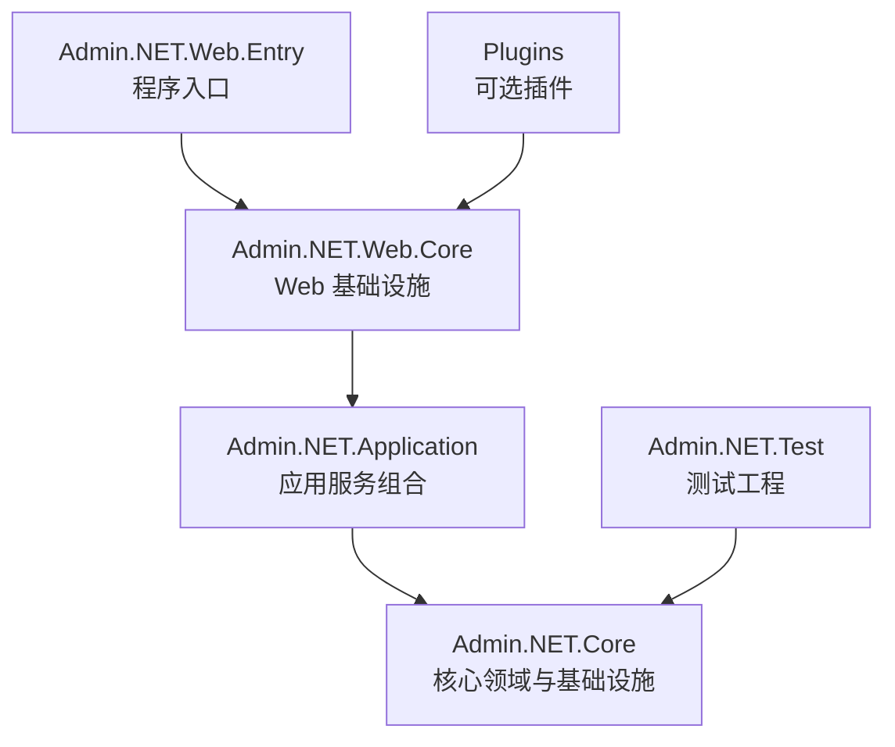
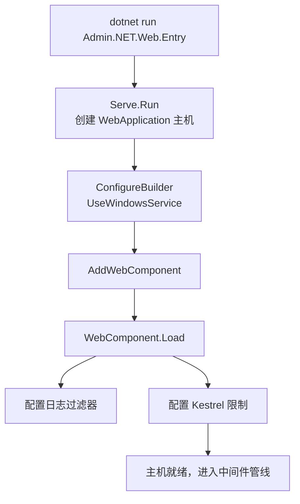
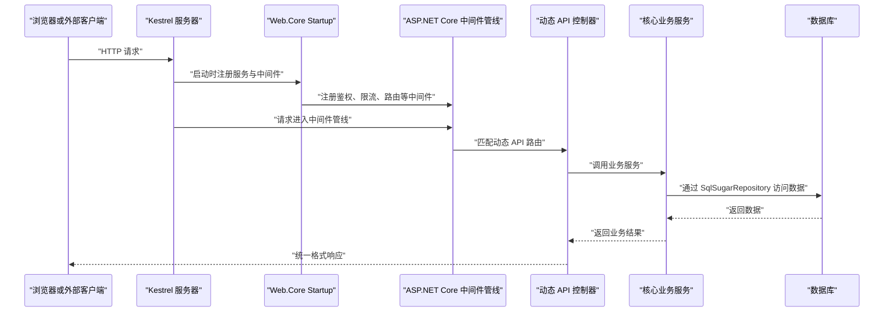
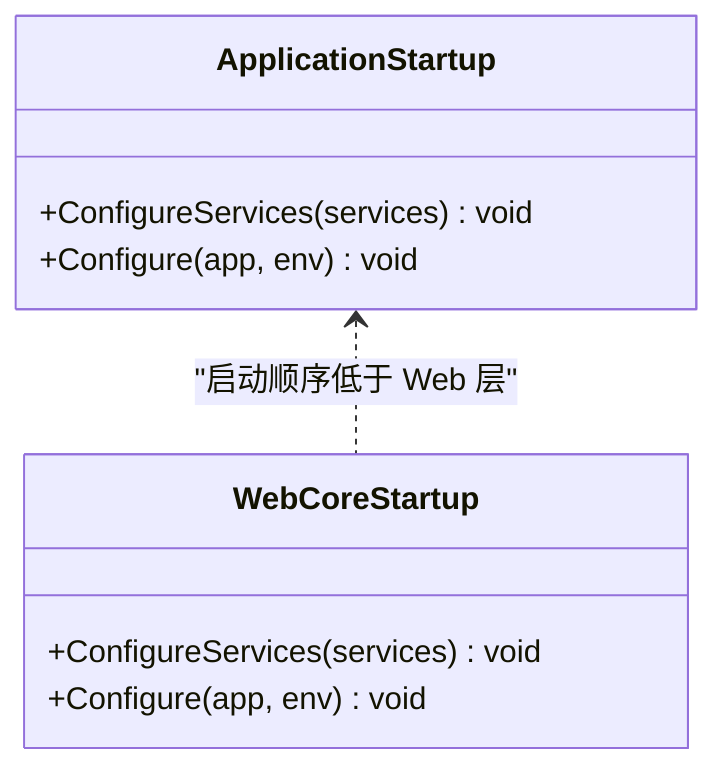
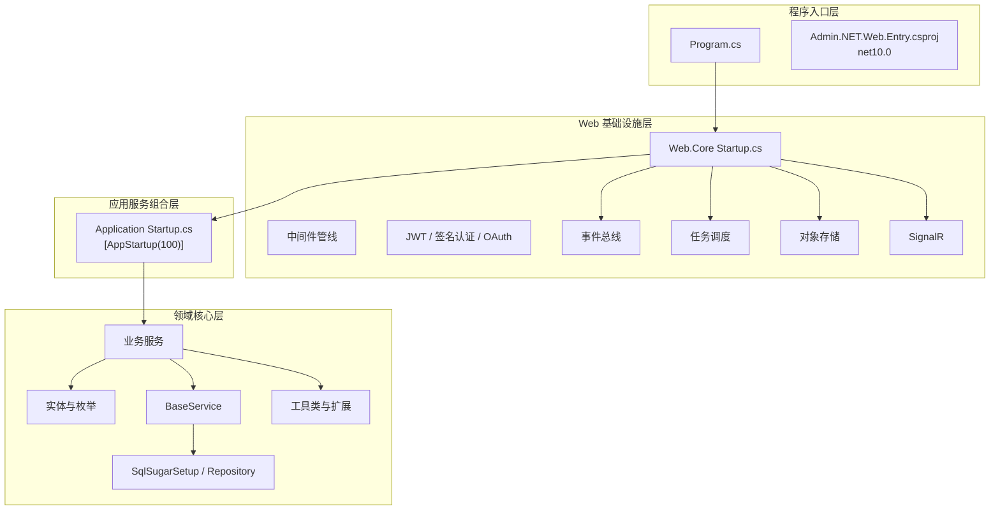
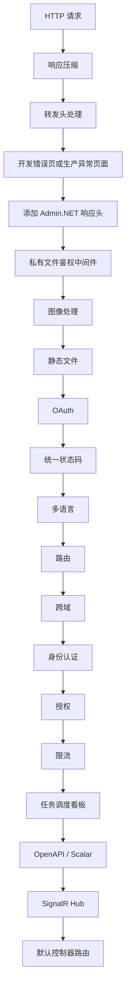
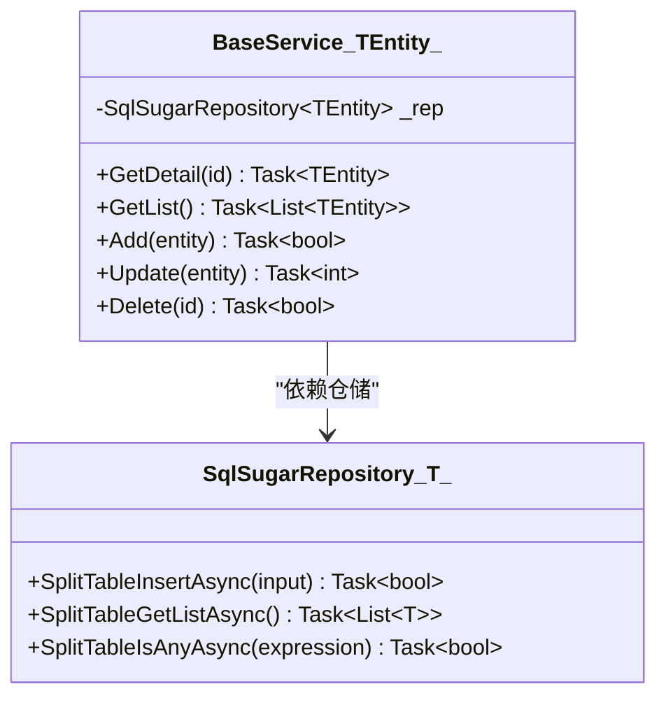
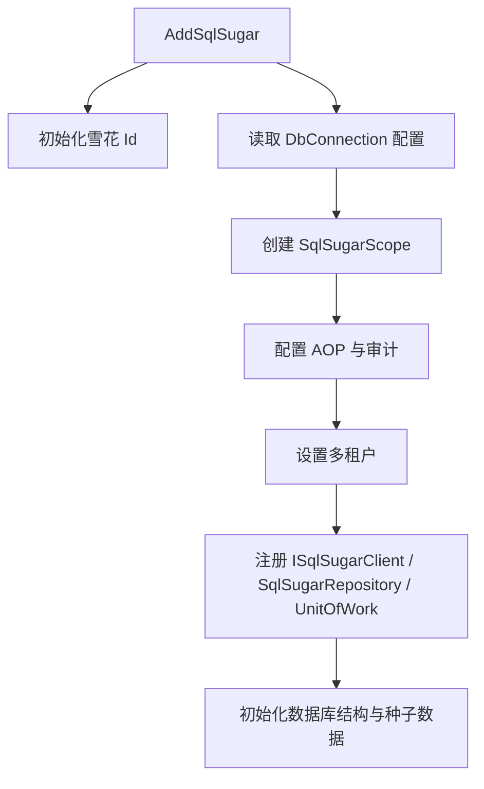
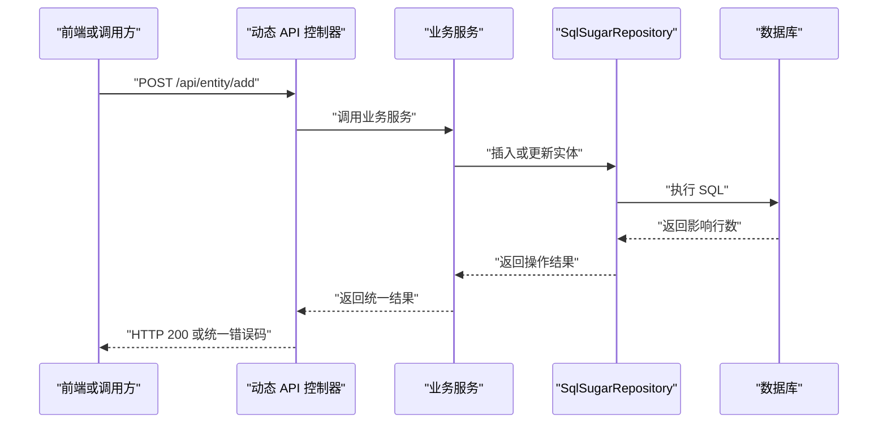
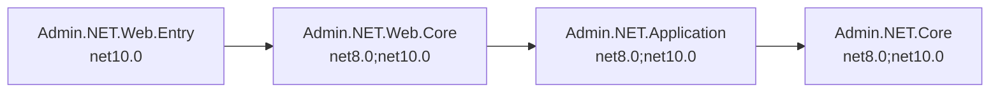

# 后端分层架构

<cite>
**本文引用的文件**   
- [README.md](file://README.md)
- [global.json](file://Admin.NET/global.json)
- [Program.cs](file://Admin.NET/Admin.NET.Web.Entry/Program.cs)
- [FakeStartup.cs](file://Admin.NET/Admin.NET.Web.Entry/FakeStartup.cs)
- [Admin.NET.Web.Entry.csproj](file://Admin.NET/Admin.NET.Web.Entry/Admin.NET.Web.Entry.csproj)
- [appsettings.json](file://Admin.NET/Admin.NET.Web.Entry/appsettings.json)
- [Startup.cs](file://Admin.NET/Admin.NET.Web.Core/Startup.cs)
- [Admin.NET.Web.Core.csproj](file://Admin.NET/Admin.NET.Web.Core/Admin.NET.Web.Core.csproj)
- [Startup.cs](file://Admin.NET/Admin.NET.Application/Startup.cs)
- [GlobalUsings.cs](file://Admin.NET/Admin.NET.Application/GlobalUsings.cs)
- [Admin.NET.Application.csproj](file://Admin.NET/Admin.NET.Application/Admin.NET.Application.csproj)
- [GlobalUsings.cs](file://Admin.NET/Admin.NET.Core/GlobalUsings.cs)
- [Admin.NET.Core.csproj](file://Admin.NET/Admin.NET.Core/Admin.NET.Core.csproj)
- [BaseService.cs](file://Admin.NET/Admin.NET.Core/Service/BaseService.cs)
- [SqlSugarSetup.cs](file://Admin.NET/Admin.NET.Core/SqlSugar/SqlSugarSetup.cs)
- [SqlSugarRepository.cs](file://Admin.NET/Admin.NET.Core/SqlSugar/SqlSugarRepository.cs)
</cite>

## 目录

1. [引言](#引言)
2. [项目结构](#项目结构)
3. [核心组件](#核心组件)
4. [架构总览](#架构总览)
5. [详细组件分析](#详细组件分析)
6. [依赖关系分析](#依赖关系分析)
7. [性能与可维护性](#性能与可维护性)
8. [故障排查指南](#故障排查指南)
9. [结论](#结论)

## 引言

Admin.NET 是基于 ASP.NET Core、Furion 和 SqlSugar 的通用权限开发框架，采用前后端分离与模块化设计。当前文档聚焦后端四层架构：程序入口层 `Admin.NET.Web.Entry`、Web 基础设施层 `Admin.NET.Web.Core`、应用服务组合层 `Admin.NET.Application`，以及领域核心层 `Admin.NET.Core`。

根据仓库说明，后端共享工程按项目配置支持 .NET 8 与 .NET 10 双目标；API 入口与测试工程使用 .NET 10。前端移植已完成，业务前端入口为 `Web/apps/web-antdv-next/`，后端运行命令以 `Admin.NET/Admin.NET.Web.Entry/Admin.NET.Web.Entry.csproj` 为准。数据库集成验收要求隔离的真实 PostgreSQL，不应以 SQLite 或 Mock 结果代替真实联调。

| 层级 | 工程路径 | 主要职责 | 目标框架 |
|---|---|---|---|
| 程序入口层 | `Admin.NET.Admin.NET.Web.Entry` | 启动 Kestrel、Windows 服务、日志过滤、Kestrel 超时与上传大小、注册 Furion Web 组件 | net10.0 |
| Web 基础设施层 | `Admin.NET.Admin.NET.Web.Core` | Furion 应用启动、中间件管线、鉴权、限流、事件总线、文件存储、SignalR、OpenAPI/Scalar | net8.0;net10.0 |
| 应用服务组合层 | `Admin.NET.Admin.NET.Application` | 应用级启动器、业务配置扩展点、应用服务装配位置 | net8.0;net10.0 |
| 领域核心层 | `Admin.NET.Admin.NET.Core` | 实体模型、枚举、工具类、基础服务、事件总线、任务调度、签名认证、ORM 抽象 | net8.0;net10.0 |

**本节来源**
- [README.md:1-60](file://README.md#L1-L60)
- [Admin.NET.Web.Entry.csproj:3-10](file://Admin.NET/Admin.NET.Web.Entry/Admin.NET.Web.Entry.csproj#L3-L10)
- [Admin.NET.Web.Core.csproj:3-8](file://Admin.NET/Admin.NET.Web.Core/Admin.NET.Web.Core.csproj#L3-L8)
- [Admin.NET.Application.csproj:3-9](file://Admin.NET/Admin.NET.Application/Admin.NET.Application.csproj#L3-L9)
- [Admin.NET.Core.csproj:3-12](file://Admin.NET/Admin.NET.Core/Admin.NET.Core.csproj#L3-L12)

## 项目结构

后端解决方案位于 `Admin.NET/`，包含四个核心工程和测试工程，并保留插件目录与 Docker 部署资料。当前分支已完成前端移植，但本技术文档仅讨论后端分层架构。

**图表来源**
- [Admin.NET.Web.Entry.csproj:63-71](file://Admin.NET/Admin.NET.Web.Entry/Admin.NET.Web.Entry.csproj#L63-L71)
- [Admin.NET.Web.Core.csproj:15-21](file://Admin.NET/Admin.NET.Web.Core/Admin.NET.Web.Core.csproj#L15-L21)
- [Admin.NET.Application.csproj:24-32](file://Admin.NET/Admin.NET.Application/Admin.NET.Application.csproj#L24-L32)
- [Admin.NET.Core.csproj:1-70](file://Admin.NET/Admin.NET.Core/Admin.NET.Core.csproj#L1-L70)

**本节来源**
- [Admin.NET.Web.Entry.csproj:63-71](file://Admin.NET/Admin.NET.Web.Entry/Admin.NET.Web.Entry.csproj#L63-L71)
- [Admin.NET.Web.Core.csproj:15-21](file://Admin.NET/Admin.NET.Web.Core/Admin.NET.Web.Core.csproj#L15-L21)
- [Admin.NET.Application.csproj:24-32](file://Admin.NET/Admin.NET.Application/Admin.NET.Application.csproj#L24-L32)

## 核心组件

### 程序入口：Admin.NET.Web.Entry

该工程是 .NET 应用的真正进程入口。它不直接承载业务逻辑，而是负责：

1. 调用 Furion 的 `Serve.Run` 创建 WebApplication 主机。
2. 通过 `RunOptions.Default` 配置主机构建器。
3. 使用 `UseWindowsService()` 启用 Windows 服务支持。
4. 注册 `WebComponent`，将 Web 层能力注入 Furion 容器。
5. 在 Windows 非服务控制台运行时禁用事件日志，避免普通用户写入权限异常。
6. 设置日志级别过滤，屏蔽部分框架噪声日志。
7. 配置 Kestrel 的 KeepAlive、请求头超时和最大请求体大小。

**图表来源**
- [Program.cs:10-38](file://Admin.NET/Admin.NET.Web.Entry/Program.cs#L10-L38)

**本节来源**
- [Program.cs:10-38](file://Admin.NET/Admin.NET.Web.Entry/Program.cs#L10-L38)
- [FakeStartup.cs:10-14](file://Admin.NET/Admin.NET.Web.Entry/FakeStartup.cs#L10-L14)
- [Admin.NET.Web.Entry.csproj:3-10](file://Admin.NET/Admin.NET.Web.Entry/Admin.NET.Web.Entry.csproj#L3-L10)

### Web 基础设施：Admin.NET.Web.Core

该工程承担 HTTP 请求进入系统后的基础设施装配。其 `Startup` 类标注 `[AppStartup(int.MaxValue)]`，表示在 Furion 启动阶段优先执行。主要职责包括：

- 注册项目选项、缓存、SqlSugar、JWT、签名认证、跨域、远程请求、任务队列、任务调度、敏感词检测。
- 配置控制器、统一返回、JSON 序列化、OAuth、ElasticSearch、转发头、限流、图像处理、OSS、文件服务、模板引擎、SignalR、验证码、日志、响应压缩、虚拟文件系统。
- 在管道中启用错误页、HSTS、静态文件、OAuth、统一状态码、多语言、路由、跨域、身份认证、授权、IP 限流、客户端限流、策略限流、定时任务看板、OpenAPI/Scalar、Hub 路由与默认控制器路由。

**图表来源**
- [Startup.cs:25-200](file://Admin.NET/Admin.NET.Web.Core/Startup.cs#L25-L200)
- [Startup.cs:201-442](file://Admin.NET/Admin.NET.Web.Core/Startup.cs#L201-L442)
- [BaseService.cs:13-90](file://Admin.NET/Admin.NET.Core/Service/BaseService.cs#L13-L90)
- [SqlSugarRepository.cs:11-125](file://Admin.NET/Admin.NET.Core/SqlSugar/SqlSugarRepository.cs#L11-L125)

**本节来源**
- [Startup.cs:25-200](file://Admin.NET/Admin.NET.Web.Core/Startup.cs#L25-L200)
- [Startup.cs:201-442](file://Admin.NET/Admin.NET.Web.Core/Startup.cs#L201-L442)
- [Admin.NET.Web.Core.csproj:3-21](file://Admin.NET/Admin.NET.Web.Core/Admin.NET.Web.Core.csproj#L3-L21)

### 应用服务组合：Admin.NET.Application

该工程是业务扩展的自然边界。当前实现提供一个空的 `Startup` 类，并通过 `[AppStartup(100)]` 指定启动顺序。这意味着：

- Web 层的 `Startup` 使用更高优先级 `int.MaxValue`，先完成基础设施装配。
- 应用层的 `Startup` 使用优先级 `100`，适合后续接入业务模块、应用配置、应用服务装配。
- 新增业务模块可以放在 `Admin.NET.Application` 或其子目录中，由 Web 层引用需要启用的应用工程。

**图表来源**
- [Startup.cs:10-22](file://Admin.NET/Admin.NET.Application/Startup.cs#L10-L22)
- [Startup.cs:25-200](file://Admin.NET/Admin.NET.Web.Core/Startup.cs#L25-L200)

**本节来源**
- [Startup.cs:10-22](file://Admin.NET/Admin.NET.Application/Startup.cs#L10-L22)
- [GlobalUsings.cs:10-15](file://Admin.NET/Admin.NET.Application/GlobalUsings.cs#L10-L15)
- [Admin.NET.Application.csproj:3-32](file://Admin.NET/Admin.NET.Application/Admin.NET.Application.csproj#L3-L32)

### 领域核心：Admin.NET.Core

这是整个后端最底层的共享库，承载领域模型、枚举、工具、基础服务、事件总线、任务调度、签名认证、ORM 抽象和大量第三方集成。其 `GlobalUsings.cs` 将 Furion、SqlSugar、Magicodes、Mapster、NewLife、Yitter.IdGenerator 等常用类型提升为全局可用。

核心特点包括：

- 使用 Furion 提供依赖注入、动态 API、配置选项、日志、事件总线、任务调度、统一结果和视图引擎。
- 使用 SqlSugar 作为 ORM，封装仓储、工作单元、多租户、日志表、系统表、雪花 Id、连接池和数据库初始化。
- 通过特性如 `TenantAttribute`、`LogTableAttribute`、`SysTableAttribute` 控制数据访问行为。
- 通过 `BaseService<TEntity>` 提供增删改查基能力，子类可直接继承获得动态 API 暴露能力。

**本节来源**
- [GlobalUsings.cs:10-56](file://Admin.NET/Admin.NET.Core/GlobalUsings.cs#L10-L56)
- [Admin.NET.Core.csproj:3-70](file://Admin.NET/Admin.NET.Core/Admin.NET.Core.csproj#L3-L70)

## 架构总览

Admin.NET 的后端分层遵循“入口最小化、基础设施显式化、应用可组合、核心可复用”的原则。

**图表来源**
- [Program.cs:10-38](file://Admin.NET/Admin.NET.Web.Entry/Program.cs#L10-L38)
- [Startup.cs:25-442](file://Admin.NET/Admin.NET.Web.Core/Startup.cs#L25-L442)
- [Startup.cs:10-22](file://Admin.NET/Admin.NET.Application/Startup.cs#L10-L22)
- [BaseService.cs:13-90](file://Admin.NET/Admin.NET.Core/Service/BaseSystem.cs#L13-L90)
- [SqlSugarSetup.cs:20-120](file://Admin.NET/Admin.NET.Core/SqlSugar/SqlSugarSetup.cs#L20-L120)

## 详细组件分析

### 程序入口层职责边界

`Admin.NET.Web.Entry` 只负责进程启动和主机配置，不包含具体业务。关键边界如下：

| 关注点 | 实现方式 |
|---|---|
| 主机启动 | `Serve.Run` + `RunOptions.Default` |
| Windows 服务 | `UseWindowsService()` |
| Furion 组件 | `AddWebComponent<WebComponent>()` |
| 日志策略 | 控制台运行时禁用 Windows 事件日志；过滤框架噪声日志 |
| Kestrel | KeepAlive 30 分钟、请求头超时 30 分钟、无最大请求体限制 |
| 依赖方向 | 仅引用 `Admin.NET.Web.Core` |

**本节来源**
- [Program.cs:10-38](file://Admin.NET/Admin.NET.Web.Entry/Program.cs#L10-L38)
- [Admin.NET.Web.Entry.csproj:63-71](file://Admin.NET/Admin.NET.Web.Entry/Admin.NET.Web.Entry.csproj#L63-L71)

### Web 基础设施层职责边界

`Admin.NET.Web.Core` 是 HTTP 请求进入系统的第一个后端装配点。它不直接实现复杂业务规则，而是把基础设施能力串联起来。

#### 服务注册重点

- **缓存**：通过 `AddCache()` 注册缓存能力。
- **ORM**：通过 `AddSqlSugar()` 注册 SqlSugar 上下文、仓储和工作单元。
- **鉴权**：JWT 全局启用，支持 URL token 和 Hub access_token。
- **签名认证**：通过 `AddSignatureAuthentication` 结合 `SysOpenAccessService`。
- **事件总线**：支持内存、Redis 消息源，并可扩展 RabbitMQ。
- **任务调度**：持久化到数据库，支持集群模式。
- **文件存储**：本地、OSS 和多提供者抽象。
- **SignalR**：开启详细错误、心跳、超时和消息大小限制。
- **OpenAPI**：使用 Scalar 生成接口文档。

#### 中间件管线重点

**图表来源**
- [Startup.cs:201-442](file://Admin.NET/Admin.NET.Web.Core/Startup.cs#L201-L442)

**本节来源**
- [Startup.cs:25-200](file://Admin.NET/Admin.NET.Web.Core/Startup.cs#L25-L200)
- [Startup.cs:201-442](file://Admin.NET/Admin.NET.Web.Core/Startup.cs#L201-L442)

### 应用服务组合层职责边界

`Admin.NET.Application` 当前是一个空启动器，但它定义了业务扩展的约定：

- 使用 `[AppStartup(100)]`，明确其启动顺序晚于 Web 层。
- 提供 `ConfigureServices` 和 `Configure` 扩展点。
- 业务服务可放在 `Admin.NET.Application` 或独立应用工程中，最终由 Web 层引用。
- GlobalUsings 已引入 `Admin.NET.Core`、Furion、动态 API、授权、Mvc 和依赖注入相关类型，便于业务服务直接复用核心能力。

这种设计让新增业务模块不需要修改底层核心，只需在应用层或新工程中声明服务，并由宿主选择启用。

**本节来源**
- [Startup.cs:10-22](file://Admin.NET/Admin.NET.Application/Startup.cs#L10-L22)
- [GlobalUsings.cs:10-15](file://Admin.NET/Admin.NET.Application/GlobalUsings.cs#L10-L15)

### 领域核心层职责边界

`Admin.NET.Core` 是共享领域与基础设施层。它应当：

- 不依赖 Web 项目。
- 定义领域实体、枚举、配置选项、工具类和基础服务。
- 封装对第三方组件的使用，例如 SqlSugar、Redis、ElasticSearch、邮件、短信、微信、OSS、任务调度。
- 暴露稳定接口，供 Web 层和应用层消费。

#### 基础服务与动态 API

`BaseService<TEntity>` 是所有实体基础服务的基类，它：

- 继承 Furion 的 `IDynamicApiController`，使子类自动成为动态 API。
- 依赖 `SqlSugarRepository<TEntity>` 进行数据访问。
- 提供 `GetDetail`、`GetList`、`Add`、`Update`、`Delete` 等常见操作。
- 子类可重写方法，增加校验、审计、权限、缓存或事务逻辑。

**图表来源**
- [BaseService.cs:13-90](file://Admin.NET/Admin.NET.Core/Service/BaseService.cs#L13-L90)
- [SqlSugarRepository.cs:11-125](file://Admin.NET/Admin.NET.Core/SqlSugar/SqlSugarRepository.cs#L11-L125)

**本节来源**
- [BaseService.cs:13-90](file://Admin.NET/Admin.NET.Core/Service/BaseService.cs#L13-L90)
- [GlobalUsings.cs:10-56](file://Admin.NET/Admin.NET.Core/GlobalUsings.cs#L10-L56)

### SqlSugar 数据访问抽象

`SqlSugarSetup.AddSqlSugar` 是整个 ORM 能力的装配点。它负责：

1. 初始化雪花 Id。
2. 注册 MongoDb 扩展。
3. 配置动态表达式解析。
4. 读取 `DbConnection` 配置。
5. 创建 `SqlSugarScope`。
6. 为每个连接配置 AOP、差异日志、审计、命名规则和数据库模式兼容。
7. 注册单例 `ISqlSugarClient`、泛型仓储和工作单元。
8. 初始化数据库结构和种子数据。

**图表来源**
- [SqlSugarSetup.cs:20-120](file://Admin.NET/Admin.NET.Core/SqlSugar/SqlSugarSetup.cs#L20-L120)

**本节来源**
- [SqlSugarSetup.cs:20-120](file://Admin.NET/Admin.NET.Core/SqlSugar/SqlSugarSetup.cs#L20-L120)

### 跨层调用与数据流向

一个典型的数据写入流程如下：

**图表来源**
- [BaseService.cs:13-90](file://Admin.NET/Admin.NET.Core/Service/BaseService.cs#L13-L90)
- [SqlSugarRepository.cs:11-125](file://Admin.NET/Admin.NET.Core/SqlSugar/SqlSugarRepository.cs#L11-L125)

**本节来源**
- [BaseService.cs:13-90](file://Admin.NET/Admin.NET.Core/Service/BaseService.cs#L13-L90)
- [SqlSugarRepository.cs:11-125](file://Admin.NET/Admin.NET.Core/SqlSugar/SqlSugarRepository.cs#L11-L125)

## 依赖关系分析

各工程之间的依赖方向是单向且清晰的：

**图表来源**
- [Admin.NET.Web.Entry.csproj:63-71](file://Admin.NET/Admin.NET.Web.Entry/Admin.NET.Web.Entry.csproj#L63-L71)
- [Admin.NET.Web.Core.csproj:15-21](file://Admin.NET/Admin.NET.Web.Core/Admin.NET.Web.Core.csproj#L15-L21)
- [Admin.NET.Application.csproj:24-32](file://Admin.NET/Admin.NET.Application/Admin.NET.Application.csproj#L24-L32)

### 依赖耦合分析

| 依赖方向 | 耦合强度 | 说明 |
|---|---|---|
| Entry → Web.Core | 低 | 仅启动和组件注册 |
| Web.Core → Application | 低 | 通过 Furion 启动器扩展点装配 |
| Application → Core | 中 | 业务服务依赖领域模型和基础能力 |
| Web.Core → Core | 中 | Web 基础设施需要事件总线、任务调度、签名认证、ORM 等 |
| Core 内部 | 高 | 核心层内部高度内聚，面向稳定接口 |

### 外部依赖

`Admin.NET.Core` 集中管理第三方依赖，包括：

- Furion 生态：依赖注入、动态 API、配置、日志、事件总线、任务调度、统一结果、Mapster。
- SqlSugar：ORM、MongoDbCore。
- NewLife.Redis：缓存。
- Elastic.Clients.Elasticsearch：日志或检索。
- Magicodes.IE：导入导出。
- SignalR、OAuth、RateLimit、ImageSharp、OSS、短信、邮件、二维码、SSH、UAParser、Yitter.IdGenerator 等。

**本节来源**
- [Admin.NET.Core.csproj:13-70](file://Admin.NET/Admin.NET.Core/Admin.NET.Core.csproj#L13-L70)
- [Admin.NET.Web.Core.csproj:10-21](file://Admin.NET/Admin.NET.Web.Core/Admin.NET.Web.Core.csproj#L10-L21)
- [Admin.NET.Web.Entry.csproj:56-71](file://Admin.NET/Admin.NET.Web.Entry/Admin.NET.Web.Entry.csproj#L56-L71)

## 性能与可维护性

### 分层架构的可维护性优势

1. **职责清晰**：程序入口只负责主机配置；Web 层负责中间件和基础设施；应用层负责业务装配；核心层负责领域和基础能力。
2. **扩展安全**：新增业务服务通常只需在 `Admin.NET.Application` 或新工程中注册，无需改动底层核心。
3. **测试友好**：核心层不含 Web 细节，更适合单元测试；Web 层可使用 FakeStartup 等机制配合集成测试。
4. **替换成本低**：ORM、缓存、消息队列、文件存储等能力集中在核心层，替换实现时对外暴露的接口保持稳定。

### 扩展点

| 扩展点 | 位置 | 用途 |
|---|---|---|
| Furion Web 组件 | `Program.cs` | 自定义主机、日志、Kestrel |
| Web 启动器 | `Admin.NET.Web.Core/Startup.cs` | 注册 Web 基础设施 |
| 应用启动器 | `Admin.NET.Application/Startup.cs` | 注册业务服务和配置 |
| SqlSugar 初始化 | `SqlSugarSetup.cs` | 多连接、AOP、审计、种子数据 |
| 仓储 | `SqlSugarRepository<T>` | 多租户、日志表、系统表、分表 |
| 基础服务 | `BaseService<TEntity>` | 通用 CRUD 与动态 API |
| 事件总线存储 | Web 启动器 | 切换 Redis 或 RabbitMQ 事件源 |
| 文件存储 | `SysFileProviderService` / `IOSSServiceManager` | 本地与 OSS 多提供者 |

### 性能考虑

- **Kestrel 配置**：KeepAlive 和请求头超时设置为 30 分钟，适合长连接场景；最大请求体大小未限制，需结合业务和数据量评估安全风险。
- **SQL 审计与慢查询**：超过 5 秒的 SQL 会记录警告日志，便于定位慢查询。
- **响应压缩**：启用 Brotli 和 Gzip，并扩展 MIME 类型。
- **IP 地址库加载**：将国际 IP 数据库加载到内存，以空间换时间。
- **SignalR**：开启详细错误、心跳和超时，调整接收消息大小。
- **事件总线**：关闭默认事件日志，避免额外 IO 开销；可按需切换到 Redis 或 RabbitMQ。

**本节来源**
- [Program.cs:20-38](file://Admin.NET/Admin.NET.Web.Entry/Program.cs#L20-L38)
- [Startup.cs:201-442](file://Admin.NET/Admin.NET.Web.Core/Startup.cs#L201-L442)
- [SqlSugarSetup.cs:120-200](file://Admin.NET/Admin.NET.Core/SqlSugar/SqlSugarSetup.cs#L120-L200)

## 故障排查指南

### 控制台运行时 Windows 事件日志报错

当在非 Windows 服务模式下运行程序时，`WebComponent.Load` 会禁用 `EventLogLoggerProvider`，避免普通用户写入事件日志失败。如果仍出现日志写入异常，应检查：

- 是否在 Windows 下以控制台方式运行。
- 是否误启用了事件日志相关配置。
- 日志级别过滤是否屏蔽了期望日志。

**本节来源**
- [Program.cs:20-38](file://Admin.NET/Admin.NET.Web.Entry/Program.cs#L20-L38)

### 数据库连接或多租户异常

`SqlSugarRepository<T>` 会根据实体特性和请求头中的租户信息决定连接：

- 贴 `TenantAttribute` 的实体走对应租户连接。
- 贴 `LogTableAttribute` 的实体走日志库连接。
- 贴 `SysTableAttribute` 的实体走系统库连接。
- 登录用户不能通过请求头随意切换其他租户，否则抛出错误码 `D1016`。
- 非法租户 ID 抛出错误码 `D1012`。

排查建议：

1. 确认 `DbConnection` 配置是否正确。
2. 确认实体是否误加或未加租户、日志表、系统表特性。
3. 确认请求头中的租户 ID 是否与当前用户 Claim 一致。
4. 区分主库、日志库和业务库连接。

**本节来源**
- [SqlSugarRepository.cs:23-90](file://Admin.NET/Admin.NET.Core/SqlSugar/SqlSugarRepository.cs#L23-L90)

### 接口超时或慢查询

`SqlSugarSetup.SetDbAop` 对超过 5 秒的 SQL 输出警告日志，包含文件名、行号和方法名。排查步骤：

1. 查看慢查询日志。
2. 定位调用栈中的方法。
3. 检查是否缺少索引、是否存在 N+1 查询。
4. 评估是否需要分页、缓存或异步优化。

**本节来源**
- [SqlSugarSetup.cs:120-200](file://Admin.NET/Admin.NET.Core/SqlSugar/SqlSugarSetup.cs#L120-L200)

### 事件总线未持久化

事件总线默认可能使用内存存储。若希望分布式场景下事件可靠传递，应在 Web 启动器中根据 `CacheOptions.CacheType` 切换为 Redis 事件源。若注释掉 RabbitMQ 配置，则不会启用 RabbitMQ 事件源。

**本节来源**
- [Startup.cs:120-200](file://Admin.NET/Admin.NET.Web.Core/Startup.cs#L120-L200)

## 结论

Admin.NET 的后端分层架构以 Furion 的模块化启动机制为基础，以 SqlSugar 的 ORM 抽象为核心，形成“入口最小、基础设施显式、应用可组合、核心可复用”的四层结构。`Admin.NET.Web.Entry` 负责主机与进程生命周期；`Admin.NET.Web.Core` 负责 Web 中间件、鉴权、限流、事件总线、任务调度和文档；`Admin.NET.Application` 提供业务装配扩展点；`Admin.NET.Core` 承载领域模型、基础服务和第三方能力。

这种分层使得：

- 新增业务服务可在应用层或新工程中实现，不影响底层。
- Web 基础设施可通过启动器和中间件扩展。
- 数据访问通过仓储抽象屏蔽 SqlSugar 细节。
- 多租户、日志表、系统表和分表逻辑集中在核心层。
- 双目标框架（.NET 8 与 .NET 10）允许在不同环境中灵活编译，同时保持核心能力一致。

在实际项目中，建议严格遵循依赖方向，避免反向引用；在核心层保持稳定的接口契约；在 Web 层集中管理横切关注点；在应用层组织业务用例；并使用隔离的真实 PostgreSQL 进行数据库集成验证。