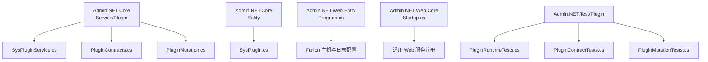
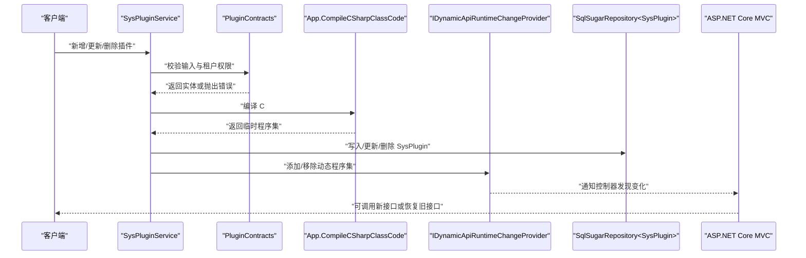
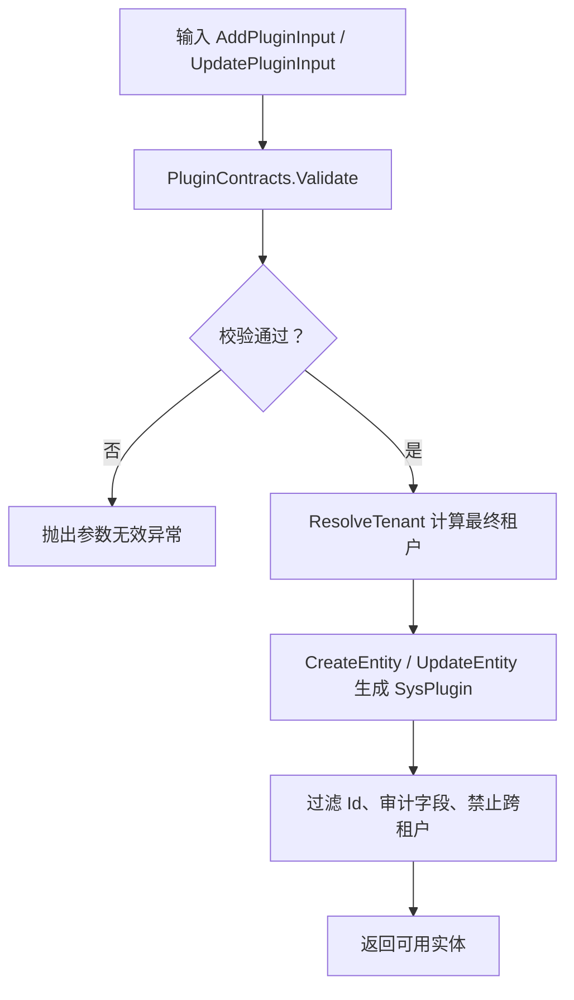
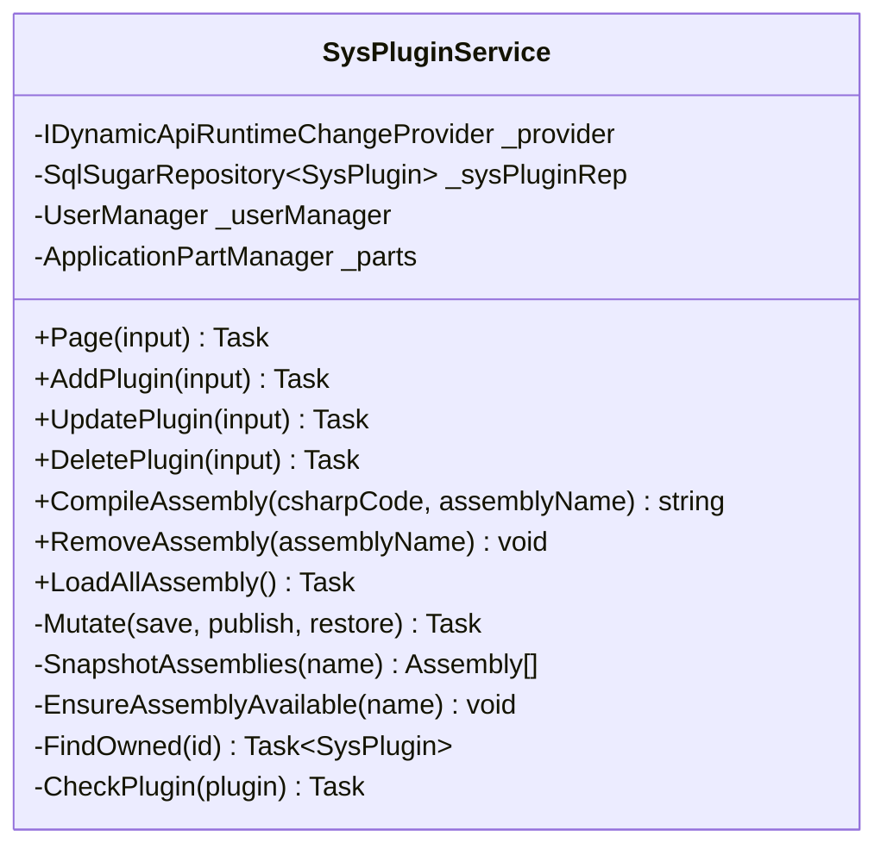
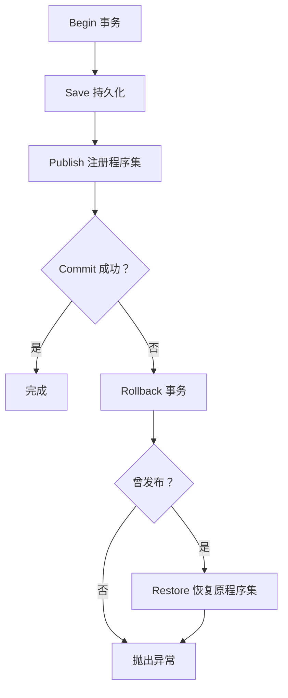
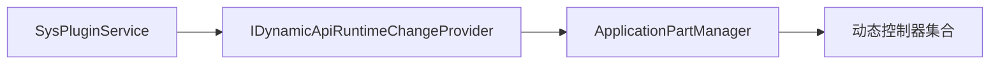

# 插件架构设计

<cite>
**本文引用的文件**
- [PluginContracts.cs](file://Admin.NET/Admin.NET.Core/Service/Plugin/PluginContracts.cs)
- [SysPluginService.cs](file://Admin.NET/Admin.NET.Core/Service/Plugin/SysPluginService.cs)
- [PluginMutation.cs](file://Admin.NET/Admin.NET.Core/Service/Plugin/PluginMutation.cs)
- [SysPlugin.cs](file://Admin.NET/Admin.NET.Core/Entity/SysPlugin.cs)
- [Program.cs](file://Admin.NET/Admin.NET.Web.Entry/Program.cs)
- [Startup.cs](file://Admin.NET/Admin.NET.Web.Core/Startup.cs)
- [CLAUDE.md](file://Admin.NET/Admin.NET.Application/CLAUDE.md)
- [PluginRuntimeTests.cs](file://Admin.NET/Admin.NET.Test/Plugin/PluginRuntimeTests.cs)
- [PluginContractTests.cs](file://Admin.NET/Admin.NET.Test/Plugin/PluginContractTests.cs)
- [PluginMutationTests.cs](file://Admin.NET/Admin.NET.Test/Plugin/PluginMutationTests.cs)
</cite>

## 目录
1. [引言](#引言)
2. [项目结构](#项目结构)
3. [核心组件](#核心组件)
4. [架构总览](#架构总览)
5. [详细组件分析](#详细组件分析)
6. [依赖与集成关系](#依赖与集成关系)
7. [性能与扩展性](#性能与扩展性)
8. [安全性与版本兼容](#安全性与版本兼容)
9. [故障排查](#故障排查)
10. [结论](#结论)

## 引言
本仓库的插件体系围绕“动态程序集 + 动态 API”展开：插件以 C# 源码形式持久化，运行期编译为临时程序集并注册到 ASP.NET Core MVC 的动态控制器发现机制中。`PluginContracts` 定义插件输入校验、租户范围、实体创建和更新等契约；`SysPluginService` 暴露增删改查、动态编译、动态注册与卸载等接口；`PluginMutation` 提供单进程并发保护以及数据库事务与运行时发布的双向回滚能力。

需要特别说明的是：当前代码库中的“插件”主要指“动态脚本插件”，即通过 API 提交 C# 源代码并编译运行的机制。文档标题中提到的 ReZero、WorkWeixin、DingTalk、GoView、K3Cloud 等内置插件属于应用层或外部集成概念，但当前仓库并未在已分析文件中实现对应的插件契约、服务或启动集成。因此，本文仅对现有动态插件框架做准确说明，不对未实现的内置插件功能进行推断。

## 项目结构
插件相关代码集中在 `Admin.NET.Core` 的 Service 与 Entity 层，测试位于 `Admin.NET.Test/Plugin`，Web 入口负责宿主初始化，不直接包含插件逻辑。

**图示来源**
- [SysPluginService.cs:1-264](file://Admin.NET/Admin.NET.Core/Service/Plugin/SysPluginService.cs#L1-L264)
- [PluginContracts.cs:1-97](file://Admin.NET/Admin.NET.Core/Service/Plugin/PluginContracts.cs#L1-L97)
- [PluginMutation.cs:1-55](file://Admin.NET/Admin.NET.Core/Service/Plugin/PluginMutation.cs#L1-L55)
- [SysPlugin.cs:1-56](file://Admin.NET/Admin.NET.Core/Entity/SysPlugin.cs#L1-L56)
- [Program.cs:1-38](file://Admin.NET/Admin.NET.Web.Entry/Program.cs#L1-L38)
- [Startup.cs:1-200](file://Admin.NET/Admin.NET.Web.Core/Startup.cs#L1-L200)
- [PluginRuntimeTests.cs:1-103](file://Admin.NET/Admin.NET.Test/Plugin/PluginRuntimeTests.cs#L1-L103)
- [PluginContractTests.cs:1-132](file://Admin.NET/Admin.NET.Test/Plugin/PluginContractTests.cs#L1-L132)
- [PluginMutationTests.cs:1-68](file://Admin.NET/Admin.NET.Test/Plugin/PluginMutationTests.cs#L1-L68)

**章节来源**
- [SysPluginService.cs:1-264](file://Admin.NET/Admin.NET.Core/Service/Plugin/SysPluginService.cs#L1-L264)
- [PluginContracts.cs:1-97](file://Admin.NET/Admin.NET.Core/Service/Plugin/PluginContracts.cs#L1-L97)
- [PluginMutation.cs:1-55](file://Admin.NET/Admin.NET.Core/Service/Plugin/PluginMutation.cs#L1-L55)
- [SysPlugin.cs:1-56](file://Admin.NET/Admin.NET.Core/Entity/SysPlugin.cs#L1-L56)
- [Program.cs:1-38](file://Admin.NET/Admin.NET.Web.Entry/Program.cs#L1-L38)
- [Startup.cs:1-200](file://Admin.NET/Admin.NET.Web.Core/Startup.cs#L1-L200)

## 核心组件
| 组件 | 职责 | 关键行为 |
|---|---|---|
| `PluginContracts` | 插件数据契约与权限边界 | 校验新增/分页输入、计算租户、限制删除所有者、构造查询范围、生成和更新 `SysPlugin` 实体、防止越权覆盖字段 |
| `SysPluginService` | 插件生命周期管理 | 列表分页、新增、更新、删除、动态编译、动态程序集注册与卸载、加载启用插件 |
| `PluginMutation` | 变更协调器 | 单进程互斥、数据库事务开始/提交/回滚、运行时发布失败恢复、聚合异常记录 |
| `SysPlugin` | 插件持久化模型 | 名称、C# 源码、程序集名、排序、状态、备注、租户信息 |

**章节来源**
- [PluginContracts.cs:1-97](file://Admin.NET/Admin.NET.Core/Service/Plugin/PluginContracts.cs#L1-L97)
- [SysPluginService.cs:1-264](file://Admin.NET/Admin.NET.Core/Service/Plugin/SysPluginService.cs#L1-L264)
- [PluginMutation.cs:1-55](file://Admin.NET/Admin.NET.Core/Service/Plugin/PluginMutation.cs#L1-L55)
- [SysPlugin.cs:1-56](file://Admin.NET/Admin.NET.Core/Entity/SysPlugin.cs#L1-L56)

## 架构总览
动态插件的运行路径是：请求进入 `SysPluginService` → 使用 `PluginContracts` 校验和构建实体 → 通过 `App.CompileCSharpClassCode` 编译 C# 源码 → 通过 Furion 的 `IDynamicApiRuntimeChangeProvider` 将程序集注册为动态控制器 → 由 ASP.NET Core MVC 发现该控制器并对外暴露接口。所有变更操作通过 `PluginMutation` 串行执行，保证数据库与运行时的一致性。

**图示来源**
- [SysPluginService.cs:40-190](file://Admin.NET/Admin.NET.Core/Service/Plugin/SysPluginService.cs#L40-L190)
- [PluginContracts.cs:12-97](file://Admin.NET/Admin.NET.Core/Service/Plugin/PluginContracts.cs#L12-L97)
- [PluginMutation.cs:12-55](file://Admin.NET/Admin.NET.Core/Service/Plugin/PluginMutation.cs#L12-L55)

## 详细组件分析

### 插件契约：`PluginContracts`
`PluginContracts` 不是传统意义上的接口契约类，而是静态契约工具类，承担三类职责：

1. **输入校验**  
   - `AddPluginInput.Validate`：检查名称、C# 源码、程序集名长度、备注长度、状态枚举值、租户 ID。
   - `PagePluginInput.Validate`：检查分页参数合法性。

2. **租户与多租户边界**  
   - `ResolveTenant`：非超管不得伪造其他租户；结果必须大于 0。
   - `ScopeQuery`：普通租户只允许访问自身租户数据。
   - `RequireAccessible`：查询到的插件必须存在且归属当前租户或超管。
   - `EnsureRemovalOwner`：删除或移除程序集时，目标必须是当前租户、宿主程序集或临时程序集的所有者。

3. **实体构造与更新**  
   - `CreateEntity`：从输入创建 `SysPlugin`，清理空白字符串，忽略 `Id`、`CreateUserId`、`UpdateUserName` 等审计字段。
   - `UpdateEntity`：基于当前实体生成只允许更新的投影对象，禁止移动租户。
   - `UpdateQuery`：显式指定更新列，避免 ORM 自定义 Where 覆盖主键条件，且不更新 `TenantId`、`CreateUserId` 等敏感字段。

**图示来源**
- [PluginContracts.cs:12-97](file://Admin.NET/Admin.NET.Core/Service/Plugin/PluginContracts.cs#L12-L97)

**章节来源**
- [PluginContracts.cs:12-97](file://Admin.NET/Admin.NET.Core/Service/Plugin/PluginContracts.cs#L12-L97)
- [PluginContractTests.cs:11-132](file://Admin.NET/Admin.NET.Test/Plugin/PluginContractTests.cs#L11-L132)

### 插件生命周期服务：`SysPluginService`
`SysPluginService` 是一个动态 API 控制器，实现以下生命周期：

| 操作 | 行为 |
|---|---|
| 分页列表 | 按租户、名称过滤，按 `OrderNo` 和 `Id` 排序 |
| 新增 | 校验 → 编译 → 确保程序集名称不冲突 → 写入数据库 → 若启用则注册程序集 |
| 更新 | 校验 → 读取已有插件 → 编译新代码 → 快照旧程序集 → 原子替换并通知 MVC |
| 删除 | 校验所有权 → 快照旧程序集 → 删除记录 → 卸载程序集 |
| 编译接口 | 独立编译 C# 源码并注册为动态程序集，用于快速验证 |
| 卸载接口 | 根据程序集名卸载宿主程序集、临时程序集或插件程序集 |
| 加载全部 | 启动后重新编译并注册所有启用状态的插件 |

**图示来源**
- [SysPluginService.cs:16-264](file://Admin.NET/Admin.NET.Core/Service/Plugin/SysPluginService.cs#L16-L264)

**章节来源**
- [SysPluginService.cs:16-264](file://Admin.NET/Admin.NET.Core/Service/Plugin/SysPluginService.cs#L16-L264)

### 变更协调器：`PluginMutation`
`PluginMutation` 提供两个关键能力：

1. **单进程互斥**  
   使用 `SemaphoreSlim` 保证同一时刻只有一个插件变更操作执行，避免并发修改导致程序集注册状态不一致。

2. **数据库与运行时双向回滚**  
   `ExecuteAsync` 按顺序执行：开始事务 → 保存 → 发布程序集 → 提交事务 → 正常结束；任一阶段失败都会触发回滚，并在尝试过发布后恢复原程序集。多个异常会被包装为 `AggregateException`，便于定位失败阶段。

**图示来源**
- [PluginMutation.cs:12-55](file://Admin.NET/Admin.NET.Core/Service/Plugin/PluginMutation.cs#L12-L55)

**章节来源**
- [PluginMutation.cs:12-55](file://Admin.NET/Admin.NET.Core/Service/Plugin/PluginMutation.cs#L12-L55)
- [PluginMutationTests.cs:12-68](file://Admin.NET/Admin.NET.Test/Plugin/PluginMutationTests.cs#L12-L68)

### 插件实体：`SysPlugin`
`SysPlugin` 继承租户基类，表示一个可动态编译并注册的插件：

| 字段 | 含义 | 约束 |
|---|---|---|
| `Name` | 插件名称 | 必填，最大 64 字符，有索引 |
| `CsharpCode` | 插件 C# 源码 | 必填，大文本存储 |
| `AssemblyName` | 运行时程序集名称 | 可选，最大 512 字符 |
| `OrderNo` | 排序号 | 默认 100 |
| `Status` | 启用/禁用状态 | 使用系统枚举 |
| `Remark` | 备注 | 可选，最大 128 字符 |

**章节来源**
- [SysPlugin.cs:14-56](file://Admin.NET/Admin.NET.Core/Entity/SysPlugin.cs#L14-L56)

## 依赖与集成关系

### 与 Furion 和 MVC 的动态 API 集成
`SysPluginService` 注入 `IDynamicApiRuntimeChangeProvider` 和 `ApplicationPartManager`，通过 `AddAssembliesWithNotifyChanges`、`RemoveAssembliesWithNotifyChanges` 和 `NotifyChanges` 将动态程序集注册为 MVC 控制器。测试确认：即使编译句柄释放，MVC 仍可调用已发布的控制器；卸载后会清空对应控制器。

**图示来源**
- [SysPluginService.cs:24-40](file://Admin.NET/Admin.NET.Core/Service/Plugin/SysPluginService.cs#L24-L40)
- [PluginRuntimeTests.cs:18-103](file://Admin.NET/Admin.NET.Test/Plugin/PluginRuntimeTests.cs#L18-L103)

**章节来源**
- [SysPluginService.cs:24-40](file://Admin.NET/Admin.NET.Core/Service/Plugin/SysPluginService.cs#L24-L40)
- [PluginRuntimeTests.cs:18-103](file://Admin.NET/Admin.NET.Test/Plugin/PluginRuntimeTests.cs#L18-L103)

### 与 Web 宿主的集成
- `Program.cs` 初始化 Furion Web 组件、Windows 事件日志过滤、日志级别、Kestrel 超时和上传大小。
- `Startup.cs` 注册缓存、数据库、JWT、签名认证、事件总线、限流、Swagger 等通用能力。
- 应用扩展层 `Admin.NET.Application` 明确说明：插件工程出现在解决方案中不代表会自动加载，需显式引用和启动注册。

这意味着：当前仓库的插件能力是基础设施，具体业务插件是否启用取决于宿主如何引用和启动它们。

**章节来源**
- [Program.cs:12-38](file://Admin.NET/Admin.NET.Web.Entry/Program.cs#L12-L38)
- [Startup.cs:20-200](file://Admin.NET/Admin.NET.Web.Core/Startup.cs#L20-L200)
- [CLAUDE.md:1-44](file://Admin.NET/Admin.NET.Application/CLAUDE.md#L1-L44)

## 性能与扩展性

### 运行时特性
- **动态编译**：每次新增或更新都调用 `App.CompileCSharpClassCode`，会带来 CPU 和内存开销。
- **程序集注册**：MVC 控制器发现机制会扫描动态程序集，频繁注册/卸载会影响接口路由构建。
- **单进程互斥**：`PluginMutation` 的互斥锁保证一致性，但高并发插件变更会成为串行瓶颈。
- **临时程序集持有**：编译结果通常被 `using` 包裹，但 MVC 仍可能持有类型引用；测试覆盖了编译句柄释放后控制器仍可调用、卸载后控制器消失的场景。

### 可扩展点
- 可通过 `IDynamicApiRuntimeChangeProvider` 扩展动态 API 注册策略。
- 可通过 `ApplicationPartManager` 观察程序集变化。
- 可在 `PluginMutation.ExecuteAsync` 外增加审计、指标或告警钩子，但不建议直接修改其事务与恢复语义。

### 优化建议
- 对高频启停场景考虑预热或增量刷新策略。
- 控制动态程序集数量与体积，避免一次性注册过多控制器。
- 将耗时插件初始化放入异步任务，避免阻塞 API 响应。
- 对插件源码进行白名单校验，减少危险反射或系统调用。

[本节为通用性能讨论，不直接分析具体代码片段]

## 安全性与版本兼容

### 安全性
- **输入校验**：名称、源码、程序集名、备注长度均有限制，非法枚举值会被拒绝。
- **租户隔离**：普通用户不能伪造租户，不能查看或修改其他租户插件。
- **所有权控制**：删除或卸载程序集前检查所有者，宿主程序集和临时程序集有特殊保护规则。
- **字段保护**：`CreateEntity` 和 `UpdateEntity` 不暴露 `Id`、`CreateUserId`、`UpdateUserName` 等审计字段。
- **SQL 安全**：`UpdateQuery` 显式指定更新列和 Where 条件，防止 ORM 自定义查询覆盖主键或租户条件。

### 版本兼容性
- 插件以 C# 源码形式存储，升级宿主或编译器时，可能需要重新编译已有插件。
- 程序集名称冲突会被拒绝，避免不同租户或宿主程序集互相覆盖。
- 启用状态控制插件是否参与运行时注册，便于灰度与回滚。
- 由于动态程序集与 MVC 共享进程空间，卸载并不等同于彻底释放托管类型，应通过测试覆盖实际行为。

**章节来源**
- [PluginContracts.cs:12-97](file://Admin.NET/Admin.NET.Core/Service/Plugin/PluginContracts.cs#L12-L97)
- [SysPluginService.cs:80-264](file://Admin.NET/Admin.NET.Core/Service/Plugin/SysPluginService.cs#L80-L264)
- [PluginContractTests.cs:40-132](file://Admin.NET/Admin.NET.Test/Plugin/PluginContractTests.cs#L40-L132)

## 故障排查

| 现象 | 可能原因 | 处理建议 |
|---|---|---|
| 新增插件时报参数无效 | 名称为空、过长，源码为空，程序集名过长，状态非法，租户无效 | 检查 `PluginContracts.Validate` 和输入 DTO |
| 更新插件报目标已变化 | 并发更新导致数据库行被修改 | 重试或加乐观锁；检查事务与互斥锁 |
| 删除插件报无权限 | 非超管访问了其他租户插件，或目标程序集不属于当前租户 | 检查 `EnsureRemovalOwner` 和租户上下文 |
| 编译接口后无法调用 | 动态程序集未注册或已被卸载 | 检查 `AddAssembliesWithNotifyChanges` 和 MVC 控制器发现 |
| 插件启用后接口不可用 | 插件未处于启用状态，或程序集名称冲突 | 检查 `StatusEnum.Enable` 和程序集名称唯一性 |
| 事务提交失败但运行时已发布 | `PluginMutation` 会尝试恢复原程序集 | 查看 `AggregateException` 中各阶段异常 |
| 卸载后仍有控制器残留 | MVC 仍持有程序集引用或缓存 | 重启服务或等待 GC；参考 `PluginRuntimeTests` 行为 |

**章节来源**
- [PluginMutation.cs:12-55](file://Admin.NET/Admin.NET.Core/Service/Plugin/PluginMutation.cs#L12-L55)
- [PluginRuntimeTests.cs:18-103](file://Admin.NET/Admin.NET.Test/Plugin/PluginRuntimeTests.cs#L18-L103)
- [PluginMutationTests.cs:12-68](file://Admin.NET/Admin.NET.Test/Plugin/PluginMutationTests.cs#L12-L68)

## 结论
Admin.NET 的插件架构以“动态源码 + 动态程序集 + 动态控制器”为核心，通过 `PluginContracts` 统一输入、租户和实体契约，通过 `SysPluginService` 管理插件的增删改查与运行时注册，通过 `PluginMutation` 保证数据库与 MVC 运行时的一致性。该设计实现了核心系统与插件代码的解耦，但也带来编译成本、进程内程序集管理和并发一致性的挑战。

对于计划中的 ReZero、WorkWeixin、DingTalk、GoView、K3Cloud 等内置插件，当前仓库尚未提供对应的插件契约实现与服务集成；如需接入，应在应用扩展层明确引用插件工程、完成配置绑定、启动注册，并通过真实 PostgreSQL 和浏览器流程进行验收，而不能仅凭解决方案中存在插件工程就断言其已启用。