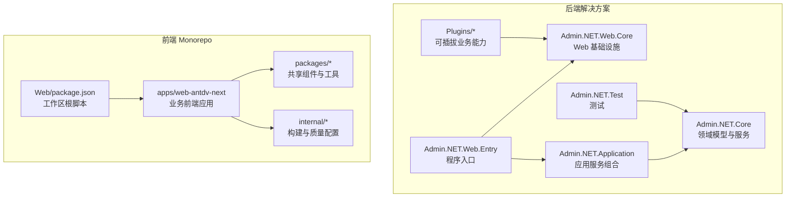
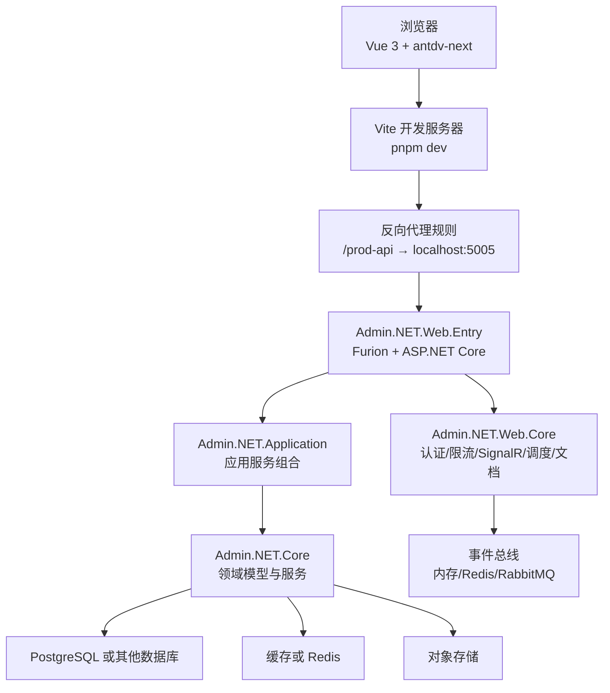
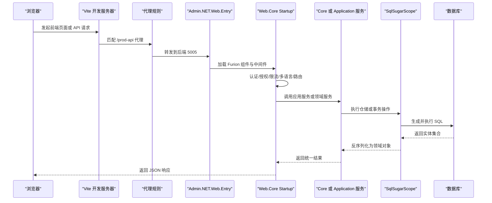
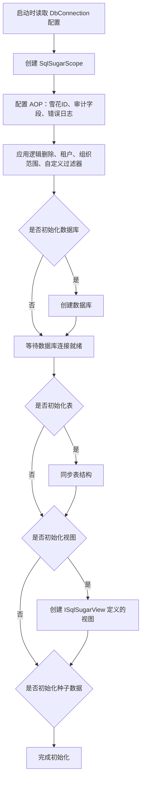
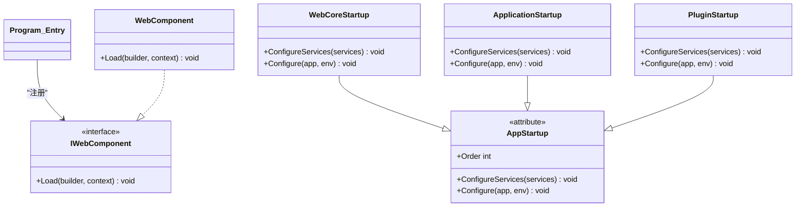
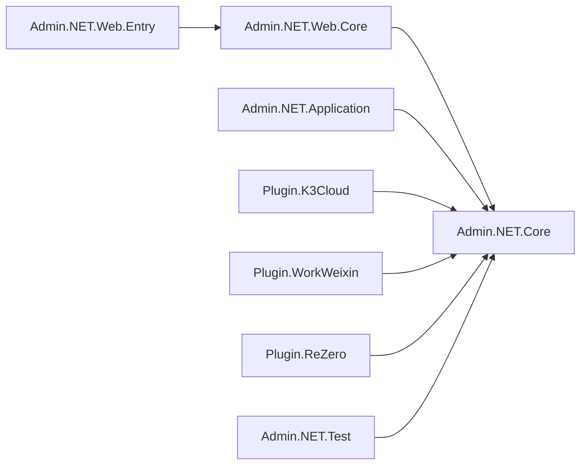
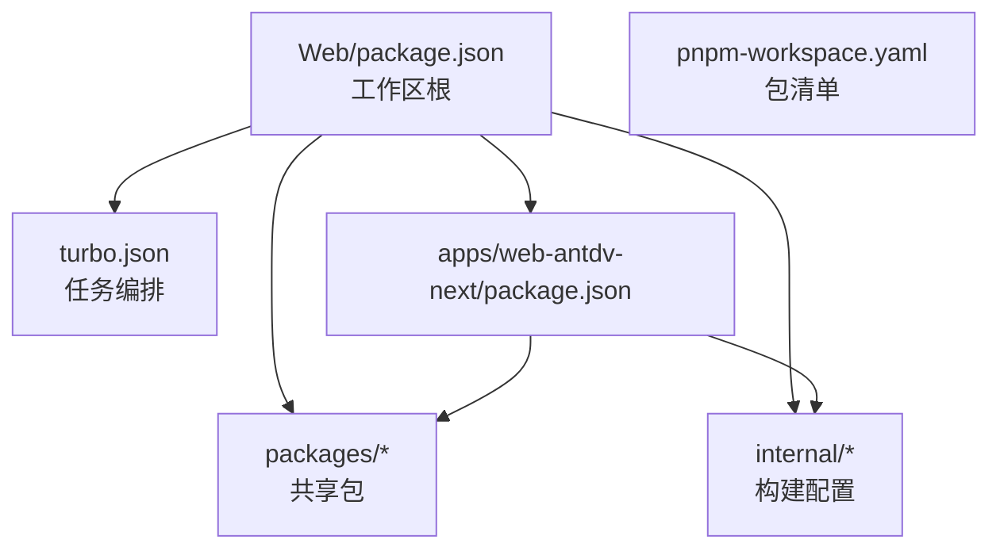

# 架构总览

<cite>
**本文引用的文件**   
- [README.md](file://README.md)
- [Admin.NET.sln](file://Admin.NET/Admin.NET.sln)
- [global.json](file://Admin.NET/global.json)
- [Program.cs](file://Admin.NET/Admin.NET.Web.Entry/Program.cs)
- [Startup.cs（Web.Core）](file://Admin.NET/Admin.NET.Web.Core/Startup.cs)
- [Startup.cs（Application）](file://Admin.NET/Admin.NET.Application/Startup.cs)
- [GlobalUsings.cs（Core）](file://Admin.NET/Admin.NET.Core/GlobalUsings.cs)
- [SqlSugarSetup.cs](file://Admin.NET/Admin.NET.Core/SqlSugar/SqlSugarSetup.cs)
- [DbConnectionOptions.cs](file://Admin.NET/Admin.NET.Core/Option/DbConnectionOptions.cs)
- [Startup.cs（ReZero 插件）](file://Admin.NET/Plugins/Admin.NET.Plugin.ReZero/Startup.cs)
- [vite.config.ts（web-antdv-next）](file://Web/apps/web-antdv-next/vite.config.ts)
- [package.json（工作区根）](file://Web/package.json)
- [package.json（业务前端应用）](file://Web/apps/web-antdv-next/package.json)
- [pnpm-workspace.yaml](file://Web/pnpm-workspace.yaml)
- [turbo.json](file://Web/turbo.json)
</cite>

## 目录
1. [引言](#引言)
2. [项目结构](#项目结构)
3. [核心组件](#核心组件)
4. [架构总览](#架构总览)
5. [详细组件分析](#详细组件分析)
6. [依赖关系分析](#依赖关系分析)
7. [性能与可扩展性](#性能与可扩展性)
8. [故障排查指南](#故障排查指南)
9. [结论](#结论)

## 引言
Admin.NET 是基于 ASP.NET Core、Furion 框架和 SqlSugar ORM 的通用权限开发框架，采用前后端分离与模块化设计。后端以 .NET 解决方案组织分层能力，当前 README 说明共享工程支持 .NET 8 / .NET 10，API 入口与测试工程使用 .NET 10；前端已迁移到基于 Vue 3、Vben Admin、ant-design-vue-next 和 Vite 的 Monorepo，使用 pnpm workspace 管理业务应用与共享包。

本仓库已完成前端移植，业务前端入口为 `Web/apps/web-antdv-next`，后端程序入口为 `Admin.NET.Admin.NET.Web.Entry`。数据库集成验收要求真实 PostgreSQL，不能以 SQLite 或 Mock 结果替代联调验证。

**章节来源**
- [README.md:1-35](file://README.md#L1-L35)

## 项目结构
后端解决方案包含四个主要工程及一组插件：

| 工程 | 职责 | 关键入口或配置 |
|---|---|---|
| `Admin.NET.Web.Entry` | Web 程序入口、Kestrel 配置、日志过滤、Windows 服务适配 | `Program.cs`、`appsettings.json` |
| `Admin.NET.Web.Core` | Furion Web 基础设施、认证授权、缓存、任务调度、SignalR、限流、OpenAPI/Scalar、静态资源与压缩 | `Startup.cs` |
| `Admin.NET.Application` | 应用服务组合扩展点，默认空实现，便于按业务启用 | `Startup.cs` |
| `Admin.NET.Core` | 领域模型、服务、SqlSugar 初始化、事件总线、日志、签名认证、选项对象、工具与扩展 | `GlobalUsings.cs`、`SqlSugarSetup.cs`、`DbConnectionOptions.cs` |
| `Admin.NET.Test` | 单元测试与集成测试用例 | 各功能目录下的测试工程 |
| `Plugins/*` | 可插拔业务能力，例如钉钉、GoView、金蝶 K3 Cloud、ReZero、工作微信等 | 各插件的 `Startup.cs` |

前端 Monorepo 位于 `Web/`：

| 路径 | 职责 |
|---|---|
| `apps/web-antdv-next` | 业务前端应用，Vue 3 + Vite + antdv-next，提供开发、构建、类型检查脚本 |
| `packages/*` | 共享 UI、请求封装、状态、类型、样式、常量、国际化、Hooks 等库 |
| `internal/*` | 内部构建配置、ESLint/Prettier/Oxlint/Tailwind/Vite 共享配置 |
| `scripts/*` | 发布、清理、Turbo 运行器等 Node 脚本 |
| `src/*` | 旧前端源码残留目录，当前业务前端应以 `apps/web-antdv-next` 为准 |

**图表来源**
- [Admin.NET.sln:1-78](file://Admin.NET/Admin.NET.sln#L1-L78)
- [package.json（工作区根）:1-102](file://Web/package.json#L1-L102)
- [package.json（业务前端应用）:1-72](file://Web/apps/web-antdv-next/package.json#L1-L72)

**章节来源**
- [Admin.NET.sln:1-78](file://Admin.NET/Admin.NET.sln#L1-L78)
- [README.md:20-45](file://README.md#L20-L45)
- [package.json（工作区根）:1-102](file://Web/package.json#L1-L102)

## 核心组件
### 后端程序入口：Admin.NET.Web.Entry
`Program.cs` 通过 Furion 的 `Serve.Run` 启动主机，并注册 `IWebComponent`。它负责：
- 在 Windows 非服务模式下禁用 Windows 事件日志提供者，避免普通用户权限问题。
- 设置日志过滤，忽略 `Microsoft.Hosting` 和 `Microsoft.AspNetCore` 前缀，并仅记录 `Information` 及以上级别。
- 配置 Kestrel，将 KeepAlive 超时、请求头超时设为 30 分钟，并移除请求体大小限制，以支持大文件上传。
- `appsettings.json` 中声明 `ConfigurationScanDirectories`，自动扫描 `Configuration` 目录下的 JSON 配置文件。

**章节来源**
- [Program.cs:1-38](file://Admin.NET/Admin.NET.Web.Entry/Program.cs#L1-L38)
- [appsettings.json:1-5](file://Admin.NET/Admin.NET.Web.Entry/appsettings.json#L1-L5)

### Web 基础设施：Admin.NET.Web.Core
`Startup.cs` 是 Web 层的核心装配点，注册并启用大量横切能力：
- 项目选项、缓存、SqlSugar、JWT、签名认证、CORS、远程 HTTP、任务队列、任务调度、敏感词检测。
- 控制器、统一结果包装、JSON 序列化转换器、OAuth、ElasticSearch、转发代理头、内存限流。
- 事件总线、图像处理、OSS 对象存储、模板引擎、SignalR、验证码、响应压缩、虚拟文件系统。
- 中间件管线包括异常处理、HSTS、静态文件、OAuth、统一状态码、多语言、路由、跨域、认证授权、IP/客户端/策略限流、任务调度看板、OpenAPI/Scalar、Hub 路由与默认控制器路由。

**章节来源**
- [Startup.cs（Web.Core）:1-200](file://Admin.NET/Admin.NET.Web.Core/Startup.cs#L1-L200)
- [Startup.cs（Web.Core）:201-442](file://Admin.NET/Admin.NET.Web.Core/Startup.cs#L201-L442)

### 应用服务组合：Admin.NET.Application
`Startup.cs` 使用 `AppStartup(100)` 作为扩展点，默认不注入服务也不修改管道。业务团队可按需要在此添加应用级服务、路由或配置，而不污染核心基础设施。

**章节来源**
- [Startup.cs（Application）:1-22](file://Admin.NET/Admin.NET.Application/Startup.cs#L1-L22)

### 核心领域与服务：Admin.NET.Core
`GlobalUsings.cs` 集中引入 Furion、SqlSugar、Mapster、Magicodes、NewLife、SKIT Wechat、Yitter.IdGenerator、System.Linq.Dynamic.Core 等常用命名空间，降低重复引用成本，同时体现技术选型边界。

核心数据访问由 `SqlSugarSetup.cs` 与 `DbConnectionOptions.cs` 共同定义：
- 读取 `DbConnection` 配置，创建 `SqlSugarScope`。
- 注入雪花 ID、动态表达式解析、外部服务映射、表名与列名下划线转换。
- 注册仓储与工作单元，初始化数据库、视图、种子数据。
- 通过 AOP 自动填充租户、用户、机构、审计字段，并应用逻辑删除、租户、组织范围等查询过滤器。
- 支持差异日志、慢 SQL 告警、连接重试与多连接隔离。

**章节来源**
- [GlobalUsings.cs:1-56](file://Admin.NET/Admin.NET.Core/GlobalUsings.cs#L1-L56)
- [SqlSugarSetup.cs:1-200](file://Admin.NET/Admin.NET.Core/SqlSugar/SqlSugarSetup.cs#L1-L200)
- [SqlSugarSetup.cs:201-519](file://Admin.NET/Admin.NET.Core/SqlSugar/SqlSugarSetup.cs#L201-L519)
- [DbConnectionOptions.cs:1-136](file://Admin.NET/Admin.NET.Core/Option/DbConnectionOptions.cs#L1-L136)

### 前端业务入口：Web/apps/web-antdv-next
业务前端应用通过 `vite.config.ts` 继承 `@vben/vite-config`，输出到 `Web/dist`，并在开发服务器中将 `/prod-api` 代理到 `http://localhost:5005`，同时开启 WebSocket 代理；`/schedule` 也代理到同一后端地址。

应用依赖多个 `@vben/*` 工作区包，如 `@vben/request`、`@vben/stores`、`@vben/layouts`、`@vben/types` 等，并使用 SignalR、axios、Pinia、Vue Router、PDF.js、Monaco Editor 等运行时依赖。

**章节来源**
- [vite.config.ts（web-antdv-next）:1-36](file://Web/apps/web-antdv-next/vite.config.ts#L1-L36)
- [package.json（业务前端应用）:1-72](file://Web/apps/web-antdv-next/package.json#L1-L72)

## 架构总览
系统分为浏览器、Node 开发环境、ASP.NET Core API、数据库、缓存、对象存储、消息通道和第三方服务。

**图表来源**
- [Program.cs:1-38](file://Admin.NET/Admin.NET.Web.Entry/Program.cs#L1-L38)
- [Startup.cs（Web.Core）:1-442](file://Admin.NET/Admin.NET.Web.Core/Startup.cs#L1-L442)
- [vite.config.ts（web-antdv-next）:1-36](file://Web/apps/web-antdv-next/vite.config.ts#L1-L36)
- [README.md:20-45](file://README.md#L20-L45)

## 详细组件分析
### 请求处理调用链
从浏览器发起业务请求到数据库返回数据的典型流程如下：

**图表来源**
- [vite.config.ts（web-antdv-next）:1-36](file://Web/apps/web-antdv-next/vite.config.ts#L1-L36)
- [Program.cs:1-38](file://Admin.NET/Admin.NET.Web.Entry/Program.cs#L1-L38)
- [Startup.cs（Web.Core）:1-442](file://Admin.NET/Admin.NET.Web.Core/Startup.cs#L1-L442)
- [SqlSugarSetup.cs:1-200](file://Admin.NET/Admin.NET.Core/SqlSugar/SqlSugarSetup.cs#L1-L200)

### 数据初始化与领域过滤流程
SqlSugar 初始化过程决定表、视图、种子数据和查询过滤器的行为：

**图表来源**
- [SqlSugarSetup.cs:1-200](file://Admin.NET/Admin.NET.Core/SqlSugar/SqlSugarSetup.cs#L1-L200)
- [SqlSugarSetup.cs:201-519](file://Admin.NET/Admin.NET.Core/SqlSugar/SqlSugarSetup.cs#L201-L519)
- [DbConnectionOptions.cs:1-136](file://Admin.NET/Admin.NET.Core/Option/DbConnectionOptions.cs#L1-L136)

### 插件架构与扩展点
插件工程遵循与主程序相同的 Furion `AppStartup` 模式，可在自身工程中注册服务、读取配置、挂载能力。示例中的 ReZero 插件：
- 使用 `AppStartup(100)` 注册服务。
- 读取 `ReZeroOptions` 与默认数据库连接配置。
- 启用 SuperAPI，复用主程序的认证键名与数据库连接。
- 插件通过解决方案文件被纳入构建，便于按需启用。

**图表来源**
- [Program.cs:1-38](file://Admin.NET/Admin.NET.Web.Entry/Program.cs#L1-L38)
- [Startup.cs（Web.Core）:1-200](file://Admin.NET/Admin.NET.Web.Core/Startup.cs#L1-L200)
- [Startup.cs（Application）:1-22](file://Admin.NET/Admin.NET.Application/Startup.cs#L1-L22)
- [Startup.cs（ReZero 插件）:1-54](file://Admin.NET/Plugins/Admin.NET.Plugin.ReZero/Startup.cs#L1-L54)

**章节来源**
- [Startup.cs（ReZero 插件）:1-54](file://Admin.NET/Plugins/Admin.NET.Plugin.ReZero/Startup.cs#L1-L54)
- [Admin.NET.sln:40-78](file://Admin.NET/Admin.NET.sln#L40-L78)

## 依赖关系分析
### 后端工程依赖
解决方案文件明确列出核心工程、测试工程和插件工程。依赖方向大致为：
- `Admin.NET.Web.Entry` 引用 `Admin.NET.Web.Core`。
- `Admin.NET.Web.Core` 引用 `Admin.NET.Core`。
- `Admin.NET.Application` 通常用于组合 `Admin.NET.Core` 的能力。
- 插件工程引用 `Admin.NET.Core`，并通过 Furion 生命周期注入服务。
- `Admin.NET.Test` 独立于运行工程，主要用于验证。

**图表来源**
- [Admin.NET.sln:1-78](file://Admin.NET/Admin.NET.sln#L1-L78)

### 前端工作区依赖
工作区根脚本通过 `pnpm --filter @vben/web-antdv-next` 直接驱动业务前端应用，而不是对全仓库执行通用命令。根脚本的 `dev`、`build`、`check:type`、`lint` 均面向 `@vben/web-antdv-next`。

**图表来源**
- [package.json（工作区根）:1-102](file://Web/package.json#L1-L102)
- [turbo.json:1-48](file://Web/turbo.json#L1-L48)
- [pnpm-workspace.yaml:1-200](file://Web/pnpm-workspace.yaml#L1-L200)
- [package.json（业务前端应用）:1-72](file://Web/apps/web-antdv-next/package.json#L1-L72)

**章节来源**
- [Admin.NET.sln:1-78](file://Admin.NET/Admin.NET.sln#L1-L78)
- [package.json（工作区根）:1-102](file://Web/package.json#L1-L102)
- [turbo.json:1-48](file://Web/turbo.json#L1-L48)
- [pnpm-workspace.yaml:1-200](file://Web/pnpm-workspace.yaml#L1-L200)

## 性能与可扩展性
### 技术选型决策
| 技术领域 | 选型 | 理由与影响 |
|---|---|---|
| 后端框架 | Furion + ASP.NET Core | 提供 Web 组件、配置扫描、统一结果、动态 API、事件总线等基础设施，减少样板代码 |
| ORM | SqlSugar | 简化多数据库、多连接、实体映射、AOP、工作单元与增量建表 |
| 身份认证 | JWT + 签名认证 | 同时支持传统令牌与接口签名，适合开放接口和移动端场景 |
| 实时通信 | SignalR | 在线用户、公告通知等实时能力 |
| 任务调度 | Furion Schedule + 持久化 | 支持集群、监控与作业持久化 |
| 前端框架 | Vue 3 + antdv-next + Vite | 现代组件生态、开发体验良好、构建速度快 |
| 前端包管理 | pnpm workspace + turbo | 共享依赖、工作区构建、任务缓存 |
| 数据库验收 | 真实 PostgreSQL | 避免 SQLite/Mock 掩盖驱动差异 |

### 可扩展性
- 新增业务服务优先放入 `Admin.NET.Application` 或通过独立应用工程引用 `Admin.NET.Core`。
- 新增领域能力可通过 `Admin.NET.Core` 的服务、实体、选项、扩展方法实现。
- 插件工程通过 `AppStartup` 注入服务，适合对接第三方系统，如 ReZero、钉钉、工作微信、金蝶 K3 Cloud、GoView 等。
- 前端共享能力放入 `packages/*`，业务页面放在 `apps/web-antdv-next/src/views`。

### 可维护性
- 后端通过全局 using 和 Furion 约定减少分散配置。
- 前端通过 workspace catalog 统一管理依赖版本，减少冲突。
- 构建产物输出到 `Web/dist`，生产构建命令明确针对业务应用。

### 部署拓扑考虑
- API 进程监听本地端口，前端开发阶段通过 Vite 代理转发。
- 生产环境应部署独立的反向代理、API 进程、数据库、缓存、对象存储和日志系统。
- 事件总线可选择内存、Redis 或 RabbitMQ，需结合缓存配置进行切换。
- 文件上传与预览受认证控制，私有文件禁止匿名访问。

[本节为通用建议，不直接分析具体代码文件]

## 故障排查指南
### 后端启动问题
- 如果控制台出现 Windows 事件日志写入失败，确认当前是否在 Windows 非服务模式下运行；`Program.cs` 已禁用该日志提供者。
- 如果接口超时或上传失败，检查 Kestrel 配置中的请求体大小限制和超时时间。
- 如果数据库初始化失败，检查 `DbConnection` 配置、`EnableInitDb`、`EnableInitTable`、`EnableInitSeed` 以及数据库是否可达。
- 如果查询缺少租户或组织范围，检查当前用户上下文、令牌载荷和 SqlSugar 过滤器是否生效。

**章节来源**
- [Program.cs:1-38](file://Admin.NET/Admin.NET.Web.Entry/Program.cs#L1-L38)
- [SqlSugarSetup.cs:1-200](file://Admin.NET/Admin.NET.Core/SqlSugar/SqlSugarSetup.cs#L1-L200)
- [SqlSugarSetup.cs:201-519](file://Admin.NET/Admin.NET.Core/SqlSugar/SqlSugarSetup.cs#L201-L519)
- [DbConnectionOptions.cs:1-136](file://Admin.NET/Admin.NET.Core/Option/DbConnectionOptions.cs#L1-L136)

### 前端开发问题
- 如果前端无法调用后端 API，检查 `vite.config.ts` 中的 `/prod-api` 代理目标是否为 `http://localhost:5005`，并确认后端正在运行。
- 如果 SignalR 相关实时功能不可用，检查 Hub 路由、WebSocket 代理和后端 SignalR 配置。
- 如果类型检查失败，使用业务应用的 `typecheck` 脚本，不要误以为根脚本检查了所有 workspace 包。

**章节来源**
- [vite.config.ts（web-antdv-next）:1-36](file://Web/apps/web-antdv-next/vite.config.ts#L1-L36)
- [package.json（业务前端应用）:1-72](file://Web/apps/web-antdv-next/package.json#L1-L72)
- [package.json（工作区根）:1-102](file://Web/package.json#L1-L102)

### 数据库与集成验收
- 必须使用隔离的真实 PostgreSQL 进行联调，不能使用 SQLite 或 Mock 代替。
- 初始化可能创建表和种子数据，应使用独立开发库，避免破坏已有数据。
- 浏览器流程只要求桌面端；Playwright 用于端到端浏览器验证，Vitest 用于逻辑测试，两者不能互相替代真实 API 与数据库链路验收。

**章节来源**
- [README.md:20-45](file://README.md#L20-L45)

## 结论
Admin.NET 的后端以 Furion 和 SqlSugar 为基础，形成清晰的程序入口、Web 基础设施、应用服务组合与核心领域分层；前端采用 Vue 3 与 antdv-next 的 Monorepo，通过 pnpm workspace 和 Turbo 管理业务应用与共享包。插件架构允许在不侵入主程序的前提下扩展能力，适用于多系统集成与差异化需求。

在演进过程中，应坚持以下原则：
- 保持后端分层边界，核心能力下沉到 `Admin.NET.Core`，应用组合放在 `Admin.NET.Application` 或独立工程。
- 前端业务变更集中在 `apps/web-antdv-next`，公共能力沉淀到 `packages/*`。
- 数据库验收始终基于真实 PostgreSQL，避免以轻量存储掩盖驱动差异。
- 扩展优先通过插件和应用服务，而非直接修改 Web 基础设施。

[本节为总结性内容，不直接分析具体代码文件]