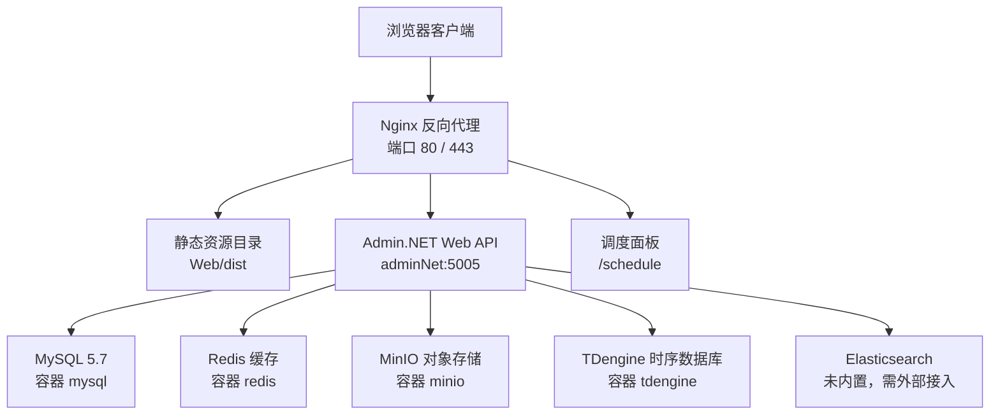
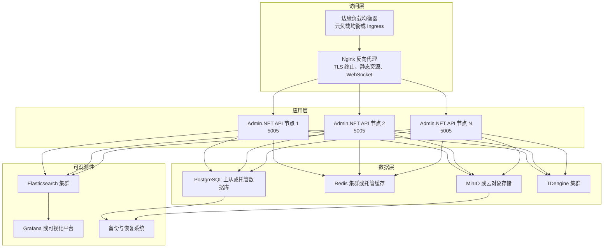
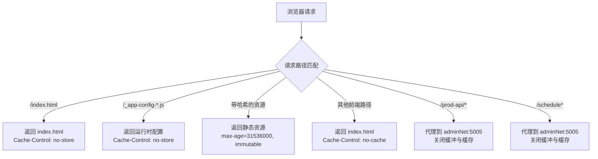
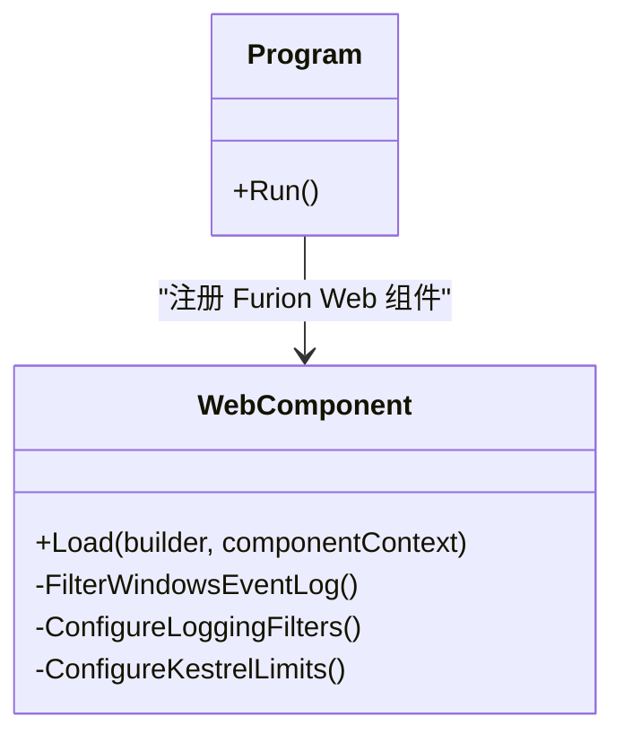
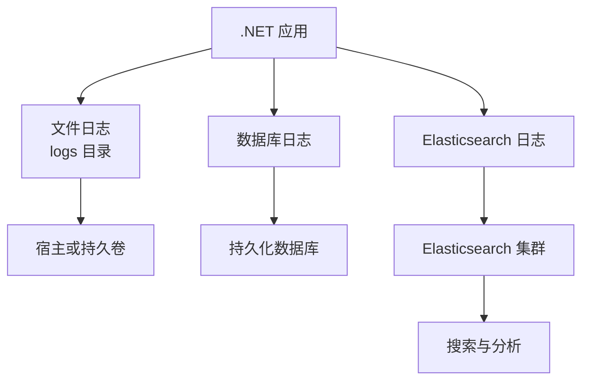
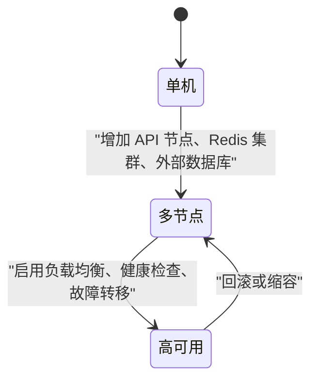
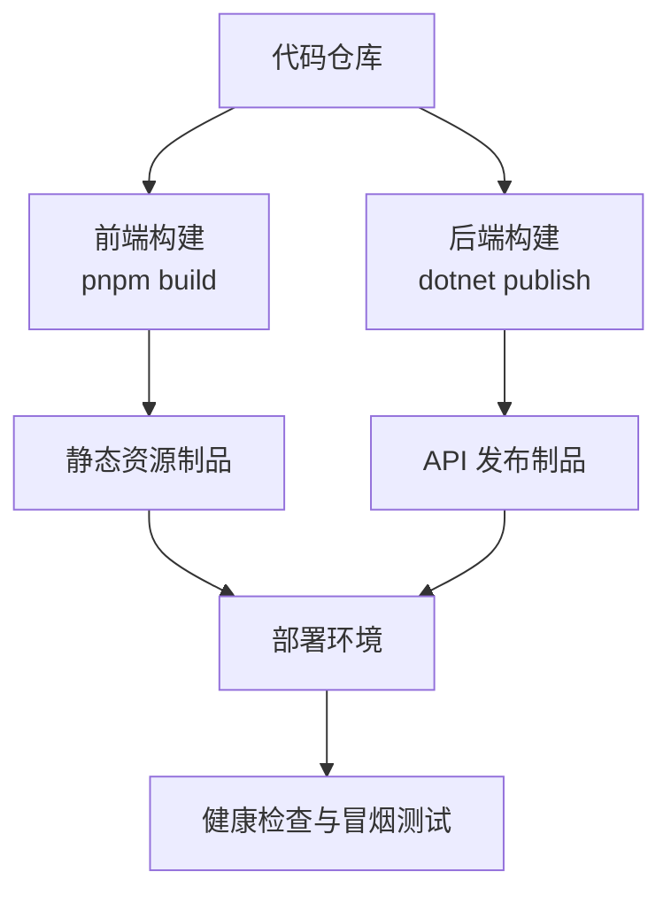

# 系统部署拓扑

<cite>
**本文引用的文件**   
- [README.md](file://README.md)
- [docker-compose.yml](file://docker/docker-compose.yml)
- [docker-compose-builder.yml](file://docker/docker-compose-builder.yml)
- [nginx.conf](file://docker/nginx/conf/nginx.conf)
- [wait-for-it.sh](file://docker/app/wait-for-it.sh)
- [App.json](file://docker/app/Configuration/App.json)
- [Database.json](file://docker/app/Configuration/Database.json)
- [Cache.json](file://docker/app/Configuration/Cache.json)
- [Logging.json](file://docker/app/Configuration/Logging.json)
- [Upload.json](file://docker/app/Configuration/Upload.json)
- [EventBus.json](file://docker/app/Configuration/EventBus.json)
- [Program.cs](file://Admin.NET/Admin.NET.Web.Entry/Program.cs)
- [Admin.NET.Web.Entry.csproj](file://Admin.NET/Admin.NET.Web.Entry/Admin.NET.Web.Entry.csproj)
- [Dockerfile](file://Admin.NET/Admin.NET.Web.Entry/Dockerfile)
- [package.json](file://Web/package.json)
</cite>

## 目录
1. [简介](#简介)
2. [项目结构与部署边界](#项目结构与部署边界)
3. [生产环境部署架构](#生产环境部署架构)
4. [Docker Compose 编排说明](#docker-compose-编排说明)
5. [Nginx 反向代理与静态资源策略](#nginx-反向代理与静态资源策略)
6. .NET Web 应用程序配置
7. [数据库、Redis 与外部存储](#数据库redis-与外部存储)
8. [日志、Elasticsearch 与监控](#日志elasticsearch-与监控)
9. [单机部署与多节点集群方案](#单机部署与多节点集群方案)
10. [负载均衡、SSL 与证书管理](#负载均衡ssl-与证书管理)
11. [环境变量与密钥安全](#环境变量与密钥安全)
12. [部署自动化流程](#部署自动化流程)
13. [备份恢复机制](#备份恢复机制)
14. [健康检查、故障转移与扩容](#健康检查故障转移与扩容)
15. [部署命令与验收清单](#部署命令与验收清单)
16. [故障排查指南](#故障排查指南)
17. [结论](#结论)

## 简介
本仓库的 Admin.NET 是一个前后端分离的通用权限开发框架。后端以 ASP.NET Core 和 Furion 为核心，当前业务前端入口为 `Web/apps/web-antdv-next/`，使用 pnpm workspace 管理；后端入口位于 `Admin.NET/Admin.NET.Web.Entry/`。仓库提供了 Docker Compose 示例，包含 Nginx、MySQL、Redis、MinIO、TDengine 等组件，并展示了如何把编译后的前端静态资源与后端 API 组合部署。

需要特别注意：当前仓库提供的默认 Compose 模板中并没有 Elasticsearch 服务，也没有 PostgreSQL 容器；虽然 README 提到集成验收使用 PostgreSQL，但 Compose 模板实际暴露的是 MySQL 5.7，且数据库配置文件默认启用 SQLite。因此，生产部署时应根据真实基础设施重新调整数据库、缓存、对象存储、日志和密钥配置，不能直接依赖模板中的默认值。

**章节来源**
- [README.md:1-144](file://README.md#L1-L144)

## 项目结构与部署边界
从部署视角看，仓库至少包含以下边界：

| 层次 | 路径或镜像 | 职责 | 是否由 Compose 启动 |
|---|---|---|---:|
| 前端构建产物 | `Web/dist/` | Vite 构建后的 HTML、JS、CSS、字体等静态资源 | 否 |
| Nginx 反向代理 | `nginx:1.20.2` | 对外暴露 HTTP/HTTPS，转发 `/prod-api`、`/schedule`，托管静态页面 | 是 |
| .NET Web 应用 | `mcr.microsoft.com/dotnet/aspnet:9.0`（Compose） | 运行 `Admin.NET.Web.Entry.dll`，监听 `5005` | 是 |
| 关系型数据库 | `mysql:5.7`（Compose） | 提供持久化数据 | 是 |
| Redis 缓存 | `redis:latest` | 缓存、分布式 SignalR 通道、事件总线可选后端 | 是 |
| 对象存储 | `minio/minio` | MinIO 对象存储 | 是 |
| 时序数据库 | `tdengine/tdengine:3.3.6.13` | TDengine 时序数据 | 是 |
| Elasticsearch | 未在 Compose 中定义 | 日志收集分析（需自建或使用托管服务） | 否 |



**图表来源**
- [docker-compose.yml:1-110](file://docker/docker-compose.yml#L1-L110)
- [nginx.conf:1-91](file://docker/nginx/conf/nginx.conf#L1-L91)
- [App.json:1-49](file://docker/app/Configuration/App.json#L1-L49)

**章节来源**
- [docker-compose.yml:1-110](file://docker/docker-compose.yml#L1-L110)
- [docker-compose-builder.yml:1-21](file://docker/docker-compose-builder.yml#L1-L21)
- [package.json:1-102](file://Web/package.json#L1-L102)

## 生产环境部署架构
生产环境的推荐拓扑应明确区分“对外入口”“API 实例”“持久化服务”和“可观测性服务”。



该图是生产建议拓扑，不表示当前仓库 Compose 已完整实现所有组件。实际部署时，应将 PostgreSQL、Redis、Elasticsearch 等作为独立服务或托管服务管理，而不是简单复制开发模板。

**图表来源**
- [docker-compose.yml:1-110](file://docker/docker-compose.yml#L1-L110)
- [Logging.json:1-49](file://docker/app/Configuration/Logging.json#L1-L49)
- [Cache.json:1-35](file://docker/app/Configuration/Cache.json#L1-L35)

## Docker Compose 编排说明
`docker/docker-compose.yml` 定义了以下服务：

| 服务名 | 镜像 | 端口映射 | 主要用途 | 关键卷或配置 |
|---|---|---|---|---|
| `nginx` | `nginx:1.20.2` | `9100:80`、`9103:443` | 反向代理、静态资源、SSL | 挂载 `../Web/dist`、`./nginx/conf/nginx.conf`、`./nginx/key` |
| `mysql` | `mysql:5.7` | `9101:3306` | 关系型数据存储 | 挂载 `./mysql/mysql`、`./mysql/mysql.cnf` |
| `redis` | `redis:latest` | `6379:6379` | 缓存、分布式会话、SignalR 通道 | 挂载 `redis.conf`、`data`、`logs` |
| `minio` | `minio/minio:RELEASE.2025-04-22T22-12-26Z` | `9104:9000`、`9105:9001` | 对象存储控制台与 API | 挂载 `./minio/data`、`./minio/config` |
| `tdengine` | `tdengine/tdengine:3.3.6.13` | 多个时序端口 | 时序数据 | 挂载数据与日志目录 |
| `adminNet` | `mcr.microsoft.com/dotnet/aspnet:9.0` | `9102:5050` | 运行 Admin.NET Web API | 挂载发布目录和配置目录 |

### 服务依赖
- `adminNet` 通过 `depends_on` 声明依赖 `mysql` 和 `redis`。
- `adminNet` 启动命令先执行 `wait-for-it.sh mysql:3306 -t 120`，再运行 `dotnet Admin.NET.Web.Entry.dll --content-root /app/wwwroot`。
- `nginx` 通过 `links` 指向 `adminNet`，以便在 Compose 内部解析 `adminNet` 主机名。

### 网络与端口
- Nginx 对外暴露 `80` 和 `443`，分别映射到宿主机 `9100` 和 `9103`。
- MySQL 对外暴露 `3306`，映射到宿主机 `9101`。
- Redis 对外暴露 `6379`。
- MinIO API 暴露 `9000`，控制台暴露 `9001`，映射到宿主机 `9104`、`9105`。
- Admin.NET API 对外暴露 `5050`，映射到宿主机 `9102`。

### 数据卷
- 前端静态资源来自仓库根目录的 `../Web/dist`。
- Nginx 配置和证书来自 `./nginx/conf` 和 `./nginx/key`。
- MySQL 数据位于 `./mysql/mysql`。
- Redis 配置和数据分别位于 `./redis/redis.conf`、`./redis/data`、`./redis/logs`。
- MinIO 数据位于 `./minio/data`，配置位于 `./minio/config`。
- TDengine 数据位于 `./tdengine/taos/dnode/data`，日志位于 `./tdengine/taos/dnode/log`。
- Admin.NET 发布目录来自 `../Admin.NET/Admin.NET.Web.Entry/bin/Release/net9.0/`，配置目录来自 `./app/Configuration/`。

### 环境变量
- Nginx、MySQL、Redis、MinIO、TDengine、Admin.NET 都设置了 `TZ=Asia/Shanghai`。
- Redis 设置 `REDIS_PASSWORD=123456`。
- MinIO 设置 `MINIO_ROOT_USER=admin`、`MINIO_ROOT_PASSWORD=admin123456`。
- MySQL 设置 `MYSQL_ROOT_HOST=%`、`MYSQL_DATABASE=admin`、`MYSQL_ROOT_PASSWORD=root`。

**章节来源**
- [docker-compose.yml:1-110](file://docker/docker-compose.yml#L1-L110)
- [docker-compose-builder.yml:1-21](file://docker/docker-compose-builder.yml#L1-L21)
- [wait-for-it.sh:1-182](file://docker/app/wait-for-it.sh#L1-L182)

## Nginx 反向代理与静态资源策略
Nginx 配置承担了三个核心职责：

1. **静态资源托管**  
   - 站点根目录为 `/usr/share/nginx/html`，对应 Compose 中的 `../Web/dist`。
   - `/index.html` 强制 `no-store`，避免浏览器缓存入口页。
   - `_app-config-*.js` 运行时配置也强制 `no-store`，确保更新后能拉取最新配置。
   - 带内容哈希的前缀资源如 `assets`、`js`、`css`、`fonts` 下的长文件名资源设置为长期缓存 `public, max-age=31536000, immutable`。
   - 其他前端路由 fallback 到 `/index.html`，并添加 `no-cache`。

2. **API 反向代理**  
   - `/prod-api/` 被代理到 `http://adminNet:5005/`。
   - 保留 `Host`、`X-Real-IP`、`X-Forwarded-For`、`X-Forwarded-Proto`。
   - 支持 WebSocket 升级头。
   - 关闭 Nginx 缓冲与缓存，延长读写超时到 `3600s`，适合上传、导出、长连接等场景。

3. **调度面板代理**  
   - `/schedule` 单独代理到 `adminNet:5005`。
   - 同样关闭缓冲和缓存，适合 Dashboard 类实时界面。



**图表来源**
- [nginx.conf:1-91](file://docker/nginx/conf/nginx.conf#L1-L91)

**章节来源**
- [nginx.conf:1-91](file://docker/nginx/conf/nginx.conf#L1-L91)
- [docker-compose.yml:1-110](file://docker/docker-compose.yml#L1-L110)

## .NET Web 应用程序配置
### 目标框架与入口
- 项目 `Admin.NET.Web.Entry` 的目标框架是 `net10.0`。
- `global.json` 仅指定测试运行器为 `Microsoft.Testing.Platform`，并不固定 .NET SDK 版本。
- 默认的 `Dockerfile` 基于 `aspnet:6.0`，而 Compose 中使用 `aspnet:9.0`，并且发布目录路径引用 `net9.0`，存在版本不一致风险，生产构建时必须统一。

### Kestrel 与日志过滤
- `Program.cs` 通过 Furion 的 `Serve.Run` 启动 Web 应用。
- Windows 下非服务模式会禁用 EventLog 日志记录，避免普通用户权限问题。
- 日志过滤器排除部分 Microsoft 框架类别，并将最低级别设为 `Information`。
- Kestrel 配置了较长的 KeepAlive 和请求头超时，取消最大请求体大小限制，便于大文件上传。



**图表来源**
- [Program.cs:1-38](file://Admin.NET/Admin.NET.Web.Entry/Program.cs#L1-L38)

### 应用配置
- `App.json` 将 API 监听地址配置为 `http://*:5005`。
- 启用了 Swagger/OpenAPI 文档注入。
- 配置了本地化语言、SnowId 机器码、密码加密算法和密钥等。
- CORS 暴露了分页头和令牌头，并启用 SignalR 跨域支持。

**章节来源**
- [Admin.NET.Web.Entry.csproj:1-71](file://Admin.NET/Admin.NET.Web.Entry/Admin.NET.Web.Entry.csproj#L1-L71)
- [Program.cs:1-38](file://Admin.NET/Admin.NET.Web.Entry/Program.cs#L1-L38)
- [App.json:1-49](file://docker/app/Configuration/App.json#L1-L49)

## 数据库、Redis 与外部存储
### 数据库
当前 Compose 模板使用 MySQL 5.7，但 `Database.json` 默认启用 SQLite，并开启数据库初始化、表初始化和种子数据初始化。这意味着如果直接运行，可能优先走 SQLite 路径，而不是 Compose 中的 MySQL。

生产环境应按以下步骤修正：
1. 选择 PostgreSQL 或 MySQL，并在 `Database.json` 中配置正确的连接字符串、驱动类型和初始化策略。
2. 如果数据库是外部托管服务，不要使用 Compose 内网域名直连，应使用公网或专用网络地址。
3. 关闭自动初始化种子数据，除非是首次初始化脚本；生产库应避免每次启动都写种子。
4. 若需要独立日志库，可在注释示例基础上扩展 `ConnectionConfigs`，但不应泄露真实凭据。

### Redis
- 缓存类型为 `Redis`，前缀为 `adminnet_`。
- 连接字符串包含服务器、密码和数据库索引。
- 集群模式已启用，SignalR 使用 Redis 作为分布式通道。
- 哨兵配置已预留，但未启用哨兵模式。

生产建议：
- 使用受保护的 Redis 实例，密码应从密钥管理系统注入。
- 如需多节点 API，必须保持 Redis 连接一致，否则分布式 Session、SignalR 和事件总线会失效。
- 将 `ServerId` 改为唯一标识，避免多节点冲突。

### 对象存储与时序数据库
- MinIO 作为对象存储示例，默认账号和密码已在 Compose 中明文配置。
- Upload 配置支持 MinIO、阿里云、腾讯云、七牛、华为云等 OSS 提供者。
- TDengine 作为时序数据库示例，端口较多，适合监控指标或日志流式数据。

**章节来源**
- [Database.json:1-72](file://docker/app/Configuration/Database.json#L1-L72)
- [Cache.json:1-35](file://docker/app/Configuration/Cache.json#L1-L35)
- [Upload.json:1-29](file://docker/app/Configuration/Upload.json#L1-L29)
- [docker-compose.yml:1-110](file://docker/docker-compose.yml#L1-L110)

## 日志、Elasticsearch 与监控
### 日志输出
`Logging.json` 同时启用文件日志和数据库日志：
- 文件日志按日期命名，单个文件不超过 10MB，最多保留 30 个滚动文件。
- 数据库日志最低级别为 `Information`。
- Elasticsearch 日志默认关闭，但模板中包含 Basic 认证、ApiKey、Base64ApiKey、证书指纹和服务地址等字段。

### Elasticsearch
当前 Compose 没有 Elasticsearch 服务，因此生产环境需要自行部署或接入托管服务。启用前应完成：
- 配置 `ServerUris`、认证方式和安全证书。
- 使用独立的 Elasticsearch 集群，避免与应用共享同一磁盘。
- 建立索引生命周期策略，控制索引保留时间和空间占用。
- 将敏感认证信息放入密钥管理系统，不在配置文件中硬编码。

### 监控
- 应用启用了全局拦截日志，但配置提示生产环境建议关闭，因为会影响性能。
- 可通过 Grafana、Prometheus 或其他 APM 工具对接 .NET 指标，而不是仅依赖文件日志和数据库日志。



**图表来源**
- [Logging.json:1-49](file://docker/app/Configuration/Logging.json#L1-L49)

**章节来源**
- [Logging.json:1-49](file://docker/app/Configuration/Logging.json#L1-L49)
- [docker-compose.yml:1-110](file://docker/docker-compose.yml#L1-L110)

## 单机部署与多节点集群方案
### 单机部署
适合开发、演示或小规模生产：
- 使用仓库提供的 `docker-compose.yml`。
- 前置 Nginx 或云负载均衡。
- 单台 API 容器运行一个 Admin.NET 实例。
- 单实例 Redis、MySQL、MinIO、TDengine。
- Elasticsearch 单独安装或托管。

注意事项：
- 修改 `Database.json`，使数据库连接指向真实数据库。
- 修改 `Cache.json`，确保 Redis 密码、地址和集群标识正确。
- 修改 `Upload.json`，对象存储凭证应来自密钥管理。
- 不要把 `bin/Release/net9.0/` 直接挂在源码目录，应使用 CI 构建产物。

### 多节点集群
适合高可用生产：
- 增加多个 `adminNet` 容器或进程，每个绑定相同配置。
- Redis 使用集群或哨兵模式，保证分布式 Session 和 SignalR。
- 数据库使用主从或托管数据库。
- MinIO 使用集群模式或对象存储网关。
- Nginx 或上游负载均衡器对多个 API 实例做健康检查和流量分发。
- Elasticsearch 集群集中收集所有 API 节点的日志。



**图表来源**
- [Cache.json:1-35](file://docker/app/Configuration/Cache.json#L1-L35)
- [docker-compose.yml:1-110](file://docker/docker-compose.yml#L1-L110)

## 负载均衡、SSL 与证书管理
### 负载均衡
- 当前 Nginx 只代理到一个后端服务名 `adminNet`。
- 多节点时应在 Nginx 的 `upstream` 中定义多个 API 实例，并通过健康检查剔除异常节点。
- 更推荐由云负载均衡或 Kubernetes Ingress 承担外部入口，Nginx 作为应用内反向代理。

### SSL 证书
- Nginx 配置读取 `/etc/nginx/key/abc.admin.com.pem` 和 `.key`。
- Compose 将 `./nginx/key` 挂载到容器。
- 仓库还提供 CSR 生成脚本示例，但不应直接提交私钥。
- 生产建议使用 Let’s Encrypt、企业 CA 或云证书管理服务，定期轮换证书。

### 静态资源缓存
- 入口页和运行时配置禁止缓存。
- 带哈希的内容资源永久缓存。
- 普通前端路由使用 `no-cache`，配合服务端响应头或 CDN 缓存策略。

**章节来源**
- [nginx.conf:1-91](file://docker/nginx/conf/nginx.conf#L1-L91)
- [docker-compose.yml:1-110](file://docker/docker-compose.yml#L1-L110)

## 环境变量与密钥安全
当前模板中存在多处硬编码凭据，不适合直接用于生产：
- MySQL 根密码 `root`。
- Redis 密码 `123456`。
- MinIO 根用户名和密码。
- OAuth 客户端 ID 和 Secret 占位符。
- Elasticsearch 用户名、密码、Base64ApiKey 和证书指纹。
- Upload SSH Provider 示例中的用户名和密码。

生产安全建议：
1. 使用环境变量、Secret 文件或密钥管理服务注入敏感信息。
2. 将 Docker Compose 中的明文密码替换为变量引用。
3. 将 Nginx 私钥和证书放在受控目录，仅允许部署账户读取。
4. 对 `App.json` 中的 SM2 公私钥进行脱敏处理，避免提交到代码仓库。
5. 数据库连接字符串、OSS 密钥、ES 凭据统一由运维平台注入。

**章节来源**
- [docker-compose.yml:1-110](file://docker/docker-compose.yml#L1-L110)
- [OAuth.json:1-14](file://docker/app/Configuration/OAuth.json#L1-L14)
- [Logging.json:1-49](file://docker/app/Configuration/Logging.json#L1-L49)
- [Upload.json:1-29](file://docker/app/Configuration/Upload.json#L1-L29)
- [App.json:1-49](file://docker/app/Configuration/App.json#L1-L49)

## 部署自动化流程
推荐流水线分为前端构建、后端构建、制品发布、环境部署四段：

1. **前端构建**  
   - 使用 Node.js 22 或 24 与 pnpm 11。
   - 安装依赖后执行 `pnpm build`，产出 `Web/dist/`。
   - 将构建产物打包为制品，供 Nginx 使用。

2. **后端构建**  
   - 使用与目标框架一致的 .NET SDK。
   - 当前业务项目目标框架为 `net10.0`，但 Compose 使用 `aspnet:9.0`，发布目录仍指向 `net9.0`，必须统一。
   - 构建 Release 包，并验证 `Admin.NET.Web.Entry.dll` 是否存在。

3. **制品发布**  
   - 将前端静态资源和后端发布目录合并到部署目录。
   - 将 Nginx 配置、证书、应用配置作为独立配置卷。

4. **环境部署**  
   - 使用 Docker Compose 或编排平台拉起服务。
   - 校验数据库迁移、Redis 连通、对象存储连通。
   - 执行灰度发布和冒烟测试。



**图表来源**
- [package.json:1-102](file://Web/package.json#L1-L102)
- [Admin.NET.Web.Entry.csproj:1-71](file://Admin.NET/Admin.NET.Web.Entry/Admin.NET.Web.Entry.csproj#L1-L71)
- [docker-compose-builder.yml:1-21](file://docker/docker-compose-builder.yml#L1-L21)

**章节来源**
- [package.json:1-102](file://Web/package.json#L1-L102)
- [Admin.NET.Web.Entry.csproj:1-71](file://Admin.NET/Admin.NET.Web.Entry/Admin.NET.Web.Entry.csproj#L1-L71)
- [docker-compose-builder.yml:1-21](file://docker/docker-compose-builder.yml#L1-L21)

## 备份恢复机制
### 数据库备份
- MySQL：使用 `mysqldump` 或云托管数据库备份功能。
- PostgreSQL：使用 `pg_dump`、逻辑备份或快照。
- 建议定时备份全量数据，并保留最近若干份历史备份。

### Redis 备份
- Redis AOF/RDB 文件应持久化到卷或对象存储。
- 注意 Redis 密码和同步权限，避免备份文件泄露。

### 对象存储备份
- MinIO 数据卷应定期同步到异地存储。
- 如果使用云对象存储，可使用其跨区域复制功能。

### 日志与配置备份
- Nginx 配置和证书应纳入配置管理仓库。
- 应用配置和密钥应通过密钥管理系统版本化。
- 文件日志和数据库日志应归档到冷存储，便于审计。

**章节来源**
- [docker-compose.yml:1-110](file://docker/docker-compose.yml#L1-L110)
- [Upload.json:1-29](file://docker/app/Configuration/Upload.json#L1-L29)

## 健康检查、故障转移与扩容
### 健康检查
当前 Compose 没有为 Nginx、Redis、MinIO、TDengine 或 Admin.NET 配置健康检查。建议补充：
- Nginx：HTTP `/` 或 `/health` 返回 200。
- Admin.NET：暴露 `/health` 或 `/ready` 端点，检测数据库、Redis、对象存储连通性。
- MySQL/PostgreSQL：执行轻量查询或连接测试。
- Redis：执行 `PING`。
- MinIO：访问控制台或对象存储健康接口。
- Elasticsearch：访问 `_cluster/health`。

### 故障转移
- Nginx 或上游负载均衡器检测到 API 失败后，将流量切换到健康节点。
- Redis 故障会导致缓存失效、SignalR 断开、分布式任务异常，应优先恢复或切换备用缓存。
- 数据库故障会导致整体不可用，应尽快切换到只读副本或启用降级策略。

### 扩容策略
- 水平扩容 API 节点，保持无状态。
- 通过 Redis 集群或哨兵提升缓存可用性。
- 数据库采用读写分离或托管数据库自动故障转移。
- 对象存储使用集群或多区域副本。

**章节来源**
- [docker-compose.yml:1-110](file://docker/docker-compose.yml#L1-L110)
- [nginx.conf:1-91](file://docker/nginx/conf/nginx.conf#L1-L91)

## 部署命令与验收清单
### 基础部署命令
以下为基于仓库现有结构的参考命令，实际生产应结合 CI/CD 和密钥管理：

1. 安装前端依赖并构建：
   ```powershell
   cd Web
   pnpm install --frozen-lockfile
   pnpm build
   ```

2. 准备后端发布目录：
   ```powershell
   dotnet publish Admin.NET/Admin.NET.Web.Entry/Admin.NET.Web.Entry.csproj -c Release -o Admin.NET/Admin.NET.Web.Entry/bin/Release/net10.0
   ```

3. 启动 Compose 服务：
   ```powershell
   docker compose -f docker/docker-compose.yml up -d
   ```

4. 查看服务状态：
   ```powershell
   docker compose -f docker/docker-compose.yml ps
   docker compose -f docker/docker-compose.yml logs -f nginx
   docker compose -f docker/docker-compose.yml logs -f adminNet
   ```

### 验收清单
- 浏览器访问 `http://localhost:9100` 或配置的域名。
- 静态资源加载正常，`/index.html` 不被长期缓存。
- `/prod-api` 能转发到 Admin.NET API。
- `/schedule` 能访问调度面板。
- 数据库连接成功，表结构符合预期。
- Redis 可写入缓存，分布式 SignalR 正常工作。
- 对象存储可上传下载文件。
- Elasticsearch 日志仅在显式启用后可见。
- 日志文件、数据库日志、对象存储日志均可回溯。

**章节来源**
- [README.md:1-144](file://README.md#L1-L144)
- [docker-compose.yml:1-110](file://docker/docker-compose.yml#L1-L110)
- [nginx.conf:1-91](file://docker/nginx/conf/nginx.conf#L1-L91)

## 故障排查指南
### Nginx 无法访问
- 检查 `9100`、`9103` 端口是否被防火墙拦截。
- 确认 `../Web/dist` 是否存在 `index.html`。
- 检查 Nginx 证书路径 `/etc/nginx/key/abc.admin.com.pem` 和 `.key` 是否正确挂载。
- 查看 Nginx 日志确认静态资源 404 或代理失败。

### API 启动失败
- 检查 `wait-for-it.sh` 是否等待 MySQL 成功。
- 确认 `Database.json` 的连接字符串指向真实数据库。
- 确认 Redis 地址、密码和数据库索引正确。
- 检查 Admin.NET 发布目录是否包含 `Admin.NET.Web.Entry.dll`。
- 查看 `adminNet` 容器日志。

### 数据库连接异常
- 如果模板默认 SQLite 生效，可能不会连接到 Compose 中的 MySQL。
- 检查 `Database.json` 的 `DbType` 和 `ConnectionString`。
- 确认数据库初始化策略不会在生产环境重复写入种子数据。

### Redis 连接异常
- 检查 `Cache.json` 中的 Redis 连接字符串。
- 确认 Compose 中 Redis 密码和应用配置一致。
- 多节点部署时检查集群标识和 SignalR 通道前缀。

### 对象存储异常
- 检查 MinIO 账号密码和 Endpoint。
- 确认 Upload 配置与 OSSProvider 配置一致。
- 如果是云对象存储，检查 Region、Bucket、Https 和自定义 Host。

### Elasticsearch 日志不可用
- 确认 `Logging.json` 中 Elasticsearch 已启用。
- 检查 `ServerUris`、认证方式和证书指纹。
- 确认 Elasticsearch 集群可达且索引可写。

**章节来源**
- [docker-compose.yml:1-110](file://docker/docker-compose.yml#L1-L110)
- [nginx.conf:1-91](file://docker/nginx/conf/nginx.conf#L1-L91)
- [wait-for-it.sh:1-182](file://docker/app/wait-for-it.sh#L1-L182)
- [Database.json:1-72](file://docker/app/Configuration/Database.json#L1-L72)
- [Cache.json:1-35](file://docker/app/Configuration/Cache.json#L1-L35)
- [Upload.json:1-29](file://docker/app/Configuration/Upload.json#L1-L29)
- [Logging.json:1-49](file://docker/app/Configuration/Logging.json#L1-L49)

## 结论
Admin.NET 的生产部署应以“Nginx 反向代理 + 无状态 .NET API + 外部化数据与缓存 + 独立可观测性”为核心原则。当前仓库的 Docker Compose 更适合开发和演示，其中包含 MySQL、Redis、MinIO、TDengine 等组件，但没有 Elasticsearch，也未强制使用 PostgreSQL。生产环境必须：
- 修正数据库、缓存、对象存储和日志配置。
- 统一 .NET SDK、目标框架和发布目录。
- 移除明文凭据，改用密钥管理。
- 补充健康检查、日志采集、备份恢复和监控告警。
- 根据负载规模规划单机或集群部署，并确保 Redis、数据库和对象存储具备高可用能力。