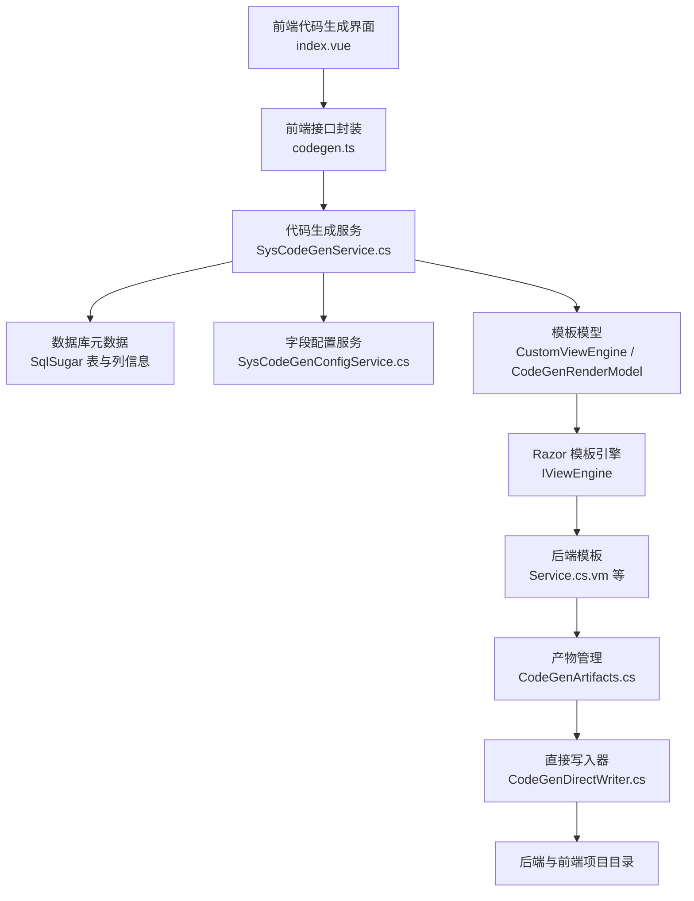
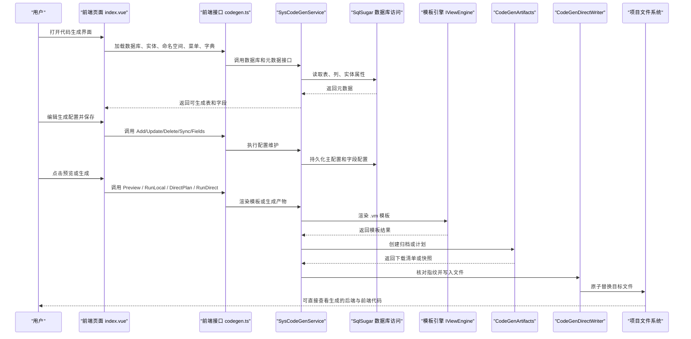
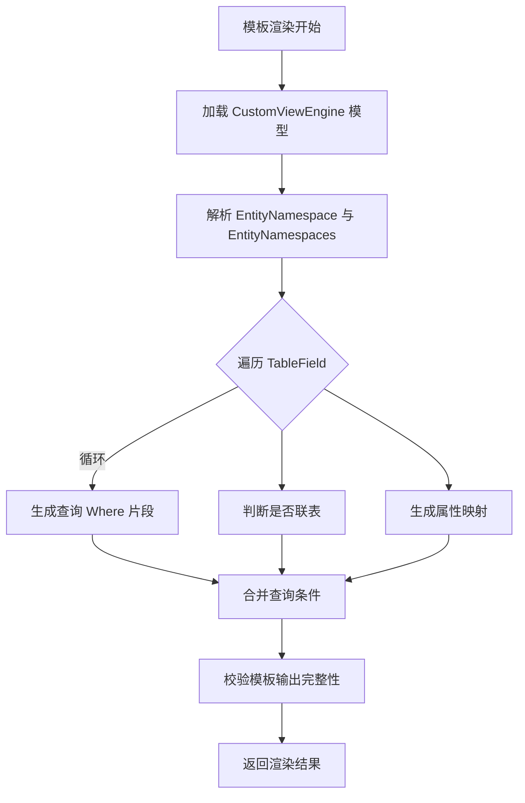
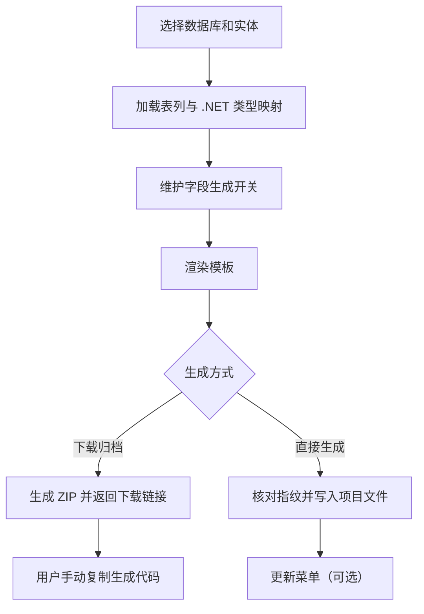
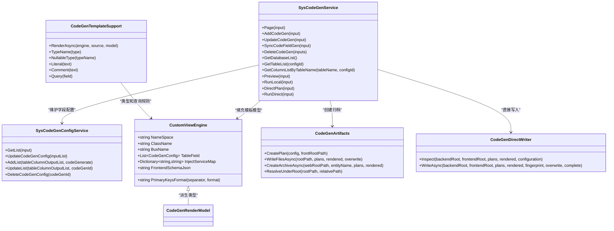
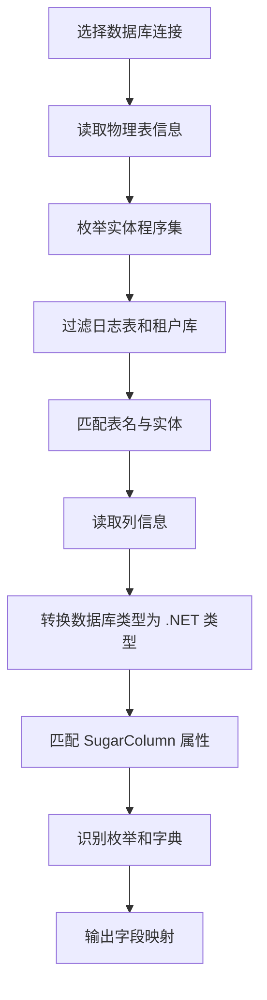
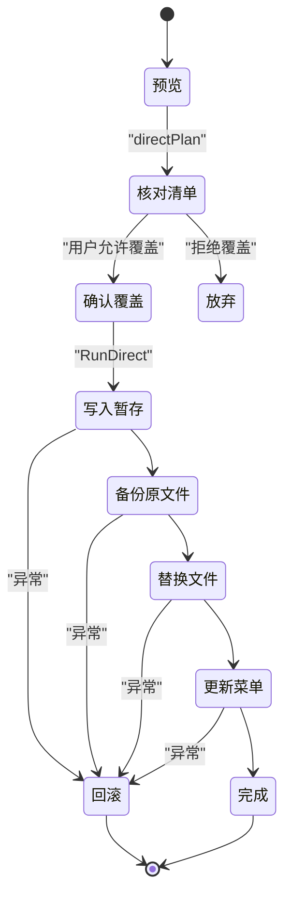

# 代码生成系统

<cite>
**本文引用的文件**   
- [SysCodeGenService.cs](file://Admin.NET/Admin.NET.Core/Service/CodeGen/SysCodeGenService.cs)
- [SysCodeGenConfigService.cs](file://Admin.NET/Admin.NET.Core/Service/CodeGen/SysCodeGenConfigService.cs)
- [CustomViewEngine.cs](file://Admin.NET/Admin.NET.Core/Service/CodeGen/CustomViewEngine.cs)
- [CodeGenTemplateSupport.cs](file://Admin.NET/Admin.NET.Core/Service/CodeGen/CodeGenTemplateSupport.cs)
- [CodeGenArtifacts.cs](file://Admin.NET/Admin.NET.Core/Service/CodeGen/CodeGenArtifacts.cs)
- [CodeGenDirectWriter.cs](file://Admin.NET/Admin.NET.Core/Service/CodeGen/CodeGenDirectWriter.cs)
- [CodeGenOptions.cs](file://Admin.NET/Admin.NET.Core/Option/CodeGenOptions.cs)
- [CodeGen.json](file://Admin.NET/Admin.NET.Application/Configuration/CodeGen.json)
- [SysCodeGen.cs](file://Admin.NET/Admin.NET.Core/Entity/SysCodeGen.cs)
- [SysCodeGenConfig.cs](file://Admin.NET/Admin.NET.Core/Entity/SysCodeGenConfig.cs)
- [CodeGenConfig.cs](file://Admin.NET/Admin.NET.Core/Service/CodeGen/Dto/CodeGenConfig.cs)
- [CodeGenInput.cs](file://Admin.NET/Admin.NET.Core/Service/CodeGen/Dto/CodeGenInput.cs)
- [CodeGenOutput.cs](file://Admin.NET/Admin.NET.Core/Service/CodeGen/Dto/CodeGenOutput.cs)
- [CodeGenHelper.cs](file://Admin.NET/Admin.NET.Core/Utils/CodeGenHelper.cs)
- [CodeGenUtil.cs](file://Admin.NET/Admin.NET.Core/Utils/CodeGenUtil.cs)
- [Service.cs.vm](file://Admin.NET/Admin.NET.Web.Entry/wwwroot/template/Service.cs.vm)
- [index.vue](file://Web/apps/web-antdv-next/src/views/system/codeGen/index.vue)
- [codegen-model.ts](file://Web/apps/web-antdv-next/src/views/system/codeGen/codegen-model.ts)
- [codegen.ts](file://Web/apps/web-antdv-next/src/api/system/codegen.ts)
- [CodeGenTemplateRenderingTests.cs](file://Admin.NET/Admin.NET.Test/CodeGen/CodeGenTemplateRenderingTests.cs)
</cite>

## 目录

1. [简介](#简介)
2. [项目结构](#项目结构)
3. [核心组件](#核心组件)
4. [架构总览](#架构总览)
5. [详细组件分析](#详细组件分析)
6. [依赖关系分析](#依赖关系分析)
7. [性能与并发特性](#性能与并发特性)
8. [模板定制指南](#模板定制指南)
9. [数据库元数据与字段映射](#数据库元数据与字段映射)
10. [版本管理与增量更新](#版本管理与增量更新)
11. [代码质量检查与格式化](#代码质量检查与格式化)
12. [最佳实践与常见问题](#最佳实践与常见问题)
13. [结论](#结论)

## 简介

Admin.NET 的代码生成系统围绕“数据库实体 → 后端服务与输入输出模型 → 前端页面与接口调用”展开，通过 Razor 模板引擎、可配置字段元数据和两种写入策略，实现前后端代码的自动化产出。当前仓库以 `Web/apps/web-antdv-next` 为业务前端入口，后端生成目标由 `CodeGenOptions` 和解决方案目录结构共同决定；测试工程基于 `Microsoft.Testing.Platform`，不应据此声称已固定全局 `.NET SDK` 版本。

该系统的重点包括：

- 使用 `ISqlSugarClient` 读取数据库表结构和属性映射。
- 将元数据填充到 `CustomViewEngine` 派生模型中。
- 通过 `IViewEngine` 渲染 `.vm` 后缀的 Razor 模板。
- 支持打包下载或直接写入项目根目录。
- 提供前端表单维护代码生成配置、字段开关、查询方式、唯一约束和打印模板等。
- 通过单元测试验证模板编译结果，而不是仅断言字符串片段。

## 项目结构

代码生成相关代码主要分布在以下位置：

| 层次 | 路径 | 职责 |
|---|---|---|
| 领域实体 | `Admin.NET/Admin.NET.Core/Entity/SysCodeGen.cs` | 保存代码生成主配置 |
| 字段配置实体 | `Admin.NET/Admin.NET.Core/Entity/SysCodeGenConfig.cs` | 保存每个字段的生成选项 |
| 应用服务 | `Admin.NET/Admin.NET.Core/Service/CodeGen/SysCodeGenService.cs` | 对外暴露代码生成 API |
| 字段配置服务 | `Admin.NET/Admin.NET.Core/Service/CodeGen/SysCodeGenConfigService.cs` | 批量同步和维护字段配置 |
| 模板模型 | `Admin.NET/Admin.NET.Core/Service/CodeGen/CustomViewEngine.cs` | 定义模板可用属性和辅助方法 |
| 模板工具 | `Admin.NET/Admin.NET.Core/Service/CodeGen/CodeGenTemplateSupport.cs` | 类型名、查询表达式、文本转义等公共逻辑 |
| 产物管理 | `Admin.NET/Admin.NET.Core/Service/CodeGen/CodeGenArtifacts.cs` | 生成清单、归档和路径安全校验 |
| 直接写入 | `Admin.NET/Admin.NET.Core/Service/CodeGen/CodeGenDirectWriter.cs` | 核对指纹后原子式替换文件 |
| 运行时配置 | `Admin.NET/Admin.NET.Core/Option/CodeGenOptions.cs` | 实体程序集、命名空间和项目根目录 |
| 配置文件 | `Admin.NET/Admin.NET.Application/Configuration/CodeGen.json` | 代码生成默认选项 |
| 模板文件 | `Admin.NET/Admin.NET.Web.Entry/wwwroot/template/*.vm` | 后端代码模板 |
| 前端页面 | `Web/apps/web-antdv-next/src/views/system/codeGen/index.vue` | 代码生成器界面 |
| 前端模型 | `Web/apps/web-antdv-next/src/views/system/codeGen/codegen-model.ts` | 草稿、校验和字段状态 |
| 前端接口 | `Web/apps/web-antdv-next/src/api/system/codegen.ts` | 调用后端代码生成 API |
| 单元测试 | `Admin.NET/Admin.NET.Test/CodeGen/CodeGenTemplateRenderingTests.cs` | 验证模板编译和后端代码生成 |

**图表来源**
- [SysCodeGenService.cs:1-200](file://Admin.NET/Admin.NET.Core/Service/CodeGen/SysCodeGenService.cs#L1-L200)
- [CodeGenArtifacts.cs:1-164](file://Admin.NET/Admin.NET.Core/Service/CodeGen/CodeGenArtifacts.cs#L1-L164)
- [CodeGenDirectWriter.cs:1-177](file://Admin.NET/Admin.NET.Core/Service/CodeGen/CodeGenDirectWriter.cs#L1-L177)
- [index.vue:1-225](file://Web/apps/web-antdv-next/src/views/system/codeGen/index.vue#L1-L225)

**章节来源**
- [SysCodeGenService.cs:1-200](file://Admin.NET/Admin.NET.Core/Service/CodeGen/SysCodeGenService.cs#L1-L200)
- [CodeGenOptions.cs:1-39](file://Admin.NET/Admin.NET.Core/Option/CodeGenOptions.cs#L1-L39)
- [CodeGen.json:1-11](file://Admin.NET/Admin.NET.Application/Configuration/CodeGen.json#L1-L11)

## 核心组件

### 代码生成服务

`SysCodeGenService` 是代码生成系统的中央控制器，承担以下职责：

- 分页查询、新增、更新、删除代码生成配置。
- 根据数据库连接选择器切换多库上下文。
- 枚举实体、表、列并回填属性名、字典、枚举和描述。
- 渲染模板并返回预览或生成产物。
- 计算直接生成的目标清单。
- 在菜单生成开启时创建或更新菜单。

关键 API 包括：

| 接口行为 | 用途 |
|---|---|
| `Page` | 查询已保存的代码生成配置 |
| `AddCodeGen` | 新增配置并插入字段配置 |
| `UpdateCodeGen` | 更新配置，必要时重建字段配置 |
| `SyncCodeFieldGen` | 同步数据库字段，保留用户修改过的配置 |
| `DeleteCodeGen` | 删除字段配置和主配置 |
| `GetDatabaseList` | 列出可用数据库连接 |
| `GetTableList` | 根据实体程序集过滤出可生成表 |
| `GetColumnListByTableName` | 获取表列及 .NET 类型映射 |
| `Preview` | 渲染模板但不写文件 |
| `RunLocal` | 生成 ZIP 包供浏览器下载 |
| `DirectPlan` | 核对直接生成目标清单 |
| `RunDirect` | 按指纹写入真实项目文件 |

**章节来源**
- [SysCodeGenService.cs:1-200](file://Admin.NET/Admin.NET.Core/Service/CodeGen/SysCodeGenService.cs#L1-L200)
- [SysCodeGenService.cs:201-502](file://Admin.NET/Admin.NET.Core/Service/CodeGen/SysCodeGenService.cs#L201-L502)

### 字段配置服务

`SysCodeGenConfigService` 负责字段级配置的持久化：

- 按 `CodeGenId` 查询字段列表。
- 将 `EffectType == "EnumSelector"` 的字段映射为枚举代码。
- 拆分外键显示列。
- 批量新增初始字段。
- 增量同步字段，保留已有记录的主键 ID。
- 删除不再存在的字段。
- 使用事务和乐观校验保证并发更新安全。

**章节来源**
- [SysCodeGenConfigService.cs:1-137](file://Admin.NET/Admin.NET.Core/Service/CodeGen/SysCodeGenConfigService.cs#L1-L137)

### 模板模型与模板支持

`CustomViewEngine` 是所有模板共享的模型基类，包含：

- 命名空间、类名、业务名、作者、页面目录、打印类型等生成参数。
- 字段集合及其分类：查询字段、导入字段、上传字段、下拉字段、外键字段、主键字段等。
- 主键条件拼接方法。
- 注入服务映射，例如文件服务、SQL 客户端、字典服务等。
- 前端共享 JSON Schema，用于驱动前端表单、表格和校验。
- 默认值解析逻辑，兼容 PostgreSQL 类型转换表达式。
- 表格列属性生成辅助方法。

`CodeGenTemplateSupport` 提供模板侧可复用的静态能力：

- 按 `CustomViewEngine` 实例运行模板编译。
- 添加必要程序集引用和命名空间。
- 将真实 .NET 类型转换为 C# 字符串类型名。
- 将基础类型和枚举转为可空类型。
- 对描述文本做 JSON 字符串转义。
- 对 XML 注释做单行安全转义。
- 把字段查询方式转为可编译的 Where 表达式。

**章节来源**
- [CustomViewEngine.cs:1-255](file://Admin.NET/Admin.NET.Core/Service/CodeGen/CustomViewEngine.cs#L1-L255)
- [CodeGenTemplateSupport.cs:1-101](file://Admin.NET/Admin.NET.Core/Service/CodeGen/CodeGenTemplateSupport.cs#L1-L101)

### 产物与直接写入

`CodeGenArtifacts` 负责：

- 根据 `GenerateType` 决定生成哪些文件。
- 规范化前端根目录，默认追加 `apps/web-antdv-next`。
- 生成后端服务、输入、输出、DTO 和前端页面、API 调用文件。
- 校验标识符、相对路径、模板与结果数量一致性。
- 计算每个文件的 UTF-8 字节长度和 SHA256。
- 将生成内容写入暂存目录，压缩后发布到 `wwwroot/CodeGen`。
- 防止路径越界、重复路径和非法路径片段。

`CodeGenDirectWriter` 负责：

- 检查模板渲染结果是否完整。
- 判断目标文件是否已存在。
- 将待写入文件复制到带操作 ID 的暂存目录。
- 备份已存在文件并校验原始摘要。
- 逐个移动临时文件覆盖目标。
- 在业务回调成功后才提交最终结果。
- 失败时回滚已发布的文件和目录。
- 使用信号量串行化直接写入，避免并发覆盖。

**章节来源**
- [CodeGenArtifacts.cs:1-164](file://Admin.NET/Admin.NET.Core/Service/CodeGen/CodeGenArtifacts.cs#L1-L164)
- [CodeGenDirectWriter.cs:1-177](file://Admin.NET/Admin.NET.Core/Service/CodeGen/CodeGenDirectWriter.cs#L1-L177)

## 架构总览

代码生成整体流程如下：

**图表来源**
- [SysCodeGenService.cs:201-502](file://Admin.NET/Admin.NET.Core/Service/CodeGen/SysCodeGenService.cs#L201-L502)
- [CodeGenArtifacts.cs:1-164](file://Admin.NET/Admin.NET.Core/Service/CodeGen/CodeGenArtifacts.cs#L1-L164)
- [CodeGenDirectWriter.cs:1-177](file://Admin.NET/Admin.NET.Core/Service/CodeGen/CodeGenDirectWriter.cs#L1-L177)
- [index.vue:1-225](file://Web/apps/web-antdv-next/src/views/system/codeGen/index.vue#L1-L225)
- [codegen.ts:1-49](file://Web/apps/web-antdv-next/src/api/system/codegen.ts#L1-L49)

## 详细组件分析

### 模板引擎设计与变量替换机制

系统使用 ASP.NET Core 的 `IViewEngine` 作为模板引擎，模板文件位于 `wwwroot/template`，当前后端模板包括：

- `Service.cs.vm`：动态 API 控制器服务。
- `Input.cs.vm`：新增和更新输入模型。
- `Output.cs.vm`：详情和列表输出模型。
- `Dto.cs.vm`：领域数据传输对象。

模板采用 Razor 语法，通过 `@using` 引用命名空间，通过 `@model` 绑定 `CustomViewEngine` 或其派生类型 `CodeGenRenderModel`。模板中的变量替换分为三类：

| 类别 | 说明 |
|---|---|
| 标量属性 | 如 `ClassName`、`BusName`、`NameSpace`、`LowerClassName` |
| 集合属性 | 如 `TableField`、`PrimaryKeyFieldList`、`QueryWhetherList` |
| 方法属性 | 如 `PrimaryKeysFormat`、`InjectServiceMap`、`FrontendSchemaJson` |

模板还通过 `CodeGenTemplateSupport` 调用静态方法，例如：

- `Comment(text)`：生成安全的 XML 注释。
- `Literal(text)`：生成安全的 C# 字符串字面量。
- `Query(field)`：将查询方式转换为 SQL 查询表达式。

**图表来源**
- [Service.cs.vm:1-200](file://Admin.NET/Admin.NET.Web.Entry/wwwroot/template/Service.cs.vm#L1-L200)
- [CodeGenTemplateSupport.cs:1-101](file://Admin.NET/Admin.NET.Core/Service/CodeGen/CodeGenTemplateSupport.cs#L1-L101)
- [CustomViewEngine.cs:1-255](file://Admin.NET/Admin.NET.Core/Service/CodeGen/CustomViewEngine.cs#L1-L255)

**章节来源**
- [Service.cs.vm:1-200](file://Admin.NET/Admin.NET.Web.Entry/wwwroot/template/Service.cs.vm#L1-L200)
- [CodeGenTemplateSupport.cs:1-101](file://Admin.NET/Admin.NET.Core/Service/CodeGen/CodeGenTemplateSupport.cs#L1-L101)
- [CustomViewEngine.cs:1-255](file://Admin.NET/Admin.NET.Core/Service/CodeGen/CustomViewEngine.cs#L1-L255)

### 前后端代码生成流程

#### 后端生成

后端模板根据字段配置生成：

- 分页查询服务，支持关键字模糊查询、范围查询、比较查询、非空查询。
- 详情查询。
- 新增，含唯一约束校验。
- 更新，忽略未标记更新的通用字段。
- 软删除或硬删除，取决于是否存在 `IsDelete` 字段。
- 批量删除。
- 可选的状态设置方法。

模板还会根据字段特征自动注入依赖：

- 上传字段注入文件服务。
- 下拉或导入字段注入 SQL 客户端。
- 字典选择器注入字典服务。

#### 前端生成

前端生成通常包括：

- `index.vue`：列表页、搜索栏、分页、增删改按钮。
- `editDialog.vue`：弹窗表单。
- `api.ts`：Axios 风格的接口调用。

这些路径由 `CodeGenArtifacts.CreatePlan` 决定，默认输出到：

- 后端：`{NameSpace}/Service/{EntityName}` 及 `Dto` 子目录。
- 前端：`apps/web-antdv-next/src/views/{pagePath}/{lowerName}`。

**图表来源**
- [SysCodeGenService.cs:201-502](file://Admin.NET/Admin.NET.Core/Service/CodeGen/SysCodeGenService.cs#L201-L502)
- [CodeGenArtifacts.cs:1-164](file://Admin.NET/Admin.NET.Core/Service/CodeGen/CodeGenArtifacts.cs#L1-L164)
- [CodeGenDirectWriter.cs:1-177](file://Admin.NET/Admin.NET.Core/Service/CodeGen/CodeGenDirectWriter.cs#L1-L177)

**章节来源**
- [CodeGenArtifacts.cs:1-164](file://Admin.NET/Admin.NET.Core/Service/CodeGen/CodeGenArtifacts.cs#L1-L164)
- [CodeGenDirectWriter.cs:1-177](file://Admin.NET/Admin.NET.Core/Service/CodeGen/CodeGenDirectWriter.cs#L1-L177)
- [Service.cs.vm:1-200](file://Admin.NET/Admin.NET.Web.Entry/wwwroot/template/Service.cs.vm#L1-L200)

### 自定义模板开发

要扩展或替换模板，建议遵循以下约定：

1. 保持模板使用 Razor 语法，并通过 `@model` 绑定 `CustomViewEngine` 或 `CodeGenRenderModel`。
2. 使用 `model.TableField` 等集合属性控制生成分支，而不是硬编码字段名。
3. 使用 `CodeGenTemplateSupport.Comment` 和 `CodeGenTemplateSupport.Literal` 处理用户输入文本。
4. 使用 `CodeGenTemplateSupport.Query` 生成查询条件，不要自行拼接 SQL。
5. 如需额外程序集，可通过 `CodeGenTemplateSupport.RenderAsync` 的配置方式添加引用。
6. 新增模板时，应在 `CodeGenArtifacts.CreatePlan` 中加入模板名到输出路径的映射。
7. 新增模板时，应补充单元测试，至少验证模板可被 Razor 编译。

模板中常用的内置数据包括：

| 数据项 | 用途 |
|---|---|
| `ClassName` | 生成的类名 |
| `LowerClassName` | 首字母小写类名 |
| `BusName` | 业务名称 |
| `NameSpace` | 后端命名空间 |
| `EntityNamespace` | 真实实体命名空间 |
| `TableField` | 字段列表 |
| `PrimaryKeyFieldList` | 主键字段 |
| `AddUpdateFieldList` | 可新增和更新的字段 |
| `QueryWhetherList` | 可查询字段 |
| `ImportFieldList` | 可导入字段 |
| `UploadFieldList` | 上传字段 |
| `TableUniqueConfigList` | 唯一约束配置 |
| `FrontendSchemaJson` | 前端表单和表格契约 |

**章节来源**
- [CustomViewEngine.cs:1-255](file://Admin.NET/Admin.NET.Core/Service/CodeGen/CustomViewEngine.cs#L1-L255)
- [CodeGenTemplateSupport.cs:1-101](file://Admin.NET/Admin.NET.Core/Service/CodeGen/CodeGenTemplateSupport.cs#L1-L101)
- [CodeGenArtifacts.cs:1-164](file://Admin.NET/Admin.NET.Core/Service/CodeGen/CodeGenArtifacts.cs#L1-L164)
- [CodeGenTemplateRenderingTests.cs:1-137](file://Admin.NET/Admin.NET.Test/CodeGen/CodeGenTemplateRenderingTests.cs#L1-L137)

## 依赖关系分析

**图表来源**
- [SysCodeGenService.cs:1-200](file://Admin.NET/Admin.NET.Core/Service/CodeGen/SysCodeGenService.cs#L1-L200)
- [SysCodeGenConfigService.cs:1-137](file://Admin.NET/Admin.NET.Core/Service/CodeGen/SysCodeGenConfigService.cs#L1-L137)
- [CustomViewEngine.cs:1-255](file://Admin.NET/Admin.NET.Core/Service/CodeGen/CustomViewEngine.cs#L1-L255)
- [CodeGenTemplateSupport.cs:1-101](file://Admin.NET/Admin.NET.Core/Service/CodeGen/CodeGenTemplateSupport.cs#L1-L101)
- [CodeGenArtifacts.cs:1-164](file://Admin.NET/Admin.NET.Core/Service/CodeGen/CodeGenArtifacts.cs#L1-L164)
- [CodeGenDirectWriter.cs:1-177](file://Admin.NET/Admin.NET.Core/Service/CodeGen/CodeGenDirectWriter.cs#L1-L177)

**章节来源**
- [SysCodeGenService.cs:1-200](file://Admin.NET/Admin.NET.Core/Service/CodeGen/SysCodeGenService.cs#L1-L200)
- [CodeGenArtifacts.cs:1-164](file://Admin.NET/Admin.NET.Core/Service/CodeGen/CodeGenArtifacts.cs#L1-L164)
- [CodeGenDirectWriter.cs:1-177](file://Admin.NET/Admin.NET.Core/Service/CodeGen/CodeGenDirectWriter.cs#L1-L177)

## 性能与并发特性

- 字段配置更新使用数据库事务，并在更新前锁定主配置和现有字段，避免脏写。
- 直接写入使用 `SemaphoreSlim(1, 1)` 保证同一时刻只有一个直接生成任务。
- 归档生成使用临时目录，完成后移动到 `wwwroot/CodeGen`，失败时清理暂存。
- 直接写入先写临时文件，再逐个移动，失败时尝试恢复原文件。
- 前端请求使用 `AbortController` 取消旧请求，避免竞态导致错误响应覆盖。
- 预览、下载和直接生成都从已保存配置加载，不通过请求参数替换目标。

**章节来源**
- [SysCodeGenConfigService.cs:1-137](file://Admin.NET/Admin.NET.Core/Service/CodeGen/SysCodeGenConfigService.cs#L1-L137)
- [CodeGenDirectWriter.cs:1-177](file://Admin.NET/Admin.NET.Core/Service/CodeGen/CodeGenDirectWriter.cs#L1-L177)
- [CodeGenArtifacts.cs:1-164](file://Admin.NET/Admin.NET.Core/Service/CodeGen/CodeGenArtifacts.cs#L1-L164)
- [index.vue:1-225](file://Web/apps/web-antdv-next/src/views/system/codeGen/index.vue#L1-L225)

## 模板定制指南

### 模板结构

推荐模板结构如下：

| 文件 | 用途 |
|---|---|
| `Service.cs.vm` | 动态 API 控制器服务 |
| `Input.cs.vm` | 新增和更新输入 DTO |
| `Output.cs.vm` | 详情和列表输出 DTO |
| `Dto.cs.vm` | 领域实体 DTO |
| `index.vue` | 前端列表页 |
| `component/editDialog.vue` | 前端编辑弹窗 |
| `api.ts` | 前端接口调用 |

### 内置函数与扩展点

| 扩展点 | 说明 |
|---|---|
| `CodeGenTemplateSupport.RenderAsync` | 自定义模板编译配置 |
| `CodeGenTemplateSupport.TypeName` | 将 .NET 类型转为 C# 类型名 |
| `CodeGenTemplateSupport.NullableType` | 将基础类型转为可空类型 |
| `CodeGenTemplateSupport.Literal` | 生成安全的字符串字面量 |
| `CodeGenTemplateSupport.Comment` | 生成安全的 XML 注释 |
| `CodeGenTemplateSupport.Query` | 生成查询表达式 |
| `CustomViewEngine.InjectServiceMap` | 按需注入服务 |
| `CustomViewEngine.FrontendSchemaJson` | 前端表单契约 |
| `CodeGenArtifacts.CreatePlan` | 注册新模板和输出路径 |

### 条件渲染示例

模板可根据字段配置生成不同分支：

- 当字段为枚举时，使用枚举类型。
- 当字段为外键或树选择器时，生成联表查询。
- 当存在 `IsDelete` 字段时，使用假删除。
- 当主键为自增 `long` 时，返回 `long`，否则返回复合主键对象。
- 当存在上传字段时，注入文件服务。
- 当存在字典选择器时，注入字典服务。

这些分支均由 `Service.cs.vm` 和 `CustomViewEngine` 共同驱动，开发者应避免在模板中直接拼接 SQL 或硬编码实体名。

**章节来源**
- [Service.cs.vm:1-200](file://Admin.NET/Admin.NET.Web.Entry/wwwroot/template/Service.cs.vm#L1-L200)
- [CustomViewEngine.cs:1-255](file://Admin.NET/Admin.NET.Core/Service/CodeGen/CustomViewEngine.cs#L1-L255)
- [CodeGenTemplateSupport.cs:1-101](file://Admin.NET/Admin.NET.Core/Service/CodeGen/CodeGenTemplateSupport.cs#L1-L101)
- [CodeGenArtifacts.cs:1-164](file://Admin.NET/Admin.NET.Core/Service/CodeGen/CodeGenArtifacts.cs#L1-L164)

## 数据库元数据与字段映射

### 表结构分析

`SysCodeGenService.GetTableList` 通过以下步骤获取可生成表：

1. 从 `DbConnectionOptions` 获取指定库定位器。
2. 使用 `SqlSugar` 的 `DbMaintenance.GetTableInfoList` 获取物理表。
3. 从实体程序集中查找带有 `SugarTable` 的实体。
4. 过滤日志表和多库租户配置。
5. 匹配物理表名与实体映射表名。
6. 返回实体名、物理表名和表注释。

### 字段映射

`GetColumnListByTableName` 和内部 `GetColumnList` 负责字段映射：

1. 根据 `configId` 切换到对应数据库连接。
2. 读取物理列信息。
3. 使用 `CodeGenHelper.ConvertDataType` 或 `CodeGenUtil.ConvertDataType` 将数据库类型转为 .NET 类型。
4. 根据 `SugarColumn` 属性匹配实体属性名和描述。
5. 识别枚举和字典。
6. 对没有对应属性的列进行过滤或移除。

数据库类型映射支持多种数据库，包括 Oracle、达梦、PostgreSQL、MySQL 等。

**图表来源**
- [SysCodeGenService.cs:201-502](file://Admin.NET/Admin.NET.Core/Service/CodeGen/SysCodeGenService.cs#L201-L502)
- [CodeGenHelper.cs:1-200](file://Admin.NET/Admin.NET.Core/Utils/CodeGenHelper.cs#L1-L200)
- [CodeGenUtil.cs:1-200](file://Admin.NET/Admin.NET.Core/Utils/CodeGenUtil.cs#L1-L200)

**章节来源**
- [SysCodeGenService.cs:201-502](file://Admin.NET/Admin.NET.Core/Service/CodeGen/SysCodeGenService.cs#L201-L502)
- [CodeGenHelper.cs:1-200](file://Admin.NET/Admin.NET.Core/Utils/CodeGenHelper.cs#L1-L200)
- [CodeGenUtil.cs:1-200](file://Admin.NET/Admin.NET.Core/Utils/CodeGenUtil.cs#L1-L200)

## 版本管理与增量更新

### 生成配置版本管理

代码生成配置分为两层：

- 主配置：保存在 `SysCodeGen`，包含业务名、命名空间、生成方式、菜单配置等。
- 字段配置：保存在 `SysCodeGenConfig`，包含字段开关、查询方式、作用类型、排序等。

字段配置更新采用“先锁定、再校验、最后写入”的策略：

1. 锁定主配置。
2. 锁定现有字段。
3. 计算差异更新。
4. 逐条更新并校验影响行数。
5. 提交事务。

### 直接生成增量策略

直接生成不是简单覆盖所有文件，而是：

1. 前端先调用 `directPlan` 获取目标文件清单和指纹。
2. 前端展示待生成文件及已有文件摘要。
3. 用户确认覆盖后，后端再次校验指纹。
4. 将新内容写入暂存目录。
5. 备份已存在文件。
6. 逐个替换目标文件。
7. 成功完成菜单更新后返回最终计划。
8. 任一阶段失败则尝试恢复原文件。

这种方式适合 CI/CD 或多人协作场景，因为指纹变化会强制重新核对，避免因缓存或外部修改导致误覆盖。

**图表来源**
- [CodeGenDirectWriter.cs:1-177](file://Admin.NET/Admin.NET.Core/Service/CodeGen/CodeGenDirectWriter.cs#L1-L177)
- [SysCodeGenService.cs:201-502](file://Admin.NET/Admin.NET.Core/Service/CodeGen/SysCodeGenService.cs#L201-L502)

**章节来源**
- [SysCodeGenConfigService.cs:1-137](file://Admin.NET/Admin.NET.Core/Service/CodeGen/SysCodeGenConfigService.cs#L1-L137)
- [CodeGenDirectWriter.cs:1-177](file://Admin.NET/Admin.NET.Core/Service/CodeGen/CodeGenDirectWriter.cs#L1-L177)
- [SysCodeGenService.cs:201-502](file://Admin.NET/Admin.NET.Core/Service/CodeGen/SysCodeGenService.cs#L201-L502)

## 代码质量检查与格式化

### 后端模板质量

模板生成的 C# 代码不是仅做字符串断言，而是：

1. 读取真实模板文件。
2. 通过 `IViewEngine` 渲染。
3. 将多个模板结果解析为 C# 语法树。
4. 构造模拟实体和全局 using。
5. 使用 Roslyn 编译为一个程序集。
6. 断言编译成功。

这能提前发现模板中缺失类型、错误命名空间、无效表达式等问题。

### 前端代码质量

前端仓库包含 ESLint、Stylelint、Prettier、oxlint 和 oxfmt 等工具。需要注意：

- `pnpm dev`、`pnpm build`、`pnpm lint`、`pnpm check:type` 面向业务应用，不应表述为全 workspace 检查。
- 代码生成系统的前端部分位于 `Web/apps/web-antdv-next`，但仓库整体是 pnpm workspace。
- 前端代码生成器页面本身有独立测试，例如行为测试、预览测试和字段会话测试。

### 数据库联调要求

数据库集成验证应使用隔离的真实 PostgreSQL，不能以 SQLite 或 Mock 结果声称真实联调通过。当前代码生成服务的表列查询依赖真实数据库元数据，因此测试环境必须保证数据库可连接且元数据一致。

**章节来源**
- [CodeGenTemplateRenderingTests.cs:1-137](file://Admin.NET/Admin.NET.Test/CodeGen/CodeGenTemplateRenderingTests.cs#L1-L137)
- [SysCodeGenService.cs:201-502](file://Admin.NET/Admin.NET.Core/Service/CodeGen/SysCodeGenService.cs#L201-L502)

## 最佳实践与常见问题

### 最佳实践

1. **优先使用实体属性驱动字段映射**  
   通过 `SugarColumn` 明确列名、描述和主键，让代码生成器自动匹配属性，而不是依赖下划线转驼峰猜测。

2. **区分枚举与字典**  
   枚举字段使用枚举类型，并设置 `DictTypeCode`；字典字段使用 `DictSelector` 效果类型。

3. **谨慎修改主键和通用字段**  
   `SysCodeGenConfig` 中的 `WhetherCommon == "Y"` 或主键字段在前端会被保护，避免误改。

4. **使用直接生成而非手动覆盖**  
   直接生成会校验指纹、备份原文件并尝试回滚，更适合生产或 CI 环境。

5. **保持模板与模型一致**  
   新增模板字段时，同时更新 `CustomViewEngine`、`CodeGenArtifacts.CreatePlan` 和相关测试。

6. **不要绕过指纹核对**  
   如果提示“目标文件已变化”，应重新预览并获取新指纹，不要强行跳过。

7. **生成菜单时注意页面目录**  
   `pagePath` 来自菜单路由的 `name`，不是菜单标题或路径。

8. **多库生成时明确 `configId`**  
   不同库可能同名表，必须通过库定位器区分。

### 常见问题

| 问题 | 原因 | 解决 |
|---|---|---|
| 实体不存在或不可用于代码生成 | 实体程序集未加入 `EntityAssemblyNames`，或实体不在指定库 | 检查 `CodeGen.json` 和 `CodeGenOptions` |
| 字段映射为空 | 实体属性与数据库列无法匹配 | 检查 `SugarColumn`、大小写和下划线转换 |
| 查询表达式报错 | 非字符串字段使用了模糊查询 | 改为 `==`、`!=`、`>`、`<`、`>=`、`<=` 或 `isNotNull` |
| 直接生成失败并提示指纹变化 | 文件或配置已被外部修改 | 重新预览并重新获取指纹 |
| 直接生成提示目标文件已存在 | 未勾选覆盖 | 确认是否需要覆盖，或重新核对清单 |
| 生成路径超出目录 | `PagePath` 或 `NameSpace` 包含非法路径片段 | 使用安全相对路径 |
| 预览成功但下载失败 | 归档发布前发生异常 | 检查磁盘权限、`wwwroot/CodeGen` 目录和取消令牌 |
| 字段配置保存失败 | 并发修改导致乐观校验失败 | 刷新页面后重新加载字段再保存 |

**章节来源**
- [CodeGenOptions.cs:1-39](file://Admin.NET/Admin.NET.Core/Option/CodeGenOptions.cs#L1-L39)
- [CodeGen.json:1-11](file://Admin.NET/Admin.NET.Application/Configuration/CodeGen.json#L1-L11)
- [CodeGenTemplateSupport.cs:1-101](file://Admin.NET/Admin.NET.Core/Service/CodeGen/CodeGenTemplateSupport.cs#L1-L101)
- [CodeGenDirectWriter.cs:1-177](file://Admin.NET/Admin.NET.Core/Service/CodeGen/CodeGenDirectWriter.cs#L1-L177)
- [SysCodeGenConfigService.cs:1-137](file://Admin.NET/Admin.NET.Core/Service/CodeGen/SysCodeGenConfigService.cs#L1-L137)

## 结论

Admin.NET 的代码生成系统以数据库元数据为基础，通过 Razor 模板、结构化字段配置和两种写入策略，打通了后端服务、输入输出模型与前端页面的自动生成链路。其设计重点在于：

- 模板渲染可编译、可测试，不只是字符串拼接。
- 字段配置支持细粒度控制查询、列表、增改、导入、排序和默认值。
- 直接生成具备指纹校验、备份和回滚能力。
- 产物路径经过严格校验，防止越界和冲突。
- 前端界面提供完整的配置、字段编辑、预览和生成体验。

在实际项目中，应优先使用官方模板和字段配置机制；只有在确有需要时才扩展模板或自定义写入逻辑，并确保相关单元测试覆盖新的分支和边界条件。