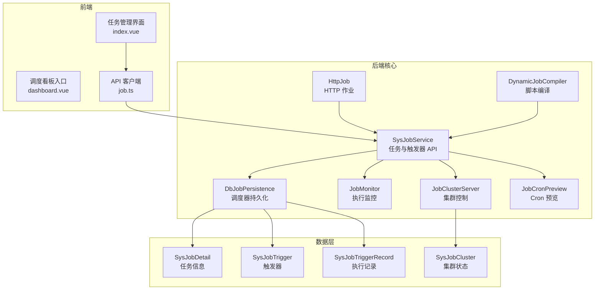
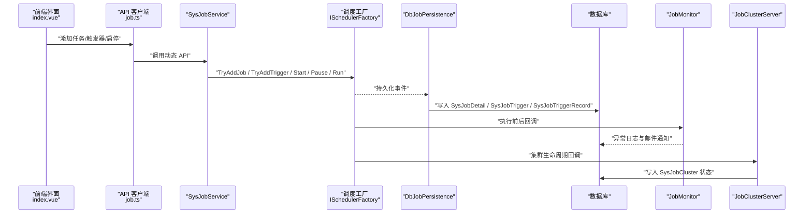
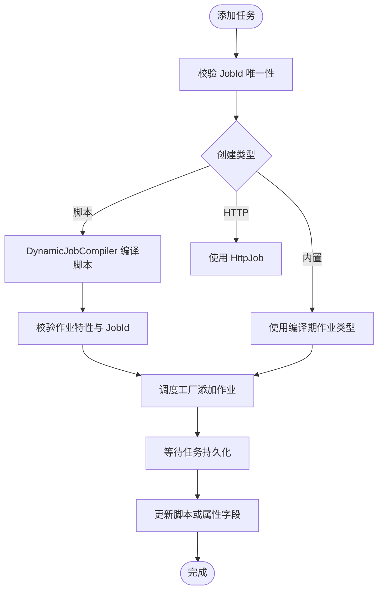
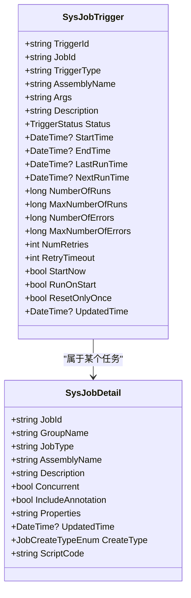
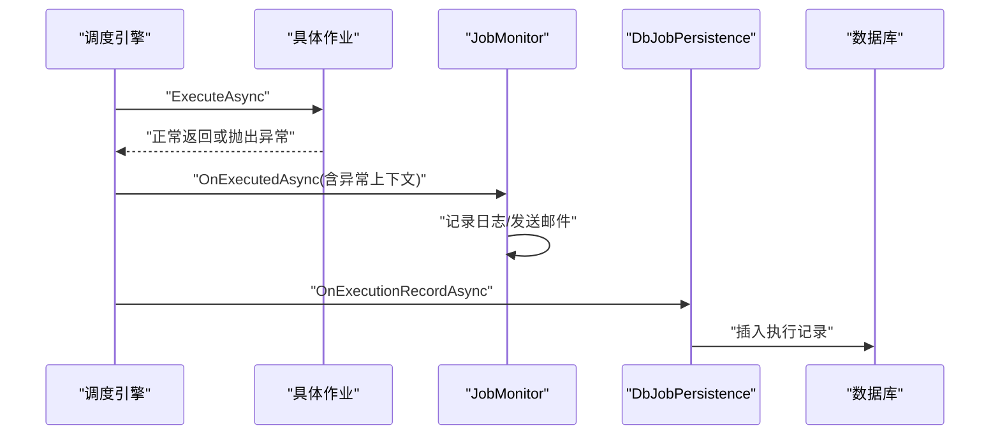
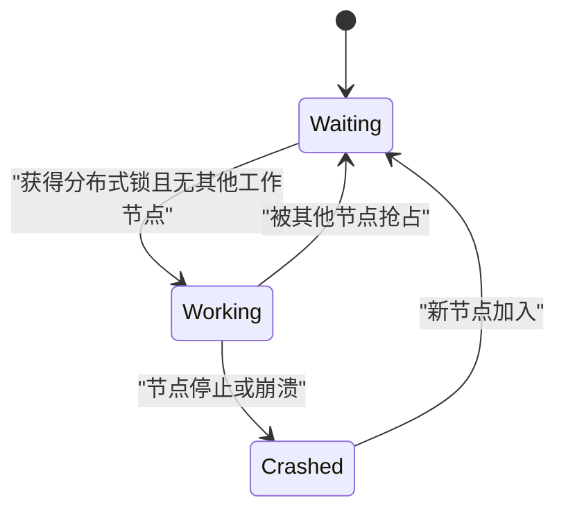
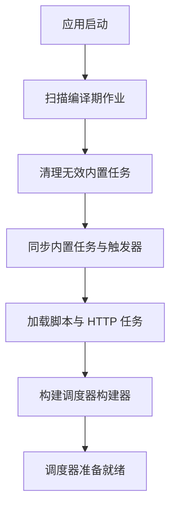
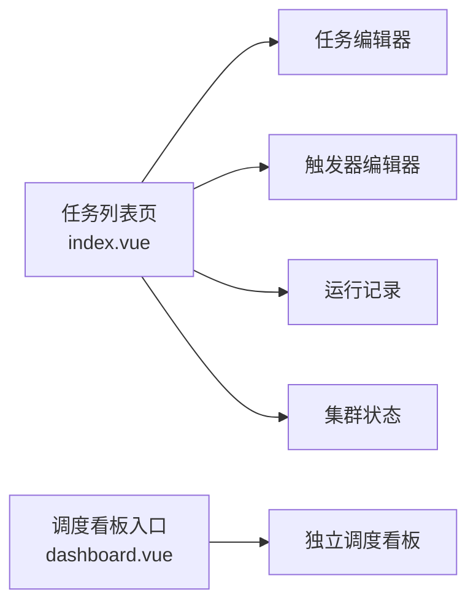
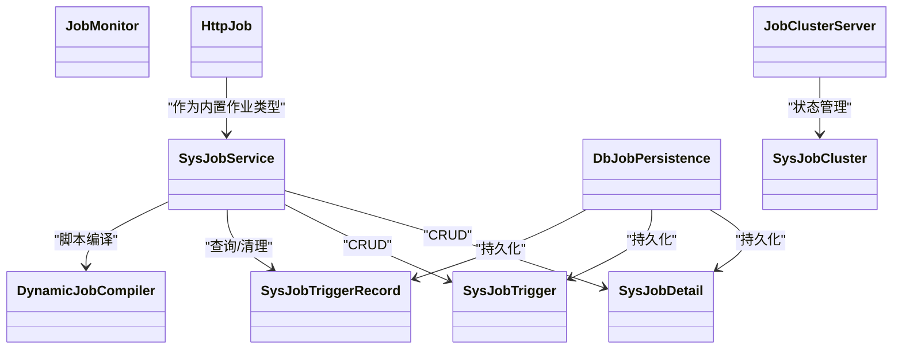

# 任务调度系统

<cite>
**本文引用的文件 **
- [DynamicJobCompiler.cs](file://Admin.NET/Admin.NET.Core/Job/DynamicJobCompiler.cs)
- [SysJobService.cs](file://Admin.NET/Admin.NET.Core/Service/Job/SysJobService.cs)
- [DbJobPersistence.cs](file://Admin.NET/Admin.NET.Core/Service/Job/DbJobPersistence.cs)
- [JobMonitor.cs](file://Admin.NET/Admin.NET.Core/Service/Job/JobMonitor.cs)
- [JobClusterServer.cs](file://Admin.NET/Admin.NET.Core/Service/Job/JobClusterServer.cs)
- [HttpJob.cs](file://Admin.NET/Admin.NET.Core/Service/Job/Http/HttpJob.cs)
- [HttpJobMessage.cs](file://Admin.NET/Admin.NET.Core/Service/Job/Http/HttpJobMessage.cs)
- [JobCronPreview.cs](file://Admin.NET/Admin.NET.Core/Service/Job/JobCronPreview.cs)
- [SysJobDetail.cs](file://Admin.NET/Admin.NET.Core/Entity/SysJobDetail.cs)
- [SysJobTrigger.cs](file://Admin.NET/Admin.NET.Core/Entity/SysJobTrigger.cs)
- [SysJobTriggerRecord.cs](file://Admin.NET/Admin.NET.Core/Entity/SysJobTriggerRecord.cs)
- [SysJobCluster.cs](file://Admin.NET/Admin.NET.Core/Entity/SysJobCluster.cs)
- [JobCreateTypeEnum.cs](file://Admin.NET/Admin.NET.Core/Enum/JobCreateTypeEnum.cs)
- [JobDetailInput.cs](file://Admin.NET/Admin.NET.Core/Service/Job/Dto/JobDetailInput.cs)
- [job.ts](file://Web/apps/web-antdv-next/src/api/system/job.ts)
- [index.vue](file://Web/apps/web-antdv-next/src/views/system/job/index.vue)
- [dashboard.vue](file://Web/apps/web-antdv-next/src/views/system/job/dashboard.vue)
- [JobRecordTests.cs](file://Admin.NET/Admin.NET.Test/Schedule/JobRecordTests.cs)
</cite>

## 目录
1. [简介](#简介)
2. [项目结构](#项目结构)
3. [核心组件](#核心组件)
4. [架构总览](#架构总览)
5. [详细组件分析](#详细组件分析)
6. [依赖关系分析](#依赖关系分析)
7. [性能与资源管理](#性能与资源管理)
8. [故障排查指南](#故障排查指南)
9. [结论](#结论)
10. [附录：任务定义与配置示例路径](#附录任务定义与配置示例路径)

## 简介
本文件系统梳理 Admin.NET 的任务调度能力。当前实现基于 Furion 的调度框架（包含 `ISchedulerFactory`、`SchedulerBuilder`、触发器构建器等），并在项目中通过持久化层、监视器、集群控制、HTTP 作业等扩展形成完整任务管理能力。代码中的“Sundial”字样在仓库中未见直接实现引用；因此，本文严格以实际源码为依据描述现有调度集成，不虚构 Sundial 相关特性。

任务支持三类创建方式：
- 内置任务：编译期扫描并注册的作业类型。
- 脚本任务：运行时动态编译 C# 脚本，要求脚本中包含实现调度接口的作业类及元数据。
- HTTP 任务：通过统一 HTTP 请求执行远端接口，便于跨服务调用。

触发器支持周期性与一次性模式，提供 Cron 表达式预览、起止时间、最大运行次数、错误次数、重试次数与重试间隔等参数。执行过程记录到数据库，并提供前端监控界面、日志记录、错误邮件通知和集群状态展示。

## 项目结构
任务调度相关代码主要集中在后端 `Admin.NET.Admin.NET.Core` 工程中：
- 实体模型：`SysJobDetail`、`SysJobTrigger`、`SysJobTriggerRecord`、`SysJobCluster`。
- 业务服务：`SysJobService` 负责任务的增删改查、启停控制、触发器管理和 Cron 预览。
- 持久化：`DbJobPersistence` 将调度器中的作业、触发器和执行记录同步到数据库。
- 执行监控：`JobMonitor` 捕获异常并写入日志与可选邮件通知。
- 集群控制：`JobClusterServer` 维护集群表状态，实现单实例执行策略。
- 内置作业：`HttpJob` 作为 HTTP 调用型作业。
- 动态编译：`DynamicJobCompiler` 将脚本编译为可执行的作业类型。
- 前端页面：`Web/apps/web-antdv-next/src/views/system/job` 下的任务列表、编辑器、记录查看与调度看板入口。

**图表来源**
- [SysJobService.cs:1-200](file://Admin.NET/Admin.NET.Core/Service/Job/SysJobService.cs#L1-L200)
- [DbJobPersistence.cs:1-288](file://Admin.NET/Admin.NET.Core/Service/Job/DbJobPersistence.cs#L1-L288)
- [JobMonitor.cs:1-46](file://Admin.NET/Admin.NET.Core/Service/Job/JobMonitor.cs#L1-L46)
- [JobClusterServer.cs:1-98](file://Admin.NET/Admin.NET.Core/Service/Job/JobClusterServer.cs#L1-L98)
- [HttpJob.cs:1-112](file://Admin.NET/Admin.NET.Core/Service/Job/Http/HttpJob.cs#L1-L112)
- [DynamicJobCompiler.cs:1-25](file://Admin.NET/Admin.NET.Core/Job/DynamicJobCompiler.cs#L1-L25)
- [JobCronPreview.cs:1-59](file://Admin.NET/Admin.NET.Core/Service/Job/JobCronPreview.cs#L1-L59)
- [SysJobDetail.cs:1-87](file://Admin.NET/Admin.NET.Core/Entity/SysJobDetail.cs#L1-L87)
- [SysJobTrigger.cs:1-147](file://Admin.NET/Admin.NET.Core/Entity/SysJobTrigger.cs#L1-L147)
- [SysJobTriggerRecord.cs:1-72](file://Admin.NET/Admin.NET.Core/Entity/SysJobTriggerRecord.cs#L1-L72)
- [SysJobCluster.cs:1-41](file://Admin.NET/Admin.NET.Core/Entity/SysJobCluster.cs#L1-L41)
- [index.vue:1-200](file://Web/apps/web-antdv-next/src/views/system/job/index.vue#L1-L200)
- [dashboard.vue:1-33](file://Web/apps/web-antdv-next/src/views/system/job/dashboard.vue#L1-L33)
- [job.ts:1-61](file://Web/apps/web-antdv-next/src/api/system/job.ts#L1-L61)

**章节来源**
- [SysJobService.cs:1-200](file://Admin.NET/Admin.NET.Core/Service/Job/SysJobService.cs#L1-L200)
- [DbJobPersistence.cs:1-288](file://Admin.NET/Admin.NET.Core/Service/Job/DbJobPersistence.cs#L1-L288)
- [index.vue:1-200](file://Web/apps/web-antdv-next/src/views/system/job/index.vue#L1-L200)
- [dashboard.vue:1-33](file://Web/apps/web-antdv-next/src/views/system/job/dashboard.vue#L1-L33)
- [job.ts:1-61](file://Web/apps/web-antdv-next/src/api/system/job.ts#L1-L61)

## 核心组件
- `SysJobService`：对外暴露任务与触发器的增删改查、启动暂停、立即执行、全局启停、唤醒调度器、持久化所有任务、清空运行记录和 Cron 预览等能力。它同时协调调度工厂、动态编译器与数据库仓储。
- `DbJobPersistence`：实现调度框架的持久化接口，负责启动时预加载内置与脚本任务、同步作业与触发器、处理变更事件以及落盘执行记录，并在执行记录增长后清理过期记录。
- `JobMonitor`：监听作业执行结果，记录异常日志，并根据配置决定是否发送错误邮件。
- `JobClusterServer`：通过 `SysJobCluster` 表维护集群节点状态，使用分布式锁避免并发抢占，仅允许一个工作节点执行特定集群任务。
- `HttpJob`：根据 `HttpJobMessage` 构造 HTTP 请求，支持方法、超时、请求头、请求体、响应内容打印与成功状态校验。
- `DynamicJobCompiler`：使用应用编译工具把脚本字符串编译成程序集，并提取实现调度接口的作业类型。
- `JobCronPreview`：对 Cron 表达式进行解析与最近几次触发时间预览，限制时区与服务端一致，防止随机规则导致不可重现预览。

**章节来源**
- [SysJobService.cs:1-200](file://Admin.NET/Admin.NET.Core/Service/Job/SysJobService.cs#L1-L200)
- [DbJobPersistence.cs:1-288](file://Admin.NET/Admin.NET.Core/Service/Job/DbJobPersistence.cs#L1-L288)
- [JobMonitor.cs:1-46](file://Admin.NET/Admin.NET.Core/Service/Job/JobMonitor.cs#L1-L46)
- [JobClusterServer.cs:1-98](file://Admin.NET/Admin.NET.Core/Service/Job/JobClusterServer.cs#L1-L98)
- [HttpJob.cs:1-112](file://Admin.NET/Admin.NET.Core/Service/Job/Http/HttpJob.cs#L1-L112)
- [DynamicJobCompiler.cs:1-25](file://Admin.NET/Admin.NET.Core/Job/DynamicJobCompiler.cs#L1-L25)
- [JobCronPreview.cs:1-59](file://Admin.NET/Admin.NET.Core/Service/Job/JobCronPreview.cs#L1-L59)

## 架构总览
任务从前端发起，经 `job.ts` 调用后端 `SysJobService` 的动态 API。服务层操作调度工厂注册或更新作业与触发器，并通过 `DbJobPersistence` 将调度器状态与数据库保持同步。任务执行时由调度引擎调用具体作业类型；`JobMonitor` 捕获异常，`DbJobPersistence` 记录执行时间线。集群模式下，`JobClusterServer` 确保同一集群只有一台机器承担调度工作。

**图表来源**
- [SysJobService.cs:200-491](file://Admin.NET/Admin.NET.Core/Service/Job/SysJobService.cs#L200-L491)
- [DbJobPersistence.cs:201-288](file://Admin.NET/Admin.NET.Core/Service/Job/DbJobPersistence.cs#L201-L288)
- [JobMonitor.cs:1-46](file://Admin.NET/Admin.NET.Core/Service/Job/JobMonitor.cs#L1-L46)
- [JobClusterServer.cs:1-98](file://Admin.NET/Admin.NET.Core/Service/Job/JobClusterServer.cs#L1-L98)
- [index.vue:1-200](file://Web/apps/web-antdv-next/src/views/system/job/index.vue#L1-L200)
- [job.ts:1-61](file://Web/apps/web-antdv-next/src/api/system/job.ts#L1-L61)

## 详细组件分析

### 任务定义与创建流程
任务创建分为三种类型：
- 内置类型：由编译期扫描到的作业类型自动注册。
- 脚本类型：需要传入 C# 脚本代码，服务端用 `DynamicJobCompiler` 编译，并要求脚本类上带有作业详情特性且 `JobId` 与输入一致。
- HTTP 类型：使用内置的 `HttpJob`，通过 `HttpJobMessage` 配置远端调用。

新增任务时会先检查 `JobId` 唯一性，再根据类型选择作业类，调用调度工厂添加作业，等待持久化完成，最后更新脚本代码或属性字段。更新任务时不允许改变创建类型，若脚本变化则重新编译并更新调度器中的作业详情。

**图表来源**
- [SysJobService.cs:1-200](file://Admin.NET/Admin.NET.Core/Service/Job/SysJobService.cs#L1-L200)
- [DynamicJobCompiler.cs:1-25](file://Admin.NET/Admin.NET.Core/Job/DynamicJobCompiler.cs#L1-L25)
- [HttpJob.cs:1-112](file://Admin.NET/Admin.NET.Core/Service/Job/Http/HttpJob.cs#L1-L112)
- [JobCreateTypeEnum.cs:1-32](file://Admin.NET/Admin.NET.Core/Enum/JobCreateTypeEnum.cs#L1-L32)

**章节来源**
- [SysJobService.cs:1-200](file://Admin.NET/Admin.NET.Core/Service/Job/SysJobService.cs#L1-L200)
- [DynamicJobCompiler.cs:1-25](file://Admin.NET/Admin.NET.Core/Job/DynamicJobCompiler.cs#L1-L25)
- [HttpJob.cs:1-112](file://Admin.NET/Admin.NET.Core/Service/Job/Http/HttpJob.cs#L1-L112)
- [JobCreateTypeEnum.cs:1-32](file://Admin.NET/Admin.NET.Core/Enum/JobCreateTypeEnum.cs#L1-L32)

### 触发器与调度配置
触发器用于定义任务何时执行。支持以下关键配置：
- 触发器编号与所属任务编号。
- 触发器类型与程序集名称。
- 参数格式：Cron 触发器参数为数组形式的表达式与格式编号；周期性触发器参数为正整数毫秒。
- 起止时间与运行窗口。
- 最大运行次数与最大错误次数。
- 重试次数与重试间隔。
- 是否立即启动、启动时执行一次、是否重置仅运行一次的计数。

服务层在新增或更新触发器时会对起止时间顺序、负数参数、Cron 表达式有效性、周期毫秒合法性进行校验，并将参数规范化为数组字符串后再持久化。Cron 预览功能会验证表达式、格式与时区，并返回最近 5 次触发时间。

**图表来源**
- [SysJobTrigger.cs:1-147](file://Admin.NET/Admin.NET.Core/Entity/SysJobTrigger.cs#L1-L147)
- [SysJobDetail.cs:1-87](file://Admin.NET/Admin.NET.Core/Entity/SysJobDetail.cs#L1-L87)

**章节来源**
- [SysJobService.cs:200-491](file://Admin.NET/Admin.NET.Core/Service/Job/SysJobService.cs#L200-L491)
- [SysJobTrigger.cs:1-147](file://Admin.NET/Admin.NET.Core/Entity/SysJobTrigger.cs#L1-L147)
- [SysJobDetail.cs:1-87](file://Admin.NET/Admin.NET.Core/Entity/SysJobDetail.cs#L1-L87)
- [JobCronPreview.cs:1-59](file://Admin.NET/Admin.NET.Core/Service/Job/JobCronPreview.cs#L1-L59)

### 任务执行监控与失败处理
执行监控由 `JobMonitor` 负责。当作业抛出异常时，它会记录结构化日志，并根据配置项决定是否发布错误邮件事件。执行结果与耗时由调度框架生成执行时间线，再由 `DbJobPersistence.OnExecutionRecordAsync` 写入 `SysJobTriggerRecord`。服务层提供分页查询执行记录、清空全部记录、以及按任务与触发器保留最近若干条记录的清理逻辑。

**图表来源**
- [JobMonitor.cs:1-46](file://Admin.NET/Admin.NET.Core/Service/Job/JobMonitor.cs#L1-L46)
- [DbJobPersistence.cs:201-288](file://Admin.NET/Admin.NET.Core/Service/Job/DbJobPersistence.cs#L201-L288)
- [SysJobTriggerRecord.cs:1-72](file://Admin.NET/Admin.NET.Core/Entity/SysJobTriggerRecord.cs#L1-L72)

**章节来源**
- [JobMonitor.cs:1-46](file://Admin.NET/Admin.NET.Core/Service/Job/JobMonitor.cs#L1-L46)
- [DbJobPersistence.cs:201-288](file://Admin.NET/Admin.NET.Core/Service/Job/DbJobPersistence.cs#L201-L288)
- [SysJobTriggerRecord.cs:1-72](file://Admin.NET/Admin.NET.Core/Entity/SysJobTriggerRecord.cs#L1-L72)

### 分布式任务调度与集群部署
集群控制通过 `JobClusterServer` 与 `SysJobCluster` 表协作完成。节点启动时写入或更新集群状态为等待；在工作前，节点使用缓存提供的分布式锁轮询数据库，若已有其他节点处于工作状态则继续等待，否则设置自身为工作状态并退出等待循环。节点停止或崩溃时会将状态更新为已崩溃。

需要注意的是，当前实现主要保证同一集群在同一时刻只有一个节点主动执行调度任务；如果多个进程共享同一个调度器实例，则需要额外考虑共享内存与调度器实例边界。生产环境部署时，应结合进程管理器、容器编排与外部依赖（如缓存、数据库）来保证集群一致性。

**图表来源**
- [JobClusterServer.cs:1-98](file://Admin.NET/Admin.NET.Core/Service/Job/JobClusterServer.cs#L1-L98)
- [SysJobCluster.cs:1-41](file://Admin.NET/Admin.NET.Core/Entity/SysJobCluster.cs#L1-L41)

**章节来源**
- [JobClusterServer.cs:1-98](file://Admin.NET/Admin.NET.Core/Service/Job/JobClusterServer.cs#L1-L98)
- [SysJobCluster.cs:1-41](file://Admin.NET/Admin.NET.Core/Entity/SysJobCluster.cs#L1-L41)

### 任务执行引擎与持久化机制
启动阶段，`DbJobPersistence.PreloadAsync` 会：
- 扫描所有编译期定义的作业。
- 清理数据库中已不存在于代码中的内置任务及其触发器。
- 同步内置作业的详细信息与触发器到数据库。
- 加载数据库中非内置任务，并为脚本任务动态编译作业类型，为 HTTP 任务绑定 `HttpJob`。
- 将数据库中的触发器合并到调度器构建器，避免重复扫描特性触发器。

运行时，调度器对作业与触发器的变更会通过 `OnChangedAsync` 与 `OnTriggerChangedAsync` 持久化到数据库；执行时间线通过 `OnExecutionRecordAsync` 写入记录表。

**图表来源**
- [DbJobPersistence.cs:1-288](file://Admin.NET/Admin.NET.Core/Service/Job/DbJobPersistence.cs#L1-L288)
- [DynamicJobCompiler.cs:1-25](file://Admin.NET/Admin.NET.Core/Job/DynamicJobCompiler.cs#L1-L25)
- [HttpJob.cs:1-112](file://Admin.NET/Admin.NET.Core/Service/Job/Http/HttpJob.cs#L1-L112)

**章节来源**
- [DbJobPersistence.cs:1-288](file://Admin.NET/Admin.NET.Core/Service/Job/DbJobPersistence.cs#L1-L288)

### 前端监控界面
前端任务管理页面提供：
- 任务分页查询、分组筛选与描述搜索。
- 任务编辑与触发器编辑弹窗。
- 任务启停、取消、立即执行、删除等操作。
- 触发器启停、删除与运行记录查看。
- 全局启停、唤醒调度器、持久化所有任务、清空运行记录。
- 集群状态列表。
- 定时刷新任务列表。

调度看板页面提供一个按钮跳转到独立调度看板地址，并在具备权限时内嵌 iframe 展示。

**图表来源**
- [index.vue:1-200](file://Web/apps/web-antdv-next/src/views/system/job/index.vue#L1-L200)
- [dashboard.vue:1-33](file://Web/apps/web-antdv-next/src/views/system/job/dashboard.vue#L1-L33)

**章节来源**
- [index.vue:1-200](file://Web/apps/web-antdv-next/src/views/system/job/index.vue#L1-L200)
- [dashboard.vue:1-33](file://Web/apps/web-antdv-next/src/views/system/job/dashboard.vue#L1-L33)
- [job.ts:1-61](file://Web/apps/web-antdv-next/src/api/system/job.ts#L1-L61)

## 依赖关系分析
- `SysJobService` 依赖 SqlSugar 仓储、调度工厂与动态编译器，是任务管理的中心协调者。
- `DbJobPersistence` 依赖服务作用域工厂、SqlSugar 客户端，负责调度器与数据库的双向同步。
- `JobMonitor` 依赖服务作用域工厂、事件发布器与日志记录器。
- `JobClusterServer` 依赖 SqlSugar 仓储与缓存提供者。
- `HttpJob` 依赖远程 HTTP 服务与调度日志。
- 前端 `job.ts` 依赖生成的 `SysJobApi` 与通用请求客户端。

**图表来源**
- [SysJobService.cs:1-200](file://Admin.NET/Admin.NET.Core/Service/Job/SysJobService.cs#L1-L200)
- [DbJobPersistence.cs:1-288](file://Admin.NET/Admin.NET.Core/Service/Job/DbJobPersistence.cs#L1-L288)
- [JobMonitor.cs:1-46](file://Admin.NET/Admin.NET.Core/Service/Job/JobMonitor.cs#L1-L46)
- [JobClusterServer.cs:1-98](file://Admin.NET/Admin.NET.Core/Service/Job/JobClusterServer.cs#L1-L98)
- [HttpJob.cs:1-112](file://Admin.NET/Admin.NET.Core/Service/Job/Http/HttpJob.cs#L1-L112)
- [DynamicJobCompiler.cs:1-25](file://Admin.NET/Admin.NET.Core/Job/DynamicJobCompiler.cs#L1-L25)
- [SysJobDetail.cs:1-87](file://Admin.NET/Admin.NET.Core/Entity/SysJobDetail.cs#L1-L87)
- [SysJobTrigger.cs:1-147](file://Admin.NET/Admin.NET.Core/Entity/SysJobTrigger.cs#L1-L147)
- [SysJobTriggerRecord.cs:1-72](file://Admin.NET/Admin.NET.Core/Entity/SysJobTriggerRecord.cs#L1-L72)
- [SysJobCluster.cs:1-41](file://Admin.NET/Admin.NET.Core/Entity/SysJobCluster.cs#L1-L41)

**章节来源**
- [SysJobService.cs:1-200](file://Admin.NET/Admin.NET.Core/Service/Job/SysJobService.cs#L1-L200)
- [DbJobPersistence.cs:1-288](file://Admin.NET/Admin.NET.Core/Service/Job/DbJobPersistence.cs#L1-L288)
- [SysJobDetail.cs:1-87](file://Admin.NET/Admin.NET.Core/Entity/SysJobDetail.cs#L1-L87)
- [SysJobTrigger.cs:1-147](file://Admin.NET/Admin.NET.Core/Entity/SysJobTrigger.cs#L1-L147)
- [SysJobTriggerRecord.cs:1-72](file://Admin.NET/Admin.NET.Core/Entity/SysJobTriggerRecord.cs#L1-L72)
- [SysJobCluster.cs:1-41](file://Admin.NET/Admin.NET.Core/Entity/SysJobCluster.cs#L1-L41)

## 性能与资源管理
- 任务并行：`SysJobDetail.Concurrent` 控制任务是否并行执行；高吞吐场景应避免过度并行导致下游资源争用。
- 触发器上限：通过 `MaxNumberOfRuns` 与 `MaxNumberOfErrors` 限制任务运行次数与错误次数，避免无限重试。
- 重试机制：`NumRetries` 与 `RetryTimeout` 提供基础重试能力；注意重试间隔不宜过短，以免放大下游压力。
- Cron 预览：`JobCronPreview` 限制表达式长度与时区，避免非法或难以预测的调度计划。
- 执行记录清理：`ClearExpireJobTriggerRecord` 默认保留最近 30 条记录，避免执行历史膨胀影响查询性能。
- HTTP 作业超时：`HttpJobMessage.Timeout` 可设置请求超时，防止任务长时间阻塞。
- 前端轮询：任务列表每 5 秒刷新一次，应避免在高负载环境下降低刷新频率。

优化建议：
- 合理设置 Cron 表达式，避免过于密集的执行周期。
- 对长耗时任务采用异步批处理与幂等设计，配合 `Concurrent=false` 串行执行。
- 对下游接口启用连接池与超时保护，减少任务堆积。
- 定期清理执行记录，并监控错误率与重试次数。
- 在生产环境开启错误邮件告警，及时发现问题。

[本节为通用性能指导，不直接分析具体文件]

## 故障排查指南
常见问题与定位步骤：
- 任务无法启动：检查 `SysJobService.RequiredJob` 抛出的“任务不存在或未加载到调度引擎”错误；确认任务已持久化并成功加载。
- 触发器保存失败：检查起止时间顺序、负数参数、Cron 表达式合法性与周期毫秒值；参考 `ValidatedTrigger` 的校验逻辑。
- Cron 预览报错：确认表达式格式与时区在服务端本地时区范围内，避免随机规则。
- 执行记录未产生：确认调度器已启动、触发器状态正常，并检查 `DbJobPersistence.OnExecutionRecordAsync` 是否写入记录。
- 集群状态异常：检查 `SysJobCluster` 表中是否有多个工作节点或长期处于崩溃状态；确认分布式锁与缓存可用。
- SQLite 记录清空问题：测试用例覆盖了 SQLite 雪花主键表无序列时的清空逻辑，需确保清理接口在非 SQLite 下使用截断命令。

**章节来源**
- [SysJobService.cs:200-491](file://Admin.NET/Admin.NET.Core/Service/Job/SysJobService.cs#L200-L491)
- [JobCronPreview.cs:1-59](file://Admin.NET/Admin.NET.Core/Service/Job/JobCronPreview.cs#L1-L59)
- [DbJobPersistence.cs:201-288](file://Admin.NET/Admin.NET.Core/Service/Job/DbJobPersistence.cs#L201-L288)
- [JobClusterServer.cs:1-98](file://Admin.NET/Admin.NET.Core/Service/Job/JobClusterServer.cs#L1-L98)
- [JobRecordTests.cs:1-56](file://Admin.NET/Admin.NET.Test/Schedule/JobRecordTests.cs#L1-L56)

## 结论
Admin.NET 的任务调度系统以 Furion 调度框架为基础，通过持久化层、监控器、集群控制和 HTTP 作业扩展，形成了完整的任务定义、调度、执行与观测闭环。其优势在于：
- 支持内置、脚本与 HTTP 三种任务类型，便于快速集成既有代码与外部服务。
- 提供丰富的触发器参数与 Cron 预览，帮助运维人员安全地配置周期任务。
- 将调度器状态与数据库强一致持久化，并提供执行记录与错误告警。
- 通过集群表与分布式锁实现单实例调度，适合多进程部署场景。

生产环境建议重点关注 Cron 表达式质量、任务并行度、重试策略、执行记录清理与错误告警通道，并结合容器编排与外部依赖的健康检查保障稳定性。

[本节为总结性内容，不直接分析具体文件]

## 附录：任务定义与配置示例路径
以下为仓库中与任务调度相关的典型实现位置，可作为编写任务定义、调度配置与监控界面的参考：
- 动态脚本编译：[DynamicJobCompiler.cs:1-25](file://Admin.NET/Admin.NET.Core/Job/DynamicJobCompiler.cs#L1-L25)
- 任务与触发器 API：[SysJobService.cs:1-200](file://Admin.NET/Admin.NET.Core/Service/Job/SysJobService.cs#L1-L200)、[SysJobService.cs:200-491](file://Admin.NET/Admin.NET.Core/Service/Job/SysJobService.cs#L200-L491)
- 持久化与执行记录：[DbJobPersistence.cs:1-288](file://Admin.NET/Admin.NET.Core/Service/Job/DbJobPersistence.cs#L1-L288)
- 执行监控与错误邮件：[JobMonitor.cs:1-46](file://Admin.NET/Admin.NET.Core/Service/Job/JobMonitor.cs#L1-L46)
- 集群控制与状态：[JobClusterServer.cs:1-98](file://Admin.NET/Admin.NET.Core/Service/Job/JobClusterServer.cs#L1-L98)
- HTTP 作业与消息模型：[HttpJob.cs:1-112](file://Admin.NET/Admin.NET.Core/Service/Job/Http/HttpJob.cs#L1-L112)、[HttpJobMessage.cs:1-68](file://Admin.NET/Admin.NET.Core/Service/Job/Http/HttpJobMessage.cs#L1-L68)
- Cron 预览：[JobCronPreview.cs:1-59](file://Admin.NET/Admin.NET.Core/Service/Job/JobCronPreview.cs#L1-L59)
- 任务与触发器实体：[SysJobDetail.cs:1-87](file://Admin.NET/Admin.NET.Core/Entity/SysJobDetail.cs#L1-L87)、[SysJobTrigger.cs:1-147](file://Admin.NET/Admin.NET.Core/Entity/SysJobTrigger.cs#L1-L147)、[SysJobTriggerRecord.cs:1-72](file://Admin.NET/Admin.NET.Core/Entity/SysJobTriggerRecord.cs#L1-L72)、[SysJobCluster.cs:1-41](file://Admin.NET/Admin.NET.Core/Entity/SysJobCluster.cs#L1-L41)
- 任务创建类型枚举：[JobCreateTypeEnum.cs:1-32](file://Admin.NET/Admin.NET.Core/Enum/JobCreateTypeEnum.cs#L1-L32)
- 任务输入模型：[JobDetailInput.cs:1-50](file://Admin.NET/Admin.NET.Core/Service/Job/Dto/JobDetailInput.cs#L1-L50)
- 前端 API 封装：[job.ts:1-61](file://Web/apps/web-antdv-next/src/api/system/job.ts#L1-L61)
- 前端任务管理与看板：[index.vue:1-200](file://Web/apps/web-antdv-next/src/views/system/job/index.vue#L1-L200)、[dashboard.vue:1-33](file://Web/apps/web-antdv-next/src/views/system/job/dashboard.vue#L1-L33)
- SQLite 执行记录清理测试：[JobRecordTests.cs:1-56](file://Admin.NET/Admin.NET.Test/Schedule/JobRecordTests.cs#L1-L56)