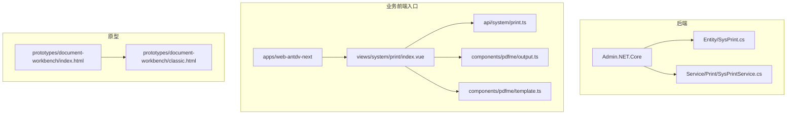
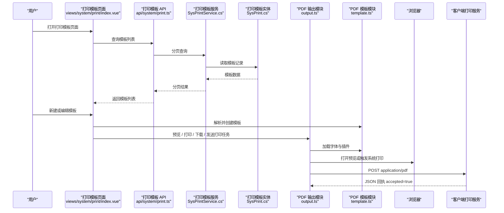
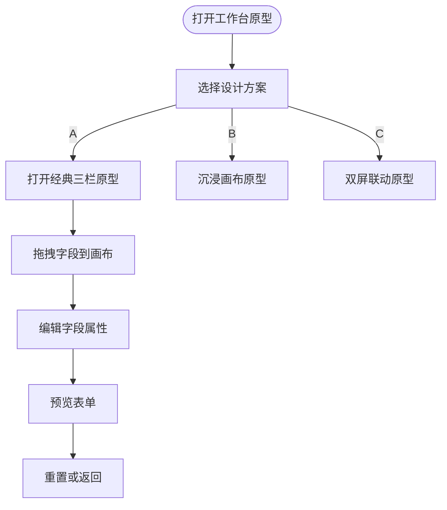
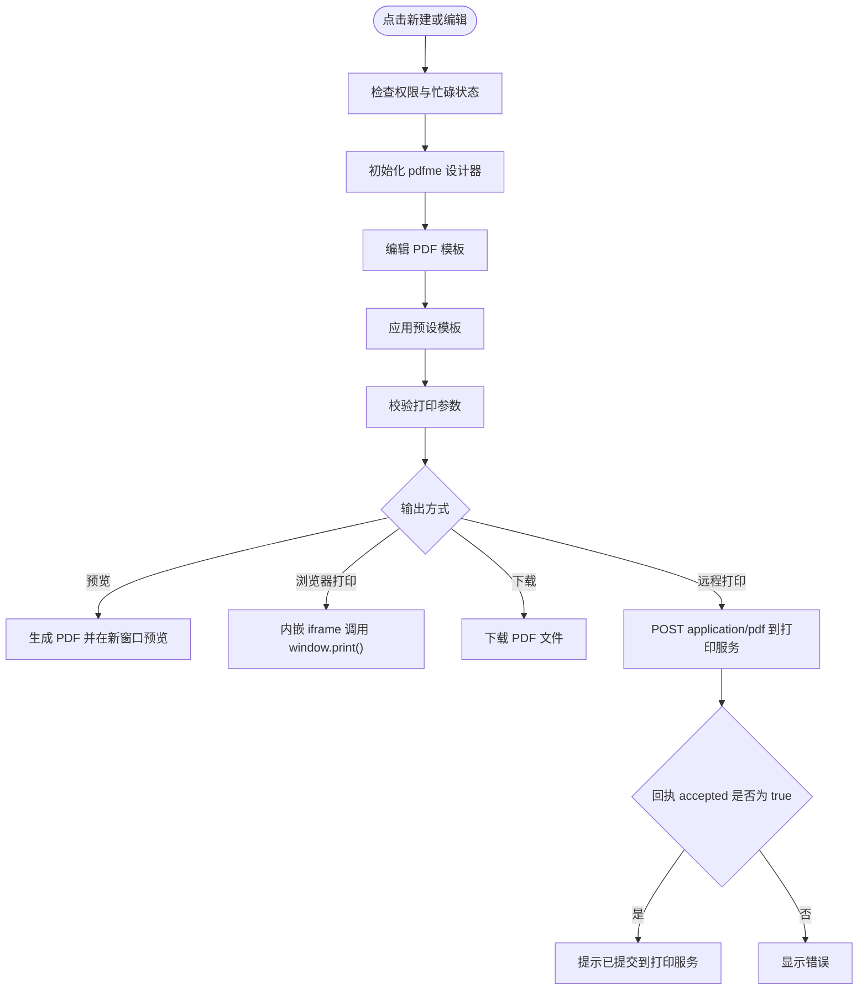
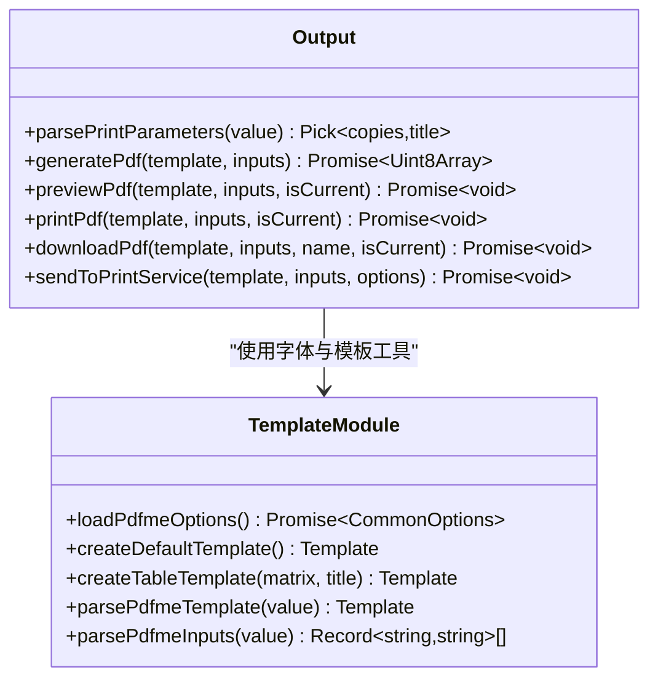
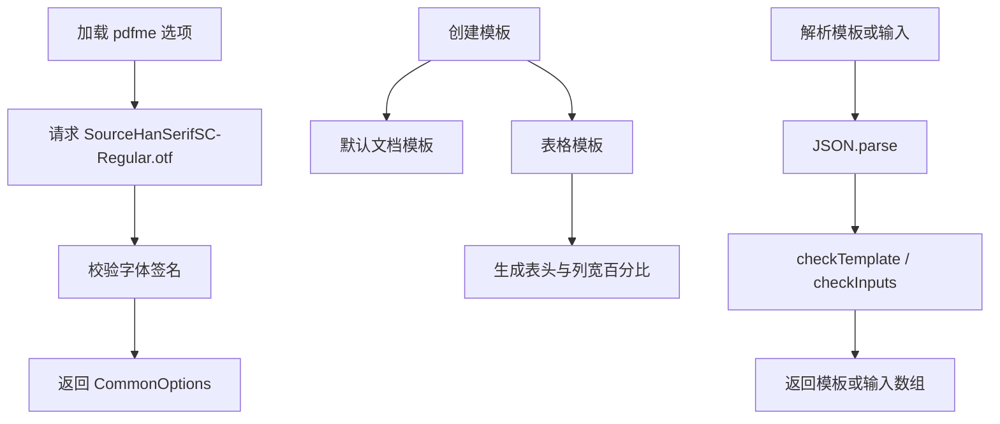
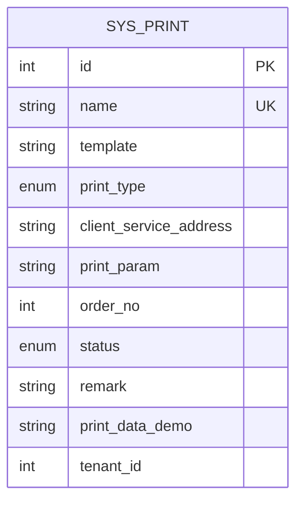
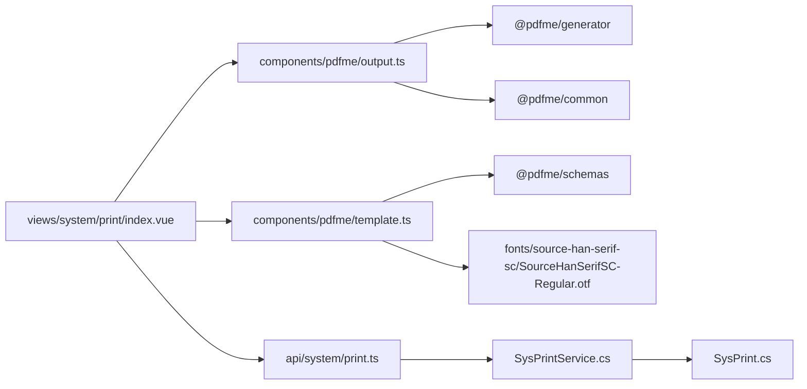

# 在线构建器

<cite>
**本文引用的文件**   
- [README.md](file://README.md)
- [adminnet-document-workbench-handoff-2026-10-20.md](file://docs/讨论/adminnet-document-workbench-handoff-2026-10-20.md)
- [pdfme-print-service.md](file://docs/frontend/pdfme-print-service.md)
- [index.html](file://Web/apps/web-antdv-next/prototypes/document-workbench/index.html)
- [classic.html](file://Web/apps/web-antdv-next/prototypes/document-workbench/classic.html)
- [SysPrint.cs](file://Admin.NET/Admin.NET.Core/Entity/SysPrint.cs)
- [SysPrintService.cs](file://Admin.NET/Admin.NET.Core/Service/Print/SysPrintService.cs)
- [print/index.vue](file://Web/apps/web-antdv-next/src/views/system/print/index.vue)
- [print.ts](file://Web/apps/web-antdv-next/src/api/system/print.ts)
- [output.ts](file://Web/apps/web-antdv-next/src/components/pdfme/output.ts)
- [template.ts](file://Web/apps/web-antdv-next/src/components/pdfme/template.ts)
</cite>

## 目录
1. [引言](#引言)
2. [项目结构](#项目结构)
3. [核心组件](#核心组件)
4. [架构总览](#架构总览)
5. [详细组件分析](#详细组件分析)
6. [依赖关系分析](#依赖关系分析)
7. [性能与可维护性](#性能与可维护性)
8. [故障排查](#故障排查)
9. [结论](#结论)
10. [附录：截图、配置与示例](#附录截图配置与示例)

## 引言
本仓库的“在线构建器”当前以两个层面实现：
- 单据设计工作台原型：通过方案 A 的经典三栏界面，演示字段库、画布、属性面板和单据配置的交互。
- PDF 模板管理与输出能力：基于 pdfme 提供打印模板编辑、预览、浏览器打印、下载和远程打印服务调用。

根据仓库说明，上游历史功能包含“拖动表单元素生成相应 Vue 代码”，而正式方向是“完全自研统一单据设计工作台”，不直接接入成品表单或报表设计器；PDF 相关能力则在现有 pdfme 前端能力基础上扩展为应用内打印服务。

**章节来源**
- [README.md:1-110](file://README.md#L1-L110)
- [adminnet-document-workbench-handoff-2026-10-20.md:1-67](file://docs/讨论/adminnet-document-workbench-handoff-2026-10-20.md#L1-L67)

## 项目结构
在线构建器涉及前后端及原型资源，主要路径如下：

**图表来源**
- [SysPrint.cs:1-75](file://Admin.NET/Admin.NET.Core/Entity/SysPrint.cs#L1-L75)
- [SysPrintService.cs:1-91](file://Admin.NET/Admin.NET.Core/Service/Print/SysPrintService.cs#L1-L91)
- [print/index.vue:1-200](file://Web/apps/web-antdv-next/src/views/system/print/index.vue#L1-L200)
- [print.ts:1-17](file://Web/apps/web-antdv-next/src/api/system/print.ts#L1-L17)
- [output.ts:1-132](file://Web/apps/web-antdv-next/src/components/pdfme/output.ts#L1-L132)
- [template.ts:1-120](file://Web/apps/web-antdv-next/src/components/pdfme/template.ts#L1-L120)
- [index.html:1-49](file://Web/apps/web-antdv-next/prototypes/document-workbench/index.html#L1-L49)
- [classic.html:1-171](file://Web/apps/web-antdv-next/prototypes/document-workbench/classic.html#L1-L171)

**章节来源**
- [README.md:1-50](file://README.md#L1-L50)
- [adminnet-document-workbench-handoff-2026-10-20.md:1-30](file://docs/讨论/adminnet-document-workbench-handoff-2026-10-20.md#L1-L30)

## 核心组件
- **单据设计工作台原型**
  - 使用 `index.html` 作为方案选择入口，展示方案 A、B、C 三种布局。
  - 方案 A 的 `classic.html` 实现经典三栏：左侧字段控件库、中间画布、右侧属性与单据配置。
- **PDF 模板管理页面**
  - 位于 `views/system/print/index.vue`，负责模板列表、新增编辑、预设模板、预览、打印和远程打印。
- **PDF 输出模块**
  - `output.ts` 提供生成、预览、浏览器打印、下载和发送打印任务的函数。
- **PDF 模板与字体模块**
  - `template.ts` 提供 pdfme 插件、默认模板、表格模板、字体加载、模板与输入数据解析。
- **后端打印模板实体与服务**
  - `SysPrint.cs` 定义打印模板存储模型。
  - `SysPrintService.cs` 提供分页查询、按名称获取、增删改接口。

**章节来源**
- [index.html:1-49](file://Web/apps/web-antdv-next/prototypes/document-workbench/index.html#L1-L49)
- [classic.html:1-171](file://Web/apps/web-antdv-next/prototypes/document-workbench/classic.html#L1-L171)
- [print/index.vue:1-200](file://Web/apps/web-antdv-next/src/views/system/print/index.vue#L1-L200)
- [output.ts:1-132](file://Web/apps/web-antdv-next/src/components/pdfme/output.ts#L1-L132)
- [template.ts:1-120](file://Web/apps/web-antdv-next/src/components/pdfme/template.ts#L1-L120)
- [SysPrint.cs:1-75](file://Admin.NET/Admin.NET.Core/Entity/SysPrint.cs#L1-L75)
- [SysPrintService.cs:1-91](file://Admin.NET/Admin.NET.Core/Service/Print/SysPrintService.cs#L1-L91)

## 架构总览
在线构建器当前采用“原型 + 打印模板管理 + pdfme 输出”的组合方式：

**图表来源**
- [print/index.vue:1-200](file://Web/apps/web-antdv-next/src/views/system/print/index.vue#L1-L200)
- [print.ts:1-17](file://Web/apps/web-antdv-next/src/api/system/print.ts#L1-L17)
- [SysPrintService.cs:1-91](file://Admin.NET/Admin.NET.Core/Service/Print/SysPrintService.cs#L1-L91)
- [SysPrint.cs:1-75](file://Admin.NET/Admin.NET.Core/Entity/SysPrint.cs#L1-L75)
- [output.ts:1-132](file://Web/apps/web-antdv-next/src/components/pdfme/output.ts#L1-L132)
- [template.ts:1-120](file://Web/apps/web-antdv-next/src/components/pdfme/template.ts#L1-L120)

## 详细组件分析

### 单据设计工作台原型
原型不是完整的前端业务页面，而是用于验证交互方案的独立 HTML。它强调：
- 方案选择：在总览页切换方案 A、B、C。
- 方案 A 三栏布局：字段库、画布、属性面板。
- 内存状态：刷新后恢复示例，不连接后端。
- 未完成项：尚未集成 Vben、持久化、发布、真实 CRUD、权限、事务、动态明细、查询数据集、精确分页、PDF 输出和实机套打。

**图表来源**
- [index.html:1-49](file://Web/apps/web-antdv-next/prototypes/document-workbench/index.html#L1-L49)
- [classic.html:1-171](file://Web/apps/web-antdv-next/prototypes/document-workbench/classic.html#L1-L171)
- [adminnet-document-workbench-handoff-2026-10-20.md:1-67](file://docs/讨论/adminnet-document-workbench-handoff-2026-10-20.md#L1-L67)

**章节来源**
- [adminnet-document-workbench-handoff-2026-10-20.md:1-67](file://docs/讨论/adminnet-document-workbench-handoff-2026-10-20.md#L1-L67)

### PDF 模板管理页面
打印模板页面承担以下职责：
- 列表查询：支持按名称、租户过滤。
- 权限控制：基于按钮权限码判断是否允许新增或更新。
- 设计器挂载：打开时初始化 pdfme Designer，关闭时销毁实例。
- 预设模板：文档、商品清单、标签等常用模板。
- 输出流程：预览、浏览器打印、下载、发送到客户端打印服务。
- 会话边界：使用 `sessionBoundary` 管理取消信号，避免页面关闭或版本变化后继续执行。

**图表来源**
- [print/index.vue:1-200](file://Web/apps/web-antdv-next/src/views/system/print/index.vue#L1-L200)
- [output.ts:1-132](file://Web/apps/web-antdv-next/src/components/pdfme/output.ts#L1-L132)
- [template.ts:1-120](file://Web/apps/web-antdv-next/src/components/pdfme/template.ts#L1-L120)

**章节来源**
- [print/index.vue:1-200](file://Web/apps/web-antdv-next/src/views/system/print/index.vue#L1-L200)

### PDF 输出模块
`output.ts` 封装了 pdfme 的核心输出能力：
- `parsePrintParameters`：解析打印份数与标题，限制份数为 1～100，标题不超过 200 字。
- `generatePdf`：基于模板、输入数据和 pdfme 选项生成 PDF。
- `previewPdf`：在新窗口打开 PDF Blob URL。
- `printPdf`：通过隐藏 iframe 加载 PDF 并调用浏览器打印。
- `downloadPdf`：生成文件名并触发下载。
- `sendToPrintService`：将 PDF 发送到受信任的 HTTP/HTTPS 地址，要求跨域允许、回执为 JSON 且 `accepted` 严格等于 `true`。

**图表来源**
- [output.ts:1-132](file://Web/apps/web-antdv-next/src/components/pdfme/output.ts#L1-L132)
- [template.ts:1-120](file://Web/apps/web-antdv-next/src/components/pdfme/template.ts#L1-L120)

**章节来源**
- [output.ts:1-132](file://Web/apps/web-antdv-next/src/components/pdfme/output.ts#L1-L132)
- [pdfme-print-service.md:1-32](file://docs/frontend/pdfme-print-service.md#L1-L32)

### PDF 模板与字体模块
`template.ts` 负责：
- 注册 pdfme 插件：文本与表格。
- 创建默认文档模板。
- 创建表格模板：从二维矩阵生成表头与列宽。
- 加载中文字体：Noto Serif CJK SC 2.003，键名兼容 `SourceHanSerifSC`。
- 校验模板与输入数据：损坏模板或非法输入会抛出错误。

**图表来源**
- [template.ts:1-120](file://Web/apps/web-antdv-next/src/components/pdfme/template.ts#L1-L120)

**章节来源**
- [template.ts:1-120](file://Web/apps/web-antdv-next/src/components/pdfme/template.ts#L1-L120)
- [pdfme-print-service.md:1-32](file://docs/frontend/pdfme-print-service.md#L1-L32)

### 后端打印模板实体与服务
后端提供打印模板的基础数据管理能力：
- `SysPrint` 实体包含名称、模板 JSON、打印类型、客户端服务地址、打印参数、排序、状态和备注，以及预览测试数据。
- `SysPrintService` 提供分页查询、按名称获取、新增、更新、删除。
- 新增和更新时会检查同名模板是否存在，避免重复。

**图表来源**
- [SysPrint.cs:1-75](file://Admin.NET/Admin.NET.Core/Entity/SysPrint.cs#L1-L75)

**章节来源**
- [SysPrint.cs:1-75](file://Admin.NET/Admin.NET.Core/Entity/SysPrint.cs#L1-L75)
- [SysPrintService.cs:1-91](file://Admin.NET/Admin.NET.Core/Service/Print/SysPrintService.cs#L1-L91)

### 前端打印模板 API
前端通过 `api/system/print.ts` 封装打印模板接口：
- `listPrintTemplates`：分页查询模板。
- `savePrintTemplate`：根据是否有 ID 决定新增或更新。
- `removePrintTemplate`：按 ID 删除。
- `getPrintTemplate`：按名称获取模板。

**章节来源**
- [print.ts:1-17](file://Web/apps/web-antdv-next/src/api/system/print.ts#L1-L17)
- [SysPrintService.cs:1-91](file://Admin.NET/Admin.NET.Core/Service/Print/SysPrintService.cs#L1-L91)

## 依赖关系分析
在线构建器的关键依赖包括：
- 前端业务页面依赖 pdfme 设计器、输出模块和模板模块。
- 输出模块依赖 pdfme generator、common 校验和 schemas。
- 模板模块依赖 pdfme common、schemas 和字体资源。
- 后端实体依赖 SqlSugar 映射与租户基类。
- 原型 HTML 仅用于交互验证，不依赖业务后端。

**图表来源**
- [print/index.vue:1-200](file://Web/apps/web-antdv-next/src/views/system/print/index.vue#L1-L200)
- [print.ts:1-17](file://Web/apps/web-antdv-next/src/api/system/print.ts#L1-L17)
- [output.ts:1-132](file://Web/apps/web-antdv-next/src/components/pdfme/output.ts#L1-L132)
- [template.ts:1-120](file://Web/apps/web-antdv-next/src/components/pdfme/template.ts#L1-L120)
- [SysPrintService.cs:1-91](file://Admin.NET/Admin.NET.Core/Service/Print/SysPrintService.cs#L1-L91)
- [SysPrint.cs:1-75](file://Admin.NET/Admin.NET.Core/Entity/SysPrint.cs#L1-L75)

**章节来源**
- [print/index.vue:1-200](file://Web/apps/web-antdv-next/src/views/system/print/index.vue#L1-L200)
- [output.ts:1-132](file://Web/apps/web-antdv-next/src/components/pdfme/output.ts#L1-L132)
- [template.ts:1-120](file://Web/apps/web-antdv-next/src/components/pdfme/template.ts#L1-L120)

## 性能与可维护性
- **字体缓存**：字体加载使用单次 promise 缓存，失败后清空缓存以便重试，避免重复网络请求。
- **设计器生命周期**：打开设计器时异步初始化，关闭时销毁实例，防止内存泄漏。
- **输出超时**：预览、iframe 打印和远程打印均设置超时或清理逻辑，避免长时间占用资源。
- **模板校验**：模板和输入数据在保存和执行前进行 JSON 与结构校验，降低渲染失败概率。
- **原型隔离**：工作区原型仅用于交互验证，不应视为生产实现；正式实现应拆分字段定义与布局节点，并增加持久化、权限、事务和业务状态机。

[本节为通用建议，不直接分析具体代码片段]

## 故障排查
常见问题与处理建议：
- **打印字体加载失败**：检查字体资源路径和网络可达性，确认字体签名有效。
- **模板损坏或格式不兼容**：修复模板 JSON 或重建常用模板。
- **预览窗口被拦截**：允许浏览器弹出新窗口。
- **远程打印服务不可用**：检查地址协议、跨域配置、请求头、响应内容和 `accepted` 字段。
- **打印份数或标题无效**：确保份数为 1～100 的整数，标题不超过 200 字。
- **会话失效导致任务取消**：页面关闭或版本变化会中止未完成操作，需重新发起。

**章节来源**
- [output.ts:1-132](file://Web/apps/web-antdv-next/src/components/pdfme/output.ts#L1-L132)
- [template.ts:1-120](file://Web/apps/web-antdv-next/src/components/pdfme/template.ts#L1-L120)
- [pdfme-print-service.md:1-32](file://docs/frontend/pdfme-print-service.md#L1-L32)

## 结论
当前 Admin.NET 在线构建器以“单据设计工作台原型”和“PDF 模板管理与输出”为主要实现形态。原型明确了自研统一单据设计工作台的方向，但尚未完成前端集成、持久化、发布、权限、事务、动态明细、查询与 PDF 输出验收；PDF 能力则已通过 pdfme 在前端落地模板编辑、预览、打印和远程打印服务调用。后续开发应以方案 A 为准，优先打通字段与独立布局协议、工作台、定义发布、录入保存、同单据套打、业务操作与导入导出，再逐步完善多页、查询报表和统计能力。

[本节为总结性内容，不直接分析具体代码片段]

## 附录：截图、配置与示例
- **设计器界面截图**
  - 方案选择总览：`Web/apps/web-antdv-next/prototypes/document-workbench/index.html`
  - 经典三栏原型：`Web/apps/web-antdv-next/prototypes/document-workbench/classic.html`
- **表单配置文件**
  - 打印模板实体：`Admin.NET/Admin.NET.Core/Entity/SysPrint.cs`
  - 打印模板服务：`Admin.NET/Admin.NET.Core/Service/Print/SysPrintService.cs`
  - 前端打印模板 API：`Web/apps/web-antdv-next/src/api/system/print.ts`
  - 打印模板页面：`Web/apps/web-antdv-next/src/views/system/print/index.vue`
- **PDF 生成示例**
  - PDF 输出模块：`Web/apps/web-antdv-next/src/components/pdfme/output.ts`
  - PDF 模板与字体模块：`Web/apps/web-antdv-next/src/components/pdfme/template.ts`
  - PDF 打印服务契约：`docs/frontend/pdfme-print-service.md`

**章节来源**
- [index.html:1-49](file://Web/apps/web-antdv-next/prototypes/document-workbench/index.html#L1-L49)
- [classic.html:1-171](file://Web/apps/web-antdv-next/prototypes/document-workbench/classic.html#L1-L171)
- [SysPrint.cs:1-75](file://Admin.NET/Admin.NET.Core/Entity/SysPrint.cs#L1-L75)
- [SysPrintService.cs:1-91](file://Admin.NET/Admin.NET.Core/Service/Print/SysPrintService.cs#L1-L91)
- [print.ts:1-17](file://Web/apps/web-antdv-next/src/api/system/print.ts#L1-L17)
- [print/index.vue:1-200](file://Web/apps/web-antdv-next/src/views/system/print/index.vue#L1-L200)
- [output.ts:1-132](file://Web/apps/web-antdv-next/src/components/pdfme/output.ts#L1-L132)
- [template.ts:1-120](file://Web/apps/web-antdv-next/src/components/pdfme/template.ts#L1-L120)
- [pdfme-print-service.md:1-32](file://docs/frontend/pdfme-print-service.md#L1-L32)