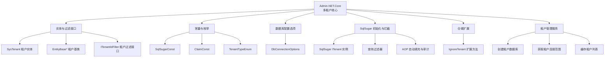
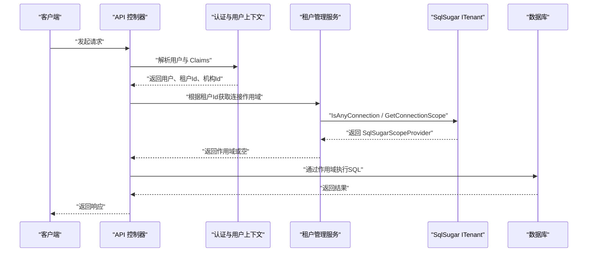
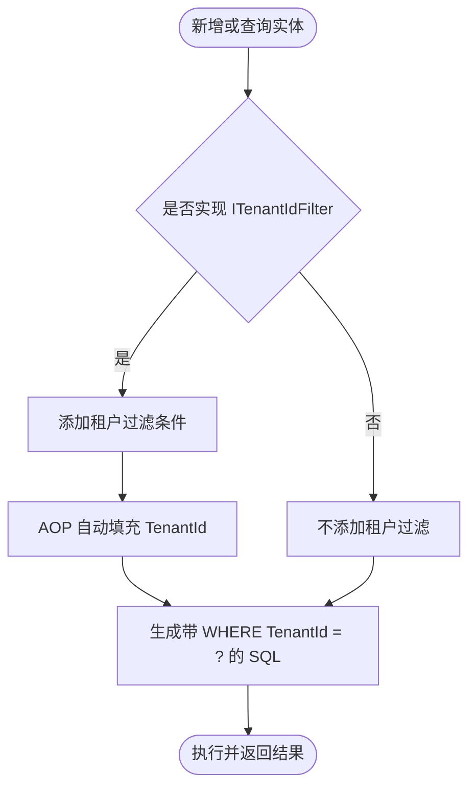
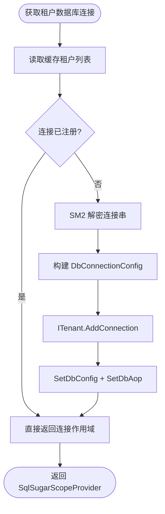
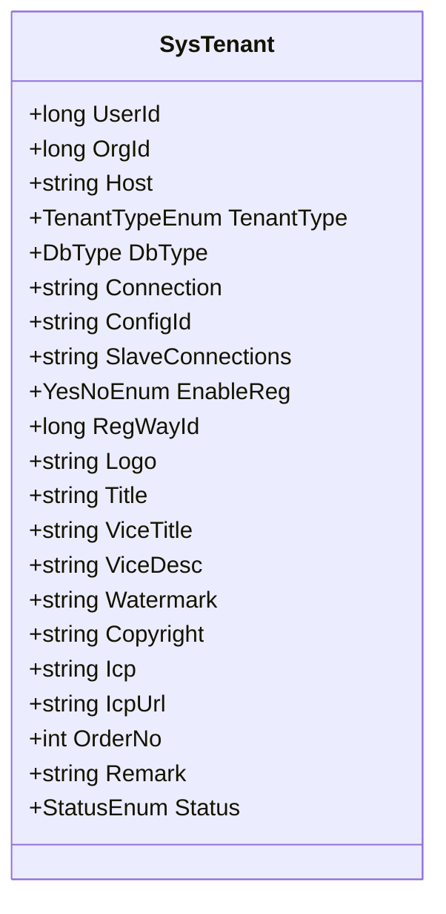
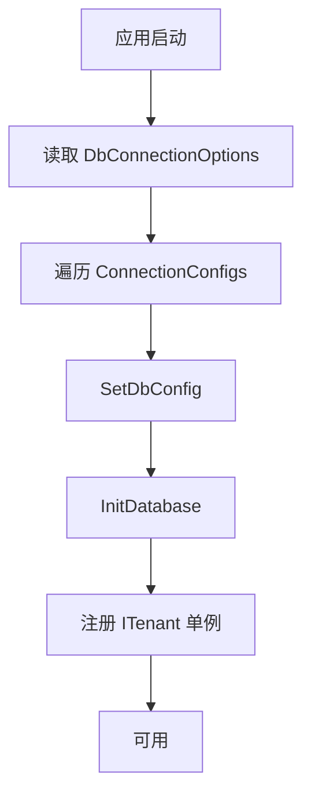
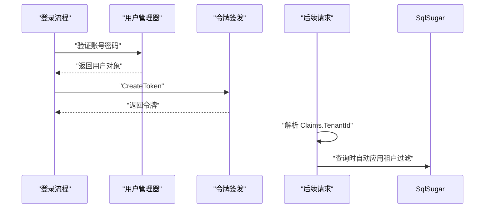
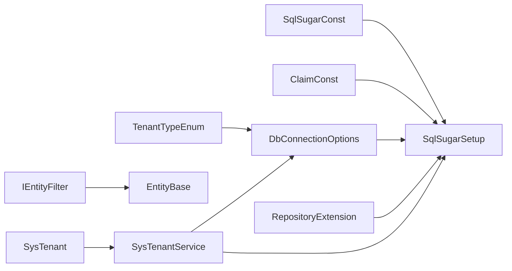

# 多租户架构

<cite>
**本文引用的文件**   
- [SqlSugarSetup.cs](file://Admin.NET/Admin.NET.Core/SqlSugar/SqlSugarSetup.cs)
- [SysTenantService.cs](file://Admin.NET/Admin.NET.Core/Service/Tenant/SysTenantService.cs)
- [SysTenant.cs](file://Admin.NET/Admin.NET.Core/Entity/SysTenant.cs)
- [EntityBase.cs](file://Admin.NET/Admin.NET.Core/Entity/EntityBase.cs)
- [IEntityFilter.cs](file://Admin.NET/Admin.NET.Core/Entity/IEntityFilter.cs)
- [RepositoryExtension.cs](file://Admin.NET/Admin.NET.Core/Extension/RepositoryExtension.cs)
- [TenantTypeEnum.cs](file://Admin.NET/Admin.NET.Core/Enum/TenantTypeEnum.cs)
- [DbConnectionOptions.cs](file://Admin.NET/Admin.NET.Core/Option/DbConnectionOptions.cs)
- [SqlSugarConst.cs](file://Admin.NET/Admin.NET.Core/Const/SqlSugarConst.cs)
- [ClaimConst.cs](file://Admin.NET/Admin.NET.Core/Const/ClaimConst.cs)
</cite>

## 目录
1. [简介](#简介)
2. [项目结构中的多租户位置](#项目结构中的多租户位置)
3. [核心组件](#核心组件)
4. [架构总览](#架构总览)
5. [详细组件分析](#详细组件分析)
6. [依赖关系分析](#依赖关系分析)
7. [性能与可扩展性](#性能与可扩展性)
8. [故障排查指南](#故障排查指南)
9. [结论](#结论)

## 简介
本文件面向 Admin.NET 的多租户能力，围绕以下目标展开：
- 说明三种数据隔离策略：共享表按租户字段隔离、独立数据库隔离；当前仓库未实现 Schema 隔离。
- 解释租户配置管理机制：租户信息模型、动态连接注册、加密缓存和运行时切换。
- 深入讲解 SqlSugar 集成：多租户实例、查询拦截器、自动填充、过滤器与连接范围。
- 梳理租户上下文与线程安全：基于 Claims 的租户标识、AOP 注入、仓储扩展。
- 给出业务扩展点：租户专属菜单、租户配置、跨租户访问控制、日志与差异审计。
- 提供部署建议与性能优化方向。

## 项目结构中的多租户位置
多租户相关代码主要集中在 `Admin.NET.Admin.NET.Core` 中：
- 实体与过滤接口：`EntityBase.cs`、`IEntityFilter.cs`、`SysTenant.cs`。
- 枚举与常量：`TenantTypeEnum.cs`、`SqlSugarConst.cs`、`ClaimConst.cs`。
- 配置选项：`DbConnectionOptions.cs`。
- 数据层基础设施：`SqlSugarSetup.cs`、`RepositoryExtension.cs`。
- 业务服务：`Service/Tenant/SysTenantService.cs`。

**图表来源**
- [SysTenant.cs:1-145](file://Admin.NET/Admin.NET.Core/Entity/SysTenant.cs#L1-L145)
- [EntityBase.cs:140-203](file://Admin.NET/Admin.NET.Core/Entity/EntityBase.cs#L140-L203)
- [IEntityFilter.cs:1-40](file://Admin.NET/Admin.NET.Core/Entity/IEntityFilter.cs#L1-L40)
- [TenantTypeEnum.cs:1-26](file://Admin.NET/Admin.NET.Core/Enum/TenantTypeEnum.cs#L1-L26)
- [SqlSugarConst.cs:1-33](file://Admin.NET/Admin.NET.Core/Const/SqlSugarConst.cs#L1-L33)
- [ClaimConst.cs:1-73](file://Admin.NET/Admin.NET.Core/Const/ClaimConst.cs#L1-L73)
- [DbConnectionOptions.cs:1-136](file://Admin.NET/Admin.NET.Core/Option/DbConnectionOptions.cs#L1-L136)
- [SqlSugarSetup.cs:1-200](file://Admin.NET/Admin.NET.Core/SqlSugar/SqlSugarSetup.cs#L1-L200)
- [RepositoryExtension.cs:340-365](file://Admin.NET/Admin.NET.Core/Extension/RepositoryExtension.cs#L340-L365)
- [SysTenantService.cs:500-809](file://Admin.NET/Admin.NET.Core/Service/Tenant/SysTenantService.cs#L500-L809)

**章节来源**
- [SysTenant.cs:1-145](file://Admin.NET/Admin.NET.Core/Entity/SysTenant.cs#L1-L145)
- [EntityBase.cs:140-203](file://Admin.NET/Admin.NET.Core/Entity/EntityBase.cs#L140-L203)
- [IEntityFilter.cs:1-40](file://Admin.NET/Admin.NET.Core/Entity/IEntityFilter.cs#L1-L40)
- [TenantTypeEnum.cs:1-26](file://Admin.NET/Admin.NET.Core/Enum/TenantTypeEnum.cs#L1-L26)
- [SqlSugarConst.cs:1-33](file://Admin.NET/Admin.NET.Core/Const/SqlSugarConst.cs#L1-L33)
- [ClaimConst.cs:1-73](file://Admin.NET/Admin.NET.Core/Const/ClaimConst.cs#L1-L73)
- [DbConnectionOptions.cs:1-136](file://Admin.NET/Admin.NET.Core/Option/DbConnectionOptions.cs#L1-L136)
- [SqlSugarSetup.cs:1-200](file://Admin.NET/Admin.NET.Core/SqlSugar/SqlSugarSetup.cs#L1-L200)
- [RepositoryExtension.cs:340-365](file://Admin.NET/Admin.NET.Core/Extension/RepositoryExtension.cs#L340-L365)
- [SysTenantService.cs:500-809](file://Admin.NET/Admin.NET.Core/Service/Tenant/SysTenantService.cs#L500-L809)

## 核心组件
- 租户类型枚举：支持“按 ID 隔离”和“按数据库隔离”。
- 租户实体：保存域名、类型、数据库类型、连接串、从库配置、状态等。
- 租户过滤接口：为所有需要租户隔离的实体提供 `TenantId` 字段。
- SqlSugar 多租户实例：全局单例 `ITenant`，管理多个连接与作用域。
- 租户管理服务：负责租户生命周期、菜单授权、连接缓存、数据库创建与连接作用域获取。
- 仓储扩展：提供忽略租户过滤的方法，用于系统级或跨租户查询。
- 配置选项：集中定义数据库连接集合、初始化开关、下划线转换、连接串加密等。

**章节来源**
- [TenantTypeEnum.cs:1-26](file://Admin.NET/Admin.NET.Core/Enum/TenantTypeEnum.cs#L1-L26)
- [SysTenant.cs:1-145](file://Admin.NET/Admin.NET.Core/Entity/SysTenant.cs#L1-L145)
- [IEntityFilter.cs:1-40](file://Admin.NET/Admin.NET.Core/Entity/IEntityFilter.cs#L1-L40)
- [SqlSugarSetup.cs:1-200](file://Admin.NET/Admin.NET.Core/SqlSugar/SqlSugarSetup.cs#L1-L200)
- [SysTenantService.cs:500-809](file://Admin.NET/Admin.NET.Core/Service/Tenant/SysTenantService.cs#L500-L809)
- [RepositoryExtension.cs:340-365](file://Admin.NET/Admin.NET.Core/Extension/RepositoryExtension.cs#L340-L365)
- [DbConnectionOptions.cs:1-136](file://Admin.NET/Admin.NET.Core/Option/DbConnectionOptions.cs#L1-L136)

## 架构总览
Admin.NET 的多租户架构以 SqlSugar 的 `ITenant` 为核心，结合 AOP、查询过滤器、Claims 上下文和租户管理服务，形成“请求进入 → 解析租户 → 选择连接 → 应用过滤 → 执行 SQL”的完整链路。

**图表来源**
- [SysTenantService.cs:748-809](file://Admin.NET/Admin.NET.Core/Service/Tenant/SysTenantService.cs#L748-L809)
- [SqlSugarSetup.cs:1-200](file://Admin.NET/Admin.NET.Core/SqlSugar/SqlSugarSetup.cs#L1-L200)

## 详细组件分析

### 数据隔离策略

#### 共享表按租户字段隔离（ID 隔离）
- 实体继承租户基类并实现 `ITenantIdFilter`，统一包含 `TenantId`。
- SqlSugar 在 AOP 中根据当前用户 Claims 的 `TenantId` 添加全局查询过滤器。
- 默认主租户由常量定义，所有业务数据都带有该租户标识。

**图表来源**
- [EntityBase.cs:140-203](file://Admin.NET/Admin.NET.Core/Entity/EntityBase.cs#L140-L203)
- [IEntityFilter.cs:1-40](file://Admin.NET/Admin.NET.Core/Entity/IEntityFilter.cs#L1-L40)
- [SqlSugarSetup.cs:201-370](file://Admin.NET/Admin.NET.Core/SqlSugar/SqlSugarSetup.cs#L201-L370)

**章节来源**
- [EntityBase.cs:140-203](file://Admin.NET/Admin.NET.Core/Entity/EntityBase.cs#L140-L203)
- [IEntityFilter.cs:1-40](file://Admin.NET/Admin.NET.Core/Entity/IEntityFilter.cs#L1-L40)
- [SqlSugarSetup.cs:201-370](file://Admin.NET/Admin.NET.Core/SqlSugar/SqlSugarSetup.cs#L201-L370)
- [SqlSugarConst.cs:1-33](file://Admin.NET/Admin.NET.Core/Const/SqlSugarConst.cs#L1-L33)

#### 独立数据库隔离（库隔离）
- 租户类型为 `Db` 时，使用独立的 `ConnectionString` 和可选从库配置。
- 租户管理服务会解密连接串，向 `ITenant` 动态注册连接，并按租户 `ConfigId` 获取作用域。
- 支持通过 API 创建租户数据库，初始化业务表结构，排除系统表和日志表。

**图表来源**
- [SysTenantService.cs:767-809](file://Admin.NET/Admin.NET.Core/Service/Tenant/SysTenantService.cs#L767-L809)
- [DbConnectionOptions.cs:1-136](file://Admin.NET/Admin.NET.Core/Option/DbConnectionOptions.cs#L1-L136)

**章节来源**
- [SysTenantService.cs:748-809](file://Admin.NET/Admin.NET.Core/Service/Tenant/SysTenantService.cs#L748-L809)
- [DbConnectionOptions.cs:1-136](file://Admin.NET/Admin.NET.Core/Option/DbConnectionOptions.cs#L1-L136)

#### Schema 隔离
当前仓库未实现 Schema 隔离方案。现有机制集中在：
- 表名前缀处理与驼峰转下划线。
- 按 `ConfigId` 区分不同数据库连接。
- 通过 `[Tenant]` 特性将某些表限定到特定库。

若未来需要 Schema 隔离，应在数据库驱动层或 CodeFirst 映射阶段增加 schema 配置；当前版本不建议据此推断已有实现。

[本节为概念说明，不直接分析具体代码片段]

### 租户配置管理机制

#### 租户信息存储
`SysTenant` 保存租户的核心元数据：
- 管理员用户、组织、域名、租户类型、数据库类型。
- 连接串、从库连接、注册开关、默认注册方案。
- 站点品牌信息、排序、状态、备注。

**图表来源**
- [SysTenant.cs:1-145](file://Admin.NET/Admin.NET.Core/Entity/SysTenant.cs#L1-L145)

**章节来源**
- [SysTenant.cs:1-145](file://Admin.NET/Admin.NET.Core/Entity/SysTenant.cs#L1-L145)

#### 动态配置加载
- 启动阶段扫描 `DbConnectionOptions.ConnectionConfigs`，为每个配置设置外部服务、AOP、差异日志和初始化流程。
- 租户库连接在运行时通过 `GetTenantDbConnectionScope` 动态注册。
- 租户列表被加密后缓存，避免每次请求解密连接串。

**图表来源**
- [SqlSugarSetup.cs:1-200](file://Admin.NET/Admin.NET.Core/SqlSugar/SqlSugarSetup.cs#L1-L200)
- [DbConnectionOptions.cs:1-136](file://Admin.NET/Admin.NET.Core/Option/DbConnectionOptions.cs#L1-L136)

**章节来源**
- [SqlSugarSetup.cs:1-200](file://Admin.NET/Admin.NET.Core/SqlSugar/SqlSugarSetup.cs#L1-L200)
- [DbConnectionOptions.cs:1-136](file://Admin.NET/Admin.NET.Core/Option/DbConnectionOptions.cs#L1-L136)

#### 运行时切换
- 登录成功后，用户 Claims 中包含 `TenantId`。
- 查询时 SqlSugar 自动附加 `WHERE TenantId = ?`。
- 超级管理员可切换当前用户的 `TenantId`，重新签发令牌。
- 匿名入口可通过域名匹配启用租户，否则回退到默认租户。

**图表来源**
- [ClaimConst.cs:1-73](file://Admin.NET/Admin.NET.Core/Const/ClaimConst.cs#L1-L73)
- [SqlSugarSetup.cs:201-370](file://Admin.NET/Admin.NET.Core/SqlSugar/SqlSugarSetup.cs#L201-L370)
- [SysTenantService.cs:500-748](file://Admin.NET/Admin.NET.Core/Service/Tenant/SysTenantService.cs#L500-L748)

**章节来源**
- [ClaimConst.cs:1-73](file://Admin.NET/Admin.NET.Core/Const/ClaimConst.cs#L1-L73)
- [SqlSugarSetup.cs:201-370](file://Admin.NET/Admin.NET.Core/SqlSugar/SqlSugarSetup.cs#L201-L370)
- [SysTenantService.cs:500-748](file://Admin.NET/Admin.NET.Core/Service/Tenant/SysTenantService.cs#L500-L748)

### SqlSugar 多租户插件配置、查询拦截器和数据过滤

#### 多租户实例
- `SqlSugarSetup.ITenant` 是全局静态属性，保存 `ITenant` 实例。
- `AddSqlSugar` 注册雪花 Id、动态表达式、连接配置、AOP、仓储和工作单元。
- `LogDb` 根据是否存在日志库连接，选择日志库或主库。

**章节来源**
- [SqlSugarSetup.cs:1-200](file://Admin.NET/Admin.NET.Core/SqlSugar/SqlSugarSetup.cs#L1-L200)

#### 查询拦截器
- 非种子数据写入时，AOP 自动填充主键、创建时间、操作人、机构等信息。
- 超级管理员可选择忽略软删除过滤。
- 非超级管理员时，根据 Claims 的 `TenantId` 添加租户过滤。
- 同时应用机构数据范围过滤和自定义实体过滤。

**章节来源**
- [SqlSugarSetup.cs:201-370](file://Admin.NET/Admin.NET.Core/SqlSugar/SqlSugarSetup.cs#L201-L370)

#### 数据过滤
- `ITenantIdFilter` 作为租户过滤契约。
- `EntityBase*` 系列基类统一暴露 `TenantId`。
- 仓储扩展提供 `IgnoreTenant`，允许显式忽略租户过滤。

**章节来源**
- [IEntityFilter.cs:1-40](file://Admin.NET/Admin.NET.Core/Entity/IEntityFilter.cs#L1-L40)
- [EntityBase.cs:140-203](file://Admin.NET/Admin.NET.Core/Entity/EntityBase.cs#L140-L203)
- [RepositoryExtension.cs:340-365](file://Admin.NET/Admin.NET.Core/Extension/RepositoryExtension.cs#L340-L365)

### 租户上下文管理与线程安全

#### 上下文来源
- 租户标识来自 Claims，键为 `ClaimConst.TenantId`。
- 用户标识、真实姓名、机构标识等同理。
- 非 Web 线程中 `App.User` 为空，AOP 会跳过部分自动填充逻辑。

#### 线程安全
- 租户连接注册使用 `lock(iTenant)` 保护，防止并发重复注册。
- 缓存租户列表在内存中，更新时先移除指定连接再重建缓存。
- 多租户连接通过 `ConfigId` 区分，避免混用。

**章节来源**
- [ClaimConst.cs:1-73](file://Admin.NET/Admin.NET.Core/Const/ClaimConst.cs#L1-L73)
- [SqlSugarSetup.cs:201-370](file://Admin.NET/Admin.NET.Core/SqlSugar/SqlSugarSetup.cs#L201-L370)
- [SysTenantService.cs:767-809](file://Admin.NET/Admin.NET.Core/Service/Tenant/SysTenantService.cs#L767-L809)

### 租户相关的业务扩展点

#### 租户专属菜单
- 每个租户维护 `SysTenantMenu`，绑定菜单权限。
- 默认租户菜单保持固定主键，避免重复。
- 菜单授权会校验父级、路由唯一性和按钮权限唯一性。

**章节来源**
- [SysTenantService.cs:500-748](file://Admin.NET/Admin.NET.Core/Service/Tenant/SysTenantService.cs#L500-L748)

#### 租户标识传递
- 登录后用户 Claims 携带 `TenantId`。
- 服务层通过 `_userManager.TenantId` 或 Claims 获取当前租户。
- 匿名入口通过域名匹配启用租户，否则回退默认租户。

**章节来源**
- [ClaimConst.cs:1-73](file://Admin.NET/Admin.NET.Core/Const/ClaimConst.cs#L1-L73)
- [SysTenantService.cs:100-200](file://Admin.NET/Admin.NET.Core/Service/Tenant/SysTenantService.cs#L100-L200)

#### 跨租户数据访问控制
- 系统级查询可使用 `ClearFilter()` 或 `IgnoreTenant()`。
- 插件、模板、开放访问等模块在必要时绕过租户过滤。
- 删除租户时会清理关联的用户、角色、菜单、组织和职位数据。

**章节来源**
- [RepositoryExtension.cs:340-365](file://Admin.NET/Admin.NET.Core/Extension/RepositoryExtension.cs#L340-L365)
- [SysTenantService.cs:500-748](file://Admin.NET/Admin.NET.Core/Service/Tenant/SysTenantService.cs#L500-L748)

## 依赖关系分析

**图表来源**
- [TenantTypeEnum.cs:1-26](file://Admin.NET/Admin.NET.Core/Enum/TenantTypeEnum.cs#L1-L26)
- [SqlSugarConst.cs:1-33](file://Admin.NET/Admin.NET.Core/Const/SqlSugarConst.cs#L1-L33)
- [ClaimConst.cs:1-73](file://Admin.NET/Admin.NET.Core/Const/ClaimConst.cs#L1-L73)
- [IEntityFilter.cs:1-40](file://Admin.NET/Admin.NET.Core/Entity/IEntityFilter.cs#L1-L40)
- [EntityBase.cs:140-203](file://Admin.NET/Admin.NET.Core/Entity/EntityBase.cs#L140-L203)
- [SysTenant.cs:1-145](file://Admin.NET/Admin.NET.Core/Entity/SysTenant.cs#L1-L145)
- [DbConnectionOptions.cs:1-136](file://Admin.NET/Admin.NET.Core/Option/DbConnectionOptions.cs#L1-L136)
- [RepositoryExtension.cs:340-365](file://Admin.NET/Admin.NET.Core/Extension/RepositoryExtension.cs#L340-L365)
- [SysTenantService.cs:500-809](file://Admin.NET/Admin.NET.Core/Service/Tenant/SysTenantService.cs#L500-L809)
- [SqlSugarSetup.cs:1-200](file://Admin.NET/Admin.NET.Core/SqlSugar/SqlSugarSetup.cs#L1-L200)

**章节来源**
- [TenantTypeEnum.cs:1-26](file://Admin.NET/Admin.NET.Core/Enum/TenantTypeEnum.cs#L1-L26)
- [SqlSugarConst.cs:1-33](file://Admin.NET/Admin.NET.Core/Const/SqlSugarConst.cs#L1-L33)
- [ClaimConst.cs:1-73](file://Admin.NET/Admin.NET.Core/Const/ClaimConst.cs#L1-L73)
- [IEntityFilter.cs:1-40](file://Admin.NET/Admin.NET.Core/Entity/IEntityFilter.cs#L1-L40)
- [EntityBase.cs:140-203](file://Admin.NET/Admin.NET.Core/Entity/EntityBase.cs#L140-L203)
- [SysTenant.cs:1-145](file://Admin.NET/Admin.NET.Core/Entity/SysTenant.cs#L1-L145)
- [DbConnectionOptions.cs:1-136](file://Admin.NET/Admin.NET.Core/Option/DbConnectionOptions.cs#L1-L136)
- [RepositoryExtension.cs:340-365](file://Admin.NET/Admin.NET.Core/Extension/RepositoryExtension.cs#L340-L365)
- [SysTenantService.cs:500-809](file://Admin.NET/Admin.NET.Core/Service/Tenant/SysTenantService.cs#L500-L809)
- [SqlSugarSetup.cs:1-200](file://Admin.NET/Admin.NET.Core/SqlSugar/SqlSugarSetup.cs#L1-L200)

## 性能与可扩展性

### 性能特点
- 默认租户采用共享表隔离，减少数据库连接数量，适合中小规模多租户。
- 大租户或高隔离需求租户可使用独立数据库，降低锁竞争和数据膨胀。
- AOP 自动填充减少业务代码负担，但需注意非 Web 线程缺少用户上下文时的行为。
- 租户连接动态注册，避免启动时加载全部租户库连接。

### 优化建议
- 合理划分租户类型：共享表用于低隔离、低成本场景；独立库用于高隔离、高负载场景。
- 对高频查询增加合适索引，尤其 `TenantId`、`OrgId` 等过滤字段。
- 谨慎使用 `ClearFilter` 或 `IgnoreTenant`，避免无意跨租户访问。
- 控制租户库数量，避免过多连接导致连接池压力。
- 开启控制台 SQL 输出仅用于调试，生产环境应关闭。
- 对差异日志和慢查询日志进行采样或限流，避免日志表膨胀。

[本节为通用指导，不直接分析具体代码片段]

## 故障排查指南

### 常见问题
- 查询不到数据：检查是否启用了租户过滤，确认 Claims 中 `TenantId` 是否正确。
- 跨租户误访问：检查是否误用 `ClearFilter` 或 `IgnoreTenant`。
- 租户库连接失败：检查缓存中租户连接是否解密成功，确认 `ConfigId` 是否一致。
- 无法创建租户库：确认租户类型为 `Db`，且连接串有效；Oracle 不支持通过该接口创建库。
- 默认租户不可修改：默认租户和主库配置受保护，禁止变更类型、状态和主库配置。

### 定位路径
- 租户过滤与自动填充：查看 SqlSugar AOP 设置。
- 租户连接注册与解密：查看租户服务获取连接作用域逻辑。
- 租户缓存更新：查看缓存租户方法。
- 常量与 Claims：确认默认租户 Id、主库配置 Id、Claims 键名。

**章节来源**
- [SqlSugarSetup.cs:201-370](file://Admin.NET/Admin.NET.Core/SqlSugar/SqlSugarSetup.cs#L201-L370)
- [SysTenantService.cs:748-809](file://Admin.NET/Admin.NET.Core/Service/Tenant/SysTenantService.cs#L748-L809)
- [SqlSugarConst.cs:1-33](file://Admin.NET/Admin.NET.Core/Const/SqlSugarConst.cs#L1-L33)
- [ClaimConst.cs:1-73](file://Admin.NET/Admin.NET.Core/Const/ClaimConst.cs#L1-L73)

## 结论
Admin.NET 的多租户架构以 SqlSugar 为基础，通过实体基类、过滤接口和 AOP 实现共享表租户隔离，并通过动态连接注册实现独立数据库隔离。租户信息由 `SysTenant` 管理，运行时常量与 Claims 提供租户上下文，租户服务负责连接缓存、菜单授权和数据库初始化。当前仓库未实现 Schema 隔离，实际部署应根据业务隔离需求和负载特征选择共享表或独立库模式，并结合索引、连接池、日志和缓存策略进行性能优化。

[本节为总结性内容，不直接分析具体代码片段]