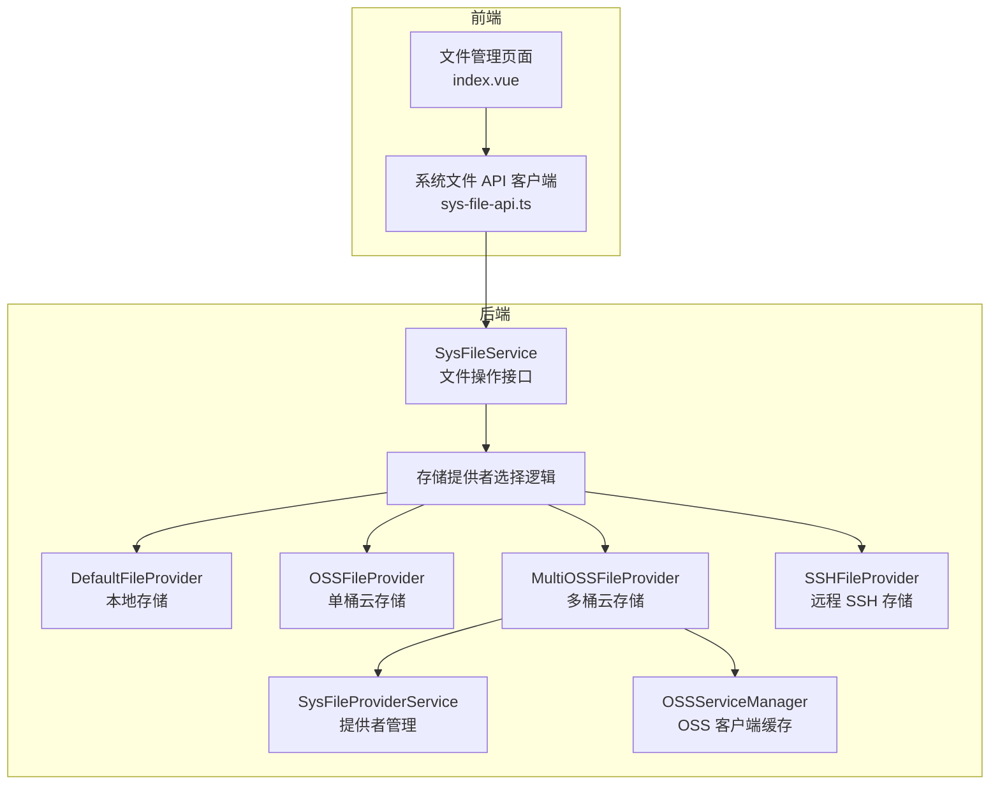
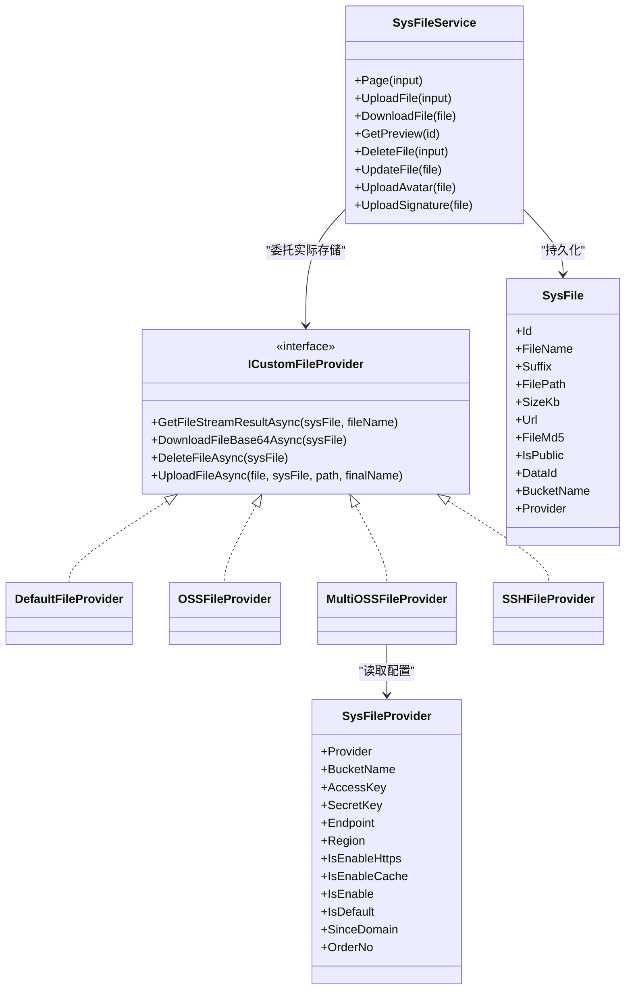
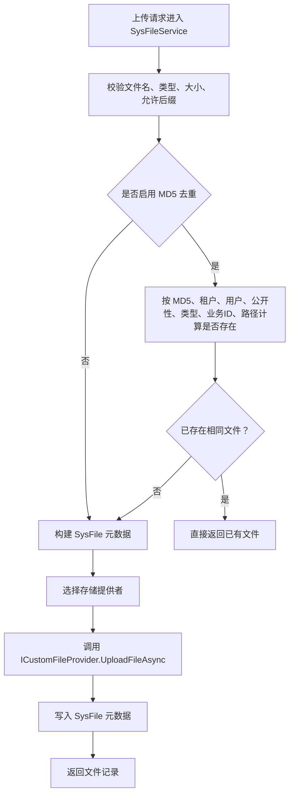
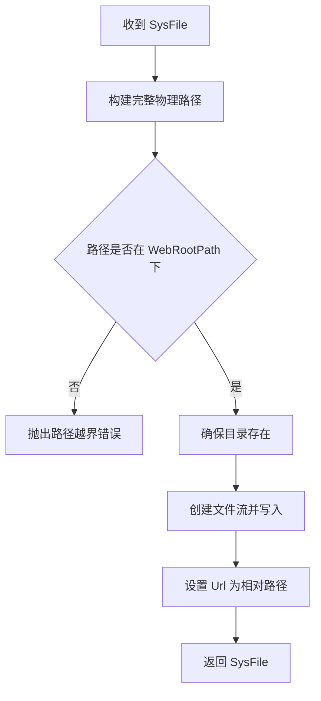
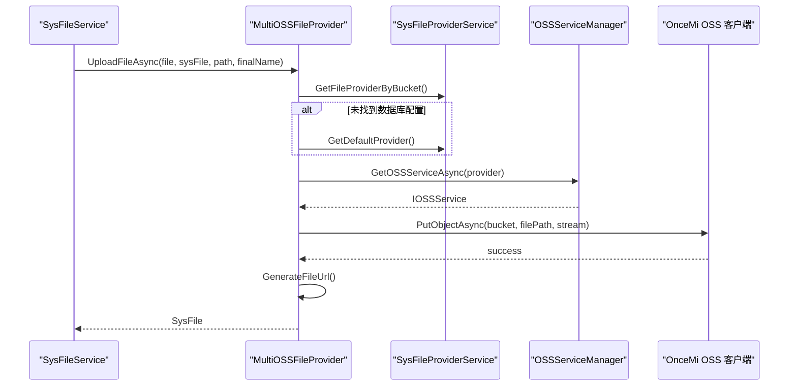
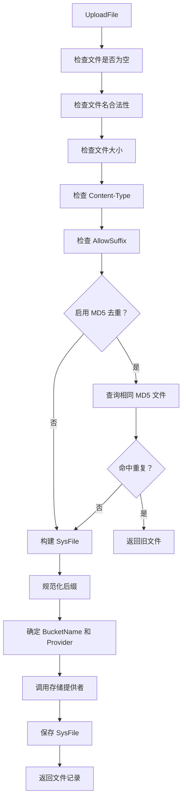
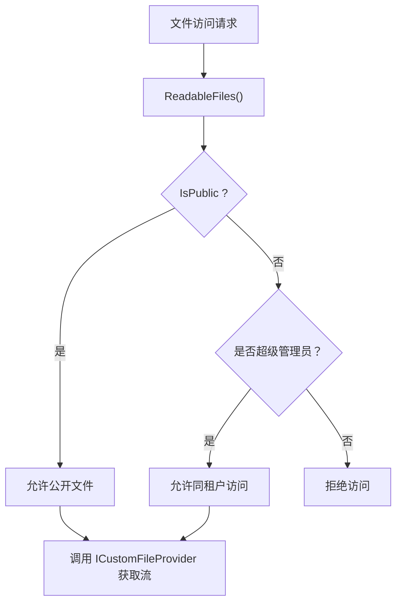
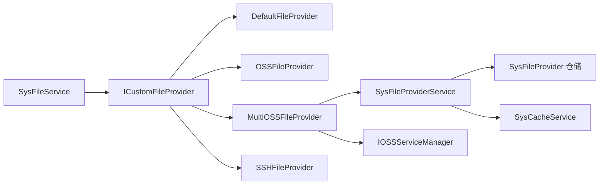

# 文件管理系统

<cite>
**本文引用的文件**   
- [SysFileService.cs](file://Admin.NET/Admin.NET.Core/Service/File/SysFileService.cs)
- [SysFileProviderController.cs](file://Admin.NET/Admin.NET.Core/Service/File/SysFileProviderController.cs)
- [SysFileProviderService.cs](file://Admin.NET/Admin.NET.Core/Service/File/SysFileProviderService.cs)
- [IOSSServiceManager.cs](file://Admin.NET/Admin.NET.Core/Service/File/IOSSServiceManager.cs)
- [ICustomFileProvider.cs](file://Admin.NET/Admin.NET.Core/Service/File/FileProvider/ICustomFileProvider.cs)
- [DefaultFileProvider.cs](file://Admin.NET/Admin.NET.Core/Service/File/FileProvider/DefaultFileProvider.cs)
- [OSSFileProvider.cs](file://Admin.NET/Admin.NET.Core/Service/File/FileProvider/OSSFileProvider.cs)
- [MultiOSSFileProvider.cs](file://Admin.NET/Admin.NET.Core/Service/File/FileProvider/MultiOSSFileProvider.cs)
- [SSHFileProvider.cs](file://Admin.NET/Admin.NET.Core/Service/File/FileProvider/SSHFileProvider.cs)
- [SysFile.cs](file://Admin.NET/Admin.NET.Core/Entity/SysFile.cs)
- [SysFileProvider.cs](file://Admin.NET/Admin.NET.Core/Entity/SysFileProvider.cs)
- [UploadOptions.cs](file://Admin.NET/Admin.NET.Core/Option/UploadOptions.cs)
- [FileInput.cs](file://Admin.NET/Admin.NET.Core/Service/File/Dto/FileInput.cs)
- [index.vue](file://Web/apps/web-antdv-next/src/views/system/file/index.vue)
- [sys-file-api.ts](file://Web/apps/web-antdv-next/src/api-services/apis/sys-file-api.ts)
</cite>

## 目录
1. [引言](#引言)
2. [项目结构](#项目结构)
3. [核心组件](#核心组件)
4. [架构总览](#架构总览)
5. [详细组件分析](#详细组件分析)
6. [依赖关系分析](#依赖关系分析)
7. [性能与容量规划](#性能与容量规划)
8. [故障排查指南](#故障排查指南)
9. [结论](#结论)

## 引言
本文件系统基于 Admin.NET 构建，提供统一的后端文件抽象层，支持本地磁盘、远程 SSH 存储以及云对象存储；前端以 Web 应用 `Web/apps/web-antdv-next` 为业务入口，提供文件上传、预览、下载和基础编辑能力。后端通过 `SysFileService` 暴露文件操作接口，并通过 `ICustomFileProvider` 将具体存储实现解耦；同时提供 `SysFileProviderController` / `SysFileProviderService` 管理多存储提供者配置，包括阿里云 OSS、腾讯云 COS 和 MinIO。

需要特别说明：当前代码库未实现分片上传、断点续传、服务端图片缩放或 PDF 生成等高级能力；现有上传校验包含大小、类型和可选 MD5 去重，但“分片”“断点续传”“进度条”“批量上传”属于前端能力范畴，且当前页面仅演示单文件选择上传。

## 项目结构
文件相关代码主要分布在以下位置：

| 层次 | 路径 | 职责 |
|---|---|---|
| 领域实体 | `Admin.NET/Admin.NET.Core/Entity/SysFile.cs`、`SysFileProvider.cs` | 系统文件元数据、存储提供者配置 |
| 服务层 | `Admin.NET/Admin.NET.Core/Service/File/SysFileService.cs`、`SysFileProviderService.cs` | 文件上传下载、权限过滤、提供者管理 |
| 控制器 | `Admin.NET/Admin.NET.Core/Service/File/SysFileProviderController.cs` | 存储提供者管理 API |
| 存储抽象 | `Admin.NET/Admin.NET.Core/Service/File/FileProvider/ICustomFileProvider.cs` | 统一文件读写接口 |
| 存储实现 | `DefaultFileProvider.cs`、`OSSFileProvider.cs`、`MultiOSSFileProvider.cs`、`SSHFileProvider.cs` | 本地、云存储、多桶、SSH 实现 |
| 云存储缓存 | `Admin.NET/Admin.NET.Core/Service/File/IOSSServiceManager.cs` | OSS 客户端实例缓存 |
| 配置选项 | `Admin.NET/Admin.NET.Core/Option/UploadOptions.cs` | 上传大小、允许类型、MD5 去重 |
| 前端页面 | `Web/apps/web-antdv-next/src/views/system/file/index.vue` | 文件列表、上传、预览、删除 |
| 前端 API | `Web/apps/web-antdv-next/src/api-services/apis/sys-file-api.ts` | 自动生成的文件 API 调用 |

**图表来源**
- [SysFileService.cs:1-120](file://Admin.NET/Admin.NET.Core/Service/File/SysFileService.cs#L1-L120)
- [SysFileProviderService.cs:1-120](file://Admin.NET/Admin.NET.Core/Service/File/SysFileProviderService.cs#L1-L120)
- [IOSSServiceManager.cs:1-60](file://Admin.NET/Admin.NET.Core/Service/File/IOSSServiceManager.cs#L1-L60)
- [index.vue:1-80](file://Web/apps/web-antdv-next/src/views/system/file/index.vue#L1-L80)
- [sys-file-api.ts:1-80](file://Web/apps/web-antdv-next/src/api-services/apis/sys-file-api.ts#L1-L80)

**章节来源**
- [SysFileService.cs:1-120](file://Admin.NET/Admin.NET.Core/Service/File/SysFileService.cs#L1-L120)
- [SysFileProviderService.cs:1-120](file://Admin.NET/Admin.NET.Core/Service/File/SysFileProviderService.cs#L1-L120)
- [index.vue:1-80](file://Web/apps/web-antdv-next/src/views/system/file/index.vue#L1-L80)

## 核心组件
- **系统文件服务**：负责文件上传、下载、预览、删除、元数据更新、头像与电子签名上传、按业务 ID 关联文件。
- **文件提供者接口**：定义获取文件流、Base64 下载、删除和上传的统一方法。
- **本地文件提供者**：基于 WebRootPath 的物理路径存储，含路径越界保护。
- **云对象存储提供者**：支持阿里云 OSS、腾讯云 COS、MinIO；单桶版本使用全局配置，多桶版本从数据库动态读取。
- **SSH 文件提供者**：通过 SSH 连接上传、读取和删除远程服务器上的文件。
- **存储提供者管理服务**：维护数据库中的存储提供者记录，支持启用禁用、默认提供者、缓存清理和统计。
- **OSS 服务管理器**：缓存不同提供者的 OSS 客户端实例，避免重复创建。

**章节来源**
- [SysFileService.cs:1-120](file://Admin.NET/Admin.NET.Core/Service/File/SysFileService.cs#L1-L120)
- [ICustomFileProvider.cs:1-45](file://Admin.NET/Admin.NET.Core/Service/File/FileProvider/ICustomFileProvider.cs#L1-L45)
- [DefaultFileProvider.cs:1-89](file://Admin.NET/Admin.NET.Core/Service/File/FileProvider/DefaultFileProvider.cs#L1-L89)
- [OSSFileProvider.cs:1-81](file://Admin.NET/Admin.NET.Core/Service/File/FileProvider/OSSFileProvider.cs#L1-L81)
- [MultiOSSFileProvider.cs:1-120](file://Admin.NET/Admin.NET.Core/Service/File/FileProvider/MultiOSSFileProvider.cs#L1-L120)
- [SSHFileProvider.cs:1-65](file://Admin.NET/Admin.NET.Core/Service/File/FileProvider/SSHFileProvider.cs#L1-L65)
- [SysFileProviderService.cs:1-120](file://Admin.NET/Admin.NET.Core/Service/File/SysFileProviderService.cs#L1-L120)
- [IOSSServiceManager.cs:1-100](file://Admin.NET/Admin.NET.Core/Service/File/IOSSServiceManager.cs#L1-L100)

## 架构总览
文件管理系统的核心是“业务服务 + 存储提供者”分层：

**图表来源**
- [SysFileService.cs:1-120](file://Admin.NET/Admin.NET.Core/Service/File/SysFileService.cs#L1-L120)
- [ICustomFileProvider.cs:1-45](file://Admin.NET/Admin.NET.Core/Service/File/FileProvider/ICustomFileProvider.cs#L1-L45)
- [SysFile.cs:1-104](file://Admin.NET/Admin.NET.Core/Entity/SysFile.cs#L1-L104)
- [SysFileProvider.cs:1-118](file://Admin.NET/Admin.NET.Core/Entity/SysFileProvider.cs#L1-L118)
- [MultiOSSFileProvider.cs:1-120](file://Admin.NET/Admin.NET.Core/Service/File/FileProvider/MultiOSSFileProvider.cs#L1-L120)

## 详细组件分析

### 文件存储抽象层设计
`ICustomFileProvider` 定义了四个关键方法：

| 方法 | 含义 | 返回 |
|---|---|---|
| `GetFileStreamResultAsync` | 根据文件元数据返回可下载的流结果 | `FileStreamResult` |
| `DownloadFileBase64Async` | 把文件内容转为 Base64 字符串 | `string` |
| `DeleteFileAsync` | 删除物理文件 | `Task` |
| `UploadFileAsync` | 接收前端文件并落盘，返回填充后的文件元数据 | `SysFile` |

该接口屏蔽了本地、SSH、单桶云存储和多桶云存储的差异，使 `SysFileService` 只关注业务规则，不关心底层介质。

**图表来源**
- [SysFileService.cs:250-420](file://Admin.NET/Admin.NET.Core/Service/File/SysFileService.cs#L250-L420)

**章节来源**
- [ICustomFileProvider.cs:1-45](file://Admin.NET/Admin.NET.Core/Service/File/FileProvider/ICustomFileProvider.cs#L1-L45)
- [SysFileService.cs:201-420](file://Admin.NET/Admin.NET.Core/Service/File/SysFileService.cs#L201-L420)

### 本地文件系统实现
`DefaultFileProvider` 将文件写入 Web 根目录下的相对路径中，并构造 URL 供后续访问。其安全策略包括：

- 使用 `App.WebHostEnvironment.WebRootPath` 作为根目录。
- 拼接完整物理路径后校验目标路径必须以根目录开头，防止路径穿越。
- 自动创建目标目录。
- 上传成功后设置 `Url` 为相对路径形式，便于反向代理或静态资源服务处理。

**图表来源**
- [DefaultFileProvider.cs:1-89](file://Admin.NET/Admin.NET.Core/Service/File/FileProvider/DefaultFileProvider.cs#L1-L89)

**章节来源**
- [DefaultFileProvider.cs:1-89](file://Admin.NET/Admin.NET.Core/Service/File/FileProvider/DefaultFileProvider.cs#L1-L89)

### 云存储集成
#### 单桶云存储提供者
`OSSFileProvider` 使用全局 `OSSProviderOptions` 创建 OSS 客户端，支持：

- 阿里云 OSS：URL 形如 `bucket.endpoint/object`。
- 腾讯云 COS：URL 形如 `bucket-endpoint.region.myqcloud.com/object`，也支持自定义 Host。
- MinIO：使用 Endpoint 或自定义 Host 拼接地址。

该实现适合只有一个固定存储桶的场景，无法动态切换多个桶。

**章节来源**
- [OSSFileProvider.cs:1-81](file://Admin.NET/Admin.NET.Core/Service/File/FileProvider/OSSFileProvider.cs#L1-L81)
- [UploadOptions.cs:1-60](file://Admin.NET/Admin.NET.Core/Option/UploadOptions.cs#L1-L60)

#### 多桶云存储提供者
`MultiOSSFileProvider` 是更通用的实现，它结合 `SysFileProviderService` 和 `IOSSServiceManager`，按以下顺序选择存储提供者：

1. 若文件记录中已指定 `BucketName`，则查找对应提供者。
2. 若上传时传入 `ProviderId`，优先使用该提供者。
3. 若传入 `BucketName`，则按桶名匹配。
4. 否则使用默认提供者。
5. 如果数据库无配置，可从配置文件兜底构造临时提供者。

URL 生成策略考虑自定义域名、HTTPS、HTTP 以及不同提供者的域名格式。

**图表来源**
- [MultiOSSFileProvider.cs:1-120](file://Admin.NET/Admin.NET.Core/Service/File/FileProvider/MultiOSSFileProvider.cs#L1-L120)
- [MultiOSSFileProvider.cs:201-255](file://Admin.NET/Admin.NET.Core/Service/File/FileProvider/MultiOSSFileProvider.cs#L201-L255)
- [SysFileProviderService.cs:201-520](file://Admin.NET/Admin.NET.Core/Service/File/SysFileProviderService.cs#L201-L520)
- [IOSSServiceManager.cs:1-100](file://Admin.NET/Admin.NET.Core/Service/File/IOSSServiceManager.cs#L1-L100)

**章节来源**
- [MultiOSSFileProvider.cs:1-255](file://Admin.NET/Admin.NET.Core/Service/File/FileProvider/MultiOSSFileProvider.cs#L1-L255)
- [SysFileProviderService.cs:201-520](file://Admin.NET/Admin.NET.Core/Service/File/SysFileProviderService.cs#L201-L520)

#### 阿里云 OSS 与腾讯云 COS 配置要点
- 阿里云：需配置 `Provider=Aliyun`、`Endpoint`、`Region`、`AccessKey`、`SecretKey`、`BucketName`。
- 腾讯云：需配置 `Provider=QCloud`、`Endpoint`、`Region`、`AccessKey`、`SecretKey`、`BucketName`，并可设置 `CustomHost`。
- MinIO：需配置 `Provider=Minio`、`Endpoint`、`AccessKey`、`SecretKey`、`BucketName`，建议开启 HTTPS。
- 所有提供者均支持 `IsEnableHttps`、`IsEnableCache`、`SinceDomain`、`IsEnable`、`IsDefault`。

**章节来源**
- [SysFileProvider.cs:1-118](file://Admin.NET/Admin.NET.Core/Entity/SysFileProvider.cs#L1-L118)
- [OSSFileProvider.cs:40-81](file://Admin.NET/Admin.NET.Core/Service/File/FileProvider/OSSFileProvider.cs#L40-L81)
- [MultiOSSFileProvider.cs:201-255](file://Admin.NET/Admin.NET.Core/Service/File/FileProvider/MultiOSSFileProvider.cs#L201-L255)

### 文件上传下载功能
#### 上传流程
`SysFileService.UploadFile` 完成以下关键步骤：

1. 校验文件非空。
2. 校验文件名不包含非法字符。
3. 校验文件大小，单位 KB 与 `UploadOptions.MaxSize` 比较。
4. 校验 MIME 类型是否在 `UploadOptions.ContentType` 中。
5. 校验可选的 `AllowSuffix` 白名单。
6. 可选 MD5 去重：当启用 MD5、未指定桶名和提供者 ID 时，按 MD5、租户、用户、公开性、类型、业务 ID、路径、后缀判断是否复用已有记录。
7. 规范化后缀，例如 `.jpeg` 转换为 `.jpg`。
8. 生成最终文件名 `Id + Suffix`。
9. 调用 `ICustomFileProvider.UploadFileAsync` 写入实际存储。
10. 插入 `SysFile` 元数据。

**图表来源**
- [SysFileService.cs:250-420](file://Admin.NET/Admin.NET.Core/Service/File/SysFileService.cs#L250-L420)

#### 下载与预览
- 下载接口支持按文件 ID 或 URL 下载。
- 预览接口通过文件 ID 返回文件流。
- 本地存储直接读取物理文件。
- OSS 存储通过预签名 URL 获取流。
- SSH 存储通过 SSH 连接读取。

**章节来源**
- [SysFileService.cs:1-120](file://Admin.NET/Admin.NET.Core/Service/File/SysFileService.cs#L1-L120)
- [SysFileService.cs:201-260](file://Admin.NET/Admin.NET.Core/Service/File/SysFileService.cs#L201-L260)
- [DefaultFileProvider.cs:30-89](file://Admin.NET/Admin.NET.Core/Service/File/FileProvider/DefaultFileProvider.cs#L30-L89)
- [OSSFileProvider.cs:20-60](file://Admin.NET/Admin.NET.Core/Service/File/FileProvider/OSSFileProvider.cs#L20-L60)
- [SSHFileProvider.cs:20-65](file://Admin.NET/Admin.NET.Core/Service/File/FileProvider/SSHFileProvider.cs#L20-L65)

#### 分片上传、断点续传、进度显示与批量操作
当前后端没有独立的分片上传、断点续传或多段上传 API。前端页面 `index.vue` 使用 Ant Design Vue 的 `Upload` 组件选择单个文件，并在弹窗中提交；不支持大文件分片、续传状态持久化和实时进度展示。批量操作方面，后端提供“根据文件 ID 集合获取文件”接口，但没有“批量上传”或“批量删除”接口。

因此，若需要分片上传、断点续传和进度显示，应扩展前端上传组件并结合新的后端 API；当前仓库中未提供这些实现。

**章节来源**
- [index.vue:1-247](file://Web/apps/web-antdv-next/src/views/system/file/index.vue#L1-L247)
- [SysFileService.cs:201-260](file://Admin.NET/Admin.NET.Core/Service/File/SysFileService.cs#L201-L260)

### 文件预览和处理功能
当前实现侧重“文件访问”，而非“文件内容转换”：

- 图片缩放：未发现服务端图片缩放逻辑。
- 格式转换：未发现服务端格式转换逻辑。
- PDF 生成：未发现 PDF 生成逻辑。
- 预览：前端通过 `readFile` 获取二进制数据后交给预览组件；后端提供文件流下载接口。

如果需要图片缩放、格式转换或 PDF 生成，应在新增的服务中引入图像处理库，并由存储提供者或独立服务返回缩略图、转换后文件或生成后的 PDF。

**章节来源**
- [SysFileService.cs:120-200](file://Admin.NET/Admin.NET.Core/Service/File/SysFileService.cs#L120-L200)
- [index.vue:1-247](file://Web/apps/web-antdv-next/src/views/system/file/index.vue#L1-L247)

### 文件访问控制与权限验证机制
文件访问控制分为两层：

1. **业务层权限**：
   - 公开文件：任何登录用户可读取。
   - 私有文件：非超级管理员只能访问自己的租户。
   - 写操作：删除和更新会限制为非超级管理员必须属于同一租户。
   - 头像和签名：进一步要求文件属于当前用户。

2. **存储层访问**：
   - 本地存储：通过 Web 根目录访问，受 Web 服务器反向代理或鉴权拦截影响。
   - OSS 存储：通过预签名 URL 访问，由云服务商控制访问有效期。
   - SSH 存储：通过服务端 SSH 连接读取，不受外部直接访问。

**图表来源**
- [SysFileService.cs:120-200](file://Admin.NET/Admin.NET.Core/Service/File/SysFileService.cs#L120-L200)

**章节来源**
- [SysFileService.cs:120-200](file://Admin.NET/Admin.NET.Core/Service/File/SysFileService.cs#L120-L200)
- [SysFileService.cs:201-260](file://Admin.NET/Admin.NET.Core/Service/File/SysFileService.cs#L201-L260)

### 文件上传组件说明
前端文件上传位于 `Web/apps/web-antdv-next/src/views/system/file/index.vue`：

- 使用 Ant Design Vue 的 `Upload` 组件。
- 支持常见图片、Office、PDF、文本和音视频格式。
- 最大文件大小提示为 10 MB。
- 上传前进行文件有效性校验。
- 上传成功后刷新列表并提示成功。
- 不显示上传进度，也不支持拖拽多文件批量上传。

如需增强，可在该页面中替换为支持分片、断点续传和进度的上传组件，并调用新的后端分片 API。

**章节来源**
- [index.vue:1-247](file://Web/apps/web-antdv-next/src/views/system/file/index.vue#L1-L247)

### 存储配置示例
以下为当前代码中涉及的配置项说明，不代表完整部署模板：

| 配置项 | 含义 | 说明 |
|---|---|---|
| `UploadOptions.Path` | 本地上传根路径 | 用于本地存储的文件目录 |
| `UploadOptions.MaxSize` | 最大文件大小 | 单位为 KB |
| `UploadOptions.ContentType` | 允许上传的 MIME 类型 | 白名单 |
| `UploadOptions.EnableMd5` | 是否启用 MD5 去重 | 防止重复上传 |
| `OSSProviderOptions.Enabled` | 是否启用 OSS 存储 | 决定是否使用云存储 |
| `OSSProviderOptions.Provider` | 云存储提供商 | 如 Aliyun、QCloud、Minio |
| `OSSProviderOptions.Bucket` | 默认桶名称 | 单桶场景使用 |
| `OSSProviderOptions.CustomHost` | 自定义 Host | 覆盖默认域名 |
| `SysFileProvider.*` | 多桶提供者配置 | 存储在数据库中 |

**章节来源**
- [UploadOptions.cs:1-60](file://Admin.NET/Admin.NET.Core/Option/UploadOptions.cs#L1-L60)
- [SysFileProvider.cs:1-118](file://Admin.NET/Admin.NET.Core/Entity/SysFileProvider.cs#L1-L118)

## 依赖关系分析

**图表来源**
- [SysFileService.cs:1-120](file://Admin.NET/Admin.NET.Core/Service/File/SysFileService.cs#L1-L120)
- [MultiOSSFileProvider.cs:1-120](file://Admin.NET/Admin.NET.Core/Service/File/FileProvider/MultiOSSFileProvider.cs#L1-L120)
- [SysFileProviderService.cs:1-120](file://Admin.NET/Admin.NET.Core/Service/File/SysFileProviderService.cs#L1-L120)
- [IOSSServiceManager.cs:1-60](file://Admin.NET/Admin.NET.Core/Service/File/IOSSServiceManager.cs#L1-L60)

**章节来源**
- [SysFileService.cs:1-120](file://Admin.NET/Admin.NET.Core/Service/File/SysFileService.cs#L1-L120)
- [MultiOSSFileProvider.cs:1-120](file://Admin.NET/Admin.NET.Core/Service/File/FileProvider/MultiOSSFileProvider.cs#L1-L120)
- [SysFileProviderService.cs:1-120](file://Admin.NET/Admin.NET.Core/Service/File/SysFileProviderService.cs#L1-L120)

## 性能与容量规划
- **本地存储**：
  - 优点：延迟低、无需额外网络请求。
  - 风险：与 Web 进程共享磁盘空间，容易耗尽磁盘；备份和迁移需要复制物理文件。
  - 建议：定期清理无用文件，监控磁盘容量，使用独立数据盘，配合日志轮转。

- **云对象存储**：
  - 优点：弹性扩容、高可用、CDN 友好。
  - 风险：网络延迟、带宽成本、跨域和访问密钥泄露。
  - 建议：使用预签名 URL、HTTPS、最小权限策略、合理的缓存头、冷热数据分层。

- **SSH 存储**：
  - 优点：可直接访问远端服务器文件系统。
  - 风险：SSH 通道性能较低，不适合高频大文件传输。
  - 建议：仅用于内部运维或特殊环境，生产建议使用对象存储。

- **上传优化**：
  - 当前实现按完整文件流上传，大文件会增加内存和网络压力。
  - 建议未来实现分片上传、并发上传、断点续传，并结合前端进度回调。

- **存储提供者缓存**：
  - `OSSServiceManager` 对 OSS 客户端实例做缓存，减少重复创建开销。
  - 配置变更后需调用缓存清理接口，避免使用过期客户端。

[本节为通用指导，不直接分析具体源码]

## 故障排查指南
- **上传失败：类型不允许**
  - 检查 `UploadOptions.ContentType` 是否包含请求的 `Content-Type`。
  - 检查前端 `accept` 属性与实际文件类型是否一致。

- **上传失败：大小超限**
  - 检查 `UploadOptions.MaxSize`，单位为 KB。
  - 注意前端提示 10 MB，但后端校验由配置决定。

- **上传失败：后缀无效**
  - 检查 `AllowSuffix` 是否包含目标后缀。
  - 注意 `.jpeg` 会被规范化为 `.jpg`。

- **重复上传未命中**
  - 确认 `UploadOptions.EnableMd5` 已启用。
  - 确认上传时未指定 `BucketName` 或 `ProviderId`。
  - 确认租户、用户、公开性、类型、业务 ID、路径和后缀一致。

- **OSS 访问异常**
  - 检查 `SysFileProvider` 配置是否有效。
  - 检查 AccessKey、SecretKey、Endpoint、Region、BucketName。
  - 调用存储提供者缓存清理接口。
  - 检查云厂商控制台中的 CORS、ACL 和域名绑定。

- **本地文件路径越界**
  - `DefaultFileProvider` 会拒绝不在 WebRootPath 下的路径。
  - 检查 `FilePath` 是否被恶意篡改。

- **删除后仍能看到文件**
  - 检查 OSS 预签名 URL 是否仍然有效。
  - 检查 CDN 或浏览器缓存。
  - 确认删除接口是否成功调用。

**章节来源**
- [SysFileService.cs:250-420](file://Admin.NET/Admin.NET.Core/Service/File/SysFileService.cs#L250-L420)
- [DefaultFileProvider.cs:1-89](file://Admin.NET/Admin.NET.Core/Service/File/FileProvider/DefaultFileProvider.cs#L1-L89)
- [SysFileProviderService.cs:201-520](file://Admin.NET/Admin.NET.Core/Service/File/SysFileProviderService.cs#L201-L520)

## 结论
Admin.NET 文件管理系统以 `ICustomFileProvider` 为核心抽象，将本地、SSH 和多种云对象存储统一为一致的上传、下载、删除和 Base64 下载接口。`SysFileService` 负责业务规则、权限控制和元数据管理；`SysFileProviderService` 管理多存储提供者配置，`OSSServiceManager` 缓存 OSS 客户端以提升性能。

当前实现已经覆盖典型中小规模文件管理场景，但未内置分片上传、断点续传、图片缩放、格式转换和 PDF 生成。若业务需要，应在前端增加分片和进度能力，在后端扩展分片上传 API 和文件处理服务，同时保持存储抽象层的向后兼容。