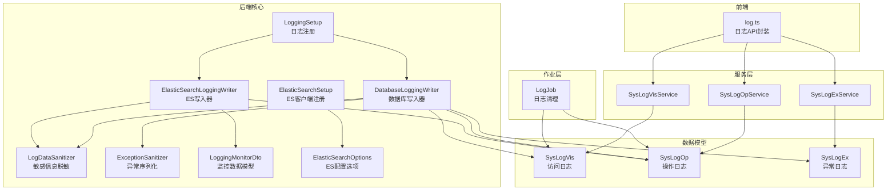
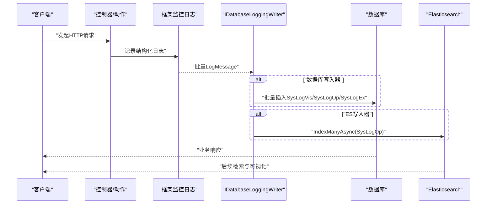
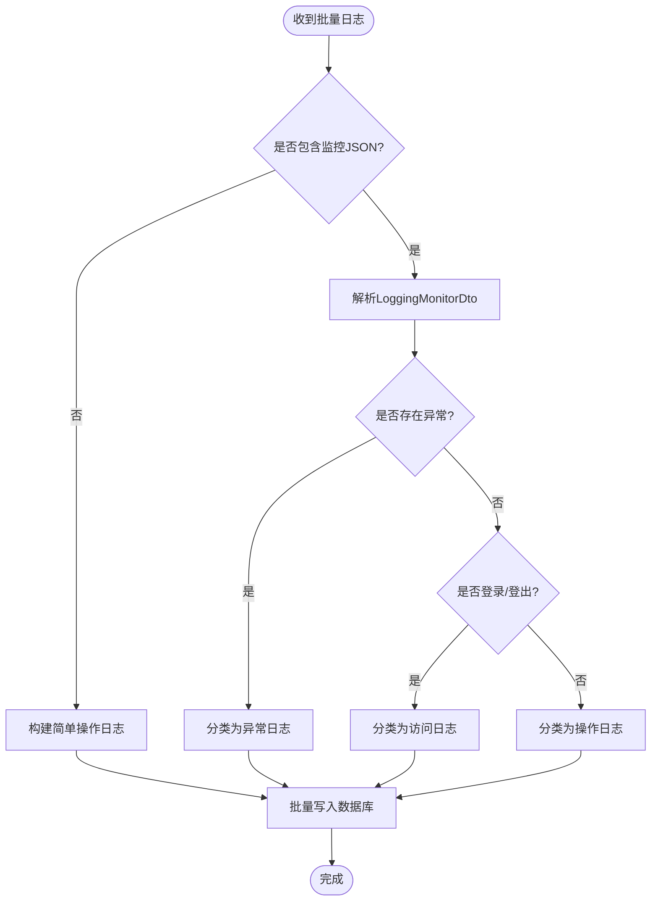
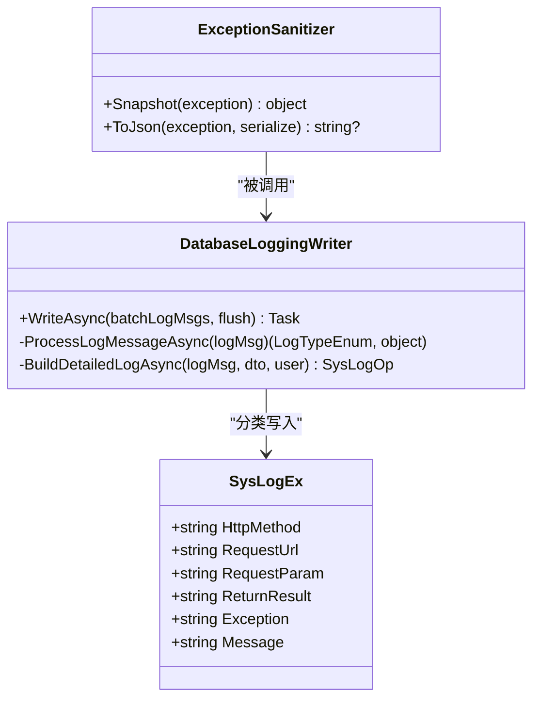
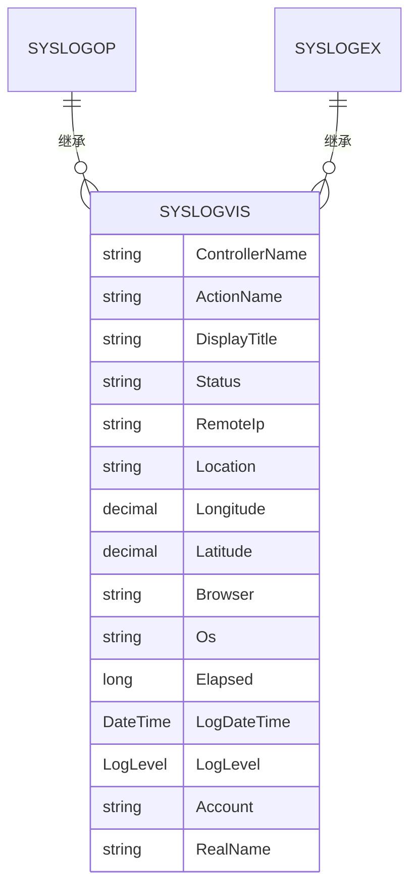
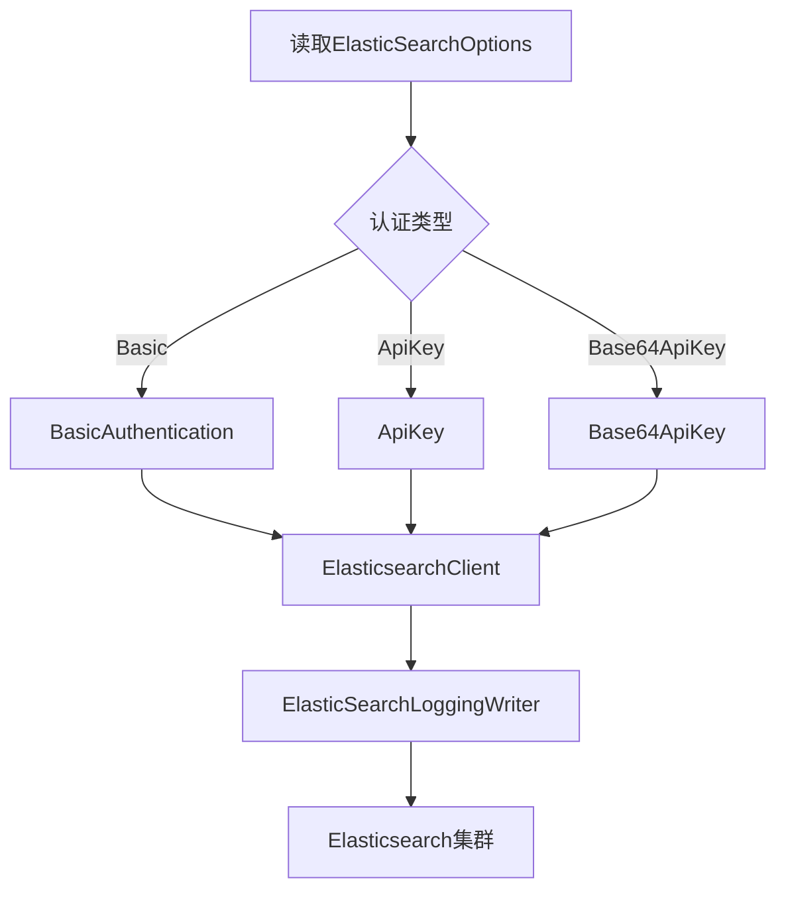
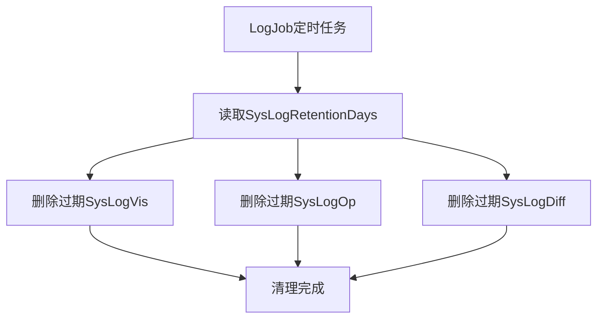
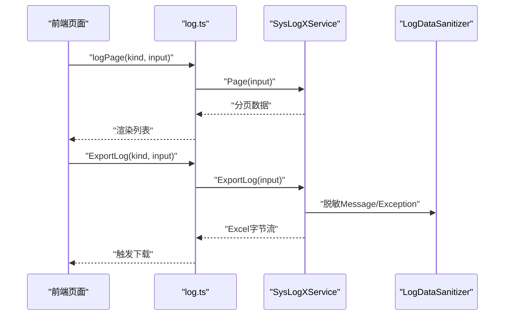
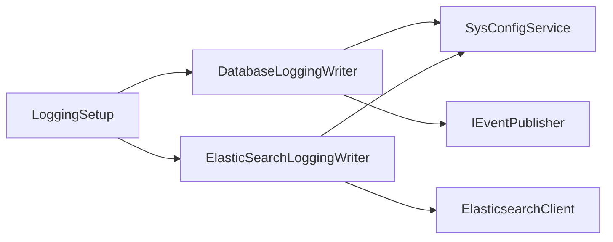

# 日志监控系统

<cite>
**本文引用的文件**   
- [LoggingSetup.cs](file://Admin.NET/Admin.NET.Core/Logging/LoggingSetup.cs)
- [DatabaseLoggingWriter.cs](file://Admin.NET/Admin.NET.Core/Logging/DatabaseLoggingWriter.cs)
- [ElasticSearchLoggingWriter.cs](file://Admin.NET/Admin.NET.Core/Logging/ElasticSearchLoggingWriter.cs)
- [LogDataSanitizer.cs](file://Admin.NET/Admin.NET.Core/Logging/LogDataSanitizer.cs)
- [ExceptionSanitizer.cs](file://Admin.NET/Admin.NET.Core/Logging/ExceptionSanitizer.cs)
- [LoggingMonitorDto.cs](file://Admin.NET/Admin.NET.Core/Logging/LoggingMonitorDto.cs)
- [ElasticSearchOptions.cs](file://Admin.NET/Admin.NET.Core/Option/ElasticSearchOptions.cs)
- [ElasticSearchSetup.cs](file://Admin.NET/Admin.NET.Core/ElasticSearch/ElasticSearchSetup.cs)
- [SysLogVis.cs](file://Admin.NET/Admin.NET.Core/Entity/SysLogVis.cs)
- [SysLogOp.cs](file://Admin.NET/Admin.NET.Core/Entity/SysLogOp.cs)
- [SysLogEx.cs](file://Admin.NET/Admin.NET.Core/Entity/SysLogEx.cs)
- [SysLogVisService.cs](file://Admin.NET/Admin.NET.Core/Service/Log/SysLogVisService.cs)
- [SysLogOpService.cs](file://Admin.NET/Admin.NET.Core/Service/Log/SysLogOpService.cs)
- [SysLogExService.cs](file://Admin.NET/Admin.NET.Core/Service/Log/SysLogExService.cs)
- [LogJob.cs](file://Admin.NET/Admin.NET.Core/Job/LogJob.cs)
- [log.ts](file://Web/apps/web-antdv-next/src/api/system/log.ts)
</cite>

## 目录
1. [引言](#引言)
2. [项目结构](#项目结构)
3. [核心组件](#核心组件)
4. [架构总览](#架构总览)
5. [详细组件分析](#详细组件分析)
6. [依赖关系分析](#依赖关系分析)
7. [性能与成本优化](#性能与成本优化)
8. [故障诊断与排错指南](#故障诊断与排错指南)
9. [结论](#结论)
10. [附录：配置、查询与管理界面参考](#附录配置查询与管理界面参考)

## 引言
本文围绕 Admin.NET 的日志监控体系展开，聚焦以下目标：
- 操作日志记录机制：请求拦截、数据采集、敏感信息脱敏、异步存储。
- 异常日志收集：全局异常捕获、堆栈跟踪、错误分类、告警通知。
- 访问日志分析：HTTP 请求追踪、响应时间统计、用户行为分析。
- Elasticsearch 集成：索引策略、搜索能力与可视化展示建议。
- 日志聚合、归档与清理策略。
- 日志性能优化与存储成本控制。
- 提供可操作的配置示例、查询语句与管理界面使用指南。

本仓库当前以 .NET Core 后端和 Web/apps/web-antdv-next 业务前端为基线；数据库实体与服务位于 Admin.NET.Admin.NET.Core；Elasticsearch 客户端注册与写入逻辑分别位于 ElasticSearch 相关模块与 Logging 模块。

## 项目结构
从日志视角看，系统主要包含如下层次：
- 日志采集层：由框架监控基础设施生成结构化日志消息，并注入控制器/动作上下文。
- 日志处理层：通过 IDatabaseLoggingWriter 抽象，将日志分发到不同持久化通道。
- 数据模型层：SysLogVis（访问日志）、SysLogOp（操作日志）、SysLogEx（异常日志）。
- 服务层：SysLogVisService、SysLogOpService、SysLogExService 提供分页查询、详情、清空与导出。
- 作业层：LogJob 定期清理历史日志。
- Elasticsearch 集成：ElasticSearchSetup 注册客户端，ElasticSearchLoggingWriter 把操作日志批量写入 ES。
- 前端层：web-antdv-next 提供日志查询页面与通用日志 API 封装。

**图示来源**
- [LoggingSetup.cs:12-104](file://Admin.NET/Admin.NET.Core/Logging/LoggingSetup.cs#L12-L104)
- [DatabaseLoggingWriter.cs:17-282](file://Admin.NET/Admin.NET.Core/Logging/DatabaseLoggingWriter.cs#L17-L282)
- [ElasticSearchLoggingWriter.cs:15-129](file://Admin.NET/Admin.NET.Core/Logging/ElasticSearchLoggingWriter.cs#L15-L129)
- [LogDataSanitizer.cs:12-98](file://Admin.NET/Admin.NET.Core/Logging/LogDataSanitizer.cs#L12-L98)
- [ExceptionSanitizer.cs:12-56](file://Admin.NET/Admin.NET.Core/Logging/ExceptionSanitizer.cs#L12-L56)
- [LoggingMonitorDto.cs:12-309](file://Admin.NET/Admin.NET.Core/Logging/LoggingMonitorDto.cs#L12-L309)
- [ElasticSearchOptions.cs:12-64](file://Admin.NET/Admin.NET.Core/Option/ElasticSearchOptions.cs#L12-L64)
- [ElasticSearchSetup.cs:12-53](file://Admin.NET/Admin.NET.Core/ElasticSearch/ElasticSearchSetup.cs#L12-L53)
- [SysLogVis.cs:12-116](file://Admin.NET/Admin.NET.Core/Entity/SysLogVis.cs#L12-L116)
- [SysLogOp.cs:12-72](file://Admin.NET/Admin.NET.Core/Entity/SysLogOp.cs#L12-L72)
- [SysLogEx.cs:12-72](file://Admin.NET/Admin.NET.Core/Entity/SysLogEx.cs#L12-L72)
- [SysLogVisService.cs:12-79](file://Admin.NET/Admin.NET.Core/Service/Log/SysLogVisService.cs#L12-L79)
- [SysLogOpService.cs:12-101](file://Admin.NET/Admin.NET.Core/Service/Log/SysLogOpService.cs#L12-L101)
- [SysLogExService.cs:12-101](file://Admin.NET/Admin.NET.Core/Service/Log/SysLogExService.cs#L12-L101)
- [LogJob.cs:12-46](file://Admin.NET/Admin.NET.Core/Job/LogJob.cs#L12-L46)
- [log.ts:1-45](file://Web/apps/web-antdv-next/src/api/system/log.ts#L1-L45)

**章节来源**
- [LoggingSetup.cs:12-104](file://Admin.NET/Admin.NET.Core/Logging/LoggingSetup.cs#L12-L104)
- [ElasticSearchSetup.cs:12-53](file://Admin.NET/Admin.NET.Core/ElasticSearch/ElasticSearchSetup.cs#L12-L53)
- [SysLogVis.cs:12-116](file://Admin.NET/Admin.NET.Core/Entity/SysLogVis.cs#L12-L116)
- [SysLogOp.cs:12-72](file://Admin.NET/Admin.NET.Core/Entity/SysLogOp.cs#L12-L72)
- [SysLogEx.cs:12-72](file://Admin.NET/Admin.NET.Core/Entity/SysLogEx.cs#L12-L72)

## 核心组件
- 日志注册与过滤：LoggingSetup 统一注册控制台、文件、Elasticsearch、数据库等输出通道，并通过 WriteFilter 控制只处理框架监控日志。
- 数据库写入器：DatabaseLoggingWriter 解析监控数据，按访问、操作、异常三类分别批量插入数据库，支持邮件告警。
- ES 写入器：ElasticSearchLoggingWriter 将操作日志批量写入 ES，并跳过 userInfo/logout 等无关操作。
- 敏感信息脱敏：LogDataSanitizer 对请求参数、返回结果、URL、异常文本进行 JSON 与正则级脱敏。
- 异常序列化：ExceptionSanitizer 避免直接序列化 Exception 导致的不支持成员问题，转为安全快照。
- 监控数据模型：LoggingMonitorDto 承载 HTTP 请求、响应、异常、用户授权声明、设备信息等完整上下文。
- 配置项：ElasticSearchOptions 提供 ES 连接、认证、默认索引等配置。
- ES 客户端注册：ElasticSearchSetup 根据配置创建单例 ElasticsearchClient。
- 日志实体：SysLogVis/SysLogOp/SysLogEx 描述访问、操作、异常三类日志的数据结构。
- 日志服务：SysLogVisService/SysLogOpService/SysLogExService 提供分页、详情、清空、导出等操作。
- 日志清理作业：LogJob 定时删除超过保留天数的历史日志。
- 前端日志 API：log.ts 统一封装日志分页、详情、清空、导出接口调用。

**章节来源**
- [LoggingSetup.cs:12-104](file://Admin.NET/Admin.NET.Core/Logging/LoggingSetup.cs#L12-L104)
- [DatabaseLoggingWriter.cs:17-282](file://Admin.NET/Admin.NET.Core/Logging/DatabaseLoggingWriter.cs#L17-L282)
- [ElasticSearchLoggingWriter.cs:15-129](file://Admin.NET/Admin.NET.Core/Logging/ElasticSearchLoggingWriter.cs#L15-L129)
- [LogDataSanitizer.cs:12-98](file://Admin.NET/Admin.NET.Core/Logging/LogDataSanitizer.cs#L12-L98)
- [ExceptionSanitizer.cs:12-56](file://Admin.NET/Admin.NET.Core/Logging/ExceptionSanitizer.cs#L12-L56)
- [LoggingMonitorDto.cs:12-309](file://Admin.NET/Admin.NET.Core/Logging/LoggingMonitorDto.cs#L12-L309)
- [ElasticSearchOptions.cs:12-64](file://Admin.NET/Admin.NET.Core/Option/ElasticSearchOptions.cs#L12-L64)
- [ElasticSearchSetup.cs:12-53](file://Admin.NET/Admin.NET.Core/ElasticSearch/ElasticSearchSetup.cs#L12-L53)
- [SysLogVis.cs:12-116](file://Admin.NET/Admin.NET.Core/Entity/SysLogVis.cs#L12-L116)
- [SysLogOp.cs:12-72](file://Admin.NET/Admin.NET.Core/Entity/SysLogOp.cs#L12-L72)
- [SysLogEx.cs:12-72](file://Admin.NET/Admin.NET.Core/Entity/SysLogEx.cs#L12-L72)
- [SysLogVisService.cs:12-79](file://Admin.NET/Admin.NET.Core/Service/Log/SysLogVisService.cs#L12-L79)
- [SysLogOpService.cs:12-101](file://Admin.NET/Admin.NET.Core/Service/Log/SysLogOpService.cs#L12-L101)
- [SysLogExService.cs:12-101](file://Admin.NET/Admin.NET.Core/Service/Log/SysLogExService.cs#L12-L101)
- [LogJob.cs:12-46](file://Admin.NET/Admin.NET.Core/Job/LogJob.cs#L12-L46)
- [log.ts:1-45](file://Web/apps/web-antdv-next/src/api/system/log.ts#L1-L45)

## 架构总览
下图展示一次 HTTP 请求在 Admin.NET 中的日志流转过程：

**图示来源**
- [LoggingSetup.cs:78-104](file://Admin.NET/Admin.NET.Core/Logging/LoggingSetup.cs#L78-L104)
- [DatabaseLoggingWriter.cs:39-93](file://Admin.NET/Admin.NET.Core/Logging/DatabaseLoggingWriter.cs#L39-L93)
- [ElasticSearchLoggingWriter.cs:33-56](file://Admin.NET/Admin.NET.Core/Logging/ElasticSearchLoggingWriter.cs#L33-L56)

## 详细组件分析

### 操作日志记录机制
- 请求拦截与数据采集
  - 框架监控生成 LoggingMonitorDto，包含 ControllerName、ActionName、HttpMethod、RequestUrl、Parameters、ReturnInformation、UserAgent、AuthorizationClaims、TraceId、ThreadId、TimeOperationElapsedMilliseconds 等字段。
  - LoggingSetup 通过 AddMonitorLogging 配置忽略属性名与类型，减少敏感数据进入日志上下文。
- 操作日志分类
  - DatabaseLoggingWriter.ProcessLogMessageAsync 根据 ActionName 是否为登录/登出判断访问日志，否则若存在异常则为异常日志，其余为操作日志。
  - ElasticSearchLoggingWriter 会跳过 userInfo/logout 操作，不写入 ES。
- 敏感信息脱敏
  - LogDataSanitizer.SanitizeRecord 针对 SysLogOp/SysLogEx/SysLogDiff 的请求参数、返回结果、URL、异常、差异数据进行 JSON 节点与正则匹配脱敏。
  - 同时屏蔽 SQL 和无字段上下文的参数，防止历史明文凭据泄露。
- 异步存储
  - DatabaseLoggingWriter.WriteAsync 并行执行三个 Insertable 批量写入，并在开启邮件告警时发布 SendErrorMail 事件。
  - ElasticSearchLoggingWriter.WriteAsync 使用 IndexManyAsync 批量写入 ES。

**图示来源**
- [DatabaseLoggingWriter.cs:97-131](file://Admin.NET/Admin.NET.Core/Logging/DatabaseLoggingWriter.cs#L97-L131)
- [DatabaseLoggingWriter.cs:133-200](file://Admin.NET/Admin.NET.Core/Logging/DatabaseLoggingWriter.cs#L133-L200)
- [LogDataSanitizer.cs:22-98](file://Admin.NET/Admin.NET.Core/Logging/LogDataSanitizer.cs#L22-L98)

**章节来源**
- [LoggingMonitorDto.cs:12-309](file://Admin.NET/Admin.NET.Core/Logging/LoggingMonitorDto.cs#L12-L309)
- [LoggingSetup.cs:12-40](file://Admin.NET/Admin.NET.Core/Logging/LoggingSetup.cs#L12-L40)
- [DatabaseLoggingWriter.cs:97-200](file://Admin.NET/Admin.NET.Core/Logging/DatabaseLoggingWriter.cs#L97-L200)
- [ElasticSearchLoggingWriter.cs:33-129](file://Admin.NET/Admin.NET.Core/Logging/ElasticSearchLoggingWriter.cs#L33-L129)
- [LogDataSanitizer.cs:22-98](file://Admin.NET/Admin.NET.Core/Logging/LogDataSanitizer.cs#L22-L98)

### 异常日志收集
- 全局异常捕获
  - 代码中存在已注释的全局异常处理器 LogExceptionHandler，当前未启用；实际异常日志由框架监控日志触发 DatabaseLoggingWriter 的分类逻辑写入 SysLogEx。
- 堆栈跟踪与安全序列化
  - ExceptionSanitizer.ToJson 先将真实 Exception 投影为 type/message/source/stackTrace/innerException 的安全快照，再交由上层序列化；序列化失败回退为原始 ToString 文本，确保“宁脏不丢”。
- 错误分类与告警
  - DatabaseLoggingWriter 在分类阶段检测到 logMsg.Exception 或 loggingMonitor.Exception 时标记为异常日志，并收集异常对象用于后续邮件告警事件。
  - 邮件发送由 IEventPublisher.PublishAsync(CommonConst.SendErrorMail, exceptions) 触发，外部订阅者负责具体投递实现。

**图示来源**
- [ExceptionSanitizer.cs:12-56](file://Admin.NET/Admin.NET.Core/Logging/ExceptionSanitizer.cs#L12-L56)
- [DatabaseLoggingWriter.cs:97-131](file://Admin.NET/Admin.NET.Core/Logging/DatabaseLoggingWriter.cs#L97-L131)
- [SysLogEx.cs:12-72](file://Admin.NET/Admin.NET.Core/Entity/SysLogEx.cs#L12-L72)

**章节来源**
- [LogExceptionHandler.cs:12-53](file://Admin.NET/Admin.NET.Core/Logging/LogExceptionHandler.cs#L12-L53)
- [ExceptionSanitizer.cs:12-56](file://Admin.NET/Admin.NET.Core/Logging/ExceptionSanitizer.cs#L12-L56)
- [DatabaseLoggingWriter.cs:97-131](file://Admin.NET/Admin.NET.Core/Logging/DatabaseLoggingWriter.cs#L97-L131)

### 访问日志分析
- HTTP 请求追踪
  - SysLogVis 记录 ControllerName、ActionName、Status、RemoteIp、Location、Longitude、Latitude、Browser、Os、Elapsed、Account、RealName 等字段，可用于登录/退出及关键入口行为分析。
- 响应时间统计
  - Elapsed 字段来源于 LoggingMonitorDto.TimeOperationElapsedMilliseconds，可在列表页按耗时阈值筛选。
- 用户行为分析
  - SysLogVisService.GetList 返回带经纬度与登录时间的地理分布数据，便于前端地图可视化。
  - 分页查询支持租户隔离、账号、IP、状态码等条件过滤。

**图示来源**
- [SysLogVis.cs:12-116](file://Admin.NET/Admin.NET.Core/Entity/SysLogVis.cs#L12-L116)
- [SysLogOp.cs:12-72](file://Admin.NET/Admin.NET.Core/Entity/SysLogOp.cs#L12-L72)
- [SysLogEx.cs:12-72](file://Admin.NET/Admin.NET.Core/Entity/SysLogEx.cs#L12-L72)

**章节来源**
- [SysLogVisService.cs:30-79](file://Admin.NET/Admin.NET.Core/Service/Log/SysLogVisService.cs#L30-L79)
- [SysLogVis.cs:12-116](file://Admin.NET/Admin.NET.Core/Entity/SysLogVis.cs#L12-L116)

### Elasticsearch 集成
- 客户端注册
  - ElasticSearchSetup.AddElasticSearch 读取 Logging:ElasticSearch 配置，根据 Basic/ApiKey/Base64ApiKey 认证方式创建 ElasticsearchClient 单例，并设置 DefaultIndex。
- 写入策略
  - ElasticSearchLoggingWriter.WriteAsync 仅处理 SysLogOp 操作日志，跳过 userInfo/logout，批量 IndexManyAsync。
  - LoggingSetup 中 ES 写入器的 WriteFilter 限定只处理 CommonConst.SysLogCategoryName 类别的日志。
- 索引策略与可视化
  - 默认索引来自 ElasticSearchOptions.DefaultIndex。生产环境建议按日期滚动索引（如 logs-op-YYYY-MM-DD），以便分片管理与生命周期管理。
  - Kibana 可视化建议：基于 RequestUrl、ActionName、HttpMethod、Status、Elapsed、RemoteIp、Account、TraceId 建立仪表板，结合地理位置 Location/Latitude/Longitude 展示登录轨迹。

**图示来源**
- [ElasticSearchSetup.cs:12-53](file://Admin.NET/Admin.NET.Core/ElasticSearch/ElasticSearchSetup.cs#L12-L53)
- [ElasticSearchLoggingWriter.cs:33-56](file://Admin.NET/Admin.NET.Core/Logging/ElasticSearchLoggingWriter.cs#L33-L56)
- [ElasticSearchOptions.cs:12-64](file://Admin.NET/Admin.NET.Core/Option/ElasticSearchOptions.cs#L12-L64)

**章节来源**
- [ElasticSearchSetup.cs:12-53](file://Admin.NET/Admin.NET.Core/ElasticSearch/ElasticSearchSetup.cs#L12-L53)
- [ElasticSearchLoggingWriter.cs:15-129](file://Admin.NET/Admin.NET.Core/Logging/ElasticSearchLoggingWriter.cs#L15-L129)
- [LoggingSetup.cs:78-104](file://Admin.NET/Admin.NET.Core/Logging/LoggingSetup.cs#L78-L104)
- [ElasticSearchOptions.cs:12-64](file://Admin.NET/Admin.NET.Core/Option/ElasticSearchOptions.cs#L12-L64)

### 日志聚合、归档与清理
- 聚合
  - 数据库聚合：SysLogVis/SysLogOp/SysLogEx 三表分别承载访问、操作、异常日志，支持按租户、时间、账号、IP、控制器/动作、耗时、状态码等维度查询。
  - ES 聚合：可将高频检索与分析压力迁移至 ES，利用 ES 聚合能力做趋势分析与多维统计。
- 归档
  - 建议在 ES 端使用索引生命周期管理（ILM）或滚动索引策略，将旧索引迁移到低成本存储。
- 清理
  - LogJob 定时任务删除 CreateTime 早于保留天数的 SysLogVis/SysLogOp/SysLogDiff 数据，保留天数由配置项 ConfigConst.SysLogRetentionDays 控制。

**图示来源**
- [LogJob.cs:12-46](file://Admin.NET/Admin.NET.Core/Job/LogJob.cs#L12-L46)

**章节来源**
- [LogJob.cs:12-46](file://Admin.NET/Admin.NET.Core/Job/LogJob.cs#L12-L46)

### 前端日志管理
- 前端 API 封装
  - log.ts 提供统一的日志分页、详情、清空、导出接口，支持 vis/op/ex/diff 四种日志类型。
- 管理界面
  - 前端页面可通过 log.ts 调用后端 SysLogVisService/SysLogOpService/SysLogExService，实现分页列表、详情查看、清空与 Excel 导出。
  - 操作日志与异常日志导出会再次执行 LogDataSanitizer 脱敏，保证下载内容安全。

**图示来源**
- [log.ts:1-45](file://Web/apps/web-antdv-next/src/api/system/log.ts#L1-L45)
- [SysLogOpService.cs:73-101](file://Admin.NET/Admin.NET.Core/Service/Log/SysLogOpService.cs#L73-L101)
- [SysLogExService.cs:73-101](file://Admin.NET/Admin.NET.Core/Service/Log/SysLogExService.cs#L73-L101)
- [LogDataSanitizer.cs:22-98](file://Admin.NET/Admin.NET.Core/Logging/LogDataSanitizer.cs#L22-L98)

**章节来源**
- [log.ts:1-45](file://Web/apps/web-antdv-next/src/api/system/log.ts#L1-L45)
- [SysLogOpService.cs:12-101](file://Admin.NET/Admin.NET.Core/Service/Log/SysLogOpService.cs#L12-L101)
- [SysLogExService.cs:12-101](file://Admin.NET/Admin.NET.Core/Service/Log/SysLogExService.cs#L12-L101)

## 依赖关系分析
- 低耦合抽象：IDatabaseLoggingWriter 抽象了多种日志写入通道，新增写入目标无需修改现有流程。
- 强内聚数据模型：SysLogVis/SysLogOp/SysLogEx 明确区分访问、操作、异常三类日志，便于独立查询与治理。
- 配置驱动：LoggingSetup 与 ElasticSearchSetup 均通过 App.GetConfig 读取配置，支持运行时开关与多认证方式。
- 潜在循环依赖风险：写入器依赖 SysConfigService 获取功能开关，需确保配置服务可用；异常邮件事件通过 IEventPublisher 解耦。

**图示来源**
- [LoggingSetup.cs:12-104](file://Admin.NET/Admin.NET.Core/Logging/LoggingSetup.cs#L12-L104)
- [DatabaseLoggingWriter.cs:17-43](file://Admin.NET/Admin.NET.Core/Logging/DatabaseLoggingWriter.cs#L17-L43)
- [ElasticSearchLoggingWriter.cs:15-31](file://Admin.NET/Admin.NET.Core/Logging/ElasticSearchLoggingWriter.cs#L15-L31)

**章节来源**
- [LoggingSetup.cs:12-104](file://Admin.NET/Admin.NET.Core/Logging/LoggingSetup.cs#L12-L104)
- [DatabaseLoggingWriter.cs:17-43](file://Admin.NET/Admin.NET.Core/Logging/DatabaseLoggingWriter.cs#L17-L43)
- [ElasticSearchLoggingWriter.cs:15-31](file://Admin.NET/Admin.NET.Core/Logging/ElasticSearchLoggingWriter.cs#L15-L31)

## 性能与成本优化
- 写入路径优化
  - 数据库写入采用并行批量插入，减少多次往返开销。
  - ES 写入使用 IndexManyAsync 批量索引，降低网络与序列化成本。
- 过滤与裁剪
  - LoggingSetup 的 WriteFilter 仅处理框架监控日志类别，避免无关日志污染。
  - ElasticSearchLoggingWriter 跳过 userInfo/logout 等无价值操作。
- 脱敏与序列化
  - LogDataSanitizer 对敏感字段进行精准替换，避免明文凭证落地。
  - ExceptionSanitizer 避免深层反射成员导致的序列化异常，提高健壮性。
- 存储成本控制
  - 使用 LogJob 定期清理历史日志，保留天数可配置。
  - ES 建议使用滚动索引与 ILM 策略，按时间分片，降低热点与存储成本。
- 前端体验
  - 列表查询忽略大字段 RequestParam/ReturnResult/Message，减少传输与渲染压力。
  - 导出前再次脱敏，确保数据安全。

[本节为通用指导，不直接分析具体文件]

## 故障诊断与排错指南
- 日志未入库或未写入 ES
  - 检查 LoggingSetup 中对应通道的 Enabled 配置与 WriteFilter 条件。
  - 确认 SysConfigService 能读取 ConfigConst.SysOpLog 开关。
  - ES 连接失败时检查 ElasticSearchOptions.ServerUris、AuthType、DefaultIndex。
- 敏感信息未脱敏
  - 检查 LogDataSanitizer 的敏感键集合与正则规则，确认字段名匹配。
  - 注意 SQL 与参数上下文中 beforeValue/afterValue/value 字段的脱敏逻辑。
- 异常日志丢失或无法序列化
  - 确认 ExceptionSanitizer.ToJson 是否成功转换快照；若仍失败，应降级为纯文本。
- 日志清理不生效
  - 检查 LogJob 是否已注册调度，以及 SysLogRetentionDays 配置值是否正确。
- 前端日志导出乱码或过大
  - 检查导出接口是否返回 Blob 类型，并确保服务端正确设置 Content-Type 与文件名。

**章节来源**
- [LoggingSetup.cs:78-104](file://Admin.NET/Admin.NET.Core/Logging/LoggingSetup.cs#L78-L104)
- [ElasticSearchLoggingWriter.cs:33-56](file://Admin.NET/Admin.NET.Core/Logging/ElasticSearchLoggingWriter.cs#L33-L56)
- [ElasticSearchOptions.cs:12-64](file://Admin.NET/Admin.NET.Core/Option/ElasticSearchOptions.cs#L12-L64)
- [LogDataSanitizer.cs:22-98](file://Admin.NET/Admin.NET.Core/Logging/LogDataSanitizer.cs#L22-L98)
- [ExceptionSanitizer.cs:12-56](file://Admin.NET/Admin.NET.Core/Logging/ExceptionSanitizer.cs#L12-L56)
- [LogJob.cs:12-46](file://Admin.NET/Admin.NET.Core/Job/LogJob.cs#L12-L46)

## 结论
Admin.NET 的日志监控系统通过框架监控日志、双通道写入（数据库与 Elasticsearch）、严格脱敏与安全序列化、以及定时清理作业，形成了完整的采集、存储、查询与分析闭环。数据库侧适合精确审计与合规存档，ES 侧适合高性能检索与可视化分析。配合前端统一管理界面，运维与开发团队可以快速定位问题、评估性能、分析用户行为，并在保障数据安全的前提下进行长期运营。

[本节为总结性内容，不直接分析具体文件]

## 附录：配置、查询与管理界面参考

### 配置示例
- 日志监控与输出开关
  - Logging:Monitor:ConsoleLog：控制台日志开关。
  - Logging:File:Enabled：文件日志开关。
  - Logging:ElasticSearch:Enabled：ES 日志开关。
  - Logging:Database:Enabled：数据库日志开关。
  - Logging:NotifyErrorMail：异常邮件告警开关。
- Elasticsearch 配置
  - Logging:ElasticSearch.Enabled：是否启用。
  - Logging:ElasticSearch.AuthType：Basic/ApiKey/Base64ApiKey。
  - Logging:ElasticSearch.User/Password：Basic 认证凭据。
  - Logging:ElasticSearch.ApiId/ApiKey：ApiKey 认证凭据。
  - Logging:ElasticSearch.Base64ApiKey：Base64ApiKey 认证凭据。
  - Logging:ElasticSearch.Fingerprint：HTTPS 证书指纹。
  - Logging:ElasticSearch.ServerUris[]：ES 集群地址。
  - Logging:ElasticSearch.DefaultIndex：默认索引名称。
- 日志保留策略
  - ConfigConst.SysLogRetentionDays：日志保留天数（LogJob 使用）。
  - ConfigConst.SysOpLog：是否记录操作日志。

**章节来源**
- [LoggingSetup.cs:12-104](file://Admin.NET/Admin.NET.Core/Logging/LoggingSetup.cs#L12-L104)
- [ElasticSearchOptions.cs:12-64](file://Admin.NET/Admin.NET.Core/Option/ElasticSearchOptions.cs#L12-L64)
- [LogJob.cs:12-46](file://Admin.NET/Admin.NET.Core/Job/LogJob.cs#L12-L46)

### 查询语句建议
- 数据库查询（SQL 风格示例）
  - 操作日志分页与筛选：
    - SELECT * FROM SysLogOp WHERE CreateTime BETWEEN @StartTime AND @EndTime AND TenantId = @TenantId ORDER BY CreateTime DESC;
  - 异常日志筛选：
    - SELECT * FROM SysLogEx WHERE Status != '200' AND CreateTime >= @StartTime;
  - 访问日志地理分布：
    - SELECT Location, Longitude, Latitude, RealName, LogDateTime FROM SysLogVis WHERE Longitude > 0 AND Latitude > 0;
- Elasticsearch 查询（KQL/DSL 思路）
  - 按 URL 与方法检索：
    - query: request_url:/api/* AND method:POST
  - 按耗时阈值检索慢请求：
    - query: elapsed:>5000
  - 按状态码筛选错误：
    - query: status:[400 TO 599]
  - 按 TraceId 关联链路：
    - query: trace_id:"<trace-id>"

[本节为通用指导，不直接分析具体文件]

### 管理界面参考
- 访问日志
  - 分页列表：支持账号、IP、耗时、状态码筛选。
  - 地图展示：基于 Location/Longitude/Latitude 展示登录轨迹。
  - 清空权限：仅超级管理员可清空全部访问日志。
- 操作日志
  - 分页列表：忽略大字段以减少传输，支持控制器/动作、耗时、状态码筛选。
  - 详情查看：脱敏后的 Message/Exception/RequestParam/ReturnResult。
  - 导出：支持 Excel 导出，导出前执行脱敏。
- 异常日志
  - 分页列表：忽略大字段，支持控制器/动作、IP、耗时、状态码筛选。
  - 详情查看：脱敏后的异常快照与上下文。
  - 导出：支持 Excel 导出，导出前执行脱敏。
- 前端 API
  - log.ts 提供统一封装，简化前端调用复杂度。

**章节来源**
- [SysLogVisService.cs:30-79](file://Admin.NET/Admin.NET.Core/Service/Log/SysLogVisService.cs#L30-L79)
- [SysLogOpService.cs:30-101](file://Admin.NET/Admin.NET.Core/Service/Log/SysLogOpService.cs#L30-L101)
- [SysLogExService.cs:30-101](file://Admin.NET/Admin.NET.Core/Service/Log/SysLogExService.cs#L30-L101)
- [log.ts:1-45](file://Web/apps/web-antdv-next/src/api/system/log.ts#L1-L45)