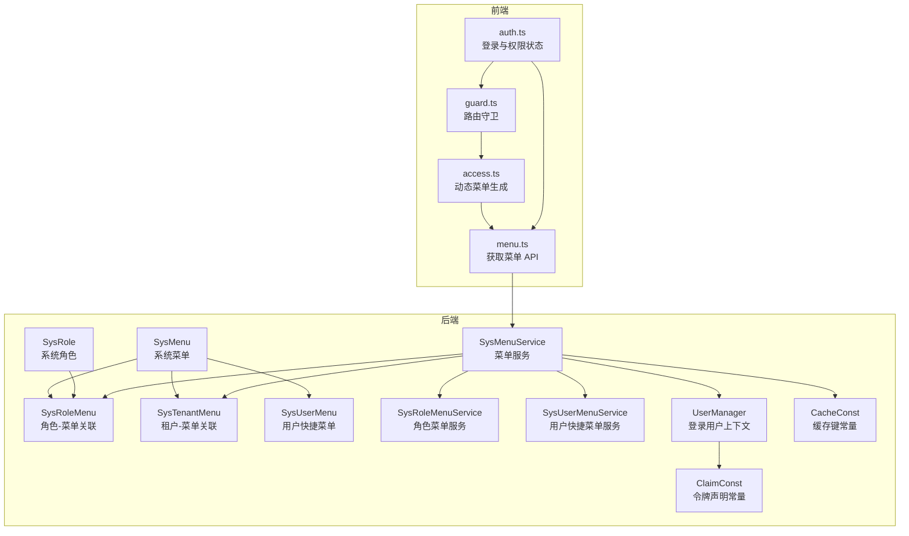
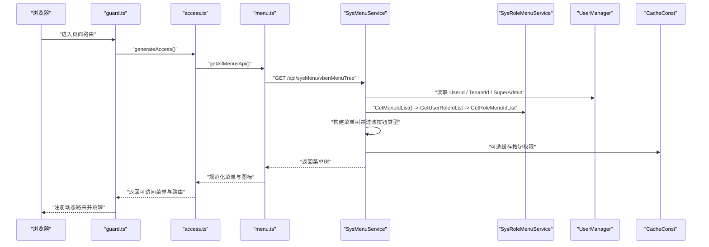
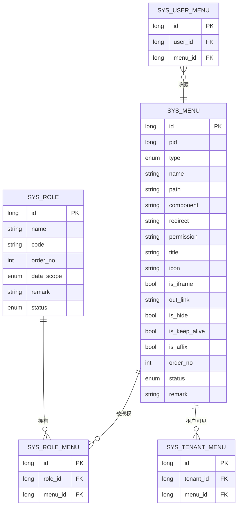
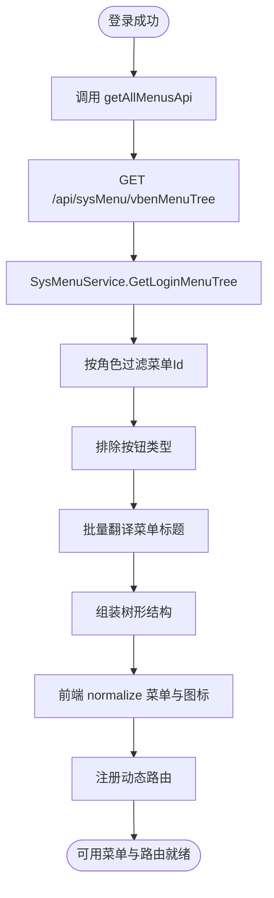
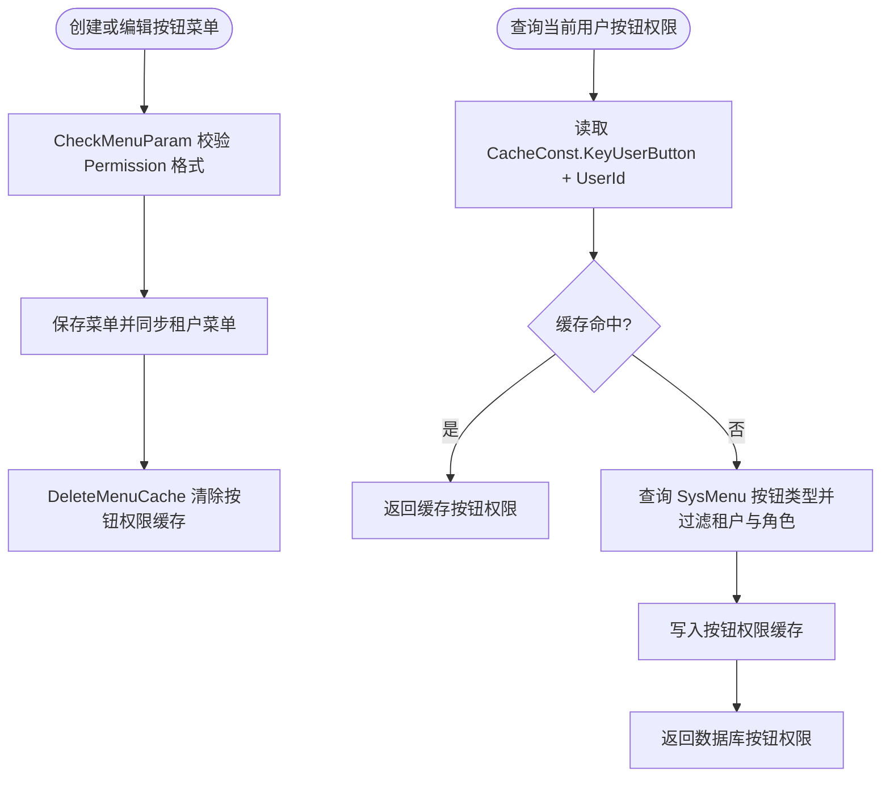
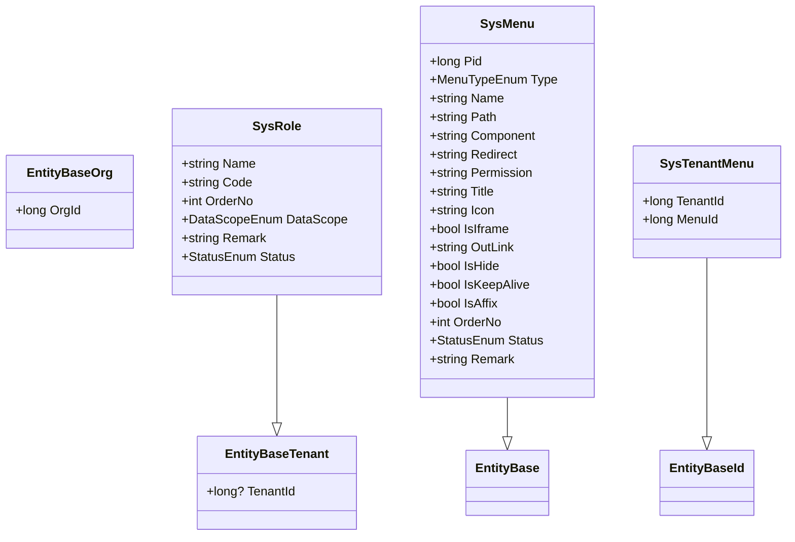
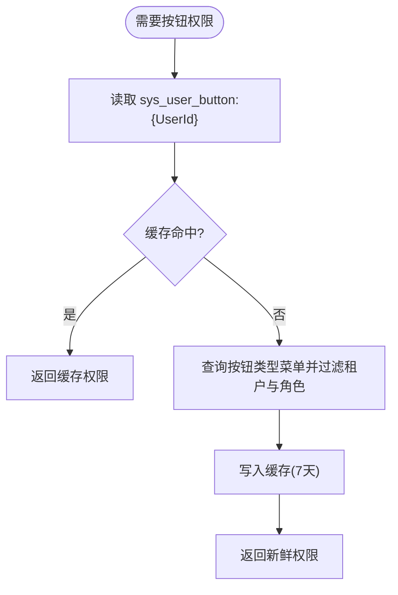
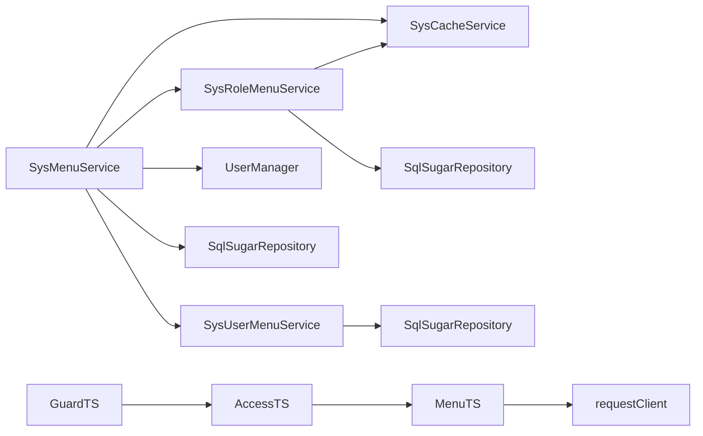

# 权限管理系统

<cite>
**本文引用的文件**   
- [SysMenu.cs](file://Admin.NET/Admin.NET.Core/Entity/SysMenu.cs)
- [SysRole.cs](file://Admin.NET/Admin.NET.Core/Entity/SysRole.cs)
- [SysUserMenu.cs](file://Admin.NET/Admin.NET.Core/Entity/SysUserMenu.cs)
- [SysRoleMenu.cs](file://Admin.NET/Admin.NET.Core/Entity/SysRoleMenu.cs)
- [SysTenantMenu.cs](file://Admin.NET/Admin.NET.Core/Entity/SysTenantMenu.cs)
- [DataScopeEnum.cs](file://Admin.NET/Admin.NET.Core/Enum/DataScopeEnum.cs)
- [MenuTypeEnum.cs](file://Admin.NET/Admin.NET.Core/Enum/MenuTypeEnum.cs)
- [StatusEnum.cs](file://Admin.NET/Admin.NET.Core/Enum/StatusEnum.cs)
- [AccountTypeEnum.cs](file://Admin.NET/Admin.NET.Core/Enum/AccountTypeEnum.cs)
- [EntityBase.cs](file://Admin.NET/Admin.NET.Core/Entity/EntityBase.cs)
- [IEntityFilter.cs](file://Admin.NET/Admin.NET.Core/Entity/IEntityFilter.cs)
- [SysMenuService.cs](file://Admin.NET/Admin.NET.Core/Service/Menu/SysMenuService.cs)
- [SysUserMenuService.cs](file://Admin.NET/Admin.NET.Core/Service/User/SysUserMenuService.cs)
- [SysRoleMenuService.cs](file://Admin.NET/Admin.NET.Core/Service/Role/SysRoleMenuService.cs)
- [UserManager.cs](file://Admin.NET/Admin.NET.Core/Service/User/UserManager.cs)
- [ClaimConst.cs](file://Admin.NET/Admin.NET.Core/Const/ClaimConst.cs)
- [CacheConst.cs](file://Admin.NET/Admin.NET.Core/Const/CacheConst.cs)
- [guard.ts](file://Web/apps/web-antdv-next/src/router/guard.ts)
- [access.ts](file://Web/apps/web-antdv-next/src/router/access.ts)
- [menu.ts](file://Web/apps/web-antdv-next/src/api/core/menu.ts)
- [auth.ts](file://Web/apps/web-antdv-next/src/store/auth.ts)
</cite>

## 目录
1. [引言](#引言)
2. [项目结构](#项目结构)
3. [核心组件](#核心组件)
4. [架构总览](#架构总览)
5. [详细组件分析](#详细组件分析)
6. [依赖关系分析](#依赖关系分析)
7. [性能与缓存优化](#性能与缓存优化)
8. [配置与使用示例](#配置与使用示例)
9. [故障排查指南](#故障排查指南)
10. [结论](#结论)

## 引言
本文件系统性说明 Admin.NET 的权限管理体系，重点覆盖以下方面：
- RBAC（基于角色的访问控制）模型：用户、角色、菜单的关联关系和数据模型。
- 菜单权限控制：动态菜单加载、前端路由守卫、按钮级权限标识。
- 数据权限范围：租户隔离、部门数据隔离、自定义数据范围。
- 权限缓存策略与性能优化。
- 后端权限验证流程与前端权限控制实现。

本说明以当前仓库源码为依据，前端业务入口为 `Web/apps/web-antdv-next`，后端权限能力集中在 `Admin.NET.Admin.NET.Core` 实体与服务层中。

## 项目结构
权限相关代码主要分布在如下位置：
- 后端领域模型：`Admin.NET/Admin.NET.Core/Entity`
- 后端枚举定义：`Admin.NET/Admin.NET.Core/Enum`
- 后端服务层：`Admin.NET/Admin.NET.Core/Service`
- 后端常量与上下文：`Admin.NET/Admin.NET.Core/Const`、`Admin.NET/Admin.NET.Core/Service/User`
- 前端路由守卫与动态菜单：`Web/apps/web-antdv-next/src/router`
- 前端 API 与状态管理：`Web/apps/web-antdv-next/src/api/core`、`Web/apps/web-antdv-next/src/store`

**图示来源**
- [SysMenu.cs:1-134](file://Admin.NET/Admin.NET.Core/Entity/SysMenu.cs#L1-L134)
- [SysRole.cs:1-56](file://Admin.NET/Admin.NET.Core/Entity/SysRole.cs#L1-L56)
- [SysRoleMenu.cs:1-35](file://Admin.NET/Admin.NET.Core/Entity/SysRoleMenu.cs#L1-L35)
- [SysTenantMenu.cs:1-27](file://Admin.NET/Admin.NET.Core/Entity/SysTenantMenu.cs#L1-L27)
- [SysUserMenu.cs:1-41](file://Admin.NET/Admin.NET.Core/Entity/SysUserMenu.cs#L1-L41)
- [SysMenuService.cs:1-494](file://Admin.NET/Admin.NET.Core/Service/Menu/SysMenuService.cs#L1-L494)
- [SysRoleMenuService.cs:1-100](file://Admin.NET/Admin.NET.Core/Service/Role/SysRoleMenuService.cs#L1-L100)
- [SysUserMenuService.cs:1-123](file://Admin.NET/Admin.NET.Core/Service/User/SysUserMenuService.cs#L1-L123)
- [UserManager.cs:12-66](file://Admin.NET/Admin.NET.Core/Service/User/UserManager.cs#L12-L66)
- [CacheConst.cs:1-128](file://Admin.NET/Admin.NET.Core/Const/CacheConst.cs#L1-L128)
- [ClaimConst.cs:17-72](file://Admin.NET/Admin.NET.Core/Const/ClaimConst.cs#L17-L72)
- [guard.ts:1-145](file://Web/apps/web-antdv-next/src/router/guard.ts#L1-L145)
- [access.ts:1-42](file://Web/apps/web-antdv-next/src/router/access.ts#L1-L42)
- [menu.ts:1-39](file://Web/apps/web-antdv-next/src/api/core/menu.ts#L1-L39)
- [auth.ts:1-234](file://Web/apps/web-antdv-next/src/store/auth.ts#L1-L234)

**章节来源**
- [SysMenu.cs:1-134](file://Admin.NET/Admin.NET.Core/Entity/SysMenu.cs#L1-L134)
- [SysRole.cs:1-56](file://Admin.NET/Admin.NET.Core/Entity/SysRole.cs#L1-L56)
- [SysMenuService.cs:1-494](file://Admin.NET/Admin.NET.Core/Service/Menu/SysMenuService.cs#L1-L494)
- [guard.ts:1-145](file://Web/apps/web-antdv-next/src/router/guard.ts#L1-L145)
- [access.ts:1-42](file://Web/apps/web-antdv-next/src/router/access.ts#L1-L42)
- [menu.ts:1-39](file://Web/apps/web-antdv-next/src/api/core/menu.ts#L1-L39)
- [auth.ts:1-234](file://Web/apps/web-antdv-next/src/store/auth.ts#L1-L234)

## 核心组件
权限体系的核心由“实体模型 + 服务 + 上下文 + 常量 + 前端路由”组成：

- **SysMenu**：菜单实体，包含类型、名称、路径、组件、权限标识、标题、图标、是否隐藏、排序、状态等字段。按钮类型菜单使用 `Permission` 作为权限标识；目录和菜单类型不设置该字段。
- **SysRole**：角色实体，继承租户基类，支持数据范围枚举 `DataScopeEnum`，用于数据权限控制。
- **SysRoleMenu**：角色-菜单关联表，建立角色对菜单的授权关系。
- **SysTenantMenu**：租户-菜单关联表，实现租户维度的菜单可见性。
- **SysUserMenu**：用户快捷菜单，记录用户对菜单的收藏或常用导航。
- **SysMenuService**：提供登录菜单树、菜单列表、按钮权限集合、菜单增删改、缓存清理等能力。
- **SysRoleMenuService**：负责角色菜单授权、批量授权、根据角色获取菜单 Id 列表。
- **SysUserMenuService**：负责用户快捷菜单收藏、取消收藏、查询当前用户收藏菜单。
- **UserManager**：从 HTTP 上下文中解析当前登录用户信息，包括用户 Id、租户 Id、账号类型、语言代码等。
- **ClaimConst / CacheConst**：JWT 声明键与缓存键常量。
- **前端 guard.ts / access.ts / menu.ts / auth.ts**：负责登录态检查、动态菜单加载、路由守卫、权限状态管理。

**章节来源**
- [SysMenu.cs:1-134](file://Admin.NET/Admin.NET.Core/Entity/SysMenu.cs#L1-L134)
- [SysRole.cs:1-56](file://Admin.NET/Admin.NET.Core/Entity/SysRole.cs#L1-L56)
- [SysRoleMenu.cs:1-35](file://Admin.NET/Admin.NET.Core/Entity/SysRoleMenu.cs#L1-L35)
- [SysTenantMenu.cs:1-27](file://Admin.NET/Admin.NET.Core/Entity/SysTenantMenu.cs#L1-L27)
- [SysUserMenu.cs:1-41](file://Admin.NET/Admin.NET.Core/Entity/SysUserMenu.cs#L1-L41)
- [SysMenuService.cs:1-494](file://Admin.NET/Admin.NET.Core/Service/Menu/SysMenuService.cs#L1-L494)
- [SysRoleMenuService.cs:1-100](file://Admin.NET/Admin.NET.Core/Service/Role/SysRoleMenuService.cs#L1-L100)
- [SysUserMenuService.cs:1-123](file://Admin.NET/Admin.NET.Core/Service/User/SysUserMenuService.cs#L1-L123)
- [UserManager.cs:12-66](file://Admin.NET/Admin.NET.Core/Service/User/UserManager.cs#L12-L66)
- [ClaimConst.cs:17-72](file://Admin.NET/Admin.NET.Core/Const/ClaimConst.cs#L17-L72)
- [CacheConst.cs:1-128](file://Admin.NET/Admin.NET.Core/Const/CacheConst.cs#L1-L128)

## 架构总览
权限架构分为三层：
1. **数据层**：菜单、角色、租户、用户快捷菜单实体。
2. **服务层**：菜单服务、角色菜单服务、用户快捷菜单服务，组合权限查询、缓存、翻译与租户过滤逻辑。
3. **表现层**：前端路由守卫、动态菜单生成、API 调用与状态存储。

**图示来源**
- [guard.ts:1-145](file://Web/apps/web-antdv-next/src/router/guard.ts#L1-L145)
- [access.ts:1-42](file://Web/apps/web-antdv-next/src/router/access.ts#L1-L42)
- [menu.ts:1-39](file://Web/apps/web-antdv-next/src/api/core/menu.ts#L1-L39)
- [SysMenuService.cs:1-494](file://Admin.NET/Admin.NET.Core/Service/Menu/SysMenuService.cs#L1-L494)
- [SysRoleMenuService.cs:1-100](file://Admin.NET/Admin.NET.Core/Service/Role/SysRoleMenuService.cs#L1-L100)
- [UserManager.cs:12-66](file://Admin.NET/Admin.NET.Core/Service/User/UserManager.cs#L12-L66)
- [CacheConst.cs:1-128](file://Admin.NET/Admin.NET.Core/Const/CacheConst.cs#L1-L128)

## 详细组件分析

### RBAC 数据模型与用户-角色-菜单关联
RBAC 在 Admin.NET 中通过以下实体实现：
- 用户通过角色获得菜单权限，角色与菜单通过 `SysRoleMenu` 关联。
- 菜单按类型区分目录、菜单、按钮；按钮菜单使用 `Permission` 作为权限标识。
- 租户维度通过 `SysTenantMenu` 控制哪些菜单对租户可见。
- 用户快捷菜单通过 `SysUserMenu` 记录用户对菜单的收藏。

**图示来源**
- [SysMenu.cs:1-134](file://Admin.NET/Admin.NET.Core/Entity/SysMenu.cs#L1-L134)
- [SysRole.cs:1-56](file://Admin.NET/Admin.NET.Core/Entity/SysRole.cs#L1-L56)
- [SysRoleMenu.cs:1-35](file://Admin.NET/Admin.NET.Core/Entity/SysRoleMenu.cs#L1-L35)
- [SysTenantMenu.cs:1-27](file://Admin.NET/Admin.NET.Core/Entity/SysTenantMenu.cs#L1-L27)
- [SysUserMenu.cs:1-41](file://Admin.NET/Admin.NET.Core/Entity/SysUserMenu.cs#L1-L41)

**章节来源**
- [SysMenu.cs:1-134](file://Admin.NET/Admin.NET.Core/Entity/SysMenu.cs#L1-L134)
- [SysRole.cs:1-56](file://Admin.NET/Admin.NET.Core/Entity/SysRole.cs#L1-L56)
- [SysRoleMenu.cs:1-35](file://Admin.NET/Admin.NET.Core/Entity/SysRoleMenu.cs#L1-L35)
- [SysTenantMenu.cs:1-27](file://Admin.NET/Admin.NET.Core/Entity/SysTenantMenu.cs#L1-L27)
- [SysUserMenu.cs:1-41](file://Admin.NET/Admin.NET.Core/Entity/SysUserMenu.cs#L1-L41)

### 菜单权限控制机制
菜单权限控制分为后端计算与前端展示两部分：

- **后端菜单树构建**：
  - `SysMenuService.GetLoginMenuTree` 获取当前用户登录菜单树。
  - 非超级管理员时，先通过 `GetMenuIdList` 获取用户角色对应的菜单 Id 集合，再过滤菜单。
  - 排除按钮类型菜单，只返回目录与菜单类型。
  - 根据语言代码进行批量翻译，避免重复开销。
  - 将扁平菜单组装为树形结构并转换为输出 DTO。

- **前端动态菜单加载**：
  - `menu.ts` 暴露 `getAllMenusApi`，调用 `/api/sysMenu/vbenMenuTree` 获取菜单。
  - `access.ts` 使用 `@vben/access` 的 `generateAccessible` 生成菜单与路由，并可配置无权限时的 403 页面。
  - `guard.ts` 在路由守卫中判断登录态、是否已生成动态路由，并调用 `generateAccess` 完成最终路由注册与跳转。

**图示来源**
- [SysMenuService.cs:1-494](file://Admin.NET/Admin.NET.Core/Service/Menu/SysMenuService.cs#L1-L494)
- [menu.ts:1-39](file://Web/apps/web-antdv-next/src/api/core/menu.ts#L1-L39)
- [access.ts:1-42](file://Web/apps/web-antdv-next/src/router/access.ts#L1-L42)
- [guard.ts:1-145](file://Web/apps/web-antdv-next/src/router/guard.ts#L1-L145)

**章节来源**
- [SysMenuService.cs:1-494](file://Admin.NET/Admin.NET.Core/Service/Menu/SysMenuService.cs#L1-L494)
- [menu.ts:1-39](file://Web/apps/web-antdv-next/src/api/core/menu.ts#L1-L39)
- [access.ts:1-42](file://Web/apps/web-antdv-next/src/router/access.ts#L1-L42)
- [guard.ts:1-145](file://Web/apps/web-antdv-next/src/router/guard.ts#L1-L145)

### 按钮级权限的实现
按钮级权限通过菜单实体的 `Permission` 字段表达，并在菜单服务和缓存中统一管理：

- **后端按钮权限校验**：
  - `SysMenuService.CheckMenuParam` 强制按钮类型菜单必须包含 `Permission`，且格式需包含冒号。
  - `SysMenuService.GetOwnBtnPermList` 获取当前用户的按钮权限集合，优先从缓存读取，否则查询数据库并按租户和用户角色过滤。
  - 按钮权限缓存键使用 `CacheConst.KeyUserButton`，并以用户 Id 作为键后缀。

- **前端按钮权限展示**：
  - 登录成功后，`auth.ts` 将用户信息中的按钮集合写入 `accessStore.setAccessCodes`，供前端指令或函数判断按钮显示。
  - 当前前端仓库未直接发现 `v-permission` 指令实现，但权限状态已通过 `accessStore` 暴露，可在业务组件中按需判断。

**图示来源**
- [SysMenuService.cs:200-494](file://Admin.NET/Admin.NET.Core/Service/Menu/SysMenuService.cs#L200-L494)
- [CacheConst.cs:1-128](file://Admin.NET/Admin.NET.Core/Const/CacheConst.cs#L1-L128)
- [auth.ts:200-234](file://Web/apps/web-antdv-next/src/store/auth.ts#L200-L234)

**章节来源**
- [SysMenuService.cs:200-494](file://Admin.NET/Admin.NET.Core/Service/Menu/SysMenuService.cs#L200-L494)
- [CacheConst.cs:1-128](file://Admin.NET/Admin.NET.Core/Const/CacheConst.cs#L1-L128)
- [auth.ts:200-234](file://Web/apps/web-antdv-next/src/store/auth.ts#L200-L234)

### 数据权限范围控制
数据权限围绕角色数据范围与租户隔离展开：

- **角色数据范围**：
  - `SysRole.DataScope` 使用 `DataScopeEnum`，支持全部数据、本部门及以下、本部门、仅本人、自定义数据。
  - 该字段可用于在服务层扩展数据查询条件，结合机构维度实现细粒度数据隔离。

- **租户隔离**：
  - 多数实体继承 `EntityBaseTenant`，包含 `TenantId` 字段。
  - `SysTenantMenu` 维护租户与菜单的关联，菜单服务在查询菜单时使用 `GetSugarQueryableAndTenantId` 构建带租户过滤的查询。
  - 超级管理员具有更宽泛的菜单范围，普通用户只能看到其租户下的菜单。

- **机构数据权限**：
  - `EntityBaseOrg` 与 `IOrgIdFilter` 提供机构维度基础字段与接口，适合后续扩展部门数据权限规则。

**图示来源**
- [EntityBase.cs:1-200](file://Admin.NET/Admin.NET.Core/Entity/EntityBase.cs#L1-L200)
- [SysRole.cs:1-56](file://Admin.NET/Admin.NET.Core/Entity/SysRole.cs#L1-L56)
- [SysMenu.cs:1-134](file://Admin.NET/Admin.NET.Core/Entity/SysMenu.cs#L1-L134)
- [SysTenantMenu.cs:1-27](file://Admin.NET/Admin.NET.Core/Entity/SysTenantMenu.cs#L1-L27)

**章节来源**
- [SysRole.cs:1-56](file://Admin.NET/Admin.NET.Core/Entity/SysRole.cs#L1-L56)
- [DataScopeEnum.cs:1-44](file://Admin.NET/Admin.NET.Core/Enum/DataScopeEnum.cs#L1-L44)
- [EntityBase.cs:1-200](file://Admin.NET/Admin.NET.Core/Entity/EntityBase.cs#L1-L200)
- [IEntityFilter.cs:1-40](file://Admin.NET/Admin.NET.Core/Entity/IEntityFilter.cs#L1-L40)
- [SysMenuService.cs:430-494](file://Admin.NET/Admin.NET.Core/Service/Menu/SysMenuService.cs#L430-L494)

### 权限缓存策略与性能优化
权限相关缓存主要集中在按钮权限集合：

- **缓存键设计**：
  - `CacheConst.KeyUserButton` 作为按钮权限缓存前缀。
  - 用户级别缓存键为 `sys_user_button:{UserId}`。
  - 系统级所有按钮权限缓存键为 `sys_user_button:0`。

- **缓存读写流程**：
  - `SysMenuService.GetOwnBtnPermList` 优先读取用户按钮权限缓存；若未命中则查询数据库并按租户与角色过滤，最后写入缓存。
  - `SysMenuService.GetAllBtnPermList` 提供系统级按钮权限缓存，便于全局校验。
  - 菜单变更（新增、更新、删除、授权）会调用 `DeleteMenuCache` 清除按钮权限缓存，保证一致性。

- **性能优化要点**：
  - 菜单标题批量翻译避免多次数据库交互。
  - 菜单树构建后转换为输出 DTO，减少前端转换开销。
  - 超管与普通用户采用不同查询路径，减少无效 JOIN 与过滤。

**图示来源**
- [SysMenuService.cs:430-494](file://Admin.NET/Admin.NET.Core/Service/Menu/SysMenuService.cs#L430-L494)
- [CacheConst.cs:1-128](file://Admin.NET/Admin.NET.Core/Const/CacheConst.cs#L1-L128)

**章节来源**
- [SysMenuService.cs:430-494](file://Admin.NET/Admin.NET.Core/Service/Menu/SysMenuService.cs#L430-L494)
- [CacheConst.cs:1-128](file://Admin.NET/Admin.NET.Core/Const/CacheConst.cs#L1-L128)

## 依赖关系分析
权限模块的主要依赖关系如下：

- `SysMenuService` 依赖：
  - `SqlSugarRepository<SysTenantMenu>`、`SqlSugarRepository<SysMenu>`
  - `SysRoleMenuService`、`SysUserRoleService`、`SysUserMenuService`
  - `SysCacheService`、`UserManager`、`SysLangTextCacheService`、`SysLangTextService`

- `SysRoleMenuService` 依赖：
  - `SqlSugarRepository<SysRoleMenu>`、`SysCacheService`

- `SysUserMenuService` 依赖：
  - `SqlSugarRepository<SysUserMenu>`、`UserManager`

- 前端依赖：
  - `guard.ts` 依赖 `@vben/stores`、`@vben/preferences`、`router`、`access.ts`
  - `access.ts` 依赖 `@vben/access`、`menu.ts`
  - `menu.ts` 依赖 `requestClient`、各菜单归一化函数

**图示来源**
- [SysMenuService.cs:1-494](file://Admin.NET/Admin.NET.Core/Service/Menu/SysMenuService.cs#L1-L494)
- [SysRoleMenuService.cs:1-100](file://Admin.NET/Admin.NET.Core/Service/Role/SysRoleMenuService.cs#L1-L100)
- [SysUserMenuService.cs:1-123](file://Admin.NET/Admin.NET.Core/Service/User/SysUserMenuService.cs#L1-L123)
- [guard.ts:1-145](file://Web/apps/web-antdv-next/src/router/guard.ts#L1-L145)
- [access.ts:1-42](file://Web/apps/web-antdv-next/src/router/access.ts#L1-L42)
- [menu.ts:1-39](file://Web/apps/web-antdv-next/src/api/core/menu.ts#L1-L39)

**章节来源**
- [SysMenuService.cs:1-494](file://Admin.NET/Admin.NET.Core/Service/Menu/SysMenuService.cs#L1-L494)
- [SysRoleMenuService.cs:1-100](file://Admin.NET/Admin.NET.Core/Service/Role/SysRoleMenuService.cs#L1-L100)
- [SysUserMenuService.cs:1-123](file://Admin.NET/Admin.NET.Core/Service/User/SysUserMenuService.cs#L1-L123)
- [guard.ts:1-145](file://Web/apps/web-antdv-next/src/router/guard.ts#L1-L145)
- [access.ts:1-42](file://Web/apps/web-antdv-next/src/router/access.ts#L1-L42)
- [menu.ts:1-39](file://Web/apps/web-antdv-next/src/api/core/menu.ts#L1-L39)

## 性能与缓存优化
- **菜单标题批量翻译**：在后端对菜单列表进行批量翻译，避免逐条翻译带来的额外请求与数据库压力。
- **按钮权限缓存**：使用固定过期时间的缓存键存储用户按钮权限，减少高频权限校验对数据库的影响。
- **菜单树构造优化**：先查询主表再构建树，避免复杂 JOIN 导致的性能问题；对超管与普通用户采用不同查询策略。
- **缓存失效策略**：菜单增删改及角色授权操作后统一清理按钮权限缓存，保证权限变更后尽快生效。

[本节为通用性能建议，不直接分析具体文件]

## 配置与使用示例
以下示例描述如何在 Admin.NET 中配置并使用权限功能，不涉及具体代码内容：

- **配置菜单类型与权限标识**：
  - 目录和菜单类型：设置 `Type` 为目录或菜单，填写 `Title`、`Path`、`Component`、`Icon`、`OrderNo`、`Status`。
  - 按钮类型：设置 `Type` 为按钮，必填 `Permission`，格式应包含冒号，例如表示资源与动作的组合。
  - 参考路径：[SysMenu.cs:20-64](file://Admin.NET/Admin.NET.Core/Entity/SysMenu.cs#L20-L64)、[SysMenuService.cs:360-430](file://Admin.NET/Admin.NET.Core/Service/Menu/SysMenuService.cs#L360-L430)

- **分配角色菜单权限**：
  - 使用 `SysRoleMenuService.GrantRoleMenu` 将菜单授权给角色；该服务会自动补充父级菜单，确保树形完整性。
  - 参考路径：[SysRoleMenuService.cs:30-100](file://Admin.NET/Admin.NET.Core/Service/Role/SysRoleMenuService.cs#L30-L100)

- **前端获取菜单并生成路由**：
  - 登录成功后调用 `getAllMenusApi`，并通过 `generateAccessible` 生成菜单与路由。
  - 参考路径：[menu.ts:1-39](file://Web/apps/web-antdv-next/src/api/core/menu.ts#L1-L39)、[access.ts:1-42](file://Web/apps/web-antdv-next/src/router/access.ts#L1-L42)

- **前端路由守卫与登录态检查**：
  - 在 `guard.ts` 中检查 token、是否需要鉴权、是否已生成动态路由，必要时跳转登录页。
  - 参考路径：[guard.ts:1-145](file://Web/apps/web-antdv-next/src/router/guard.ts#L1-L145)

- **前端按钮权限展示**：
  - 登录后将用户按钮权限存入 `accessStore`，在组件中根据权限集合决定是否渲染按钮。
  - 参考路径：[auth.ts:200-234](file://Web/apps/web-antdv-next/src/store/auth.ts#L200-L234)

**章节来源**
- [SysMenu.cs:20-64](file://Admin.NET/Admin.NET.Core/Entity/SysMenu.cs#L20-L64)
- [SysMenuService.cs:360-430](file://Admin.NET/Admin.NET.Core/Service/Menu/SysMenuService.cs#L360-L430)
- [SysRoleMenuService.cs:30-100](file://Admin.NET/Admin.NET.Core/Service/Role/SysRoleMenuService.cs#L30-L100)
- [menu.ts:1-39](file://Web/apps/web-antdv-next/src/api/core/menu.ts#L1-L39)
- [access.ts:1-42](file://Web/apps/web-antdv-next/src/router/access.ts#L1-L42)
- [guard.ts:1-145](file://Web/apps/web-antdv-next/src/router/guard.ts#L1-L145)
- [auth.ts:200-234](file://Web/apps/web-antdv-next/src/store/auth.ts#L200-L234)

## 故障排查指南
常见问题与排查思路：

- **菜单不显示**：
  - 检查菜单状态是否为启用，类型是否为目录或菜单。
  - 确认角色是否已授权该菜单，并检查租户菜单关联是否正确。
  - 参考路径：[SysMenuService.cs:1-200](file://Admin.NET/Admin.NET.Core/Service/Menu/SysMenuService.cs#L1-L200)、[SysTenantMenu.cs:1-27](file://Admin.NET/Admin.NET.Core/Entity/SysTenantMenu.cs#L1-L27)

- **按钮权限无效**：
  - 检查按钮菜单的 `Permission` 是否符合规范。
  - 确认按钮权限缓存是否被正确清理。
  - 参考路径：[SysMenuService.cs:360-430](file://Admin.NET/Admin.NET.Core/Service/Menu/SysMenuService.cs#L360-L430)、[CacheConst.cs:1-128](file://Admin.NET/Admin.NET.Core/Const/CacheConst.cs#L1-L128)

- **前端路由未生成**：
  - 检查 `guard.ts` 中是否已调用 `generateAccess`。
  - 确认 `access.ts` 是否正确调用 `getAllMenusApi`。
  - 参考路径：[guard.ts:1-145](file://Web/apps/web-antdv-next/src/router/guard.ts#L1-L145)、[access.ts:1-42](file://Web/apps/web-antdv-next/src/router/access.ts#L1-L42)

- **多租户菜单异常**：
  - 确认当前用户租户 Id 与菜单租户关联一致。
  - 检查 `GetSugarQueryableAndTenantId` 的租户过滤逻辑。
  - 参考路径：[SysMenuService.cs:430-494](file://Admin.NET/Admin.NET.Core/Service/Menu/SysMenuService.cs#L430-L494)

**章节来源**
- [SysMenuService.cs:1-200](file://Admin.NET/Admin.NET.Core/Service/Menu/SysMenuService.cs#L1-L200)
- [SysTenantMenu.cs:1-27](file://Admin.NET/Admin.NET.Core/Entity/SysTenantMenu.cs#L1-L27)
- [SysMenuService.cs:360-430](file://Admin.NET/Admin.NET.Core/Service/Menu/SysMenuService.cs#L360-L430)
- [CacheConst.cs:1-128](file://Admin.NET/Admin.NET.Core/Const/CacheConst.cs#L1-L128)
- [guard.ts:1-145](file://Web/apps/web-antdv-next/src/router/guard.ts#L1-L145)
- [access.ts:1-42](file://Web/apps/web-antdv-next/src/router/access.ts#L1-L42)
- [SysMenuService.cs:430-494](file://Admin.NET/Admin.NET.Core/Service/Menu/SysMenuService.cs#L430-L494)

## 结论
Admin.NET 的权限管理系统以 RBAC 为核心，通过菜单、角色、租户与用户快捷菜单等多维度数据模型实现灵活的权限控制。后端通过菜单服务与服务层组合逻辑完成动态菜单构建、按钮权限校验与缓存管理；前端通过路由守卫与动态菜单生成实现界面侧的权限展示与路由保护。数据权限通过角色数据范围与租户隔离进一步细化，满足多租户与部门级数据访问需求。整体方案具备良好的可扩展性与性能优化空间，适合在企业级后台系统中落地与演进。