# 核心功能

<cite>
**本文引用的文件**   
- [README.md](file://README.md)
- [SysUser.cs](file://Admin.NET/Admin.NET.Core/Entity/SysUser.cs)
- [SysRole.cs](file://Admin.NET/Admin.NET.Core/Entity/SysRole.cs)
- [SysTenant.cs](file://Admin.NET/Admin.NET.Core/Entity/SysTenant.cs)
- [SysJobDetail.cs](file://Admin.NET/Admin.NET.Core/Entity/SysJobDetail.cs)
- [SysFile.cs](file://Admin.NET/Admin.NET.Core/Entity/SysFile.cs)
- [SysAuthService.cs](file://Admin.NET/Admin.NET.Core/Service/Auth/SysAuthService.cs)
- [SysLdapService.cs](file://Admin.NET/Admin.NET.Core/Service/Auth/SysLdapService.cs)
- [SysOAuthService.cs](file://Admin.NET/Admin.NET.Core/Service/OAuth/SysOAuthService.cs)
- [LoginModeEnum.cs](file://Admin.NET/Admin.NET.Core/Enum/LoginModeEnum.cs)
- [DataScopeEnum.cs](file://Admin.NET/Admin.NET.Core/Enum/DataScopeEnum.cs)
- [SysTenantService.cs](file://Admin.NET/Admin.NET.Core/Service/Tenant/SysTenantService.cs)
- [SysJobService.cs](file://Admin.NET/Admin.NET.Core/Service/Job/SysJobService.cs)
- [SysFileService.cs](file://Admin.NET/Admin.NET.Core/Service/File/SysFileService.cs)
- [SysCodeGenService.cs](file://Admin.NET/Admin.NET.Core/Service/CodeGen/SysCodeGenService.cs)
- [SysUserService.cs](file://Admin.NET/Admin.NET.Core/Service/User/SysUserService.cs)
- [SysMenuService.cs](file://Admin.NET/Admin.NET.Core/Service/Menu/SysMenuService.cs)
- [SysOrgService.cs](file://Admin.NET/Admin.NET.Core/Service/Org/SysOrgService.cs)
- [DatabaseLoggingWriter.cs](file://Admin.NET/Admin.NET.Core/Logging/DatabaseLoggingWriter.cs)
</cite>

## 目录
1. [引言](#引言)
2. [项目结构](#项目结构)
3. [核心组件总览](#核心组件总览)
4. [架构总览](#架构总览)
5. [认证与授权系统](#认证与授权系统)
6. [权限管理系统](#权限管理系统)
7. [多租户架构](#多租户架构)
8. [用户与组织机构管理](#用户与组织机构管理)
9. [任务调度系统](#任务调度系统)
10. [文件管理系统](#文件管理系统)
11. [日志监控系统](#日志监控系统)
12. [代码生成系统](#代码生成系统)
13. [在线构建器与文档导出](#在线构建器与文档导出)
14. [依赖关系分析](#依赖关系分析)
15. [性能与可运维性](#性能与可运维性)
16. [常见业务场景与最佳实践](#常见业务场景与最佳实践)
17. [故障排查指南](#故障排查指南)
18. [结论](#结论)

## 引言
本文件面向 Admin.NET 平台的核心业务能力，围绕当前仓库中已实现的 .NET 后端能力与已移植的前端应用入口 `Web/apps/web-antdv-next/` 进行说明。框架基于 ASP.NET Core、Furion 和 SqlSugar，提供多租户、权限管理、任务调度、消息通知、文件管理、代码生成、打印与 PDF 输出等通用能力。前端使用 Vue 3、Vben、antdv-next 和 Vite，并通过 pnpm workspace 组织应用与共享包。

后端主入口位于 `Admin.NET/Admin.NET.Web.Entry/`，API 与共享能力集中在 `Admin.NET.Admin.NET.Core` 与 `Admin.NET.Admin.NET.Application`，业务扩展建议放在独立应用工程或既有 `Admin.NET.Admin.NET.Application` 中。

**章节来源**
- [README.md:1-60](file://README.md#L1-L60)

## 项目结构
仓库采用前后端分离与模块化设计：
- 后端共享工程按职责划分到 `Core` 与 `Application`；Web 层由 `Web.Core` 与 `Web.Entry` 组装。
- 前端业务页面在 `Web/apps/web-antdv-next/src/views/`，接口封装与路由沿用当前应用结构。
- 插件工程位于 `Admin.NET/Plugins/`，可按需启用钉钉、企业微信、GoView、数据桥接等能力。

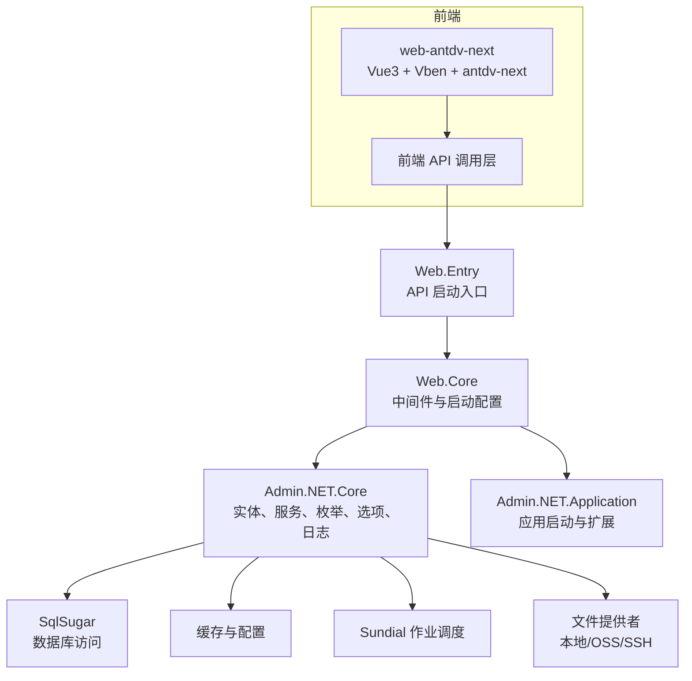

**图表来源**
- [README.md:1-60](file://README.md#L1-L60)
- [SysAuthService.cs:1-60](file://Admin.NET/Admin.NET.Core/Service/Auth/SysAuthService.cs#L1-L60)
- [SysFileService.cs:1-60](file://Admin.NET/Admin.NET.Core/Service/File/SysFileService.cs#L1-L60)

**章节来源**
- [README.md:1-60](file://README.md#L1-L60)

## 核心组件总览
| 领域 | 关键实体或服务 | 业务价值 | 主要实现要点 |
|---|---|---|---|
| 认证与登录 | `SysAuthService`、`SysLdapService`、`SysOAuthService` | 统一账号密码、域账户、第三方 OAuth 登录 | JWT 令牌、验证码、错误次数限制、LDAP 校验、第三方回调 |
| 权限 | `SysMenuService`、`SysRoleService`、`SysUserRoleService`、`DataScopeEnum` | RBAC 菜单按钮权限与数据范围控制 | 角色绑定菜单、用户按钮权限缓存、数据范围过滤 |
| 多租户 | `SysTenantService`、`SysTenant` | 租户隔离、域名识别、数据库切换 | Id 隔离与库隔离、读写从库、租户菜单与配置 |
| 用户与机构 | `SysUserService`、`SysOrgService` | 用户生命周期、组织架构树、职务与扩展机构 | 分页查询、新增注册、角色与扩展机构联动 |
| 任务调度 | `SysJobService`、`SysJobDetail` | 定时任务、脚本任务、HTTP 任务 | Sundial 集成、动态编译、触发器与集群 |
| 文件管理 | `SysFileService`、`SysFile` | 上传、下载、预览、云存储 | Default/OSS/SSH/MultiOSS 提供者 |
| 日志监控 | `DatabaseLoggingWriter`、日志实体 | 操作日志、异常日志、访问日志 | 批量写入、IP 定位、设备信息、告警邮件 |
| 代码生成 | `SysCodeGenService` | 快速生成前后端代码 | 元数据同步、事务保护、菜单标题联动 |
| 在线构建器与 PDF | 前端 PDFME 组件与后端模板/导入导出 | 拖拽表单设计、PDF 报告输出 | 模板变量渲染、Magicodes.IE 导出 |

**章节来源**
- [SysAuthService.cs:1-120](file://Admin.NET/Admin.NET.Core/Service/Auth/SysAuthService.cs#L1-L120)
- [SysMenuService.cs:1-120](file://Admin.NET/Admin.NET.Core/Service/Menu/SysMenuService.cs#L1-L120)
- [SysTenantService.cs:1-120](file://Admin.NET/Admin.NET.Core/Service/Tenant/SysTenantService.cs#L1-L120)
- [SysUserService.cs:1-120](file://Admin.NET/Admin.NET.Core/Service/User/SysUserService.cs#L1-L120)
- [SysJobService.cs:1-120](file://Admin.NET/Admin.NET.Core/Service/Job/SysJobService.cs#L1-L120)
- [SysFileService.cs:1-120](file://Admin.NET/Admin.NET.Core/Service/File/SysFileService.cs#L1-L120)
- [DatabaseLoggingWriter.cs:1-120](file://Admin.NET/Admin.NET.Core/Logging/DatabaseLoggingWriter.cs#L1-L120)
- [SysCodeGenService.cs:1-120](file://Admin.NET/Admin.NET.Core/Service/CodeGen/SysCodeGenService.cs#L1-L120)

## 架构总览
Admin.NET 的核心架构围绕“身份—权限—租户—资源”展开：
- 用户通过认证服务获取 JWT；JWT 中包含用户身份、租户、角色与权限标识。
- 权限引擎根据角色与菜单/按钮关系决定用户可见菜单与可操作按钮。
- 多租户上下文由 UserManager 维护，SqlSugar 按租户选择连接或过滤数据。
- 资源如文件、任务、日志均受租户与权限约束。

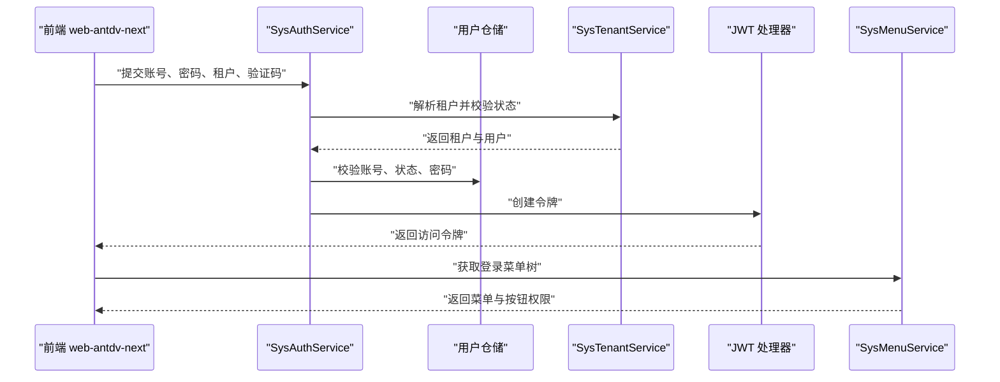

**图表来源**
- [SysAuthService.cs:60-160](file://Admin.NET/Admin.NET.Core/Service/Auth/SysAuthService.cs#L60-L160)
- [SysTenantService.cs:120-220](file://Admin.NET/Admin.NET.Core/Service/Tenant/SysTenantService.cs#L120-L220)
- [SysMenuService.cs:120-220](file://Admin.NET/Admin.NET.Core/Service/Menu/SysMenuService.cs#L120-L220)

## 认证与授权系统
### 业务价值
为平台提供统一的身份认证与多种登录方式，支持账号密码、域账户、第三方 OAuth，并在登录成功后颁发 JWT，用于后续菜单、按钮与数据权限校验。

### 实现原理
- **账号密码登录**：校验验证码、密码错误次数、账号状态；可选择是否开启域登录验证；成功则清理按钮权限缓存并生成令牌。
- **域账户 LDAP**：读取租户启用的 LDAP 配置，建立连接并执行 Bind 认证；支持版本、BaseDn、BindDn、AuthFilter、属性映射与安全参数。
- **第三方 OAuth**：通过 AspNet.Security.OAuth.Providers 发起 Challenge，回调后提取 OpenId、姓名、邮箱、头像等，若未绑定用户则自动创建用户并分配默认角色，再签发令牌并重定向回前端。
- **登录模式**：枚举 `LoginModeEnum` 区分 PC 与 APP 模式，便于前端适配不同交互流程。

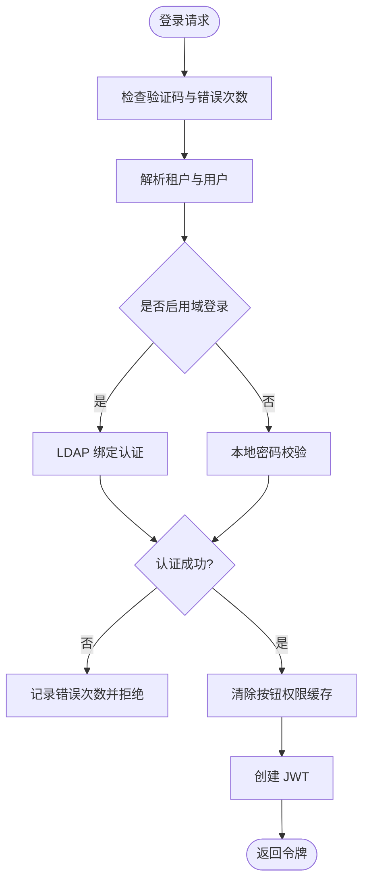

**图表来源**
- [SysAuthService.cs:60-160](file://Admin.NET/Admin.NET.Core/Service/Auth/SysAuthService.cs#L60-L160)
- [SysLdapService.cs:1-120](file://Admin.NET/Admin.NET.Core/Service/Auth/SysLdapService.cs#L1-L120)
- [SysOAuthService.cs:1-120](file://Admin.NET/Admin.NET.Core/Service/OAuth/SysOAuthService.cs#L1-L120)
- [LoginModeEnum.cs:1-26](file://Admin.NET/Admin.NET.Core/Enum/LoginModeEnum.cs#L1-L26)

### 配置选项与使用示例
- **验证码开关**：通过配置控制是否启用验证码。
- **密码最大错误次数**：未配置或误配时默认允许 5 次。
- **域登录开关**：开启后优先走 LDAP 认证路径。
- **第三方 Provider**：需在 OAuth 设置中启用对应 Provider；回调地址由服务端自动拼接。
- **使用示例**：前端先调用登录接口，成功后将 Token 存入浏览器存储；后续请求携带 Token 访问受限 API。

**章节来源**
- [SysAuthService.cs:60-160](file://Admin.NET/Admin.NET.Core/Service/Auth/SysAuthService.cs#L60-L160)
- [SysLdapService.cs:120-320](file://Admin.NET/Admin.NET.Core/Service/Auth/SysLdapService.cs#L120-L320)
- [SysOAuthService.cs:1-120](file://Admin.NET/Admin.NET.Core/Service/OAuth/SysOAuthService.cs#L1-L120)
- [LoginModeEnum.cs:1-26](file://Admin.NET/Admin.NET.Core/Enum/LoginModeEnum.cs#L1-L26)

## 权限管理系统
### 业务价值
实现 RBAC 模型下的菜单权限、按钮权限与数据权限，使不同角色在不同租户下拥有差异化的功能访问与数据可见范围。

### 实现原理
- **RBAC 模型**：用户—角色—菜单/按钮—数据范围；角色绑定菜单后，用户继承角色权限。
- **菜单权限**：非超级管理员和非系统管理员需要按角色计算可访问菜单 ID 列表，再构造树形菜单；支持国际化翻译。
- **按钮权限**：登录后会清理按钮权限缓存，确保菜单或角色变更后按钮显示即时生效。
- **数据权限**：角色定义 `DataScopeEnum`，包括全部数据、本部门及以下、本部门、仅本人、自定义数据；结合组织机构树进行数据过滤。

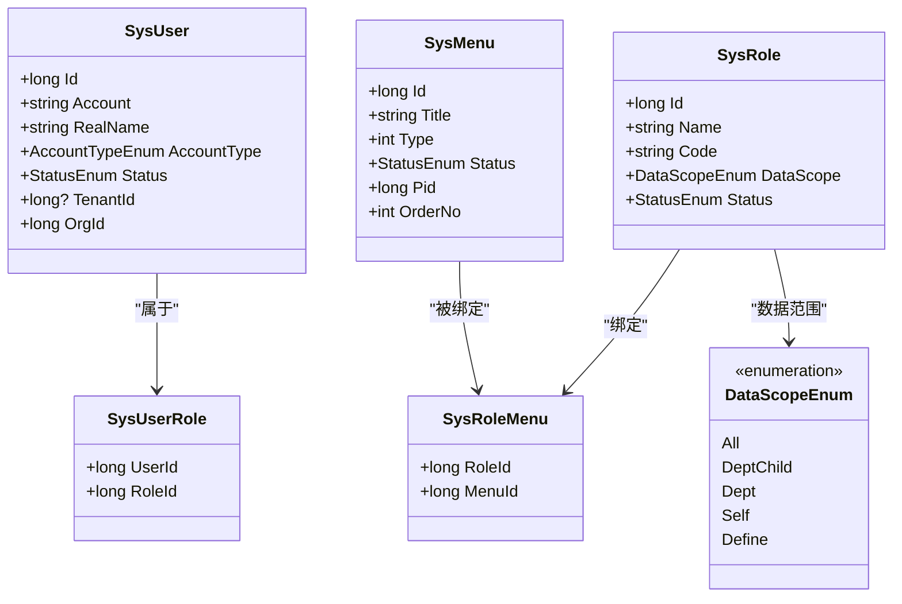

**图表来源**
- [SysUser.cs:1-120](file://Admin.NET/Admin.NET.Core/Entity/SysUser.cs#L1-L120)
- [SysRole.cs:1-56](file://Admin.NET/Admin.NET.Core/Entity/SysRole.cs#L1-L56)
- [SysMenuService.cs:1-120](file://Admin.NET/Admin.NET.Core/Service/Menu/SysMenuService.cs#L1-L120)
- [DataScopeEnum.cs:1-44](file://Admin.NET/Admin.NET.Core/Enum/DataScopeEnum.cs#L1-L44)

### 配置选项与使用示例
- **菜单类型**：目录、菜单、按钮，不同类型用于控制导航与操作权限。
- **角色数据范围**：在角色上设置数据范围，影响查询时的数据过滤条件。
- **使用示例**：管理员在菜单管理中为角色绑定菜单，在角色管理中设置数据范围；普通用户登录后只能看到其权限范围内的菜单与按钮。

**章节来源**
- [SysMenuService.cs:1-220](file://Admin.NET/Admin.NET.Core/Service/Menu/SysMenuService.cs#L1-L220)
- [SysRole.cs:1-56](file://Admin.NET/Admin.NET.Core/Entity/SysRole.cs#L1-L56)
- [DataScopeEnum.cs:1-44](file://Admin.NET/Admin.NET.Core/Enum/DataScopeEnum.cs#L1-L44)

## 多租户架构
### 业务价值
为 SaaS 或多部门系统提供租户隔离能力，支持按 Id 隔离或按数据库隔离，并可配置域名识别、从库读写分离、租户菜单与配置。

### 实现原理
- **租户模型**：`SysTenant` 包含域名、租户类型、数据库类型、连接串、从库连接、注册开关、Logo、标题等。
- **租户解析**：登录时按传入租户或用户所属租户解析；匿名入口可通过 Host 匹配默认租户。
- **Id 隔离与库隔离**：Id 隔离复用主库，库隔离使用独立连接；支持从库连接数组实现读写分离。
- **租户初始化**：新增租户时初始化基础数据并缓存租户列表。

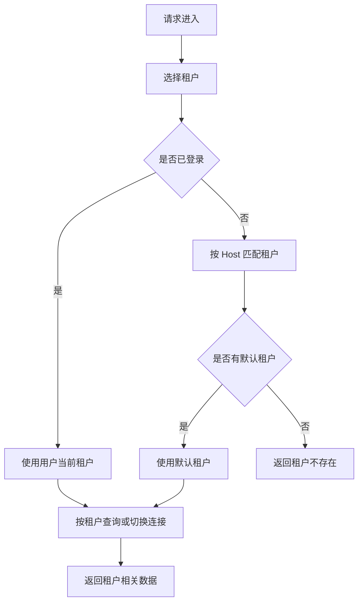

**图表来源**
- [SysTenant.cs:1-145](file://Admin.NET/Admin.NET.Core/Entity/SysTenant.cs#L1-L145)
- [SysTenantService.cs:120-220](file://Admin.NET/Admin.NET.Core/Service/Tenant/SysTenantService.cs#L120-L220)

### 配置选项与使用示例
- **租户类型**：Id 或 Db；Db 类型必须提供有效连接。
- **从库连接**：JSON 格式字符串，用于读写分离。
- **注册开关**：是否允许租户注册用户。
- **使用示例**：后台新增租户，填写域名、数据库连接、从库配置；前端通过代理或域名路由到对应租户。

**章节来源**
- [SysTenant.cs:1-145](file://Admin.NET/Admin.NET.Core/Entity/SysTenant.cs#L1-L145)
- [SysTenantService.cs:220-420](file://Admin.NET/Admin.NET.Core/Service/Tenant/SysTenantService.cs#L220-L420)

## 用户与组织机构管理
### 业务价值
提供用户全生命周期管理与多层级组织结构维护，支持用户绑定职务、机构、角色与数据权限，同时支持域账号绑定与事件发布。

### 实现原理
- **用户模型**：`SysUser` 包含账号、密码、真实姓名、性别、年龄、生日、民族、手机、证件、邮箱、地址、文化程度、政治面貌、毕业院校、办公电话、紧急联系人、简介、排序、状态、账号类型等。
- **用户服务**：分页查询联合机构与职务；新增用户时校验唯一性、越权、手机号重复，默认密码来自配置；可绑定域账号并发布用户事件。
- **机构服务**：支持机构树、搜索、权限过滤；非超管新增机构需校验父机构权限；递归禁用无权限节点防止越权修改。

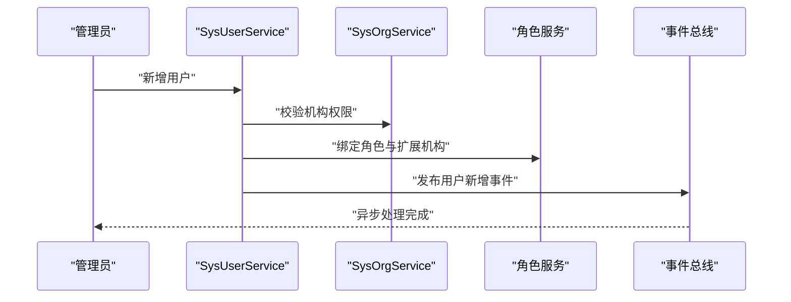

**图表来源**
- [SysUserService.cs:1-200](file://Admin.NET/Admin.NET.Core/Service/User/SysUserService.cs#L1-L200)
- [SysOrgService.cs:1-200](file://Admin.NET/Admin.NET.Core/Service/Org/SysOrgService.cs#L1-L200)

### 配置选项与使用示例
- **默认密码**：未指定密码时使用系统配置默认值。
- **域账号**：新增用户时可绑定域账号，便于后续 LDAP 登录。
- **使用示例**：管理员在用户管理中新增用户，选择机构、职务、角色；用户在登录后获得对应菜单与按钮权限。

**章节来源**
- [SysUser.cs:1-200](file://Admin.NET/Admin.NET.Core/Entity/SysUser.cs#L1-L200)
- [SysUserService.cs:1-200](file://Admin.NET/Admin.NET.Core/Service/User/SysUserService.cs#L1-L200)
- [SysOrgService.cs:1-200](file://Admin.NET/Admin.NET.Core/Service/Org/SysOrgService.cs#L1-L200)

## 任务调度系统
### 业务价值
提供可视化的定时任务管理能力，支持内置任务、HTTP 任务与动态脚本任务，便于运维与业务自动化。

### 实现原理
- **作业模型**：`SysJobDetail` 包含 JobId、组名、作业类型、程序集、描述、并行、注解扫描、额外数据、创建类型、脚本代码等。
- **作业服务**：分页查询作业及触发器；添加作业时根据创建类型选择动态编译或 HTTP 作业；更新时保持创建类型不变；删除时同步移除调度器中的作业与持久化数据。
- **动态编译**：脚本任务通过 `DynamicJobCompiler` 编译为类型，要求标注作业详情特性并匹配 JobId。

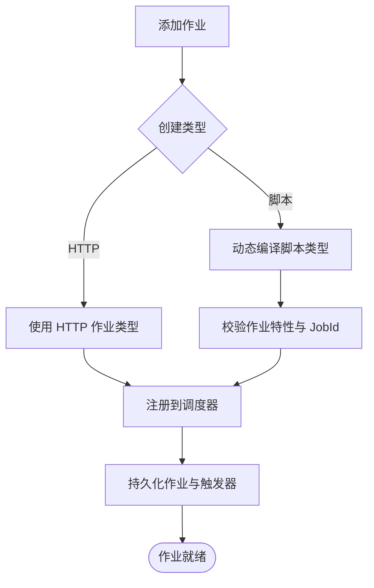

**图表来源**
- [SysJobDetail.cs:1-87](file://Admin.NET/Admin.NET.Core/Entity/SysJobDetail.cs#L1-L87)
- [SysJobService.cs:120-280](file://Admin.NET/Admin.NET.Core/Service/Job/SysJobService.cs#L120-L280)

### 配置选项与使用示例
- **作业组名**：逻辑分组作业，便于管理。
- **并发执行**：是否允许同一作业并发运行。
- **注解扫描**：是否扫描特性触发器。
- **使用示例**：在作业管理中添加脚本作业，编写脚本代码并设置 Cron 表达式；系统会自动编译并注册调度任务。

**章节来源**
- [SysJobDetail.cs:1-87](file://Admin.NET/Admin.NET.Core/Entity/SysJobDetail.cs#L1-L87)
- [SysJobService.cs:120-320](file://Admin.NET/Admin.NET.Core/Service/Job/SysJobService.cs#L120-L320)

## 文件管理系统
### 业务价值
统一管理文件上传、下载、预览与外链访问，支持本地存储与云对象存储，可扩展 SSH 或其他自定义提供者。

### 实现原理
- **文件模型**：`SysFile` 包含提供者、桶名称、文件名、后缀、存储路径、大小、外链地址、MD5、文件类别、别名、公开标记、业务数据 Id。
- **文件服务**：选择具体文件提供者（Default/OSS/SSH/MultiOSS）；支持 Base64 上传、多文件上传、下载、预览、签名图片、流式读取。
- **公开与私有**：公开文件跨租户可见，私有文件按租户与用户权限过滤。

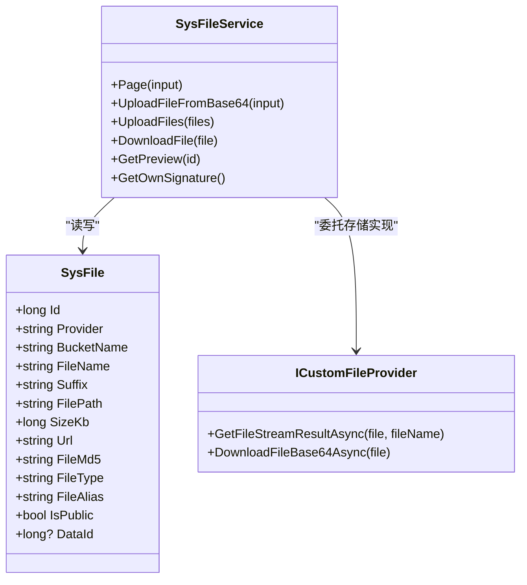

**图表来源**
- [SysFile.cs:1-104](file://Admin.NET/Admin.NET.Core/Entity/SysFile.cs#L1-L104)
- [SysFileService.cs:1-200](file://Admin.NET/Admin.NET.Core/Service/File/SysFileService.cs#L1-L200)

### 配置选项与使用示例
- **OSS 开关**：启用 OSS 后统一走 MultiOSSFileProvider。
- **SSH 开关**：启用 SSH 文件提供者。
- **多 OSS 配置**：通过 `MultiOSS:Enabled` 与 `OSSProviderOptions` 控制。
- **使用示例**：前端调用上传接口，后端根据配置写入本地或云存储，并返回文件 URL；前端直接使用该 URL 预览或下载。

**章节来源**
- [SysFile.cs:1-104](file://Admin.NET/Admin.NET.Core/Entity/SysFile.cs#L1-L104)
- [SysFileService.cs:1-200](file://Admin.NET/Admin.NET.Core/Service/File/SysFileService.cs#L1-L200)

## 日志监控系统
### 业务价值
记录系统操作日志、异常日志与访问日志，支持 IP 地理位置、设备信息、性能耗时与异常告警邮件，帮助运维审计与问题定位。

### 实现原理
- **日志写入器**：`DatabaseLoggingWriter` 接收批量日志消息，分类为操作日志、异常日志、访问日志，并批量插入独立日志数据库。
- **日志分类**：根据监控上下文判断是否为访问日志；异常日志收集异常并发送邮件；访问日志覆盖登录、退出等动作。
- **详细日志**：提取远程 IP、地理位置、浏览器、操作系统、耗时、HTTP 方法与 URL，并对敏感数据进行脱敏。

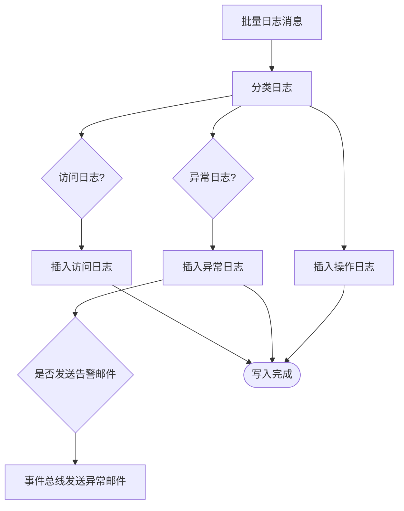

**图表来源**
- [DatabaseLoggingWriter.cs:1-200](file://Admin.NET/Admin.NET.Core/Logging/DatabaseLoggingWriter.cs#L1-L200)

### 配置选项与使用示例
- **操作日志开关**：通过配置决定是否记录操作日志。
- **异常邮件通知**：通过配置控制是否发送异常邮件。
- **使用示例**：系统在请求处理过程中注入监控信息，日志写入器异步分类并批量写入数据库，必要时触发告警邮件。

**章节来源**
- [DatabaseLoggingWriter.cs:1-200](file://Admin.NET/Admin.NET.Core/Logging/DatabaseLoggingWriter.cs#L1-L200)

## 代码生成系统
### 业务价值
降低重复开发成本，根据数据库表结构与配置一键生成前后端代码，支持字段同步、唯一键配置、菜单标题联动与事务保护。

### 实现原理
- **代码生成模型**：`SysCodeGen` 与 `SysCodeGenConfig` 保存表级与字段级生成配置。
- **生成服务**：分页查询生成配置；新增/更新时校验唯一表名、字段元数据；同步字段时锁定原配置；删除时按主库连接顺序删除字段与主配置。
- **菜单联动**：更新生成配置时可同步菜单标题并刷新菜单缓存。

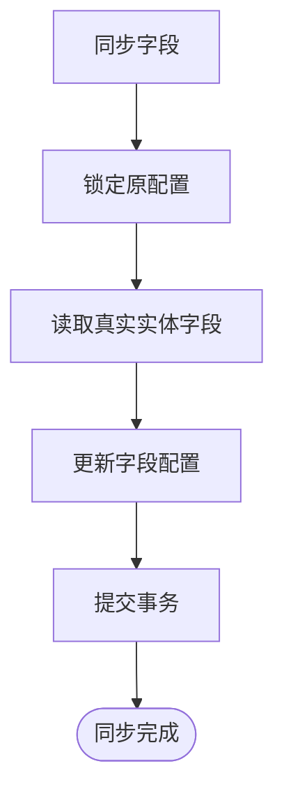

**图表来源**
- [SysCodeGenService.cs:120-320](file://Admin.NET/Admin.NET.Core/Service/CodeGen/SysCodeGenService.cs#L120-L320)

### 配置选项与使用示例
- **唯一键配置**：指定表的唯一键列，用于生成唯一校验。
- **生成菜单**：是否自动生成菜单项并同步标题。
- **使用示例**：在代码生成界面选择数据库表，配置字段类型与展示控件，点击同步字段后生成前后端代码。

**章节来源**
- [SysCodeGenService.cs:1-320](file://Admin.NET/Admin.NET.Core/Service/CodeGen/SysCodeGenService.cs#L1-L320)

## 在线构建器与文档导出
### 业务价值
提供拖拽式设计器生成前端表单代码，并结合模板与导入导出能力生成 PDF 报告，提升业务报表与文档生产效率。

### 实现原理
- **前端 PDFME 组件**：负责模板加载、变量渲染与输出；测试文件表明模板与输出存在单元与端到端验证。
- **后端模板与导入导出**：通过模板服务与 Magicodes.IE 支持 Excel/PDF 等格式导出；结合业务数据填充模板生成报告。
- **业务闭环**：设计器生成前端表单，后端渲染模板并输出 PDF，供用户下载或归档。

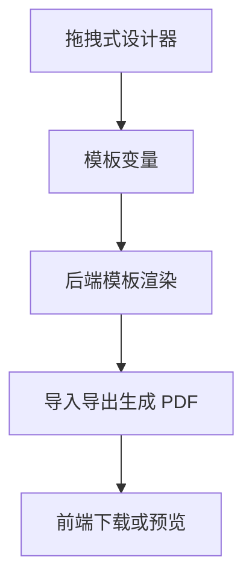

[此图为概念流程图，不直接映射具体源码文件]

### 配置选项与使用示例
- **模板字段**：在设计器中绑定后端数据字段。
- **导出格式**：支持 PDF、Excel 等多种格式。
- **使用示例**：在报表模块中选择模板，填入业务数据，点击导出并下载生成的 PDF 文件。

[本节为概念说明，未直接分析具体源码文件]

## 依赖关系分析
核心服务之间的耦合关系如下：
- 认证服务依赖用户仓储、菜单服务、在线用户服务、配置服务、短信服务、LDAP 服务、缓存与服务管理器。
- 菜单服务依赖租户菜单、角色菜单、用户角色、用户菜单、语言文本缓存与服务。
- 租户服务依赖用户扩展机构、租户菜单、角色菜单、用户角色、租户、角色、用户、机构、职务与上传选项。
- 作业服务依赖作业详情、触发器、触发记录、集群、调度工厂与动态编译器。
- 文件服务依赖用户管理器、文件仓储、OSS 选项、上传选项、配置与命名服务提供者。
- 日志写入器依赖配置服务、事件总线、服务作用域与日志数据库。

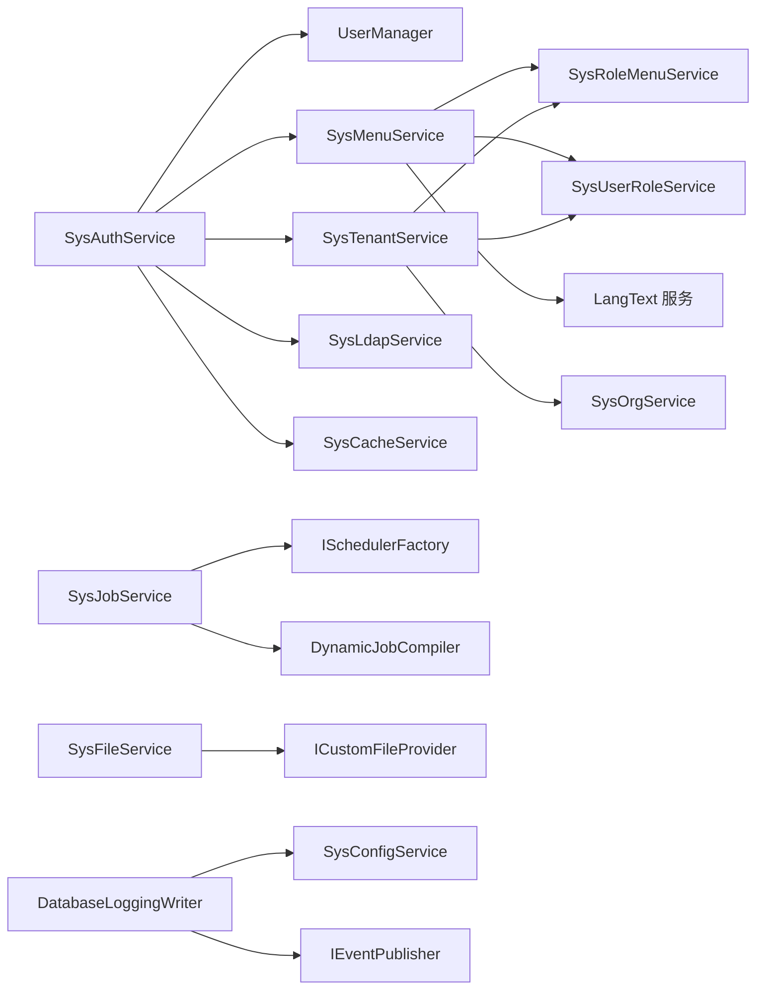

**图表来源**
- [SysAuthService.cs:1-120](file://Admin.NET/Admin.NET.Core/Service/Auth/SysAuthService.cs#L1-L120)
- [SysMenuService.cs:1-120](file://Admin.NET/Admin.NET.Core/Service/Menu/SysMenuService.cs#L1-L120)
- [SysTenantService.cs:1-120](file://Admin.NET/Admin.NET.Core/Service/Tenant/SysTenantService.cs#L1-L120)
- [SysJobService.cs:1-120](file://Admin.NET/Admin.NET.Core/Service/Job/SysJobService.cs#L1-L120)
- [SysFileService.cs:1-120](file://Admin.NET/Admin.NET.Core/Service/File/SysFileService.cs#L1-L120)
- [DatabaseLoggingWriter.cs:1-120](file://Admin.NET/Admin.NET.Core/Logging/DatabaseLoggingWriter.cs#L1-L120)

## 性能与可运维性
- **缓存优化**：认证流程中清理按钮权限缓存，避免旧缓存导致按钮不可见；菜单翻译使用缓存批量翻译减少重复 IO。
- **批量写入**：日志写入器批量插入操作、异常、访问日志，减少高频写入导致的锁竞争。
- **事务保护**：代码生成新增/更新/同步字段使用事务，保证主配置与字段配置一致性。
- **异步事件**：用户操作与异常告警通过事件总线异步处理，降低主流程阻塞。
- **数据库隔离**：日志写入独立数据库，避免业务库压力影响审计。

[本节为一般性指导，不直接分析具体源码文件]

## 常见业务场景与最佳实践
- **多租户 SaaS 接入**：
  - 新建租户时选择库隔离并提供连接串，配置从库实现读写分离。
  - 前端按域名或租户参数路由到对应租户；登录后自动使用用户当前租户。
- **第三方登录集成**：
  - 启用对应 OAuth Provider；回调后自动创建用户并绑定默认角色。
  - 注意 OpenId 唯一性与用户信息映射。
- **权限最小化原则**：
  - 为每个角色仅绑定必要菜单与按钮；数据范围尽量设置为“仅本人”或“本部门”。
  - 定期审查角色与菜单绑定关系，清理无用权限。
- **任务调度安全**：
  - 脚本任务应经过代码审查；限制脚本权限与网络访问。
  - 对重要任务启用重试与失败告警。
- **文件安全**：
  - 敏感文件标记为私有，避免公开外链泄露。
  - 使用云存储签名 URL 控制访问有效期。
- **日志审计**：
  - 开启操作日志与异常日志；配置异常邮件通知。
  - 定期清理历史日志，避免数据库膨胀。

[本节为一般性指导，不直接分析具体源码文件]

## 故障排查指南
- **登录失败**：
  - 检查验证码是否开启且输入正确。
  - 检查密码错误次数是否超过上限。
  - 检查域登录是否启用且 LDAP 配置有效。
- **菜单不显示**：
  - 确认用户角色已绑定对应菜单。
  - 检查按钮权限缓存是否清理。
- **租户数据异常**：
  - 确认租户状态启用。
  - 检查 Id 隔离与库隔离配置是否正确。
- **任务无法执行**：
  - 检查作业类型与脚本代码是否有效。
  - 检查调度器中是否存在该 JobId。
- **文件无法下载**：
  - 检查文件是否公开或当前用户有权限。
  - 检查 OSS/SSH 提供者配置。
- **日志缺失**：
  - 检查操作日志开关与日志数据库连接。
  - 检查事件总线与异常邮件通知配置。

**章节来源**
- [SysAuthService.cs:60-160](file://Admin.NET/Admin.NET.Core/Service/Auth/SysAuthService.cs#L60-L160)
- [SysMenuService.cs:120-220](file://Admin.NET/Admin.NET.Core/Service/Menu/SysMenuService.cs#L120-L220)
- [SysTenantService.cs:220-420](file://Admin.NET/Admin.NET.Core/Service/Tenant/SysTenantService.cs#L220-L420)
- [SysJobService.cs:120-320](file://Admin.NET/Admin.NET.Core/Service/Job/SysJobService.cs#L120-L320)
- [SysFileService.cs:120-280](file://Admin.NET/Admin.NET.Core/Service/File/SysFileService.cs#L120-L280)
- [DatabaseLoggingWriter.cs:120-282](file://Admin.NET/Admin.NET.Core/Logging/DatabaseLoggingWriter.cs#L120-L282)

## 结论
Admin.NET 通过统一的认证授权、RBAC 权限、多租户隔离、任务调度、文件管理、日志监控与代码生成能力，为企业管理系统提供了完整的基础设施。当前仓库已完成前端移植，业务前端以 `Web/apps/web-antdv-next/` 为入口；后端共享工程按 `.csproj` 分别支持 .NET 8 与 .NET 10，API 入口与测试项目使用 .NET 10。部署前请结合实际环境完成数据库、Redis、OSS 与前端代理的配置验证，并使用独立开发库进行初始化与联调。

[本节为总结性内容，不直接分析具体源码文件]