# 用户和组织机构管理

<cite>
**本文引用的文件**   
- [SysUser.cs](file://Admin.NET/Admin.NET.Core/Entity/SysUser.cs)
- [SysOrg.cs](file://Admin.NET/Admin.NET.Core/Entity/SysOrg.cs)
- [SysPos.cs](file://Admin.NET/Admin.NET.Core/Entity/SysPos.cs)
- [SysUserRole.cs](file://Admin.NET/Admin.NET.Core/Entity/SysUserRole.cs)
- [SysUserExtOrg.cs](file://Admin.NET/Admin.NET.Core/Entity/SysUserExtOrg.cs)
- [SysUserLdap.cs](file://Admin.NET/Admin.NET.Core/Entity/SysUserLdap.cs)
- [SysOnlineUser.cs](file://Admin.NET/Admin.NET.Core/Entity/SysOnlineUser.cs)
- [SysUserService.cs](file://Admin.NET/Admin.NET.Core/Service/User/SysUserService.cs)
- [SysOrgService.cs](file://Admin.NET/Admin.NET.Core/Service/Org/SysOrgService.cs)
- [SysUserExtOrgService.cs](file://Admin.NET/Admin.NET.Core/Service/User/SysUserExtOrgService.cs)
- [SysUserLdapService.cs](file://Admin.NET/Admin.NET.Core/Service/User/SysUserLdapService.cs)
- [SysUserRoleService.cs](file://Admin.NET/Admin.NET.Core/Service/User/SysUserRoleService.cs)
- [SysUserMenuService.cs](file://Admin.NET/Admin.NET.Core/Service/User/SysUserMenuService.cs)
- [SysUserRegWayService.cs](file://Admin.NET/Admin.NET.Core/Service/User/SysUserRegWayService.cs)
- [Program.cs](file://Admin.NET/Admin.NET.Web.Entry/Program.cs)
- [web-antdv-next/package.json](file://Web/apps/web-antdv-next/package.json)
</cite>

## 目录

1. [简介](#简介)
2. [项目结构定位](#项目结构定位)
3. [核心实体设计](#核心实体设计)
4. [用户生命周期管理](#用户生命周期管理)
5. [组织架构与数据权限](#组织架构与数据权限)
6. [职位管理体系](#职位管理体系)
7. [用户组、角色与权限继承](#用户组角色与权限继承)
8. [在线状态与安全控制](#在线状态与安全控制)
9. [系统架构总览](#系统架构总览)
10. [详细组件分析](#详细组件分析)
11. [依赖关系分析](#依赖关系分析)
12. [性能优化与批量处理实践](#性能优化与批量处理实践)
13. [故障排查指南](#故障排查指南)
14. [结论](#结论)

## 简介

本文面向 Admin.NET 的用户管理和组织机构管理模块，围绕当前仓库中的后端核心实体与服务实现进行说明。重点覆盖以下能力：

- 用户实体字段、账号类型、状态及审计字段设计。
- 用户注册、新增、更新、删除、禁用启用、密码变更、重置、解锁等生命周期操作。
- 树形组织架构的层级关系、组织树查询、父节点校验、级联删除。
- 职位定义、人员任职、扩展机构中的职位信息。
- 用户与组织的关联方式，包括直属组织、扩展组织、角色数据范围。
- 在线用户管理与强制下线。
- 事件发布机制用于审计与外部集成。
- 前端业务入口 `Web/apps/web-antdv-next` 的运行环境约定。

需要特别说明的是：当前代码未实现“注销账户”这一独立业务动作；现有删除接口执行物理删除，并同步清理角色、扩展组织、域账号和用户收藏菜单。若业务需要软删除或归档流程，应基于现有删除流程扩展，而不是直接复用该接口。

## 项目结构定位

Admin.NET 的后端用户和组织相关逻辑集中在 `Admin.NET.Admin.NET.Core` 工程内：

| 层次 | 主要职责 | 典型路径 |
|---|---|---|
| 实体层 | 用户、组织、职位、用户角色、扩展组织、域配置、在线用户等模型定义 | `Admin.NET/Core/Entity` |
| 服务层 | 用户管理、组织管理、角色管理、扩展组织、域账号、菜单收藏等业务逻辑 | `Admin.NET/Core/Service` |
| Web 入口 | API 控制器运行、应用启动、配置加载 | `Admin.NET/Web.Entry` |
| 前端业务入口 | 当前已移植的前端应用，不是旧前端模板 | `Web/apps/web-antdv-next` |

前端运行环境以 `Web/apps/web-antdv-next/package.json` 为准，其 `packageManager`、`engines` 和 workspace 配置决定开发、构建、检查命令的使用方式。根脚本如 `pnpm dev`、`pnpm build`、`pnpm lint`、`pnpm check:type` 面向业务应用，不能理解为全 workspace 统一检查。

后端 API 通过动态 API 控制器暴露，例如 `SysUserService` 和 `SysOrgService` 均实现 `IDynamicApiController`，并由 `Program.cs` 所在的 Web 入口启动运行。

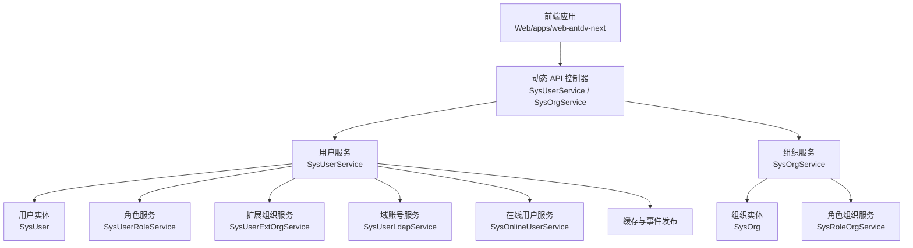

**图表来源**
- [SysUserService.cs:13-36](file://Admin.NET/Admin.NET.Core/Service/User/SysUserService.cs#L13-L36)
- [SysOrgService.cs:13-28](file://Admin.NET/Admin.NET.Core/Service/Org/SysOrgService.cs#L13-L28)
- [SysUser.cs:1-353](file://Admin.NET/Admin.NET.Core/Entity/SysUser.cs#L1-L353)
- [SysOrg.cs:1-96](file://Admin.NET/Admin.NET.Core/Entity/SysOrg.cs#L1-L96)

**章节来源**
- [Program.cs](file://Admin.NET/Admin.NET.Web.Entry/Program.cs)
- [web-antdv-next/package.json](file://Web/apps/web-antdv-next/package.json)

## 核心实体设计

### 用户实体 `SysUser`

`SysUser` 是用户主表，继承租户与组织基类，表示系统中的登录主体。关键字段包括：

| 字段类别 | 字段名 | 含义 |
|---|---|---|
| 身份标识 | `Account` | 登录账号，建立索引 |
| 安全信息 | `Password` | 加密存储，序列化时忽略 |
| 个人信息 | `RealName`、`NickName`、`Avatar`、`Sex`、`Age`、`Birthday`、`Nation`、`Phone`、`CardType`、`IdCardNum`、`Email`、`Address` | 用户基本资料 |
| 组织与职位 | `OrgId`、`PosId`、`ManagerUserId` | 直属机构、职位、直属主管 |
| 工作信息 | `JobNum`、`PosLevel`、`PosTitle`、`Expertise`、`OfficeZone`、`Office`、`JoinDate` | 工号、职级、职称、办公区域、入职日期 |
| 登录记录 | `LastLoginIp`、`LastLoginAddress`、`LastLoginTime`、`LastLoginDevice` | 最新登录信息 |
| 业务属性 | `Status`、`AccountType`、`OrderNo`、`Remark`、`LangCode`、`Homepage`、`Signature` | 状态、账号类型、排序、备注、语言、首页、签名 |
| 验证方法 | `ValidateIsSuperAdminAccountType`、`ValidateIsUserId` | 防止误改超级管理员、禁止自删 |

账号类型区分普通用户、系统管理员、超级管理员；状态使用通用状态枚举，默认启用。`SysUser` 还提供组织、职位、主管的导航属性，便于查询展示。

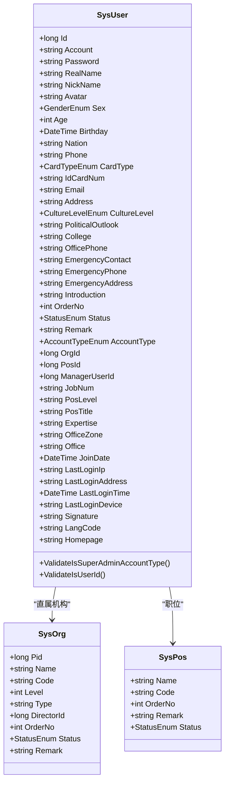

**图表来源**
- [SysUser.cs:1-353](file://Admin.NET/Admin.NET.Core/Entity/SysUser.cs#L1-L353)
- [SysOrg.cs:1-96](file://Admin.NET/Admin.NET.Core/Entity/SysOrg.cs#L1-L96)
- [SysPos.cs:1-56](file://Admin.NET/Admin.NET.Core/Entity/SysPos.cs#L1-L56)

**章节来源**
- [SysUser.cs:1-353](file://Admin.NET/Admin.NET.Core/Entity/SysUser.cs#L1-L353)

### 组织实体 `SysOrg`

`SysOrg` 采用邻接表模式，通过 `Pid` 表示父机构，形成树形结构。关键特性如下：

- `Pid`：父机构标识，根机构通常为 `0`。
- `Name`、`Code`：名称和编码，分别建立索引。
- `Level`：可选层级。
- `Type`：机构类型，通常由字典管理。
- `DirectorId`：负责人，导航到 `SysUser`。
- `Children`：内存中的子节点集合，用于构建树。
- `Disabled`：前端展示标记，表示是否不可选择。

组织实体本身不直接包含用户列表，但服务层会结合 `SysUser.OrgId` 和扩展组织表判断组织中的人员。

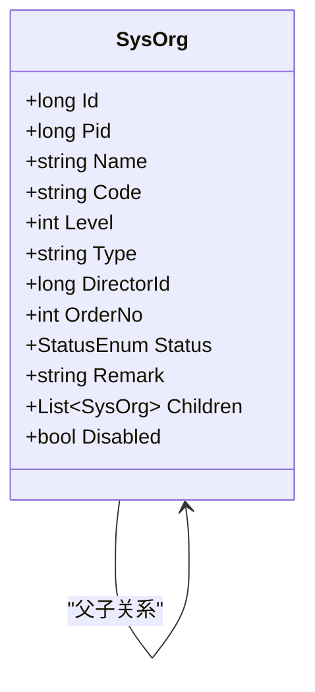

**图表来源**
- [SysOrg.cs:1-96](file://Admin.NET/Admin.NET.Core/Entity/SysOrg.cs#L1-L96)

**章节来源**
- [SysOrg.cs:1-96](file://Admin.NET/Admin.NET.Core/Entity/SysOrg.cs#L1-L96)

### 职位实体 `SysPos`

`SysPos` 定义职位模板，不包含具体人员，而是作为可复用的职位定义：

- `Name`、`Code`：职位名称和编码。
- `OrderNo`：排序。
- `Status`：启用状态。
- `UserList`：只读展示用集合，实际任职关系通过 `SysUser.PosId` 和扩展组织中的 `PosId` 表达。

**章节来源**
- [SysPos.cs:1-56](file://Admin.NET/Admin.NET.Core/Entity/SysPos.cs#L1-L56)

### 用户角色、扩展组织、域账号与在线用户

| 实体 | 用途 |
|---|---|
| `SysUserRole` | 用户与角色的多对多关系 |
| `SysUserExtOrg` | 用户在扩展机构中的任职信息，支持独立的职位、工号、职级、入职日期 |
| `SysUserLdap` | AD/LDAP 域账号映射，含邮箱、过期标志、DN 等 |
| `SysOnlineUser` | 在线连接信息，包括连接标识、IP、浏览器、操作系统、时间 |

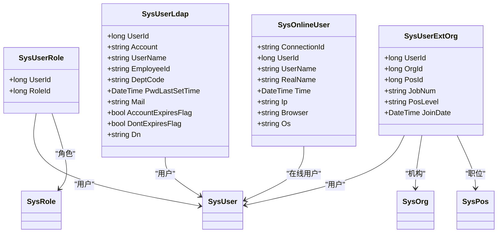

**图表来源**
- [SysUserRole.cs:1-41](file://Admin.NET/Admin.NET.Core/Entity/SysUserRole.cs#L1-L41)
- [SysUserExtOrg.cs:1-77](file://Admin.NET/Admin.NET.Core/Entity/SysUserExtOrg.cs#L1-L77)
- [SysUserLdap.cs:1-80](file://Admin.NET/Admin.NET.Core/Entity/SysUserLdap.cs#L1-L80)
- [SysOnlineUser.cs:1-68](file://Admin.NET/Admin.NET.Core/Entity/SysOnlineUser.cs#L1-L68)

**章节来源**
- [SysUserRole.cs:1-41](file://Admin.NET/Admin.NET.Core/Entity/SysUserRole.cs#L1-L41)
- [SysUserExtOrg.cs:1-77](file://Admin.NET/Admin.NET.Core/Entity/SysUserExtOrg.cs#L1-L77)
- [SysUserLdap.cs:1-80](file://Admin.NET/Admin.NET.Core/Entity/SysUserLdap.cs#L1-L80)
- [SysOnlineUser.cs:1-68](file://Admin.NET/Admin.NET.Core/Entity/SysOnlineUser.cs#L1-L68)

## 用户生命周期管理

用户生命周期包括注册、新增、更新、查看、禁用启用、删除、密码变更、密码重置、登录解锁、角色授权、扩展组织维护等。

### 用户状态流转

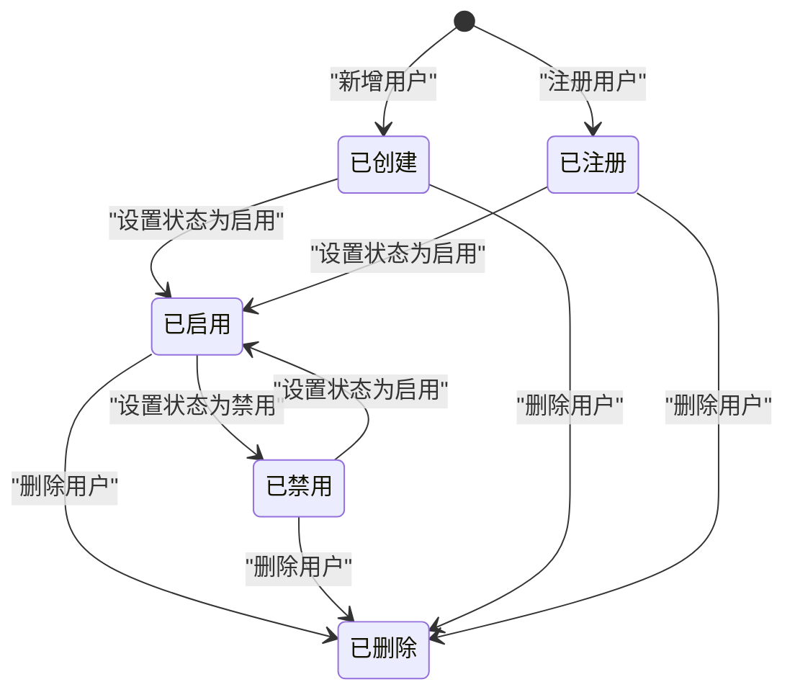

**图表来源**
- [SysUserService.cs:93-132](file://Admin.NET/Admin.NET.Core/Service/User/SysUserService.cs#L93-L132)
- [SysUserService.cs:137-185](file://Admin.NET/Admin.NET.Core/Service/User/SysUserService.cs#L137-L185)
- [SysUserService.cs:362-401](file://Admin.NET/Admin.NET.Core/Service/User/SysUserService.cs#L362-L401)
- [SysUserService.cs:274-306](file://Admin.NET/Admin.NET.Core/Service/User/SysUserService.cs#L274-L306)

### 新增用户

新增用户流程要点：

1. 填充租户标识，并根据超管条件决定是否接受前端传入租户。
2. 调用分配校验，限制越权创建。
3. 校验账号唯一性。
4. 手机号重复时抛出错误码。
5. 非超级管理员不得创建超级管理员或系统管理员。
6. 未传密码时使用系统默认密码。
7. 加密后插入用户。
8. 同步角色和扩展组织。
9. 可选写入域账号。
10. 发布新增事件。

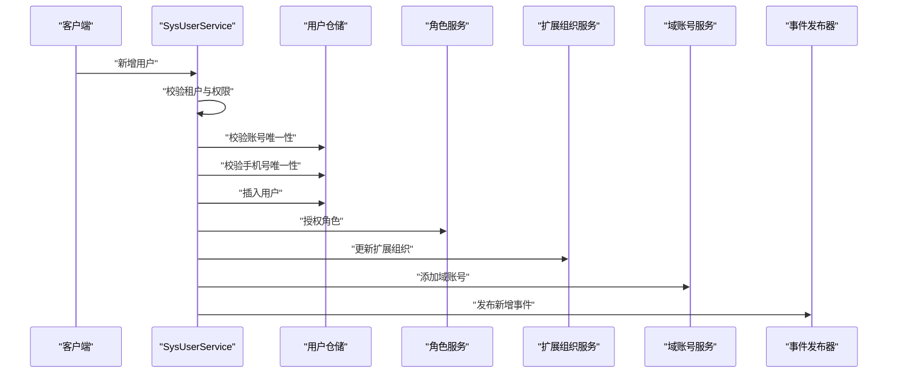

**图表来源**
- [SysUserService.cs:93-132](file://Admin.NET/Admin.NET.Core/Service/User/SysUserService.cs#L93-L132)

### 注册用户

注册接口用于匿名或公开授权场景：

- 必须提供有效租户。
- 注册方案负责关联范围和权限边界。
- 账号和手机号唯一性校验。
- 不允许注册超级管理员或系统管理员。
- 密码可明文传输并经 SM2 解密，再按强度策略加密。
- 成功后发布注册事件。

**章节来源**
- [SysUserService.cs:137-185](file://Admin.NET/Admin.NET.Core/Service/User/SysUserService.cs#L137-L185)

### 更新用户

更新用户时：

- 先读取原始用户和原始角色、扩展组织。
- 校验账号和手机号唯一性。
- 非超级管理员不得修改为超级管理员或系统管理员。
- 更新基础信息，忽略敏感和审计字段。
- 单独更新生日和入职日期，保证空值能落库。
- 更新角色和扩展组织。
- 清理用户组织缓存。
- 如果组织、角色或扩展组织变化，强制下线。
- 更新域账号。
- 发布更新事件。

**章节来源**
- [SysUserService.cs:197-246](file://Admin.NET/Admin.NET.Core/Service/User/SysUserService.cs#L197-L246)

### 删除用户

删除用户属于强一致性清理操作：

1. 获取可管理用户。
2. 禁止删除超级管理员。
3. 禁止用户自删。
4. 禁止删除租户默认账号。
5. 禁止删除开放接口绑定账号。
6. 强制下线。
7. 删除用户。
8. 删除用户角色。
9. 删除用户扩展组织。
10. 删除域账号。
11. 删除用户收藏菜单。
12. 发布删除事件。

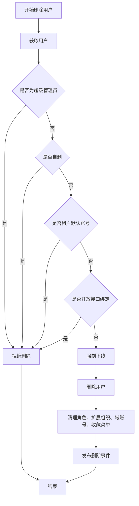

**图表来源**
- [SysUserService.cs:274-306](file://Admin.NET/Admin.NET.Core/Service/User/SysUserService.cs#L274-L306)

**章节来源**
- [SysUserService.cs:274-306](file://Admin.NET/Admin.NET.Core/Service/User/SysUserService.cs#L274-L306)

### 设置用户状态

状态设置用于启用或禁用用户：

- 禁止自改状态。
- 禁止修改超级管理员状态。
- 校验状态枚举有效性。
- 禁用时将用户加入黑名单缓存，并强制下线。
- 启用时移除黑名单缓存。
- 持久化状态并可能发布事件。

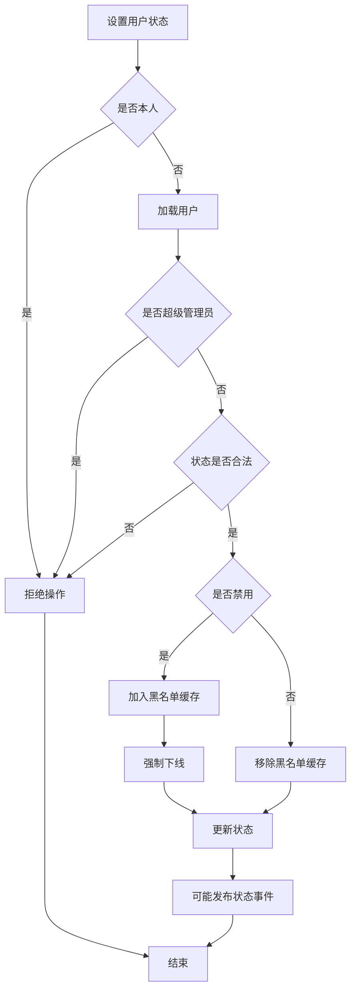

**图表来源**
- [SysUserService.cs:362-401](file://Admin.NET/Admin.NET.Core/Service/User/SysUserService.cs#L362-L401)

**章节来源**
- [SysUserService.cs:362-401](file://Admin.NET/Admin.NET.Core/Service/User/SysUserService.cs#L362-L401)

### 密码相关操作

| 操作 | 行为 |
|---|---|
| 修改密码 | 校验旧密码，比较新旧密码，按配置校验强度，加密后更新 |
| 重置密码 | 生成随机密码并加密，清空密码错误次数缓存，返回新密码 |
| 解锁登录 | 清空密码错误次数缓存，允许重新尝试登录 |

密码传输使用 SM2 解密，存储支持 MD5 或可逆加密策略；强度校验可通过配置开启。

**章节来源**
- [SysUserService.cs:426-525](file://Admin.NET/Admin.NET.Core/Service/User/SysUserService.cs#L426-L525)

## 组织架构与数据权限

### 树形组织实现

`SysOrgService` 提供组织列表和组织树两个主要查询：

- **组织列表**：根据名称、编码、类型筛选；非超管时仅返回有权限的组织。
- **组织树**：按 `Pid` 构建树，非超管时对无权限节点标记 `Disabled`，防止前端选择无权组织。

组织树构建使用 `ToTreeAsync`，并通过递归方法 `HandlerOrgTree` 标记无权节点。

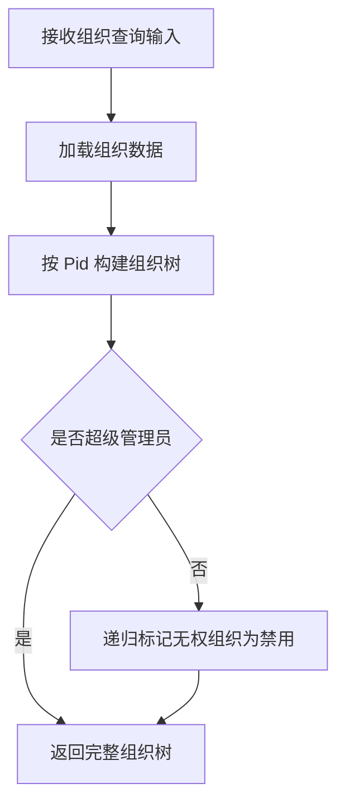

**图表来源**
- [SysOrgService.cs:34-118](file://Admin.NET/Admin.NET.Core/Service/Org/SysOrgService.cs#L34-L118)

**章节来源**
- [SysOrgService.cs:34-118](file://Admin.NET/Admin.NET.Core/Service/Org/SysOrgService.cs#L34-L118)

### 组织增删改

| 操作 | 校验与行为 |
|---|---|
| 新增组织 | 校验父组织、租户、唯一性；非超管不能直接创建根组织；父组织必须有权限；清理相关用户组织缓存 |
| 更新组织 | 校验自身与父组织不能相同、不能形成环；非超管更新根组织被禁止；父组织变更时清理缓存 |
| 删除组织 | 校验租户、权限、租户默认组织、是否有用户、扩展组织是否有用户、子组织是否有用户、是否绑定注册方案；级联删除子组织、角色组织、用户扩展组织 |

**章节来源**
- [SysOrgService.cs:200-333](file://Admin.NET/Admin.NET.Core/Service/Org/SysOrgService.cs#L200-L333)

### 用户组织权限计算

系统通过三种来源合并用户的组织范围：

1. 用户创建的组织。
2. 用户扩展组织。
3. 角色数据范围对应的组织。
4. 用户当前所属组织，若不在并集中则加入。

结果会缓存七天，键前缀为 `CacheConst.KeyUserOrg`。

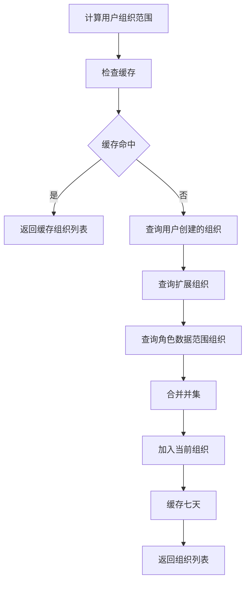

**图表来源**
- [SysOrgService.cs:356-391](file://Admin.NET/Admin.NET.Core/Service/Org/SysOrgService.cs#L356-L391)

**章节来源**
- [SysOrgService.cs:356-391](file://Admin.NET/Admin.NET.Core/Service/Org/SysOrgService.cs#L356-L391)

## 职位管理体系

职位体系由职位定义和人员任职两部分组成：

| 维度 | 实现位置 | 说明 |
|---|---|---|
| 职位定义 | `SysPos` | 定义职位名称、编码、排序、状态、备注 |
| 人员任职 | `SysUser.PosId` | 用户的主任职职位 |
| 扩展任职 | `SysUserExtOrg.PosId` | 用户在扩展机构中的任职职位 |
| 职位展示 | `SysPos.UserList` | 只读展示集合 |

这种设计将“职位模板”和“人员任职”解耦，适合企业常见的岗位编制与临时兼职场景。

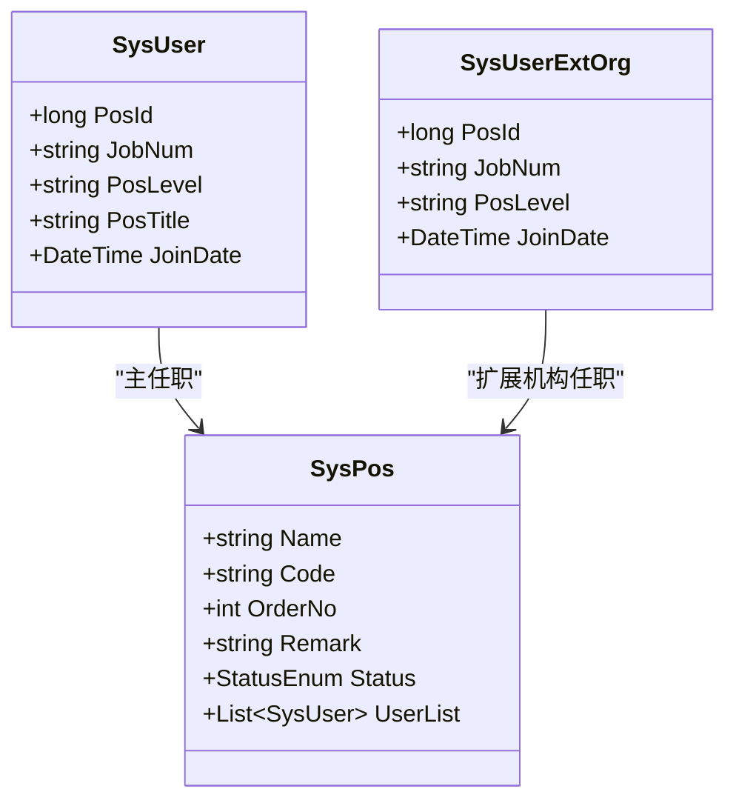

**图表来源**
- [SysPos.cs:1-56](file://Admin.NET/Admin.NET.Core/Entity/SysPos.cs#L1-L56)
- [SysUser.cs:201-353](file://Admin.NET/Admin.NET.Core/Entity/SysUser.cs#L201-L353)
- [SysUserExtOrg.cs:1-77](file://Admin.NET/Admin.NET.Core/Entity/SysUserExtOrg.cs#L1-L77)

**章节来源**
- [SysPos.cs:1-56](file://Admin.NET/Admin.NET.Core/Entity/SysPos.cs#L1-L56)
- [SysUser.cs:201-353](file://Admin.NET/Admin.NET.Core/Entity/SysUser.cs#L201-L353)
- [SysUserExtOrg.cs:1-77](file://Admin.NET/Admin.NET.Core/Entity/SysUserExtOrg.cs#L1-L77)

## 用户组、角色与权限继承

当前代码中未出现名为“用户组”的实体；权限模型基于角色、组织和数据范围组合实现。

### 角色与用户

`SysUserRole` 是用户与角色的中间表，支持一个用户拥有多个角色。角色服务负责用户角色查询、删除等操作；用户服务在授权时调用角色服务并触发事件。

### 组织与权限继承

权限继承主要体现在组织树和数据范围：

- 非超管用户只能看到和操作自己权限范围内的组织。
- 组织树返回时，无权节点标记 `Disabled`。
- 角色可配置数据范围：全部、本部门及以下、本部门、自定义。
- 系统按最大范围策略合并角色数据范围，并结合角色组织映射得到最终组织集合。

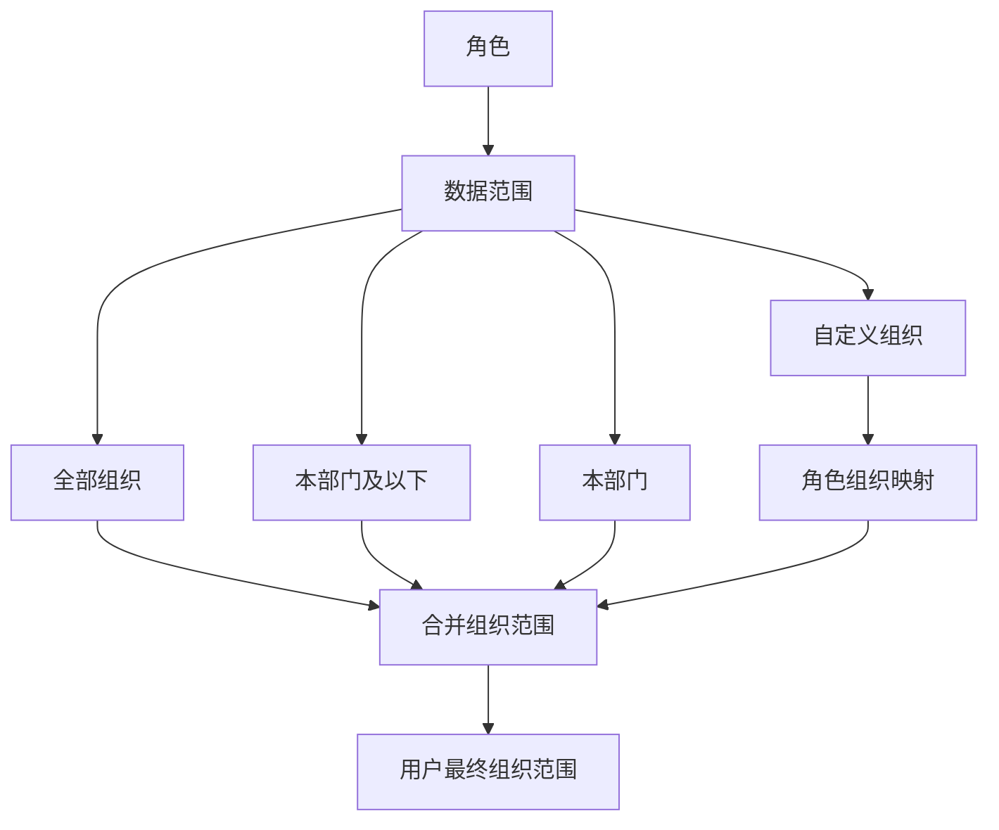

**图表来源**
- [SysOrgService.cs:414-490](file://Admin.NET/Admin.NET.Core/Service/Org/SysOrgService.cs#L414-L490)

**章节来源**
- [SysUserRole.cs:1-41](file://Admin.NET/Admin.NET.Core/Entity/SysUserRole.cs#L1-L41)
- [SysOrgService.cs:414-490](file://Admin.NET/Admin.NET.Core/Service/Org/SysOrgService.cs#L414-L490)

## 在线状态与安全控制

### 在线用户

`SysOnlineUser` 记录连接信息，包括连接标识、用户名、真实姓名、连接时间、IP、浏览器、操作系统。服务层在禁用用户、修改角色或组织时调用强制下线，使权限立即生效。

### 黑名单机制

用户被禁用时，系统会将用户标识加入黑名单缓存，从而阻止后续登录。启用用户时移除黑名单。

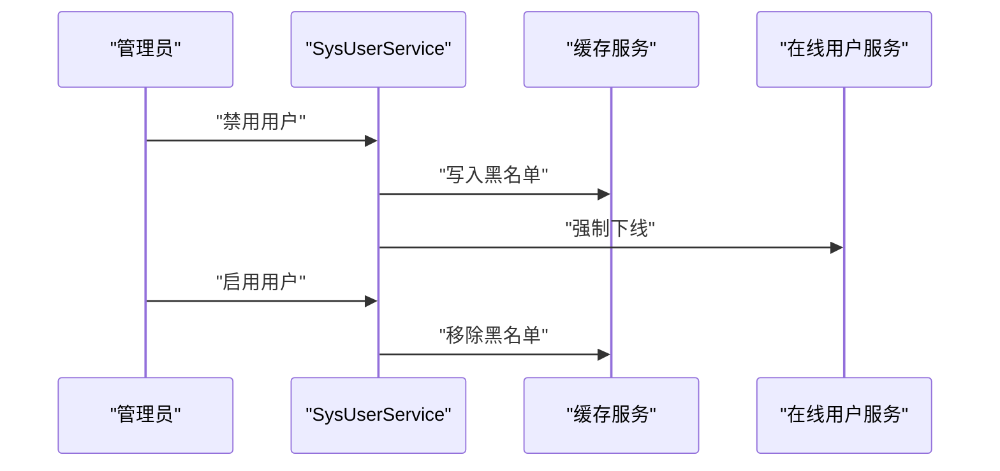

**图表来源**
- [SysUserService.cs:362-401](file://Admin.NET/Admin.NET.Core/Service/User/SysUserService.cs#L362-L401)

**章节来源**
- [SysOnlineUser.cs:1-68](file://Admin.NET/Admin.NET.Core/Entity/SysOnlineUser.cs#L1-L68)
- [SysUserService.cs:362-401](file://Admin.NET/Admin.NET.Core/Service/User/SysUserService.cs#L362-L401)

## 系统架构总览

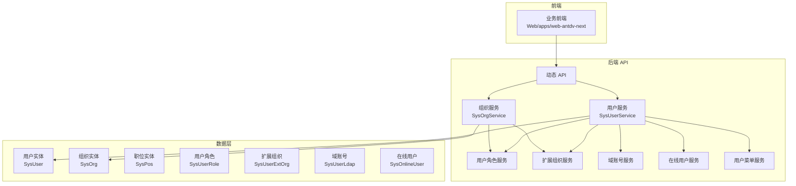

**图表来源**
- [SysUserService.cs:13-36](file://Admin.NET/Admin.NET.Core/Service/User/SysUserService.cs#L13-L36)
- [SysOrgService.cs:13-28](file://Admin.NET/Admin.NET.Core/Service/Org/SysOrgService.cs#L13-L28)
- [SysUser.cs:1-353](file://Admin.NET/Admin.NET.Core/Entity/SysUser.cs#L1-L353)
- [SysOrg.cs:1-96](file://Admin.NET/Admin.NET.Core/Entity/SysOrg.cs#L1-L96)

## 详细组件分析

### 用户分页查询

用户分页接口不仅查询用户，还关联组织和职位，并拼接角色名称与域账号：

- 过滤超级管理员账号。
- 根据组织 ID 过滤子组织用户。
- 非超管隐藏系统管理员。
- 支持账号、姓名、职位、手机号模糊查询。
- 返回组织名称、职位名称、角色名称、域账号。

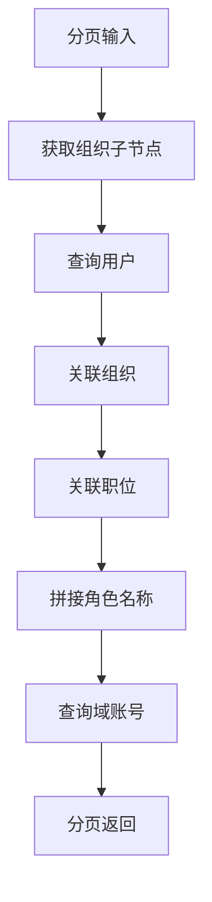

**图表来源**
- [SysUserService.cs:58-82](file://Admin.NET/Admin.NET.Core/Service/User/SysUserService.cs#L58-L82)

**章节来源**
- [SysUserService.cs:58-82](file://Admin.NET/Admin.NET.Core/Service/User/SysUserService.cs#L58-L82)

### 角色授权流程

角色授权流程：

1. 校验用户可管理。
2. 校验角色 ID 列表有效性。
3. 调用角色服务授予角色。
4. 清理用户组织缓存。
5. 强制下线用户。
6. 发布角色更新事件。

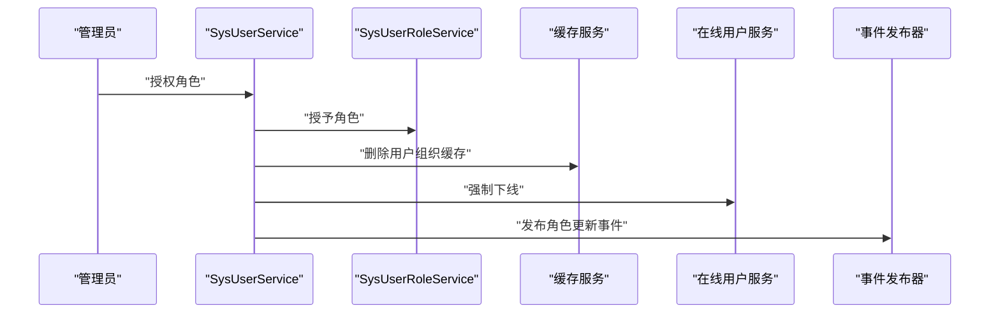

**图表来源**
- [SysUserService.cs:407-424](file://Admin.NET/Admin.NET.Core/Service/User/SysUserService.cs#L407-L424)

**章节来源**
- [SysUserService.cs:407-424](file://Admin.NET/Admin.NET.Core/Service/User/SysUserService.cs#L407-L424)

### 扩展组织维护

扩展组织用于表达用户跨组织任职关系，支持独立职位、工号、职级和入职日期。用户服务在新增、更新用户时调用扩展组织服务同步数据；删除用户时清理扩展组织。

**章节来源**
- [SysUserService.cs:257-269](file://Admin.NET/Admin.NET.Core/Service/User/SysUserService.cs#L257-L269)
- [SysUserExtOrgService.cs](file://Admin.NET/Admin.NET.Core/Service/User/SysUserExtOrgService.cs)

### 域账号同步

域账号用于对接 AD/LDAP：

- 新增用户时可写入域账号。
- 更新用户时同步域账号。
- 删除用户时清理域账号。
- 域账号表包含邮箱、过期标志、DN 等字段，支持导入对照。

**章节来源**
- [SysUserService.cs:119-122](file://Admin.NET/Admin.NET.Core/Service/User/SysUserService.cs#L119-L122)
- [SysUserService.cs:227-229](file://Admin.NET/Admin.NET.Core/Service/User/SysUserService.cs#L227-L229)
- [SysUserService.cs:300-302](file://Admin.NET/Admin.NET.Core/Service/User/SysUserService.cs#L300-L302)
- [SysUserLdapService.cs](file://Admin.NET/Admin.NET.Core/Service/User/SysUserLdapService.cs)
- [SysUserLdap.cs:1-80](file://Admin.NET/Admin.NET.Core/Entity/SysUserLdap.cs#L1-L80)

### 用户菜单收藏

删除用户时会清理用户收藏菜单；用户菜单服务提供收藏、删除收藏等功能。

**章节来源**
- [SysUserService.cs:303-305](file://Admin.NET/Admin.NET.Core/Service/User/SysUserService.cs#L303-L305)
- [SysUserMenuService.cs](file://Admin.NET/Admin.NET.Core/Service/User/SysUserMenuService.cs)

### 用户注册方案

用户注册方案由 `SysUserRegWayService` 管理，支持分页查询、新增、数据校验等，用于约束公开注册时的机构、角色和管理范围。

**章节来源**
- [SysUserRegWayService.cs](file://Admin.NET/Admin.NET.Core/Service/User/SysUserRegWayService.cs)

## 依赖关系分析

### 用户服务依赖

`SysUserService` 依赖多个服务和基础设施：

| 依赖 | 作用 |
|---|---|
| `UserManager` | 获取当前用户、租户、超管身份 |
| `SysOrgService` | 查询组织树、子组织、用户组织范围 |
| `SysUserExtOrgService` | 维护扩展组织 |
| `SysUserRoleService` | 管理用户角色 |
| `SysConfigService` | 读取系统默认密码等配置 |
| `SysOnlineUserService` | 强制下线 |
| `SysCacheService` | 读写缓存 |
| `SysUserLdapService` | 域账号同步 |
| `SqlSugarRepository<SysUser>` | 用户数据访问 |
| `SysUserMenuService` | 用户菜单收藏 |
| `IEventPublisher` | 发布用户事件 |

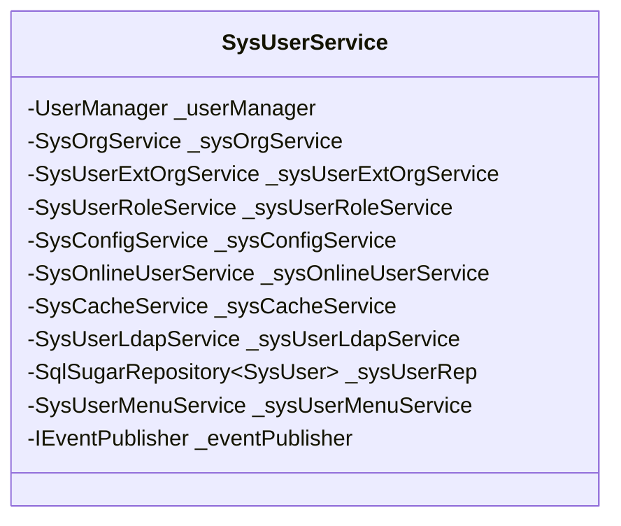

**图表来源**
- [SysUserService.cs:13-36](file://Admin.NET/Admin.NET.Core/Service/User/SysUserService.cs#L13-L36)

**章节来源**
- [SysUserService.cs:13-36](file://Admin.NET/Admin.NET.Core/Service/User/SysUserService.cs#L13-L36)

### 组织服务依赖

`SysOrgService` 依赖用户范围、角色范围、缓存和组织仓储：

| 依赖 | 作用 |
|---|---|
| `UserManager` | 判断超管和当前租户 |
| `SysCacheService` | 缓存用户组织范围 |
| `SysUserExtOrgService` | 查询扩展组织 |
| `SysUserRoleService` | 查询用户角色 |
| `SysRoleOrgService` | 查询角色对应组织 |
| `SqlSugarRepository<SysOrg>` | 组织数据访问 |

**章节来源**
- [SysOrgService.cs:13-28](file://Admin.NET/Admin.NET.Core/Service/Org/SysOrgService.cs#L13-L28)

## 性能优化与批量处理实践

### 缓存优先

组织范围计算会先查缓存，未命中时再查询数据库并缓存七天。这降低频繁权限计算的成本。

### 批量组织初始化

组织服务提供批量初始化方法，可直接清空并插入组织数据，适用于初始化或迁移场景。

### 分页查询

用户分页使用分页对象，避免一次性加载全部用户。

### 建议的最佳实践

| 场景 | 建议 |
|---|---|
| 用户数据导入 | 使用批量插入接口，避免逐条单事务；先校验唯一性和租户范围 |
| 用户数据导出 | 使用分页查询，按组织、角色、状态分批导出 |
| 批量禁用启用 | 使用批量状态接口；注意黑名单缓存和强制下线影响 |
| 组织树初始化 | 使用批量初始化接口；完成后清理用户组织缓存 |
| 大组织权限查询 | 利用现有缓存机制；避免每次请求都重建组织树 |
| 审计日志 | 利用事件发布机制；订阅用户新增、更新、删除、状态变更、密码变更、角色变更等事件 |

### 前端运行注意事项

- 使用 `pnpm dev` 启动业务应用开发服务。
- 使用 `pnpm build` 构建生产产物。
- 使用 `pnpm lint` 检查代码风格。
- 使用 `pnpm check:type` 检查类型。
- 所有命令以 `Web/apps/web-antdv-next/package.json` 的脚本定义为准。

[本节为通用指导，不直接分析具体源码行]

## 故障排查指南

| 问题 | 可能原因 | 处理方式 |
|---|---|---|
| 无法删除用户 | 用户是超级管理员 | 禁止删除超级管理员 |
| 无法删除用户 | 用户是租户默认账号 | 先解除租户绑定 |
| 无法删除用户 | 用户绑定开放接口 | 先解绑开放接口 |
| 无法删除用户 | 用户自删 | 禁止自删 |
| 无法删除组织 | 组织下有用户 | 先转移或删除用户 |
| 无法删除组织 | 扩展组织仍有用户 | 清理扩展组织关系 |
| 无法删除组织 | 子组织下仍有用户 | 先处理子组织 |
| 无法删除组织 | 组织绑定注册方案 | 先解除注册方案绑定 |
| 用户仍能看到旧权限 | 修改角色或组织后未强制下线 | 确认服务是否调用强制下线 |
| 用户被禁用后仍可登录 | 黑名单缓存未生效 | 检查缓存服务和禁用流程 |
| 密码修改失败 | 旧密码错误或强度不符合 | 检查密码加密方式和强度配置 |
| 注册失败 | 账号或手机号重复 | 检查唯一性校验 |
| 越权操作 | 非超管修改了受保护账号类型 | 检查 `ValidateAssignments` 和角色范围校验 |

**章节来源**
- [SysUserService.cs:274-306](file://Admin.NET/Admin.NET.Core/Service/User/SysUserService.cs#L274-L306)
- [SysUserService.cs:362-401](file://Admin.NET/Admin.NET.Core/Service/User/SysUserService.cs#L362-L401)
- [SysOrgService.cs:200-333](file://Admin.NET/Admin.NET.Core/Service/Org/SysOrgService.cs#L200-L333)

## 结论

Admin.NET 的用户与组织机构管理以 `SysUser`、`SysOrg`、`SysPos` 为核心，通过角色、扩展组织、域账号和在线用户共同构成完整的身份与权限体系。其关键特点包括：

- 用户生命周期覆盖注册、新增、更新、删除、状态切换和密码管理。
- 组织架构使用邻接表树形结构，并提供权限过滤和禁用标记。
- 职位与任职分离，支持主任职和扩展机构任职。
- 权限继承基于角色数据范围和组织并集，并通过缓存提升性能。
- 安全控制结合黑名单缓存和强制下线，确保状态变更后立即生效。
- 审计通过事件发布机制向外暴露用户关键操作。

当前仓库未提供“注销账户”专用接口；删除接口执行物理删除，不适合直接作为合规意义上的软注销流程。若业务要求保留历史数据、延迟清理或归档，应在事件层或扩展服务中实现软删除和异步清理逻辑。