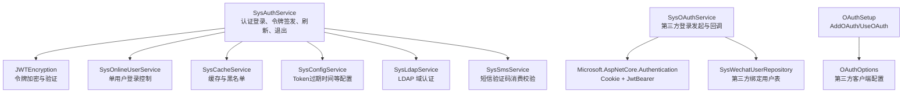
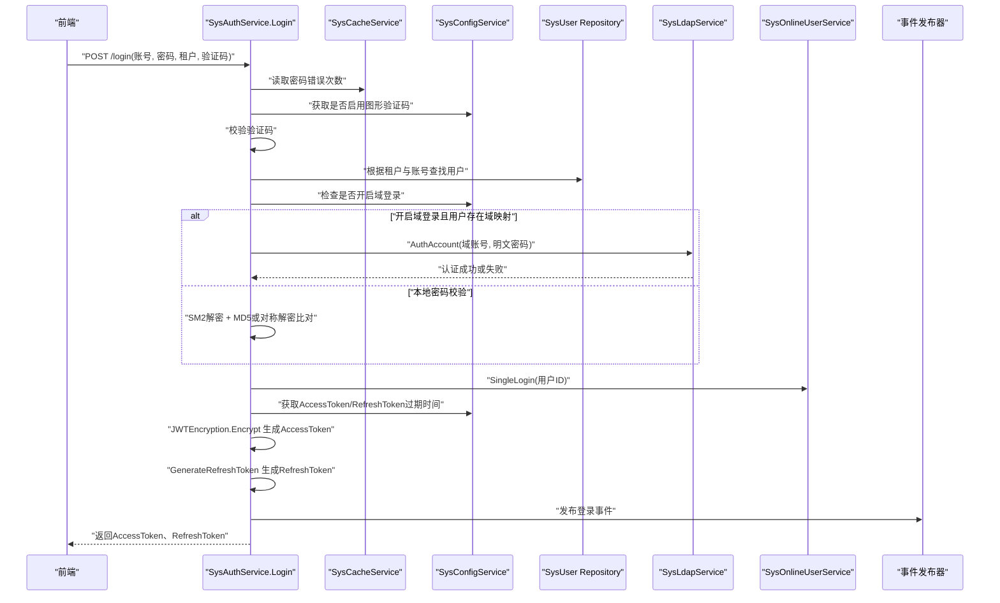
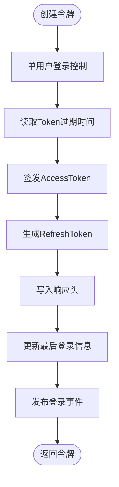
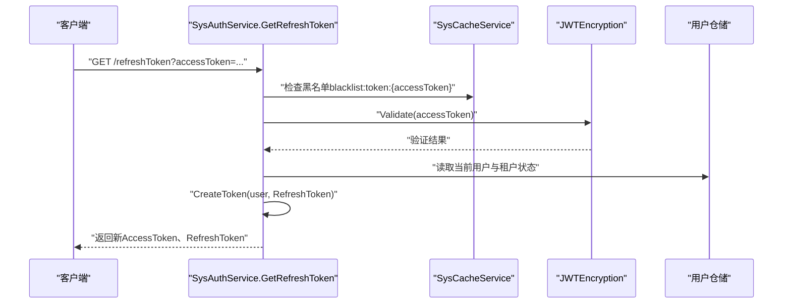
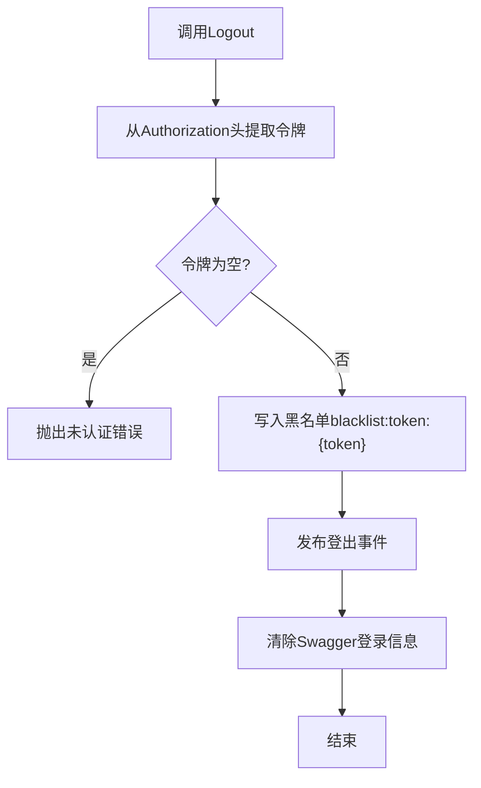
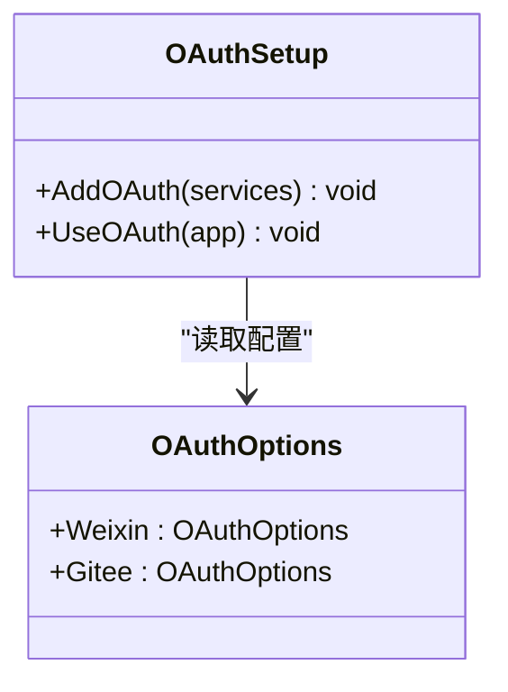
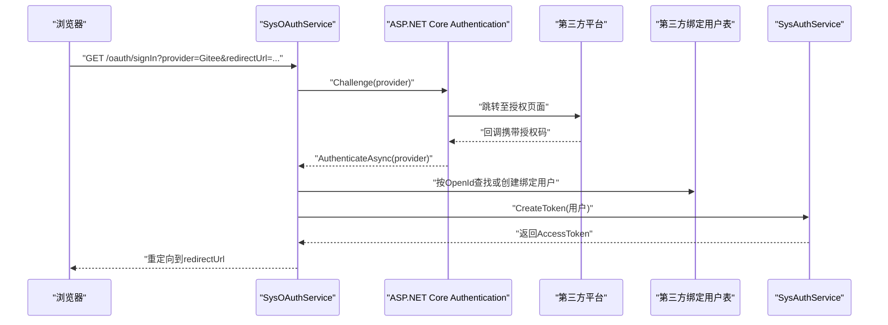
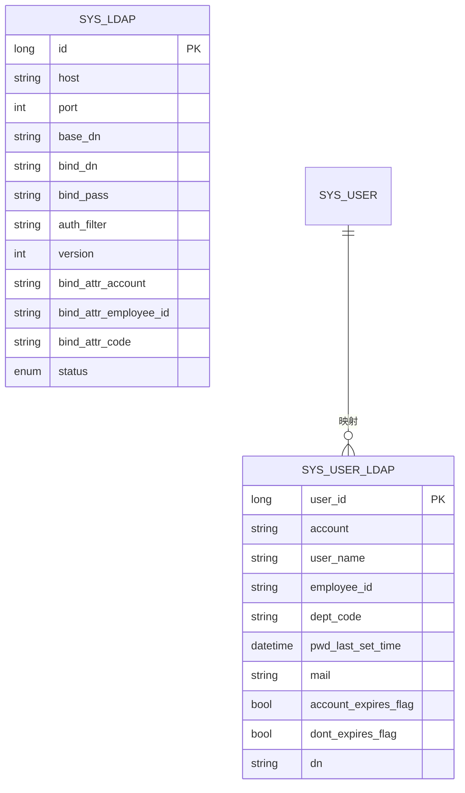
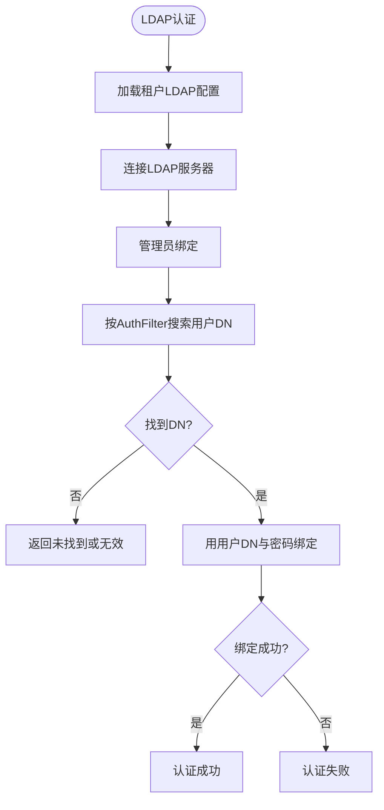
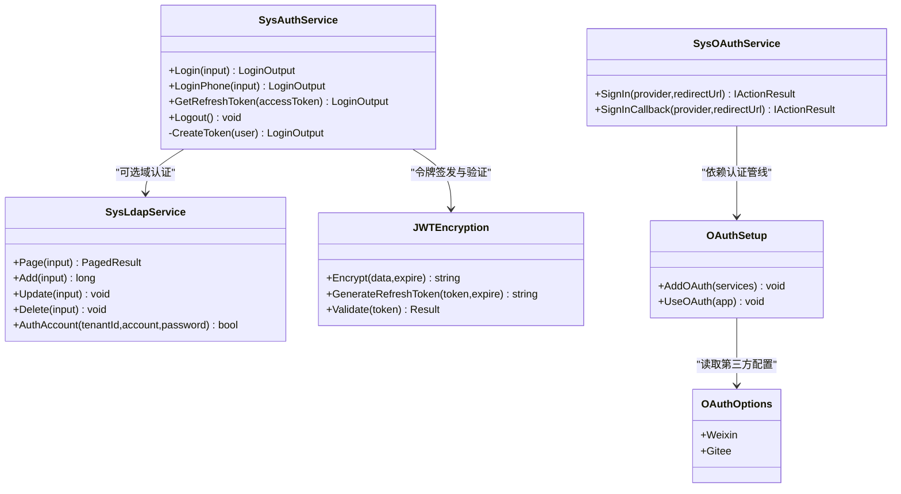

# 认证授权系统

<cite>
**本文引用的文件**   
- [SysAuthService.cs](file://Admin.NET/Admin.NET.Core/Service/Auth/SysAuthService.cs)
- [LoginInput.cs](file://Admin.NET/Admin.NET.Core/Service/Auth/Dto/LoginInput.cs)
- [LoginOutput.cs](file://Admin.NET/Admin.NET.Core/Service/Auth/Dto/LoginOutput.cs)
- [SysLdapService.cs](file://Admin.NET/Admin.NET.Core/Service/Auth/SysLdapService.cs)
- [SysLdap.cs](file://Admin.NET/Admin.NET.Core/Entity/SysLdap.cs)
- [SysUserLdap.cs](file://Admin.NET/Admin.NET.Core/Entity/SysUserLdap.cs)
- [SysOAuthService.cs](file://Admin.NET/Admin.NET.Core/Service/OAuth/SysOAuthService.cs)
- [OAuthSetup.cs](file://Admin.NET/Admin.NET.Core/Service/OAuth/OAuthSetup.cs)
- [OAuthOptions.cs](file://Admin.NET/Admin.NET.Core/Option/OAuthOptions.cs)
- [OAuthClaim.cs](file://Admin.NET/Admin.NET.Core/Service/OAuth/OAuthClaim.cs)
- [SysUser.cs](file://Admin.NET/Admin.NET.Core/Entity/SysUser.cs)
- [ConfigConst.cs](file://Admin.NET/Admin.NET.Core/Const/ConfigConst.cs)
- [SysConfigSeedData.cs](file://Admin.NET/Admin.NET.Core/SeedData/SysConfigSeedData.cs)
</cite>

## 目录
1. [简介](#简介)
2. [项目结构](#项目结构)
3. [核心组件](#核心组件)
4. [架构总览](#架构总览)
5. [详细组件分析](#详细组件分析)
6. [依赖关系分析](#依赖关系分析)
7. [性能与安全特性](#性能与安全特性)
8. [故障排查指南](#故障排查指南)
9. [结论](#结论)

## 简介
本文件系统性说明 Admin.NET 的认证与授权实现，覆盖以下主题：
- JWT 令牌机制：生成、验证、刷新与撤销。
- OAuth 2.0 开放授权集成：第三方登录流程（当前仓库已提供微信与 Gitee 示例）。
- LDAP 域服务集成：配置、查询与凭据校验。
- 多登录方式：用户名密码、手机号验证码、LDAP 域账号、第三方 OAuth 回调。
- 密码加密策略、会话与会单点登录、在线用户管理。
- 常见认证场景方案、错误处理与安全注意事项。

当前代码以后端 .NET Core 服务为主，前端业务入口为 `Web/apps/web-antdv-next`；本文聚焦后端认证授权能力，不展开前端具体交互实现。

## 项目结构
认证相关代码主要分布在以下位置：
- 认证服务：`Admin.NET.Core/Service/Auth`
- OAuth 服务与启动注册：`Admin.NET.Core/Service/OAuth`
- 实体模型：`Admin.NET.Core/Entity`
- 配置常量与种子数据：`Admin.NET.Core/Const`、`Admin.NET.Core/SeedData`

图示来源
- [SysAuthService.cs:1-200](file://Admin.NET/Admin.NET.Core/Service/Auth/SysAuthService.cs#L1-L200)
- [SysAuthService.cs:201-514](file://Admin.NET/Admin.NET.Core/Service/Auth/SysAuthService.cs#L201-L514)
- [SysOAuthService.cs:1-120](file://Admin.NET/Admin.NET.Core/Service/OAuth/SysOAuthService.cs#L1-L120)
- [OAuthSetup.cs:1-50](file://Admin.NET/Admin.NET.Core/Service/OAuth/OAuthSetup.cs#L1-L50)
- [OAuthOptions.cs:1-23](file://Admin.NET/Admin.NET.Core/Option/OAuthOptions.cs#L1-L23)

章节来源
- [SysAuthService.cs:1-200](file://Admin.NET/Admin.NET.Core/Service/Auth/SysAuthService.cs#L1-L200)
- [SysOAuthService.cs:1-120](file://Admin.NET/Admin.NET.Core/Service/OAuth/SysOAuthService.cs#L1-L120)
- [OAuthSetup.cs:1-50](file://Admin.NET/Admin.NET.Core/Service/OAuth/OAuthSetup.cs#L1-L50)
- [OAuthOptions.cs:1-23](file://Admin.NET/Admin.NET.Core/Option/OAuthOptions.cs#L1-L23)

## 核心组件
- SysAuthService：统一认证入口，负责用户名密码登录、手机号验证码登录、令牌生成与刷新、退出、锁屏校验、Swagger 临时登录、用户注册等。
- SysLdapService：LDAP 配置管理与域账号认证。
- SysOAuthService：第三方 OAuth 登录发起与回调处理。
- OAuthSetup：将 Cookie、JwtBearer、微信与 Gitee 第三方登录注册到 ASP.NET Core 认证管线。
- 实体与 DTO：SysUser、SysLdap、SysUserLdap、LoginInput、LoginOutput 等承载用户、域配置与登录输入输出。
- 配置与种子数据：ConfigConst 定义 Token 相关配置键，SysConfigSeedData 提供默认 Token 与 RefreshToken 过期时间。

章节来源
- [SysAuthService.cs:1-200](file://Admin.NET/Admin.NET.Core/Service/Auth/SysAuthService.cs#L1-L200)
- [SysLdapService.cs:1-200](file://Admin.NET/Admin.NET.Core/Service/Auth/SysLdapService.cs#L1-L200)
- [SysOAuthService.cs:1-120](file://Admin.NET/Admin.NET.Core/Service/OAuth/SysOAuthService.cs#L1-L120)
- [OAuthSetup.cs:1-50](file://Admin.NET/Admin.NET.Core/Service/OAuth/OAuthSetup.cs#L1-L50)
- [LoginInput.cs:1-119](file://Admin.NET/Admin.NET.Core/Service/Auth/Dto/LoginInput.cs#L1-L119)
- [LoginOutput.cs:1-28](file://Admin.NET/Admin.NET.Core/Service/Auth/Dto/LoginOutput.cs#L1-L28)
- [SysUser.cs:1-200](file://Admin.NET/Admin.NET.Core/Entity/SysUser.cs#L1-L200)
- [SysLdap.cs:1-88](file://Admin.NET/Admin.NET.Core/Entity/SysLdap.cs#L1-L88)
- [SysUserLdap.cs:1-80](file://Admin.NET/Admin.NET.Core/Entity/SysUserLdap.cs#L1-L80)
- [ConfigConst.cs:60-80](file://Admin.NET/Admin.NET.Core/Const/ConfigConst.cs#L60-L80)
- [SysConfigSeedData.cs:25-40](file://Admin.NET/Admin.NET.Core/SeedData/SysConfigSeedData.cs#L25-L40)

## 架构总览
下图展示一次典型“用户名密码登录”的端到端调用链：前端请求认证接口，服务完成验证码、租户与用户查找、密码校验、可选 LDAP 校验、在线用户限制、JWT 签发并返回响应头中的令牌。

图示来源
- [SysAuthService.cs:1-200](file://Admin.NET/Admin.NET.Core/Service/Auth/SysAuthService.cs#L1-L200)
- [SysAuthService.cs:201-514](file://Admin.NET/Admin.NET.Core/Service/Auth/SysAuthService.cs#L201-L514)
- [SysLdapService.cs:1-200](file://Admin.NET/Admin.NET.Core/Service/Auth/SysLdapService.cs#L1-L200)

## 详细组件分析

### 一、JWT 令牌机制：生成、验证、刷新与撤销

#### 1. 令牌生成
登录成功后，`CreateToken` 会：
- 执行单用户登录控制（可通过参数跳过）。
- 从配置中读取 AccessToken 与 RefreshToken 过期时间。
- 使用 `JWTEncryption.Encrypt` 签发包含用户标识、租户、组织、语言等信息的 AccessToken。
- 基于 AccessToken 与独立过期时间生成 RefreshToken。
- 通过响应头设置两个令牌。
- 更新最后登录 IP、地址、时间与设备信息。
- 发布登录事件，供审计与在线用户模块使用。

图示来源
- [SysAuthService.cs:201-310](file://Admin.NET/Admin.NET.Core/Service/Auth/SysAuthService.cs#L201-L310)
- [ConfigConst.cs:60-80](file://Admin.NET/Admin.NET.Core/Const/ConfigConst.cs#L60-L80)
- [SysConfigSeedData.cs:32-33](file://Admin.NET/Admin.NET.Core/SeedData/SysConfigSeedData.cs#L32-L33)

#### 2. 令牌验证
当前仓库未直接提供自定义鉴权中间件类，但 `OAuthSetup` 已注册 JwtBearer 作为默认认证方案，并由 Microsoft.AspNetCore.Authentication 在受保护接口上自动解析 Authorization 请求头。令牌的签名与有效期由 `JWTEncryption` 处理；业务侧在刷新令牌时显式调用 `JWTEncryption.Validate` 做二次校验。

注意：
- 生产环境应确保 JwtBearer 的密钥、算法与发行者配置正确。
- 若需要强制无状态校验，应在应用启动处注册并启用 JwtBearer 验证。

#### 3. 令牌刷新
`GetRefreshToken` 流程：
- 校验请求上下文、Access Token 是否为空。
- 校验 Access Token 是否在黑名单。
- 解析并验证 Access Token。
- 读取当前用户并确认租户与用户状态有效。
- 重新签发新的 AccessToken 与 RefreshToken。
- 使用 `SysUserEventTypeEnum.RefreshToken` 发布刷新事件，避免重复触发单用户登录逻辑。

图示来源
- [SysAuthService.cs:340-420](file://Admin.NET/Admin.NET.Core/Service/Auth/SysAuthService.cs#L340-L420)

#### 4. 令牌撤销
登出接口 `Logout` 将当前 AccessToken 加入 Redis 黑名单，过期时间等于 AccessToken 过期时间，从而防止被复用。同时发布登出事件并清理 Swagger 登录态。

图示来源
- [SysAuthService.cs:400-420](file://Admin.NET/Admin.NET.Core/Service/Auth/SysAuthService.cs#L400-L420)

章节来源
- [SysAuthService.cs:201-514](file://Admin.NET/Admin.NET.Core/Service/Auth/SysAuthService.cs#L201-L514)
- [ConfigConst.cs:60-80](file://Admin.NET/Admin.NET.Core/Const/ConfigConst.cs#L60-L80)
- [SysConfigSeedData.cs:32-33](file://Admin.NET/Admin.NET.Core/SeedData/SysConfigSeedData.cs#L32-L33)

### 二、OAuth 2.0 开放授权集成

当前仓库实现了基于 ASP.NET Core Authentication 的第三方登录桥接，支持：
- 微信 Weixin
- Gitee

#### 1. 认证管线注册
`OAuthSetup.AddOAuth` 注册：
- Cookie 认证方案（用于第三方回调过程）。
- JwtBearer 认证方案（作为默认认证方案）。
- 微信与 Gitee 的 OAuth 选项，其中 Gitee 额外映射头像字段。

`OAuthOptions` 暴露 `Weixin` 与 `Gitee` 的 `Microsoft.AspNetCore.Authentication.OAuth.OAuthOptions`，因此实际 ClientId、ClientSecret 应由外部配置注入。

图示来源
- [OAuthSetup.cs:1-50](file://Admin.NET/Admin.NET.Core/Service/OAuth/OAuthSetup.cs#L1-L50)
- [OAuthOptions.cs:1-23](file://Admin.NET/Admin.NET.Core/Option/OAuthOptions.cs#L1-L23)

#### 2. 登录发起与回调
`SysOAuthService.SignIn`：
- 校验 provider 是否受支持。
- 构造回调 URL，包括 provider 与前端 redirectUrl。
- 返回 ChallengeResult 引导用户到第三方授权页面。

`SysOAuthService.SignInCallback`：
- 再次校验 provider。
- 使用 `AuthenticateAsync(provider)` 获取第三方身份主体。
- 从 Claims 中提取 OpenId、姓名、邮箱、手机等。
- 若 `SysWechatUser` 不存在则新建用户并建立第三方绑定记录。
- 调用 `SysAuthService.CreateToken` 签发系统令牌。
- 重定向到前端 redirectUrl，并在 URL 中附带 AccessToken。

图示来源
- [SysOAuthService.cs:1-120](file://Admin.NET/Admin.NET.Core/Service/OAuth/SysOAuthService.cs#L1-L120)
- [OAuthSetup.cs:1-50](file://Admin.NET/Admin.NET.Core/Service/OAuth/OAuthSetup.cs#L1-L50)

#### 3. 关于授权码模式与客户端凭据模式
- 仓库当前实现的是 Web 应用常用的“授权码模式”风格第三方登录流程，即浏览器跳转到第三方平台，回调后换取身份并签发系统令牌。
- 未看到独立的客户端凭据模式服务端点；若需支持机器对机器访问，可在现有 OAuth 管线基础上扩展 Provider 或在网关层实现标准 OAuth 2.0 Token Endpoint。

章节来源
- [SysOAuthService.cs:1-120](file://Admin.NET/Admin.NET.Core/Service/OAuth/SysOAuthService.cs#L1-L120)
- [OAuthSetup.cs:1-50](file://Admin.NET/Admin.NET.Core/Service/OAuth/OAuthSetup.cs#L1-L50)
- [OAuthOptions.cs:1-23](file://Admin.NET/Admin.NET.Core/Option/OAuthOptions.cs#L1-L23)
- [OAuthClaim.cs:1-15](file://Admin.NET/Admin.NET.Core/Service/OAuth/OAuthClaim.cs#L1-L15)

### 三、LDAP 目录服务集成

#### 1. 配置模型
`SysLdap` 存储 LDAP 服务器连接与搜索规则：
- Host、Port：服务器地址与端口。
- BaseDn：用户搜索基准 DN。
- BindDn、BindPass：具有查询权限的管理员账户与加密后的绑定密码。
- AuthFilter：用户过滤规则，默认 `sAMAccountName=%s`，需在替换前进行特殊字符转义。
- Version：LDAP 协议版本。
- BindAttrAccount、BindAttrEmployeeId、BindAttrCode：用于映射 AD/LDAP 属性。
- Status：启用状态。

`SysUserLdap` 存储系统用户与域账号的映射关系，包括域账号、用户名、员工号、部门代码、最后修改密码时间、邮箱、DN 等。

图示来源
- [SysLdap.cs:1-88](file://Admin.NET/Admin.NET.Core/Entity/SysLdap.cs#L1-L88)
- [SysUserLdap.cs:1-80](file://Admin.NET/Admin.NET.Core/Entity/SysUserLdap.cs#L1-L80)

#### 2. 认证流程
当系统配置开启域登录时，`SysAuthService.Login` 会根据用户是否关联域账号选择不同路径：
- 未关联域账号：走本地密码校验。
- 已关联域账号：调用 `SysLdapService.AuthAccount` 验证域账号与密码。

`SysLdapService.AuthAccount`：
- 查找租户下启用的 LDAP 配置。
- 连接 LDAP 服务器并进行管理员绑定。
- 根据 `AuthFilter` 搜索用户 DN。
- 尝试用用户 DN 和用户密码进行绑定，成功即认证通过。
- 捕获 LDAP 异常并转换为业务错误。

图示来源
- [SysLdapService.cs:1-200](file://Admin.NET/Admin.NET.Core/Service/Auth/SysLdapService.cs#L1-L200)
- [SysAuthService.cs:1-200](file://Admin.NET/Admin.NET.Core/Service/Auth/SysAuthService.cs#L1-L200)

#### 3. 配置管理
`SysLdapService` 提供分页查询、新增、更新、删除与详情接口。新增与更新时对敏感字段 `BindPass` 使用 SM2 加密；列表与详情返回时清空该字段。

章节来源
- [SysLdapService.cs:1-200](file://Admin.NET/Admin.NET.Core/Service/Auth/SysLdapService.cs#L1-L200)
- [SysLdap.cs:1-88](file://Admin.NET/Admin.NET.Core/Entity/SysLdap.cs#L1-L88)
- [SysUserLdap.cs:1-80](file://Admin.NET/Admin.NET.Core/Entity/SysUserLdap.cs#L1-L80)
- [SysAuthService.cs:1-200](file://Admin.NET/Admin.NET.Core/Service/Auth/SysAuthService.cs#L1-L200)

### 四、多种登录方式与前端交互

#### 1. 用户名密码登录
- 输入：`LoginInput.Account`、`LoginInput.Password`、`LoginInput.TenantId`、`LoginInput.CodeId`、`LoginInput.Code`。
- 流程：
  - 检查密码错误次数。
  - 可选校验图形验证码。
  - 根据租户与账号查找用户。
  - 检查用户状态。
  - 若开启域登录且存在域映射，则走 LDAP 校验。
  - 否则执行本地密码校验。
  - 清空错误计数与按钮权限缓存。
  - 调用 `CreateToken` 签发令牌。

#### 2. 手机号验证码登录
- 输入：`LoginPhoneInput.Phone`、`LoginPhoneInput.Code`、`LoginPhoneInput.TenantId`。
- 流程：
  - 调用 `SysSmsService.ConsumeCode` 消费短信验证码。
  - 根据手机号查找用户与租户。
  - 检查用户状态。
  - 调用 `CreateToken` 签发令牌。

#### 3. 二维码登录
当前后端未看到专门的二维码登录控制器或服务。通常二维码登录属于前端与第三方扫码平台之间的交互；后端可复用手机号登录或令牌刷新接口完成最终令牌下发。若需后端参与二维码状态轮询，可在现有认证服务上扩展专用接口。

#### 4. Token 登录
当前仓库未提供“仅凭 Token 登录”的独立接口。已有能力包括：
- 第三方 OAuth 回调最终返回带 AccessToken 的重定向。
- 刷新令牌接口可使用旧 AccessToken 换取新令牌。
- Swagger 提供临时登录提交接口用于调试。

章节来源
- [LoginInput.cs:1-119](file://Admin.NET/Admin.NET.Core/Service/Auth/Dto/LoginInput.cs#L1-L119)
- [SysAuthService.cs:1-200](file://Admin.NET/Admin.NET.Core/Service/Auth/SysAuthService.cs#L1-L200)
- [SysAuthService.cs:201-514](file://Admin.NET/Admin.NET.Core/Service/Auth/SysAuthService.cs#L201-L514)

### 五、密码加密策略、会话管理与安全最佳实践

#### 1. 密码加密与传输
- 前端发送的密码采用 SM2 非对称加密传输，后端使用 `CryptogramUtil.SM2Decrypt` 解密。
- 后端密码存储支持两种模式：
  - MD5：将解密后的明文进行 MD5 比较。
  - 对称加密：解密存储密文后与明文比较。
- 建议：
  - 优先使用安全的对称加密或单向哈希算法，避免明文比较。
  - 确保前端 SM2 公钥与后端私钥一致。
  - 不在日志中输出明文密码或敏感令牌。

#### 2. 会话管理与单用户登录
- `CreateToken` 默认调用 `SysOnlineUserService.SingleLogin` 实现单用户登录控制。
- 刷新令牌时传入 `SysUserEventTypeEnum.RefreshToken` 以跳过单用户登录限制。
- 登出时将令牌加入黑名单，防止复用。

#### 3. 安全建议
- 生产环境必须启用 HTTPS，避免令牌在传输中被窃取。
- 合理设置 AccessToken 与 RefreshToken 过期时间，默认种子数据分别为 10080 分钟和 20160 分钟。
- 启用图形验证码与密码错误次数限制，降低暴力破解风险。
- 对 LDAP 配置中的 BindPass 进行加密存储，列表接口不返回敏感字段。
- 对第三方 OAuth 回调进行严格校验，禁止任意 redirectUrl。
- 如需更细粒度鉴权，应在 JwtBearer 配置中启用严格的 Issuer、Audience 与密钥轮换策略。

章节来源
- [SysAuthService.cs:1-200](file://Admin.NET/Admin.NET.Core/Service/Auth/SysAuthService.cs#L1-L200)
- [SysAuthService.cs:201-514](file://Admin.NET/Admin.NET.Core/Service/Auth/SysAuthService.cs#L201-L514)
- [SysConfigSeedData.cs:32-33](file://Admin.NET/Admin.NET.Core/SeedData/SysConfigSeedData.cs#L32-L33)
- [SysLdapService.cs:1-200](file://Admin.NET/Admin.NET.Core/Service/Auth/SysLdapService.cs#L1-L200)

## 依赖关系分析

图示来源
- [SysAuthService.cs:1-514](file://Admin.NET/Admin.NET.Core/Service/Auth/SysAuthService.cs#L1-L514)
- [SysLdapService.cs:1-200](file://Admin.NET/Admin.NET.Core/Service/Auth/SysLdapService.cs#L1-L200)
- [SysOAuthService.cs:1-120](file://Admin.NET/Admin.NET.Core/Service/OAuth/SysOAuthService.cs#L1-L120)
- [OAuthSetup.cs:1-50](file://Admin.NET/Admin.NET.Core/Service/OAuth/OAuthSetup.cs#L1-L50)
- [OAuthOptions.cs:1-23](file://Admin.NET/Admin.NET.Core/Option/OAuthOptions.cs#L1-L23)

章节来源
- [SysAuthService.cs:1-514](file://Admin.NET/Admin.NET.Core/Service/Auth/SysAuthService.cs#L1-L514)
- [SysLdapService.cs:1-200](file://Admin.NET/Admin.NET.Core/Service/Auth/SysLdapService.cs#L1-L200)
- [SysOAuthService.cs:1-120](file://Admin.NET/Admin.NET.Core/Service/OAuth/SysOAuthService.cs#L1-L120)
- [OAuthSetup.cs:1-50](file://Admin.NET/Admin.NET.Core/Service/OAuth/OAuthSetup.cs#L1-L50)
- [OAuthOptions.cs:1-23](file://Admin.NET/Admin.NET.Core/Option/OAuthOptions.cs#L1-L23)

## 性能与安全特性

- 令牌过期时间可从系统配置动态调整，便于灰度与运营策略调整。
- 密码错误次数限制结合缓存减少数据库压力。
- LDAP 查询失败时快速返回，避免长时间阻塞。
- 令牌黑名单使用缓存，避免每次鉴权都查库。
- 单用户登录控制可限制同一账号并发会话数量。
- 第三方 OAuth 回调通过标准 ASP.NET Core Authentication 管线处理，减少重复开发成本。

[本节为通用指导，不直接分析具体文件]

## 故障排查指南

| 现象 | 可能原因 | 排查步骤 | 处理建议 |
|---|---|---|---|
| 登录提示密码错误或账号不存在 | 账号不存在、密码错误、域账号未匹配 | 检查账号是否存在、是否开启域登录、LDAP 配置是否正确 | 修正密码、补充域映射或关闭域登录测试 |
| 图形验证码校验失败 | 验证码过期、前端 CodeId 不一致 | 检查验证码接口返回、前端是否重复使用 CodeId | 刷新验证码，确保 CodeId 与 Code 对应 |
| 刷新令牌失败 | Access Token 已过期或被拉黑 | 检查黑名单缓存、Token 是否已登出 | 重新登录或使用有效 Access Token |
| 第三方登录回调报错 | 第三方配置缺失、Provider 不支持 | 检查 OAuthOptions 中 ClientId/ClientSecret | 配置正确的第三方应用信息 |
| LDAP 连接失败 | 主机、端口、BaseDn、BindDn、BindPass 配置错误 | 检查 SysLdap 配置、网络连通性 | 修正配置并重启服务 |
| 登录后无法获取权限或菜单 | 权限缓存未刷新 | 查看是否更新了角色或菜单 | 重新登录或清理按钮权限缓存 |

章节来源
- [SysAuthService.cs:1-200](file://Admin.NET/Admin.NET.Core/Service/Auth/SysAuthService.cs#L1-L200)
- [SysAuthService.cs:201-514](file://Admin.NET/Admin.NET.Core/Service/Auth/SysAuthService.cs#L201-L514)
- [SysLdapService.cs:1-200](file://Admin.NET/Admin.NET.Core/Service/Auth/SysLdapService.cs#L1-L200)
- [SysOAuthService.cs:1-120](file://Admin.NET/Admin.NET.Core/Service/OAuth/SysOAuthService.cs#L1-L120)

## 结论
Admin.NET 的认证授权体系以 `SysAuthService` 为核心，结合 JWT、Redis 黑名单、短信验证码、LDAP 域认证与第三方 OAuth 回调，形成一套完整的多登录方式认证方案。其优势在于：
- 登录流程清晰，支持用户名密码与手机号验证码。
- 令牌生命周期可配置，支持刷新与撤销。
- 第三方登录通过标准认证管线接入，易于扩展。
- LDAP 集成适合企业域环境。

在生产环境中，建议进一步：
- 明确 JwtBearer 的密钥、算法与颁发者配置。
- 使用 HTTPS 与安全的跨域策略。
- 定期轮换令牌密钥与第三方客户端密钥。
- 完善审计日志与告警机制。
- 根据业务需求扩展更多登录方式，如邮箱验证码、二维码轮询、客户端凭据模式等。

[本节为总结性内容，不直接分析具体文件]