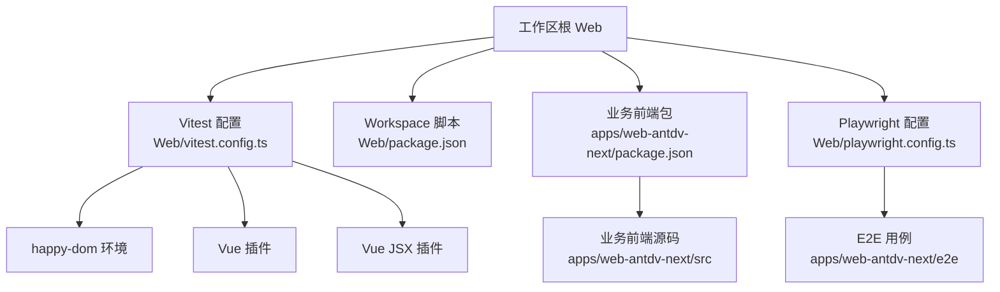
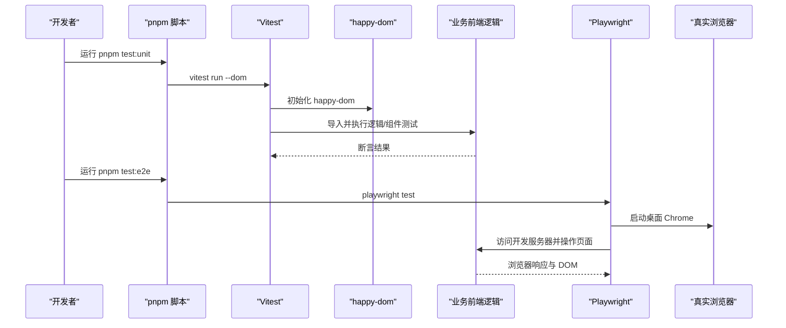
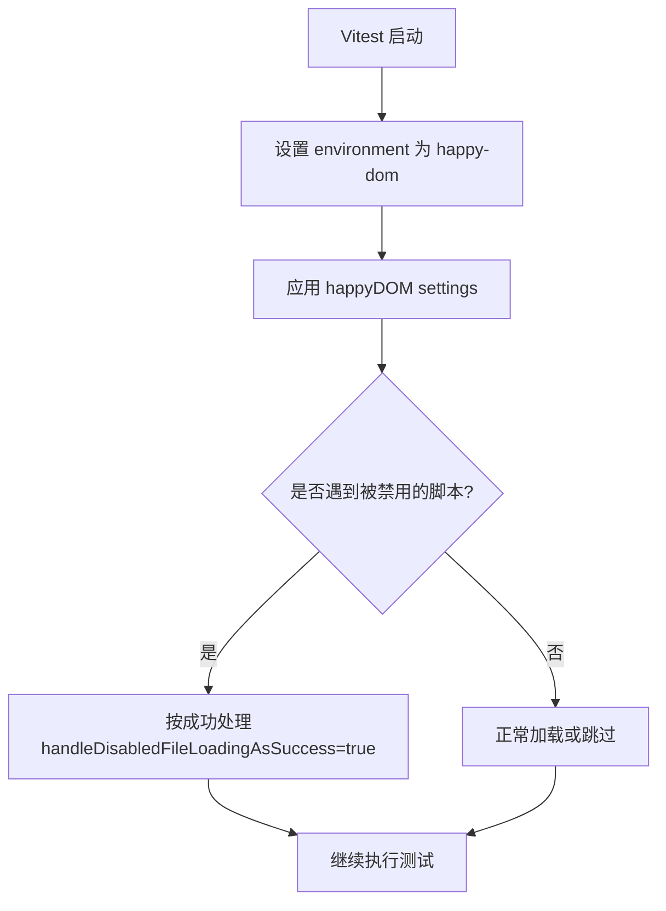
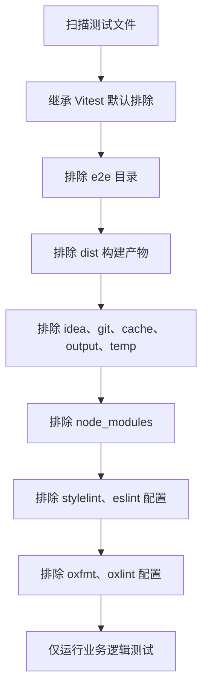
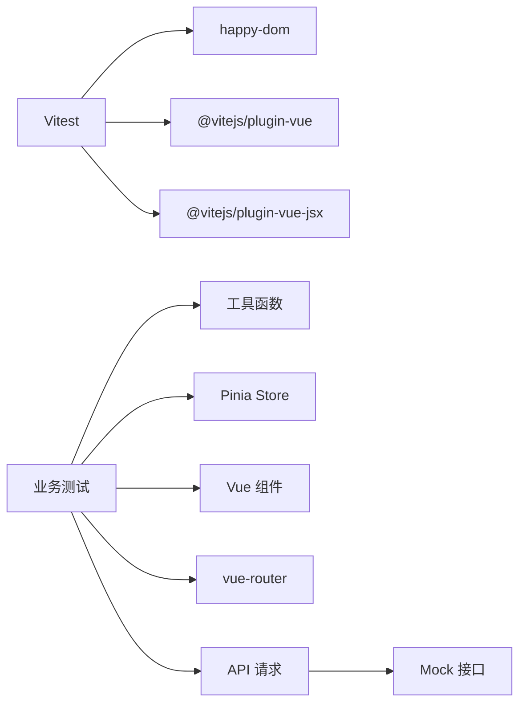

# Vitest 逻辑测试

<cite>
**本文引用的文件**   
- [Web/vitest.config.ts](file://Web/vitest.config.ts)
- [Web/package.json](file://Web/package.json)
- [Web/apps/web-antdv-next/package.json](file://Web/apps/web-antdv-next/package.json)
- [Web/playwright.config.ts](file://Web/playwright.config.ts)
</cite>

## 目录
1. [引言](#引言)
2. [项目结构](#项目结构)
3. [核心组件](#核心组件)
4. [架构总览](#架构总览)
5. [详细配置解析](#详细配置解析)
6. [依赖关系分析](#依赖关系分析)
7. [性能与执行特性](#性能与执行特性)
8. [编写指南](#编写指南)
9. [常见问题排查](#常见问题排查)
10. [结论](#结论)

## 引言
本仓库的前端采用 monorepo 结构，业务前端入口是 `apps/web-antdv-next`。当前分支已完成前端移植，因此本文以该应用为基准说明前端测试策略。

Vitest 负责前端逻辑测试：验证工具函数、状态管理、组件行为和渲染结果；它运行在 `happy-dom` 环境中，不驱动真实浏览器。真正的端到端浏览器流程由 Playwright 负责，位于 `apps/web-antdv-next/e2e`。

本文重点解释 `Web/vitest.config.ts` 中 Vue 与 Vue JSX 插件、`happy-dom` 环境、JS 禁用脚本加载安全修复和排除规则，并给出组件测试、Store 测试和工具函数测试的编写思路及注意事项。

## 项目结构
前端测试相关的关键位置如下：

| 路径 | 作用 |
|---|---|
| `Web/vitest.config.ts` | Vitest 全局配置，启用 Vue、Vue JSX、`happy-dom` 与安全修复，并设置排除规则 |
| `Web/package.json` | workspace 根脚本，包含单元测试、E2E、开发、构建、类型检查和代码检查命令 |
| `Web/apps/web-antdv-next/package.json` | 业务前端包脚本，定义 `dev`、`build`、`typecheck` 等命令 |
| `Web/playwright.config.ts` | Playwright E2E 配置，指向 `apps/web-antdv-next/e2e` |
| `apps/web-antdv-next/e2e` | Playwright 端到端测试用例目录 |

**图表来源**
- [Web/vitest.config.ts:1-28](file://Web/vitest.config.ts#L1-L28)
- [Web/package.json:1-102](file://Web/package.json#L1-L102)
- [Web/apps/web-antdv-next/package.json:1-72](file://Web/apps/web-antdv-next/package.json#L1-L72)
- [Web/playwright.config.ts:1-31](file://Web/playwright.config.ts#L1-L31)

**章节来源**
- [Web/vitest.config.ts:1-28](file://Web/vitest.config.ts#L1-L28)
- [Web/package.json:1-102](file://Web/package.json#L1-L102)
- [Web/apps/web-antdv-next/package.json:1-72](file://Web/apps/web-antdv-next/package.json#L1-L72)
- [Web/playwright.config.ts:1-31](file://Web/playwright.config.ts#L1-L31)

## 核心组件
本节从测试职责边界出发，区分三类前端测试层次。

| 测试层次 | 负责内容 | 运行方式 | 是否驱动真实浏览器 |
|---|---|---|---:|
| Vitest 逻辑测试 | 工具函数、状态管理、组件渲染逻辑、路由相关行为 | `pnpm test:unit` 或 `vitest run --dom` | 否 |
| Playwright 浏览器测试 | 页面导航、用户交互、完整业务流程 | `pnpm test:e2e` | 是 |
| 构建与类型检查 | 打包产物、TypeScript 类型、循环依赖、代码风格 | `pnpm build`、`pnpm check:type`、`pnpm lint` | 否 |

需要特别强调：**`pnpm dev`、`pnpm build`、`pnpm lint`、`pnpm check:type` 面向业务应用 `@vben/web-antdv-next`，不是全 workspace 通用检查**。它们通过 `pnpm --filter @vben/web-antdv-next` 定位到具体应用。

**章节来源**
- [Web/package.json:14-51](file://Web/package.json#L14-L51)
- [Web/apps/web-antdv-next/package.json:16-26](file://Web/apps/web-antdv-next/package.json#L16-L26)
- [Web/playwright.config.ts:4-12](file://Web/playwright.config.ts#L4-L12)

## 架构总览
前端测试架构分为两层：

1. **Vitest 层**：基于 Node + `happy-dom`，编译 Vue SFC 和 JSX，断言纯逻辑、状态变化和渲染输出。
2. **Playwright 层**：启动真实 Chrome 桌面环境，访问已启动的开发服务器，验证跨模块、跨页面、跨网络请求的真实流程。

**图表来源**
- [Web/package.json:35-41](file://Web/package.json#L35-L41)
- [Web/vitest.config.ts:1-28](file://Web/vitest.config.ts#L1-L28)
- [Web/playwright.config.ts:1-31](file://Web/playwright.config.ts#L1-L31)

## 详细配置解析

### Vue 与 Vue JSX 插件
`Web/vitest.config.ts` 引入 `@vitejs/plugin-vue` 和 `@vitejs/plugin-vue-jsx`，并在 Vitest 的 `plugins` 中注册。这使得 Vitest 能直接处理 `.vue` 单文件组件和 JSX/TSX 语法，无需额外转换步骤。

关键点：
- Vue 插件负责 `<template>`、`<script setup>`、SFC 编译。
- Vue JSX 插件负责 JSX/TSX 语法。
- 这两个插件复用 Vite 生态，保证测试环境与开发构建环境一致。

**章节来源**
- [Web/vitest.config.ts:1-7](file://Web/vitest.config.ts#L1-L7)

### happy-dom 环境
Vitest 默认环境是 Node，但前端 UI 测试通常需要 DOM、`document`、`window` 等接口。本项目选择 `happy-dom`，并通过 `environmentOptions.happyDOM.settings.handleDisabledFileLoadingAsSuccess` 调整行为。

原因：
- `happy-dom` 提供轻量级 DOM API，比 jsdom 更快，适合纯逻辑测试。
- `handleDisabledFileLoadingAsSuccess` 解决 `happy-dom v20+` 的安全修复导致的脚本加载问题：当脚本被禁用时，不再报错，而是按成功处理，从而保留原有测试行为。

**图表来源**
- [Web/vitest.config.ts:8-17](file://Web/vitest.config.ts#L8-L17)

**章节来源**
- [Web/vitest.config.ts:8-17](file://Web/vitest.config.ts#L8-L17)

### JS 禁用脚本加载安全修复
注释明确指出这是针对 `happy-dom v20+` 的安全修复。旧版本可能允许或忽略某些脚本加载失败，新版本默认禁用 JavaScript 执行以提升安全性。若不做处理，测试可能因为无法加载脚本而失败。

建议：
- 不要自行绕过此安全修复来加载任意远程脚本。
- 若测试需要模拟外部资源，优先使用 Mock API、Mock 静态资源或本地假数据。
- 仅在确实需要兼容历史行为时，保持 `handleDisabledFileLoadingAsSuccess: true`。

**章节来源**
- [Web/vitest.config.ts:11-16](file://Web/vitest.config.ts#L11-L16)

### 排除规则
Vitest 继承 `configDefaults.exclude`，并追加以下目录和模式：

| 排除项 | 含义 |
|---|---|
| `**/e2e/**` | 排除 Playwright 端到端测试，避免 Vitest 误跑浏览器用例 |
| `**/dist/**` | 排除构建产物，避免重复执行生成的代码 |
| `**/.{idea,git,cache,output,temp}/**` | 排除 IDE、版本控制、缓存和临时目录 |
| `**/node_modules/**` | 排除第三方依赖，避免扫描整个依赖树 |
| `**/{stylelint,eslint}.config.*` | 排除 ESLint、Stylelint 配置 |
| `**/{oxfmt,oxlint}.config.*` | 排除 Oxfmt、Oxlint 配置 |

这些排除规则能显著缩小测试范围，提升执行速度，并避免把工程配置文件当作测试用例。

**图表来源**
- [Web/vitest.config.ts:18-27](file://Web/vitest.config.ts#L18-L27)

**章节来源**
- [Web/vitest.config.ts:18-27](file://Web/vitest.config.ts#L18-L27)

## 依赖关系分析
Vitest 逻辑测试依赖前端运行时关键库，但不依赖后端数据库或真实浏览器。

| 依赖类别 | 示例 | 用途 |
|---|---|---|
| 框架 | `vue` | 组件与 SFC 支持 |
| JSX | `@vitejs/plugin-vue-jsx` | 组件 JSX/TSX 支持 |
| DOM | `happy-dom` | 轻量 DOM 环境 |
| 测试框架 | `vitest` | 测试运行器 |
| 组件测试 | `@vue/test-utils` | 组件挂载与交互测试 |
| 状态管理 | `pinia` | Store 测试 |
| 路由 | `vue-router` | 路由行为测试 |
| 网络请求 | `axios` 或业务请求封装 | 需 Mock |

**图表来源**
- [Web/vitest.config.ts:1-28](file://Web/vitest.config.ts#L1-L28)
- [Web/package.json:63-101](file://Web/package.json#L63-L101)
- [Web/apps/web-antdv-next/package.json:38-71](file://Web/apps/web-antdv-next/package.json#L38-L71)

**章节来源**
- [Web/package.json:63-101](file://Web/package.json#L63-L101)
- [Web/apps/web-antdv-next/package.json:38-71](file://Web/apps/web-antdv-next/package.json#L38-L71)

## 性能与执行特性
- Vitest 使用 `happy-dom`，比完整浏览器更轻，适合快速回归逻辑错误。
- 排除 `node_modules`、`e2e`、`dist` 后，测试集更小，执行更快。
- `pnpm test:unit` 实际调用 `vitest run --dom`，适合 CI 或日常提交前检查。
- 覆盖率收集属于可选增强：可在 Vitest 配置中开启 `coverage`，但当前根配置未显式启用。

注意：
- 覆盖率报告通常只统计被测源码，不应将 `node_modules`、`e2e`、`dist` 纳入统计。
- 如果团队希望强制覆盖率阈值，应在 CI 中结合覆盖率输出进行判断。

**章节来源**
- [Web/vitest.config.ts:18-27](file://Web/vitest.config.ts#L18-L27)
- [Web/package.json:35-41](file://Web/package.json#L35-L41)

## 编写指南

### 如何运行测试
推荐从工作区根目录执行：

| 命令 | 含义 |
|---|---|
| `pnpm test:unit` | 运行 Vitest 单元测试，等价于 `vitest run --dom` |
| `pnpm test:e2e` | 运行 Playwright 端到端测试 |
| `pnpm dev` | 启动业务前端开发服务器 |
| `pnpm build` | 构建业务前端应用 |
| `pnpm lint` | 对业务前端源码执行 ESLint |
| `pnpm check:type` | 对业务前端执行 TypeScript 类型检查 |

重要提醒：
- `pnpm dev`、`pnpm build`、`pnpm lint`、`pnpm check:type` 都通过 `--filter @vben/web-antdv-next` 作用于业务应用，不是对整个 workspace 做统一检查。
- 若只想运行某个测试文件，可直接使用 `vitest run` 并指定路径。

**章节来源**
- [Web/package.json:14-51](file://Web/package.json#L14-L51)
- [Web/apps/web-antdv-next/package.json:16-26](file://Web/apps/web-antdv-next/package.json#L16-L26)

### 组件测试
组件测试应关注渲染结果、事件触发、Props 变化、插槽输出和简单交互。

推荐做法：
- 使用 `@vue/test-utils` 挂载组件。
- 通过 `render`、`mount`、`shallowMount` 控制渲染深度。
- 使用 `fireEvent`、`userEvent` 模拟用户输入。
- 断言 DOM 文本、类名、属性、组件实例状态。
- 对外部副作用（网络、路由跳转）使用 Mock。

常见场景：
- 表单输入校验。
- 列表渲染与筛选。
- 按钮点击回调。
- 条件渲染。

### Store 测试
Store 测试应聚焦 Pinia State、Getter、Action 的状态变更和副作用隔离。

推荐做法：
- 使用 `createPinia()` 创建独立 Store 实例。
- 在每个测试中重置状态，避免测试相互污染。
- 对异步 Action 使用 `flushPromises` 或等待 Promise。
- 对网络请求使用 Mock，避免真实 API。
- 断言 State 字段、Getter 返回值、副作用调用次数。

常见场景：
- 用户登录状态切换。
- 权限数据加载。
- 分页参数更新。
- 多 Store 协作时的顺序断言。

### 工具函数测试
工具函数是最容易稳定覆盖的部分，应优先编写。

推荐做法：
- 每个工具函数至少一个正向用例和一个异常用例。
- 输入边界值、空值、非法类型、超大输入。
- 对日期、数字格式化、字符串处理、URL 处理等进行充分断言。
- 对依赖全局对象或浏览器的函数，优先替换为可测试封装或使用 Mock。

### Mock API
推荐使用以下方式之一：
- 使用 `vi.mock` 或测试框架提供的 Mock 能力拦截模块。
- 对 Axios 拦截器或业务请求封装返回固定响应。
- 对异步接口使用 Promise resolve/reject 模拟成功与失败。
- 对上传、下载、WebSocket 等复杂接口，优先抽象接口并用 Mock 实现。

### 模拟路由
对于 `vue-router`：
- 使用 `createMemoryHistory` 或测试专用路由实例。
- 避免依赖真实浏览器地址栏。
- 断言当前路由、查询参数、路由守卫行为。
- 对需要完整路由上下文的组件，使用测试路由容器包裹。

### 模拟 Pinia 状态
- 新建独立 Pinia 实例，避免共享状态。
- 使用 `pinia.state` 初始化和断言。
- 对组合式函数中的 Store 使用 `mockedFunction` 或 `vi.spyOn`。
- 对异步 Action 明确等待状态更新完成后再断言。

## 常见问题排查

| 问题 | 可能原因 | 处理建议 |
|---|---|---|
| 模块解析失败 | 别名、路径映射、workspace 引用未正确解析 | 确认 Vite/Vitest 共享配置；确保测试文件位于被扫描范围；检查 `imports`、路径别名 |
| Vue SFC 无法编译 | 缺少 Vue 或 JSX 插件 | 确认 `@vitejs/plugin-vue` 与 `@vitejs/plugin-vue-jsx` 已在 Vitest plugins 中注册 |
| `document` 或 `window` 不存在 | 使用了 Node 默认环境而非 `happy-dom` | 使用 `environment: 'happy-dom'` 或通过 `--dom` 运行 |
| 脚本加载报错 | `happy-dom v20+` 默认禁用脚本执行 | 保持 `handleDisabledFileLoadingAsSuccess: true`，或改用 Mock 资源 |
| 测试太慢 | 引入了真实浏览器或大型依赖 | 避免在 Vitest 中启动 Playwright；用 Mock 替代真实请求 |
| 测试互相污染 | Store、全局状态、路由未隔离 | 每个测试重置 Pinia、Router、Mock |
| 覆盖率偏低 | 未统计业务源码或被过多排除 | 检查覆盖率配置和 exclude 规则，不要排除业务源码 |
| 想运行 E2E 却触发了 Vitest | 文件位于 `e2e` 但被 Vitest 扫描 | 确认排除规则包含 `**/e2e/**`，并使用 `pnpm test:e2e` 运行 |
| 想运行 Vitest 却走了 Playwright | 混淆了两个测试层 | 使用 `pnpm test:unit` 运行 Vitest，使用 `pnpm test:e2e` 运行 Playwright |

**章节来源**
- [Web/vitest.config.ts:1-28](file://Web/vitest.config.ts#L1-L28)
- [Web/package.json:35-41](file://Web/package.json#L35-L41)
- [Web/playwright.config.ts:1-31](file://Web/playwright.config.ts#L1-L31)

## 结论
本项目的前端测试采用清晰分层：

- **Vitest** 负责快速、稳定的逻辑测试，基于 Vue、Vue JSX 和 `happy-dom`，并针对 `happy-dom v20+` 的脚本禁用安全修复做了兼容处理。
- **Playwright** 负责真实浏览器流程验证，位于 `apps/web-antdv-next/e2e`，由 `pnpm test:e2e` 驱动。
- **构建与质量检查** 通过 `pnpm dev`、`pnpm build`、`pnpm lint`、`pnpm check:type` 面向业务应用 `@vben/web-antdv-next`，不应理解为全 workspace 统一检查。

在实际工程中，建议优先补充工具函数和 Store 测试，再逐步完善组件测试；E2E 用例用于保障关键业务流程和跨模块集成。这样既能获得快速反馈，又能守住真实浏览器层面的质量底线。