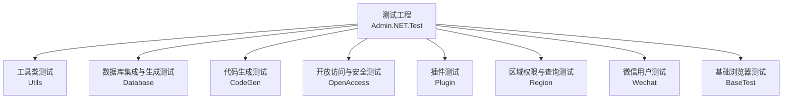
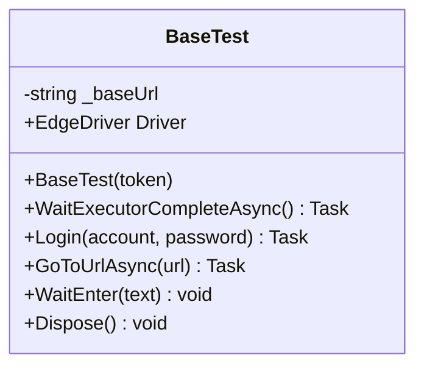
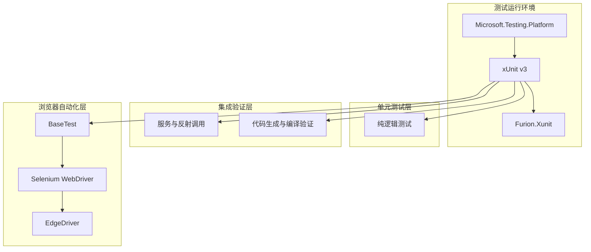
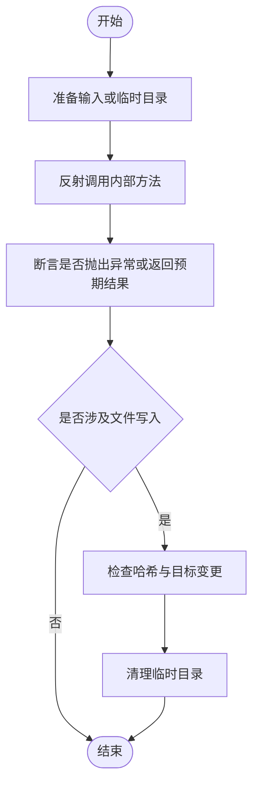
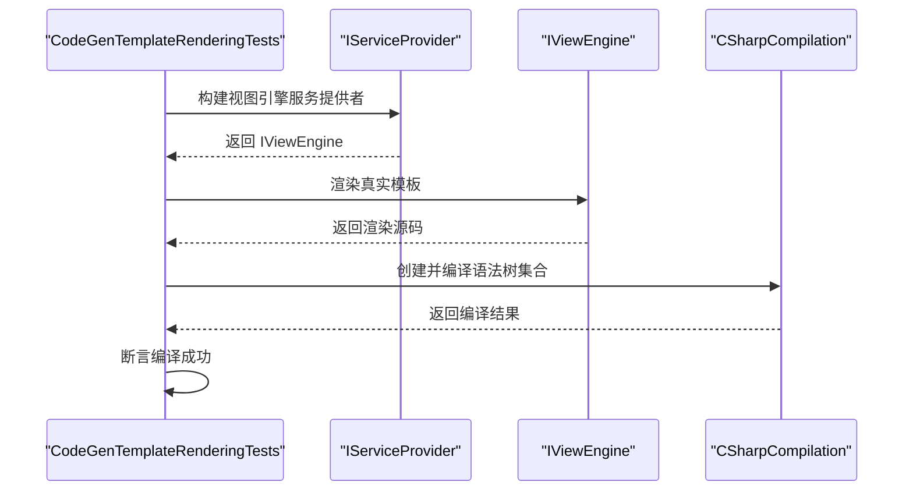
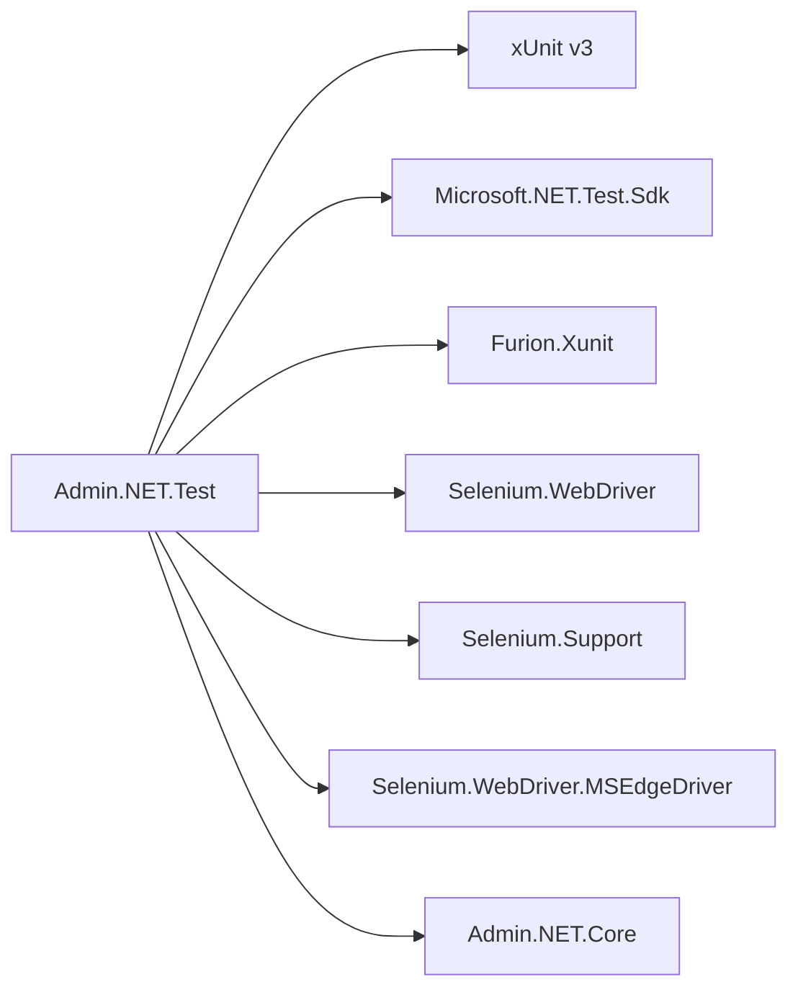

# 单元测试

<cite>
**本文引用的文件**   
- [Admin.NET.Test.csproj](file://Admin.NET/Admin.NET.Test/Admin.NET.Test.csproj)
- [global.json](file://Admin.NET/global.json)
- [BaseTest.cs](file://Admin.NET/Admin.NET.Test/BaseTest.cs)
- [SafeMathTests.cs](file://Admin.NET/Admin.NET.Test/Utils/SafeMathTests.cs)
- [DateTimeUtilTests.cs](file://Admin.NET/Admin.NET.Test/Utils/DateTimeUtilTests.cs)
- [DatabaseInputTests.cs](file://Admin.NET/Admin.NET.Test/Database/DatabaseInputTests.cs)
- [DatabaseGenerationTests.cs](file://Admin.NET/Admin.NET.Test/Database/DatabaseGenerationTests.cs)
- [CodeGenConfigContractsTests.cs](file://Admin.NET/Admin.NET.Test/CodeGen/CodeGenConfigContractsTests.cs)
- [CodeGenTemplateRenderingTests.cs](file://Admin.NET/Admin.NET.Test/CodeGen/CodeGenTemplateRenderingTests.cs)
</cite>

## 目录
1. [简介](#简介)
2. [项目结构](#项目结构)
3. [核心组件](#核心组件)
4. [架构总览](#架构总览)
5. [详细组件分析](#详细组件分析)
6. [依赖关系分析](#依赖关系分析)
7. [性能与稳定性考虑](#性能与稳定性考虑)
8. [本地运行指南](#本地运行指南)
9. [常见问题排查](#常见问题排查)
10. [结论](#结论)

## 简介
本文件说明 Admin.NET 后端测试工程 `Admin.NET.Test` 的测试框架配置、基类设计、现有测试模式，以及编写新单元测试的实践规范。当前测试工程基于 Microsoft.Testing Platform 作为测试运行器，使用 xUnit v3 作为测试框架，并通过 Furion.Xunit 提供与 Furion 生态集成的能力；同时引入 Selenium 套件用于浏览器自动化验证。

需要特别注意：
- 测试工程的目标框架为 `net10.0`。
- 根级 `global.json` 仅声明测试运行器为 `Microsoft.Testing.Platform`，并未固定具体 .NET SDK 版本。
- 前端业务应用入口位于 `Web/apps/web-antdv-next`，但本文聚焦后端测试，不涉及前端构建命令。
- 数据库相关验收应使用隔离的真实 PostgreSQL，不能以 SQLite 或模拟结果代替真实联调。
- 浏览器流程只要求桌面端；逻辑测试、Playwright 浏览器验证与真实 API/数据库链路验收需区分清楚。

## 项目结构
测试工程位于 `Admin.NET/Admin.NET.Test`，按功能域组织测试类，例如 `Utils`、`Database`、`CodeGen`、`OpenAccess`、`Plugin`、`Region`、`Wechat` 等。每个领域下的测试类通常对应一个或多个被测服务、工具或模板渲染逻辑。

**图示来源**
- [Admin.NET.Test.csproj:1-28](file://Admin.NET/Admin.NET.Test/Admin.NET.Test.csproj#L1-L28)

**章节来源**
- [Admin.NET.Test.csproj:1-28](file://Admin.NET/Admin.NET.Test/Admin.NET.Test.csproj#L1-L28)

## 核心组件
### 测试工程目标与框架
- 目标框架：`net10.0`。
- 测试运行器：由 `global.json` 指定为 `Microsoft.Testing.Platform`。
- 测试框架：xUnit v3。
- Furion 集成：Furion.Xunit。
- 浏览器自动化：Selenium WebDriver、Selenium.Support、MSEdgeDriver。
- 测试 SDK：Microsoft.NET.Test.Sdk。

这些依赖共同构成“无 UI 逻辑测试 + 可选浏览器端到端测试”的混合测试层：
- 纯单元测试通过 xUnit v3 和 Furion.Xunit 运行。
- 浏览器自动化测试通过 BaseTest 封装 EdgeDriver 完成登录、页面导航和隐式等待。
- 数据库与代码生成测试通过反射调用内部方法、真实编译 C# 语法树或使用临时目录进行校验。

**章节来源**
- [Admin.NET.Test.csproj:1-28](file://Admin.NET/Admin.NET.Test/Admin.NET.Test.csproj#L1-L28)
- [global.json:1-5](file://Admin.NET/global.json#L1-L5)

### BaseTest 基类设计
BaseTest 是面向浏览器自动化场景的测试基类，主要职责包括：
- 初始化 EdgeDriver。
- 设置默认后台地址。
- 支持通过 URL token 直接跳转登录页。
- 最大化窗口并设置隐式等待。
- 封装登录流程。
- 封装页面导航方法。
- 实现 `IDisposable`，在测试结束时关闭浏览器驱动。

**图示来源**
- [BaseTest.cs:1-98](file://Admin.NET/Admin.NET.Test/BaseTest.cs#L1-L98)

关键行为说明：
- `_baseUrl` 默认为 `http://localhost:8888`，可直接传入 token 拼接 `/login?token=...`。
- `Driver.Manage().Timeouts().ImplicitWait` 设置为 3 秒，用于元素未渲染时的等待。
- `WaitExecutorCompleteAsync` 通过 JavaScript 检查 `document.readyState` 为 `complete`，并额外等待 1 秒。
- `Login` 通过 CSS 选择器定位用户名、密码、验证码输入框并提交。
- `GoToUrlAsync` 自动补全相对路径，并在导航后等待页面加载完成。
- `WaitEnter` 暂停控制台，便于人工观察浏览器状态。
- `Dispose` 调用 `Quit` 和 `Dispose`，释放浏览器进程资源。

**章节来源**
- [BaseTest.cs:1-98](file://Admin.NET/Admin.NET.Test/BaseTest.cs#L1-L98)

## 架构总览
从测试执行角度看，Admin.NET 测试工程可分为三层：

| 层级 | 用途 | 典型依赖 | 示例 |
|---|---|---|---|
| 单元测试层 | 断言工具方法、配置契约、数据转换、模板渲染结果 | xUnit v3、Furion.ViewEngine、Microsoft.CodeAnalysis | SafeMathTests、CodeGenConfigContractsTests |
| 集成验证层 | 调用内部服务方法、反射私有方法、编译生成代码 | SysDatabaseService、Options、Reflection | DatabaseInputTests、DatabaseGenerationTests |
| 浏览器自动化层 | 启动 EdgeDriver、登录后台、验证页面交互 | Selenium、BaseTest | 继承 BaseTest 的浏览器测试类 |

**图示来源**
- [Admin.NET.Test.csproj:1-28](file://Admin.NET/Admin.NET.Test/Admin.NET.Test.csproj#L1-L28)
- [global.json:1-5](file://Admin.NET/global.json#L1-L5)
- [BaseTest.cs:1-98](file://Admin.NET/Admin.NET.Test/BaseTest.cs#L1-L98)

## 详细组件分析

### Utils 测试模式
Utils 测试主要覆盖数值安全计算和时间工具方法。其断言模式具有以下特征：
- 使用 `[Fact]` 描述单一确定性用例。
- 使用 Arrange-Act-Assert 三段式注释组织测试步骤。
- 对边界值、空值、除零、非法字符串等情况分别建模。
- 对异常路径使用 `Assert.Throws<TException>` 断言抛出类型。
- 对返回值使用 `Assert.Equal` 精确比较。

推荐实践：
- 将正常路径、异常路径、边界路径拆分为独立测试方法。
- 对可空参数、无效输入、精度控制等维度建立参数化或组合用例。
- 避免在单个测试中同时断言多个无关条件。

**章节来源**
- [SafeMathTests.cs:1-200](file://Admin.NET/Admin.NET.Test/Utils/SafeMathTests.cs#L1-L200)
- [SafeMathTests.cs:201-313](file://Admin.NET/Admin.NET.Test/Utils/SafeMathTests.cs#L201-L313)
- [DateTimeUtilTests.cs:1-200](file://Admin.NET/Admin.NET.Test/Utils/DateTimeUtilTests.cs#L1-L200)

### Database 测试模式
Database 测试分为两类：
1. **输入校验测试**：通过反射调用 `SysDatabaseService` 的非公开静态方法，验证标识符和默认值是否拒绝危险 SQL。
2. **代码生成测试**：构造临时目录和预览对象，验证生成文件的写入保护、哈希校验及临时文件清理。

**图示来源**
- [DatabaseInputTests.cs:1-44](file://Admin.NET/Admin.NET.Test/Database/DatabaseInputTests.cs#L1-L44)
- [DatabaseGenerationTests.cs:1-79](file://Admin.NET/Admin.NET.Test/Database/DatabaseGenerationTests.cs#L1-L79)

关键实践：
- 使用 `Record.Exception` 捕获反射调用中的异常，再根据期望断言成功或失败。
- 使用 `MethodInfo.Invoke` 访问非公开成员时，确保绑定标志正确。
- 文件写入测试必须使用临时目录，并在 `finally` 中清理，避免污染文件系统。
- 生成代码的可靠性不仅看文本输出，还应通过 `CSharpCompilation` 真实编译验证。

**章节来源**
- [DatabaseInputTests.cs:1-44](file://Admin.NET/Admin.NET.Test/Database/DatabaseInputTests.cs#L1-L44)
- [DatabaseGenerationTests.cs:1-79](file://Admin.NET/Admin.NET.Test/Database/DatabaseGenerationTests.cs#L1-L79)

### CodeGen 测试模式
CodeGen 测试覆盖配置契约、模板渲染和生成代码编译三个层面：

#### 配置契约测试
- 验证批量更新时保留元数据，只修改用户选项。
- 验证字段不匹配、缺失当前字段、主键删除等错误场景。
- 使用 `[Theory]` 与 `[InlineData]` 覆盖多种 effectType、queryType、标志位。
- 断言异常消息包含可读的错误信息，如“查询方式无效”“完整字段列表”“代码生成配置不存在”。

#### 模板渲染测试
- 使用 `ServiceCollection.AddViewEngine()` 构建最小视图引擎容器。
- 读取真实 Razor 模板，通过 `IViewEngine.RunCompileFromCachedAsync` 渲染。
- 将渲染结果解析为 `SyntaxTree`，并与实体定义、全局 using 一起参与真实 C# 编译。
- 断言编译结果成功，且输出中包含预期类型名。

**图示来源**
- [CodeGenTemplateRenderingTests.cs:1-137](file://Admin.NET/Admin.NET.Test/CodeGen/CodeGenTemplateRenderingTests.cs#L1-L137)

**章节来源**
- [CodeGenConfigContractsTests.cs:1-200](file://Admin.NET/Admin.NET.Test/CodeGen/CodeGenConfigContractsTests.cs#L1-L200)
- [CodeGenTemplateRenderingTests.cs:1-137](file://Admin.NET/Admin.NET.Test/CodeGen/CodeGenTemplateRenderingTests.cs#L1-L137)

## 依赖关系分析
测试工程的依赖可分为三类：

| 依赖类别 | 包名或引用 | 作用 |
|---|---|---|
| 测试运行框架 | xUnit v3、Microsoft.NET.Test.Sdk | 提供测试发现、执行和断言基础 |
| Furion 集成 | Furion.Xunit | 与 Furion 生态配合，便于在测试中使用依赖注入和相关扩展 |
| 浏览器自动化 | Selenium.WebDriver、Selenium.Support、Selenium.WebDriver.MSEdgeDriver | 启动 Edge 浏览器，执行页面操作 |
| 被测项目 | Admin.NET.Core | 测试 Core 层工具、服务、枚举、实体等 |

**图示来源**
- [Admin.NET.Test.csproj:1-28](file://Admin.NET/Admin.NET.Test/Admin.NET.Test.csproj#L1-L28)

**章节来源**
- [Admin.NET.Test.csproj:1-28](file://Admin.NET/Admin.NET.Test/Admin.NET.Test.csproj#L1-L28)

## 性能与稳定性考虑
- 浏览器测试应避免在每个测试中重复启动和销毁大量浏览器实例；若扩展更多浏览器测试，应考虑复用 Driver 或通过测试生命周期管理。
- BaseTest 的隐式等待为 3 秒，显式等待最大 30 秒，适合页面加载不稳定场景，但会拉长测试时长。
- CodeGen 模板渲染和 C# 编译属于较重操作，不适合频繁执行的快速回归测试；建议将其放在专门的慢测试或 CI 阶段。
- Database 反射调用和临时文件写入应保持幂等，并在失败时清理资源。
- 所有断言应尽可能精确，避免模糊断言导致难以定位问题。

[本节为通用指导，不直接分析具体文件]

## 本地运行指南

### 前置条件
- 安装支持 .NET 10 的 SDK。
- 安装 Microsoft Edge 浏览器。
- 如需数据库集成验证，请准备隔离的真实 PostgreSQL 实例。
- 如需浏览器自动化测试，请确保后台服务已启动并可访问默认地址。

### 运行单个测试
可以使用测试运行器按类或方法筛选测试。常见方式包括：
- 在 IDE 的测试资源管理器中选择某个测试类或测试方法执行。
- 使用 dotnet test 并按完全限定类名或测试名过滤。
- 若使用 Visual Studio 或 JetBrains Rider，可直接点击测试方法运行。

注意：
- 如果测试依赖浏览器，请先启动后台服务并确保 `http://localhost:8888` 可访问。
- 如果测试依赖数据库，请确认连接配置指向隔离的 PostgreSQL。

### 运行整个测试套件
在仓库根目录或测试工程所在目录执行测试命令即可。由于 `global.json` 指定了 `Microsoft.Testing.Platform`，测试运行器会使用该平台发现并执行测试。

需要注意：
- 不要将根级 pnpm 脚本误认为是全 workspace 检查；它们面向前端业务应用。
- 不要将 SQLite 或 Mock 结果当作真实数据库联调通过的证据。
- 不要将浏览器流程与 Playwright 浏览器验证混为一谈；浏览器自动化测试在本工程中基于 Selenium，而前端 e2e 通常在 Playwright 中运行。

**章节来源**
- [global.json:1-5](file://Admin.NET/global.json#L1-L5)
- [Admin.NET.Test.csproj:1-28](file://Admin.NET/Admin.NET.Test/Admin.NET.Test.csproj#L1-L28)

## 常见问题排查

### EdgeDriver 无法启动
可能原因：
- 未安装 Microsoft Edge。
- MSEdgeDriver 版本与系统 Edge 版本不匹配。
- 浏览器驱动权限不足或被杀毒软件拦截。

排查建议：
- 检查 Selenium.WebDriver.MSEdgeDriver 版本是否与当前 Edge 兼容。
- 手动启动后台服务并访问 `http://localhost:8888`，确认页面可加载。
- 检查 BaseTest 中 `_baseUrl` 与实际服务端口是否一致。

**章节来源**
- [BaseTest.cs:1-98](file://Admin.NET/Admin.NET.Test/BaseTest.cs#L1-L98)
- [Admin.NET.Test.csproj:1-28](file://Admin.NET/Admin.NET.Test/Admin.NET.Test.csproj#L1-L28)

### 登录失败或验证码错误
可能原因：
- 后台未登录或会话失效。
- 登录接口依赖外部验证码服务。
- BaseTest.Login 中输入的验证码策略不符合实际页面逻辑。

排查建议：
- 先手动登录一次后台，确认账户、密码、验证码策略可用。
- 检查 BaseTest.Login 中用户名、密码、验证码输入框的选择器是否正确。
- 对于无法自动识别验证码的场景，可在开发调试时使用 `WaitEnter` 暂停并人工干预。

**章节来源**
- [BaseTest.cs:1-98](file://Admin.NET/Admin.NET.Test/BaseTest.cs#L1-L98)

### 反射调用内部方法失败
可能原因：
- 方法签名变化。
- 绑定标志不正确。
- 参数数组顺序或类型不匹配。

排查建议：
- 核对 `typeof(...).GetMethod` 的方法名和非公开静态绑定标志。
- 检查 `Invoke` 的参数数组是否与目标方法签名一致。
- 使用 `Record.Exception` 捕获异常并记录详细信息。

**章节来源**
- [DatabaseInputTests.cs:1-44](file://Admin.NET/Admin.NET.Test/Database/DatabaseInputTests.cs#L1-L44)

### 代码生成测试失败
可能原因：
- 模板语法变化。
- 依赖程序集路径变化。
- 临时目录权限不足。

排查建议：
- 检查 `TRUSTED_PLATFORM_ASSEMBLIES` 环境变量是否包含运行时程序集路径。
- 检查临时目录是否存在写入权限。
- 查看编译诊断信息，确认渲染后的 C# 代码是否可编译。

**章节来源**
- [DatabaseGenerationTests.cs:1-79](file://Admin.NET/Admin.NET.Test/Database/DatabaseGenerationTests.cs#L1-L79)
- [CodeGenTemplateRenderingTests.cs:1-137](file://Admin.NET/Admin.NET.Test/CodeGen/CodeGenTemplateRenderingTests.cs#L1-L137)

## 结论
Admin.NET 的测试工程以 xUnit v3 为核心，通过 Microsoft.Testing Platform 运行，并结合 Furion.Xunit、Selenium 和真实编译机制，覆盖了从工具方法到代码生成、从反射调用到浏览器自动化的多类测试场景。BaseTest 提供了稳定的浏览器测试基座，而 Utils、Database、CodeGen 等领域的测试展示了 Arrange-Act-Assert、异常断言、参数化测试、真实编译验证等最佳实践。

编写新测试时应遵循以下原则：
- 明确测试范围：纯逻辑、集成验证、浏览器自动化分别处理。
- 使用清晰的命名：体现被测对象、输入条件和预期结果。
- 使用 Arrange-Act-Assert 结构组织测试步骤。
- 对异步测试使用异步测试方法，避免阻塞。
- 对外部依赖使用 Mock、隔离上下文或最小依赖容器。
- 对浏览器测试复用 BaseTest，避免硬编码页面选择器。
- 对数据库测试使用隔离的真实 PostgreSQL，不使用 SQLite 替代。
- 对代码生成测试使用真实编译，不只比较字符串。