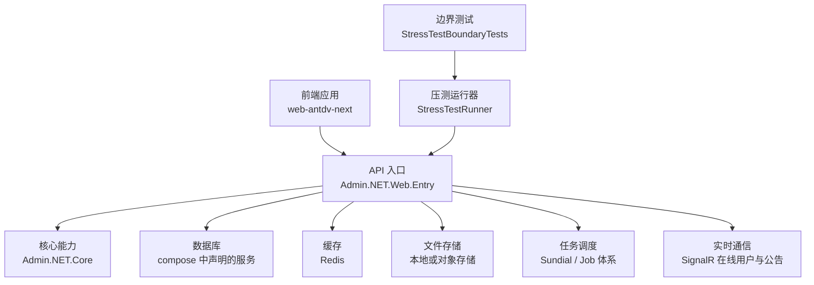
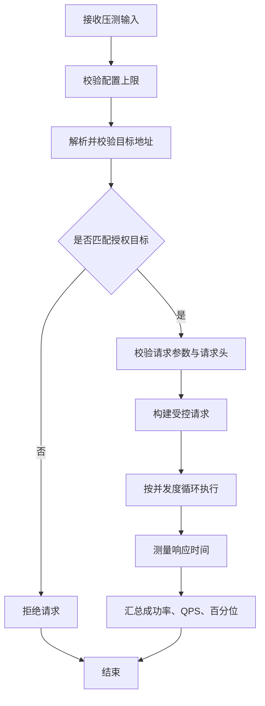
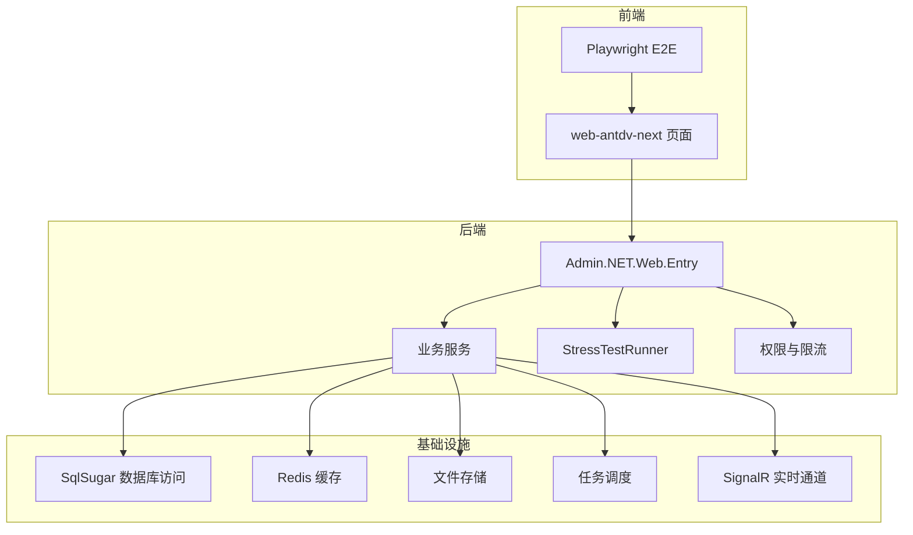
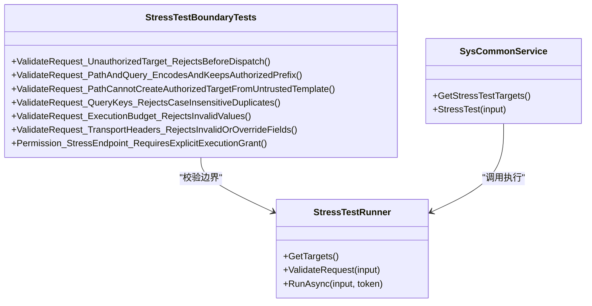
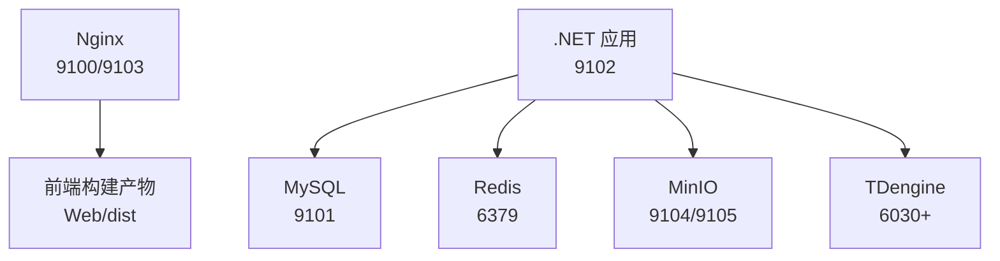

# 性能与压力测试

<cite>
**本文引用的文件**   
- [README.md](file://README.md)
- [StressTestBoundaryTests.cs](file://Admin.NET/Admin.NET.Test/Stress/StressTestBoundaryTests.cs)
- [StressTestRunner.cs](file://Admin.NET/Admin.NET.Core/Service/Common/StressTestRunner.cs)
- [SysCommonService.cs](file://Admin.NET/Admin.NET.Core/Service/Common/SysCommonService.cs)
- [StressTestOptions.cs](file://Admin.NET/Admin.NET.Core/Option/StressTestOptions.cs)
- [docker-compose.yml](file://docker/docker-compose.yml)
- [Admin.NET.Test.csproj](file://Admin.NET/Admin.NET.Test/Admin.NET.Test.csproj)
- [global.json](file://Admin.NET/global.json)
- [Admin.NET.Web.Entry.csproj](file://Admin.NET/Admin.NET.Web.Entry/Admin.NET.Web.Entry.csproj)
- [Web/package.json](file://Web/package.json)
- [stress-test-contract.spec.ts](file://Web/apps/web-antdv-next/e2e/stress-test-contract.spec.ts)
</cite>

## 目录

1. [引言](#引言)
2. [项目结构与压测边界](#项目结构与压测边界)
3. [核心组件分析](#核心组件分析)
4. [架构总览](#架构总览)
5. [后端边界测试定位](#后端边界测试定位)
6. [负载场景设计](#负载场景设计)
7. [外部压测工具使用指南](#外部压测工具使用指南)
8. [隔离环境配置](#隔离环境配置)
9. [压测计划模板](#压测计划模板)
10. [常见瓶颈识别](#常见瓶颈识别)
11. [故障排查](#故障排查)
12. [结论](#结论)

## 引言

Admin.NET 是基于 ASP.NET Core、Furion 和 SqlSugar 的通用权限开发框架，支持多租户、权限管理、任务调度、消息通知、文件管理、代码生成、在线用户、SignalR 实时通信、限流控制等能力。当前仓库已完成前端移植，业务前端入口为 `Web/apps/web-antdv-next/`，后端 API 入口为 `Admin.NET/Admin.NET.Web.Entry/`。

本性能与压力测试文档的目标是：

- 说明现有 `StressTestBoundaryTests` 作为后端边界测试的定位；
- 解释如何基于 `StressTestRunner` 扩展对 SqlSugar、Redis、任务调度、文件上传、SignalR 等核心路径的压力验证；
- 给出如何使用外部压测工具对 Admin.NET API 和前端 E2E 接口施加压力的方法；
- 结合 `docker-compose.yml` 提供隔离的 PostgreSQL、Redis、Nginx 和 MinIO 等依赖环境；
- 提供基准测试、负载测试、稳定性测试和容量测试的执行步骤、观察指标与告警阈值；
- 补充数据库慢查询、Redis 内存占用、SignalR 连接数和前端资源加载等常见瓶颈分析方法。

需要特别注意：当前仓库中的 `docker-compose.yml` 实际提供了 Nginx、MySQL、Redis、MinIO、TDengine 以及一个示例 .NET Web 应用容器。虽然 README 将集成验收数据库描述为 PostgreSQL，但本分支的 compose 文件并未包含 PostgreSQL 服务，因此编写压测环境时不能假设 PostgreSQL 已存在，必须根据真实部署清单显式加入数据库容器。

**章节来源**
- [README.md:1-60](file://README.md#L1-L60)

## 项目结构与压测边界

从源码结构看，Admin.NET 采用前后端分离与模块化设计：

| 层次 | 主要职责 | 相关路径或文件 |
|---|---|---|
| 前端业务应用 | Vite + pnpm workspace 管理的 web-antdv-next 应用，包含页面、路由、API 调用与 E2E 用例 | `Web/apps/web-antdv-next/`、`Web/package.json` |
| 后端 API 入口 | 运行 Furion、Swagger、静态资源、中间件和控制器 | `Admin.NET/Admin.NET.Web.Entry/` |
| 核心能力层 | 提供 SqlSugar、缓存、Job、SignalR、文件、认证、限流等共享能力 | `Admin.NET/Admin.NET.Core/` |
| 应用服务层 | 业务服务和动态 API | `Admin.NET/Admin.NET.Application/` |
| 测试工程 | xUnit 单元测试、Selenium 基础、E2E 契约测试 | `Admin.NET/Admin.NET.Test/` |
| 压测边界测试 | 校验压测请求参数、目标地址、执行预算和权限边界 | `Admin.NET/Admin.NET.Test/Stress/StressTestBoundaryTests.cs` |
| 压测实现 | 受控并发、超时、百分位统计和目标白名单校验 | `Admin.NET/Admin.NET.Core/Service/Common/StressTestRunner.cs` |
| 压测配置 | 是否启用、授权目标、并发与轮数上限 | `Admin.NET/Admin.NET.Core/Option/StressTestOptions.cs` |
| 外部依赖编排 | Nginx、数据库、缓存、对象存储等容器服务 | `docker/docker-compose.yml` |

**图表来源**
- [Admin.NET.Web.Entry.csproj:1-71](file://Admin.NET/Admin.NET.Web.Entry/Admin.NET.Web.Entry.csproj#L1-L71)
- [Admin.NET.Test.csproj:1-28](file://Admin.NET/Admin.NET.Test/Admin.NET.Test.csproj#L1-L28)
- [StressTestRunner.cs:1-183](file://Admin.NET/Admin.NET.Core/Service/Common/StressTestRunner.cs#L1-L183)
- [docker-compose.yml:1-110](file://docker/docker-compose.yml#L1-L110)

**章节来源**
- [README.md:22-60](file://README.md#L22-L60)
- [Admin.NET.Web.Entry.csproj:1-71](file://Admin.NET/Admin.NET.Web.Entry/Admin.NET.Web.Entry.csproj#L1-L71)
- [Admin.NET.Test.csproj:1-28](file://Admin.NET/Admin.NET.Test/Admin.NET.Test.csproj#L1-L28)
- [docker-compose.yml:1-110](file://docker/docker-compose.yml#L1-L110)

## 核心组件分析

### 压测配置模型

`StressTestOptions` 是压测能力的开关与上限配置：

| 字段 | 含义 | 默认值或约束 |
|---|---|---|
| `Enabled` | 是否启用压测目标暴露和执行能力 | 默认关闭 |
| `Targets` | 允许访问的压测目标列表 | 最多 20 个 |
| `MaxTotalRequests` | 单次压测最大总请求数 | 1 至 10000 |
| `MaxConcurrency` | 全局最大并发数 | 1 至 64 |
| `MaxRounds` | 最大轮数 | 1 至 100 |
| `MaxRequestsPerRound` | 每轮最大请求数 | 1 至 1000 |
| `RequestTimeoutSeconds` | 单个请求超时时间 | 1 至 60 秒 |

`StressTestTarget` 只暴露名称和目标地址，用于前端展示和被 `ValidateRequest` 匹配。

**章节来源**
- [StressTestOptions.cs:1-25](file://Admin.NET/Admin.NET.Core/Option/StressTestOptions.cs#L1-L25)

### 压测运行器

`StressTestRunner` 是压测的核心实现，承担以下职责：

1. 解析并校验压测配置；
2. 限制目标只能访问数值 IP 的 HTTP 或 HTTPS 地址；
3. 拒绝路径遍历、片段、凭据、非法转义和未授权域名；
4. 校验请求数量、轮数、并行度、请求头、路径参数、查询参数和表单 Body；
5. 使用 `Parallel.ForEachAsync` 控制并发；
6. 记录成功与失败次数、总耗时、吞吐量和响应时间百分位；
7. 通过信号量保证同一时刻只有一个压测任务执行；
8. 暴露 `GetTargets` 和 `RunAsync` 供 API 层调用。

**图表来源**
- [StressTestRunner.cs:1-183](file://Admin.NET/Admin.NET.Core/Service/Common/StressTestRunner.cs#L1-L183)

**章节来源**
- [StressTestRunner.cs:1-183](file://Admin.NET/Admin.NET.Core/Service/Common/StressTestRunner.cs#L1-L183)

### API 接入点

`SysCommonService` 暴露两个关键接口：

| 接口 | 方法 | 权限要求 | 行为 |
|---|---|---|---|
| 获取授权压测目标 | `GET /api/sysCommon/stressTestTargets` | 超级管理员 | 返回 `StressTestRunner.GetTargets()` |
| 接口压测 | `POST /api/sysCommon/stressTest` | 超级管理员 | 调用 `StressTestRunner.RunAsync` |

测试明确断言这两个端点不标注 `AllowAnonymous`，且需要显式权限授予，避免任意用户直接发起压测。

**章节来源**
- [SysCommonService.cs:118-138](file://Admin.NET/Admin.NET.Core/Service/Common/SysCommonService.cs#L118-L138)
- [StressTestBoundaryTests.cs:127-139](file://Admin.NET/Admin.NET.Test/Stress/StressTestBoundaryTests.cs#L127-L139)

## 架构总览

从系统视角看，Admin.NET 的性能链路可以分为前端界面、API 网关、业务服务、数据访问、缓存、文件存储、任务调度和实时通信。

**图表来源**
- [Web/package.json:1-102](file://Web/package.json#L1-L102)
- [Admin.NET.Web.Entry.csproj:1-71](file://Admin.NET/Admin.NET.Web.Entry/Admin.NET.Web.Entry.csproj#L1-L71)
- [StressTestRunner.cs:1-183](file://Admin.NET/Admin.NET.Core/Service/Common/StressTestRunner.cs#L1-L183)
- [README.md:70-144](file://README.md#L70-L144)

## 后端边界测试定位

`StressTestBoundaryTests` 不是传统意义上的吞吐量基准测试，而是对压测边界的防御性测试。它关注的是：

- 是否只允许访问数值 IP 的 HTTP/HTTPS 地址；
- 是否拒绝域名、端口替换、路径遍历、URL 编码绕过、片段和凭据；
- 是否拒绝不受支持的协议，例如 FTP；
- 是否严格校验请求数量、轮数和并发度；
- 是否拒绝危险或可覆盖传输层的请求头；
- 是否防止路径模板注入；
- 是否只在配置启用且有授权目标时才暴露可执行目标；
- 是否保护压测端点不被匿名访问；
- 取消令牌是否能阻止未完成的任务泄漏结果。

这些用例共同定义了“哪些请求可以进入压测执行路径”，而不是“系统每秒能处理多少请求”。因此，在扩展性能验证时，应把 `StressTestBoundaryTests` 视为安全边界基线，再把真实负载放在外部压测工具或独立负载工程中验证。

**图表来源**
- [StressTestBoundaryTests.cs:1-159](file://Admin.NET/Admin.NET.Test/Stress/StressTestBoundaryTests.cs#L1-L159)
- [StressTestRunner.cs:1-183](file://Admin.NET/Admin.NET.Core/Service/Common/StressTestRunner.cs#L1-L183)
- [SysCommonService.cs:118-138](file://Admin.NET/Admin.NET.Core/Service/Common/SysCommonService.cs#L118-L138)

**章节来源**
- [StressTestBoundaryTests.cs:1-159](file://Admin.NET/Admin.NET.Test/Stress/StressTestBoundaryTests.cs#L1-L159)

## 负载场景设计

### 针对 SqlSugar 数据访问的负载

SqlSugar 是 Admin.NET 的 ORM 层，适合用读多写少的典型后台操作建模：

| 场景 | 输入 | 观察指标 | 预期瓶颈 |
|---|---|---|---|
| 分页查询 | 带分页、排序、过滤条件的 GET 请求 | QPS、P95/P99 延迟、数据库连接数、慢查询数量 | 缺少索引、全表扫描、N+1 查询 |
| 批量写入 | 事务内插入多条记录 | 提交延迟、锁等待、磁盘写入 | 事务过大、索引维护成本 |
| 复杂条件查询 | 多表关联或动态条件 | CPU、SQL 执行计划、临时表 | 索引缺失、表达式无法走索引 |
| 大结果集导出 | 流式或大批量读取 | 内存峰值、序列化时间、网络带宽 | 一次性加载过多实体 |

建议优先通过 SqlSugar 提供的日志或监控能力捕获慢查询，再结合数据库 EXPLAIN 确认执行计划。不要仅凭整体 P99 升高就判断为数据库问题，还要区分是单条慢查询还是大量中等延迟请求累积所致。

### 针对 Redis 缓存的负载

Admin.NET 使用 NewLife.Redis，常用于字典、会话、限流、缓存等场景。压测时应分别验证：

| 场景 | 输入 | 观察指标 | 预期瓶颈 |
|---|---|---|---|
| 热点键读取 | 高并发 GET 缓存 | 命中率、Redis 内存、命令延迟 | 单键竞争、内存不足 |
| 写入风暴 | 高频 SET/EXPIRE | 写放大、持久化延迟 | AOF/RDB 阻塞 |
| 过期风暴 | 大批量 Key 同时过期 | CPU 抖动、命中率下降 | 清理线程压力 |
| 大对象缓存 | 大 JSON 或二进制对象 | 网络带宽、序列化开销 | 缓存对象过大 |

Redis 压测应单独评估连接池、Key 分布、TTL 策略和持久化模式，避免把所有压力集中在同一个 Key 上。

### 针对任务调度的负载

Admin.NET 支持 Sundial 分布式作业调度，并提供多个 Job 相关文件。压测时应关注：

| 场景 | 输入 | 观察指标 | 预期瓶颈 |
|---|---|---|---|
| 定时任务堆积 | 短周期、长耗时任务 | 任务积压、执行间隔漂移 | 单节点处理能力不足 |
| 并发任务 | 多 Job 同时触发 | CPU、数据库连接、外部依赖 | 资源争用 |
| 失败重试 | 任务失败后重试 | 重试风暴、日志量 | 下游服务不可用 |
| 集群任务 | 多实例调度 | 任务重复执行、抢占 | 分布式锁或状态不一致 |

### 针对文件上传的负载

文件路径涉及本地文件提供者、OSS、SSH 和自定义文件提供者。压测时需区分：

| 场景 | 输入 | 观察指标 | 预期瓶颈 |
|---|---|---|---|
| 小文件上传 | 多并发上传 KB 级文件 | 上传成功率、鉴权延迟 | 鉴权或元数据写入 |
| 大文件上传 | MB 到 GB 级文件 | 内存峰值、磁盘 I/O、网络带宽 | 对象存储或磁盘吞吐 |
| 批量上传 | 大量小文件 | 句柄数、文件系统 inode | 文件系统限制 |
| 下载热点 | 相同文件被频繁下载 | 缓存命中率、CDN 命中率 | 源站或存储桶带宽 |

### 针对 SignalR 的负载

在线用户和公告功能基于 SignalR。压测时应关注：

| 场景 | 输入 | 观察指标 | 预期瓶颈 |
|---|---|---|---|
| 大量连接建立 | 并发连接 SignalR Hub | 连接数、握手延迟、CPU | WebSocket 握手、Hub 初始化 |
| 广播消息 | 向所有连接发送消息 | 消息延迟、内存增长 | 连接数 × 消息大小 |
| 分组推送 | 向特定组推送 | 分组查找延迟、连接分发 | 分组映射表 |
| 连接断开恢复 | 客户端重连 | 重连率、断线时长 | 网络抖动或服务器负载 |

### 前端 E2E 接口的负载

前端 E2E 使用 Playwright，当前 `stress-test-contract.spec.ts` 主要用于契约和交互验收，而不是生产级并发压测。它通过 Mock 后端返回固定的压测结果，验证：

- 压测页面可显示配置；
- 请求参数、路径参数、查询参数和 Body 参数能正确传递；
- 执行结果包含总请求数、成功数、失败数、QPS、总耗时和各百分位；
- 空配置时禁止开始压测；
- 超限时前端拒绝调用后端；
- 运行期间锁定编辑；
- 取消后给出明确状态；
- 全部失败时仍显示完成但不给出成功结论。

因此，前端 E2E 适合作为压测 UI 的回归测试，而真实前端资源加载压力应由浏览器压测工具或 CDN 监控补充。

**章节来源**
- [stress-test-contract.spec.ts:1-187](file://Web/apps/web-antdv-next/e2e/stress-test-contract.spec.ts#L1-L187)

## 外部压测工具使用指南

### 对 Admin.NET API 施加压力

推荐使用支持并发、持续时间、吞吐量和延迟指标的外部压测工具，例如 k6、wrk、 vegeta、JMeter 或 Artillery。无论选择哪种工具，都应先确认以下信息：

| 指标类别 | 定义 | 建议记录方式 |
|---|---|---|
| 并发连接数 | 同时发起的请求或连接数量 | 压测工具并发参数、服务端连接数 |
| 请求大小 | 请求体、Header、路径参数的总体大小 | 压测载荷大小、文件大小 |
| 持续时间 | 压测运行的总时长 | 压测任务生命周期 |
| 吞吐量 | 每秒成功请求数（QPS） | 压测报告和服务端日志 |
| 延迟 | 平均、P95、P99、P99.9 响应时间 | 压测报告和 `StressTestOutput` |
| 错误率 | 非 2xx 或异常比例 | 压测报告、服务端错误日志 |
| 资源使用 | CPU、内存、磁盘、网络、数据库连接 | 系统监控、APM、数据库监控 |

基本流程如下：

1. 启动隔离环境；
2. 确认 API 地址；
3. 准备最小可复现载荷；
4. 先做低并发冒烟；
5. 逐步提升并发；
6. 记录 QPS 和延迟曲线；
7. 观察资源拐点；
8. 输出压测报告。

对于 `/api/sysCommon/stressTest`，由于该接口本身会对外部地址发起 HTTP 请求，不建议直接用其作为唯一压测入口。更合适的做法是让外部压测工具直接压测业务 API，或使用 `StressTestRunner` 验证内部受控目标。

### 对前端 E2E 接口施加压力

Playwright 不适合直接模拟成千上万浏览器连接。推荐：

- 使用 Playwright 进行少量端到端流程验证；
- 使用浏览器压测工具模拟真实用户点击和资源加载；
- 使用 CDN 和静态资源监控观察前端包体积、缓存命中率和首屏时间；
- 使用 API 压测工具覆盖前端调用的后端接口；
- 将 E2E 脚本作为回归用例，而不是吞吐主力。

### 指标对齐

`StressTestRunner` 返回的统计包含：

| 指标 | 含义 | 适用场景 |
|---|---|---|
| `TotalRequests` | 总请求数 | 压测规模核对 |
| `SuccessfulRequests` | 成功请求数 | 成功率计算 |
| `FailedRequests` | 失败请求数 | 错误率计算 |
| `QueriesPerSecond` | 总请求数除以总耗时 | 粗略吞吐量 |
| `MinResponseTime` | 最短响应时间 | 冷启动或最快路径 |
| `AverageResponseTime` | 成功请求的平均延迟 | 中心趋势 |
| `Percentile95/99/99.9` | 尾部延迟 | 用户体验敏感指标 |

注意：`QueriesPerSecond` 使用总请求数计算，没有剔除失败请求；延迟百分位只对成功请求采样。因此，在评估用户体验时，应同时观察成功率、P99 和失败原因。

**章节来源**
- [StressTestRunner.cs:80-130](file://Admin.NET/Admin.NET.Core/Service/Common/StressTestRunner.cs#L80-L130)
- [stress-test-contract.spec.ts:16-32](file://Web/apps/web-antdv-next/e2e/stress-test-contract.spec.ts#L16-L32)

## 隔离环境配置

### docker-compose 服务说明

当前 `docker/docker-compose.yml` 定义了以下服务：

| 服务 | 镜像或用途 | 端口 | 作用 |
|---|---|---|---|
| nginx | Nginx 1.20.2 | 9100、9103 | 静态资源代理 |
| mysql | MySQL 5.7 | 9101 | 示例数据库 |
| redis | Redis latest | 6379 | 缓存 |
| minio | MinIO | 9104、9105 | 对象存储 |
| tdengine | TDengine 3.3.6 | 6030、6041、6044-6049 等 | 时序数据示例 |
| adminNet | .NET 运行时容器 | 9102 | 示例应用容器 |

需要注意：

- Nginx 挂载 `../Web/dist`，对应前端生产构建产物；
- Redis 挂载配置文件和数据目录；
- MinIO 挂载数据和配置目录；
- adminNet 容器依赖 MySQL 和 Redis；
- README 指明集成验收使用 PostgreSQL，但 compose 文件未包含 PostgreSQL；
- 压测环境必须显式声明所用数据库类型，不能混用开发库。

**图表来源**
- [docker-compose.yml:1-110](file://docker/docker-compose.yml#L1-L110)

### 压测环境建议

为避免影响开发库，建议创建独立的压测 compose 文件，至少满足：

1. 使用独立数据库实例；
2. 使用独立 Redis 实例；
3. 使用独立对象存储；
4. 固定端口映射；
5. 限制容器 CPU 和内存；
6. 清空或重建种子数据；
7. 禁用不必要的日志级别；
8. 关闭面向公网的调试接口。

如果业务依赖 PostgreSQL，应在 compose 中添加 PostgreSQL 服务，并把 Admin.NET 的连接字符串指向该容器。不要复用本机开发数据库，也不要在压测环境中保留真实用户数据。

**章节来源**
- [docker-compose.yml:1-110](file://docker/docker-compose.yml#L1-L110)
- [README.md:22-60](file://README.md#L22-L60)

## 压测计划模板

### 基准测试

目的：建立系统在稳定负载下的性能基线。

| 阶段 | 步骤 | 观察指标 | 通过标准 |
|---|---|---|---|
| 准备 | 启动隔离环境，初始化数据库和种子数据 | 服务健康检查 | 所有依赖可用 |
| 预热 | 低并发运行 5 分钟 | 内存、GC、连接数 | 资源趋于平稳 |
| 单接口基准 | 对关键接口分别压测 | QPS、P95、P99、错误率 | 无 5xx，P99 不超过阈值 |
| 混合基准 | 按比例组合读写接口 | 综合 QPS、CPU、I/O | 资源未达硬上限 |
| 记录 | 保存压测配置和结果 | 基线报告 | 可复现实验 |

基准测试不应追求极限吞吐，而应记录正常负载下的稳定表现。

### 负载测试

目的：验证系统在预期峰值下的表现。

| 阶段 | 步骤 | 观察指标 | 通过标准 |
|---|---|---|---|
| 阶梯加压 | 每分钟提升并发 | QPS、延迟、错误率 | 延迟不超过 SLA |
| 峰值保持 | 在目标并发下维持 30 分钟 | 资源利用率、GC、连接池 | 无持续增长 |
| 回落 | 降低并发 | 恢复速度 | 资源回落到稳态 |
| 结论 | 对比基线 | 性能退化 | 退化小于允许范围 |

### 稳定性测试

目的：发现长时间运行后的内存泄漏、连接泄漏、缓存膨胀或任务堆积。

| 阶段 | 步骤 | 观察指标 | 通过标准 |
|---|---|---|---|
| 长期运行 | 以日常峰值的 60%~80% 持续运行 | 内存、堆栈、日志、任务队列 | 无持续增长 |
| 波动注入 | 周期性增加突发流量 | 恢复时间和错误率 | 自动恢复 |
| 依赖重启 | 重启 Redis 或数据库 | 重连、缓存重建 | 服务可用 |
| 结论 | 稳定性报告 | 泄漏与恢复 | 无致命缺陷 |

### 容量测试

目的：确定系统崩溃点或不可接受延迟的临界容量。

| 阶段 | 步骤 | 观察指标 | 通过标准 |
|---|---|---|---|
| 快速加压 | 快速提升并发 | QPS、延迟、错误率 | 找到拐点 |
| 资源定位 | 分析 CPU、内存、磁盘、网络 | 瓶颈组件 | 明确瓶颈 |
| 扩容验证 | 增加实例或资源 | 吞吐提升比例 | 符合预期 |
| 结论 | 容量规划 | 单节点/集群容量 | 支持业务预测 |

### 告警阈值建议

| 指标 | 警告阈值 | 严重阈值 | 说明 |
|---|---|---|---|
| 错误率 | > 1% | > 5% | 含 5xx 和业务错误 |
| P95 延迟 | > 基线 2 倍 | > 基线 5 倍 | 按接口分类 |
| P99 延迟 | > 基线 3 倍 | > 基线 10 倍 | 用户体验敏感 |
| QPS 下降 | > 20% | > 50% | 对比历史基线 |
| CPU | > 70% | > 90% | 单核或进程级 |
| 内存 | > 75% | > 90% | 关注 GC 和泄漏 |
| 数据库连接 | > 80% | > 95% | 连接池耗尽风险 |
| Redis 内存 | > 70% | > 90% | 关注淘汰和持久化 |
| SignalR 连接数 | > 80% 容量 | > 95% 容量 | 关注广播延迟 |
| 文件存储 I/O | > 80% 吞吐 | > 95% 吞吐 | 关注大文件上传 |

阈值应根据实际业务 SLA 调整，不能简单套用通用值。

## 常见瓶颈识别

### 数据库慢查询

症状：

- P95 或 P99 延迟突然升高；
- 数据库 CPU 或 I/O 上升；
- 连接池使用率接近上限；
- 事务变长；
- 某些接口在数据量增长后明显变慢。

排查方法：

1. 开启 SqlSugar 或数据库慢查询日志；
2. 提取高频慢 SQL；
3. 使用 EXPLAIN 查看执行计划；
4. 检查是否缺少索引或索引失效；
5. 检查是否一次性加载过多数据；
6. 检查事务范围是否过大；
7. 检查是否存在 N+1 查询；
8. 对热点查询考虑合理缓存。

### Redis 内存占用

症状：

- Redis 内存持续增长；
- 命中率下降；
- 写入延迟升高；
- 出现 OOM 或淘汰事件；
- 持久化过程卡顿。

排查方法：

1. 检查 Key 空间分布；
2. 定位热点 Key；
3. 检查 TTL 策略；
4. 检查大对象；
5. 检查持久化模式；
6. 评估是否需要分片或集群；
7. 结合业务缓存重建逻辑评估淘汰影响。

### SignalR 连接数

症状：

- 在线用户页面连接数持续增长；
- 广播消息延迟升高；
- CPU 或内存随连接数增长；
- 客户端频繁断线重连。

排查方法：

1. 检查 Hub 初始化是否昂贵；
2. 检查广播消息是否过大；
3. 检查是否对所有连接广播而非分组；
4. 检查连接释放逻辑；
5. 检查负载均衡和 Sticky Session；
6. 监控 WebSocket 握手和消息分发延迟。

### 前端资源加载问题

症状：

- 首屏时间长；
- 大 JS/CSS 包导致加载缓慢；
- 静态资源缓存未命中；
- CDN 命中率低；
- 图片或非关键资源阻塞主流程。

排查方法：

1. 分析前端包体积；
2. 检查路由懒加载；
3. 检查静态资源缓存策略；
4. 检查 CDN 配置；
5. 检查 Nginx 压缩和缓存；
6. 使用浏览器性能面板观察加载瀑布图；
7. 将 E2E 截图和关键路径指标纳入回归。

**章节来源**
- [StressTestRunner.cs:80-183](file://Admin.NET/Admin.NET.Core/Service/Common/StressTestRunner.cs#L80-L183)
- [stress-test-contract.spec.ts:60-113](file://Web/apps/web-antdv-next/e2e/stress-test-contract.spec.ts#L60-L113)

## 故障排查

### 压测未启用或无授权目标

现象：

- 前端压测按钮不可用；
- 后端返回空目标；
- 调用压测接口报错。

可能原因：

- `StressTestOptions.Enabled` 为 false；
- `Targets` 为空；
- 配置超出安全上限；
- 超级管理员权限不足。

处理步骤：

1. 检查 `StressTestOptions`；
2. 检查 `GetStressTestTargets` 返回值；
3. 确认前端是否正确读取授权目标；
4. 确认账号具备超级管理员和压测权限。

### 请求地址被拒绝

现象：

- `ValidateRequest` 抛出异常；
- 压测未开始；
- 报“不在授权目标及路径范围内”。

可能原因：

- 使用了域名；
- 使用了非数值 IP；
- 包含了片段或凭据；
- 使用了 FTP；
- 路径包含相对路径或非法转义；
- 请求地址模板注入。

处理步骤：

1. 将目标改为数值 IP；
2. 删除查询串、片段和凭据；
3. 确认路径前缀匹配；
4. 不要在路径模板中注入主机名；
5. 使用 `StressTestBoundaryTests` 中的用例对照检查。

### 并发或请求量超限

现象：

- 前端提示超过总量上限；
- 后端拒绝执行；
- 压测提前结束。

可能原因：

- `NumberOfRequests × NumberOfRounds` 超过 `MaxTotalRequests`；
- 单轮请求数超过 `MaxRequestsPerRound`；
- 轮数超过 `MaxRounds`；
- 并发超过 `MaxConcurrency`。

处理步骤：

1. 调整压测参数；
2. 提高 `StressTestOptions` 上限；
3. 拆分压测批次；
4. 使用外部压测工具进行更大规模验证。

### 压测执行卡住或取消失败

现象：

- 压测长时间不返回；
- 取消后状态不明确；
- 并发压测互相阻塞。

可能原因：

- 目标服务不可用或响应极慢；
- 连接超时配置过短；
- 已有压测正在执行；
- 取消令牌未正确传播。

处理步骤：

1. 检查目标服务健康状态；
2. 调整 `RequestTimeoutSeconds`；
3. 确认同一时刻只有一个压测任务；
4. 检查前端取消逻辑；
5. 检查后端 `CancellationToken` 使用。

**章节来源**
- [StressTestRunner.cs:1-183](file://Admin.NET/Admin.NET.Core/Service/Common/StressTestRunner.cs#L1-L183)
- [StressTestBoundaryTests.cs:16-159](file://Admin.NET/Admin.NET.Test/Stress/StressTestBoundaryTests.cs#L16-L159)

## 结论

Admin.NET 的压测能力由三部分构成：

1. **边界测试**：`StressTestBoundaryTests` 确保压测只能访问授权目标，防止路径注入、协议绕过、头部篡改和无限并发；
2. **运行器**：`StressTestRunner` 提供受控并发、超时、统计和百分位延迟，适合作为内部受控压测入口；
3. **外部压测**：真正的大规模负载应由外部工具驱动，覆盖 SqlSugar、Redis、任务调度、文件上传和 SignalR 等核心路径。

在实际项目中，建议把 `StressTestBoundaryTests` 作为安全边界基线保留，把 `StressTestRunner` 作为受限的内部诊断工具，把外部压测工具和监控系统作为生产级性能验证主体。配合隔离的 `docker-compose` 环境，可以避免压测污染开发库，也能更可靠地评估数据库、缓存、文件存储、任务调度和前端资源的真实瓶颈。