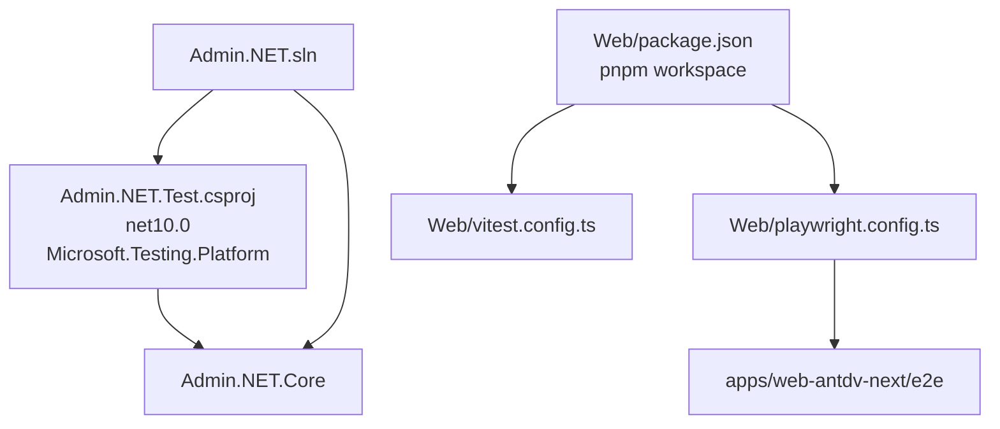
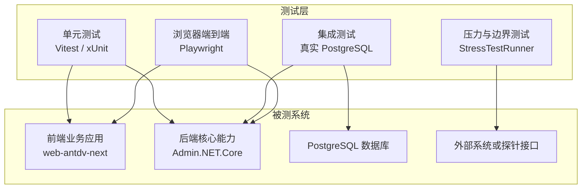
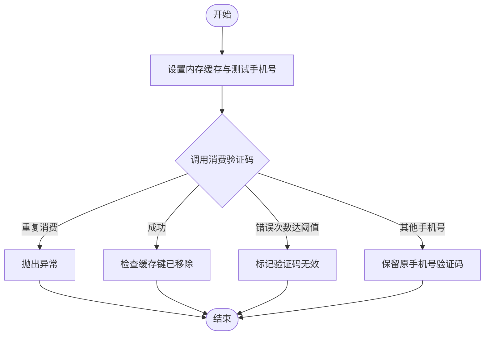
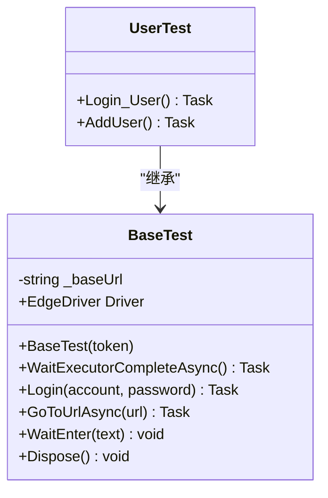
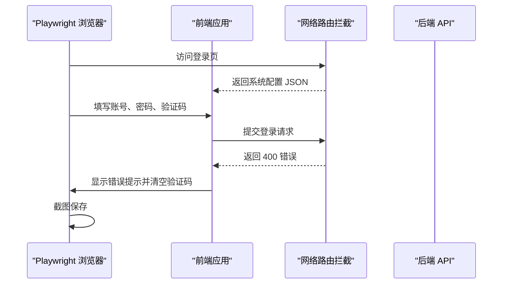
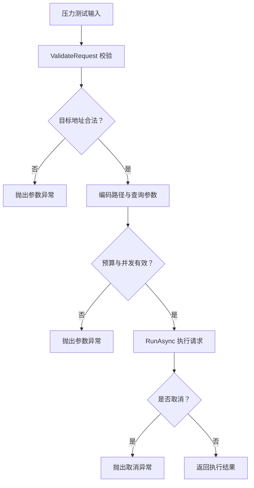
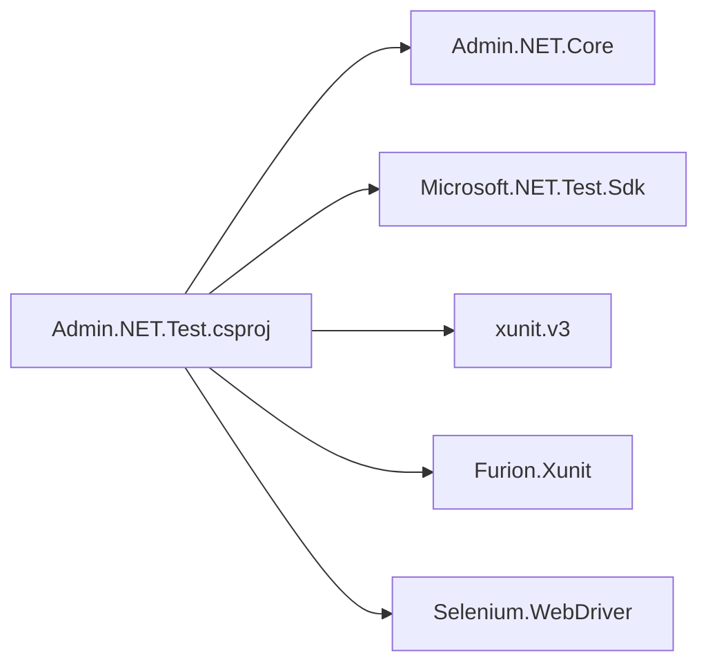
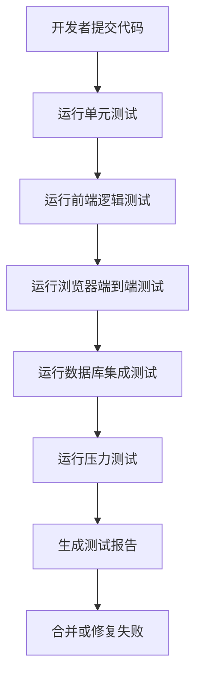

# 测试策略

<cite>
**本文引用的文件**   
- [Admin.NET.sln](file://Admin.NET/Admin.NET.sln)
- [global.json](file://Admin.NET/global.json)
- [Admin.NET.Test.csproj](file://Admin.NET/Admin.NET.Test/Admin.NET.Test.csproj)
- [BaseTest.cs](file://Admin.NET/Admin.NET.Test/BaseTest.cs)
- [SmsCodeTests.cs](file://Admin.NET/Admin.NET.Test/Registration/SmsCodeTests.cs)
- [RegistrationBoundaryTests.cs](file://Admin.NET/Admin.NET.Test/Registration/RegistrationBoundaryTests.cs)
- [StressTestBoundaryTests.cs](file://Admin.NET/Admin.NET.Test/Stress/StressTestBoundaryTests.cs)
- [UserTest.cs](file://Admin.NET/Admin.NET.Test/User/UserTest.cs)
- [package.json](file://Web/package.json)
- [vitest.config.ts](file://Web/vitest.config.ts)
- [playwright.config.ts](file://Web/playwright.config.ts)
- [auth-contract.spec.ts](file://Web/apps/web-antdv-next/e2e/auth-contract.spec.ts)
- [database-contract.spec.ts](file://Web/apps/web-antdv-next/e2e/database-contract.spec.ts)
</cite>

## 目录
1. [引言](#引言)
2. [项目结构](#项目结构)
3. [核心组件](#核心组件)
4. [架构总览](#架构总览)
5. [详细组件分析](#详细组件分析)
6. [依赖分析](#依赖分析)
7. [性能考虑](#性能考虑)
8. [故障排查指南](#故障排查指南)
9. [结论](#结论)
10. [附录](#附录)

## 引言
本文档说明 Admin.NET 的测试策略，覆盖后端单元测试、集成测试、前端逻辑测试与浏览器端到端验证。重点明确：
- 使用 Microsoft.Testing Platform 作为 .NET 测试执行框架；测试工程目标框架为 net10.0。
- 数据库集成测试必须使用隔离的真实 PostgreSQL，不能用 SQLite 或 Mock 结果替代真实联调。
- 前端使用 Vitest 做逻辑测试，Playwright 做桌面端浏览器端到端验证。
- 区分 Vitest 逻辑测试、Playwright 浏览器端到端测试与真实 API/数据库链路验收三类测试。
- 给出测试覆盖率建议、命名约定、断言最佳实践、压力测试实施方案以及测试环境与数据管理指导。

## 项目结构
当前仓库包含 .NET 后端解决方案和基于 pnpm monorepo 的前端应用。测试相关的主要位置如下：
- 后端测试工程位于 `Admin.NET/Admin.NET.Test`，通过 `Admin.NET.sln` 加入解决方案。
- 前端业务入口为 `Web/apps/web-antdv-next`，Vitest 配置在根 `Web/vitest.config.ts`，Playwright 配置在根 `Web/playwright.config.ts`，E2E 用例位于 `Web/apps/web-antdv-next/e2e`。

**图表来源**
- [Admin.NET.sln:1-78](file://Admin.NET/Admin.NET.sln#L1-L78)
- [Admin.NET.Test.csproj:1-28](file://Admin.NET/Admin.NET.Test/Admin.NET.Test.csproj#L1-L28)
- [package.json:1-102](file://Web/package.json#L1-L102)
- [vitest.config.ts:1-28](file://Web/vitest.config.ts#L1-L28)
- [playwright.config.ts:1-31](file://Web/playwright.config.ts#L1-L31)

**章节来源**
- [Admin.NET.sln:1-78](file://Admin.NET/Admin.NET.sln#L1-L78)
- [Admin.NET.Test.csproj:1-28](file://Admin.NET/Admin.NET.Test/Admin.NET.Test.csproj#L1-L28)
- [package.json:1-102](file://Web/package.json#L1-L102)

## 核心组件
### 后端测试基础设施
- 测试工程目标框架为 net10.0，启用 Microsoft.Testing Platform Runner。
- 测试工程引用 `Microsoft.NET.Test.Sdk`、`xunit.v3`、`Furion.Xunit`，并引用 `Admin.NET.Core` 以访问领域服务与工具。
- `global.json` 中声明测试运行器为 Microsoft.Testing Platform，但不固定具体 SDK 版本。

**章节来源**
- [Admin.NET.Test.csproj:1-28](file://Admin.NET/Admin.NET.Test/Admin.NET.Test.csproj#L1-L28)
- [global.json:1-5](file://Admin.NET/global.json#L1-L5)

### 前端测试基础设施
- 前端工作区使用 pnpm，包管理器版本锁定在 `pnpm@11.16.0`，Node 引擎要求 `^22.18.0 || ^24.12.0`。
- 根脚本中：
  - `pnpm test:unit` 调用 Vitest 并以 happy-dom 运行 DOM 逻辑测试。
  - `pnpm test:e2e` 调用 Playwright 执行浏览器端到端测试。
  - `pnpm test:benchmark` 调用 Vitest benchmark。
- Vitest 配置排除 e2e、dist、node_modules 等路径，并使用 happy-dom 模拟浏览器环境。
- Playwright 配置默认启动本地开发服务器，测试目录为 `apps/web-antdv-next/e2e`，仅使用 Desktop Chrome，并发 worker 数为 2。

**章节来源**
- [package.json:1-102](file://Web/package.json#L1-L102)
- [vitest.config.ts:1-28](file://Web/vitest.config.ts#L1-L28)
- [playwright.config.ts:1-31](file://Web/playwright.config.ts#L1-L31)

## 架构总览
Admin.NET 的测试体系分为四层：

- 单元测试覆盖纯函数、工具类、服务边界、缓存行为与权限校验。
- 集成测试面向真实数据库连接，当前示例使用 SqlSugarScope + SQLite 进行边界验证，但规范要求数据库集成验收应替换为隔离的真实 PostgreSQL。
- 浏览器端到端测试通过 Playwright 验证登录、验证码、字段编辑、生成预览等用户流程。
- 压力测试通过 `StressTestRunner` 验证请求参数、目标地址、预算限制、并发控制与权限策略。

**图表来源**
- [SmsCodeTests.cs:1-88](file://Admin.NET/Admin.NET.Test/Registration/SmsCodeTests.cs#L1-L88)
- [RegistrationBoundaryTests.cs:1-175](file://Admin.NET/Admin.NET.Test/Registration/RegistrationBoundaryTests.cs#L1-L175)
- [StressTestBoundaryTests.cs:1-159](file://Admin.NET/Admin.NET.Test/Stress/StressTestBoundaryTests.cs#L1-L159)
- [auth-contract.spec.ts:1-128](file://Web/apps/web-antdv-next/e2e/auth-contract.spec.ts#L1-L128)
- [database-contract.spec.ts:1-164](file://Web/apps/web-antdv-next/e2e/database-contract.spec.ts#L1-L164)

## 详细组件分析

### 单元测试策略
#### 设计原则
- 单元测试应保持快速、可重复、无外部副作用。
- 对外部依赖（缓存、HTTP、文件系统）使用内存实现或可控输入。
- 使用 xUnit `[Fact]`、`[Theory]`、`[InlineData]` 表达单例与参数化场景。

#### 示例：短信验证码边界测试
`SmsCodeTests` 使用内存缓存模拟验证码存储，验证以下行为：
- 正确消费后移除缓存键。
- 重复消费被拒绝。
- 五次错误尝试后失效。
- 不同手机号之间互不影响。
- 并发请求只允许一次成功。
- 冷却期内再次发送短信被拒绝。

**图表来源**
- [SmsCodeTests.cs:1-88](file://Admin.NET/Admin.NET.Test/Registration/SmsCodeTests.cs#L1-L88)

**章节来源**
- [SmsCodeTests.cs:1-88](file://Admin.NET/Admin.NET.Test/Registration/SmsCodeTests.cs#L1-L88)

#### 示例：注册边界测试
`RegistrationBoundaryTests` 构造 SqlSugarScope，初始化若干租户、角色、机构、职位实体，并通过 ClaimsPrincipal 模拟多租户上下文，验证：
- 外键关联不存在时拒绝写入。
- 特权账户类型被拒绝。
- 伪造租户 ID 时使用当前身份。
- 跨租户更新和删除受权限控制。
- 关闭注册时清理方案并保留其他租户数据。

该测试目前使用 SQLite 文件数据库，用于验证服务边界与事务一致性；但在正式数据库集成验收中，应替换为隔离的真实 PostgreSQL。

**章节来源**
- [RegistrationBoundaryTests.cs:1-175](file://Admin.NET/Admin.NET.Test/Registration/RegistrationBoundaryTests.cs#L1-L175)

### BaseTest 基类与浏览器自动化
`BaseTest` 是后端测试中的浏览器自动化基类，封装了 EdgeDriver、页面导航、隐式等待、登录流程与资源释放。它适用于需要打开真实前端页面的自动化场景。

**图表来源**
- [BaseTest.cs:1-98](file://Admin.NET/Admin.NET.Test/BaseTest.cs#L1-L98)
- [UserTest.cs:1-65](file://Admin.NET/Admin.NET.Test/User/UserTest.cs#L1-L65)

**章节来源**
- [BaseTest.cs:1-98](file://Admin.NET/Admin.NET.Test/BaseTest.cs#L1-L98)
- [UserTest.cs:1-65](file://Admin.NET/Admin.NET.Test/User/UserTest.cs#L1-L65)

### 集成测试策略
#### 数据库集成要求
- 数据库集成验证必须使用隔离的真实 PostgreSQL，不能以 SQLite 或 Mock 结果替代真实联调。
- 建议使用独立数据库实例或按测试进程隔离的数据库名，避免测试间互相污染。
- 测试前应执行迁移或建表脚本，测试后清理临时数据。
- 对于多租户、权限、外键约束等复杂场景，应在真实数据库中验证事务回滚、约束失败与并发冲突。

#### 当前实现的定位
当前 `RegistrationBoundaryTests` 展示了服务边界、权限校验与事务一致性测试思路，但使用的是 SQLite。这是边界验证的实现方式，不是最终数据库集成验收标准。后续应将连接配置切换为 PostgreSQL，并保持相同的测试断言与隔离策略。

**章节来源**
- [RegistrationBoundaryTests.cs:1-175](file://Admin.NET/Admin.NET.Test/Registration/RegistrationBoundaryTests.cs#L1-L175)

### 前端测试策略
#### Vitest 逻辑测试
- 运行命令：`pnpm test:unit`。
- 使用 happy-dom 模拟浏览器 DOM。
- 排除 e2e、dist、node_modules 等目录。
- 适合测试工具函数、表单逻辑、状态处理、路由钩子、UI 组件纯逻辑。

#### Playwright 浏览器端到端验证
- 运行命令：`pnpm test:e2e`。
- 测试目录：`apps/web-antdv-next/e2e`。
- 默认启动本地开发服务器 `http://127.0.0.1:8890`，也可通过环境变量 `ADMINNET_E2E_BASE_URL` 指定已有后端地址。
- 使用 Desktop Chrome，视口宽度 1440、高度 1000。
- CI 环境下失败时保留 trace，非 CI 默认关闭。

#### 示例：登录契约测试
`auth-contract.spec.ts` 通过 route mock 拦截系统配置、验证码、登录等接口，验证：
- 密码是否加密传输。
- 是否携带租户信息与验证码。
- 登录失败时是否显示错误提示。
- 滑块验证码在鼠标与触屏拖拽下的交互。
- 手机号码格式校验是否阻止发送短信。

**图表来源**
- [auth-contract.spec.ts:1-128](file://Web/apps/web-antdv-next/e2e/auth-contract.spec.ts#L1-L128)

#### 示例：数据库可视化契约测试
`database-contract.spec.ts` 通过 mock 后端接口验证数据库可视化界面：
- 选择数据库与数据表。
- 编辑字段时的草稿保留。
- 新增表、修改表、删除字段的确认对话框。
- 只读授权下隐藏写入入口。
- 实体与种子数据生成前的预览与哈希校验。

**章节来源**
- [package.json:1-102](file://Web/package.json#L1-L102)
- [vitest.config.ts:1-28](file://Web/vitest.config.ts#L1-L28)
- [playwright.config.ts:1-31](file://Web/playwright.config.ts#L1-L31)
- [auth-contract.spec.ts:1-128](file://Web/apps/web-antdv-next/e2e/auth-contract.spec.ts#L1-L128)
- [database-contract.spec.ts:1-164](file://Web/apps/web-antdv-next/e2e/database-contract.spec.ts#L1-L164)

### 压力测试与边界测试
`StressTestBoundaryTests` 围绕 `StressTestRunner` 验证压力测试功能的边界条件，包括：
- 目标地址白名单校验。
- 路径与查询参数编码。
- 禁止从不可信模板注入 host。
- 查询键大小写重复检测。
- 执行预算限制。
- 传输头白名单与非法头拒绝。
- 并发度自动推导。
- 禁用或未启用时不暴露可执行目标。
- 取消令牌导致操作取消。
- 压力测试接口需要显式授权且未开放匿名访问。

**图表来源**
- [StressTestBoundaryTests.cs:1-159](file://Admin.NET/Admin.NET.Test/Stress/StressTestBoundaryTests.cs#L1-L159)

**章节来源**
- [StressTestBoundaryTests.cs:1-159](file://Admin.NET/Admin.NET.Test/Stress/StressTestBoundaryTests.cs#L1-L159)

## 依赖分析
### 后端测试依赖
- 测试工程直接依赖 `Admin.NET.Core`，从而可访问服务、实体、工具类和常量。
- 测试框架依赖 `Microsoft.NET.Test.Sdk`、`xunit.v3`、`Furion.Xunit`。
- 浏览器自动化依赖 Selenium 与 EdgeDriver。

**图表来源**
- [Admin.NET.Test.csproj:1-28](file://Admin.NET/Admin.NET.Test/Admin.NET.Test.csproj#L1-L28)

**章节来源**
- [Admin.NET.Test.csproj:1-28](file://Admin.NET/Admin.NET.Test/Admin.NET.Test.csproj#L1-L28)

### 前端测试依赖
- Vitest 依赖 `@vitejs/plugin-vue`、`@vitejs/plugin-vue-jsx`、`happy-dom`。
- Playwright 依赖 `@playwright/test`、`playwright`。
- 工作区依赖由 pnpm workspace 与 catalog 管理。

**章节来源**
- [package.json:1-102](file://Web/package.json#L1-L102)
- [vitest.config.ts:1-28](file://Web/vitest.config.ts#L1-L28)
- [playwright.config.ts:1-31](file://Web/playwright.config.ts#L1-L31)

## 性能考虑
- 单元测试应尽量保持毫秒级执行时间，避免 I/O、网络请求和真实数据库连接。
- 集成测试因涉及真实数据库，应合理设置超时，避免 CI 长时间阻塞。
- Playwright 端到端测试默认 worker 数为 2，CI 下重试 1 次；如需并行压测，可调整 workers 或拆分用例集。
- Vitest benchmark 可通过 `pnpm test:benchmark` 运行基准测试，适合比较算法、序列化、解析器等热点路径。
- 压力测试应避免对生产环境造成影响，只能对预发或专用探针接口执行，并严格控制并发、轮次与总请求数。

## 故障排查指南
### 后端测试常见问题
- 若测试无法发现，检查是否启用 Microsoft.Testing Platform Runner，并确保 `UseMicrosoftTestingPlatformRunner` 与 `Microsoft.NET.Test.Sdk` 正常引入。
- 若浏览器自动化失败，检查 EdgeDriver 是否与系统兼容，并确认 `BaseTest` 能正常创建并销毁 `EdgeDriver`。
- 若集成测试报数据库连接错误，优先确认 PostgreSQL 是否可用、用户名密码是否正确、数据库是否已创建。

**章节来源**
- [Admin.NET.Test.csproj:1-28](file://Admin.NET/Admin.NET.Test/Admin.NET.Test.csproj#L1-L28)
- [BaseTest.cs:1-98](file://Admin.NET/Admin.NET.Test/BaseTest.cs#L1-L98)

### 前端测试常见问题
- Vitest 报告 DOM 相关错误时，检查是否使用 `pnpm test:unit`，确保 happy-dom 环境生效。
- Playwright 报告无法访问页面时，检查 `ADMINNET_E2E_BASE_URL` 是否指向正确的后端或前端开发服务器。
- 如果 E2E 用例在 CI 失败，查看 Playwright trace 和失败截图，确认是网络问题、页面渲染问题还是断言问题。

**章节来源**
- [vitest.config.ts:1-28](file://Web/vitest.config.ts#L1-L28)
- [playwright.config.ts:1-31](file://Web/playwright.config.ts#L1-L31)

## 结论
Admin.NET 的测试体系以 Microsoft.Testing Platform 和 xUnit 为基础，结合 Vitest 与 Playwright 形成前后端贯通的质量保障。单元测试聚焦纯逻辑与边界行为，集成测试强调真实 PostgreSQL 联调，浏览器端到端测试覆盖关键用户流程，压力测试则保证高风险功能具备严格的参数校验与安全边界。建议在持续集成中分层执行这些测试，并对数据库集成测试设置独立 PostgreSQL 实例，确保测试结果反映真实部署质量。

## 附录

### 测试层次与执行流程

### 测试覆盖率建议
- 单元测试覆盖率建议达到较高水平，尤其覆盖工具函数、权限校验、边界条件和并发场景。
- 集成测试覆盖率不应只看行覆盖，还应关注关键业务流程、事务回滚、权限越权和数据一致性。
- 前端逻辑测试应覆盖主要 UI 分支、表单校验、错误处理和异步状态。
- 浏览器端到端测试应覆盖登录、权限、核心业务主流程和关键异常路径。

### 测试命名约定
- 测试类名采用业务语义加 `Tests` 后缀，例如 `SmsCodeTests`、`RegistrationBoundaryTests`、`StressTestBoundaryTests`。
- 测试方法名描述输入、行为和期望结果，例如 `ConsumeCode_ValidCode_RemovesCodeAndRejectsReplay`、`Add_ForeignAssociation_RejectsWithoutWriting`。
- Playwright 用例使用自然语言描述场景，例如 `encrypts the password, sends tenant and captcha, then handles rejection`。

### 断言最佳实践
- 使用 xUnit 的 `Assert.ThrowsAny`、`Assert.ThrowsAnyAsync`、`Assert.Equal`、`Assert.Empty`、`Assert.Single` 等表达明确预期。
- 对异步并发场景使用 `Task.WhenAll` 配合唯一成功断言，确保竞态条件被覆盖。
- 对浏览器测试使用 Playwright 的 `expect` 断言元素可见性、URL、表单值、错误提示和网络请求。
- 对契约测试断言请求载荷、响应结构和错误消息，而不是只断言 HTTP 状态码。

### 测试环境搭建
- .NET 环境：安装支持 net10.0 的 SDK，并确保 Microsoft.Testing Platform 可正常运行。
- Node 环境：使用 `pnpm@11.16.0`，Node 版本满足 `^22.18.0 || ^24.12.0`。
- 浏览器环境：Playwright 默认使用 Desktop Chrome；如需其他浏览器，可在 `playwright.config.ts` 中扩展 devices。
- 数据库环境：准备隔离的真实 PostgreSQL，提供独立的连接字符串，并在测试前执行必要初始化。

### 测试数据管理
- 单元测试使用内存对象、内存缓存或可控输入，避免持久化。
- 集成测试使用临时文件或独立数据库，测试结束后清理。
- 浏览器端到端测试可使用 route mock 隔离后端，或使用真实后端时通过会话、租户、角色等前置条件准备数据。
- 压力测试只能针对专用探针或预发接口，严禁在生产环境直接执行。