# 浏览器端到端测试

<cite>
**本文引用的文件**   
- [Web/playwright.config.ts](file://Web/playwright.config.ts)
- [Web/vitest.config.ts](file://Web/vitest.config.ts)
- [Web/package.json](file://Web/package.json)
- [Web/apps/web-antdv-next/package.json](file://Web/apps/web-antdv-next/package.json)
- [Web/apps/web-antdv-next/e2e/fixtures/admin-session.ts](file://Web/apps/web-antdv-next/e2e/fixtures/admin-session.ts)
- [Web/apps/web-antdv-next/e2e/auth-contract.spec.ts](file://Web/apps/web-antdv-next/e2e/auth-contract.spec.ts)
- [Web/apps/web-antdv-next/e2e/user-contract.spec.ts](file://Web/apps/web-antdv-next/e2e/user-contract.spec.ts)
- [Web/apps/web-antdv-next/e2e/file-contract.spec.ts](file://Web/apps/web-antdv-next/e2e/file-contract.spec.ts)
- [Web/apps/web-antdv-next/e2e/stress-test-contract.spec.ts](file://Web/apps/web-antdv-next/e2e/stress-test-contract.spec.ts)
</cite>

## 目录
1. [引言](#引言)
2. [项目结构](#项目结构)
3. [核心组件](#核心组件)
4. [架构总览](#架构总览)
5. [详细组件分析](#详细组件分析)
6. [依赖关系分析](#依赖关系分析)
7. [性能与执行特性](#性能与执行特性)
8. [故障排查指南](#故障排查指南)
9. [结论](#结论)

## 引言
本文件说明 Admin.NET Web 工作区中，面向业务前端应用 `@vben/web-antdv-next` 的浏览器端到端测试方案。当前基线以 `Web/apps/web-antdv-next/` 为业务前端入口；Playwright 负责驱动真实桌面 Chrome 访问已启动的前端应用，Vitest 负责在 `happy-dom` 环境中运行纯逻辑和组件级测试。端到端测试用例位于 `Web/apps/web-antdv-next/e2e/`，并通过合同测试模式拦截后端接口，验证浏览器、前端路由、权限、表单和数据契约。

## 项目结构
端到端测试围绕以下关键位置组织：
- Playwright 配置位于工作区根目录 `Web/playwright.config.ts`。
- 测试用例位于 `Web/apps/web-antdv-next/e2e/`，按功能模块命名 `*-contract.spec.ts`。
- 公共会话和登录 Fixture 位于 `Web/apps/web-antdv-next/e2e/fixtures/admin-session.ts`。
- Vitest 配置位于 `Web/vitest.config.ts`，明确排除 `e2e` 目录，避免与 Playwright 混跑。
- 工作区脚本位于 `Web/package.json`，提供 `dev`、`test:unit`、`test:e2e` 等命令。
- 业务应用脚本位于 `Web/apps/web-antdv-next/package.json`，暴露 `dev`、`build`、`preview`、`typecheck`。

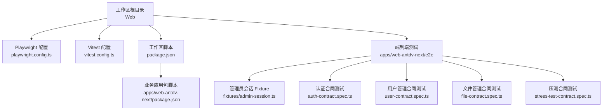

**图表来源**
- [Web/playwright.config.ts:1-31](file://Web/playwright.config.ts#L1-L31)
- [Web/vitest.config.ts:1-28](file://Web/vitest.config.ts#L1-L28)
- [Web/package.json:1-102](file://Web/package.json#L1-L102)
- [Web/apps/web-antdv-next/package.json:1-72](file://Web/apps/web-antdv-next/package.json#L1-L72)
- [Web/apps/web-antdv-next/e2e/fixtures/admin-session.ts:1-155](file://Web/apps/web-antdv-next/e2e/fixtures/admin-session.ts#L1-L155)

**章节来源**
- [Web/playwright.config.ts:1-31](file://Web/playwright.config.ts#L1-L31)
- [Web/vitest.config.ts:1-28](file://Web/vitest.config.ts#L1-L28)
- [Web/package.json:1-102](file://Web/package.json#L1-L102)
- [Web/apps/web-antdv-next/package.json:1-72](file://Web/apps/web-antdv-next/package.json#L1-L72)

## 核心组件
Playwright 端到端测试的核心由以下部分构成：
- `playwright.config.ts`：定义测试目录、基础地址、项目、webServer、重试、追踪、截图和 CI 行为。
- `admin-session.ts`：提供管理员 Token 生成、页面请求拦截、菜单和用户信息 Mock，以及统一登录流程。
- 各 `*-contract.spec.ts`：描述业务模块的浏览器交互、API 契约、权限边界和错误处理。

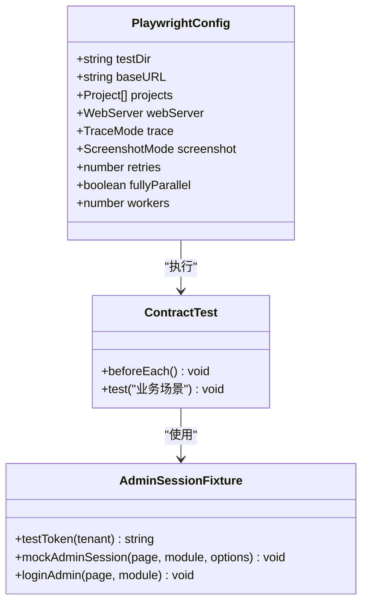

**图表来源**
- [Web/playwright.config.ts:1-31](file://Web/playwright.config.ts#L1-L31)
- [Web/apps/web-antdv-next/e2e/fixtures/admin-session.ts:1-155](file://Web/apps/web-antdv-next/e2e/fixtures/admin-session.ts#L1-L155)

**章节来源**
- [Web/playwright.config.ts:1-31](file://Web/playwright.config.ts#L1-L31)
- [Web/apps/web-antdv-next/e2e/fixtures/admin-session.ts:1-155](file://Web/apps/web-antdv-next/e2e/fixtures/admin-session.ts#L1-L155)

## 架构总览
端到端测试的执行链路分为两条路径：本地开发时自动启动前端开发服务器，或指向已有服务；Playwright 启动桌面 Chrome，访问前端页面，通过网络拦截实现合同测试，最后输出结果、截图和失败追踪文件。

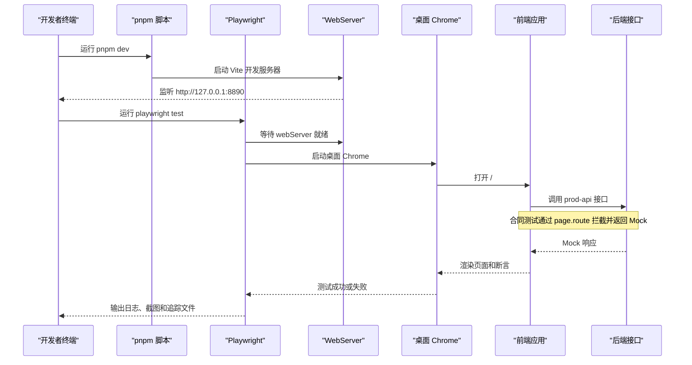

**图表来源**
- [Web/playwright.config.ts:1-31](file://Web/playwright.config.ts#L1-L31)
- [Web/apps/web-antdv-next/e2e/auth-contract.spec.ts:1-128](file://Web/apps/web-antdv-next/e2e/auth-contract.spec.ts#L1-L128)
- [Web/apps/web-antdv-next/e2e/fixtures/admin-session.ts:1-155](file://Web/apps/web-antdv-next/e2e/fixtures/admin-session.ts#L1-L155)

## 详细组件分析

### Playwright 配置解析
`playwright.config.ts` 是端到端测试的入口配置，关键项如下：
- `testDir`：指定测试目录为 `./apps/web-antdv-next/e2e`。
- `baseURL`：优先读取环境变量 `ADMINNET_E2E_BASE_URL`，默认值为 `http://127.0.0.1:8890`。
- `projects`：仅定义 `desktop` 项目，使用 `Desktop Chrome` 设备，视口宽度 1440、高度 1000。
- `webServer`：当未设置 `ADMINNET_E2E_BASE_URL` 时，自动执行 `pnpm --filter @vben/web-antdv-next dev --port 8890 --host 127.0.0.1`，等待 `baseURL` 可用；CI 环境不复用已有服务。
- `trace`：CI 环境下保留失败追踪，本地关闭。
- `screenshot`：仅在断言失败时截取全页截图。
- `retries`：CI 环境重试一次，本地不重试。
- `forbidOnly`：CI 环境禁止只运行单个测试，防止误提交。
- `fullyParallel` 和 `workers`：允许并发执行，最多两个工作进程。
- `expect.timeout`：断言超时 10 秒。

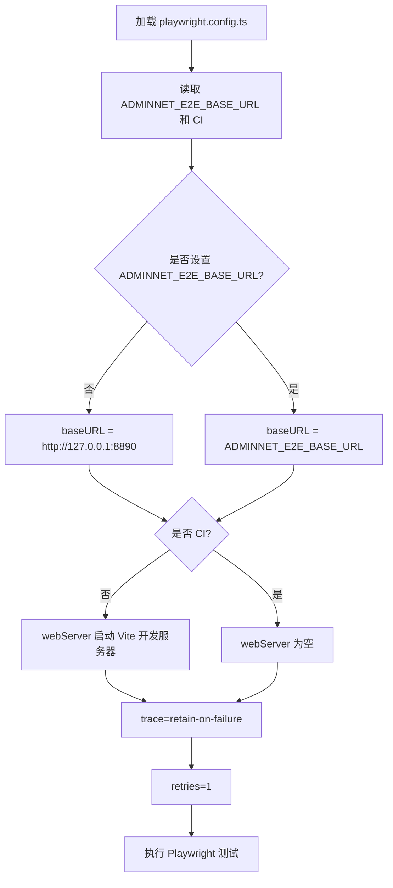

**图表来源**
- [Web/playwright.config.ts:1-31](file://Web/playwright.config.ts#L1-L31)

**章节来源**
- [Web/playwright.config.ts:1-31](file://Web/playwright.config.ts#L1-L31)

### Vitest 逻辑测试与 Playwright 浏览器验证的区别
Vitest 和 Playwright 在本项目中承担不同职责：
- Vitest 使用 `happy-dom` 运行纯逻辑和组件级测试，适合单元测试、状态更新、工具函数和业务逻辑验证。
- Playwright 驱动真实桌面 Chrome，访问实际运行的前端应用，验证路由、用户交互、权限控制、表单数据、网络请求和浏览器副作用。
- `vitest.config.ts` 显式排除 `**/e2e/**`，确保 Vitest 不会误执行端到端测试。
- 工作区脚本中 `test:unit` 对应 Vitest，`test:e2e` 对应 Playwright。

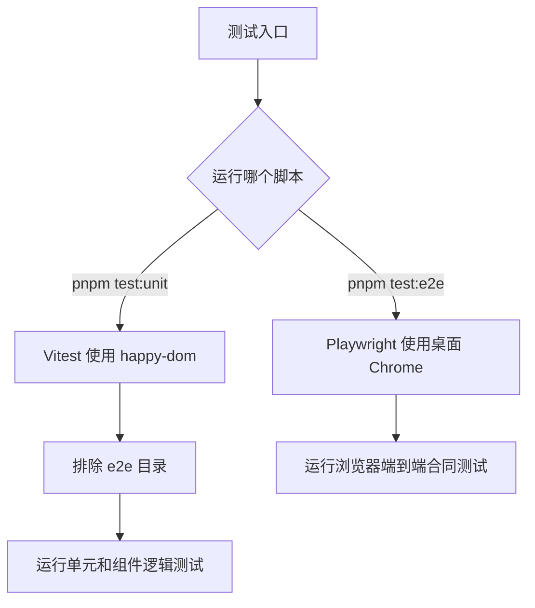

**图表来源**
- [Web/vitest.config.ts:1-28](file://Web/vitest.config.ts#L1-L28)
- [Web/package.json:1-102](file://Web/package.json#L1-L102)

**章节来源**
- [Web/vitest.config.ts:1-28](file://Web/vitest.config.ts#L1-L28)
- [Web/package.json:1-102](file://Web/package.json#L1-L102)

### admin-session 会话管理方式
`admin-session.ts` 提供两类能力：
- `mockAdminSession(page, module, options)`：拦截 `/prod-api/hubs/onlineUser/negotiate`、系统信息、登录、用户信息、菜单树、租户列表、字典下拉等接口，根据模块名动态构造按钮权限和前缀菜单，支持只读模式、超级管理员模式和特殊模块的自定义动作。
- `loginAdmin(page, module)`：跳转到登录页，填写账号和密码，点击提交，并断言跳转至目标系统模块路径。

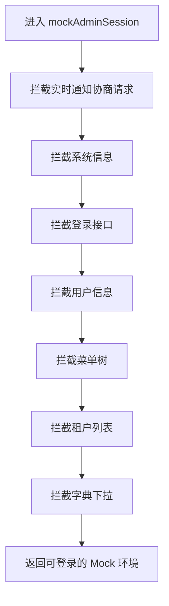

**图表来源**
- [Web/apps/web-antdv-next/e2e/fixtures/admin-session.ts:1-155](file://Web/apps/web-antdv-next/e2e/fixtures/admin-session.ts#L1-L155)

**章节来源**
- [Web/apps/web-antdv-next/e2e/fixtures/admin-session.ts:1-155](file://Web/apps/web-antdv-next/e2e/fixtures/admin-session.ts#L1-L155)

### auth-contract 合同测试典型结构
`auth-contract.spec.ts` 展示认证模块的合同测试风格：
- 在 `beforeEach` 中拦截系统配置、租户列表、验证码等接口。
- 测试密码加密、租户和验证码参数、登录拒绝提示、验证码清空、系统维护不可提交、滑块验证、短信验证码校验等。
- 使用 `page.route` 拦截真实后端请求，保证测试只依赖前端和接口契约。
- 使用 `page.screenshot` 保存登录页截图。

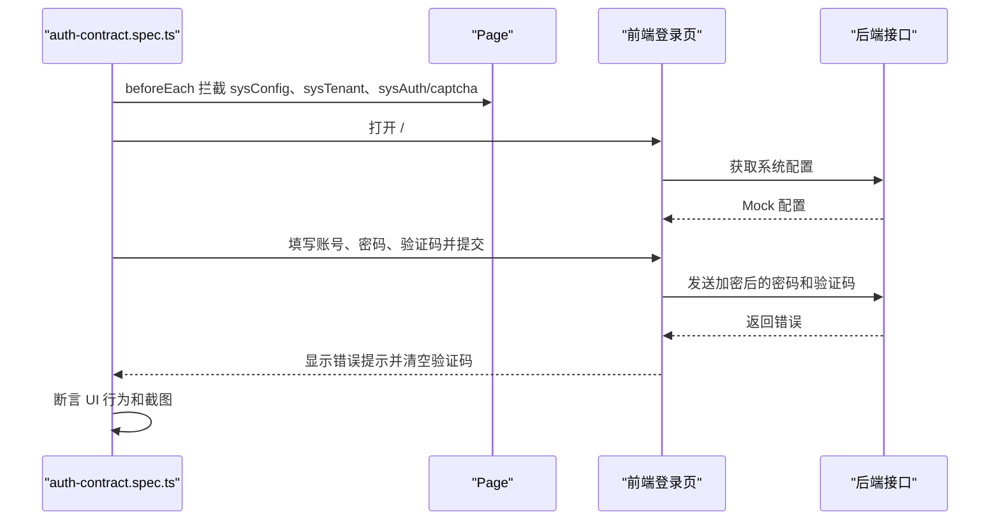

**图表来源**
- [Web/apps/web-antdv-next/e2e/auth-contract.spec.ts:1-128](file://Web/apps/web-antdv-next/e2e/auth-contract.spec.ts#L1-L128)

**章节来源**
- [Web/apps/web-antdv-next/e2e/auth-contract.spec.ts:1-128](file://Web/apps/web-antdv-next/e2e/auth-contract.spec.ts#L1-L128)

### user-contract 合同测试典型结构
`user-contract.spec.ts` 使用 `loginAdmin` 和 `mockAdminSession` 快速搭建用户管理测试环境：
- 通过全局拦截未知 `/prod-api/**` 请求，强制声明所有依赖接口。
- 模拟用户分页、部门树、职位列表、角色列表、语言下拉、自有角色和扩展机构。
- 覆盖编辑保存、复制账号、删除账号、重置密码、解锁登录、只读权限、角色变更、状态更新失败等场景。
- 通过断言请求 URL、POST 数据和 UI 状态，验证用户管理的完整契约。

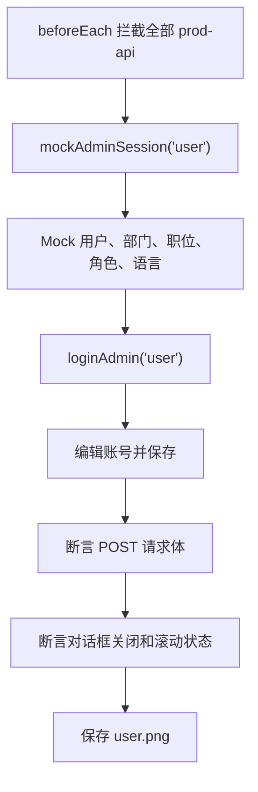

**图表来源**
- [Web/apps/web-antdv-next/e2e/user-contract.spec.ts:1-244](file://Web/apps/web-antdv-next/e2e/user-contract.spec.ts#L1-L244)
- [Web/apps/web-antdv-next/e2e/fixtures/admin-session.ts:1-155](file://Web/apps/web-antdv-next/e2e/fixtures/admin-session.ts#L1-L155)

**章节来源**
- [Web/apps/web-antdv-next/e2e/user-contract.spec.ts:1-244](file://Web/apps/web-antdv-next/e2e/user-contract.spec.ts#L1-L244)
- [Web/apps/web-antdv-next/e2e/fixtures/admin-session.ts:1-155](file://Web/apps/web-antdv-next/e2e/fixtures/admin-session.ts#L1-L155)

### file-contract 合同测试典型结构
`file-contract.spec.ts` 聚焦文件上传、编辑、下载预览和权限控制：
- 初始化时将未知 `/prod-api/api/**` 请求返回 404，强制声明文件相关接口。
- 验证空文件、不支持后缀、上传失败保留草稿、取消后清空输入。
- 验证编辑只发送元数据，失败不丢失输入。
- 验证二进制下载鉴权错误只提示一次。
- 验证私有图片带认证请求，预览后释放对象 URL。
- 验证只读权限隐藏上传、编辑、删除、预览、下载按钮。
- 验证异步上传延迟完成时，关闭再打开对话框不残留旧草稿。

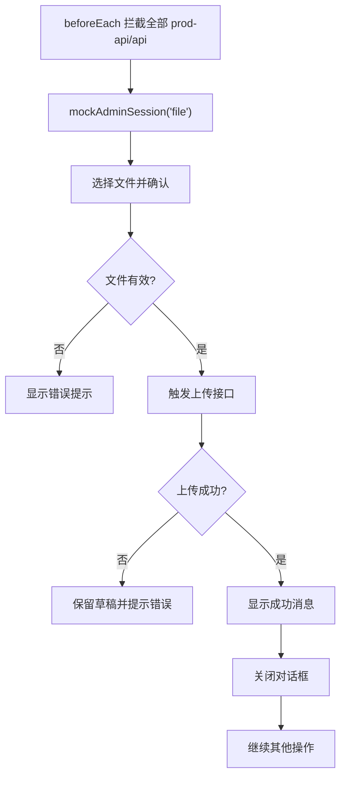

**图表来源**
- [Web/apps/web-antdv-next/e2e/file-contract.spec.ts:1-99](file://Web/apps/web-antdv-next/e2e/file-contract.spec.ts#L1-L99)
- [Web/apps/web-antdv-next/e2e/fixtures/admin-session.ts:1-155](file://Web/apps/web-antdv-next/e2e/fixtures/admin-session.ts#L1-L155)

**章节来源**
- [Web/apps/web-antdv-next/e2e/file-contract.spec.ts:1-99](file://Web/apps/web-antdv-next/e2e/file-contract.spec.ts#L1-L99)
- [Web/apps/web-antdv-next/e2e/fixtures/admin-session.ts:1-155](file://Web/apps/web-antdv-next/e2e/fixtures/admin-session.ts#L1-L155)

### stress-test-contract 合同测试典型结构
`stress-test-contract.spec.ts` 针对“受控接口压测”模块进行桌面端验收：
- 跳过移动端。
- 拦截全部 `/prod-api/**`，记录未声明请求，并在 `afterEach` 中断言无遗漏。
- Mock 压测目标和执行结果。
- 覆盖明暗主题、头部参数、Body 参数、Path 参数、Query 参数、总量上限校验、执行锁定、取消执行、全部失败结果、超级管理员和端点权限组合等场景。
- 断言最终统计文案、动画状态、滚动位置和截图。

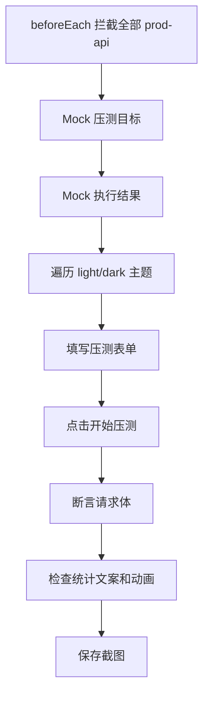

**图表来源**
- [Web/apps/web-antdv-next/e2e/stress-test-contract.spec.ts:1-187](file://Web/apps/web-antdv-next/e2e/stress-test-contract.spec.ts#L1-L187)
- [Web/apps/web-antdv-next/e2e/fixtures/admin-session.ts:1-155](file://Web/apps/web-antdv-next/e2e/fixtures/admin-session.ts#L1-L155)

**章节来源**
- [Web/apps/web-antdv-next/e2e/stress-test-contract.spec.ts:1-187](file://Web/apps/web-antdv-next/e2e/stress-test-contract.spec.ts#L1-L187)
- [Web/apps/web-antdv-next/e2e/fixtures/admin-session.ts:1-155](file://Web/apps/web-antdv-next/e2e/fixtures/admin-session.ts#L1-L155)

## 依赖关系分析
Playwright 测试依赖工作区脚本、业务应用开发和真实桌面浏览器；Vitest 测试依赖 `happy-dom` 环境和业务前端构建依赖。两者通过不同的配置文件和脚本隔离。

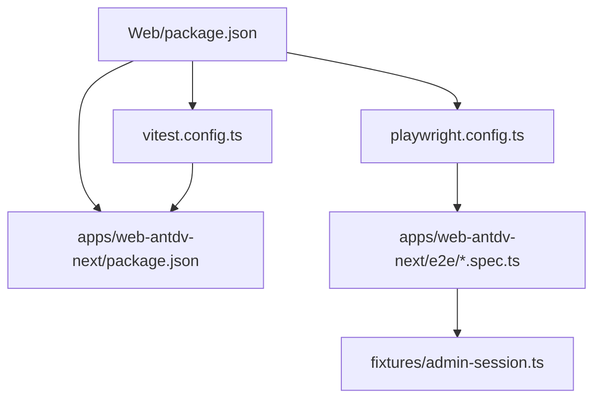

**图表来源**
- [Web/package.json:1-102](file://Web/package.json#L1-L102)
- [Web/playwright.config.ts:1-31](file://Web/playwright.config.ts#L1-L31)
- [Web/vitest.config.ts:1-28](file://Web/vitest.config.ts#L1-L28)
- [Web/apps/web-antdv-next/package.json:1-72](file://Web/apps/web-antdv-next/package.json#L1-L72)

**章节来源**
- [Web/package.json:1-102](file://Web/package.json#L1-L102)
- [Web/playwright.config.ts:1-31](file://Web/playwright.config.ts#L1-L31)
- [Web/vitest.config.ts:1-28](file://Web/vitest.config.ts#L1-L28)
- [Web/apps/web-antdv-next/package.json:1-72](file://Web/apps/web-antdv-next/package.json#L1-L72)

## 性能与执行特性
- 并发执行：`fullyParallel: true` 配合 `workers: 2`，可在本地同时运行多个测试用例，提高整体吞吐。
- 断言超时：`expect.timeout: 10_000`，避免长等待掩盖网络或 UI 阻塞问题。
- 重试策略：本地不重试，CI 重试一次，减少偶发网络抖动影响。
- 只运行单个测试：CI 下 `forbidOnly` 阻止只运行单个用例，降低误提交风险。
- 截图：仅失败时截图，减少磁盘占用，便于定位 UI 差异。
- 追踪：CI 失败时保留追踪文件，帮助回放失败过程。
- 视口：固定 1440×1000，确保桌面端布局一致。
- 并发压力：`stress-test-contract.spec.ts` 本身只做界面契约验证，不发起大规模真实后端压测，避免把 E2E 测试变成生产压测。

**章节来源**
- [Web/playwright.config.ts:1-31](file://Web/playwright.config.ts#L1-L31)
- [Web/apps/web-antdv-next/e2e/stress-test-contract.spec.ts:1-187](file://Web/apps/web-antdv-next/e2e/stress-test-contract.spec.ts#L1-L187)

## 故障排查指南

### 本地运行命令
推荐流程：
1. 在工作区根目录执行 `pnpm dev`，启动 `@vben/web-antdv-next` 开发服务器，默认监听 `http://127.0.0.1:8890`。
2. 执行 `pnpm test:e2e` 运行 Playwright 测试。
3. 如果只想运行某个测试文件，可使用 Playwright 自带的过滤方式，例如按文件名或标签筛选。

若只想运行 Vitest 逻辑测试，执行 `pnpm test:unit`；该命令使用 `happy-dom`，不会启动浏览器，也不会执行 `e2e` 目录。

### 通过环境变量指向已有服务
设置 `ADMINNET_E2E_BASE_URL` 后，Playwright 不再自动启动 `webServer`，而是直接访问该地址。例如：
- `ADMINNET_E2E_BASE_URL=http://localhost:8890 pnpm test:e2e`
- `ADMINNET_E2E_BASE_URL=https://your-domain pnpm test:e2e`

注意：此时需要确保目标服务已经包含前端构建产物，并且后端接口可由前端通过 `/prod-api` 前缀访问。

### 截图和追踪文件分析
- 失败时会在全页截图中保存 `*.png`，通常位于 Playwright 报告目录中。
- CI 失败会生成追踪文件，可通过 Playwright Inspector 或报告界面回放页面操作步骤、网络请求和 DOM 快照。
- 建议在失败测试中主动添加 `page.screenshot`，尤其是涉及模态框、滚动区域、表格和复杂表单的场景。

### 断言失败常见原因
- 未声明后端接口：`user-contract.spec.ts` 和 `stress-test-contract.spec.ts` 都会拦截并拒绝未声明的 `/prod-api/**` 请求，新增页面接口时需要在 `beforeEach` 中添加 Mock。
- 权限不足：`admin-session.ts` 会根据模块和 `readOnly`、`superAdmin` 参数生成按钮权限；如果 UI 缺少预期按钮，应检查 `mockAdminSession` 的参数。
- 路由不一致：`loginAdmin` 期望登录后跳转到 `/system/{module}`；如果前端路由变化，需要同步更新 Fixture 或测试用例。
- 网络超时：断言超时为 10 秒，若后端响应慢，应优先优化被测页面或增加稳定 Mock，而不是盲目扩大超时。
- CI 不稳定：启用了一次重试，但仍可能受网络、浏览器启动或前端热更新影响；建议先复现本地失败，再判断是否为环境问题。

### CI 环境适配建议
- 保持 `ADMINNET_E2E_BASE_URL` 指向稳定的部署地址，或在 CI 中启动独立前端实例。
- 不要将临时缓存、绝对路径、真实密钥或连接凭据写入测试。
- 避免在 E2E 中执行真实数据库写操作；如需持久化，应使用隔离测试数据库和清理机制。
- 如果需要更严格的行为，可开启 `forbidOnly`（已在 CI 默认开启）并限制 `workers`。
- 对不稳定 UI，优先修复确定性断言，例如基于角色、按钮名称、表单字段和请求 URL，而不是依赖随机坐标或文本片段。

**章节来源**
- [Web/playwright.config.ts:1-31](file://Web/playwright.config.ts#L1-L31)
- [Web/vitest.config.ts:1-28](file://Web/vitest.config.ts#L1-L28)
- [Web/package.json:1-102](file://Web/package.json#L1-L102)
- [Web/apps/web-antdv-next/e2e/user-contract.spec.ts:1-244](file://Web/apps/web-antdv-next/e2e/user-contract.spec.ts#L1-L244)
- [Web/apps/web-antdv-next/e2e/stress-test-contract.spec.ts:1-187](file://Web/apps/web-antdv-next/e2e/stress-test-contract.spec.ts#L1-L187)

## 结论
本项目的前端端到端测试以 Playwright 为核心，聚焦浏览器与前端应用的真实交互，并通过合同测试模式屏蔽后端不确定性。`playwright.config.ts` 明确了测试目录、基础地址、桌面项目、webServer、追踪、截图和 CI 重试策略；`admin-session.ts` 提供统一的会话 Mock 和登录流程；各 `*-contract.spec.ts` 覆盖认证、用户、文件、压测等关键业务模块。Vitest 则专注 `happy-dom` 下的纯逻辑测试，与 Playwright 形成互补。推荐在本地先运行 `pnpm dev`，再运行 `pnpm test:e2e`；在生产或 CI 中通过 `ADMINNET_E2E_BASE_URL` 指向稳定服务，并使用截图和追踪文件辅助定位问题。