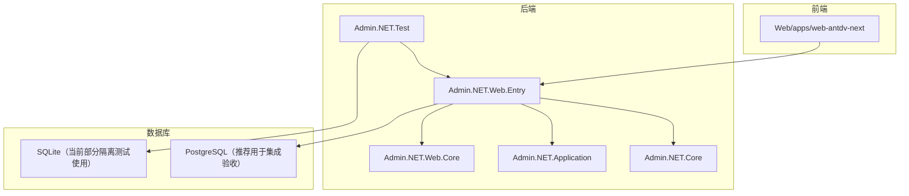
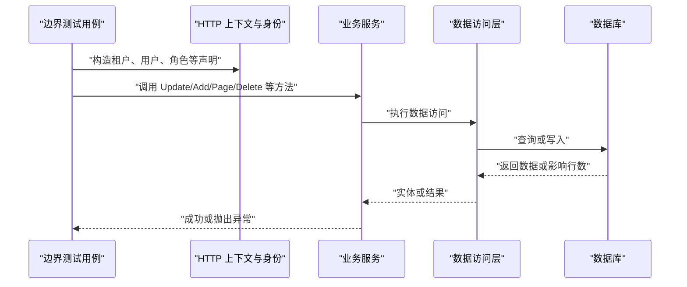
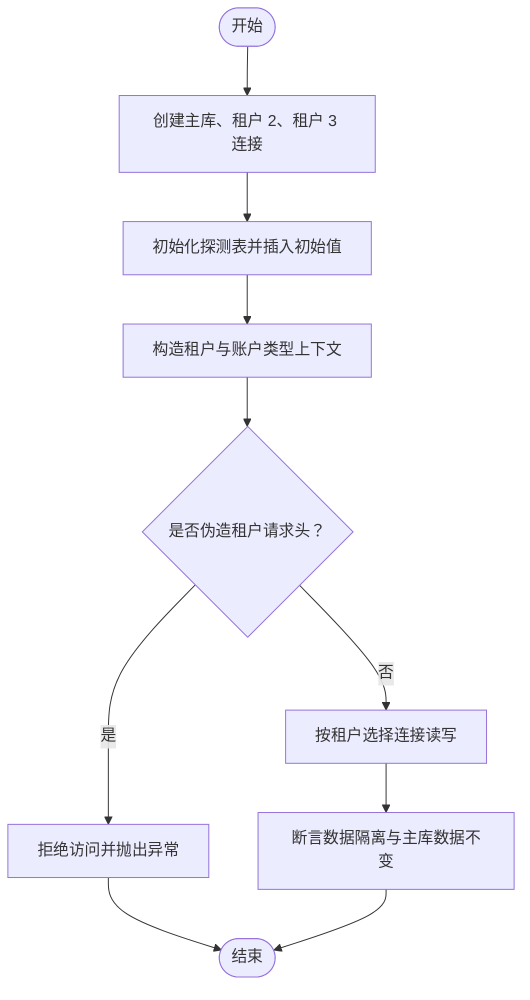
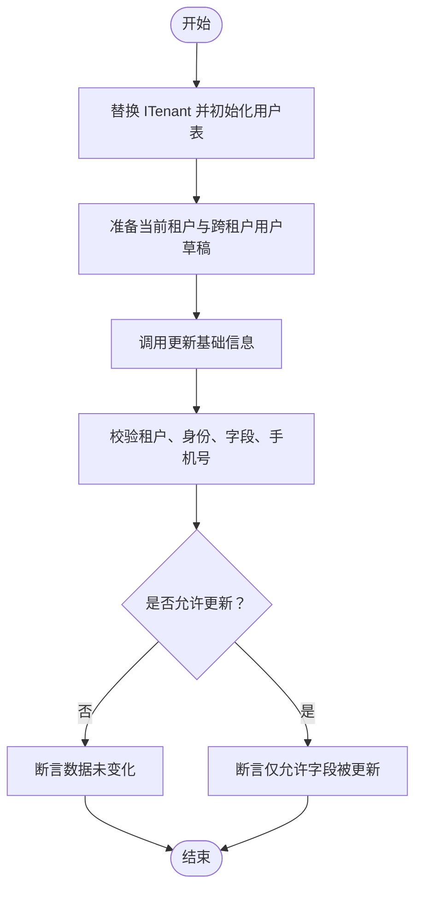
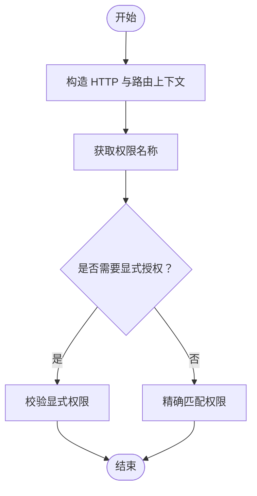
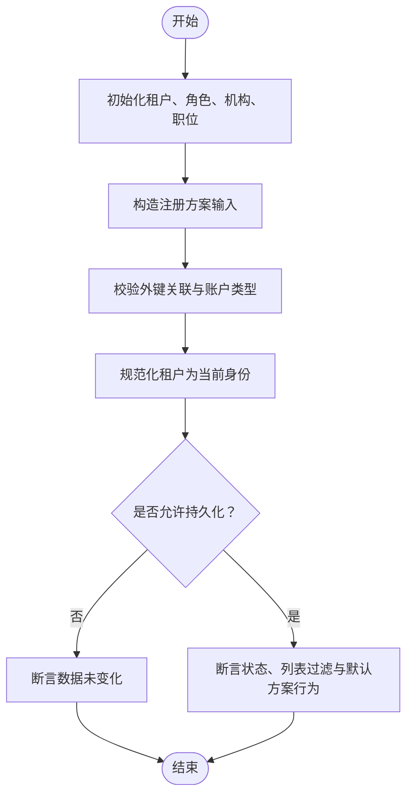
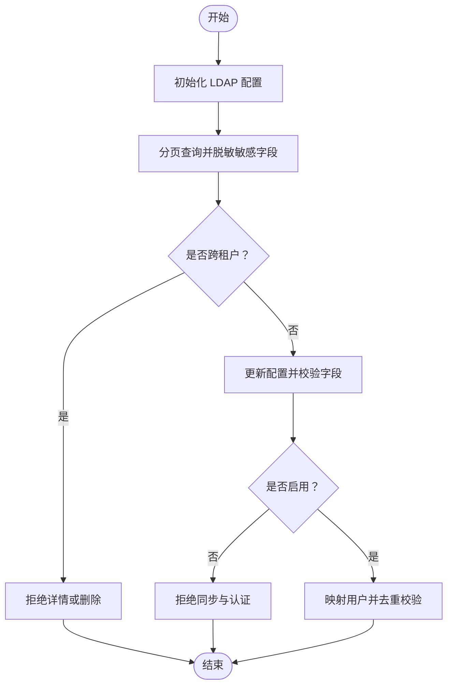
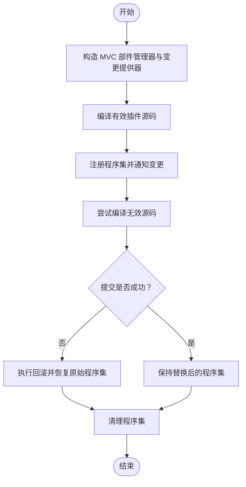
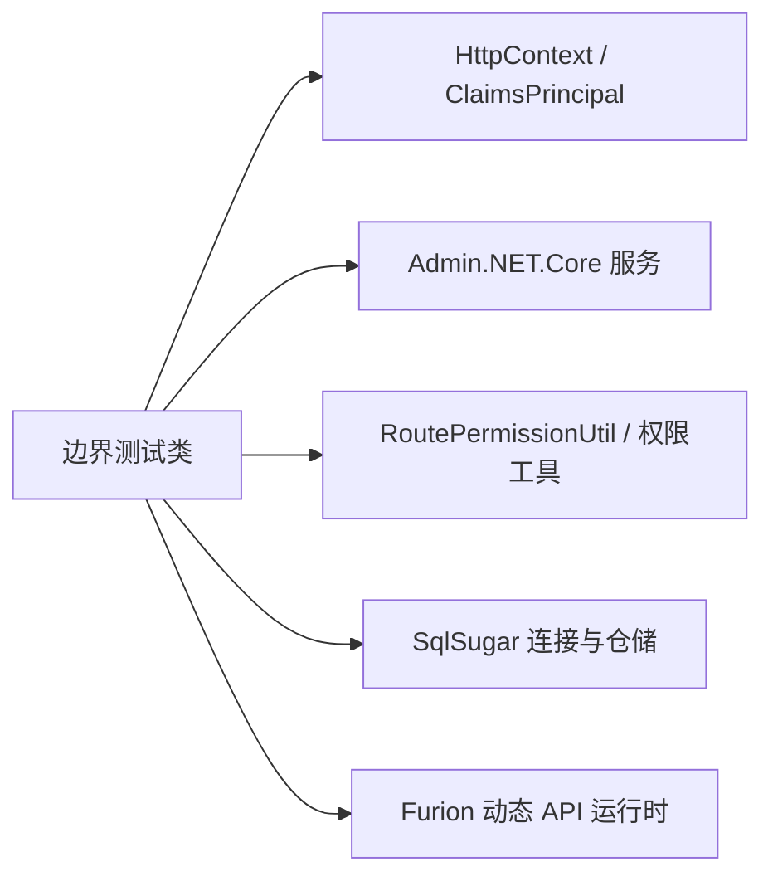

# 集成测试

<cite>
**本文引用的文件**   
- [README.md](file://README.md)
- [global.json](file://Admin.NET/global.json)
- [Admin.NET.sln](file://Admin.NET/Admin.NET.sln)
- [BaseTest.cs](file://Admin.NET/Admin.NET.Test/BaseTest.cs)
- [TenantRepositoryIsolationTests.cs](file://Admin.NET/Admin.NET.Test/Tenant/TenantRepositoryIsolationTests.cs)
- [ProfileIsolationTests.cs](file://Admin.NET/Admin.NET.Test/User/ProfileIsolationTests.cs)
- [OpenAccessPermissionTests.cs](file://Admin.NET/Admin.NET.Test/OpenAccess/OpenAccessPermissionTests.cs)
- [RegistrationBoundaryTests.cs](file://Admin.NET/Admin.NET.Test/Registration/RegistrationBoundaryTests.cs)
- [LdapBoundaryTests.cs](file://Admin.NET/Admin.NET.Test/Ldap/LdapBoundaryTests.cs)
- [PluginRuntimeTests.cs](file://Admin.NET/Admin.NET.Test/Plugin/PluginRuntimeTests.cs)
</cite>

## 目录
1. [引言](#引言)
2. [项目结构](#项目结构)
3. [核心组件](#核心组件)
4. [架构总览](#架构总览)
5. [详细组件分析](#详细组件分析)
6. [依赖关系分析](#依赖关系分析)
7. [性能注意事项](#性能注意事项)
8. [故障排查指南](#故障排查指南)
9. [结论](#结论)
10. [附录：本地执行与验证清单](#附录本地执行与验证清单)

## 引言
本文面向 Admin.NET 的后端集成测试，重点说明边界测试如何围绕多租户、权限校验、LDAP、注册流程和插件运行时进行断言。需要特别强调：**当前仓库中的多个“隔离”边界测试使用 SQLite 文件数据库模拟真实数据访问，并不等同于对真实 PostgreSQL 的集成联调**。根据仓库 README，后端入口为 `Admin.NET/Admin.NET.Web.Entry/`，前端入口为 `Web/apps/web-antdv-next/`，并且明确说明“集成验收使用 PostgreSQL”，因此生产级或持续集成级别的数据库集成验证必须基于独立、可恢复的真实 PostgreSQL 实例，不能仅以 SQLite 或 Mock 结果声称联调通过。

此外，仓库的 `.NET` 配置中 `Admin.NET/global.json` 仅声明测试运行器为 `Microsoft.Testing.Platform`，并不能据此推断已固定 .NET SDK 版本；而解决方案和 README 显示业务 API 入口与测试工程属于 .NET 工程体系的一部分，应分别按各自 `.csproj` 的目标框架理解，不要把共享工程、API 入口与测试工程混为一个目标框架。

**章节来源**
- [README.md:1-40](file://README.md#L1-L40)
- [global.json:1-5](file://Admin.NET/global.json#L1-L5)
- [Admin.NET.sln:1-20](file://Admin.NET/Admin.NET.sln#L1-L20)

## 项目结构
Admin.NET 后端采用前后端分离与模块化设计。本仓库包含以下与集成测试相关的核心位置：
- 后端应用工程：`Admin.NET.Admin.NET.Application`、`Admin.NET.Admin.NET.Core`、`Admin.NET.Admin.NET.Web.Core`、`Admin.NET.Admin.NET.Web.Entry`
- 测试工程：`Admin.NET.Admin.NET.Test`
- 前端业务入口：`Web/apps/web-antdv-next/`
- 解决方案：`Admin.NET/Admin.NET.sln`



**图表来源**
- [Admin.NET.sln:1-20](file://Admin.NET/Admin.NET.sln#L1-L20)
- [README.md:12-28](file://README.md#L12-L28)

**章节来源**
- [Admin.NET.sln:1-20](file://Admin.NET/Admin.NET.sln#L1-L20)
- [README.md:12-28](file://README.md#L12-L28)

## 核心组件
本节聚焦文档指定的六个边界测试类，说明其测试场景、数据准备方式和断言要点。

| 测试类 | 测试主题 | 数据准备方式 | 事务回滚策略 | 主要断言要点 |
|---|---|---|---|---|
| `TenantRepositoryIsolationTests` | 多租户仓储是否按租户隔离读写 | 构造三个连接标识的主库、租户 2、租户 3，每个连接使用独立 SQLite 文件并初始化探测表 | 测试结束后释放 `SqlSugarScope`、清理 SQLite 连接池并删除临时文件 | 不同租户读取写入互不干扰；伪造租户请求头被拒绝；主租户查询仍指向主连接 |
| `ProfileIsolationTests` | 用户资料更新是否受租户、身份、字段保护约束 | 将全局 `ITenant` 替换为独立 SQLite，初始化用户表并插入两条不同租户的用户草稿 | 测试后恢复旧 `ITenant`、释放连接池并删除临时文件 | 跨租户更新被拒绝；伪造管理字段被保留原值；手机号冲突被拒绝；未变更历史重复手机号允许其他字段更新 |
| `OpenAccessPermissionTests` | 开放接口权限名称与显式授权规则 | 无数据库；构造 HTTP 上下文和路由上下文直接调用权限工具 | 无持久状态 | 开放接口动作映射到显式权限；候选或密钥权限只接受新增或更新；组合权限不展开；大小写无关精确匹配 |
| `RegistrationBoundaryTests` | 用户注册方案的多租户与权限边界 | 替换全局 `ITenant`，初始化租户、角色、机构、职位等表，注入自增主键 AOP，创建两个租户的基础数据 | 测试后恢复 `ITenant`、清理连接池并删除临时文件 | 外键关联无效被拒绝；特权账户类型被拒绝；伪造租户使用当前身份；跨租户修改被拒绝且数据不变；同名在不同租户允许但列表过滤；默认方案禁用时清空绑定 |
| `LdapBoundaryTests` | LDAP 配置与用户映射的租户隔离、敏感信息脱敏和同步前置检查 | 替换 `ITenant`，初始化 LDAP 和用户映射表，为两个租户各插入一条配置 | 测试后恢复 `ITenant`、清理连接池并删除临时文件 | 分页返回隐藏密码；跨租户详情和删除被拒绝；空密码不覆盖存储值；伪造租户和非法端口被拒绝；禁用配置阻止同步和认证；权限名映射到同步组织权限；重复账号和外租户映射被拒绝 |
| `PluginRuntimeTests` | 插件动态编译与 MVC 控制器替换的回滚行为 | 不使用数据库；构造 `ApplicationPartManager`、MVC 特性提供者和动态程序集 | 在 finally 中移除已添加的程序集；提交失败时触发回滚委托 | 有效源码编译成功，无效源码抛出异常；原始控制器在编译句柄释放后仍可发现；提交失败时回滚并将 MVC 恢复为原始程序集 |

**章节来源**
- [TenantRepositoryIsolationTests.cs:1-127](file://Admin.NET/Admin.NET.Test/Tenant/TenantRepositoryIsolationTests.cs#L1-L127)
- [ProfileIsolationTests.cs:1-156](file://Admin.NET/Admin.NET.Test/User/ProfileIsolationTests.cs#L1-L156)
- [OpenAccessPermissionTests.cs:1-70](file://Admin.NET/Admin.NET.Test/OpenAccess/OpenAccessPermissionTests.cs#L1-L70)
- [RegistrationBoundaryTests.cs:1-175](file://Admin.NET/Admin.NET.Test/Registration/RegistrationBoundaryTests.cs#L1-L175)
- [LdapBoundaryTests.cs:1-141](file://Admin.NET/Admin.NET.Test/Ldap/LdapBoundaryTests.cs#L1-L141)
- [PluginRuntimeTests.cs:1-103](file://Admin.NET/Admin.NET.Test/Plugin/PluginRuntimeTests.cs#L1-L103)

## 架构总览
这些边界测试共同体现了一个分层思路：测试代码直接构造 ASP.NET Core 的 `HttpContext`、`ClaimsPrincipal`、服务实例和数据访问对象，从而绕过完整的 HTTP 链路，验证服务层和权限层的边界行为。其中，涉及数据库的测试会替换全局租户连接，使用 SQLite 作为轻量数据源；不涉及数据库的测试则直接断言权限映射、动态程序集发现和 MVC 控制器替换逻辑。



**图表来源**
- [ProfileIsolationTests.cs:56-115](file://Admin.NET/Admin.NET.Test/User/ProfileIsolationTests.cs#L56-L115)
- [RegistrationBoundaryTests.cs:70-160](file://Admin.NET/Admin.NET.Test/Registration/RegistrationBoundaryTests.cs#L70-L160)
- [LdapBoundaryTests.cs:42-135](file://Admin.NET/Admin.NET.Test/Ldap/LdapBoundaryTests.cs#L42-L135)

**章节来源**
- [ProfileIsolationTests.cs:1-156](file://Admin.NET/Admin.NET.Test/User/ProfileIsolationTests.cs#L1-L156)
- [RegistrationBoundaryTests.cs:1-175](file://Admin.NET/Admin.NET.Test/Registration/RegistrationBoundaryTests.cs#L1-L175)
- [LdapBoundaryTests.cs:1-141](file://Admin.NET/Admin.NET.Test/Ldap/LdapBoundaryTests.cs#L1-L141)

## 详细组件分析

### 多租户仓储隔离：`TenantRepositoryIsolationTests`
该测试模拟多租户仓储选择数据库的行为。它构造三个连接标识，分别对应主库、租户 2 和租户 3，并为每个连接创建独立的 SQLite 文件，然后初始化探测表并插入初始值。测试通过伪造 `DefaultHttpContext` 中的租户和账户类型声明来构造不同身份的仓储，断言：
- 租户 2 与租户 3 的数据互不可见；
- 对租户 2 的更新不会出现在租户 3；
- 伪造租户请求头会在任何数据库写入前被拒绝；
- 主租户查询仍命中主连接；
- 显式超级管理员作用域可以覆盖预期租户选择。



**图表来源**
- [TenantRepositoryIsolationTests.cs:24-63](file://Admin.NET/Admin.NET.Test/Tenant/TenantRepositoryIsolationTests.cs#L24-L63)
- [TenantRepositoryIsolationTests.cs:65-115](file://Admin.NET/Admin.NET.Test/Tenant/TenantRepositoryIsolationTests.cs#L65-L115)

**章节来源**
- [TenantRepositoryIsolationTests.cs:1-127](file://Admin.NET/Admin.NET.Test/Tenant/TenantRepositoryIsolationTests.cs#L1-L127)

### 用户资料更新边界：`ProfileIsolationTests`
该测试验证用户资料更新服务的租户隔离、字段保护和唯一性校验。它替换全局 `ITenant`，初始化用户表，并通过 `RuntimeHelpers.GetUninitializedObject` 直接填充必要字段，避免依赖 Web Host 的默认语言。测试断言：
- 跨租户更新被拒绝；
- 伪造的管理字段如账号、账户类型、状态、组织、职位、密码、创建人保持不变；
- 手机号与其他租户冲突时被拒绝；
- 历史遗留的重复手机号在未被变更时允许其他字段更新。



**图表来源**
- [ProfileIsolationTests.cs:24-54](file://Admin.NET/Admin.NET.Test/User/ProfileIsolationTests.cs#L24-L54)
- [ProfileIsolationTests.cs:56-156](file://Admin.NET/Admin.NET.Test/User/ProfileIsolationTests.cs#L56-L156)

**章节来源**
- [ProfileIsolationTests.cs:1-156](file://Admin.NET/Admin.NET.Test/User/ProfileIsolationTests.cs#L1-L156)

### 开放接口权限：`OpenAccessPermissionTests`
该测试不依赖数据库，而是直接构造路由上下文，断言开放接口的权限名称生成、显式授权要求以及权限匹配规则。关键点包括：
- 开放接口动作映射到显式权限；
- 某些候选或密钥权限只接受新增或更新操作；
- 组合权限不会展开为新增或更新；
- 权限匹配大小写不敏感，但必须是精确权限。



**图表来源**
- [OpenAccessPermissionTests.cs:15-70](file://Admin.NET/Admin.NET.Test/OpenAccess/OpenAccessPermissionTests.cs#L15-L70)

**章节来源**
- [OpenAccessPermissionTests.cs:1-70](file://Admin.NET/Admin.NET.Test/OpenAccess/OpenAccessPermissionTests.cs#L1-L70)

### 注册流程边界：`RegistrationBoundaryTests`
该测试覆盖用户注册方案的增删改查边界。它初始化租户、角色、机构、职位等基础数据，并通过 AOP 处理主键自增。测试断言：
- 外键关联无效时拒绝写入；
- 特权或无效账户类型被拒绝；
- 伪造租户会被替换为当前身份；
- 跨租户修改和删除被拒绝且数据保持原状；
- 同名注册方案在不同租户允许，但列表按租户过滤；
- 默认注册方案被禁用时会清空租户绑定；
- 系统信息保存对外部注册方案的引用需显式授权。



**图表来源**
- [RegistrationBoundaryTests.cs:17-69](file://Admin.NET/Admin.NET.Test/Registration/RegistrationBoundaryTests.cs#L17-L69)
- [RegistrationBoundaryTests.cs:71-175](file://Admin.NET/Admin.NET.Test/Registration/RegistrationBoundaryTests.cs#L71-L175)

**章节来源**
- [RegistrationBoundaryTests.cs:1-175](file://Admin.NET/Admin.NET.Test/Registration/RegistrationBoundaryTests.cs#L1-L175)

### LDAP 边界：`LdapBoundaryTests`
该测试验证 LDAP 配置的租户隔离、敏感字段脱敏、参数校验、同步前置检查和用户映射边界。它初始化 LDAP 配置和用户映射表，断言：
- 分页返回中密码为空；
- 跨租户详情和删除被拒绝；
- 空密码不覆盖已有密码；
- 伪造租户和非法端口被拒绝；
- 禁用配置阻止同步与认证；
- 同步部门权限映射到同步组织权限；
- 重复账号和外租户映射被拒绝且现有映射保持不变。



**图表来源**
- [LdapBoundaryTests.cs:18-41](file://Admin.NET/Admin.NET.Test/Ldap/LdapBoundaryTests.cs#L18-L41)
- [LdapBoundaryTests.cs:42-141](file://Admin.NET/Admin.NET.Test/Ldap/LdapBoundaryTests.cs#L42-L141)

**章节来源**
- [LdapBoundaryTests.cs:1-141](file://Admin.NET/Admin.NET.Test/Ldap/LdapBoundaryTests.cs#L1-L141)

### 插件运行时：`PluginRuntimeTests`
该测试验证插件动态编译、MVC 控制器替换与回滚机制。它不依赖数据库，而是：
- 构造 `ApplicationPartManager` 与 MVC 控制器特性提供者；
- 通过反射实例化 Furion 的动态 API 运行时变更提供器；
- 编译有效 C# 源码并注册程序集；
- 故意编译无效源码以验证异常路径；
- 提交失败时触发回滚委托，确保 MVC 控制器恢复为原始程序集；
- 最终移除程序集并断言控制器特征为空。



**图表来源**
- [PluginRuntimeTests.cs:12-64](file://Admin.NET/Admin.NET.Test/Plugin/PluginRuntimeTests.cs#L12-L64)
- [PluginRuntimeTests.cs:66-103](file://Admin.NET/Admin.NET.Test/Plugin/PluginRuntimeTests.cs#L66-L103)

**章节来源**
- [PluginRuntimeTests.cs:1-103](file://Admin.NET/Admin.NET.Test/Plugin/PluginRuntimeTests.cs#L1-L103)

## 依赖关系分析
这些测试类的依赖可分为三类：
1. **ASP.NET Core 基础设施依赖**：`DefaultHttpContext`、`HttpContextAccessor`、`ClaimsPrincipal`、路由模式、MVC 控制器特性提供者。
2. **Admin.NET 核心依赖**：租户常量、账户类型、服务类、权限工具类、SqlSugar 仓储与连接配置。
3. **外部依赖**：部分测试依赖 Furion 的 `CompileCSharpClassCode` 与动态 API 运行时提供器。



**图表来源**
- [TenantRepositoryIsolationTests.cs:12-23](file://Admin.NET/Admin.NET.Test/Tenant/TenantRepositoryIsolationTests.cs#L12-L23)
- [ProfileIsolationTests.cs:12-23](file://Admin.NET/Admin.NET.Test/User/ProfileIsolationTests.cs#L12-L23)
- [OpenAccessPermissionTests.cs:12-19](file://Admin.NET/Admin.NET.Test/OpenAccess/OpenAccessPermissionTests.cs#L12-L19)
- [RegistrationBoundaryTests.cs:12-20](file://Admin.NET/Admin.NET.Test/Registration/RegistrationBoundaryTests.cs#L12-L20)
- [LdapBoundaryTests.cs:12-20](file://Admin.NET/Admin.NET.Test/Ldap/LdapBoundaryTests.cs#L12-L20)
- [PluginRuntimeTests.cs:12-20](file://Admin.NET/Admin.NET.Test/Plugin/PluginRuntimeTests.cs#L12-L20)

**章节来源**
- [TenantRepositoryIsolationTests.cs:1-127](file://Admin.NET/Admin.NET.Test/Tenant/TenantRepositoryIsolationTests.cs#L1-L127)
- [ProfileIsolationTests.cs:1-156](file://Admin.NET/Admin.NET.Test/User/ProfileIsolationTests.cs#L1-L156)
- [OpenAccessPermissionTests.cs:1-70](file://Admin.NET/Admin.NET.Test/OpenAccess/OpenAccessPermissionTests.cs#L1-L70)
- [RegistrationBoundaryTests.cs:1-175](file://Admin.NET/Admin.NET.Test/Registration/RegistrationBoundaryTests.cs#L1-L175)
- [LdapBoundaryTests.cs:1-141](file://Admin.NET/Admin.NET.Test/Ldap/LdapBoundaryTests.cs#L1-L141)
- [PluginRuntimeTests.cs:1-103](file://Admin.NET/Admin.NET.Test/Plugin/PluginRuntimeTests.cs#L1-L103)

## 性能注意事项
- **连接池与临时文件**：多个 SQLite 测试在构造函数中创建 `SqlSugarScope`，并在 `Dispose` 中调用 SQLite 连接池清理和文件删除。并发执行时应避免同一进程内大量测试同时创建临时 SQLite 文件导致 I/O 竞争。
- **测试数据量**：当前边界测试的数据量较小，主要用于验证边界条件；若扩展为真实 PostgreSQL 集成测试，应避免一次性插入大量种子数据，优先按需准备最小数据集。
- **事务与回滚**：SQLite 测试通过构造独立连接并在析构时释放，而不是依赖数据库事务回滚。迁移到真实 PostgreSQL 后，建议为每个测试用例开启显式事务，在失败或完成时回滚，以保证测试间完全隔离。
- **并发限制**：`ProfileIsolationTests`、`RegistrationBoundaryTests`、`LdapBoundaryTests` 都使用了 `[Collection]` 并设置 `DisableParallelization = true`，说明这些测试会替换全局 `ITenant`，不适合并行执行。
- **外部资源**：LDAP 测试不连接真实 LDAP 服务器，而是验证前置检查与权限映射；插件运行时测试不加载磁盘插件，而是使用内存动态程序集。真实环境联调时需区分这类单元测试与端到端集成测试。

[本节为通用性能指导，不直接分析具体代码行]

## 故障排查指南
当集成测试失败时，可按以下层次定位问题：

1. **确认测试类型**  
   - 如果失败发生在 SQLite 相关路径，优先检查临时文件是否被占用、`SqlSugarScope` 是否正确释放、`ITenant` 是否恢复。
   - 如果失败发生在权限或路由路径，优先检查 `DefaultHttpContext`、路由模式和权限字符串。
   - 如果失败发生在插件运行时路径，优先检查动态编译异常、程序集注册与移除逻辑。

2. **检查全局状态污染**  
   - `ProfileIsolationTests`、`RegistrationBoundaryTests`、`LdapBoundaryTests` 都会替换 `SqlSugarSetup.ITenant`，失败后必须确保 `Dispose` 执行，否则会污染后续测试。
   - 多租户测试会创建多个 SQLite 文件，失败后应检查临时目录是否残留文件。

3. **检查断言语义**  
   - 多租户测试断言的是“读取隔离”和“伪造请求头被拒绝”。
   - 用户资料测试断言的是“越权字段不被覆盖”和“唯一性约束”。
   - 开放接口测试断言的是“显式授权”和“权限匹配规则”。
   - 注册测试断言的是“外键有效性”“租户规范化”“默认方案禁用行为”。
   - LDAP 测试断言的是“敏感字段脱敏”“配置开关前置检查”“映射去重”。
   - 插件测试断言的是“编译失败不影响已发布控制器”“提交失败触发回滚”。

4. **日志与异常信息**  
   - 关注测试抛出的异常类型和消息，尤其是 SQLite 无法打开文件、权限不足、路由权限不匹配、动态编译语法错误、程序集移除后控制器缺失等。
   - 如果切换到真实 PostgreSQL，应重点关注连接字符串、数据库是否存在、表是否初始化、种子数据是否就绪。

**章节来源**
- [TenantRepositoryIsolationTests.cs:24-127](file://Admin.NET/Admin.NET.Test/Tenant/TenantRepositoryIsolationTests.cs#L24-L127)
- [ProfileIsolationTests.cs:24-156](file://Admin.NET/Admin.NET.Test/User/ProfileIsolationTests.cs#L24-L156)
- [RegistrationBoundaryTests.cs:17-175](file://Admin.NET/Admin.NET.Test/Registration/RegistrationBoundaryTests.cs#L17-L175)
- [LdapBoundaryTests.cs:18-141](file://Admin.NET/Admin.NET.Test/Ldap/LdapBoundaryTests.cs#L18-L141)
- [PluginRuntimeTests.cs:12-103](file://Admin.NET/Admin.NET.Test/Plugin/PluginRuntimeTests.cs#L12-L103)

## 结论
Admin.NET 的边界测试覆盖了多租户、权限校验、LDAP、注册流程和插件运行时等关键集成点。当前多个隔离测试使用 SQLite 文件数据库验证真实数据访问路径，但不应将其等同于真实 PostgreSQL 联调。仓库明确要求集成验收使用 PostgreSQL，因此在持续集成和生产验证环境中，应搭建独立数据库实例，准备种子数据和测试用户，并使用真实连接进行端到端或至少真实数据库链路验证。对于浏览器流程，应区分 Vitest 逻辑测试、Playwright 浏览器验证与真实 API、数据库链路验收，避免用单一层面的成功掩盖其他链路的缺陷。

[本节为总结性内容，不直接分析具体代码行]

## 附录：本地执行与验证清单

### 环境与前提
- 后端入口：`Admin.NET/Admin.NET.Web.Entry/`
- 前端入口：`Web/apps/web-antdv-next/`
- .NET SDK：参考 README 与解决方案；`global.json` 仅指定测试运行器，不表示已固定 SDK 版本。
- Node.js 与 pnpm：参考 README 中 Node.js 与 pnpm 版本要求。
- 数据库：开发时使用独立开发库；集成验收使用 PostgreSQL。

### 启动后端与前端
- 恢复并运行后端：
  ```powershell
  dotnet restore Admin.NET/Admin.NET.sln
  dotnet run --project Admin.NET/Admin.NET.Web.Entry/Admin.NET.Web.Entry.csproj
  ```
- 安装并启动前端：
  ```powershell
  pnpm install --frozen-lockfile
  pnpm dev
  ```

### 环境变量与配置
- 数据库连接、前端代理与 API 地址应按本机环境配置。
- 集成测试若迁移到真实 PostgreSQL，应提供独立连接字符串，并确保数据库、表结构和种子数据就绪。
- 浏览器集成测试依赖 BaseTest 中默认的 `http://localhost:8888`，需要确保后端在该端口运行。

**章节来源**
- [README.md:12-28](file://README.md#L12-L28)
- [BaseTest.cs:16-24](file://Admin.NET/Admin.NET.Test/BaseTest.cs#L16-L24)

### 执行集成测试
- 当前测试工程位于 `Admin.NET/Admin.NET.Test`，测试运行器由 `global.json` 声明为 `Microsoft.Testing.Platform`。
- 对于 SQLite 隔离测试，可直接运行测试工程；注意这些测试不是真实 PostgreSQL 联调。
- 对于真实 PostgreSQL 集成验证，应新建或复用独立数据库，并在测试启动前执行数据库初始化脚本，再运行测试。

**章节来源**
- [global.json:1-5](file://Admin.NET/global.json#L1-L5)
- [README.md:12-28](file://README.md#L12-L28)

### 失败日志分析方法
- 若测试报告出现 SQLite 文件不存在或无法打开，优先检查临时目录权限与 `Dispose` 是否执行。
- 若权限断言失败，优先检查路由路径、权限字符串和显式授权配置。
- 若 LDAP 同步或认证失败，先确认配置是否启用；测试本身不连接真实 LDAP，失败通常来自前置校验。
- 若插件运行时测试失败，优先检查动态编译异常、程序集注册与移除顺序。

**章节来源**
- [TenantRepositoryIsolationTests.cs:24-127](file://Admin.NET/Admin.NET.Test/Tenant/TenantRepositoryIsolationTests.cs#L24-L127)
- [ProfileIsolationTests.cs:24-156](file://Admin.NET/Admin.NET.Test/User/ProfileIsolationTests.cs#L24-L156)
- [OpenAccessPermissionTests.cs:15-70](file://Admin.NET/Admin.NET.Test/OpenAccess/OpenAccessPermissionTests.cs#L15-L70)
- [RegistrationBoundaryTests.cs:71-175](file://Admin.NET/Admin.NET.Test/Registration/RegistrationBoundaryTests.cs#L71-L175)
- [LdapBoundaryTests.cs:42-141](file://Admin.NET/Admin.NET.Test/Ldap/LdapBoundaryTests.cs#L42-L141)
- [PluginRuntimeTests.cs:12-103](file://Admin.NET/Admin.NET.Test/Plugin/PluginRuntimeTests.cs#L12-L103)