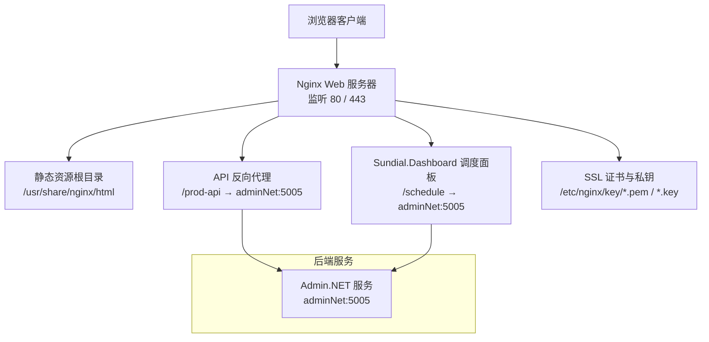
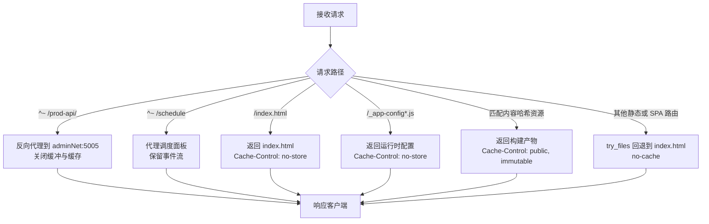
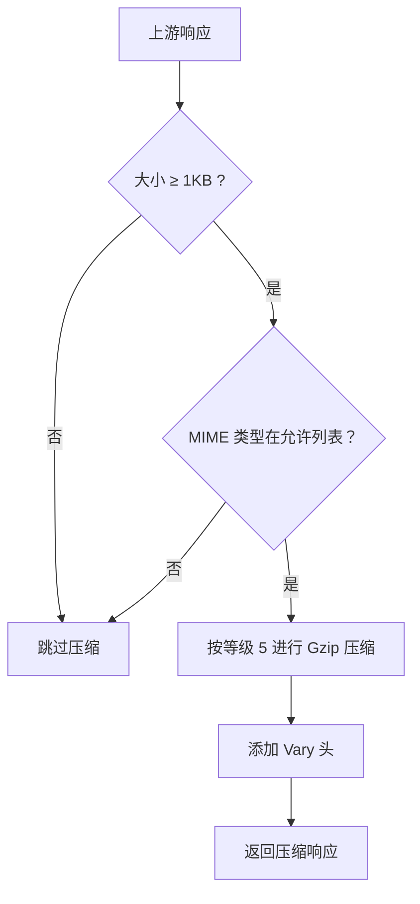
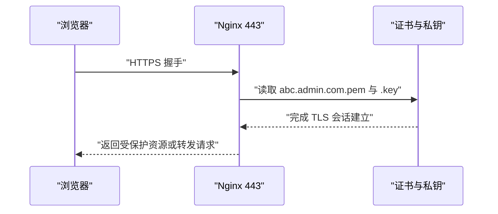
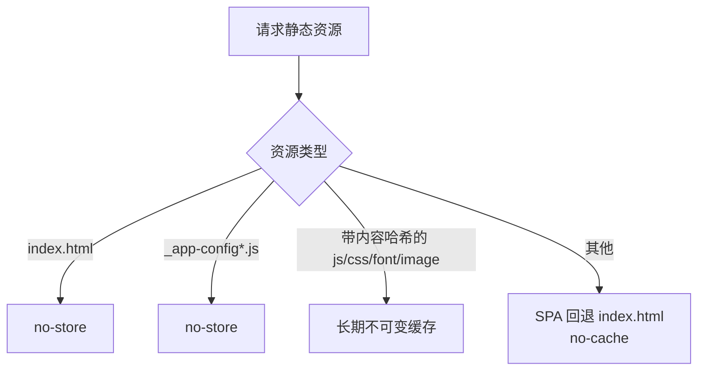
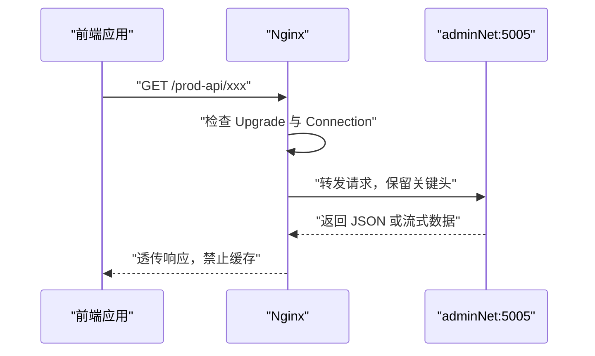
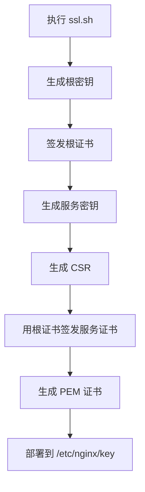
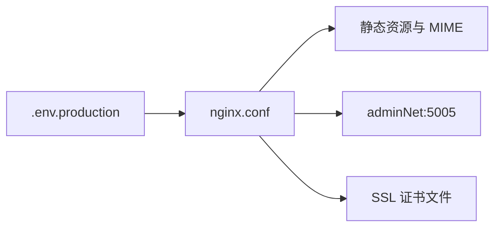

# Web 服务器配置

<cite>
**本文引用的文件**
- [docker/nginx/conf/nginx.conf](file://docker/nginx/conf/nginx.conf)
- [Web/scripts/deploy/nginx.conf](file://Web/scripts/deploy/nginx.conf)
- [docker/nginx/key/ssl.sh](file://docker/nginx/key/ssl.sh)
- [Web/apps/web-antdv-next/.env.production](file://Web/apps/web-antdv-next/.env.production)
</cite>

## 目录
1. [简介](#简介)
2. [项目结构](#项目结构)
3. [核心组件](#核心组件)
4. [架构总览](#架构总览)
5. [详细组件分析](#详细组件分析)
6. [依赖关系分析](#依赖关系分析)
7. [性能与优化](#性能与优化)
8. [故障排查](#故障排查)
9. [结论](#结论)

## 简介
本仓库包含两套 Nginx Web 服务器配置：用于生产容器环境的 `docker/nginx/conf/nginx.conf`，以及面向部署脚本的 `Web/scripts/deploy/nginx.conf`。两者均实现静态资源托管、API 反向代理、WebSocket 支持、前端缓存策略和调度面板路由；生产版本还启用 HTTPS 与安全协议相关设置。后端 Admin.NET 服务通过 Docker 网络名称 `adminNet:5005` 被 Nginx 代理。

## 项目结构
Nginx 配置位于以下位置：
- 生产环境：`docker/nginx/conf/nginx.conf`
- 部署脚本参考：`Web/scripts/deploy/nginx.conf`
- SSL 证书生成脚本：`docker/nginx/key/ssl.sh`
- 前端构建产物与运行时 API 路径约定由 `Web/apps/web-antdv-next/.env.production` 定义。

**图表来源**
- [docker/nginx/conf/nginx.conf:1-91](file://docker/nginx/conf/nginx.conf#L1-L91)
- [Web/scripts/deploy/nginx.conf:1-71](file://Web/scripts/deploy/nginx.conf#L1-L71)

**章节来源**
- [docker/nginx/conf/nginx.conf:1-91](file://docker/nginx/conf/nginx.conf#L1-L91)
- [Web/scripts/deploy/nginx.conf:1-71](file://Web/scripts/deploy/nginx.conf#L1-L71)

## 核心组件
- 全局事件与进程模型：`worker_processes`、`events.worker_connections`。
- HTTP 基础能力：`sendfile`、`keepalive_timeout`、MIME 类型、默认响应类型。
- Gzip 压缩：开启开关、最小长度、缓冲、HTTP 版本、压缩等级、MIME 类型、协商与禁用条件。
- WebSocket 升级映射：基于 `$http_upgrade` 的 `map` 块。
- 静态资源缓存策略：入口 HTML、运行时配置、内容哈希构建产物、兜底 SPA 路由。
- API 反向代理：`/prod-api` 到 `adminNet:5005`，关闭缓冲与缓存，设置读写超时。
- 调度面板路由：`/schedule` 独立代理，保留资源、API 与事件流。
- HTTPS：监听 443、证书路径、会话缓存、安全协议版本（见下文说明）。

**章节来源**
- [docker/nginx/conf/nginx.conf:1-91](file://docker/nginx/conf/nginx.conf#L1-L91)
- [Web/scripts/deploy/nginx.conf:1-71](file://Web/scripts/deploy/nginx.conf#L1-L71)

## 架构总览
下图展示请求从浏览器进入 Nginx 后的分流逻辑：HTML 与运行时配置不缓存，构建产物长期缓存，所有 `/prod-api` 与 `/schedule` 请求转发到后端服务，并支持 WebSocket 长连接。

**图表来源**
- [docker/nginx/conf/nginx.conf:23-91](file://docker/nginx/conf/nginx.conf#L23-L91)
- [Web/scripts/deploy/nginx.conf:10-71](file://Web/scripts/deploy/nginx.conf#L10-L71)

## 详细组件分析

### 全局与事件配置
- `worker_processes 1`：使用单工作进程，适合开发、测试与轻量部署；生产可结合 CPU 核数调整。
- `events.worker_connections 1024`：每个 worker 最大并发连接数。
- `http.sendfile on`：启用零拷贝发送静态文件，提升磁盘 I/O 效率。
- `http.keepalive_timeout 65`：保持连接存活时间，减少 TCP 握手开销。
- `include mime.types`、`default_type application/octet-stream`：声明 MIME 类型与默认类型。

这些参数构成 Nginx 的基础吞吐能力与内存占用基线。

**章节来源**
- [docker/nginx/conf/nginx.conf:1-12](file://docker/nginx/conf/nginx.conf#L1-L12)

### Gzip 压缩策略
当前配置启用了 Gzip，并通过多类参数控制压缩行为：
- `gzip on`：启用压缩。
- `gzip_min_length 1k`：小于 1KB 的内容不压缩，避免小响应被压缩消耗 CPU。
- `gzip_buffers 16 64K`：为压缩分配 16 个、每块 64KB 的缓冲区，适合较大文本响应。
- `gzip_http_version 1.1`：仅对 HTTP/1.1 请求进行压缩。
- `gzip_comp_level 5`：中等压缩等级，平衡 CPU 与带宽。
- `gzip_types`：指定可压缩的 MIME 类型，包括文本、JavaScript、CSS 与 XML。
- `gzip_vary on`：向下游缓存添加 Vary 头，避免不同编码响应被错误缓存。
- `gzip_proxied expired no-cache no-store private auth`：允许对多种上游响应状态进行压缩。
- `gzip_disable "MSIE [1-6]\."`：对旧版 IE 禁用压缩。

该策略适合现代浏览器与一般后台管理应用；若前端已自行压缩，可在网关层评估是否关闭或降低等级。

**图表来源**
- [docker/nginx/conf/nginx.conf:14-22](file://docker/nginx/conf/nginx.conf#L14-L22)

**章节来源**
- [docker/nginx/conf/nginx.conf:14-22](file://docker/nginx/conf/nginx.conf#L14-L22)

### HTTPS 与 TLS 安全配置
生产配置同时监听 80 与 443，并在 443 上启用 SSL：
- `listen 443 ssl` 与 `listen 80`：同时提供 HTTP 与 HTTPS 入口。
- `ssl_certificate` 与 `ssl_certificate_key`：指向 `/etc/nginx/key/abc.admin.com.pem` 与 `.key`。
- `ssl_session_cache shared:SSL:1m`：启用共享 SSL 会话缓存，减少握手成本。
- 未显式声明 `ssl_protocols` 与 `ssl_ciphers`：Nginx 将使用其编译时默认值；生产建议显式限定 TLS 版本，例如仅启用较新版本，并限制弱加密套件。

证书文件由 `ssl.sh` 生成，供挂载到容器的 `/etc/nginx/key` 目录使用。

**图表来源**
- [docker/nginx/conf/nginx.conf:24-36](file://docker/nginx/conf/nginx.conf#L24-L36)
- [docker/nginx/key/ssl.sh:1-13](file://docker/nginx/key/ssl.sh#L1-L13)

**章节来源**
- [docker/nginx/conf/nginx.conf:24-36](file://docker/nginx/conf/nginx.conf#L24-L36)
- [docker/nginx/key/ssl.sh:1-13](file://docker/nginx/key/ssl.sh#L1-L13)

### 前端静态资源缓存策略
Nginx 根据路径与文件名特征实施差异化缓存：
- `/index.html`：强制 `Cache-Control: no-store`，确保每次获取最新入口。
- `/ _app-config*.js`：运行时配置文件，强制 `no-store`，便于部署后动态更新配置。
- 构建产物：匹配 `assets/js/css/fonts` 下包含至少 8 位内容哈希的文件，设置 `public, max-age=31536000, immutable`，实现长期缓存。
- 其他路径：使用 `try_files` 回退到 `index.html`，并添加 `no-cache`，适用于 SPA 路由。

前端环境变量 `VITE_GLOB_API_URL=/prod-api` 表明业务接口统一走 `/prod-api`，与 Nginx 反向代理路径一致。

**图表来源**
- [docker/nginx/conf/nginx.conf:38-56](file://docker/nginx/conf/nginx.conf#L38-L56)
- [Web/scripts/deploy/nginx.conf:17-37](file://Web/scripts/deploy/nginx.conf#L17-L37)
- [Web/apps/web-antdv-next/.env.production:4-6](file://Web/apps/web-antdv-next/.env.production#L4-L6)

**章节来源**
- [docker/nginx/conf/nginx.conf:38-56](file://docker/nginx/conf/nginx.conf#L38-L56)
- [Web/scripts/deploy/nginx.conf:17-37](file://Web/scripts/deploy/nginx.conf#L17-L37)
- [Web/apps/web-antdv-next/.env.production:4-6](file://Web/apps/web-antdv-next/.env.production#L4-L6)

### API 反向代理与 WebSocket 支持
`/prod-api` 被精确代理到 `adminNet:5005`：
- `proxy_pass http://adminNet:5005/`：移除 `/prod-api` 前缀后转发。
- `proxy_http_version 1.1`：启用 HTTP/1.1，满足 WebSocket 要求。
- 头部透传：Host、X-Real-IP、X-Forwarded-For、X-Forwarded-Proto。
- WebSocket 升级：通过 `Upgrade` 与 `Connection $connection_upgrade` 传递升级信号。
- 缓冲与缓存：`proxy_buffering off`、`proxy_cache off`，适合实时数据与流式响应。
- 超时：读超时与写超时均为 3600 秒，适配长时间任务或实时推送。
- 响应头：强制 `no-store`，防止中间缓存污染 API 响应。

**图表来源**
- [docker/nginx/conf/nginx.conf:58-76](file://docker/nginx/conf/nginx.conf#L58-L76)
- [Web/scripts/deploy/nginx.conf:39-57](file://Web/scripts/deploy/nginx.conf#L39-L57)

**章节来源**
- [docker/nginx/conf/nginx.conf:58-76](file://docker/nginx/conf/nginx.conf#L58-L76)
- [Web/scripts/deploy/nginx.conf:39-57](file://Web/scripts/deploy/nginx.conf#L39-L57)

### Sundial.Dashboard 调度面板路由
`/schedule` 作为独立根路径代理到后端：
- `proxy_pass http://adminNet:5005`：不追加尾部斜杠，保留原路径。
- 头部与连接：透传 Host、X-Real-IP、X-Forwarded-For、X-Forwarded-Proto；Connection 设置为空字符串以兼容某些服务端实现。
- 实时特性：关闭缓冲与缓存，设置较长读取超时，确保事件流稳定。
- 响应头：同样使用 `no-store`，避免调度面板状态被缓存。

该路由使调度面板拥有独立访问入口，同时复用同一后端服务。

**章节来源**
- [docker/nginx/conf/nginx.conf:78-90](file://docker/nginx/conf/nginx.conf#L78-L90)
- [Web/scripts/deploy/nginx.conf:59-70](file://Web/scripts/deploy/nginx.conf#L59-L70)

### SSL 证书生成与 CSR 管理
`ssl.sh` 提供本地自签 CA 与服务证书的完整流程：
- 生成根密钥 `admin.com.key` 与自签根证书 `admin.com.crt`。
- 生成服务密钥 `abc.admin.com.key` 与服务证书请求 `abc.admin.com.csr`。
- 使用根证书签发服务证书 `abc.admin.com.crt`，并通过扩展字段绑定多个 IP 与域名。
- 生成 PEM 格式证书 `admin.com.pem` 与服务端 PEM 证书 `abc.admin.com.pem`，有效期更长，便于测试环境长期使用。

生产使用时应替换为可信 CA 颁发的证书，并妥善管理私钥与过期时间。

**图表来源**
- [docker/nginx/key/ssl.sh:1-13](file://docker/nginx/key/ssl.sh#L1-L13)

**章节来源**
- [docker/nginx/key/ssl.sh:1-13](file://docker/nginx/key/ssl.sh#L1-L13)

### 负载均衡与健康检查
当前配置未定义 upstream 或多后端节点，因此不存在原生负载均衡与主动健康检查。若需扩展，可考虑：
- 使用 `upstream` 定义多个 `adminNet` 实例。
- 配合第三方模块或外部健康检查服务实现主动探测。
- 在 Nginx Plus 场景中使用内置健康检查，或在开源版本中通过 Lua/第三方模块补充。

本节为概念性扩展建议，不涉及当前源码变更。

### 访问日志与错误日志
当前配置未显式配置 `access_log` 与 `error_log`，Nginx 将使用默认日志路径与级别。生产建议：
- 显式配置 `access_log` 与 `error_log`，区分业务访问与异常。
- 使用自定义日志格式记录上游地址、请求耗时与状态码。
- 结合容器日志收集系统集中归档。

本节为通用运维建议，不涉及当前源码变更。

## 依赖关系分析
Nginx 配置依赖以下运行时要素：
- 文件系统：`mime.types`、静态资源根目录 `/usr/share/nginx/html`、SSL 证书文件。
- 网络：`adminNet:5005` 后端服务可达。
- 前端构建产物：内容哈希命名规则与运行时配置文件命名约定。
- 环境变量：`VITE_GLOB_API_URL` 决定前端 API 基础路径。

**图表来源**
- [docker/nginx/conf/nginx.conf:1-91](file://docker/nginx/conf/nginx.conf#L1-L91)
- [Web/apps/web-antdv-next/.env.production:4-6](file://Web/apps/web-antdv-next/.env.production#L4-L6)

**章节来源**
- [docker/nginx/conf/nginx.conf:1-91](file://docker/nginx/conf/nginx.conf#L1-L91)
- [Web/apps/web-antdv-next/.env.production:4-6](file://Web/apps/web-antdv-next/.env.production#L4-L6)

## 性能与优化
- 进程与连接：`worker_processes` 与 `worker_connections` 应根据 CPU 核数与并发需求调优。
- 静态文件传输：`sendfile on` 已启用，适合大体积静态资源。
- 连接复用：`keepalive_timeout 65` 有助于减少重复握手。
- 压缩：Gzip 已启用，可根据实际响应体大小与 CPU 负载调整等级与类型。
- 缓存：构建产物长期缓存可降低带宽与后端压力；入口与运行时配置禁用缓存保证更新及时。
- 代理：关闭缓冲与缓存适合实时数据，但会增加后端压力，应结合后端限流与连接池优化。

本节为通用优化指导，不涉及具体源码行级分析。

## 故障排查
- 无法加载 index.html：确认静态根目录是否存在，且入口未被缓存策略拦截。
- 运行时配置未更新：确认 `_app-config*.js` 未被 CDN 或浏览器缓存，必要时清理缓存或验证 `no-store`。
- 构建资源 404：检查文件名是否包含足够长度的内容哈希，且匹配正则规则。
- WebSocket 断开：确认 `Upgrade` 与 `Connection` 头部是否正确透传，并检查后端服务是否支持相应协议。
- HTTPS 握手失败：检查证书路径、私钥权限与证书有效期，必要时重新运行 `ssl.sh` 或使用可信证书。
- 代理超时：检查 `proxy_read_timeout` 与 `proxy_send_timeout` 是否满足长任务需求，并观察后端处理耗时。

**章节来源**
- [docker/nginx/conf/nginx.conf:24-90](file://docker/nginx/conf/nginx.conf#L24-L90)
- [Web/scripts/deploy/nginx.conf:10-70](file://Web/scripts/deploy/nginx.conf#L10-L70)

## 结论
当前 Nginx 配置提供了清晰的静态资源托管、API 反向代理与调度面板路由，并通过 Gzip、连接复用与构建产物长期缓存实现基础性能优化。生产环境还需关注 TLS 协议版本、加密套件、日志采集、负载均衡与健康检查等扩展项。建议在真实 PostgreSQL 与后端服务联调基础上，逐步完善监控与容量规划。