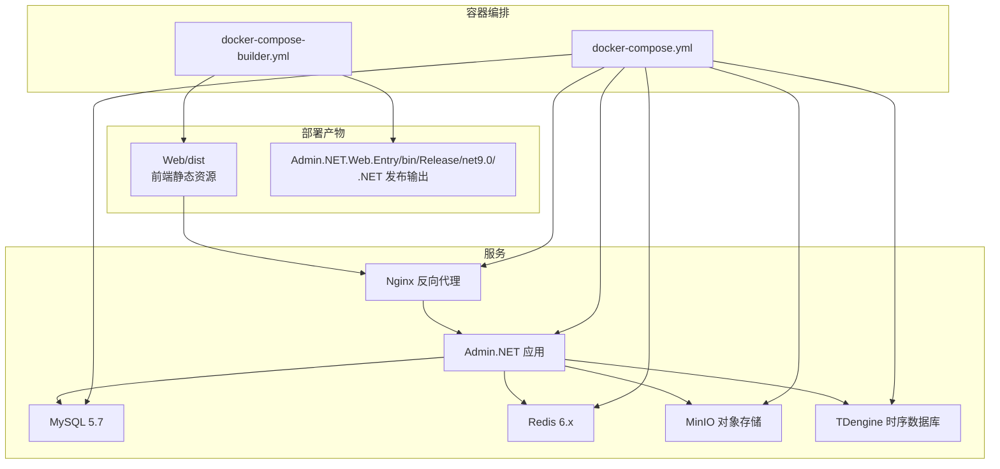
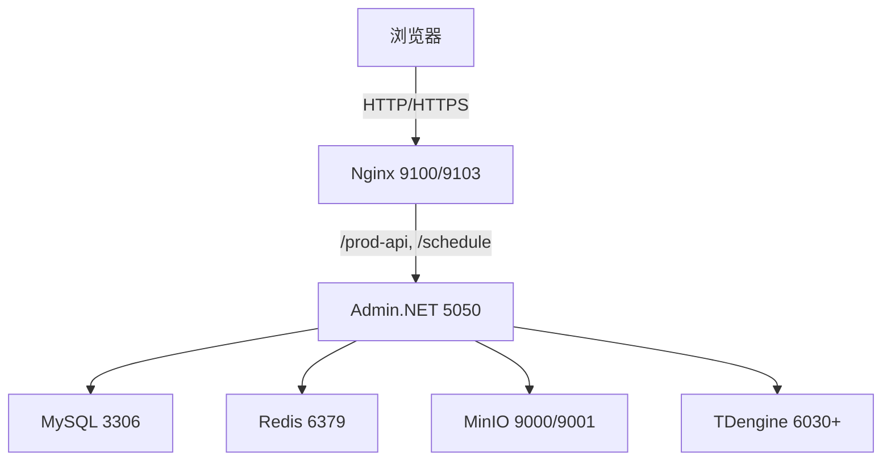
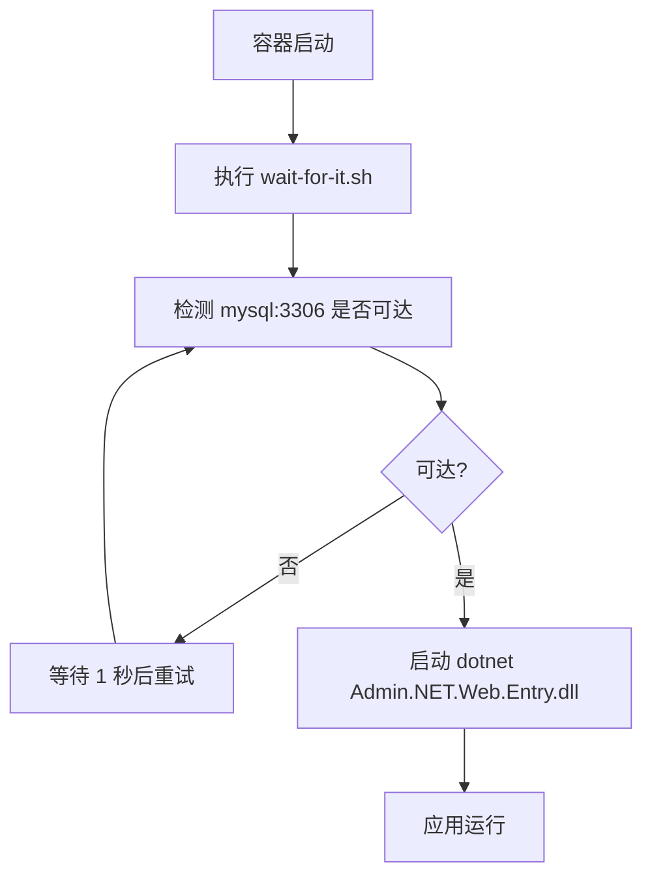
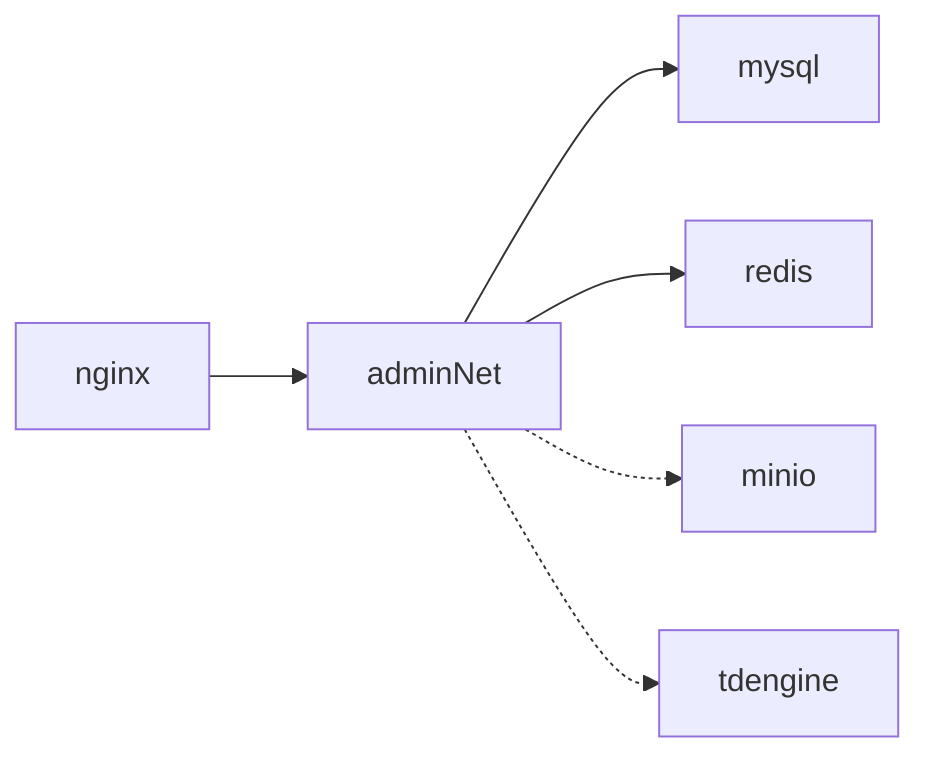

# 容器化部署

<cite>
**本文引用的文件**   
- [docker-compose.yml](file://docker/docker-compose.yml)
- [docker-compose-builder.yml](file://docker/docker-compose-builder.yml)
- [Dockerfile](file://Admin.NET/Admin.NET.Web.Entry/Dockerfile)
- [wait-for-it.sh](file://docker/app/wait-for-it.sh)
- [mysql.cnf](file://docker/mysql/mysql.cnf)
- [redis.conf](file://docker/redis/redis.conf)
- [nginx.conf](file://docker/nginx/conf/nginx.conf)
- [appsettings.json](file://Admin.NET/Admin.NET.Web.Entry/appsettings.json)
- [Program.cs](file://Admin.NET/Admin.NET.Web.Entry/Program.cs)
- [launchSettings.json](file://Admin.NET/Admin.NET.Web.Entry/Properties/launchSettings.json)
- [global.json](file://Admin.NET/global.json)
</cite>

## 目录
1. [简介](#简介)
2. [项目结构](#项目结构)
3. [核心组件](#核心组件)
4. [架构总览](#架构总览)
5. [详细组件分析](#详细组件分析)
6. [依赖关系分析](#依赖关系分析)
7. [性能与资源](#性能与资源)
8. [故障排查指南](#故障排查指南)
9. [结论](#结论)

## 简介
本文面向在本地或服务器上使用 Docker 和 docker-compose 部署 Admin.NET 的团队，覆盖以下内容：
- .NET ASP.NET Core 运行时镜像、端口暴露、语言环境与阿里云镜像源。
- docker-compose 服务编排：adminNet、MySQL、Redis、Nginx、MinIO、TDengine。
- Node.js 22 与 .NET SDK 9.0 的前后端构建容器。
- wait-for-it.sh 启动依赖等待机制。
- 容器网络、数据持久化、日志收集与故障恢复最佳实践。
- 常见问题定位：端口冲突、权限、资源限制、性能调优。

## 项目结构
本仓库的容器化配置集中在 `docker` 目录，应用运行入口在 `Admin.NET/Admin.NET.Web.Entry`，前端静态资源由 Web 构建产物提供。

**图表来源**
- [docker-compose.yml:1-110](file://docker/docker-compose.yml#L1-L110)
- [docker-compose-builder.yml:1-21](file://docker/docker-compose-builder.yml#L1-L21)

**章节来源**
- [docker-compose.yml:1-110](file://docker/docker-compose.yml#L1-L110)
- [docker-compose-builder.yml:1-21](file://docker/docker-compose-builder.yml#L1-L21)

## 核心组件
本节说明各容器的职责、镜像版本、端口映射、环境变量、数据卷挂载和关键行为。

### Nginx 反向代理
- 镜像版本：`nginx:1.20.2`
- 端口映射：
  - 宿主 `9100` → 容器 `80`
  - 宿主 `9103` → 容器 `443`
- 环境变量：时区 `Asia/Shanghai`
- 数据卷：
  - `../Web/dist` 挂载到 `/usr/share/nginx/html`
  - `./nginx/conf/nginx.conf` 以只读方式覆盖默认配置
  - `./nginx/key` 挂载证书私钥目录
- 转发规则要点：
  - `/prod-api/` 转发到 `adminNet:5005`
  - `/schedule` 转发到 `adminNet:5005`
  - 支持 WebSocket 升级头
  - 开启 gzip 压缩，并区分静态资源缓存策略

**章节来源**
- [docker-compose.yml:3-13](file://docker/docker-compose.yml#L3-L13)
- [nginx.conf:1-91](file://docker/nginx/conf/nginx.conf#L1-L91)

### MySQL 5.7
- 镜像版本：`mysql:5.7`
- 端口映射：宿主 `9101` → 容器 `3306`
- 特权模式：启用 `privileged`
- 系统限制：`nproc`、`nofile`
- 环境变量：
  - `MYSQL_ROOT_HOST=%`
  - `MYSQL_DATABASE=admin`
  - `MYSQL_ROOT_PASSWORD=root`
  - `TZ=Asia/Shanghai`
- 数据卷：
  - `./mysql/mysql` 挂载到 `/var/lib/mysql`
  - `./mysql/mysql.cnf` 挂载为 MySQL 配置
- 健康检查：当前被注释；建议在生产启用 TCP 探测

**章节来源**
- [docker-compose.yml:14-33](file://docker/docker-compose.yml#L14-L33)
- [mysql.cnf:1-51](file://docker/mysql/mysql.cnf#L1-L51)

### Redis
- 镜像版本：`redis:latest`（注释中建议使用固定版本如 `redis:6.2.7`）
- 端口映射：宿主 `6379` → 容器 `6379`
- 配置文件：`./redis/redis.conf`
- 数据卷：
  - `./redis/data` 挂载为数据目录
  - `./redis/logs` 挂载日志目录
- 密码：`REDIS_PASSWORD=123456`
- 持久化：RDB 与 AOF 同时启用

**章节来源**
- [docker-compose.yml:34-51](file://docker/docker-compose.yml#L34-L51)
- [redis.conf:1-15](file://docker/redis/redis.conf#L1-L15)

### MinIO 对象存储
- 镜像版本：`minio/minio:RELEASE.2025-04-22T22-12-26Z`
- 端口映射：
  - 宿主 `9104` → 容器 `9000`
  - 宿主 `9105` → 容器 `9001`
- 环境变量：
  - `MINIO_ROOT_USER=admin`
  - `MINIO_ROOT_PASSWORD=admin123456`
- 数据卷：
  - `./minio/data` 挂载数据
  - `./minio/config` 挂载配置
- 命令：以 `/data` 作为数据存储根目录，控制台监听 `:9001`

**章节来源**
- [docker-compose.yml:52-67](file://docker/docker-compose.yml#L52-L67)

### TDengine 时序数据库
- 镜像版本：`tdengine/tdengine:3.3.6.13`
- 特权模式：启用 `privileged`
- 主机名：`tdengine`
- 环境变量：
  - `TAOS_FQDN=tdengine`
  - `TAOS_FIRST_EP=tdengine`
  - `TAOS_SECOND_EP=tdengine`
- 数据卷：
  - `./tdengine/taos/dnode/data` 挂载数据
  - `./tdengine/taos/dnode/log` 挂载日志
- 端口映射：
  - `6030:6030`
  - `6041:6041`
  - `6044-6049:6044-6049`
  - `6044-6045:6044-6045/udp`
  - `6060:6060`

**章节来源**
- [docker-compose.yml:68-95](file://docker/docker-compose.yml#L68-L95)

### Admin.NET 应用
- 运行时镜像：`mcr.microsoft.com/dotnet/aspnet:9.0`
- 端口映射：宿主 `9102` → 容器 `5050`
- 工作目录：`/app`
- 环境变量：时区 `Asia/Shanghai`
- 数据卷：
  - `../Admin.NET/Admin.NET.Web.Entry/bin/Release/net9.0/` 挂载发布目录
  - `./app/Configuration/` 挂载运行时配置目录
  - `./app/wait-for-it.sh` 挂载启动等待脚本
- 启动命令：先等待 `mysql:3306` 就绪，再执行 `dotnet Admin.NET.Web.Entry.dll --content-root /app/wwwroot`
- 依赖顺序：`depends_on` MySQL 与 Redis

**章节来源**
- [docker-compose.yml:96-110](file://docker/docker-compose.yml#L96-L110)
- [wait-for-it.sh:1-182](file://docker/app/wait-for-it.sh#L1-L182)

## 架构总览
下图展示浏览器通过 Nginx 访问 Admin.NET，再由应用连接 MySQL、Redis、MinIO 与 TDengine 的整体流程。

**图表来源**
- [docker-compose.yml:3-110](file://docker/docker-compose.yml#L3-L110)
- [nginx.conf:1-91](file://docker/nginx/conf/nginx.conf#L1-L91)

## 详细组件分析

### Dockerfile 中的 .NET 运行时配置
仓库中存在一个 `.NET 6` 的 `Dockerfile`，其关键设计如下：
- 基础镜像：`mcr.microsoft.com/dotnet/aspnet:6.0`
- 暴露端口：`5005`
- 工作目录：`/app`
- 语言环境：`LANG zh-Hans`
- 阿里云镜像源：将 Debian 包源替换为阿里云镜像源
- 安装工具：更新包管理器并安装 `procps`
- 入口程序：`dotnet Admin.NET.Web.Entry.dll`

需要注意：
- 该 `Dockerfile` 使用 .NET 6，而当前 docker-compose 中的 adminNet 服务使用 `dotnet/aspnet:9.0`，两者不应混用。
- 若基于此 `Dockerfile` 构建镜像，需确保发布输出包含 `Admin.NET.Web.Entry.dll`，且端口与 Kestrel 实际监听端口一致。

**章节来源**
- [Dockerfile:1-18](file://Admin.NET/Admin.NET.Web.Entry/Dockerfile#L1-L18)

### 应用端口与 Kestrel 配置
- 开发启动配置监听 `http://localhost:5005`
- docker-compose 中 adminNet 映射宿主 `9102` 到容器 `5050`
- Nginx 将 `/prod-api` 与 `/schedule` 转发到 `adminNet:5005`
- Program.cs 中设置 Kestrel：
  - KeepAlive 超时
  - 请求头超时
  - 最大请求体大小设为 null

因此，容器内应用应以 `5050` 对外提供服务；如果修改了 Kestrel 监听地址，需要同步调整 Nginx 转发目标与 docker-compose 端口映射。

**章节来源**
- [launchSettings.json:1-32](file://Admin.NET/Admin.NET.Web.Entry/Properties/launchSettings.json#L1-L32)
- [docker-compose.yml:96-110](file://docker/docker-compose.yml#L96-L110)
- [nginx.conf:1-91](file://docker/nginx/conf/nginx.conf#L1-L91)
- [Program.cs:1-38](file://Admin.NET/Admin.NET.Web.Entry/Program.cs#L1-L38)

### 运行时配置扫描
应用通过 Furion 框架加载配置：
- `appsettings.json` 中声明扫描目录包括 `Configuration` 与当前目录
- docker-compose 中将 `./app/Configuration/` 挂载到 `/app/Configuration/`
- 生产环境可通过该目录注入运行时配置，避免重新构建镜像

**章节来源**
- [appsettings.json:1-5](file://Admin.NET/Admin.NET.Web.Entry/appsettings.json#L1-L5)
- [docker-compose.yml:96-110](file://docker/docker-compose.yml#L96-L110)

### 启动依赖等待机制
adminNet 服务的启动命令使用 `wait-for-it.sh`：
- 参数：`mysql:3306 -t 120`
- 含义：最多等待 120 秒，直到 MySQL 容器 `mysql:3306` 可连接
- 成功后执行：`dotnet Admin.NET.Web.Entry.dll --content-root /app/wwwroot`
- 失败时：脚本报告超时并返回非零退出码

脚本内部实现要点：
- 支持 `-h`、`-p`、`--host`、`--port`、`-t`、`--timeout`、`-s`、`--quiet`
- 优先尝试 `nc -z`，回退到 Bash 的 `/dev/tcp`
- 支持 busybox 兼容逻辑
- 支持子进程模式和严格模式

**图表来源**
- [docker-compose.yml:96-110](file://docker/docker-compose.yml#L96-L110)
- [wait-for-it.sh:1-182](file://docker/app/wait-for-it.sh#L1-L182)

**章节来源**
- [docker-compose.yml:96-110](file://docker/docker-compose.yml#L96-L110)
- [wait-for-it.sh:1-182](file://docker/app/wait-for-it.sh#L1-L182)

### 构建容器配置
`docker-compose-builder.yml` 提供前后端构建容器：

#### 前端构建容器
- 镜像：`node:22-alpine`
- 工作目录：`/app`
- 挂载：`../Web/` 到 `/app`
- 环境变量：`.env.production` 挂载、`NODE_ENV=development`
- 命令：安装依赖并执行构建，使用 npm 淘宝镜像源

#### 后端构建容器
- 镜像：`mcr.microsoft.com/dotnet/sdk:9.0`
- 工作目录：`/app`
- 挂载：`../Admin.NET/` 到 `/app`
- 命令：`dotnet build Admin.NET.sln -c Release`

注意：
- 当前全局测试配置仅选择 `Microsoft.Testing.Platform`，不能据此声称已固定 .NET SDK 版本。
- 构建容器负责生成发布产物；运行时容器应使用发布后的二进制，而不是源码目录。

**章节来源**
- [docker-compose-builder.yml:1-21](file://docker/docker-compose-builder.yml#L1-L21)
- [global.json:1-5](file://Admin.NET/global.json#L1-L5)

## 依赖关系分析
compose 中服务依赖关系如下：
- Nginx 通过 `links` 指向 `adminNet`
- adminNet 通过 `depends_on` 依赖 `mysql` 和 `redis`
- 应用实际还依赖 MinIO 与 TDengine，但 compose 未声明显式依赖，建议按业务需要补充健康检查或启动等待逻辑

**图表来源**
- [docker-compose.yml:3-110](file://docker/docker-compose.yml#L3-L110)

**章节来源**
- [docker-compose.yml:3-110](file://docker/docker-compose.yml#L3-L110)

## 性能与资源
### MySQL 配置要点
- 字符集：`utf8`
- 二进制日志：开启，同步策略为每次事务提交
- 连接数：`max_connections=1000`
- InnoDB：缓冲池 `512M`，日志文件 `256M`，读写线程各 `4`
- 查询相关：临时表、堆表、排序、连接等缓冲区按中等负载配置
- 安全：关闭符号链接、外部锁定、名称解析

### Redis 配置要点
- 绑定 `0.0.0.0`，关闭保护模式
- RDB：多档触发条件
- AOF：每秒同步
- 密码：`requirepass 123456`

### Nginx 优化要点
- gzip 开启并针对常见静态类型
- WebSocket 升级头透传
- 上传接口增加超时时间
- 静态资源按内容哈希长期缓存，入口页不缓存

### 运行时与端口
- 应用 Kestrel 关闭最大请求体大小限制
- 开发端口为 `5005`
- 容器端口映射为宿主 `9102` 到容器 `5050`

**章节来源**
- [mysql.cnf:1-51](file://docker/mysql/mysql.cnf#L1-L51)
- [redis.conf:1-15](file://docker/redis/redis.conf#L1-L15)
- [nginx.conf:1-91](file://docker/nginx/conf/nginx.conf#L1-L91)
- [Program.cs:1-38](file://Admin.NET/Admin.NET.Web.Entry/Program.cs#L1-L38)
- [launchSettings.json:1-32](file://Admin.NET/Admin.NET.Web.Entry/Properties/launchSettings.json#L1-L32)
- [docker-compose.yml:96-110](file://docker/docker-compose.yml#L96-L110)

## 故障排查指南

### 端口冲突
- 现象：容器无法启动或端口占用报错
- 排查：
  - 确认宿主机未占用 `9100`、`9103`、`9101`、`6379`、`9104`、`9105`、`9102`、`6030`、`6041`、`6044-6049`、`6044-6045`、`6060`
  - 检查多个 compose 项目是否重复映射相同端口
- 解决：修改 `docker-compose.yml` 中对应端口映射

**章节来源**
- [docker-compose.yml:3-110](file://docker/docker-compose.yml#L3-L110)

### 应用无法连接数据库
- 现象：应用启动后立即退出，或启动成功但首次请求报数据库错误
- 排查：
  - 检查 `wait-for-it.sh` 是否成功等待 `mysql:3306`
  - 查看 MySQL 容器日志和端口连通性
  - 确认数据库名 `admin`、用户名 `root`、密码 `root` 正确
- 解决：
  - 延长超时时间或优化 MySQL 启动速度
  - 修正环境变量或挂载配置

**章节来源**
- [docker-compose.yml:96-110](file://docker/docker-compose.yml#L96-L110)
- [docker-compose.yml:14-33](file://docker/docker-compose.yml#L14-L33)
- [wait-for-it.sh:1-182](file://docker/app/wait-for-it.sh#L1-L182)

### 权限问题
- 现象：MySQL 或 MinIO 数据目录写入失败
- 排查：
  - 检查宿主机挂载目录权限
  - 确认 `privileged` 模式是否必要
- 解决：
  - 调整宿主机目录所有者和权限
  - 对仅需特权能力的服务保留 `privileged`，其他服务尽量避免

**章节来源**
- [docker-compose.yml:14-33](file://docker/docker-compose.yml#L14-L33)
- [docker-compose.yml:68-95](file://docker/docker-compose.yml#L68-L95)

### Redis 密码与连接失败
- 现象：应用连接 Redis 时报认证失败
- 排查：
  - 确认 Redis 配置中 `requirepass` 值
  - 确认应用侧 Redis 连接字符串是否匹配
- 解决：统一密码并在应用配置中同步

**章节来源**
- [redis.conf:1-15](file://docker/redis/redis.conf#L1-L15)
- [docker-compose.yml:34-51](file://docker/docker-compose.yml#L34-L51)

### Nginx 证书缺失
- 现象：HTTPS 访问失败，Nginx 启动报错
- 排查：
  - 检查 `./nginx/key/abc.admin.com.pem` 和 `./nginx/key/abc.admin.com.key` 是否存在
  - 检查证书路径与文件名是否与 Nginx 配置一致
- 解决：放置有效证书文件或改用 HTTP 调试

**章节来源**
- [docker-compose.yml:3-13](file://docker/docker-compose.yml#L3-L13)
- [nginx.conf:1-91](file://docker/nginx/conf/nginx.conf#L1-L91)

### 资源限制与性能调优
- MySQL：
  - 根据内存容量调整 `innodb_buffer_pool_size`
  - 控制 `max_connections` 与应用连接池规模
- Redis：
  - 根据内存调整 RDB/AOF 触发条件
  - 关注 `appendfsync` 策略对延迟的影响
- Nginx：
  - 根据并发量调整 `worker_processes` 与 `worker_connections`
  - 合理设置 gzip 级别与缓存策略
- Admin.NET：
  - 监控 Kestrel 超时和上传大小
  - 结合上游反向代理调整超时

**章节来源**
- [mysql.cnf:1-51](file://docker/mysql/mysql.cnf#L1-L51)
- [redis.conf:1-15](file://docker/redis/redis.conf#L1-L15)
- [nginx.conf:1-91](file://docker/nginx/conf/nginx.conf#L1-L91)
- [Program.cs:1-38](file://Admin.NET/Admin.NET.Web.Entry/Program.cs#L1-L38)

### 日志收集与可观测性
- 建议：
  - 使用 Docker 日志驱动或集中日志方案收集容器标准输出
  - 将 Nginx、MySQL、Redis、MinIO、TDengine 的日志目录持久化
  - 为应用配置结构化日志，便于检索和分析
- 注意：
  - 不要将敏感信息直接写入日志
  - 对大日志文件进行轮转和保留策略管理

[本节为通用运维建议，不直接分析具体代码文件]

### 容器网络与服务发现
- 同一 compose 文件中服务可通过服务名互相访问
- 当前 Nginx 使用 `links` 引用 `adminNet`
- 建议：
  - 统一使用 compose 自定义网络
  - 为依赖服务添加健康检查，替代 `links`
  - 对 MinIO、TDengine 等强依赖补充启动等待或重试逻辑

**章节来源**
- [docker-compose.yml:3-110](file://docker/docker-compose.yml#L3-L110)

## 结论
当前容器化方案通过 docker-compose 统一管理 Nginx、Admin.NET、MySQL、Redis、MinIO 与 TDengine，并使用 `wait-for-it.sh` 保证应用在数据库可用后再启动。运行时采用 .NET ASP.NET Core 9.0 镜像，前端静态资源由 Nginx 托管，API 通过 `/prod-api` 和 `/schedule` 反向代理到应用。

生产部署建议：
- 固定所有第三方服务镜像版本，避免 `latest` 引入不可控变更
- 为所有服务添加健康检查，并将依赖关系从 `links` 升级为健康检查驱动
- 完善 MinIO 与 TDengine 的启动等待逻辑
- 将敏感配置放入环境变量或密钥管理系统
- 明确区分构建容器与运行时容器，避免源码直接参与运行
- 建立日志、指标、告警与备份恢复机制