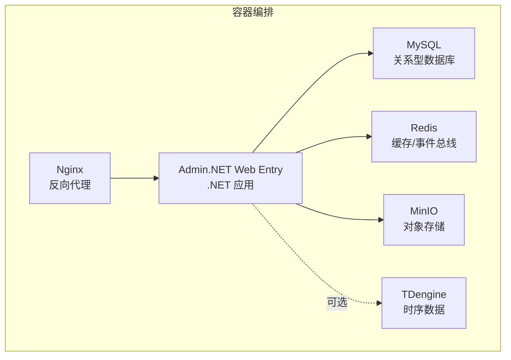
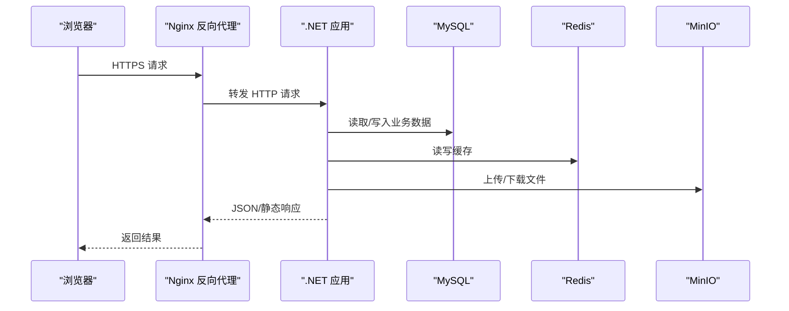
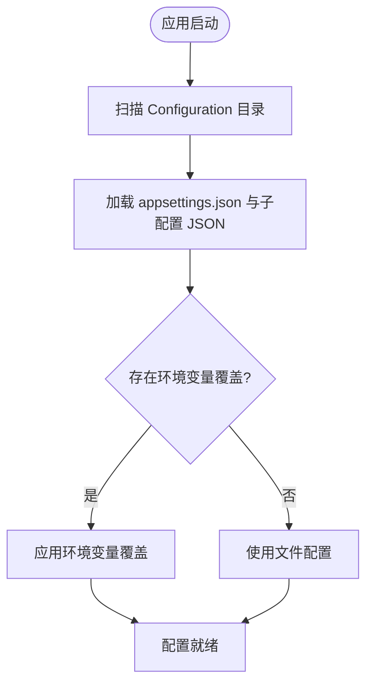
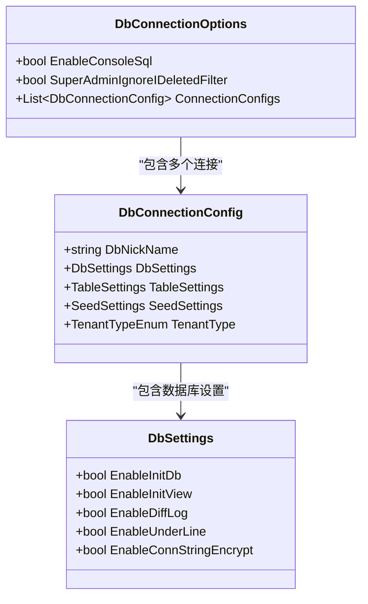
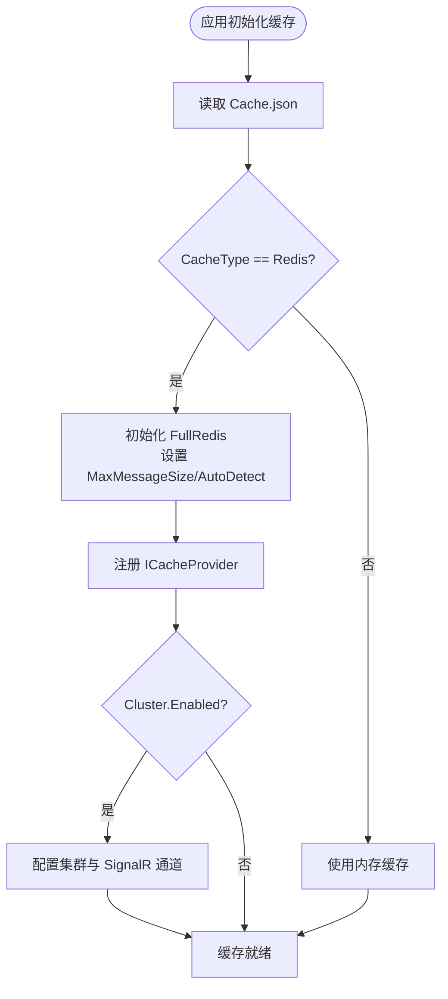
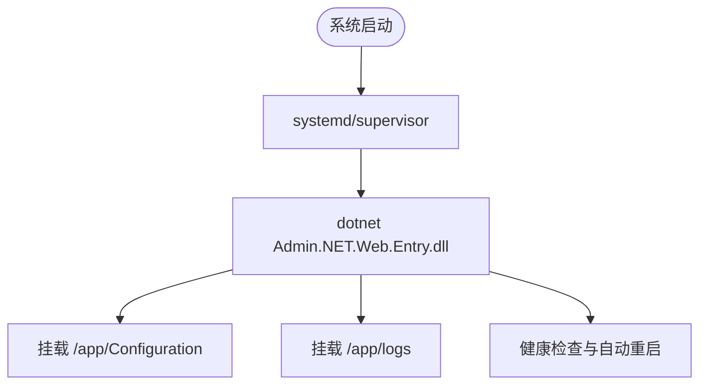
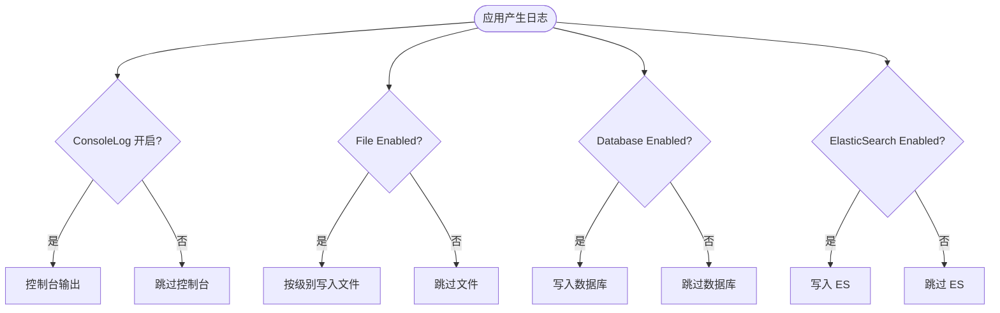
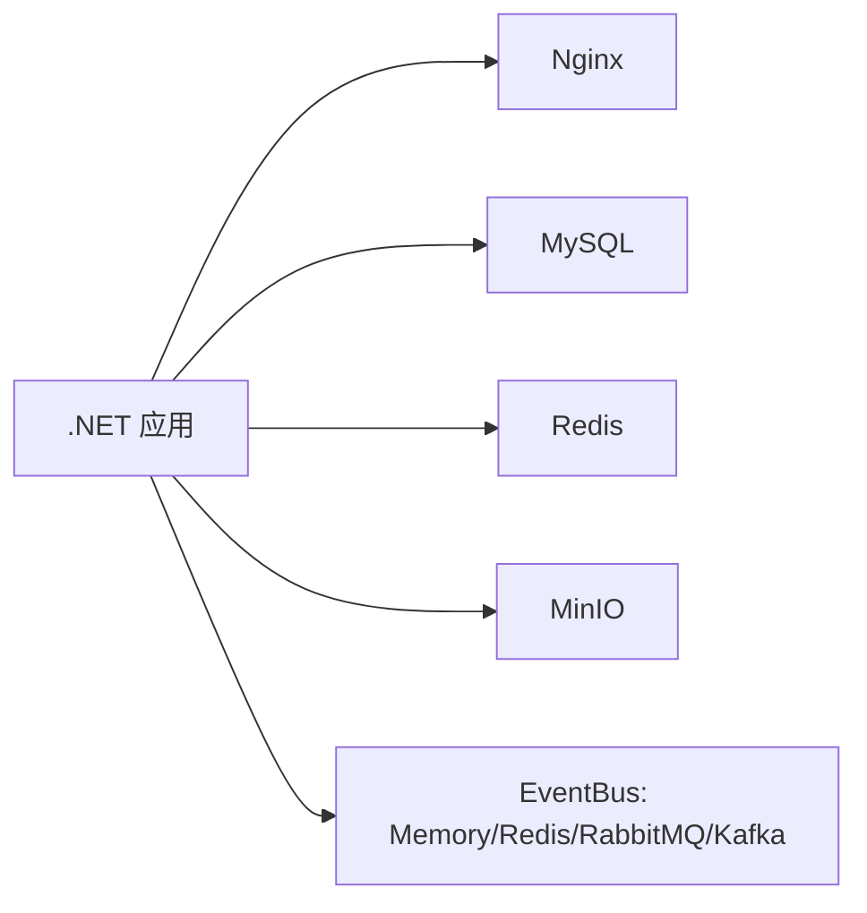

# 生产环境部署

<cite>
**本文引用的文件**   
- [Admin.NET.Web.Entry.csproj](file://Admin.NET/Admin.NET.Web.Entry/Admin.NET.Web.Entry.csproj)
- [Program.cs](file://Admin.NET/Admin.NET.Web.Entry/Program.cs)
- [web.config](file://Admin.NET/Admin.NET.Web.Entry/web.config)
- [appsettings.json](file://Admin.NET/Admin.NET.Web.Entry/appsettings.json)
- [appsettings.Development.json](file://Admin.NET/Admin.NET.Web.Entry/appsettings.Development.json)
- [Dockerfile](file://Admin.NET/Admin.NET.Web.Entry/Dockerfile)
- [global.json](file://Admin.NET/global.json)
- [docker-compose.yml](file://docker/docker-compose.yml)
- [Logging.json](file://Admin.NET/Admin.NET.Application/Configuration/Logging.json)
- [Cache.json](file://Admin.NET/Admin.NET.Application/Configuration/Cache.json)
- [EventBus.json](file://Admin.NET/Admin.NET.Application/Configuration/EventBus.json)
- [Upload.json](file://Admin.NET/Admin.NET.Application/Configuration/Upload.json)
- [Limit.json](file://Admin.NET/Admin.NET.Application/Configuration/Limit.json)
- [DbConnectionOptions.cs](file://Admin.NET/Admin.NET.Core/Option/DbConnectionOptions.cs)
- [CacheOptions.cs](file://Admin.NET/Admin.NET.Core/Option/CacheOptions.cs)
- [LoggingSetup.cs](file://Admin.NET/Admin.NET.Core/Logging/LoggingSetup.cs)
- [CacheSetup.cs](file://Admin.NET/Admin.NET.Core/Cache/CacheSetup.cs)
- [SqlSugarSetup.cs](file://Admin.NET/Admin.NET.Core/SqlSugar/SqlSugarSetup.cs)
</cite>

## 目录
1. [简介](#简介)
2. [项目结构](#项目结构)
3. [核心组件](#核心组件)
4. [架构总览](#架构总览)
5. [详细组件分析](#详细组件分析)
6. [依赖分析](#依赖分析)
7. [性能与容量规划](#性能与容量规划)
8. [故障排查指南](#故障排查指南)
9. [结论](#结论)

## 简介
本指南面向生产环境，提供从开发到生产的完整迁移路径。重点覆盖：
- 应用程序配置管理：`appsettings.json` 与 `docker/docker/app/Configuration/*.json` 的分离策略，以及环境变量注入方式。
- 数据库连接：主从复制、连接池、SSL 与超时配置。
- 缓存层：Redis 单机/集群、密码认证、持久化与内存优化。
- 进程管理与守护进程：建议使用 systemd 或 supervisor 托管 .NET 应用。
- 日志收集：应用日志、访问日志、错误日志分级输出与集中管理。
- 安全加固：防火墙、用户隔离、敏感信息加密与环境变量管理。
- 备份恢复：数据库定期备份、配置文件版本控制与灾难恢复流程。
- 监控告警：性能指标、资源使用与阈值告警。
- 扩容缩容：水平多实例与垂直资源调整建议。

## 项目结构
当前仓库包含后端 .NET Web 入口、通用能力模块、前端工程以及 Docker Compose 编排。生产部署主要关注以下部分：
- 后端入口程序：`Admin.NET.Admin.NET.Web.Entry`，目标框架为 `net10.0`，使用 Furion 启动。
- 应用配置：通过 `appsettings.json` 指定扫描 `Configuration` 目录，业务配置集中在 `Admin.NET/Admin.NET.Application/Configuration/*.json`。
- 运行时编排：`docker/docker-compose.yml` 定义 Nginx、MySQL、Redis、MinIO、TDengine 与后端服务。
- 容器镜像：`Admin.NET/Admin.NET.Web.Entry/Dockerfile` 暴露端口并运行发布产物。

**图示来源**
- [docker-compose.yml](file://docker/docker-compose.yml)

**章节来源**
- [Admin.NET.Web.Entry.csproj:1-20](file://Admin.NET/Admin.NET.Web.Entry/Admin.NET.Web.Entry.csproj#L1-L20)
- [appsettings.json:1-5](file://Admin.NET/Admin.NET.Web.Entry/appsettings.json#L1-L5)
- [docker-compose.yml:1-110](file://docker/docker-compose.yml#L1-L110)

## 核心组件
- 应用启动与 Kestrel 配置：在 `Program.cs` 中注册 Windows 服务支持、日志过滤和 Kestrel 限制。
- 配置系统：Furion 通过 `appsettings.json` 扫描 `Configuration` 目录；业务配置位于 `Admin.NET/Application/Configuration` 下多个 JSON 文件。
- 数据库：基于 SqlSugar 的多连接配置，支持连接串加密、表结构初始化、慢查询与错误日志。
- 缓存：支持 Memory 与 Redis；Redis 支持集群自动检测、哨兵模式与 SignalR 通道前缀。
- 日志：控制台、文件、数据库与 ElasticSearch 四种写入目标，支持字段脱敏与 JSON 格式。
- 限流：IP 与客户端维度限流、黑名单与白名单规则。
- 文件上传：本地、MinIO、SSH 与多 OSS 提供者。

**章节来源**
- [Program.cs:1-38](file://Admin.NET/Admin.NET.Web.Entry/Program.cs#L1-L38)
- [appsettings.json:1-5](file://Admin.NET/Admin.NET.Web.Entry/appsettings.json#L1-L5)
- [Logging.json:1-50](file://Admin.NET/Admin.NET.Application/Configuration/Logging.json#L1-L50)
- [Cache.json:1-38](file://Admin.NET/Admin.NET.Application/Configuration/Cache.json#L1-L38)
- [Limit.json:1-107](file://Admin.NET/Admin.NET.Application/Configuration/Limit.json#L1-L107)
- [Upload.json:1-33](file://Admin.NET/Admin.NET.Application/Configuration/Upload.json#L1-L33)

## 架构总览
下图展示生产环境下请求从浏览器经 Nginx 到达 .NET 应用，再访问 MySQL、Redis、MinIO 等外部依赖的路径。

**图示来源**
- [docker-compose.yml](file://docker/docker-compose.yml)

**章节来源**
- [docker-compose.yml:1-110](file://docker/docker-compose.yml#L1-L110)

## 详细组件分析

### 配置管理：appsettings 与 docker/app/Configuration 分离策略
- 应用根配置：`appsettings.json` 仅声明配置扫描目录 `Configuration`，不包含具体业务参数。
- 业务配置：所有业务相关配置位于 `Admin.NET/Admin.NET.Application/Configuration/*.json`，例如日志、缓存、事件总线、上传、限流等。
- 部署时挂载：`docker-compose.yml` 将宿主机的 `docker/docker/app/Configuration/` 映射到容器 `/app/Configuration/`，实现配置与代码分离。
- 环境变量注入：Kestrel 与 .NET 配置系统天然支持环境变量覆盖；建议在容器编排中通过环境变量注入敏感信息（如数据库密码、Redis 密码、密钥）。

**图示来源**
- [appsettings.json:1-5](file://Admin.NET/Admin.NET.Web.Entry/appsettings.json#L1-L5)
- [docker-compose.yml](file://docker/docker-compose.yml)

**章节来源**
- [appsettings.json:1-5](file://Admin.NET/Admin.NET.Web.Entry/appsettings.json#L1-L5)
- [appsettings.Development.json:1-5](file://Admin.NET/Admin.NET.Web.Entry/appsettings.Development.json#L1-L5)
- [docker-compose.yml:80-110](file://docker/docker-compose.yml#L80-L110)

### 数据库连接配置：主从、连接池、SSL 与超时
- 多连接模型：通过 `DbConnectionOptions.ConnectionConfigs` 配置多个数据库连接，支持主库、从库与业务库。
- 连接串加密：可启用 `EnableConnStringEncrypt`，由 `CryptogramUtil.Decrypt` 解密后再建立连接。
- 超时与慢查询：SQL 命令默认超时 30 秒；执行时间超过 5 秒会记录慢查询警告。
- SSL 与连接池：
  - 若底层数据库驱动支持，可在连接字符串中附加 SSL 参数（例如 `SslMode=Required;TrustServerCertificate=false`），并在服务器端启用 TLS。
  - SqlSugar 默认按连接数复用，可通过连接字符串与驱动参数调优连接池大小与空闲超时。
- 主从复制：
  - 写操作走主库，读操作可通过多个只读连接进行扩展；注意事务必须绑定主库连接。
  - 确保主从延迟可控，避免读不到最新数据。

**图示来源**
- [DbConnectionOptions.cs](file://Admin.NET/Admin.NET.Core/Option/DbConnectionOptions.cs)
- [SqlSugarSetup.cs](file://Admin.NET/Admin.NET.Core/SqlSugar/SqlSugarSetup.cs)

**章节来源**
- [DbConnectionOptions.cs:1-136](file://Admin.NET/Admin.NET.Core/Option/DbConnectionOptions.cs#L1-L136)
- [SqlSugarSetup.cs:1-200](file://Admin.NET/Admin.NET.Core/SqlSugar/SqlSugarSetup.cs#L1-L200)

### 缓存层配置：Redis 集群、密码、持久化与内存优化
- 缓存类型：`Cache.CacheType` 支持 `Memory` 与 `Redis`；未配置 Redis 时自动降级为内存缓存。
- Redis 连接：
  - 连接字符串包含服务器地址、密码、数据库编号；最大消息大小通过 `MaxMessageSize` 控制。
  - `AutoDetect` 控制是否自动检测集群节点；阿里云 Redis 代理模式需关闭自动检测。
- 集群与哨兵：
  - 通过 `Cluster.Enabled` 启用集群；SignalR 通过独立的 Redis 连接字符串配置频道前缀。
  - 哨兵模式通过 `StackExchangeSentinelConfig` 配置主库名称、密码、哨兵地址与服务名。
- 持久化与内存优化：
  - Redis 持久化策略由外部 `redis.conf` 或容器命令决定；生产建议启用 AOF 与 RDB 组合。
  - 根据业务数据大小调整 maxmemory、maxmemory-policy 与过期策略。

**图示来源**
- [Cache.json:1-38](file://Admin.NET/Admin.NET.Application/Configuration/Cache.json#L1-L38)
- [CacheSetup.cs:1-43](file://Admin.NET/Admin.NET.Core/Cache/CacheSetup.cs#L1-L43)
- [CacheOptions.cs:1-142](file://Admin.NET/Admin.NET.Core/Option/CacheOptions.cs#L1-L142)

**章节来源**
- [Cache.json:1-38](file://Admin.NET/Admin.NET.Application/Configuration/Cache.json#L1-L38)
- [CacheSetup.cs:1-43](file://Admin.NET/Admin.NET.Core/Cache/CacheSetup.cs#L1-L43)
- [CacheOptions.cs:1-142](file://Admin.NET/Admin.NET.Core/Option/CacheOptions.cs#L1-L142)

### 进程管理与守护进程：systemd 与 supervisor
- 推荐方案：
  - Linux：使用 systemd 管理 .NET 进程，设置重启策略、用户隔离、资源限制与标准输出重定向。
  - Windows：可使用 Windows 服务（已集成 `UseWindowsService()`）或 supervisor 类工具。
- 关键要点：
  - 工作目录指向发布目录，挂载 `Configuration` 与 `logs` 目录。
  - 设置 `TZ`、`.NET` 环境变量与安全上下文。
  - 配合 Nginx 反向代理与 HTTPS 证书。

[此图为概念流程，不直接映射具体源码，故无“图示来源”]

### 日志收集：应用、访问与错误日志分级输出
- 日志目标：
  - 控制台：可通过 `Logging.Monitor.ConsoleLog` 控制。
  - 文件：按级别分文件，保留数量与文件大小上限可配置。
  - 数据库：将业务日志写入数据库表。
  - ElasticSearch：可选开启 ES 写入，支持 Basic、ApiKey、Base64ApiKey 认证与证书指纹。
- 字段脱敏：内置忽略属性列表，自动过滤密码、令牌等敏感字段。
- 访问日志：建议由 Nginx 输出访问日志至统一日志目录，并由日志采集器（如 Filebeat/Fluent Bit）汇总到 ELK/ES。

**图示来源**
- [Logging.json:1-50](file://Admin.NET/Admin.NET.Application/Configuration/Logging.json#L1-L50)
- [LoggingSetup.cs:1-104](file://Admin.NET/Admin.NET.Core/Logging/LoggingSetup.cs#L1-L104)

**章节来源**
- [Logging.json:1-50](file://Admin.NET/Admin.NET.Application/Configuration/Logging.json#L1-L50)
- [LoggingSetup.cs:1-104](file://Admin.NET/Admin.NET.Core/Logging/LoggingSetup.cs#L1-L104)

### 安全加固：防火墙、权限隔离、敏感信息与变量管理
- 防火墙：
  - 仅开放必要端口（如 80/443），禁止数据库、Redis、MinIO 对外暴露。
  - 使用网络 ACL 或云安全组隔离各组件。
- 用户隔离：
  - 为 .NET 应用创建专用低权限用户，最小化文件系统与进程权限。
  - 容器内以非 root 用户运行，并通过只读挂载减少写风险。
- 敏感信息管理：
  - 不在配置文件中硬编码密钥；使用环境变量或密钥管理服务注入。
  - 数据库连接串可启用加密后存储，启动时解密。
  - 对上传文件、临时目录做权限隔离与审计。

[本节为通用安全实践，不直接分析具体文件，故无“章节来源”]

### 备份恢复：数据库、配置文件与灾难恢复
- 数据库备份：
  - 定时逻辑外置（cron/任务调度），导出 SQL 或使用云厂商备份能力。
  - 备份文件加密并异地存放，保留策略按合规要求设定。
- 配置文件版本控制：
  - `Configuration` 目录纳入版本控制模板，但排除敏感值；实际值通过 CI/CD 或密钥平台注入。
- 灾难恢复：
  - 制定恢复演练计划，包括数据库回滚、缓存清空、对象存储校验与应用重启顺序。
  - 明确 RTO/RPO 目标，准备冷备与热备切换流程。

[本节为通用运维实践，不直接分析具体文件，故无“章节来源”]

## 依赖分析
- 应用依赖：
  - Nginx：反向代理与静态资源托管。
  - MySQL：关系型数据存储。
  - Redis：缓存与事件总线（可选 RabbitMQ/Kafka）。
  - MinIO：对象存储（可选）。
  - TDengine：时序数据（可选）。
- 配置依赖：
  - `appsettings.json` 扫描 `Configuration` 目录。
  - 业务配置来自 `Admin.NET/Application/Configuration/*.json`。
  - 环境变量可覆盖配置项。

**图示来源**
- [docker-compose.yml](file://docker/docker-compose.yml)
- [EventBus.json:1-16](file://Admin.NET/Admin.NET.Application/Configuration/EventBus.json#L1-L16)

**章节来源**
- [docker-compose.yml:1-110](file://docker/docker-compose.yml#L1-L110)
- [EventBus.json:1-16](file://Admin.NET/Admin.NET.Application/Configuration/EventBus.json#L1-L16)

## 性能与容量规划
- 应用层：
  - Kestrel 超时：保持请求头与 KeepAlive 超时合理，避免长连接占用过多资源。
  - 上传大小：取消默认限制，结合业务需求与反向代理设置。
- 数据库层：
  - 主从分离：写主读从，提升读吞吐；监控主从延迟。
  - 连接池：根据并发量与 CPU/内存调优连接池大小与超时。
  - SSL：生产环境强制 TLS，关闭明文传输。
- 缓存层：
  - Redis：根据热点数据调整内存上限与淘汰策略；大对象注意消息大小限制。
  - 集群：多节点扩展读能力，注意分区键设计。
- 日志层：
  - 文件滚动与级别控制，避免磁盘打满；ES 写入按需开启。
- 资源规划：
  - 垂直扩展：增加 CPU/内存，调整 JVM/.NET GC 参数与线程池大小。
  - 水平扩展：多实例部署，通过负载均衡分发请求；会话与状态置于 Redis。

[本节为通用性能建议，不直接分析具体文件，故无“章节来源”]

## 故障排查指南
- 启动失败：
  - 检查容器端口映射、环境变量与挂载路径。
  - 确认 `wait-for-it.sh` 等待 MySQL 就绪成功。
- 数据库连接异常：
  - 验证连接串、用户名/密码、SSL 参数与超时配置。
  - 查看慢查询与错误 SQL 日志。
- 缓存不可用：
  - 核对 Redis 连接串、密码、数据库编号与 `AutoDetect` 设置。
  - 集群模式下检查节点发现与哨兵配置。
- 日志缺失：
  - 检查文件权限与滚动策略；确认 ES 连接与认证。
- 限流误伤：
  - 核对 IP/客户端白名单与规则区间；观察 429 响应。

**章节来源**
- [docker-compose.yml:80-110](file://docker/docker-compose.yml#L80-L110)
- [SqlSugarSetup.cs:1-200](file://Admin.NET/Admin.NET.Core/SqlSugar/SqlSugarSetup.cs#L1-L200)
- [CacheSetup.cs:1-43](file://Admin.NET/Admin.NET.Core/Cache/CacheSetup.cs#L1-L43)
- [LoggingSetup.cs:1-104](file://Admin.NET/Admin.NET.Core/Logging/LoggingSetup.cs#L1-L104)
- [Limit.json:1-107](file://Admin.NET/Admin.NET.Application/Configuration/Limit.json#L1-L107)

## 结论
生产部署应以“配置外置、依赖隔离、安全加固、可观测性完善”为核心原则。通过 `appsettings.json` 扫描 `Configuration` 目录并结合环境变量注入，实现环境与代码解耦；借助 Nginx、MySQL、Redis、MinIO 等组件构建稳定基础设施；利用 systemd/supervisor 保障进程可靠运行；通过文件、数据库与 ES 日志体系实现全面可观测；最后以备份与演练确保灾难恢复能力。在此基础上，逐步推进水平与垂直扩容，持续提升系统稳定性与性能。