# 监控运维

<cite>
**本文引用的文件**   
- [LoggingSetup.cs](file://Admin.NET/Admin.NET.Core/Logging/LoggingSetup.cs)
- [DatabaseLoggingWriter.cs](file://Admin.NET/Admin.NET.Core/Logging/DatabaseLoggingWriter.cs)
- [ElasticSearchLoggingWriter.cs](file://Admin.NET/Admin.NET.Core/Logging/ElasticSearchLoggingWriter.cs)
- [LogDataSanitizer.cs](file://Admin.NET/Admin.NET.Core/Logging/LogDataSanitizer.cs)
- [SysLogOpService.cs](file://Admin.NET/Admin.NET.Core/Service/SuperApiAop.cs)
- [SysLogExService.cs](file://Admin.NET/Admin.NET.Core/Service/SuperApiAop.cs)
- [SysLogVisService.cs](file://Admin.NET/Admin.NET.Core/Service/SuperApiAop.cs)
- [SysLogDiffService.cs](file://Admin.NET/Admin.NET.Core/Service/SuperApiAop.cs)
- [SysLogOp.cs](file://Admin.NET/Admin.NET.Core/Entity/SysLogOp.cs)
- [SysLogEx.cs](file://Admin.NET/Admin.NET.Core/Entity/SysLogEx.cs)
- [SysLogVis.cs](file://Admin.NET/Admin.NET.Core/Entity/SysLogVis.cs)
- [SysLogDiff.cs](file://Admin.NET/Admin.NET.Core/Entity/SysLogDiff.cs)
- [SqlSugarSetup.cs](file://Admin.NET/Admin.NET.Core/SqlSugar/SqlSugarSetup.cs)
- [appsettings.json](file://Admin.NET/Admin.NET.Web.Entry/appsettings.json)
- [Program.cs](file://Admin.NET/Admin.NET.Web.Entry/Program.cs)
- [Dockerfile](file://Admin.NET/Admin.NET.Web.Entry/Dockerfile)
- [docker-compose.yml](file://docker/docker-compose.yml)
- [redis.conf](file://docker/redis/redis.conf)
- [mysql.cnf](file://docker/mysql/mysql.cnf)
- [RuntimeMonitor.cs](file://Admin.NET/Admin.NET.Core/Utils/Runtime/RuntimeMonitor.cs)
</cite>

## 目录
1. [引言](#引言)
2. [项目结构与监控范围](#项目结构与监控范围)
3. [内置日志系统架构](#内置日志系统架构)
4. [操作日志与异常日志记录机制](#操作日志与异常日志记录机制)
5. [日志级别、输出目标与安全脱敏](#日志级别输出目标与安全脱敏)
6. [监控系统集成建议](#监控系统集成建议)
7. [性能监控方案](#性能监控方案)
8. [数据库监控](#数据库监控)
9. [缓存监控](#缓存监控)
10. [故障诊断工具与方法](#故障诊断工具与方法)
11. [容量规划与弹性伸缩](#容量规划与弹性伸缩)
12. [常见运维问题排查](#常见运维问题排查)
13. [结论](#结论)

## 引言
本监控运维指南面向 Admin.NET 后端应用，重点说明内置日志系统的架构、操作日志与异常日志的记录机制、存储格式、查询入口，以及如何扩展 Prometheus、Grafana、AlertManager、Elasticsearch、Redis、PostgreSQL 等外部系统进行可观测性建设。文档同时给出性能分析、数据库监控、缓存监控、故障诊断、容量规划与常见问题排查方法，帮助运维人员和开发人员在生产环境中稳定运行和快速定位问题。

## 项目结构与监控范围
当前仓库包含后端 .NET 工程 `Admin.NET`、前端业务应用 `Web/apps/web-antdv-next`、容器编排配置 `docker` 以及若干插件和测试工程。本次监控运维指南聚焦以下范围：
- 后端日志采集、分类、持久化与安全脱敏；
- 数据库实体模型对应的操作日志、异常日志、访问日志和差异日志；
- SqlSugar 数据访问层与日志独立数据库；
- Elasticsearch 日志写入器；
- 运行时监控能力；
- Docker 环境中的 Redis、MySQL、Nginx 与 Web Entry 部署形态；
- 前端业务应用仅作为日志查询页面的使用者，不改变后端日志采集逻辑。

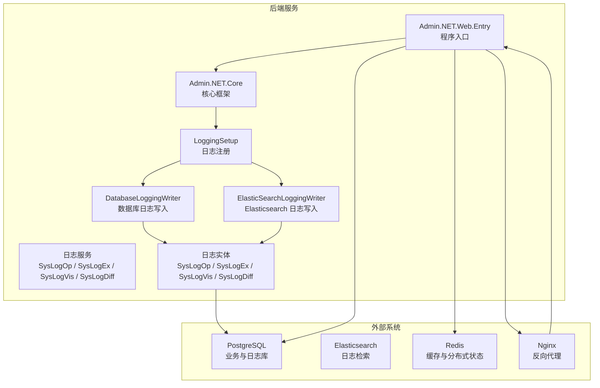

**图表来源**   
- [LoggingSetup.cs:1-104](file://Admin.NET/Admin.NET.Core/Logging/LoggingSetup.cs#L1-L104)
- [DatabaseLoggingWriter.cs:1-200](file://Admin.NET/Admin.NET.Core/Logging/DatabaseLoggingWriter.cs#L1-L200)
- [ElasticSearchLoggingWriter.cs:1-129](file://Admin.NET/Admin.NET.Core/Logging/ElasticSearchLoggingWriter.cs#L1-L129)
- [SqlSugarSetup.cs](file://Admin.NET/Admin.NET.Core/SqlSugar/SqlSugarSetup.cs)

**章节来源**   
- [LoggingSetup.cs:1-104](file://Admin.NET/Admin.NET.Core/Logging/LoggingSetup.cs#L1-L104)
- [Program.cs](file://Admin.NET/Admin.NET.Web.Entry/Program.cs)
- [Dockerfile](file://Admin.NET/Admin.NET.Web.Entry/Dockerfile)
- [docker-compose.yml](file://docker/docker-compose.yml)

## 内置日志系统架构
Admin.NET 的内置日志系统以 `LoggingSetup` 为注册中心，统一接入控制台、文件、Elasticsearch 和数据库四种输出通道。其核心设计要点如下：

- **集中注册**：通过 `AddLoggingSetup` 将监控日志、控制台格式化器、文件日志、Elasticsearch 日志、数据库日志依次注册到依赖注入容器。
- **过滤器控制**：文件日志按 `Information`、`Warning`、`Error` 三个级别分别注册独立写入器；Elasticsearch 和数据库写入器只处理 `CommonConst.SysLogCategoryName` 类别的监控日志。
- **上下文数据**：日志消息携带 `loggingMonitor` 上下文，用于区分普通自定义日志与框架监控日志，并决定后续落库分类。
- **异步批量写入**：数据库写入器对操作日志、异常日志、访问日志分类后并行插入，减少高频写入导致的锁竞争。
- **安全脱敏**：所有持久化日志在返回或写入前经过 `LogDataSanitizer`，对密码、令牌、密钥、连接字符串等敏感字段进行掩码处理。

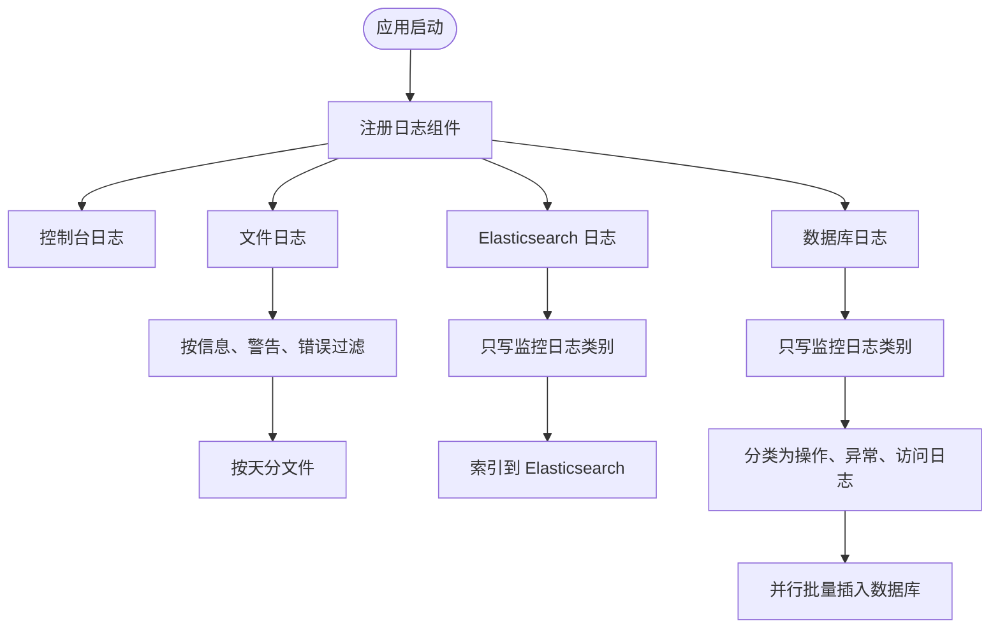

**图表来源**   
- [LoggingSetup.cs:1-104](file://Admin.NET/Admin.NET.Core/Logging/LoggingSetup.cs#L1-L104)

**章节来源**   
- [LoggingSetup.cs:1-104](file://Admin.NET/Admin.NET.Core/Logging/LoggingSetup.cs#L1-L104)
- [LogDataSanitizer.cs:1-98](file://Admin.NET/Admin.NET.Core/Logging/LogDataSanitizer.cs#L1-L98)

## 操作日志与异常日志记录机制

### 日志分类规则
`DatabaseLoggingWriter` 根据日志上下文和异常信息，把日志分为三类：
- **访问日志**：登录、手机登录、退出等动作；
- **操作日志**：常规业务接口调用；
- **异常日志**：存在异常对象或监控数据中声明异常的请求。

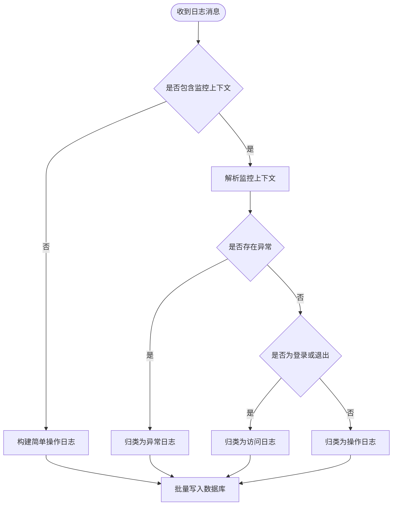

**图表来源**   
- [DatabaseLoggingWriter.cs:1-200](file://Admin.NET/Admin.NET.Core/Logging/DatabaseLoggingWriter.cs#L1-L200)

**章节来源**   
- [DatabaseLoggingWriter.cs:1-200](file://Admin.NET/Admin.NET.Core/Logging/DatabaseLoggingWriter.cs#L1-L200)

### 操作日志实体与字段
操作日志由 `SysLogOp` 表示，主要字段包括控制器名称、操作方法名、显示标题、HTTP 状态码、客户端 IP、地理位置、浏览器、操作系统、执行耗时、请求方法、请求 URL、请求参数、返回结果、事件 ID、线程 ID、追踪 ID、异常信息、消息内容、创建用户、租户等。该实体既可用于数据库表，也可映射到 Elasticsearch 索引。

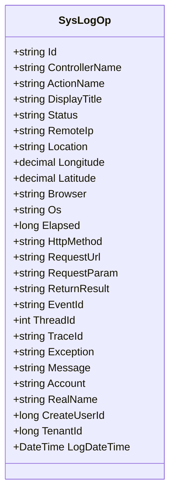

**图表来源**   
- [SysLogOp.cs](file://Admin.NET/Admin.NET.Core/Entity/SysLogOp.cs)

**章节来源**   
- [SysLogOp.cs](file://Admin.NET/Admin.NET.Core/Entity/SysLogOp.cs)
- [ElasticSearchLoggingWriter.cs:1-129](file://Admin.NET/Admin.NET.Core/Logging/ElasticSearchLoggingWriter.cs#L1-L129)

### 异常日志实体与字段
异常日志由 `SysLogEx` 表示，主要用于记录全局异常、业务异常和底层依赖异常。关键字段包括账户、真实姓名、控制器、动作、显示标题、异常详情、消息、请求参数、HTTP 方法、请求 URL、远程 IP、浏览器、追踪 ID、线程 ID、日志时间、日志级别等。

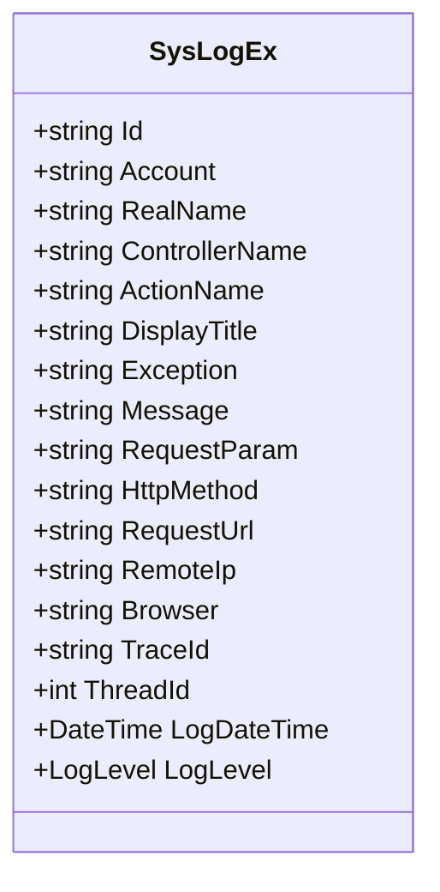

**图表来源**   
- [SysLogEx.cs](file://Admin.NET/Admin.NET.Core/Entity/SysLogEx.cs)

**章节来源**   
- [SysLogEx.cs](file://Admin.NET/Admin.NET.Core/Entity/SysLogEx.cs)

### 访问日志与差异日志
- **访问日志** `SysLogVis`：记录登录、退出等访问行为，便于审计登录来源和设备信息。
- **差异日志** `SysLogDiff`：记录数据变更前后差异，常用于业务审计和版本对比；返回时会被脱敏并丢弃原始 SQL 与参数。

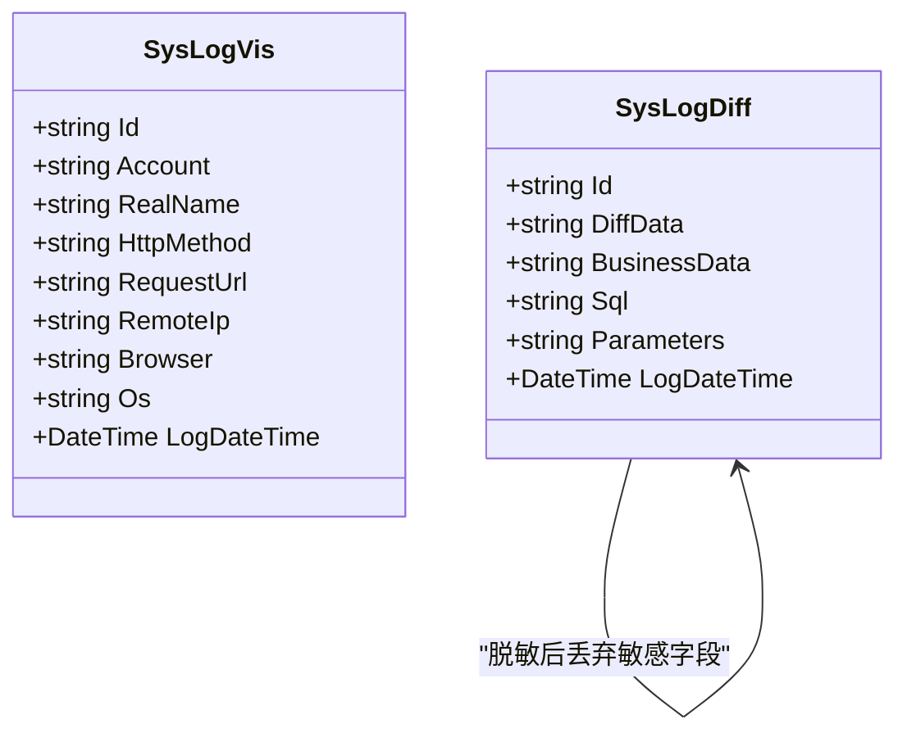

**图表来源**   
- [SysLogVis.cs](file://Admin.NET/Admin.NET.Core/Entity/SysLogVis.cs)
- [SysLogDiff.cs](file://Admin.NET/Admin.NET.Core/Entity/SysLogDiff.cs)
- [LogDataSanitizer.cs:1-98](file://Admin.NET/Admin.NET.Core/Logging/LogDataSanitizer.cs#L1-L98)

**章节来源**   
- [SysLogVis.cs](file://Admin.NET/Admin.NET.Core/Entity/SysLogVis.cs)
- [SysLogDiff.cs](file://Admin.NET/Admin.NET.Core/Entity/SysLogDiff.cs)
- [LogDataSanitizer.cs:1-98](file://Admin.NET/Admin.NET.Core/Logging/LogDataSanitizer.cs#L1-L98)

## 日志级别、输出目标与安全脱敏

### 日志级别策略
- **控制台日志**：默认开启，可通过 `Logging:Monitor:ConsoleLog` 关闭；格式化时间包含日期、星期和时区。
- **文件日志**：默认开启，通过 `Logging:File:Enabled` 控制；按 `Information`、`Warning`、`Error` 分别生成不同文件，文件名带日期和级别；支持备用回滚文件名。
- **Elasticsearch 日志**：通过 `Logging:ElasticSearch:Enabled` 控制；只写入监控日志类别，并使用 JSON 格式。
- **数据库日志**：通过 `Logging:Database:Enabled` 控制；只写入监控日志类别，并将日志消息拼接为文本后落库。

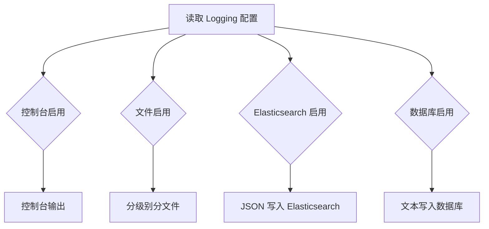

**图表来源**   
- [LoggingSetup.cs:1-104](file://Admin.NET/Admin.NET.Core/Logging/LoggingSetup.cs#L1-L104)

**章节来源**   
- [LoggingSetup.cs:1-104](file://Admin.NET/Admin.NET.Core/Logging/LoggingSetup.cs#L1-L104)

### 安全脱敏机制
`LogDataSanitizer` 对日志内容进行三层保护：
1. 对认证相关字段名进行识别，包括密码、令牌、API Key、SecretKey、Authorization、Cookie、连接字符串等；
2. 对 JSON 结构中的敏感键值进行递归替换；
3. 对 Bearer Token、URL Query 中的 token、password、apiKey 等使用正则替换为 `[redacted]`；
4. 对差异日志返回时移除 SQL 和参数，避免历史明文凭据泄露。

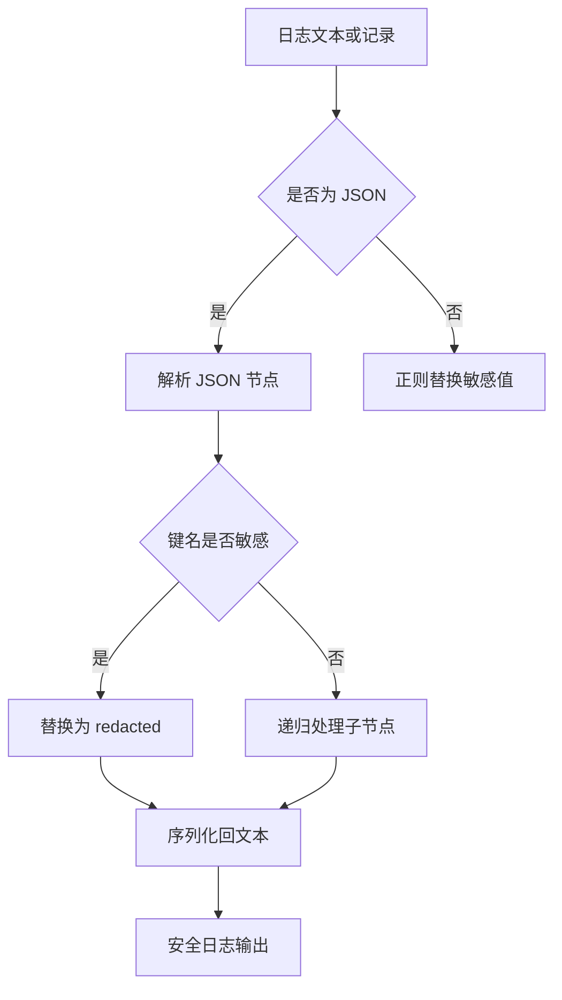

**图表来源**   
- [LogDataSanitizer.cs:1-98](file://Admin.NET/Admin.NET.Core/Logging/LogDataSanitizer.cs#L1-L98)

**章节来源**   
- [LogDataSanitizer.cs:1-98](file://Admin.NET/Admin.NET.Core/Logging/LogDataSanitizer.cs#L1-L98)

## 监控系统集成建议

### Prometheus 指标导出
当前仓库未发现直接暴露 Prometheus `/metrics` 端点的实现。建议采用以下方式扩展：
- 引入 ASP.NET Core Metrics 和 Prometheus.Client 等库，在 `Program.cs` 或 `Startup` 中注册指标收集中间件；
- 将 CPU、内存、请求速率、错误率、数据库连接池、Redis 命中率等指标暴露为标准指标；
- 确保 Prometheus 抓取路径与 Kestrel 端口匹配，并通过 Nginx 或 ServiceMesh 暴露给 Prometheus Server。

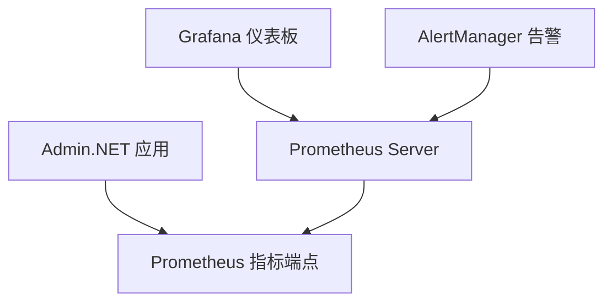

[此图为概念集成图，未直接映射具体源码文件，因此不提供图表来源]

### Grafana 可视化仪表板
建议为以下主题创建仪表板：
- 应用健康：进程存活、启动时长、重启次数；
- 请求质量：QPS、延迟分布、错误率、慢请求；
- 资源使用：CPU、内存、GC、磁盘 I/O、网络 I/O；
- 数据库：连接数、慢查询、事务失败；
- 缓存：命中率、内存、键空间、热点 Key；
- 日志：错误日志趋势、操作日志量、异常 Top API。

### AlertManager 告警规则
建议配置以下告警：
- 应用连续不可用；
- 错误率超过阈值；
- P95/P99 延迟升高；
- 数据库连接池耗尽；
- Redis 内存接近上限；
- 磁盘使用率超过阈值；
- Elasticsearch 集群状态异常。

**章节来源**   
- [Program.cs](file://Admin.NET/Admin.NET.Web.Entry/Program.cs)
- [docker-compose.yml](file://docker/docker-compose.yml)

## 性能监控方案

### 运行时监控
当前仓库提供 `RuntimeMonitor`，用于获取运行时相关信息。运维可基于它扩展 CPU、内存、线程、GC、I/O 等指标，并结合宿主进程监控工具（如 dotnet-counters、dotnet-trace、dotnet-dump）完成深度分析。

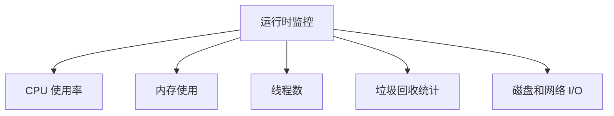

**图表来源**   
- [RuntimeMonitor.cs](file://Admin.NET/Admin.NET.Core/Utils/Runtime/RuntimeMonitor.cs)

**章节来源**   
- [RuntimeMonitor.cs](file://Admin.NET/Admin.NET.Core/Utils/Runtime/RuntimeMonitor.cs)

### 资源指标采集与分析
建议采集以下指标：
- **CPU**：总使用率、用户态/内核态占比、单核峰值；
- **内存**：工作集、托管堆、非托管堆、GC 次数；
- **磁盘 I/O**：读写吞吐、队列长度、延迟；
- **网络 I/O**：收发字节、连接数、重传率；
- **应用指标**：请求耗时、错误率、队列积压、线程阻塞。

分析方法包括：
- 使用 Grafana 展示实时趋势；
- 使用 Prometheus 规则检测突发负载；
- 结合 APM 工具分析热点方法和慢请求；
- 使用压测工具验证扩缩容效果。

## 数据库监控

### 慢查询分析
建议通过以下步骤识别慢查询：
1. 在 PostgreSQL 中启用慢查询日志或查询计划捕获；
2. 定期导出慢查询 SQL 和执行计划；
3. 结合 `SysLogOp.Elapsed` 筛选高耗时接口；
4. 对高频慢查询添加索引或优化 SQL；
5. 建立慢查询告警，避免长期性能退化。

### 连接池状态
关注以下连接池指标：
- 活跃连接数；
- 最大连接数；
- 等待连接数；
- 连接创建和销毁频率；
- 长事务数量。

当连接池接近上限时，应检查：
- 是否存在未释放连接；
- 是否存在长时间事务；
- 是否存在死锁或锁等待；
- 是否需要水平扩容或读写分离。

### 锁等待与性能瓶颈
PostgreSQL 锁等待常见原因包括：
- 大事务未提交；
- 未命中索引导致全表扫描；
- 并发更新同一行；
- 外键约束触发级联更新。

建议使用以下手段定位：
- 查看锁视图和会话状态；
- 结合操作日志中的 HTTP 接口定位业务代码；
- 使用 EXPLAIN ANALYZE 分析执行计划；
- 对热点表做分区或归档。

**章节来源**   
- [SqlSugarSetup.cs](file://Admin.NET/Admin.NET.Core/SqlSugar/SqlSugarSetup.cs)
- [SysLogOp.cs](file://Admin.NET/Admin.NET.Core/Entity/SysLogOp.cs)

## 缓存监控

### Redis 命中率
Redis 命中率是判断缓存有效性的重要指标。建议监控：
- 命中率；
- 命令总数；
- 过期键数量；
- 内存使用；
- 客户端连接数。

若命中率下降，优先排查：
- 缓存失效策略是否合理；
- 热点 Key 是否被频繁删除；
- 业务逻辑是否绕过缓存；
- 是否出现缓存穿透或雪崩。

### 内存使用与键空间分布
关注 Redis 内存增长趋势和键空间分布：
- 大 Key；
- 短命 Key；
- 未设置过期时间的 Key；
- 重复 Key 或命名不规范 Key。

可通过 Redis 监控命令和 AOF/RDB 文件分析辅助定位。

### 热点 Key 分析
热点 Key 会导致 Redis 单节点压力上升。建议：
- 使用 Redis 监控命令或第三方工具识别热点 Key；
- 对热点 Key 做本地缓存或分层缓存；
- 对大 Key 做拆分或异步预热；
- 限制单个 Key 的访问频率。

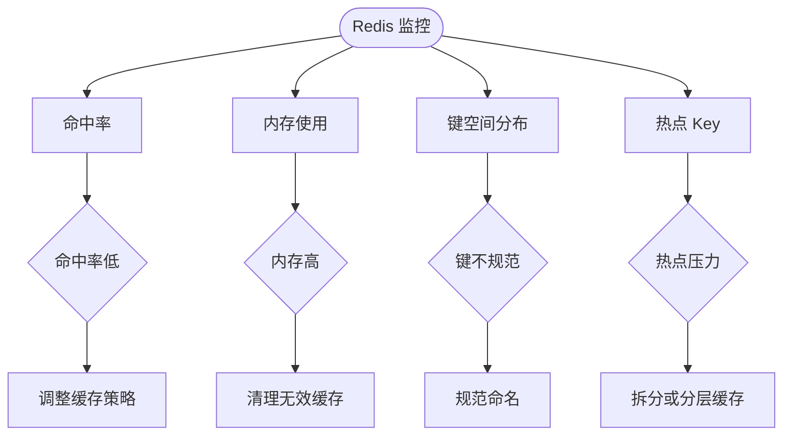

**图表来源**   
- [redis.conf](file://docker/redis/redis.conf)

**章节来源**   
- [redis.conf](file://docker/redis/redis.conf)

## 故障诊断工具与方法

### 日志聚合分析
- **数据库日志**：适合结构化查询、审计追溯和权限控制；
- **Elasticsearch 日志**：适合全文检索、复杂过滤和可视化分析；
- **文件日志**：适合本地快速排查和离线分析；
- **控制台日志**：适合开发调试和容器标准输出收集。

建议在生产环境同时启用 Elasticsearch 和数据库日志，并使用统一查询入口分析错误趋势、Top API 和异常堆栈。

### 链路追踪
日志中已包含 `TraceId`，可用于跨进程、跨组件关联请求。建议在网关、上游服务和下游依赖中传递 TraceId，并在日志、指标和 APM 系统中统一关联。

### 堆栈快照与性能剖析
- 使用 `dotnet-dump` 生成堆转储，分析内存泄漏和对象保留；
- 使用 `dotnet-trace` 采集 CPU 火焰图，定位热点方法；
- 结合 `SysLogOp.Elapsed` 和 `SysLogEx.Exception` 定位慢接口和异常接口；
- 对频繁 GC 的应用分析托管堆和非托管堆分配。

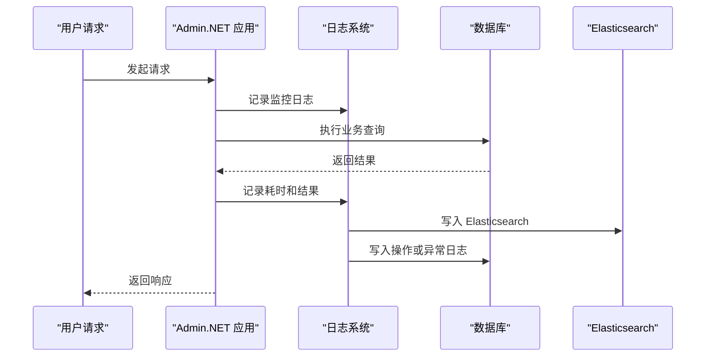

**图表来源**   
- [LoggingSetup.cs:1-104](file://Admin.NET/Admin.NET.Core/Logging/LoggingSetup.cs#L1-L104)
- [DatabaseLoggingWriter.cs:1-200](file://Admin.NET/Admin.NET.Core/Logging/DatabaseLoggingWriter.cs#L1-L200)
- [ElasticSearchLoggingWriter.cs:1-129](file://Admin.NET/Admin.NET.Core/Logging/ElasticSearchLoggingWriter.cs#L1-L129)

**章节来源**   
- [LoggingSetup.cs:1-104](file://Admin.NET/Admin.NET.Core/Logging/LoggingSetup.cs#L1-L104)
- [DatabaseLoggingWriter.cs:1-200](file://Admin.NET/Admin.NET.Core/Logging/DatabaseLoggingWriter.cs#L1-L200)
- [ElasticSearchLoggingWriter.cs:1-129](file://Admin.NET/Admin.NET.Core/Logging/ElasticSearchLoggingWriter.cs#L1-L129)

## 容量规划与弹性伸缩

### 自动扩缩容规则
建议基于以下指标设定扩缩容规则：
- CPU 使用率超过阈值持续一段时间；
- 内存使用率接近上限；
- 请求队列长度增加；
- 数据库连接池饱和；
- Redis 内存或连接数接近上限；
- Elasticsearch 写入延迟升高。

### 负载预测
- 观察历史流量曲线，识别高峰时段；
- 结合促销活动或业务上线计划提前扩容；
- 对冷数据做归档，降低数据库和缓存压力；
- 对热点接口做缓存和降级。

### 资源优化建议
- 合理设置连接池大小；
- 对慢查询加索引；
- 对大响应体做分页和压缩；
- 对非必要日志降低级别；
- 对缓存 Key 设置合理过期时间；
- 对日志做滚动保留和冷热分离。

**章节来源**   
- [docker-compose.yml](file://docker/docker-compose.yml)
- [appsettings.json](file://Admin.NET/Admin.NET.Web.Entry/appsettings.json)

## 常见运维问题排查

### 内存泄漏
排查步骤：
1. 观察进程内存持续增长；
2. 使用 `dotnet-dump` 生成堆转储；
3. 分析托管堆对象类型和引用链；
4. 检查是否有静态集合、事件订阅未释放、缓存未过期；
5. 结合 `SysLogEx` 确认是否伴随异常。

### 死锁
排查步骤：
1. 观察数据库锁等待视图；
2. 查找长事务和未提交事务；
3. 检查事务边界和锁粒度；
4. 调整 SQL 顺序，避免交叉锁；
5. 对热点行做分片或锁升级。

### 网络超时
排查步骤：
1. 检查 Nginx、Kestrel、下游服务的超时配置；
2. 查看 `SysLogOp.Elapsed` 是否持续升高；
3. 检查网络连接数和重试策略；
4. 分析 DNS、负载均衡和健康检查；
5. 结合网络监控确认带宽和丢包。

### 磁盘空间不足
排查步骤：
1. 检查文件系统使用率；
2. 检查日志文件是否滚动；
3. 检查数据库 WAL、备份、临时文件；
4. 清理无用文件或扩大磁盘；
5. 配置日志保留策略和磁盘告警。

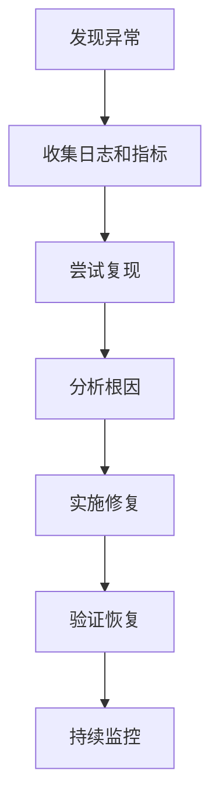

**图表来源**   
- [appsettings.json](file://Admin.NET/Admin.NET.Web.Entry/appsettings.json)
- [mysql.cnf](file://docker/mysql/mysql.cnf)
- [redis.conf](file://docker/redis/redis.conf)

**章节来源**   
- [appsettings.json](file://Admin.NET/Admin.NET.Web.Entry/appsettings.json)
- [mysql.cnf](file://docker/mysql/mysql.cnf)
- [redis.conf](file://docker/redis/redis.conf)

## 结论
Admin.NET 的内置日志系统提供了控制台、文件、Elasticsearch 和数据库四类输出，并以 `SysLogOp`、`SysLogEx`、`SysLogVis`、`SysLogDiff` 为核心实体承载操作、异常、访问和数据变更日志。配合 `LogDataSanitizer` 的安全脱敏机制，可在保障安全的前提下实现可观测性和审计能力。生产环境中建议补充 Prometheus、Grafana、AlertManager 指标体系，完善 Redis、PostgreSQL、Elasticsearch 监控，并结合运行时诊断工具形成完整的监控、分析与应急闭环。