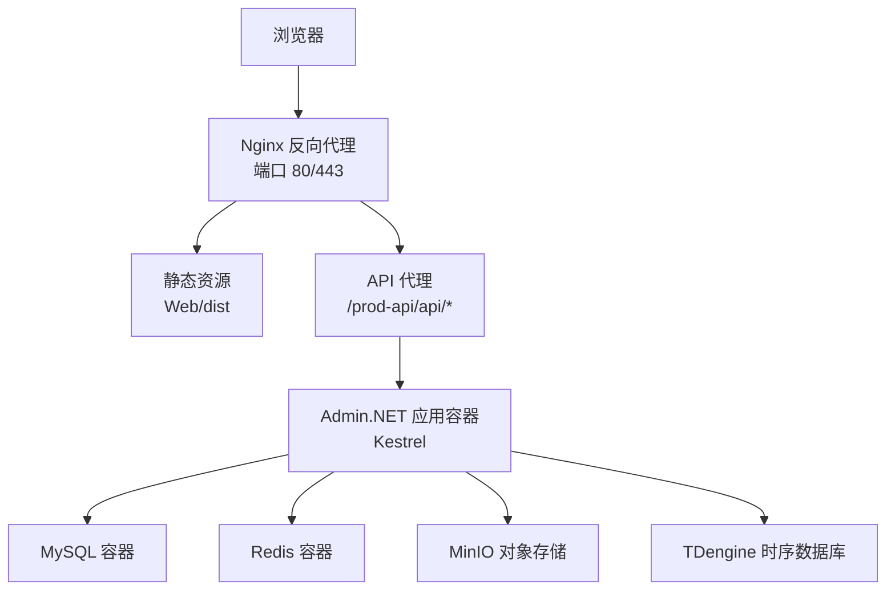
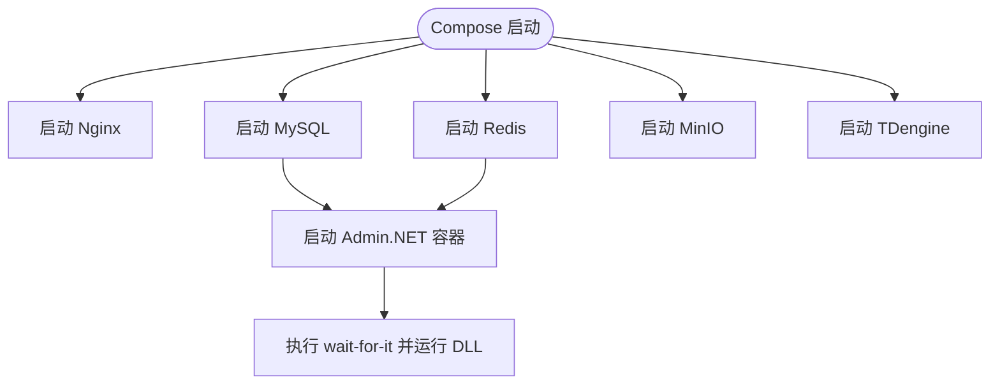
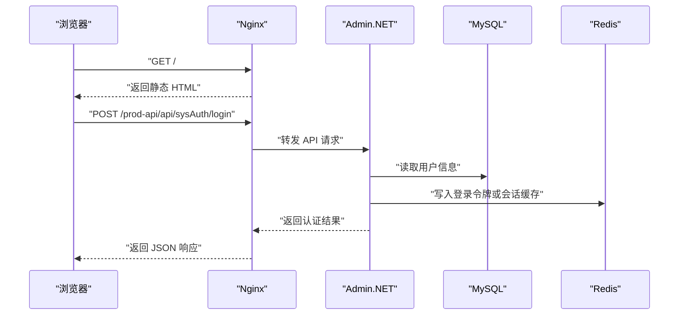
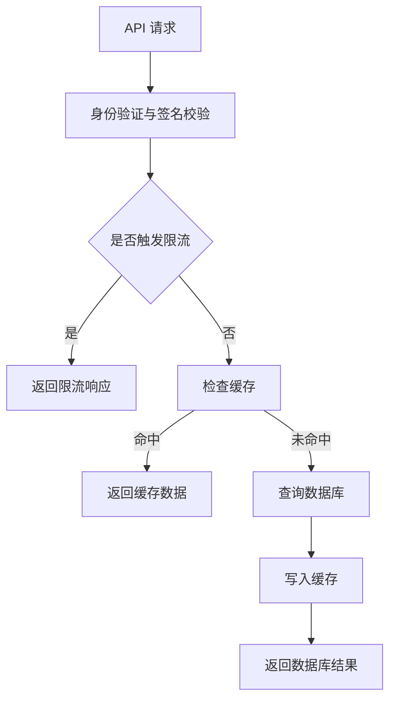
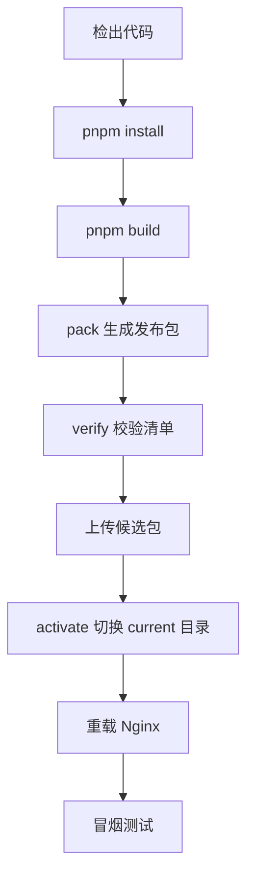

# 部署运维

<cite>
**本文引用的文件**   
- [README.md](file://README.md)
- [docker-compose.yml](file://docker/docker-compose.yml)
- [docker-compose-builder.yml](file://docker/docker-compose-builder.yml)
- [Dockerfile](file://Admin.NET/Admin.NET.Web.Entry/Dockerfile)
- [appsettings.json](file://Admin.NET/Admin.NET.Web.Entry/appsettings.json)
- [appsettings.Development.json](file://Admin.NET/Admin.NET.Web.Entry/appsettings.Development.json)
- [Program.cs](file://Admin.NET/Admin.NET.Web.Entry/Program.cs)
- [Startup.cs](file://Admin.NET/Admin.NET.Web.Core/Startup.cs)
- [ProjectOptions.cs](file://Admin.NET/Admin.NET.Web.Core/ProjectOptions.cs)
- [global.json](file://Admin.NET/global.json)
- [development.md](file://docs/development.md)
- [package.json](file://Web/package.json)
- [CUTOVER.md](file://Web/scripts/deploy/CUTOVER.md)
</cite>

## 目录
1. [简介](#简介)
2. [项目结构与部署边界](#项目结构与部署边界)
3. [开发环境部署](#开发环境部署)
4. [容器化与编排](#容器化与编排)
5. [反向代理与静态资源](#反向代理与静态资源)
6. [环境变量与敏感信息管理](#环境变量与敏感信息管理)
7. [生产环境最佳实践](#生产环境最佳实践)
8. [性能调优](#性能调优)
9. [自动化部署与持续集成](#自动化部署与持续集成)
10. [故障排查](#故障排查)
11. [结论](#结论)

## 简介
本指南面向 Admin.NET 从开发到生产的完整部署与运维。当前仓库已完成前端移植，业务前端入口为 `Web/apps/web-antdv-next/`，后端 API 入口为 `Admin.NET/Admin.NET.Web.Entry/`；数据库、缓存、对象存储等依赖服务通过 `docker/docker-compose.yml` 编排。文档重点包括：

- 使用 Docker Compose 运行 MySQL、Redis、Nginx、MinIO、TDengine 和 Admin.NET 应用。
- 解释 Nginx 作为反向代理和静态资源服务器的职责，并给出 SSL、负载均衡和路径转发建议。
- 说明环境变量、配置扫描目录、凭据管理和安全加固措施。
- 提供进程管理、日志、监控、备份恢复和故障转移建议。
- 给出数据库连接池、缓存策略、响应压缩、CDN 集成的优化方向。
- 基于现有脚本和镜像定义，补充 CI/CD 流水线示例。

**章节来源**
- [README.md:1-40](file://README.md#L1-L40)
- [development.md:1-30](file://docs/development.md#L1-L30)

## 项目结构与部署边界
Admin.NET 采用前后端分离架构：

| 层次 | 路径 | 职责 |
|---|---|---|
| 后端解决方案 | `Admin.NET/Admin.NET.sln` | 包含 Core、Application、Web.Core、Web.Entry、Test 和 Plugins |
| Web 层配置 | `Admin.NET/Admin.NET.Web.Core/Startup.cs` | 注册缓存、数据库、JWT、限流、SignalR、日志、OSS、压缩、路由和 OpenAPI |
| API 入口 | `Admin.NET/Admin.NET.Web.Entry/Program.cs` | 启动 Kestrel、Windows 服务支持和日志过滤 |
| 前端工作区 | `Web/` | pnpm workspace，业务应用位于 `apps/web-antdv-next/` |
| 构建产物 | `Web/dist/` | Vite 生产构建输出，由 Nginx 托管 |
| 容器编排 | `docker/docker-compose.yml` | 运行 Nginx、MySQL、Redis、MinIO、TDengine 和 Admin.NET 容器 |

**图表来源**
- [docker-compose.yml:1-110](file://docker/docker-compose.yml#L1-L110)
- [Startup.cs:1-200](file://Admin.NET/Admin.NET.Web.Core/Startup.cs#L1-L200)
- [Startup.cs:201-442](file://Admin.NET/Admin.NET.Web.Core/Startup.cs#L201-L442)

**章节来源**
- [README.md:25-40](file://README.md#L25-L40)
- [development.md:1-20](file://docs/development.md#L1-L20)
- [docker-compose.yml:1-110](file://docker/docker-compose.yml#L1-L110)

## 开发环境部署
### 后端开发
1. 安装 .NET 10 SDK。`Admin.NET/global.json` 仅选择 Microsoft.Testing.Platform，不固定 SDK 版本；各工程目标框架以 `.csproj` 为准。
2. 在 `Admin.NET/` 目录执行恢复、构建和运行命令，或直接运行 `Admin.NET.Admin.NET.Web.Entry/`。
3. 首次启动可能初始化数据库表与种子数据，应使用独立开发库。

### 前端开发
1. 安装 Node.js 与 pnpm。`Web/package.json` 要求 Node.js 为 `^22.18.0 || ^24.12.0`，包管理器为 `pnpm@11.16.0`。
2. 在 `Web/` 目录执行 `pnpm install --frozen-lockfile` 和 `pnpm dev`。
3. 前端代理指向本机后端接口地址；生产构建产物输出到 `Web/dist/`。

### 验收边界
- 逻辑测试使用 Vitest。
- 后端测试使用 xUnit v3。
- 桌面浏览器流程使用 Playwright。
- 真实数据库联调使用独立 PostgreSQL，不能用 SQLite 替代。

**章节来源**
- [README.md:30-40](file://README.md#L30-L40)
- [development.md:10-64](file://docs/development.md#L10-L64)
- [global.json:1-5](file://Admin.NET/global.json#L1-L5)
- [package.json:1-102](file://Web/package.json#L1-L102)

## 容器化与编排
### docker-compose 服务说明
`docker/docker-compose.yml` 定义了以下服务：

| 服务 | 镜像 | 端口映射 | 用途 |
|---|---|---:|---|
| nginx | `nginx:1.20.2` | `9100:80`、`9103:443` | 反向代理与静态资源托管 |
| mysql | `mysql:5.7` | `9101:3306` | 关系型数据库 |
| redis | `redis:latest` | `6379:6379` | 缓存与事件总线队列 |
| minio | `minio/minio:RELEASE.2025-04-22T22-12-26Z` | `9104:9000`、`9105:9001` | 对象存储控制台与 API |
| tdengine | `tdengine/tdengine:3.3.6.13` | `6030`、`6041`、`6044-6049` 等 | 时序数据存储 |
| adminNet | ASP.NET Core 运行时 | `9102:5050` | Admin.NET API 应用 |

#### 关键编排行为
- Nginx 挂载 `../Web/dist` 作为静态根目录，并挂载配置文件和证书目录。
- MySQL 暴露 root 密码、默认数据库名和本地时区，数据持久化到 `./mysql/mysql`。
- Redis 挂载 `redis.conf`、数据目录和日志目录。
- Admin.NET 容器通过 `wait-for-it.sh` 等待 MySQL 就绪后启动，并以 Release 发布目录作为内容根。

**图表来源**
- [docker-compose.yml:1-110](file://docker/docker-compose.yml#L1-L110)
- [Program.cs:1-38](file://Admin.NET/Admin.NET.Web.Entry/Program.cs#L1-L38)

### 构建镜像与发布产物
#### 前端构建
前端使用 `Web/package.json` 中的脚本：
- `pnpm build`：构建业务应用 `@vben/web-antdv-next`，输出到 `Web/dist/`。
- `pnpm dev`、`pnpm lint`、`pnpm check:type`：面向业务应用的开发与检查命令。

#### 后端构建
`docker/docker-compose-builder.yml` 提供了两个构建服务：
- `web-builder`：使用 `node:22-alpine` 构建前端。
- `net-builder`：使用 `mcr.microsoft.com/dotnet/sdk:9.0` 构建解决方案。

注意：`docker-compose-builder.yml` 使用 `dotnet build`，而不是发布；生产部署通常需要 `dotnet publish` 生成自包含或依赖框架发布目录，再用于镜像或容器挂载。

#### 应用镜像
仓库同时存在两种容器方式：
1. **直接挂载发布目录**：`docker-compose.yml` 将 `Admin.NET.Admin.NET.Web.Entry/bin/Release/net9.0/` 挂载到容器。
2. **自定义 Dockerfile**：`Admin.NET/Admin.NET.Web.Entry/Dockerfile` 基于 `aspnet:6.0`，暴露 `5005`，并以 `dotnet Admin.NET.Web.Entry.dll` 启动。

当前编排更依赖直接挂载 Release 目录的方式，而 Dockerfile 是较早期的模板，基础镜像、端口和运行时版本与 compose 中使用的 ASP.NET Core 运行时不一致。生产部署应统一镜像基础运行时、端口和内容根，避免混用。

**章节来源**
- [docker-compose.yml:1-110](file://docker/docker-compose.yml#L1-L110)
- [docker-compose-builder.yml:1-21](file://docker/docker-compose-builder.yml#L1-L21)
- [Dockerfile:1-18](file://Admin.NET/Admin.NET.Web.Entry/Dockerfile#L1-L18)
- [package.json:1-102](file://Web/package.json#L1-L102)

## 反向代理与静态资源
### Nginx 角色
在当前编排中，Nginx 承担：
- 对外暴露 HTTP 80 和 HTTPS 443。
- 托管 `Web/dist` 中的前端静态资源。
- 将 API 请求转发给 Admin.NET 应用容器。
- 支持 TLS 终止，证书目录挂载在 `./nginx/key`。

虽然 `docker/docker-compose.yml` 引用了 `./nginx/conf/nginx.conf`，但该文件在当前快照中不可见。因此生产部署不应假定其内容，必须显式维护一份可审计的 Nginx 配置。

### 推荐的路由规则
| 路径前缀 | 处理方 | 说明 |
|---|---|---|
| `/` | 静态资源 | 返回 `Web/dist` 中的 HTML、JS、CSS 和公共资源 |
| `/prod-api/api/*` | Admin.NET API | 通过内部网络转发到 `adminNet:5050` |
| `/schedule/*` | 调度看板 | 若启用，需单独校验鉴权与安全访问 |
| `/sapi/*` | OpenAPI/Scalar | 文档接口，生产环境通常关闭或限制来源 |
| `/hubs/*` | SignalR | WebSocket 长连接，需要保持连接超时与代理缓冲合理 |

### SSL 配置
- 将域名证书和私钥放入 `docker/docker/nginx/key/`。
- 监听 `443` 并启用 TLS。
- 设置 HSTS、强加密套件和证书自动续期。
- 可选将 HTTP 重定向到 HTTPS。

### 负载均衡
- 多个 Nginx 实例可作为上游网关，配合云厂商负载均衡器。
- 多个 Admin.NET 容器可共享同一 MySQL、Redis 和对象存储。
- 会话状态应无状态化；如需粘性会话，由负载均衡器控制，而非 Kestrel。

**图表来源**
- [docker-compose.yml:1-110](file://docker/docker-compose.yml#L1-L110)
- [Startup.cs:201-442](file://Admin.NET/Admin.NET.Web.Core/Startup.cs#L201-L442)

**章节来源**
- [docker-compose.yml:1-110](file://docker/docker-compose.yml#L1-L110)
- [CUTOVER.md:1-46](file://Web/scripts/deploy/CUTOVER.md#L1-L46)

## 环境变量与敏感信息管理
### 应用配置加载
`appsettings.json` 声明 Furion 的配置扫描目录为 `Configuration` 和空字符串，表示程序会合并该目录下的 JSON 配置文件。这意味着生产环境可通过外部配置文件覆盖默认值，而不必修改代码或镜像。

### 主要配置项来源
根据 `ProjectOptions.cs`，系统通过可配置选项注册大量模块，包括但不限于：

| 配置类别 | 用途 | 典型内容 |
|---|---|---|
| `DbConnectionOptions` | 数据库连接 | 连接字符串、方言、池大小 |
| `CacheOptions` | 缓存类型与参数 | Redis 或内存缓存 |
| `OSSProviderOptions` | 对象存储 | MinIO、阿里云 OSS、腾讯云 COS 等 |
| `UploadOptions` | 上传策略 | 本地或云存储路径、大小限制 |
| `EventBusOptions` | 事件总线 | Redis/RabbitMQ 连接 |
| `OAuthOptions` | OAuth 第三方登录 | 客户端 ID、密钥、回调地址 |
| `EmailOptions`、`SMSOptions` | 邮件与短信 | 供应商凭据 |
| `IpRateLimiting`、`ClientRateLimiting` | IP 与客户端限流 | 阈值、白名单 |

### 安全建议
- 不要把真实密码、密钥、证书写进源码或 README。
- 使用环境变量、密钥管理服务或挂载只读机密文件。
- 对 `appsettings.Production.json`、`Configuration/`、`docker/docker/nginx/key/` 等目录做最小权限访问控制。
- 在生产环境中禁用或限制 Swagger、Scalar、调度看板和调试页面。
- 区分开发、测试、预发和生产环境配置，禁止跨环境复用凭据。

**章节来源**
- [appsettings.json:1-5](file://Admin.NET/Admin.NET.Web.Entry/appsettings.json#L1-L5)
- [ProjectOptions.cs:1-51](file://Admin.NET/Admin.NET.Web.Core/ProjectOptions.cs#L1-L51)

## 生产环境最佳实践
### 进程管理
- 使用容器编排平台（Docker Compose、Kubernetes）管理生命周期。
- 设置重启策略：失败自动重启，OOM 退出时保留诊断信息。
- 对 Admin.NET 容器设置健康检查，结合 Nginx 上游健康探测。
- 使用滚动更新替换旧 Pod/容器，先下线流量，再切换新版本。

### 日志收集
- Kestrel 已启用响应压缩、异常处理和日志过滤。
- Windows 控制台运行时关闭 Windows 事件日志提供者，避免普通用户权限问题。
- 建议将标准输出和错误输出接入集中日志系统。
- 对 SQL、鉴权失败、限流拒绝、OSS 调用失败等关键路径增加结构化日志。

### 监控告警
- 监控 CPU、内存、磁盘、网络和容器重启次数。
- 监控数据库连接数、慢查询、Redis 内存和命中率。
- 监控 Nginx 请求延迟、错误率、SSL 证书到期时间。
- 对 Admin.NET 暴露健康检查端点，并在负载均衡层探测。

### 备份恢复
- MySQL 定期全量备份 + 增量 binlog 备份。
- Redis 开启 AOF 或 RDB，并按策略清理过期快照。
- MinIO 对象存储启用版本控制和异地复制。
- 恢复演练至少每季度一次，记录 RTO 和 RPO。

### 故障转移
- 多副本 Admin.NET 实例共享外部状态。
- MySQL 主从或高可用集群，应用侧重试与熔断。
- Redis 哨兵或集群模式，避免单点。
- Nginx 多实例，结合负载均衡器实现节点级故障转移。

**章节来源**
- [Program.cs:1-38](file://Admin.NET/Admin.NET.Web.Entry/Program.cs#L1-L38)
- [Startup.cs:201-442](file://Admin.NET/Admin.NET.Web.Core/Startup.cs#L201-L442)

## 性能调优
### 数据库连接池
- 根据并发连接数和最大连接数调整连接池大小。
- 避免长事务和一次性大查询。
- 对高频查询建立索引，避免全表扫描。
- 读写分离时确保应用侧正确路由。

### 缓存策略
- 热点字典、租户配置、权限信息优先走 Redis。
- 使用短 TTL 和缓存穿透保护。
- 对列表类数据采用分页和增量更新。
- 注意缓存与数据库一致性，必要时加版本号或失效键。

### 静态资源压缩与 CDN
- 后端已启用 Brotli 和 Gzip 响应压缩。
- Nginx 可进一步启用静态资源 gzip、brotli、缓存头和长期缓存。
- 将 `Web/dist` 中带哈希的资源推送到 CDN，提升首屏速度。
- HTML 和 `_app-config*.js` 使用较短缓存或 no-store，便于热更新。

### SignalR 与长连接
- SignalR KeepAlive 间隔为 15 秒，客户端超时为 30 秒。
- 代理层需允许 WebSocket 升级并保持足够超时。
- 在线用户和公告通知属于实时能力，应避免被防火墙或代理提前断开。

**图表来源**
- [Startup.cs:1-200](file://Admin.NET/Admin.NET.Web.Core/Startup.cs#L1-L200)
- [Startup.cs:201-442](file://Admin.NET/Admin.NET.Web.Core/Startup.cs#L201-L442)

**章节来源**
- [Startup.cs:201-442](file://Admin.NET/Admin.NET.Web.Core/Startup.cs#L201-L442)
- [docker-compose.yml:1-110](file://docker/docker-compose.yml#L1-L110)

## 自动化部署与持续集成
### 前端发布候选流程
仓库提供前端发布工具链，核心流程如下：
1. 安装依赖、执行类型检查和构建。
2. 使用 `frontend-release.mjs pack` 打包 `Web/dist`，生成包含 SHA256 清单的候选包。
3. 使用 `frontend-release.mjs verify` 校验候选包完整性。
4. 使用 `activate` 切换到新目录，并通过 Nginx 重新加载。

该流程强调：
- 发布包不包含数据库配置、生产证书或浏览器登录状态。
- 切换时使用原子重命名，失败时回滚临时备份。
- Nginx 的 `root` 指向 `current/html`，TLS 模板需替换为真实证书。
- 现场 API 地址通过 `_app-config*.js` 注入，无需重建静态资源。

**图表来源**
- [CUTOVER.md:1-46](file://Web/scripts/deploy/CUTOVER.md#L1-L46)
- [package.json:1-102](file://Web/package.json#L1-L102)

### CI/CD 流水线建议
| 阶段 | 任务 | 说明 |
|---|---|---|
| 代码检查 | 后端编译、前端 lint 与类型检查 | 阻止明显错误进入分支 |
| 单元测试 | xUnit、Vitest | 不替代真实数据库联调 |
| 构建 | 前端 `pnpm build`，后端 `dotnet publish` | 输出可部署产物 |
| 容器构建 | 构建 Admin.NET 镜像和前端静态包 | 固定镜像标签和摘要 |
| 集成测试 | 启动真实 PostgreSQL、Redis、MinIO | 验证关键业务流程 |
| 安全扫描 | 依赖漏洞、密钥泄露扫描 | 禁止提交硬编码凭据 |
| 发布候选 | 生成 manifest 并校验 SHA256 | 支持离线核对 |
| 灰度发布 | 滚动更新 Admin.NET 实例 | 先小流量再全量 |
| 回滚 | 恢复到上一个 approved 版本 | 保留旧发布目录 |

**章节来源**
- [CUTOVER.md:1-46](file://Web/scripts/deploy/CUTOVER.md#L1-L46)
- [docker-compose-builder.yml:1-21](file://docker/docker-compose-builder.yml#L1-L21)
- [package.json:1-102](file://Web/package.json#L1-L102)

## 故障排查
### 容器无法启动
- 检查 MySQL、Redis、MinIO、TDengine 是否已就绪。
- 查看 Admin.NET 容器的启动命令是否正确挂载 Release 目录。
- 确认 `wait-for-it.sh` 能连通 `mysql:3306`。

### 静态资源 404
- 确认 `Web/dist` 已构建并挂载到 Nginx。
- 检查 Nginx 的 `root` 是否与挂载路径一致。
- 核对前端构建输出和 `_app-config*.js` 中的 API 地址。

### API 无法访问
- 检查 Nginx 是否把 `/prod-api/api/*` 转发到 `adminNet:5050`。
- 确认 Kestrel 未在反向代理后丢失客户端头；应用已配置 `ForwardedHeadersOptions`。
- 检查 JWT、签名认证、限流策略和 CORS 配置。

### 登录或令牌异常
- 检查 Redis 是否可写，缓存类型是否为 Redis。
- 检查浏览器命名空间和 Cookie 是否与新旧应用隔离。
- 确认 `_app-config*.js` 中的 API 和 Hub 地址。

### 文件上传或预览失败
- 检查 OSSProvider 配置、MinIO 控制台和网络连通性。
- 私有文件下载需经过认证中间件，直链可能被拒绝。
- 检查图片处理、虚拟路径和静态文件映射。

**章节来源**
- [docker-compose.yml:1-110](file://docker/docker-compose.yml#L1-L110)
- [Startup.cs:1-200](file://Admin.NET/Admin.NET.Web.Core/Startup.cs#L1-L200)
- [Startup.cs:201-442](file://Admin.NET/Admin.NET.Web.Core/Startup.cs#L201-L442)
- [CUTOVER.md:1-46](file://Web/scripts/deploy/CUTOVER.md#L1-L46)

## 结论
Admin.NET 的生产部署应以“外部依赖稳定、前端静态资源可替换、后端无状态、配置与凭据外置”为原则。当前仓库提供了完整的 Docker Compose 编排、前端发布候选流程和后端中间件配置，但 Nginx 具体配置、生产镜像和密钥管理仍需团队根据实际基础设施落地。建议在 CI/CD 中固化构建、校验、灰度和回滚流程，在运维侧落实监控、备份、日志和容量规划，确保系统具备可观测、可恢复和可扩展的能力。