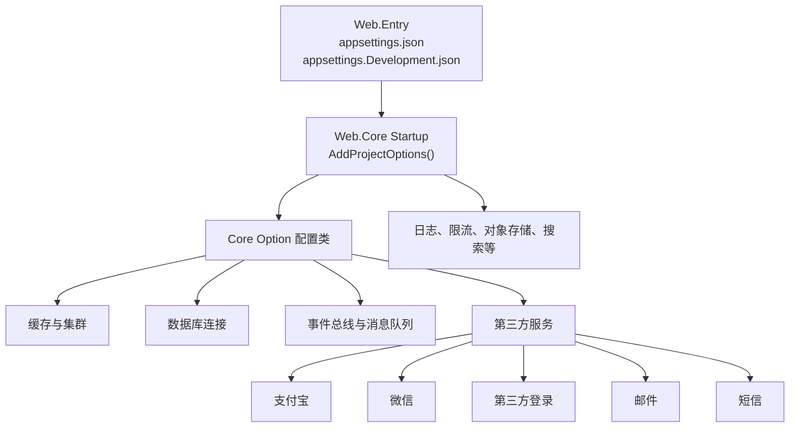
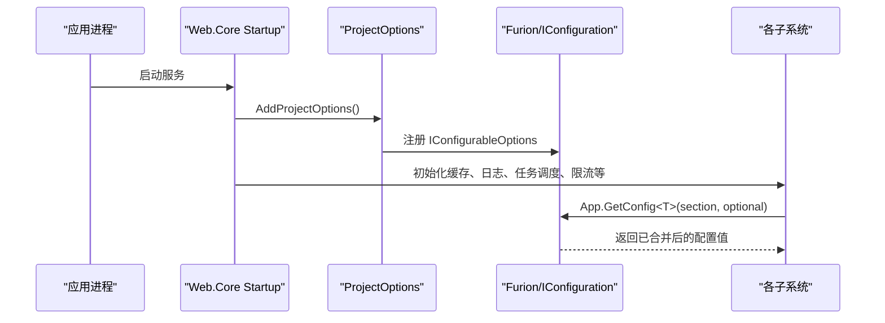
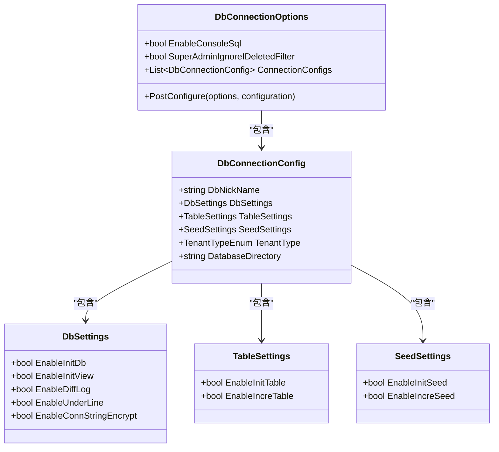
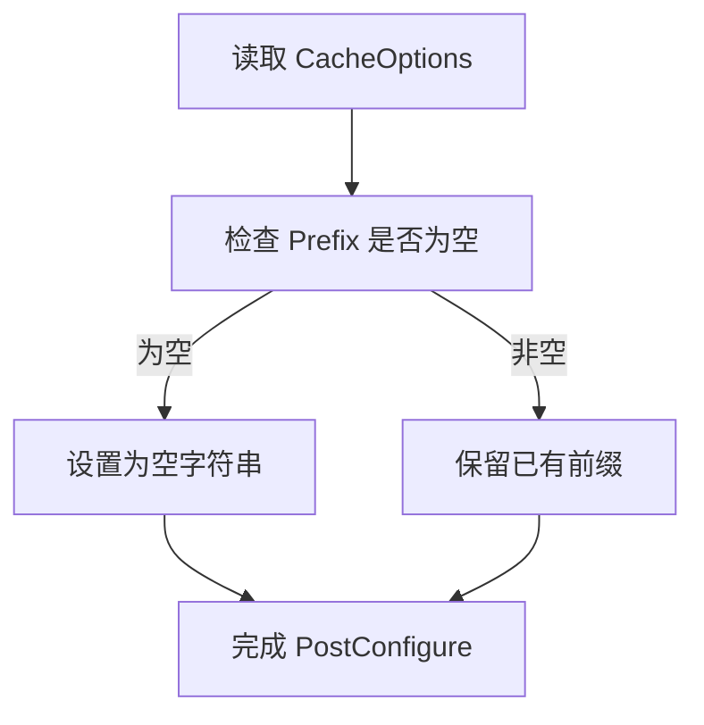
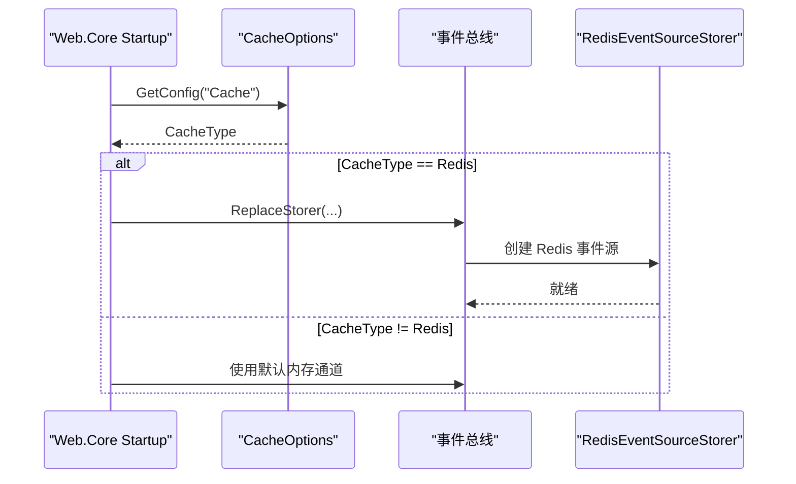
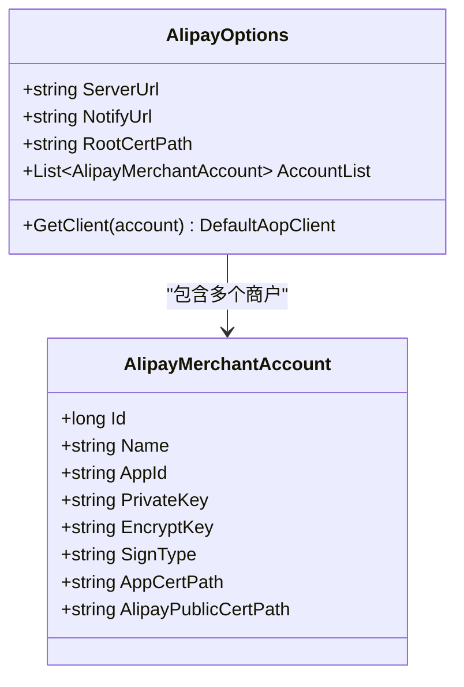
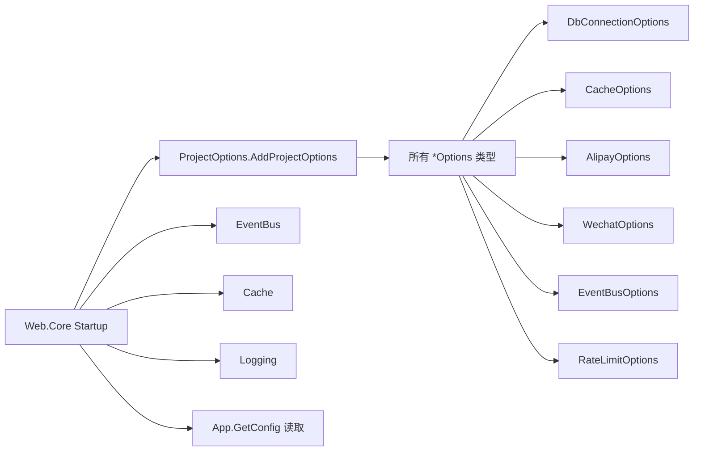
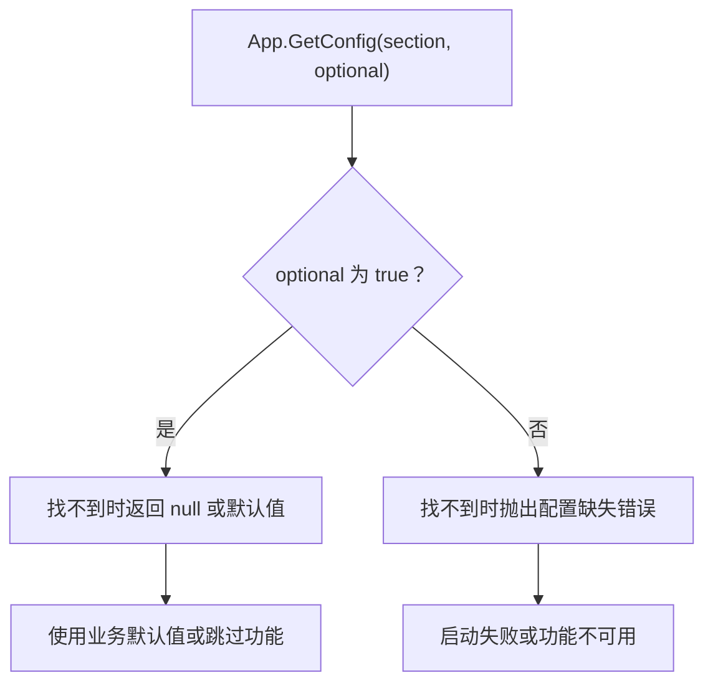

# 配置管理

<cite>
**本文引用的文件**   
- [appsettings.json](file://Admin.NET/Admin.NET.Web.Entry/appsettings.json)
- [appsettings.Development.json](file://Admin.NET/Admin.NET.Web.Entry/appsettings.Development.json)
- [Startup.cs（Web.Core）](file://Admin.NET/Admin.NET.Web.Core/Startup.cs)
- [Startup.cs（Application）](file://Admin.NET/Admin.NET.Application/Startup.cs)
- [ProjectOptions.cs](file://Admin.NET/Admin.NET.Web.Core/ProjectOptions.cs)
- [DbConnectionOptions.cs](file://Admin.NET/Admin.NET.Core/Option/DbConnectionOptions.cs)
- [CacheOptions.cs](file://Admin.NET/Admin.NET.Core/Option/CacheOptions.cs)
- [EventBusOptions.cs](file://Admin.NET/Admin.NET.Core/Option/EventBusOptions.cs)
- [AlipayOptions.cs](file://Admin.NET/Admin.NET.Core/Option/AlipayOptions.cs)
- [WechatOptions.cs](file://Admin.NET/Admin.NET.Core/Option/WechatOptions.cs)
- [SMSOptions.cs](file://Admin.NET/Admin.NET.Core/Option/SMSOptions.cs)
- [EmailOptions.cs](file://Admin.NET/Admin.NET.Core/Option/EmailOptions.cs)
- [OAuthOptions.cs](file://Admin.NET/Admin.NET.Core/Option/OAuthOptions.cs)
- [CryptogramOptions.cs](file://Admin.NET/Admin.NET.Core/Option/CryptogramOptions.cs)
- [UploadOptions.cs](file://Admin.NET/Admin.NET.Core/Option/UploadOptions.cs)
- [SnowIdOptions.cs](file://Admin.NET/Admin.NET.Core/Option/SnowIdOptions.cs)
- [APIJSONOptions.cs](file://Admin.NET/Admin.NET.Core/Option/APIJSONOptions.cs)
- [LocalizationSettingsOptions.cs](file://Admin.NET/Admin.NET.Core/Option/LocalizationSettingsOptions.cs)
- [StressTestOptions.cs](file://Admin.NET/Admin.NET.Core/Option/StressTestOptions.cs)
- [RateLimitOptions.cs](file://Admin.NET/Admin.NET.Core/Option/RateLimitOptions.cs)
- [PayCallBackOptions.cs](file://Admin.NET/Admin.NET.Core/Option/PayCallBackOptions.cs)
- [CDConfigOptions.cs](file://Admin.NET/Admin.NET.Core/Option/CDConfigOptions.cs)
- [ElasticSearchOptions.cs](file://Admin.NET/Admin.NET.Core/Option/ElasticSearchOptions.cs)
- [DeepSeekOptions.cs](file://Admin.NET/Admin.NET.Core/Option/DeepSeekOptions.cs)
- [EnumOptions.cs](file://Admin.NET/Admin.NET.Core/Option/EnumOptions.cs)
- [LoggingSetup.cs](file://Admin.NET/Admin.NET.Core/Logging/LoggingSetup.cs)
- [SysCodeGen.cs](file://Admin.NET/Admin.NET.Core/Entity/SysCodeGen.cs)
- [SqlSugarSetup.cs](file://Admin.NET/Admin.NET.Core/SqlSugar/SqlSugarSetup.cs)
- [SignalRSetup.cs](file://Admin.NET/Admin.NET.Core/SignalR/SignalRSetup.cs)
- [RedisEventSourceStorer.cs](file://Admin.NET/Admin.NET.Core/EventBus/RedisEventSourceStorer.cs)
- [AutoVersionUpdate.cs](file://Admin.NET/Admin.NET.Core/Update/AutoVersionUpdate.cs)
- [DbJobPersistence.cs](file://Admin.NET/Admin.NET.Core/Service/Job/DbJobPersistence.cs)
- [GlobalUsings.cs](file://Admin.NET/Admin.NET.Core/GlobalUsings.cs)
</cite>

## 目录
1. [简介](#简介)
2. [项目结构与配置入口](#项目结构与配置入口)
3. [配置层次与加载顺序](#配置层次与加载顺序)
4. [核心配置类与业务分类](#核心配置类与业务分类)
5. [架构总览](#架构总览)
6. [详细组件分析](#详细组件分析)
7. [依赖关系分析](#依赖关系分析)
8. [性能与安全调优配置](#性能与安全调优配置)
9. [验证、默认值与动态更新机制](#验证默认值与动态更新机制)
10. [多环境策略](#多环境策略)
11. [最佳实践](#最佳实践)
12. [故障排查指南](#故障排查指南)
13. [结论](#结论)

## 简介
本文面向 Admin.NET 的配置管理体系，重点说明以下方面：
- 配置层次结构、加载顺序与环境变量覆盖方式。
- `appsettings.json` 的作用以及业务配置类的组织方式。
- 数据库连接、缓存、消息队列、第三方服务集成等关键配置的字段含义和关联逻辑。
- 系统级、业务级、安全级、性能级配置的分类说明。
- 配置验证、默认值处理、运行时读取与部分配置动态更新的方式。
- 常见配置错误的定位方法。

需要特别说明的是：当前仓库中的 `appsettings.json` 主要声明了 Furion 框架的配置文件扫描目录；具体的业务配置项由各个 `*Options` 类型定义并通过 `App.GetConfig<T>(section, optional)` 或 `services.Configure<T>` 进行绑定。因此，配置的实际语义应以 `Option/*.cs` 中的选项类和启动注册代码为准。

## 项目结构与配置入口
Admin.NET 的配置体系由三层组成：
- Web 入口层：提供 `appsettings.json` 与 `appsettings.Development.json`，用于声明 Furion 的配置文件扫描目录。
- Web.Core 启动层：通过 `Startup` 和 `ProjectOptions.AddProjectOptions` 注册所有可配置选项、限流策略、事件总线、缓存、任务调度等基础设施。
- Core 选项层：`Admin.NET.Core/Option` 下的各类 `*Options` 描述具体配置结构，并由各子系统在启动阶段读取。

**图表来源**
- [appsettings.json:1-5](file://Admin.NET/Admin.NET.Web.Entry/appsettings.json#L1-L5)
- [Startup.cs（Web.Core）:43-120](file://Admin.NET/Admin.NET.Web.Core/Startup.cs#L43-L120)
- [ProjectOptions.cs:18-51](file://Admin.NET/Admin.NET.Web.Core/ProjectOptions.cs#L18-L51)

**章节来源**
- [appsettings.json:1-5](file://Admin.NET/Admin.NET.Web.Entry/appsettings.json#L1-L5)
- [appsettings.Development.json:1-5](file://Admin.NET/Admin.NET.Web.Entry/appsettings.Development.json#L1-L5)
- [Startup.cs（Web.Core）:43-120](file://Admin.NET/Admin.NET.Web.Core/Startup.cs#L43-L120)
- [ProjectOptions.cs:18-51](file://Admin.NET/Admin.NET.Web.Core/ProjectOptions.cs#L18-L51)

## 配置层次与加载顺序
### 配置文件层次
从源码可见，Web 入口使用 Furion 提供的配置能力，并通过 `ConfigurationScanDirectories` 指定配置文件扫描目录。该字段允许框架自动合并指定目录下的多个 JSON 文件。

- `appsettings.json`：声明基础扫描目录。
- `appsettings.Development.json`：开发环境覆盖相同键时优先生效。
- 环境变量：项目多处使用 `App.GetConfig<T>(section, optional)` 读取配置，这是 .NET 配置模型中常见的环境变量覆盖方式。例如缓存、信号集线器、日志、任务调度、代码生成、雪花 ID、分布式更新等模块都会按配置节名取值。

### 典型加载顺序
结合仓库中的实际用法，可以理解为：
1. Furion 根据 `appsettings.json` 与 `appsettings.{Environment}.json` 加载并合并配置。
2. `Startup` 调用 `AddProjectOptions()`，注册所有 `IConfigurableOptions` 类型。
3. 各子系统通过 `App.GetConfig<T>(section, optional)` 或 `services.Configure<T>(...)` 获取配置。
4. 环境变量或部署时的外部配置源会覆盖同名配置节。

需要注意：当前仓库未看到显式集中挂载环境变量到 `IConfiguration` 的代码片段，但大量使用 `App.GetConfig` 的行为表明环境变量是预期覆盖渠道之一。

**章节来源**
- [appsettings.json:1-5](file://Admin.NET/Admin.NET.Web.Entry/appsettings.json#L1-L5)
- [appsettings.Development.json:1-5](file://Admin.NET/Admin.NET.Web.Entry/appsettings.Development.json#L1-L5)
- [CacheOptions.cs:29-33](file://Admin.NET/Admin.NET.Core/Option/CacheOptions.cs#L29-L33)
- [LoggingSetup.cs:25-84](file://Admin.NET/Admin.NET.Core/Logging/LoggingSetup.cs#L25-L84)
- [SysCodeGen.cs:56-56](file://Admin.NET/Admin.NET.Core/Entity/SysCodeGen.cs#L56-L56)
- [SqlSugarSetup.cs:34-49](file://Admin.NET/Admin.NET.Core/SqlSugar/SqlSugarSetup.cs#L34-L49)
- [SignalRSetup.cs:31-36](file://Admin.NET/Admin.NET.Core/SignalR/SignalRSetup.cs#L31-L36)
- [AutoVersionUpdate.cs:43-43](file://Admin.NET/Admin.NET.Core/Update/AutoVersionUpdate.cs#L43-L43)

## 核心配置类与业务分类
Admin.NET 的核心配置集中在 `Admin.NET.Core/Option`，并由 `ProjectOptions.AddProjectOptions` 统一注册。这些配置可按用途分为以下几类。

### 系统级配置
| 配置类 | 主要用途 | 关键字段 |
|---|---|---|
| `DbConnectionOptions` | SqlSugar 数据库连接集合、初始化行为、租户隔离方式 | `EnableConsoleSql`、`SuperAdminIgnoreIDeletedFilter`、`ConnectionConfigs` |
| `SnowIdOptions` | 雪花 ID 生成器扩展配置 | `WorkerPrefix` |
| `LocalizationSettingsOptions` | 多语言支持列表、默认文化、固定时间区域 | `SupportedCultures`、`DefaultCulture`、`DateTimeFormatCulture` |
| `EnumOptions` | 枚举实体程序集扫描 | `EntityAssemblyNames` |
| `CDConfigOptions` | CI/CD 自动化更新、备份与发布参数 | `Enabled`、`Owner`、`Repo`、`Branch`、`AccessToken`、`AllowedDeploymentRoot` |
| `StressTestOptions` | 授权隔离服务的压测目标与并发限制 | `Enabled`、`Targets`、`MaxConcurrency` |

### 基础设施与性能配置
| 配置类 | 主要用途 | 关键字段 |
|---|---|---|
| `CacheOptions` | 本地缓存、Redis 缓存、集群与哨兵模式 | `Prefix`、`CacheType`、`Redis`、`Cluster` |
| `ClusterOptions` | SignalR 集群、数据保护 Key、Redis 通道前缀 | `Enabled`、`ServerId`、`SignalR`、`DataProtecteKey` |
| `RateLimitOptions` | IP 限流与客户端限流策略 | `IpRateLimitingOptions`、`ClientRateLimitingOptions` 等 |
| `ElasticSearchOptions` | Elasticsearch 索引、认证、服务器地址 | `Enabled`、`AuthType`、`ServerUris`、`DefaultIndex` |
| `UploadOptions` | 文件上传大小、格式、MD5 校验 | `Path`、`MaxSize`、`ContentType`、`EnableMd5` |
| `OSSProviderOptions` | 对象存储桶、自定义 Host、是否启用 | `Enabled`、`Bucket`、`CustomHost` |

### 消息与通信配置
| 配置类 | 主要用途 | 关键字段 |
|---|---|---|
| `EventBusOptions` | 事件总线扩展，当前示例预留 RabbitMQ 设置 | `RabbitMQ` |
| `SMSOptions` | 验证码过期时间、发送间隔、阿里云/腾讯云/自定义短信 | `VerifyCodeExpireSeconds`、`SendIntervalSeconds`、`Aliyun`、`Tencentyun`、`Custom` |
| `EmailOptions` | SMTP 邮件发送 | `Host`、`Port`、`UserName`、`Password`、`EnableSsl` |

### 第三方服务集成
| 配置类 | 主要用途 | 关键字段 |
|---|---|---|
| `AlipayOptions` | 支付宝网关、证书路径、商户账号列表 | `ServerUrl`、`NotifyUrl`、`RootCertPath`、`AccountList` |
| `WechatOptions` | 微信公众号、小程序 Token 与密钥 | `WechatAppId`、`WxOpenAppId`、`WechatToken`、`WxToken` |
| `OAuthOptions` | 第三方登录授权 | `Weixin`、`Gitee` |
| `PayCallBackOptions` | 支付回调地址 | `AlipayUrl`、`AlipayRefundUrl` |
| `DeepSeekOptions` | AI 接口源语言、地址与密钥 | `SourceLang`、`ApiUrl`、`ApiKey` |
| `APIJSONOptions` | APIJSON 角色权限 | `Roles` |

### 安全配置
| 配置类 | 主要用途 | 关键字段 |
|---|---|---|
| `CryptogramOptions` | 密码强度校验、加密算法、公钥私钥 | `StrongPassword`、`CryptoType`、`PublicKey`、`PrivateKey` |

**章节来源**
- [ProjectOptions.cs:18-51](file://Admin.NET/Admin.NET.Web.Core/ProjectOptions.cs#L18-L51)
- [DbConnectionOptions.cs:12-136](file://Admin.NET/Admin.NET.Core/Option/DbConnectionOptions.cs#L12-L136)
- [CacheOptions.cs:12-142](file://Admin.NET/Admin.NET.Core/Option/CacheOptions.cs#L12-L142)
- [EventBusOptions.cs:12-44](file://Admin.NET/Admin.NET.Core/Option/EventBusOptions.cs#L12-L44)
- [AlipayOptions.cs:14-119](file://Admin.NET/Admin.NET.Core/Option/AlipayOptions.cs#L14-L119)
- [WechatOptions.cs:12-43](file://Admin.NET/Admin.NET.Core/Option/WechatOptions.cs#L12-L43)
- [SMSOptions.cs:12-143](file://Admin.NET/Admin.NET.Core/Option/SMSOptions.cs#L12-L143)
- [EmailOptions.cs:12-58](file://Admin.NET/Admin.NET.Core/Option/EmailOptions.cs#L12-L58)
- [OAuthOptions.cs:12-23](file://Admin.NET/Admin.NET.Core/Option/OAuthOptions.cs#L12-L23)
- [CryptogramOptions.cs:12-43](file://Admin.NET/Admin.NET.Core/Option/CryptogramOptions.cs#L12-L43)
- [UploadOptions.cs:14-60](file://Admin.NET/Admin.NET.Core/Option/UploadOptions.cs#L14-L60)
- [RateLimitOptions.cs:14-37](file://Admin.NET/Admin.NET.Core/Option/RateLimitOptions.cs#L14-L37)
- [ElasticSearchOptions.cs:12-64](file://Admin.NET/Admin.NET.Core/Option/ElasticSearchOptions.cs#L12-L64)
- [LocalizationSettingsOptions.cs:9-25](file://Admin.NET/Admin.NET.Core/Option/LocalizationSettingsOptions.cs#L9-L25)
- [StressTestOptions.cs:10-25](file://Admin.NET/Admin.NET.Core/Option/StressTestOptions.cs#L10-L25)
- [CDConfigOptions.cs:12-109](file://Admin.NET/Admin.NET.Core/Option/CDConfigOptions.cs#L12-L109)
- [DeepSeekOptions.cs:9-25](file://Admin.NET/Admin.NET.Core/Option/DeepSeekOptions.cs#L9-L25)
- [APIJSONOptions.cs:12-70](file://Admin.NET/Admin.NET.Core/Option/APIJSONOptions.cs#L12-L70)
- [EnumOptions.cs:12-18](file://Admin.NET/Admin.NET.Core/Option/EnumOptions.cs#L12-L18)
- [SnowIdOptions.cs:12-18](file://Admin.NET/Admin.NET.Core/Option/SnowIdOptions.cs#L12-L18)
- [PayCallBackOptions.cs:12-23](file://Admin.NET/Admin.NET.Core/Option/PayCallBackOptions.cs#L12-L23)

## 架构总览
配置在 Admin.NET 中的运行流程大致如下：

**图表来源**
- [Startup.cs（Web.Core）:43-120](file://Admin.NET/Admin.NET.Web.Core/Startup.cs#L43-L120)
- [ProjectOptions.cs:18-51](file://Admin.NET/Admin.NET.Web.Core/ProjectOptions.cs#L18-L51)

## 详细组件分析

### 数据库连接配置
`DbConnectionOptions` 是数据库配置的核心类型，包含控制台 SQL 输出开关、超级管理员忽略逻辑删除过滤器开关，以及一组数据库连接配置。每个连接配置包含数据库别名、初始化开关、表初始化、种子初始化、租户隔离方式等信息。

其 `PostConfigure` 会对未设置 `ConfigId` 的连接赋予主配置标识，从而保证 SqlSugar 能正确识别主库。

**图表来源**
- [DbConnectionOptions.cs:12-136](file://Admin.NET/Admin.NET.Core/Option/DbConnectionOptions.cs#L12-L136)

**章节来源**
- [DbConnectionOptions.cs:12-136](file://Admin.NET/Admin.NET.Core/Option/DbConnectionOptions.cs#L12-L136)
- [SqlSugarSetup.cs:34-49](file://Admin.NET/Admin.NET.Core/SqlSugar/SqlSugarSetup.cs#L34-L49)
- [SysCodeGen.cs:56-56](file://Admin.NET/Admin.NET.Core/Entity/SysCodeGen.cs#L56-L56)

### 缓存与集群配置
`CacheOptions` 控制缓存前缀、缓存类型及 Redis 子配置。其 `PostConfigure` 会在空值或空白时把 `Prefix` 归一化为空字符串，避免后续缓存键拼接出现异常。

`ClusterOptions` 负责 SignalR 集群、数据保护 Key、哨兵模式等。SignalR 与事件总线在运行时会根据 `CacheOptions.CacheType` 选择是否使用 Redis 作为消息通道。

**图表来源**
- [CacheOptions.cs:29-33](file://Admin.NET/Admin.NET.Core/Option/CacheOptions.cs#L29-L33)

**章节来源**
- [CacheOptions.cs:12-142](file://Admin.NET/Admin.NET.Core/Option/CacheOptions.cs#L12-L142)
- [SignalRSetup.cs:31-36](file://Admin.NET/Admin.NET.Core/SignalR/SignalRSetup.cs#L31-L36)
- [RedisEventSourceStorer.cs:63-63](file://Admin.NET/Admin.NET.Core/EventBus/RedisEventSourceStorer.cs#L63-L63)

### 消息队列与事件总线
事件总线当前以内存通道为主，并根据缓存类型切换为 Redis 事件源存储器。当 `CacheOptions.CacheType` 为 Redis 时，会通过 `RedisEventSourceStorer` 将事件总线存储替换为基于 Redis 的实现。RabbitMQ 配置类仍存在，但在当前启动逻辑中处于注释占位状态。

**图表来源**
- [Startup.cs（Web.Core）:120-180](file://Admin.NET/Admin.NET.Web.Core/Startup.cs#L120-L180)
- [EventBusOptions.cs:12-44](file://Admin.NET/Admin.NET.Core/Option/EventBusOptions.cs#L12-L44)
- [RedisEventSourceStorer.cs:63-63](file://Admin.NET/Admin.NET.Core/EventBus/RedisEventSourceStorer.cs#L63-L63)

**章节来源**
- [Startup.cs（Web.Core）:120-180](file://Admin.NET/Admin.NET.Web.Core/Startup.cs#L120-L180)
- [EventBusOptions.cs:12-44](file://Admin.NET/Admin.NET.Core/Option/EventBusOptions.cs#L12-L44)

### 第三方服务集成

#### 支付宝
`AlipayOptions` 定义了支付宝网关、回调地址、根证书路径以及商户账号列表。`GetClient` 会根据传入的商户账号构造 AOP 客户端，并将相对证书路径与应用工作目录拼接。

**图表来源**
- [AlipayOptions.cs:14-119](file://Admin.NET/Admin.NET.Core/Option/AlipayOptions.cs#L14-L119)

**章节来源**
- [AlipayOptions.cs:14-119](file://Admin.NET/Admin.NET.Core/Option/AlipayOptions.cs#L14-L119)
- [PayCallBackOptions.cs:12-23](file://Admin.NET/Admin.NET.Core/Option/PayCallBackOptions.cs#L12-L23)

#### 微信
`WechatOptions` 同时承载微信公众号与微信小程序的配置，包括 AppId、Secret、Token 与 EncodingAESKey。微信相关服务还会读取 `Wechat:QRImagePath` 等路径配置。

**章节来源**
- [WechatOptions.cs:12-43](file://Admin.NET/Admin.NET.Core/Option/WechatOptions.cs#L12-L43)
- [Startup.cs（Web.Core）:43-120](file://Admin.NET/Admin.NET.Web.Core/Startup.cs#L43-L120)

#### 企业微信与钉钉
当前仓库中未发现与“企业微信”“钉钉”直接对应的 `*Options` 类。企业微信与钉钉通常属于插件或上层业务集成范畴，不应与 Core 层的通用配置混为一谈。若项目中存在相关实现，应位于插件工程或业务层，而不是本仓库的 `Admin.NET.Core/Option`。

### 其他重要配置

#### 短信
`SMSOptions` 提供验证码过期时间、发送间隔，以及阿里云、腾讯云和自定义短信接口配置。自定义短信接口支持 GET/POST、Content-Type、成功标志与模板查找。

**章节来源**
- [SMSOptions.cs:12-143](file://Admin.NET/Admin.NET.Core/Option/SMSOptions.cs#L12-L143)

#### 邮件
`EmailOptions` 配置 SMTP 主机、端口、SSL、发件人与收件人默认值。

**章节来源**
- [EmailOptions.cs:12-58](file://Admin.NET/Admin.NET.Core/Option/EmailOptions.cs#L12-L58)

#### 第三方登录
`OAuthOptions` 提供微信与 Gitee 的 OAuth 配置节点。

**章节来源**
- [OAuthOptions.cs:12-23](file://Admin.NET/Admin.NET.Core/Option/OAuthOptions.cs#L12-L23)

#### 对象存储与文件上传
`UploadOptions` 控制上传路径、大小、允许类型与 MD5 校验；`OSSProviderOptions` 控制对象存储是否启用、桶名称与自定义 Host。

**章节来源**
- [UploadOptions.cs:14-60](file://Admin.NET/Admin.NET.Core/Option/UploadOptions.cs#L14-L60)

#### 日志与搜索
`LoggingSetup` 读取 `Logging:*` 配置，控制控制台日志、文件日志、数据库日志、Elasticsearch 日志。`ElasticSearchOptions` 则定义 ES 连接、认证类型、服务器地址与默认索引。

**章节来源**
- [LoggingSetup.cs:25-84](file://Admin.NET/Admin.NET.Core/Logging/LoggingSetup.cs#L25-L84)
- [ElasticSearchOptions.cs:12-64](file://Admin.NET/Admin.NET.Core/Option/ElasticSearchOptions.cs#L12-L64)

## 依赖关系分析
配置注册与读取的关键依赖如下：

**图表来源**
- [ProjectOptions.cs:18-51](file://Admin.NET/Admin.NET.Web.Core/ProjectOptions.cs#L18-L51)
- [Startup.cs（Web.Core）:43-180](file://Admin.NET/Admin.NET.Web.Core/Startup.cs#L43-L180)
- [DbConnectionOptions.cs:12-136](file://Admin.NET/Admin.NET.Core/Option/DbConnectionOptions.cs#L12-L136)
- [CacheOptions.cs:12-142](file://Admin.NET/Admin.NET.Core/Option/CacheOptions.cs#L12-L142)
- [AlipayOptions.cs:14-119](file://Admin.NET/Admin.NET.Core/Option/AlipayOptions.cs#L14-L119)
- [WechatOptions.cs:12-43](file://Admin.NET/Admin.NET.Core/Option/WechatOptions.cs#L12-L43)
- [EventBusOptions.cs:12-44](file://Admin.NET/Admin.NET.Core/Option/EventBusOptions.cs#L12-L44)
- [RateLimitOptions.cs:14-37](file://Admin.NET/Admin.NET.Core/Option/RateLimitOptions.cs#L14-L37)

**章节来源**
- [ProjectOptions.cs:18-51](file://Admin.NET/Admin.NET.Web.Core/ProjectOptions.cs#L18-L51)
- [Startup.cs（Web.Core）:43-180](file://Admin.NET/Admin.NET.Web.Core/Startup.cs#L43-L180)

## 性能与安全调优配置
### 性能调优
- 缓存前缀：通过 `CacheOptions.Prefix` 区分不同应用或环境的缓存空间。
- Redis 最大消息大小：`RedisOption.MaxMessageSize` 控制 Redis 消息体上限。
- 限流策略：IP 限流与客户端限流分别由 `IpRateLimitingOptions`、`ClientRateLimitingOptions` 及其策略类型控制。
- 任务调度集群：通过 `JobSchedule:ClusterId` 决定是否启用集群服务器。
- 压测配置：`StressTestOptions` 控制并发、请求数量、轮次与超时，适合授权隔离场景下的压力测试。

### 安全配置
- 密码强度：`CryptogramOptions.StrongPassword` 配合正则表达式控制密码复杂度。
- 加密类型与密钥：`CryptogramOptions.CryptoType`、`PublicKey`、`PrivateKey` 控制对称或非对称加密行为。
- 数据库连接加密：`DbSettings.EnableConnStringEncrypt` 可用于连接串加密策略。
- 对象存储与文件上传：通过 `UploadOptions.EnableMd5` 防止重复上传。
- 限流：限流策略可防止暴力请求、爬虫滥用与接口滥用。

**章节来源**
- [CacheOptions.cs:12-142](file://Admin.NET/Admin.NET.Core/Option/CacheOptions.cs#L12-L142)
- [RateLimitOptions.cs:14-37](file://Admin.NET/Admin.NET.Core/Option/RateLimitOptions.cs#L14-L37)
- [CryptogramOptions.cs:12-43](file://Admin.NET/Admin.NET.Core/Option/CryptogramOptions.cs#L12-L43)
- [DbConnectionOptions.cs:12-136](file://Admin.NET/Admin.NET.Core/Option/DbConnectionOptions.cs#L12-L136)
- [UploadOptions.cs:14-60](file://Admin.NET/Admin.NET.Core/Option/UploadOptions.cs#L14-L60)
- [Startup.cs（Web.Core）:100-120](file://Admin.NET/Admin.NET.Web.Core/Startup.cs#L100-L120)

## 验证、默认值与动态更新机制

### 配置验证
当前仓库未见到统一的配置验证中间件或集中式 `Validate` 实现。配置验证主要通过以下方式体现：
- 配置类属性本身提供类型约束。
- `PostConfigure` 中进行简单归一化，如缓存前缀去空。
- 业务逻辑在读取敏感配置后做空值或有效性判断，例如支付宝客户端构造时对账号参数的检查。

建议新增配置时采用以下模式：
- 在 `PostConfigure` 中处理默认值、空值清理、边界校验。
- 对必填字段在服务启动阶段或首次使用时进行显式校验。
- 对路径、证书、密钥等敏感字段增加存在性与格式校验。

### 默认值处理
- `SMSOptions.VerifyCodeExpireSeconds` 和 `SendIntervalSeconds` 有默认值。
- `CryptogramOptions`、`UploadOptions`、`StressTestOptions`、`ElasticSearchOptions.Enabled` 等提供合理默认值。
- `DbConnectionOptions.PostConfigure` 会为缺失 `ConfigId` 的连接赋默认主配置标识。

### 动态配置更新
Admin.NET 并未在当前源码中看到通用的热重载配置管道。现有“动态性”主要体现在：
- 配置来自多个 JSON 文件与环境变量，部署时可更换外部配置源。
- 某些模块按每次读取配置，而非仅启动时注入一次，例如日志、缓存、信号集线器、任务调度等通过 `App.GetConfig` 读取。
- CI/CD 更新功能通过 `CDConfigOptions` 控制后端更新、备份与发布流程，但这属于部署自动化，不是运行时配置热更新。

**图表来源**
- [CacheOptions.cs:29-33](file://Admin.NET/Admin.NET.Core/Option/CacheOptions.cs#L29-L33)
- [SysCodeGen.cs:56-56](file://Admin.NET/Admin.NET.Core/Entity/SysCodeGen.cs#L56-L56)
- [SqlSugarSetup.cs:34-49](file://Admin.NET/Admin.NET.Core/SqlSugar/SqlSugarSetup.cs#L34-L49)

**章节来源**
- [SMSOptions.cs:12-143](file://Admin.NET/Admin.NET.Core/Option/SMSOptions.cs#L12-L143)
- [DbConnectionOptions.cs:29-39](file://Admin.NET/Admin.NET.Core/Option/DbConnectionOptions.cs#L29-L39)
- [AlipayOptions.cs:64-88](file://Admin.NET/Admin.NET.Core/Option/AlipayOptions.cs#L64-L88)

## 多环境策略
当前仓库中存在两个配置模板：
- `appsettings.json`：基础配置。
- `appsettings.Development.json`：开发环境覆盖。

两者的内容均只声明 `ConfigurationScanDirectories`，表示它们更适合作为 Furion 配置扫描入口，而不是完整业务配置载体。实际业务配置应放在被扫描的 `Configuration` 目录或其他约定位置，并通过环境变量在不同环境中覆盖。

### 推荐的多环境策略
- 基础配置放在 `appsettings.json`。
- 环境差异放在 `appsettings.{Environment}.json`。
- 敏感信息（数据库连接串、第三方密钥、令牌）放入环境变量或外部配置中心。
- 使用 `App.GetConfig<T>(section, optional)` 时明确 `optional` 参数，避免生产环境因缺失配置而崩溃。
- 对关键服务（数据库、缓存、日志、第三方 API）在启动阶段增加可用性检查。

**章节来源**
- [appsettings.json:1-5](file://Admin.NET/Admin.NET.Web.Entry/appsettings.json#L1-L5)
- [appsettings.Development.json:1-5](file://Admin.NET/Admin.NET.Web.Entry/appsettings.Development.json#L1-L5)

## 最佳实践
1. **按职责拆分配置类**：继续使用 `*Options` 类型表达配置，并在 `ProjectOptions.AddProjectOptions` 中集中注册。
2. **使用 `PostConfigure` 处理默认值**：对空值、空白字符串、无效路径进行归一化。
3. **区分环境与敏感配置**：不要将密钥硬编码进版本库；使用环境变量或外部配置源。
4. **为必填配置添加启动期校验**：数据库、缓存、日志、第三方 API 都应确保可用。
5. **避免全局静态直接读取配置**：优先通过依赖注入或使用 `App.GetConfig` 的可选模式，降低启动失败风险。
6. **谨慎开启高成本功能**：如 Redis 事件总线、Elasticsearch、分布式集群、CI/CD 自动更新等，应在对应环境显式启用。
7. **保持限流与日志策略一致**：生产环境建议开启限流、结构化日志与错误通知。
8. **证书与路径配置要稳定**：支付宝、微信、对象存储等涉及文件或 HTTPS 证书的路径，应做好相对路径与工作目录拼接校验。

## 故障排查指南

### 数据库无法连接
可能原因：
- `DbConnectionOptions.ConnectionConfigs` 未配置或 `ConfigId` 为空。
- 连接串未解密但启用了连接串加密。
- 数据库初始化开关误关闭导致表不存在。
- 环境变量中的数据库连接节名与代码读取不一致。

排查步骤：
1. 确认 `DbConnectionOptions` 已注册并可通过 `App.GetConfig<DbConnectionOptions>("DbConnection", true)` 读取。
2. 检查 `EnableInitDb`、`EnableInitTable`、`EnableInitSeed` 是否与部署目标一致。
3. 核对数据库地址、用户名、密码、隔离方式。
4. 若使用加密连接串，确认 `EnableConnStringEncrypt` 与密钥配置正确。

**章节来源**
- [DbConnectionOptions.cs:12-136](file://Admin.NET/Admin.NET.Core/Option/DbConnectionOptions.cs#L12-L136)
- [SqlSugarSetup.cs:34-49](file://Admin.NET/Admin.NET.Core/SqlSugar/SqlSugarSetup.cs#L34-L49)
- [SysCodeGen.cs:56-56](file://Admin.NET/Admin.NET.Core/Entity/SysCodeGen.cs#L56-L56)

### 缓存或事件总线不可用
可能原因：
- `CacheOptions.CacheType` 与实际缓存实现不一致。
- Redis 连接串、哨兵配置、ChannelPrefix 配置错误。
- 事件总线仍走内存通道，但期望分布式行为。

排查步骤：
1. 确认 `CacheOptions.Prefix` 未被清空导致键冲突。
2. 检查 Redis 连接、哨兵模式、SignalR 集群配置。
3. 确认事件总线是否切换到 Redis 事件源存储器。

**章节来源**
- [CacheOptions.cs:12-142](file://Admin.NET/Admin.NET.Core/Option/CacheOptions.cs#L12-L142)
- [Startup.cs（Web.Core）:120-180](file://Admin.NET/Admin.NET.Web.Core/Startup.cs#L120-L180)
- [RedisEventSourceStorer.cs:63-63](file://Admin.NET/Admin.NET.Core/EventBus/RedisEventSourceStorer.cs#L63-L63)

### 支付宝签名或证书失败
可能原因：
- `RootCertPath`、`AppCertPath`、`AlipayPublicCertPath` 路径不正确。
- 商户账号缺少必要字段。
- 回调地址与平台配置不一致。

排查步骤：
1. 检查证书路径是否相对于 `ContentRootPath`。
2. 确认 `AccountList` 中至少有一个完整商户账号。
3. 核对 `NotifyUrl`、`AlipayUrl`、`AlipayRefundUrl`。

**章节来源**
- [AlipayOptions.cs:14-119](file://Admin.NET/Admin.NET.Core/Option/AlipayOptions.cs#L14-L119)
- [PayCallBackOptions.cs:12-23](file://Admin.NET/Admin.NET.Core/Option/PayCallBackOptions.cs#L12-L23)

### 微信相关功能异常
可能原因：
- 公众号或小程序的 AppId、Secret、Token、EncodingAESKey 配置错误。
- QR 图片路径未配置或路径不可写。

排查步骤：
1. 核对 `WechatOptions` 中公众号与小程序配置。
2. 检查微信开放平台回调 URL 与 Token 配置。
3. 查看二维码图片路径配置是否有效。

**章节来源**
- [WechatOptions.cs:12-43](file://Admin.NET/Admin.NET.Core/Option/WechatOptions.cs#L12-L43)

### 日志未写入文件或数据库
可能原因：
- `Logging:File:Enabled` 或 `Logging:Database:Enabled` 未启用。
- 日志目录无写入权限。
- Elasticsearch 未启用或连接失败。

排查步骤：
1. 检查 `LoggingSetup` 读取的相关日志开关。
2. 确认日志目录权限。
3. 检查 `ElasticSearchOptions.Enabled` 与 ES 连接。

**章节来源**
- [LoggingSetup.cs:25-84](file://Admin.NET/Admin.NET.Core/Logging/LoggingSetup.cs#L25-L84)
- [ElasticSearchOptions.cs:12-64](file://Admin.NET/Admin.NET.Core/Option/ElasticSearchOptions.cs#L12-L64)

### 限流未生效
可能原因：
- `IpRateLimiting`、`ClientRateLimiting`、策略配置节名不匹配。
- 限流中间件未启用或策略为空。

排查步骤：
1. 检查 `ProjectOptions.AddProjectOptions` 中绑定的限流配置节。
2. 确认限流策略是否包含目标路由或全局规则。
3. 检查反向代理是否转发真实 IP。

**章节来源**
- [ProjectOptions.cs:38-51](file://Admin.NET/Admin.NET.Web.Core/ProjectOptions.cs#L38-L51)
- [RateLimitOptions.cs:14-37](file://Admin.NET/Admin.NET.Core/Option/RateLimitOptions.cs#L14-L37)
- [Startup.cs（Web.Core）:137-145](file://Admin.NET/Admin.NET.Web.Core/Startup.cs#L137-L145)

## 结论
Admin.NET 的配置体系以 `App.GetConfig<T>` 为核心读取方式，以 `*Options` 类型为核心描述单元，并以 `ProjectOptions.AddProjectOptions` 为统一注册入口。`appsettings.json` 与 `appsettings.Development.json` 在当前仓库中主要负责 Furion 的配置扫描入口，业务配置则由各子系统按需读取。

在实际使用中，建议：
- 将业务配置拆分为清晰的配置节。
- 使用 `PostConfigure` 处理默认值与边界情况。
- 通过环境变量覆盖敏感配置。
- 在生产环境启用限流、日志、缓存、分布式消息与监控能力。
- 对第三方服务证书、回调地址、密钥进行严格校验与隔离管理。