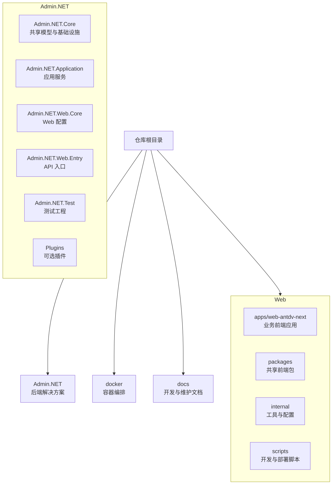
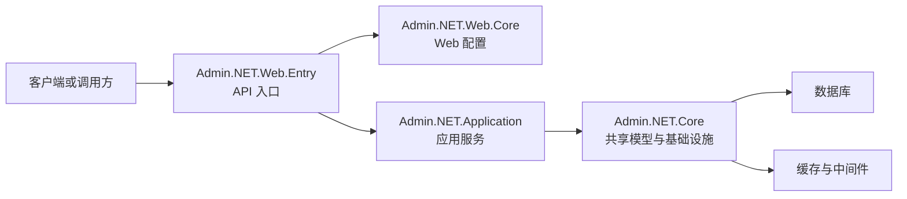
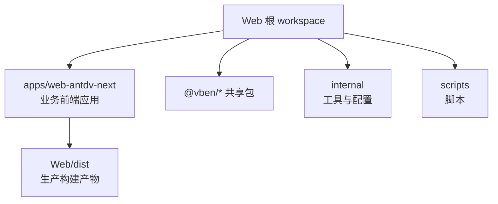

# 项目概述

<cite>
**本文引用的文件**   
- [README.md](file://README.md)
- [Admin.NET.sln](file://Admin.NET/Admin.NET.sln)
- [global.json](file://Admin.NET/global.json)
- [development.md](file://docs/development.md)
- [package.json](file://Web/package.json)
- [web-antdv-next package.json](file://Web/apps/web-antdv-next/package.json)
- [docker-compose.yml](file://docker/docker-compose.yml)
</cite>

## 目录
1. [简介](#简介)
2. [项目结构](#项目结构)
3. [核心能力](#核心能力)
4. [技术栈](#技术栈)
5. [后端架构](#后端架构)
6. [前端架构](#前端架构)
7. [快速开始](#快速开始)
8. [学习与使用路径](#学习与使用路径)
9. [常见问题与注意事项](#常见问题与注意事项)
10. [总结](#总结)

## 简介
Admin.NET 是一个面向企业级场景的通用权限开发框架，核心价值是帮助团队快速搭建具备多租户、RBAC 权限管理、前后端分离、插件扩展和在线构建能力的后台系统。它通过成熟的 .NET 生态与 Vue 前端工程化方案，把用户、角色、菜单、机构、字典、日志、任务调度、文件存储、消息通知等常见后台能力沉淀为可复用基础设施，让开发者聚焦业务功能而不是重复造轮子。

根据仓库说明，当前版本已完成前端移植，业务前端入口为 `Web/apps/web-antdv-next/`；后端以 ASP.NET Core 为基础，结合 Furion 框架和 SqlSugar ORM，提供模块化、可扩展的企业级权限平台。该框架适合以下用户：
- 需要快速落地企业后台系统的 .NET 后端团队。
- 希望使用前后端分离架构进行协作开发的前端团队。
- 需要多租户、RBAC、审计日志、任务调度、代码生成等通用能力的中大型项目。
- 希望基于成熟开源方案进行二次开发和插件扩展的中台或 SaaS 产品团队。

**章节来源**
- [README.md:1-30](file://README.md#L1-L30)

## 项目结构
仓库采用“后端解决方案 + 前端 Monorepo + Docker 配置 + 文档资料”的分层组织方式。



**图表来源**
- [Admin.NET.sln:1-78](file://Admin.NET/Admin.NET.sln#L1-L78)
- [development.md:5-17](file://docs/development.md#L5-L17)

### 后端解决方案
后端位于 `Admin.NET/`，由 `Admin.NET.sln` 统一管理主要工程和插件：
- `Admin.NET.Core`：实体、枚举、常量、扩展、缓存、事件总线、日志、定时任务、签名认证、SqlSugar 封装、种子数据、领域服务等共享基础设施。
- `Admin.NET.Application`：面向业务的应用服务、配置、OpenApi、事件总线等上层抽象。
- `Admin.NET.Web.Core`：Web 层启动配置、选项与处理器。
- `Admin.NET.Web.Entry`：API 入口程序，包含控制器、视图、静态资源、配置文件、Dockerfile 与单文件发布相关实现。
- `Admin.NET.Test`：按功能域组织的测试工程，覆盖租户、角色、用户、插件、更新、模板、性能、集成等场景。
- `Plugins/`：如 ReZero、K3Cloud、WorkWeixin 等可选插件，是否启用取决于实际项目引用和启动注册。

**章节来源**
- [Admin.NET.sln:1-78](file://Admin.NET/Admin.NET.sln#L1-L78)
- [development.md:5-17](file://docs/development.md#L5-L17)

### 前端 Monorepo
前端位于 `Web/`，使用 pnpm workspace 管理业务应用与共享包：
- `apps/web-antdv-next/`：当前业务前端应用，基于 Vite、Vue 3、Vben Admin 和 antdv-next。
- `packages/`：共享前端包，例如类型、常量、请求封装、状态管理、布局、样式、工具等。
- `internal/`：内部工具、ESLint、Prettier、Tailwind、TypeScript、Vite 等统一配置。
- `scripts/`：部署、Turbo 运行器、VSH 工具、依赖清理等辅助脚本。
- `src/`：旧版前端源码目录，不再作为当前开发入口。

**章节来源**
- [development.md:5-17](file://docs/development.md#L5-L17)
- [package.json:1-40](file://Web/package.json#L1-L40)

### Docker 配置
`docker/docker-compose.yml` 提供 Nginx、MySQL、Redis、MinIO、TDengine 以及后端 API 服务的示例编排。其中：
- Nginx 反向代理静态资源。
- MySQL、Redis、MinIO、TDengine 作为典型外部依赖。
- adminNet 服务运行后端 API，并依赖 MySQL 和 Redis。

该 compose 文件是示例环境，不能替代生产部署；数据库连接、缓存、对象存储等凭据应通过安全方式注入。

**章节来源**
- [docker-compose.yml:1-110](file://docker/docker-compose.yml#L1-L110)

## 核心能力
Admin.NET 的定位是“企业级通用权限平台”，其关键能力包括：

| 能力 | 说明 |
|---|---|
| 多租户 | 支持多租户场景，便于 SaaS 或多组织系统隔离数据与权限。 |
| RBAC 权限 | 通过用户、角色、菜单、按钮等维度控制访问范围和数据授权。 |
| 前后端分离 | 后端提供 REST API 和 Swagger/Knife4jUI 文档，前端独立构建部署。 |
| 插件扩展 | 通过 `Plugins/` 和模块化设计扩展业务领域。 |
| 在线构建器 | 拖拽表单元素生成前端代码，提升低代码开发效率。 |
| 代码生成 | 一键生成前后端代码，降低重复开发成本。 |
| 任务调度 | 基于分布式作业调度组件处理定时任务和异步工作。 |
| 审计与监控 | 登录日志、操作日志、异常日志、在线用户、服务监控。 |
| 文件与消息 | 文件上传下载、邮件短信、SignalR 实时通知。 |
| 第三方集成 | 微信、OAuth 2.0、APIJSON、Elasticsearch 日志、限流等。 |

这些能力共同构成一个可快速起步、可横向扩展的企业后台基座。

**章节来源**
- [README.md:1-30](file://README.md#L1-L30)
- [README.md:75-144](file://README.md#L75-L144)

## 技术栈
### 后端技术栈
- 运行时与框架：ASP.NET Core、Furion。
- ORM：SqlSugar。
- 目标框架：共享工程按各 `.csproj` 支持 .NET 8 与 .NET 10；API 入口与测试工程使用 .NET 10。
- 测试：xUnit v3，并通过 `Admin.NET/global.json` 选择 Microsoft.Testing.Platform 作为测试运行器。

注意：`global.json` 当前只声明测试运行器，不固定 .NET SDK 版本；实际目标框架应以各工程的 `.csproj` 为准。

**章节来源**
- [README.md:1-30](file://README.md#L1-L30)
- [Admin.NET/global.json:1-5](file://Admin.NET/global.json#L1-L5)
- [development.md:19-24](file://docs/development.md#L19-L24)

### 前端技术栈
- 运行时与构建：Node.js、pnpm、Vite。
- 前端框架：Vue 3、Vben Admin、antdv-next。
- Monorepo：pnpm workspace，配合 Turbo 和内部工具链。
- Node 与包管理器：Node.js 版本要求为 `^22.18.0 || ^24.12.0`，pnpm 版本锁定在 `pnpm@11.16.0`。

业务前端应用位于 `Web/apps/web-antdv-next/`，根脚本 `pnpm dev`、`pnpm build`、`pnpm lint`、`pnpm check:type` 均指向该应用。

**章节来源**
- [README.md:1-30](file://README.md#L1-L30)
- [package.json:1-40](file://Web/package.json#L1-L40)
- [web-antdv-next package.json:1-35](file://Web/apps/web-antdv-next/package.json#L1-L35)

### 数据库与中间件
- 数据库：PostgreSQL、SQL Server、MySQL、Oracle 等，具体驱动和集成以项目配置为准。
- 缓存与队列：Redis 等中间件可通过配置接入。
- 对象存储：本地存储、阿里云 OSS、腾讯云 COS、MinIO 等。
- 日志：Elasticsearch 日志采集。

仓库明确强调：数据库连接、缓存、OAuth、文件存储等服务需按本机环境配置，且不应将真实密钥写入仓库。

**章节来源**
- [README.md:1-30](file://README.md#L1-L30)
- [development.md:25-34](file://docs/development.md#L25-L34)

## 后端架构
后端采用分层与模块化设计，整体职责如下：



- `Admin.NET.Web.Entry`：暴露 HTTP API、处理请求生命周期、加载配置和静态资源。
- `Admin.NET.Web.Core`：集中 Web 层启动逻辑、选项和处理器。
- `Admin.NET.Application`：承载应用服务、OpenApi、事件总线、配置等上层能力。
- `Admin.NET.Core`：提供实体、枚举、扩展、缓存、事件、日志、任务、签名认证、SqlSugar、种子数据等基础能力。
- `Plugins/`：按业务领域拆分插件，例如 ReZero、K3Cloud、WorkWeixin 等。

**图表来源**
- [Admin.NET.sln:1-40](file://Admin.NET/Admin.NET.sln#L1-L40)
- [development.md:5-17](file://docs/development.md#L5-L17)

**章节来源**
- [Admin.NET.sln:1-78](file://Admin.NET/Admin.NET.sln#L1-L78)
- [development.md:5-17](file://docs/development.md#L5-L17)

## 前端架构
前端采用 Monorepo 结构，业务应用与共享包解耦：



- 业务页面放在 `Web/apps/web-antdv-next/src/views/`。
- 接口封装、授权与路由沿用当前应用结构。
- 共享能力维护在 `Web/packages/`。
- 生产构建产物输出到 `Web/dist/`。

**图表来源**
- [development.md:5-17](file://docs/development.md#L5-L17)
- [package.json:10-35](file://Web/package.json#L10-L35)

**章节来源**
- [development.md:5-17](file://docs/development.md#L5-L17)
- [package.json:10-35](file://Web/package.json#L10-L35)

## 快速开始
### 环境准备
- 安装 .NET 10 SDK。
- 安装 Node.js 版本满足 `^22.18.0 || ^24.12.0`。
- 使用 pnpm@11.16.0。
- 准备独立的 PostgreSQL 或其他目标数据库实例。
- 不要使用生产数据库执行初始化、种子数据或测试清理。

**章节来源**
- [README.md:20-40](file://README.md#L20-L40)
- [development.md:19-34](file://docs/development.md#L19-L34)

### 启动后端
在仓库根目录或 `Admin.NET/` 目录执行：

```powershell
dotnet restore Admin.NET/Admin.NET.sln
dotnet run --project Admin.NET/Admin.NET.Web.Entry/Admin.NET.Web.Entry.csproj
```

首次启动可能创建表结构和种子数据，请确认数据库用途后再运行。

**章节来源**
- [README.md:20-40](file://README.md#L20-L40)
- [development.md:35-50](file://docs/development.md#L35-L50)

### 启动前端
在 `Web/` 目录执行：

```powershell
pnpm install --frozen-lockfile
pnpm dev
```

前端会通过代理访问后端 API。端口、协议与 API 地址应匹配本机环境。

**章节来源**
- [README.md:20-40](file://README.md#L20-L40)
- [development.md:51-64](file://docs/development.md#L51-L64)

### 构建与验证
- 前端生产构建：`pnpm build`，产物输出到 `Web/dist/`。
- 前端代码检查：`pnpm lint`、`pnpm check:type`。
- 单元测试：`pnpm test:unit`。
- 浏览器端到端测试：`pnpm test:e2e`。

注意：`pnpm dev`、`pnpm build`、`pnpm lint`、`pnpm check:type` 面向业务应用 `@vben/web-antdv-next`，不应表述为全 workspace 检查。

**章节来源**
- [README.md:20-40](file://README.md#L20-L40)
- [package.json:10-35](file://Web/package.json#L10-L35)
- [development.md:51-64](file://docs/development.md#L51-L64)

## 学习与使用路径
建议新用户按以下顺序建立学习路径：

1. **理解项目价值**  
   阅读 README，了解 Admin.NET 是多租户、RBAC、前后端分离的企业权限平台，并熟悉内置主控面板、用户管理、角色管理、菜单管理、字典、日志、任务调度、文件管理、代码生成、在线构建器等能力。

2. **运行最小可用版本**  
   先启动后端 API，再启动前端，确认数据库初始化正常、前端能访问后端接口。

3. **定位业务代码位置**  
   - 后端：新增应用服务放在 `Admin.NET.Application` 或独立应用工程，复用 `Admin.NET.Core`。
   - 前端：业务页面放在 `Web/apps/web-antdv-next/src/views/`，共享能力放在 `Web/packages/`。

4. **掌握命令与验证方式**  
   - 后端：`dotnet restore`、`dotnet build`、`dotnet run`、`dotnet test`。
   - 前端：`pnpm dev`、`pnpm build`、`pnpm lint`、`pnpm check:type`、`pnpm test:unit`、`pnpm test:e2e`。

5. **扩展插件与数据库适配**  
   根据业务需要启用 `Plugins/` 中的插件，并按项目配置接入不同数据库和中间件。

6. **进入正式开发流程**  
   修改前阅读仓库规则、前端规则和后端模块旁的 `CLAUDE.md`；变更完成后按开发与验证指南补充测试和验收。

**章节来源**
- [README.md:20-74](file://README.md#L20-L74)
- [development.md:5-34](file://docs/development.md#L5-L34)

## 常见问题与注意事项
- **不要把 SQLite 或 Mock 结果当作真实数据库联调通过的证明。** 真实数据库验收需要使用独立 PostgreSQL，覆盖读写、权限、租户边界和清理操作。
- **不要把临时任务记录、缓存、构建产物或机器绝对路径作为长期知识依据。** 文档和配置应避免记录真实密钥、令牌、连接凭据或个人信息。
- **不要把上游历史界面或旧前端目录当作当前基线。** 当前业务前端是 `Web/apps/web-antdv-next/`，上游演示可能与本分支实现不同。
- **不要把 `Admin.NET/global.json` 解读为固定 .NET SDK 版本。** 它只选择 Microsoft.Testing.Platform 作为测试运行器；目标框架以各 `.csproj` 为准。
- **不要把根脚本描述为全 workspace 检查。** `pnpm dev`、`pnpm build`、`pnpm lint`、`pnpm check:type` 针对业务前端应用。
- **不要把 CLI 帮助可用或构建通过等同于集成测试通过。** 外部服务、浏览器环境和真实数据库都需要单独准备。

**章节来源**
- [README.md:20-40](file://README.md#L20-L40)
- [Admin.NET/global.json:1-5](file://Admin.NET/global.json#L1-L5)
- [development.md:19-64](file://docs/development.md#L19-L64)

## 总结
Admin.NET 是一个以多租户 RBAC 权限为核心、前后端分离、可插件扩展的企业级通用权限开发框架。后端基于 ASP.NET Core、Furion 和 SqlSugar，前端基于 Vue 3、Vben Admin 和 antdv-next，并支持多种数据库与中间件。通过清晰的目录划分、Monorepo 前端工程和可插拔插件体系，它为团队提供了从权限基座、通用后台能力到快速交付的完整起点。

新用户应先从 README 和开发指南入手，先跑通最小可用版本，再逐步理解后端分层、前端 Monorepo、插件机制和在线构建器，最后按照开发与验证规范完成测试、验收和部署。