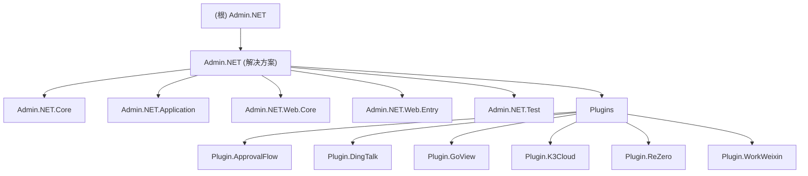

# Admin.NET 项目文档

## 变更记录 (Changelog)

| 日期 | 版本 | 说明 |
|------|------|------|
| 2026-03-01 | 补充扫描 | 补扫 Program.cs、SqlSugarFilter、Utils/、SysUserService、SysTenantService、ApprovalFlowService，覆盖率提升至约 80% |
| 2026-03-01 | 初始扫描 | 自动生成根级文档，覆盖率约 65% |

---

## 项目愿景

Admin.NET 是一个基于 .NET（支持 net8.0 / net10.0 双目标框架）的通用权限管理平台，采用 Furion 框架构建，提供多租户、RBAC 权限、代码生成器、工作流审批、定时任务、即时通讯等开箱即用的企业级能力，支持二次开发扩展。

许可证：MIT + Apache 2.0 双协议。

---

## 架构总览

```
Admin.NET/
├── Admin.NET/                    # 主解决方案目录
│   ├── Admin.NET.Core/           # 核心库：实体、服务、基础设施
│   ├── Admin.NET.Application/    # 应用层：业务扩展、配置、启动
│   ├── Admin.NET.Web.Core/       # Web 核心：中间件、JWT、Startup
│   ├── Admin.NET.Web.Entry/      # 宿主入口：Program.cs、wwwroot
│   ├── Admin.NET.Test/           # 单元/集成测试（xUnit + Selenium）
│   └── Plugins/                  # 插件目录（可热插拔）
│       ├── Admin.NET.Plugin.ApprovalFlow/   # 审批流插件
│       ├── Admin.NET.Plugin.DingTalk/       # 钉钉集成插件
│       ├── Admin.NET.Plugin.GoView/         # GoView 大屏插件
│       ├── Admin.NET.Plugin.K3Cloud/        # 金蝶K3Cloud集成插件
│       ├── Admin.NET.Plugin.ReZero/         # ReZero 超级API插件
│       └── Admin.NET.Plugin.WorkWeixin/     # 企业微信插件
```

技术栈：
- 框架：Furion 4.9.7（基于 ASP.NET Core）
- ORM：SqlSugar 5.1.4（支持 SQLite / MySQL / PostgreSQL / SQL Server / Oracle / MongoDB 等）
- 认证：JWT Bearer + Signature 双模式
- 缓存：内存缓存 / Redis（NewLife.Redis）
- 消息队列：内存事件总线 / Redis / RabbitMQ（可切换）
- 实时通讯：SignalR（支持 Redis 背板）
- 搜索：ElasticSearch（Elastic.Clients.Elasticsearch 9.x）
- 文件存储：本地 / OSS / SSH 多提供商
- 定时任务：Furion Schedule（支持集群、持久化）
- 加密：国密 SM2/SM4 + MD5 可配置
- 文档：Swagger + Knife4jUI
- 多语言：ASP.NET Core Localization（zh-CN / en）

---

## 模块结构图



---

## 模块索引

| 模块路径 | 语言 | 职责一句话 | 文档状态 |
|----------|------|-----------|----------|
| `Admin.NET/Admin.NET.Core` | C# | 核心基础库：实体模型、所有系统服务、基础设施（缓存/ORM/SignalR/ES） | 已补扫 |
| `Admin.NET/Admin.NET.Application` | C# | 应用扩展层：业务配置、自定义启动、OpenAPI 示例 | 初始 |
| `Admin.NET/Admin.NET.Web.Core` | C# | Web 宿主核心：DI 注册、中间件管道、JWT 处理器 | 初始 |
| `Admin.NET/Admin.NET.Web.Entry` | C# | 程序入口：Kestrel 配置、日志过滤、静态资源 | 已补扫 |
| `Admin.NET/Admin.NET.Test` | C# | 测试项目：xUnit 单元测试 + Selenium UI 测试 | 初始 |
| `Admin.NET/Plugins/Admin.NET.Plugin.ApprovalFlow` | C# | 审批流插件：流程定义、审批记录、表单管理 | 已补扫 |
| `Admin.NET/Plugins/Admin.NET.Plugin.DingTalk` | C# | 钉钉集成：部门/用户同步、工作流、消息推送 | 初始 |
| `Admin.NET/Plugins/Admin.NET.Plugin.GoView` | C# | GoView 大屏：项目管理、数据源、OSS 存储 | 初始 |
| `Admin.NET/Plugins/Admin.NET.Plugin.K3Cloud` | C# | 金蝶K3Cloud：ERP 数据推送集成 | 初始 |
| `Admin.NET/Plugins/Admin.NET.Plugin.ReZero` | C# | ReZero 超级API：动态 API 生成与 AOP 拦截 | 初始 |
| `Admin.NET/Plugins/Admin.NET.Plugin.WorkWeixin` | C# | 企业微信：部门/标签/应用消息/OAuth 集成 | 初始 |

---

## 运行与开发

### 前置条件

- .NET SDK 8.0 或 10.0
- 数据库（默认 SQLite，无需额外安装；生产推荐 PostgreSQL）
- Redis（可选，用于分布式缓存/消息队列/SignalR 背板）

### 快速启动

```bash
# 克隆仓库
git clone <repo-url>
cd Admin.NET

# 还原依赖
dotnet restore Admin.NET/Admin.NET.sln

# 修改数据库配置（默认 SQLite 开箱即用）
# 配置文件：Admin.NET/Admin.NET.Application/Configuration/Database.json

# 启动（默认端口 5005）
dotnet run --project Admin.NET/Admin.NET.Web.Entry
```

### 访问地址

| 地址 | 说明 |
|------|------|
| `http://localhost:5005` | 主应用 |
| `http://localhost:5005/index.html` | Swagger UI |
| `http://localhost:5005/kapi` | Knife4jUI |
| `http://localhost:5005/schedule` | 定时任务看板 |

### 默认账号

- 用户名：`superadmin`
- 密码：`123456`

### Docker

```bash
docker build -f Admin.NET/.dockerignore -t adminnet .
```

### 配置文件说明（Admin.NET.Application/Configuration/）

| 文件 | 说明 |
|------|------|
| `App.json` | 应用基础配置（端口、雪花ID、加密算法、多语言） |
| `Database.json` | 数据库连接（支持多库、读写分离） |
| `JWT.json` | JWT 令牌配置 |
| `Cache.json` | 缓存类型（Memory / Redis） |
| `Upload.json` | 文件上传配置 |
| `Email.json` | 邮件服务配置 |
| `SMS.json` | 短信服务配置（阿里云/腾讯云） |
| `OAuth.json` | 第三方 OAuth 配置（微信/Gitee） |
| `Wechat.json` | 微信公众号/小程序配置 |
| `ElasticSearch.json` | ES 集群配置 |
| `CodeGen.json` | 代码生成器配置 |
| `EventBus.json` | 事件总线/RabbitMQ 配置 |

---

## 测试策略

- 框架：xUnit + Furion.Xunit
- UI 测试：Selenium WebDriver（MSEdge）
- 测试项目：`Admin.NET/Admin.NET.Test`
- 测试文件：`User/UserTest.cs`、`Utils/DateTimeUtilTests.cs`、`Utils/SafeMathTests.cs`
- 运行测试：`dotnet test Admin.NET/Admin.NET.Test`

> 当前测试覆盖率较低，主要覆盖工具类和用户基础操作，业务服务层缺乏测试。

---

## 编码规范

- 目标框架：`net8.0;net10.0` 双目标
- Nullable：Core 层关闭（`<Nullable>disable</Nullable>`）
- 命名：服务类以 `Sys` 前缀 + 业务名 + `Service` 结尾
- 实体继承：根据需要选择 `EntityBase` / `EntityBaseDel` / `EntityBaseTenant` / `EntityBaseTenantOrg` 等基类
- 路由：小驼峰命名（`AsLowerCamelCase: true`），不切割驼峰
- 异常：统一使用 `Oops.Oh(ErrorCodeEnum.xxx)` 抛出业务异常
- 事务：使用 `[UnitOfWork]` 特性或 `SqlSugarUnitOfWork`
- 雪花ID：全局使用 `YitIdHelper.NextId()` 生成主键
- 密码加密：默认 SM2 非对称加密传输，存储支持 SM4 / MD5 可配置
- 数据权限：通过 `IOrgIdFilter` / `ITenantIdFilter` 接口 + SqlSugar 全局过滤器实现

---

## AI 使用指引

在使用 AI 辅助开发本项目时，请注意：

1. **新增业务实体**：继承合适的 `EntityBase*` 基类，添加 `[SugarTable]` 和 `[SysTable]` 特性
2. **新增服务**：实现 `IDynamicApiController, ITransient`，服务会自动注册为 API 端点
3. **新增插件**：在 `Plugins/` 目录下创建新项目，实现 `AppStartup`，在 `Admin.NET.Application.csproj` 中添加引用
4. **数据权限**：业务实体若需要租户隔离，继承 `EntityBaseTenant*`；若需要机构数据权限，继承 `EntityBaseOrg*`
5. **缓存键**：统一在 `CacheConst` 中定义缓存键常量
6. **配置读取**：使用 `App.GetConfig<T>("Section", true)` 或 `App.GetOptions<T>()` 读取配置
7. **不要修改** `EntityBase.cs`、`SqlSugarSetup.cs`、`JwtHandler.cs` 等基础设施文件，除非明确了解影响范围
